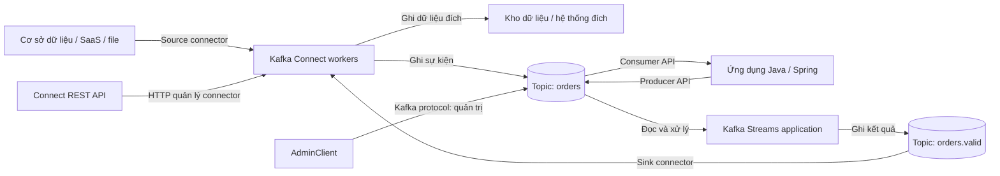

# Các API chính và vị trí của Connect, Streams trong hệ sinh thái

Apache Kafka cung cấp nhiều API để ứng dụng ghi, đọc, quản trị và xử lý luồng sự kiện. Bên cạnh các API client cốt lõi, Kafka còn có hai thành phần thường được dùng trong kiến trúc dữ liệu là **Kafka Connect** và **Kafka Streams**. Chúng cùng làm việc với topic nhưng giải quyết những bài toán khác nhau: Connect đưa dữ liệu giữa Kafka và các hệ thống bên ngoài; Streams xử lý, kết hợp và tổng hợp dữ liệu đang chạy trong Kafka.

Hiểu ranh giới giữa các thành phần giúp chọn đúng công cụ khi xây dựng hệ thống Java/Spring: dùng Producer và Consumer cho luồng trao đổi sự kiện giữa các dịch vụ, dùng Streams cho xử lý dữ liệu theo thời gian thực, dùng Connect cho tích hợp nguồn và đích dữ liệu, và dùng Admin API để tự động hóa quản trị cluster.

## 1. Bản đồ API trong hệ sinh thái Kafka

Kafka có thể được nhìn qua hai lớp:

- **Lớp giao tiếp với broker:** các Kafka client gửi yêu cầu qua Kafka wire protocol. Producer, Consumer, AdminClient và Kafka Streams sử dụng lớp giao tiếp này để làm việc với cluster.
- **Lớp tích hợp và vận hành:** Kafka Connect chạy trong các worker riêng, cung cấp REST API để quản lý connector. Bản thân connector lại dùng Kafka client để đọc hoặc ghi topic.

Ở phía cluster, KRaft quản lý metadata và controller quorum của Kafka. Đây là cơ chế nội bộ để vận hành metadata của cluster, không phải API mà service gọi để gửi event. Ứng dụng vẫn bootstrap qua địa chỉ broker và sử dụng Producer, Consumer, Admin hoặc Streams API; các thao tác quản trị được client gửi qua Kafka protocol.

Sơ đồ dưới đây thể hiện vị trí của các thành phần trong một luồng dữ liệu điển hình:



Trong sơ đồ, topic là nơi lưu trữ và phân phối sự kiện. Producer, Consumer, Streams và Connect đều có thể tương tác với topic, nhưng mục đích và cách vận hành của chúng khác nhau. Connect REST API chỉ điều khiển worker và connector; nó không phải API mặc định để ứng dụng gửi hoặc nhận từng message từ broker.

## 2. Các Kafka client API cốt lõi

### Producer API — ghi sự kiện

Producer API cho phép ứng dụng tạo `ProducerRecord` và gửi record đến một topic. Một record có thể gồm topic, key, value, timestamp, partition chỉ định và headers. Ứng dụng thường dùng key để xác định partition đích. Với partitioner mặc định, các record có cùng key thường được đưa vào cùng partition, nhờ đó giữ được thứ tự của chúng trong partition đó.

`send()` hoạt động bất đồng bộ và trả về một `Future<RecordMetadata>`. Ứng dụng có thể nhận kết quả qua callback thay vì chặn luồng xử lý để chờ từng lần gửi. Metadata trả về cho biết topic, partition và offset mà broker đã ghi nhận.

Ví dụ Java gửi một sự kiện đơn giản:

```java
Properties props = new Properties();
props.put(ProducerConfig.BOOTSTRAP_SERVERS_CONFIG, "localhost:9092");
props.put(ProducerConfig.KEY_SERIALIZER_CLASS_CONFIG,
        StringSerializer.class.getName());
props.put(ProducerConfig.VALUE_SERIALIZER_CLASS_CONFIG,
        StringSerializer.class.getName());
props.put(ProducerConfig.ACKS_CONFIG, "all");
props.put(ProducerConfig.ENABLE_IDEMPOTENCE_CONFIG, "true");

try (KafkaProducer<String, String> producer =
        new KafkaProducer<>(props)) {
    ProducerRecord<String, String> record = new ProducerRecord<>(
            "orders",
            "order-123",
            "{\"status\":\"CREATED\"}");

    producer.send(record, (metadata, exception) -> {
        if (exception != null) {
            // Ghi log và chuyển lỗi vào cơ chế xử lý phù hợp.
            exception.printStackTrace();
            return;
        }

        System.out.printf("topic=%s partition=%d offset=%d%n",
                metadata.topic(), metadata.partition(), metadata.offset());
    });
}
```

Ví dụ đặt `acks=all` để yêu cầu các replica đang nằm trong tập ISR xác nhận việc ghi, đồng thời bật idempotence để giảm nguy cơ ghi trùng do retry của producer. Độ bền thực tế còn phụ thuộc cấu hình replication và `min.insync.replicas` của topic/cluster. Idempotence của producer cũng không tự làm cho toàn bộ nghiệp vụ bên ngoài Kafka trở nên idempotent.

Khi thiết kế producer, cần xác định rõ:

- **Key:** chọn key theo thực thể cần giữ thứ tự, chẳng hạn `orderId` hoặc `accountId`. Key phân phối không đều có thể tạo partition nóng.
- **Acknowledgement và retry:** cân bằng giữa độ bền, độ trễ và khả năng tiếp tục ghi khi replica gặp sự cố.
- **Serialization:** serializer của key/value phải tương thích với định dạng mà consumer mong đợi. Trong hệ thống lớn, nên quản lý schema và khả năng tương thích thay vì tự thay đổi cấu trúc JSON tùy ý.
- **Callback và lỗi:** phân biệt lỗi có thể retry, lỗi dữ liệu không hợp lệ và lỗi cấu hình; tránh bỏ qua exception trong callback.

### Consumer API — đọc và xử lý sự kiện

Consumer API cho phép ứng dụng subscribe một hoặc nhiều topic, nhận record qua `poll()` và quản lý offset. Khi nhiều consumer dùng chung một `group.id`, Kafka phân chia các partition của topic cho các thành viên trong group. Tại một thời điểm, một partition chỉ được giao cho tối đa một consumer trong cùng group. Các group khác nhau có thể đọc độc lập cùng một topic.

Ví dụ consumer tắt auto commit và chỉ commit sau khi xử lý xong một batch:

```java
Properties props = new Properties();
props.put(ConsumerConfig.BOOTSTRAP_SERVERS_CONFIG, "localhost:9092");
props.put(ConsumerConfig.GROUP_ID_CONFIG, "order-service");
props.put(ConsumerConfig.KEY_DESERIALIZER_CLASS_CONFIG,
        StringDeserializer.class.getName());
props.put(ConsumerConfig.VALUE_DESERIALIZER_CLASS_CONFIG,
        StringDeserializer.class.getName());
props.put(ConsumerConfig.ENABLE_AUTO_COMMIT_CONFIG, "false");
props.put(ConsumerConfig.AUTO_OFFSET_RESET_CONFIG, "earliest");

try (KafkaConsumer<String, String> consumer = new KafkaConsumer<>(props)) {
    consumer.subscribe(List.of("orders"));

    while (!Thread.currentThread().isInterrupted()) {
        ConsumerRecords<String, String> records =
                consumer.poll(Duration.ofMillis(500));

        for (ConsumerRecord<String, String> record : records) {
            // Thực hiện nghiệp vụ; chỉ xem là thành công khi xử lý hoàn tất.
            processOrder(record.key(), record.value());
        }

        if (!records.isEmpty()) {
            consumer.commitSync();
        }
    }
}
```

Đây là ví dụ minh họa; `processOrder` đại diện cho logic của ứng dụng. Nếu xử lý thất bại trước khi commit, batch có thể được đọc lại. Nếu ứng dụng xử lý thành công nhưng dừng trước khi commit, record cũng có thể được phát lại. Vì vậy mô hình phổ biến là **at-least-once** kết hợp với xử lý idempotent ở phía consumer. Nếu commit trước khi xử lý hoàn tất, ứng dụng có thể mất khả năng đọc lại record khi gặp lỗi.

Một số khái niệm cần phân biệt:

- **Offset:** vị trí của record trong một partition. Offset không phải số thứ tự toàn cục cho cả topic.
- **Committed offset:** vị trí mà consumer group đã lưu để tiếp tục đọc sau khi khởi động lại hoặc rebalance.
- **`auto.offset.reset`:** chỉ được dùng khi group chưa có committed offset hợp lệ cho partition. Đặt `earliest` không tự động tua lại một group đang có offset đã commit.
- **`subscribe()` và `assign()`:** `subscribe()` tham gia cơ chế quản lý group và rebalance; `assign()` cho phép ứng dụng tự chỉ định partition và tự chịu trách nhiệm về phân phối.
- **`poll()`:** vừa lấy dữ liệu vừa duy trì tiến trình tham gia group. Xử lý một batch quá lâu có thể vượt `max.poll.interval.ms` và làm consumer bị loại khỏi group.

Số consumer đang hoạt động trong một group không thể khai thác song song vượt quá số partition được gán cho group. Muốn tăng năng lực xử lý, cần xem xét đồng thời số partition, thời gian xử lý mỗi record và khả năng cân bằng tải.

### Admin API — quản trị metadata và tài nguyên

Admin API, thường được sử dụng qua `AdminClient`, phục vụ các thao tác quản trị cluster: tạo hoặc xóa topic, mô tả topic và cluster, thay đổi cấu hình, xem consumer group và quản lý ACL ở những phiên bản hỗ trợ tương ứng. API này không thay thế Producer hoặc Consumer để truyền dữ liệu nghiệp vụ.

Ví dụ tạo topic có sáu partition và replication factor bằng ba:

```java
Properties props = new Properties();
props.put(AdminClientConfig.BOOTSTRAP_SERVERS_CONFIG, "localhost:9092");

try (AdminClient admin = AdminClient.create(props)) {
    NewTopic orders = new NewTopic("orders", 6, (short) 3);
    admin.createTopics(List.of(orders)).all().get();
}
```

Cluster cần có đủ broker để đáp ứng replication factor đã chọn. Trong ứng dụng thực tế, nên xử lý các trường hợp topic đã tồn tại, timeout, lỗi quyền truy cập và lỗi một phần khi thao tác trên nhiều tài nguyên. Các phương thức Admin thường trả về kết quả bất đồng bộ; gọi `get()` trong ví dụ chỉ để làm rõ thời điểm chờ thao tác hoàn tất.

## 3. Spring Kafka nằm ở đâu?

Spring Kafka là lớp tích hợp Kafka cho ứng dụng Spring. Nó cung cấp các abstraction quen thuộc để cấu hình và vận hành producer, consumer và admin trong Spring container:

| Thành phần Spring Kafka | API Kafka nền tảng | Vai trò |
|---|---|---|
| `KafkaTemplate` | Producer | Gửi record từ service hoặc component Spring |
| `@KafkaListener` và listener container | Consumer | Nhận record, quản lý vòng đời listener và container |
| `KafkaAdmin` | AdminClient | Khai báo hoặc quản lý tài nguyên Kafka từ ứng dụng |
| Hỗ trợ transaction và error handler | Producer/Consumer và cơ chế container | Tích hợp xử lý lỗi, retry và giao dịch với ứng dụng Spring |

Ví dụ, service có thể dùng `KafkaTemplate` để gửi sự kiện, còn một listener dùng `@KafkaListener` để nhận sự kiện thuộc consumer group. Các abstraction này giúp tích hợp dependency injection, cấu hình, lifecycle và xử lý lỗi theo cách của Spring. Tuy nhiên, những khái niệm Kafka như topic, partition, key, offset, group, commit và rebalance vẫn áp dụng như cũ.

Vì vậy, khi đọc log hoặc điều tra lỗi production, cần hiểu API Kafka nền tảng phía dưới abstraction. Ví dụ, lỗi listener có thể liên quan đến deserialization, commit offset, rebalance hoặc thời gian xử lý; chỉ nhìn vào annotation sẽ chưa đủ để xác định nguyên nhân.

## 4. Kafka Streams API — xử lý dữ liệu trong luồng

Kafka Streams là thư viện xử lý stream cho ứng dụng Java. Ứng dụng nhúng thư viện này trong tiến trình của mình, khai báo một **topology** gồm các nguồn đọc, bước xử lý và đích ghi. Kafka Streams sử dụng các Kafka client bên dưới để đọc input topic và ghi output topic, đồng thời quản lý việc phân chia công việc theo partition.

Kafka Streams phù hợp khi cần biến đổi dữ liệu liên tục, lọc sự kiện, chuẩn hóa, kết hợp nhiều luồng, đếm hoặc tổng hợp theo cửa sổ thời gian. Hai cách xây dựng topology chính là:

- **DSL (Domain Specific Language):** API mức cao với các thao tác như `filter`, `map`, `groupByKey`, `aggregate`, `join`, `windowedBy` và `to`. Đây thường là điểm bắt đầu phù hợp cho phần lớn pipeline.
- **Processor API:** API mức thấp hơn, cho phép kiểm soát luồng xử lý và tương tác với state store khi DSL không diễn đạt đủ rõ nghiệp vụ.

Ví dụ một topology đọc topic `orders`, loại record rỗng và ghi record hợp lệ sang topic khác:

```java
Properties props = new Properties();
props.put(StreamsConfig.APPLICATION_ID_CONFIG, "order-validation");
props.put(StreamsConfig.BOOTSTRAP_SERVERS_CONFIG, "localhost:9092");
props.put(StreamsConfig.DEFAULT_KEY_SERDE_CLASS_CONFIG,
        Serdes.StringSerde.class.getName());
props.put(StreamsConfig.DEFAULT_VALUE_SERDE_CLASS_CONFIG,
        Serdes.StringSerde.class.getName());

StreamsBuilder builder = new StreamsBuilder();
KStream<String, String> orders = builder.stream("orders");

orders.filter((orderId, event) -> event != null)
      .to("orders.valid");

KafkaStreams streams = new KafkaStreams(builder.build(), props);
streams.start();
Runtime.getRuntime().addShutdownHook(new Thread(streams::close));
```

Đoạn mã chỉ minh họa cấu trúc topology. Một pipeline nghiệp vụ thực tế cần deserialize event thành kiểu dữ liệu phù hợp, kiểm tra schema và quy tắc nghiệp vụ, rồi xác định rõ cách xử lý record lỗi.

### Xử lý có trạng thái và khả năng mở rộng

Với các phép tính như đếm đơn hàng theo khách hàng, tổng doanh thu theo cửa sổ thời gian hoặc join đơn hàng với trạng thái khách hàng, Streams cần lưu trạng thái. **State store** có thể giữ dữ liệu cục bộ trên instance; Kafka Streams có thể tạo changelog topic để phục hồi trạng thái khi task được chuyển sang instance khác. Một số thao tác đổi key hoặc join cũng có thể cần repartition topic để đưa các record cùng key về đúng partition.

`application.id` định danh một ứng dụng Streams logic và được dùng trong cơ chế consumer group cũng như tên các tài nguyên nội bộ. Các instance chạy cùng một topology cần dùng cùng `application.id` để chia sẻ workload; những ứng dụng logic độc lập cần ID riêng.

Khả năng song song của Streams gắn với partition của input topic. Một topology không thể tạo thêm mức song song hữu ích vượt quá số task mà partition đầu vào cho phép. Khi join hoặc aggregate, key và partitioning phải tương thích để dữ liệu liên quan được xử lý cùng nơi.

Kafka Streams hỗ trợ xử lý theo thời gian sự kiện, window, join, state store và cơ chế phục hồi. Có thể cấu hình `processing.guarantee=exactly_once_v2` khi cần bảo đảm exactly-once cho các thao tác Kafka nằm trong phạm vi mà Streams quản lý. Nếu nghiệp vụ còn gọi API thanh toán, gửi email hoặc ghi vào hệ thống ngoài Kafka, các side effect đó vẫn cần cơ chế idempotency hoặc phối hợp giao dịch riêng.

## 5. Kafka Connect — tích hợp Kafka với hệ thống bên ngoài

Kafka Connect là framework và runtime để chuyển dữ liệu giữa Kafka với các hệ thống khác. Ví dụ, Source Connector có thể đọc thay đổi từ cơ sở dữ liệu và đưa chúng vào topic; Sink Connector có thể đọc topic rồi ghi sang data warehouse, object storage hoặc hệ thống tìm kiếm.

Connect tách phần tích hợp thành các thành phần:

- **Worker:** tiến trình chạy connector và task. Có thể chạy standalone cho thử nghiệm hoặc distributed để phân phối task trên nhiều worker.
- **Connector:** mô tả nguồn hoặc đích dữ liệu, kiểm tra cấu hình và quyết định các task cần chạy.
- **Task:** đơn vị thực thi công việc đọc từ nguồn hoặc ghi vào đích. `tasks.max` đặt giới hạn trên; số task thực tế còn phụ thuộc connector và khả năng chia nhỏ nguồn dữ liệu.
- **Converter:** chuyển đổi key/value giữa định dạng trên Kafka và biểu diễn mà connector sử dụng, chẳng hạn JSON hoặc Avro tùy cấu hình và plugin.
- **Single Message Transform (SMT):** thực hiện biến đổi đơn giản trên từng record, ví dụ đổi tên field, thêm field hoặc định tuyến topic.

### Source và Sink Connector

**Source Connector** đọc dữ liệu từ hệ thống ngoài và phát record vào Kafka. Connector cần theo dõi tiến độ đọc của nguồn để có thể tiếp tục sau khi worker khởi động lại. Với nguồn cơ sở dữ liệu, cách lấy dữ liệu có thể là polling, đọc log thay đổi (CDC) hoặc cơ chế riêng của plugin.

**Sink Connector** đọc record từ Kafka và ghi sang hệ thống đích. Việc ghi thành công, retry, xử lý record lỗi và commit offset phụ thuộc vào connector cùng cấu hình của nó. Không nên mặc định mọi connector đều có cùng semantics hoặc cùng khả năng bảo đảm exactly-once đối với hệ thống đích.

Connect có thể chạy ở hai chế độ phổ biến:

| Chế độ | Đặc điểm | Trường hợp sử dụng |
|---|---|---|
| Standalone | Một worker quản lý cấu hình và task trong một tiến trình; thường lưu offset theo cấu hình local | Phát triển, thử nghiệm hoặc pipeline nhỏ |
| Distributed | Nhiều worker phối hợp, phân phối task và lưu cấu hình/trạng thái/offset trong các topic nội bộ của Kafka | Môi trường cần khả năng mở rộng và phục hồi worker |

Trong distributed mode, các worker thuộc cùng Connect cluster phải dùng cấu hình phù hợp và truy cập được các topic nội bộ. Cần thiết kế replication, quyền truy cập và dung lượng cho các topic này như một phần của vận hành Connect.

### Connect REST API — quản lý connector

Connect worker cung cấp REST API qua HTTP để tạo, xem, cập nhật, tạm dừng, khởi động lại và xóa connector. Đây là API điều khiển vòng đời connector, tách biệt với Kafka wire protocol mà producer và consumer dùng để trao đổi record.

Một số endpoint thường dùng:

| Endpoint | Mục đích |
|---|---|
| `GET /connectors` | Liệt kê connector |
| `POST /connectors` | Tạo connector mới cùng cấu hình |
| `GET /connectors/{name}` | Xem cấu hình connector |
| `GET /connectors/{name}/status` | Xem trạng thái connector và task |
| `PUT /connectors/{name}/config` | Cập nhật cấu hình connector |
| `DELETE /connectors/{name}` | Xóa connector |
| `GET /connector-plugins` | Liệt kê plugin connector mà worker nhận diện được |

Ví dụ tạo connector qua REST API (giá trị `connector.class` và các thuộc tính còn lại phải thay bằng cấu hình của plugin đã cài):

```bash
curl -X POST http://localhost:8083/connectors \
  -H 'Content-Type: application/json' \
  -d '{
    "name": "orders-source",
    "config": {
      "connector.class": "com.example.OrdersSourceConnector",
      "tasks.max": "2",
      "topic.prefix": "orders"
    }
  }'
```

REST API thường được expose trên cổng cấu hình của worker; `8083` là cổng mặc định thường gặp trong các bản phân phối Kafka Connect. Trong môi trường thật, cần bảo vệ endpoint bằng mạng nội bộ, xác thực và phân quyền phù hợp. Không đưa thông tin đăng nhập nguồn dữ liệu vào log hoặc repository.

### API dành cho người phát triển connector

Khi không có plugin phù hợp, có thể viết connector riêng bằng Connect API. Connector nguồn thường triển khai các lớp như `SourceConnector` và `SourceTask`; connector đích triển khai `SinkConnector` và `SinkTask`. Connector chịu trách nhiệm chuyển đổi giao thức của hệ thống ngoài thành record Kafka hoặc ngược lại, đồng thời phối hợp với cơ chế lưu offset của Connect.

Với đa số đội phát triển ứng dụng, nên ưu tiên connector có sẵn và cấu hình vận hành. Chỉ viết connector riêng khi giao thức nguồn/đích hoặc yêu cầu kiểm soát tiến độ không được đáp ứng bởi plugin hiện có.

## 6. Phân biệt Kafka Connect và Kafka Streams

Connect và Streams đều có thể đọc/ghi topic, nhưng được thiết kế cho hai nhóm trách nhiệm khác nhau:

| Tiêu chí | Kafka Connect | Kafka Streams |
|---|---|---|
| Mục tiêu | Kết nối Kafka với nguồn và đích dữ liệu | Xử lý và biến đổi các luồng sự kiện |
| Cách xây dựng | Cài plugin, khai báo và quản lý cấu hình connector | Viết topology trong ứng dụng Java |
| Đơn vị chạy | Worker và connector task | Instance và stream task trong ứng dụng |
| Xử lý dữ liệu | Di chuyển dữ liệu; SMT phù hợp với biến đổi đơn giản trên từng record | Filter, map, join, aggregate, window và xử lý có trạng thái |
| Vận hành | Connect REST API quản lý connector và task | Ứng dụng quản lý lifecycle của `KafkaStreams` |
| Ví dụ | Đồng bộ bảng đơn hàng từ DB vào topic; đẩy topic sang kho dữ liệu | Tính tổng đơn hàng theo khách hàng trong mỗi cửa sổ 5 phút |

Một quy tắc lựa chọn thực tế:

- Nếu câu hỏi là **“làm sao đưa dữ liệu từ hệ thống A vào Kafka hoặc từ Kafka sang hệ thống B?”**, hãy xem Kafka Connect trước.
- Nếu câu hỏi là **“làm sao tính toán, kết hợp hoặc tạo ra sự kiện mới từ các event đang chạy?”**, hãy xem Kafka Streams.
- Nếu câu hỏi là **“làm sao một service Java phát hoặc nhận sự kiện để thực hiện nghiệp vụ?”**, hãy dùng Producer/Consumer API hoặc Spring Kafka.
- Nếu câu hỏi là **“làm sao tạo topic, kiểm tra cấu hình hay quản lý metadata?”**, hãy dùng Admin API.

SMT có thể thực hiện một số biến đổi đơn giản trong Connect, nhưng không nên biến cấu hình connector thành nơi chứa logic nghiệp vụ phức tạp. Ngược lại, không cần viết một ứng dụng Streams chỉ để sao chép dữ liệu nguyên trạng từ một cơ sở dữ liệu vào Kafka nếu một Source Connector phù hợp đã đáp ứng yêu cầu.

## 7. Kết hợp các API trong một kiến trúc thực tế

Giả sử hệ thống thương mại điện tử cần đồng bộ đơn hàng từ cơ sở dữ liệu, kiểm tra và phân loại sự kiện, sau đó cung cấp dữ liệu cho dịch vụ khác và kho phân tích. Một luồng có thể được tổ chức như sau:

1. **Connect Source** đọc thay đổi đơn hàng từ cơ sở dữ liệu và ghi vào topic `orders.raw`.
2. **Kafka Streams** đọc `orders.raw`, kiểm tra cấu trúc và quy tắc nghiệp vụ, rồi ghi sự kiện hợp lệ vào `orders.valid`; sự kiện không hợp lệ có thể được định tuyến sang topic riêng để điều tra.
3. **Consumer service** dùng Spring Kafka đọc `orders.valid` để cập nhật trạng thái đơn hàng hoặc phát lệnh cho một bước nghiệp vụ tiếp theo.
4. **Connect Sink** đọc `orders.valid` và chuyển dữ liệu sang kho phân tích.
5. **AdminClient hoặc công cụ quản trị** tạo topic, kiểm tra cấu hình và giám sát metadata theo quy trình triển khai.

Trong kiến trúc này, mỗi thành phần có ranh giới rõ ràng. Connect đảm nhiệm kết nối và di chuyển dữ liệu; Streams thực hiện phép biến đổi trên luồng; Consumer service thực thi nghiệp vụ của ứng dụng; Admin API phục vụ quản trị. Có thể thay đổi một connector hoặc mở rộng số instance Streams mà không cần biến toàn bộ pipeline thành một ứng dụng đơn khối.

## 8. Các quyết định cần thống nhất giữa các API

Dù chọn API nào, một số quyết định vẫn phải nhất quán trên toàn pipeline:

**Key và thứ tự.** Kafka bảo đảm thứ tự trong từng partition. Nếu cần giữ thứ tự theo đơn hàng hoặc tài khoản, các producer phải dùng key ổn định và các bước xử lý không được làm mất quan hệ partition cần thiết. Không có thứ tự tổng thể giữa nhiều partition.

**Schema và serialization.** Producer, Consumer, Streams và Connect phải thống nhất cách mã hóa key/value. Thay đổi schema cần có quy tắc tương thích để các consumer cũ và mới cùng hoạt động trong giai đoạn triển khai.

**Retry và dữ liệu lỗi.** Retry phù hợp với lỗi tạm thời như timeout hoặc dịch vụ đích chưa sẵn sàng. Dữ liệu sai schema hoặc vi phạm quy tắc nghiệp vụ cần được cách ly, ghi nhận nguyên nhân và có quy trình xử lý lại. Retry vô hạn một record lỗi có thể chặn tiến độ của partition hoặc task.

**Offset và side effect.** Commit offset quá sớm có thể làm mất record khỏi góc nhìn của consumer; commit quá muộn có thể khiến record được xử lý lại. Khi ghi kết quả trở lại Kafka, producer transaction và `sendOffsetsToTransaction` có thể phối hợp output với offset đầu vào. Khi side effect nằm ngoài Kafka, cần thiết kế idempotency, outbox/inbox hoặc cơ chế đối soát tương ứng.

**Quan sát và vận hành.** Theo dõi consumer lag, tốc độ vào/ra, lỗi gửi và nhận, rebalance, trạng thái connector/task, thời gian xử lý, dung lượng disk và sức khỏe broker. Với Connect, cần quan sát cả worker lẫn từng task; với Streams, cần theo dõi trạng thái instance, task, state store và các topic nội bộ.

Khi đã xác định đúng ranh giới trách nhiệm, có thể ghép các API thành pipeline phù hợp: client API cho tương tác của service, Streams cho tính toán trên event, Connect cho tích hợp dữ liệu và Admin API cho quản trị cluster.
