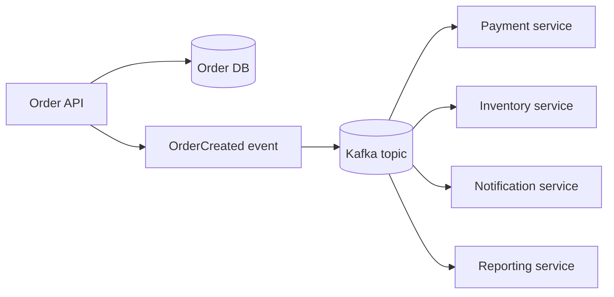
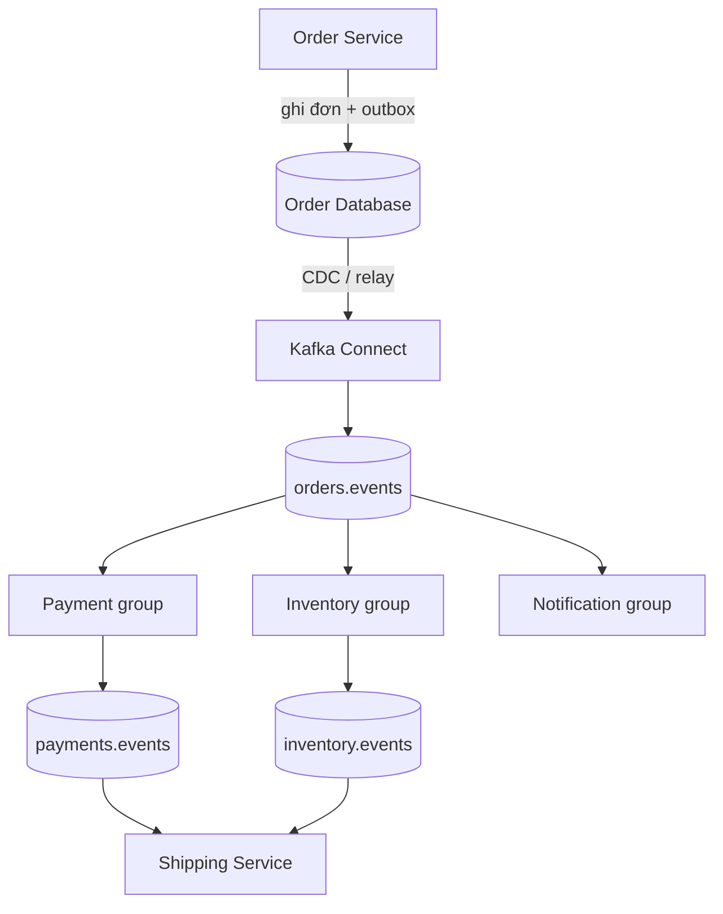

# Lộ trình thực hành từ một bản ghi đến hệ thống nhiều dịch vụ

Apache Kafka là nền tảng event streaming dùng để ghi nhận, lưu trữ và phân phối các sự kiện giữa những thành phần trong một hệ thống. Kafka phù hợp khi một hành động nghiệp vụ cần được nhiều dịch vụ quan sát, khi lưu lượng tăng theo thời gian hoặc khi bên nhận cần xử lý độc lập với bên phát.

Ta sẽ đi từ một bản ghi đơn giản, lần lượt thêm producer, consumer, partition, consumer group, khả năng chịu lỗi và các dịch vụ xử lý phía sau. Trên hành trình đó, các khái niệm topic, offset, replication, KRaft, retry, ordering, transaction, Kafka Connect và Kafka Streams sẽ gắn với một tình huống cụ thể thay vì chỉ xuất hiện như danh sách thuật ngữ.

## 1. Bắt đầu từ một sự kiện nghiệp vụ

Giả sử một cửa hàng có API tạo đơn hàng. Sau khi khách đặt hàng, hệ thống cần:

- lưu đơn hàng;
- yêu cầu dịch vụ thanh toán xác thực giao dịch;
- yêu cầu dịch vụ kho giữ hàng;
- gửi thông báo cho khách;
- cập nhật báo cáo bán hàng.

Nếu API gọi tuần tự tất cả dịch vụ, thời gian phản hồi phụ thuộc vào dịch vụ chậm nhất. Một dịch vụ gặp sự cố cũng có thể làm cả luồng tạo đơn thất bại, dù việc lưu đơn đã thành công. Khi thêm dịch vụ mới, mã của API lại phải biết và gọi thêm một đích đến.

Với event-driven architecture, dịch vụ đơn hàng phát ra sự kiện `OrderCreated` sau khi đơn được tạo. Các dịch vụ quan tâm tự đăng ký nhận sự kiện và xử lý theo tốc độ của mình. Dịch vụ đơn hàng không cần biết có bao nhiêu consumer đang đọc sự kiện đó.



Kafka đóng vai trò nhật ký sự kiện phân tán ở giữa. Producer ghi bản ghi vào Kafka; consumer đọc bản ghi theo offset của chúng. Kafka lưu bản ghi trong khoảng thời gian hoặc dung lượng được cấu hình, vì vậy consumer có thể đọc lại dữ liệu khi cần khôi phục hoặc xây dựng một consumer mới.

Một sự kiện nên mô tả điều đã xảy ra, chẳng hạn `OrderCreated`, `PaymentAuthorized` hoặc `StockReserved`. Tên sự kiện thường dùng thì quá khứ để thể hiện sự kiện là một sự thật đã xảy ra. Sự kiện khác với command: `ReserveStock` yêu cầu một dịch vụ thực hiện hành động, còn `StockReserved` thông báo hành động đã hoàn tất.

## 2. Mô hình dữ liệu và các thành phần cốt lõi của Kafka

Một Kafka record gồm key, value, timestamp và các header tùy chọn. Key thường được dùng để quyết định partition; value chứa nội dung sự kiện. Header có thể mang thông tin như correlation ID, loại sự kiện hoặc phiên bản schema.

| Thành phần | Vai trò | Cách hiểu khi thực hành |
|---|---|---|
| Broker | Một máy chủ Kafka lưu trữ và phục vụ dữ liệu | Một cụm thường có nhiều broker để phân tán tải và chịu lỗi |
| Topic | Luồng bản ghi cùng một mục đích hoặc loại dữ liệu | Ví dụ `orders.events` |
| Partition | Một phần log có thứ tự bên trong topic | Cho phép ghi và đọc song song |
| Offset | Vị trí của bản ghi trong một partition | Consumer dùng offset để tiếp tục từ vị trí đã đọc |
| Producer | Ứng dụng ghi record vào topic | Ví dụ Order Service phát `OrderCreated` |
| Consumer | Ứng dụng đọc và xử lý record | Ví dụ Payment Service nhận đơn mới |
| Consumer group | Nhóm consumer phối hợp đọc một topic | Mỗi partition tại một thời điểm được gán cho tối đa một consumer trong cùng group |
| Replication | Duy trì bản sao partition trên nhiều broker | Giúp partition tiếp tục hoạt động khi broker gặp sự cố |

### Topic, partition và offset

Topic là tên logic của luồng dữ liệu. Dữ liệu thực tế được chia thành các partition. Mỗi partition là một log append-only: record mới được nối vào cuối log và nhận một offset tăng dần trong partition đó.

Offset chỉ có ý nghĩa trong phạm vi một partition. Bản ghi offset `12` ở partition 0 không có quan hệ thứ tự với bản ghi offset `12` ở partition 1. Kafka bảo đảm thứ tự đọc trong một partition, nhưng không cung cấp thứ tự toàn cục giữa tất cả partition của topic.

Khi producer gửi record có key, partitioner thường chọn partition dựa trên key. Vì thế, các sự kiện có cùng `orderId` có thể đi vào cùng partition và được đọc theo thứ tự ghi. Đây là nền tảng để giữ thứ tự các thay đổi của cùng một đơn hàng.

### Consumer group và offset đã commit

Consumer group cho phép nhiều instance của cùng một ứng dụng chia nhau đọc topic. Kafka phân phối các partition cho các consumer trong group. Nếu topic có sáu partition, một group có thể dùng tối đa sáu consumer hoạt động song song trên topic đó; consumer dư sẽ không được gán partition.

Mỗi group quản lý offset riêng. Vì vậy, Payment Service và Reporting Service có thể cùng đọc `orders.events` nhưng tiến độ độc lập. Khi consumer xác nhận (commit) offset, Kafka ghi nhận vị trí mà group có thể tiếp tục sau khi consumer khởi động lại. Commit quá sớm có thể làm mất xử lý; commit quá muộn có thể khiến record được xử lý lặp lại.

### Replication và KRaft

Mỗi partition có một replica leader và có thể có các replica follower trên broker khác. Producer và consumer thông thường làm việc với leader; follower sao chép dữ liệu từ leader. Nếu leader hỏng, một replica đủ điều kiện có thể được bầu làm leader mới.

Replication factor là số replica của mỗi partition. Ví dụ replication factor 3 nghĩa là Kafka duy trì ba bản sao trên ba broker khác nhau. `min.insync.replicas` quy định số replica đồng bộ tối thiểu cần có để chấp nhận ghi khi producer dùng `acks=all`. Cấu hình này tạo cân bằng giữa khả năng ghi khi có lỗi và mức độ an toàn dữ liệu.

Các phiên bản Kafka hiện đại dùng KRaft để quản lý metadata cụm và bầu controller thông qua một quorum controller. KRaft thay thế kiến trúc phụ thuộc ZooKeeper trước đây. Trong môi trường thử nghiệm, broker có thể kiêm vai trò controller; ở cụm sản xuất lớn, việc tách vai trò giúp quản lý tài nguyên và lỗi rõ ràng hơn.

## 3. Thiết kế event contract trước khi viết code

Producer và consumer có thể được triển khai, phát hành và nâng cấp ở những thời điểm khác nhau. Vì vậy, payload của sự kiện là một hợp đồng giữa các dịch vụ. Một hợp đồng tốt cần có:

- `eventId`: định danh duy nhất để phát hiện xử lý trùng;
- `eventType` và phiên bản schema: cho biết cấu trúc và ý nghĩa của sự kiện;
- `occurredAt`: thời điểm nghiệp vụ xảy ra, thường ở UTC;
- khóa nghiệp vụ như `orderId`: dùng làm record key khi cần giữ thứ tự;
- `correlationId` hoặc `traceId`: liên kết log và trace xuyên dịch vụ;
- payload chứa dữ liệu mà consumer cần để xử lý, tránh buộc consumer gọi ngược producer chỉ để lấy những trường cơ bản.

Ví dụ payload minh họa:

```json
{
  "eventId": "evt-7f21",
  "eventType": "OrderCreated",
  "schemaVersion": 1,
  "occurredAt": "2026-11-20T10:15:30Z",
  "orderId": "ord-1042",
  "correlationId": "req-a812",
  "total": 1250000,
  "currency": "VND"
}
```

Không nên đưa mật khẩu, access token hoặc dữ liệu cá nhân không cần thiết vào event. Khi thay đổi schema, ưu tiên thay đổi tương thích ngược: consumer cũ vẫn đọc được event mới, chẳng hạn thêm trường tùy chọn có giá trị mặc định. Với hệ thống lớn, có thể dùng Schema Registry và định dạng Avro, Protobuf hoặc JSON Schema để quản lý schema, kiểm tra compatibility và tránh mỗi dịch vụ tự diễn giải payload theo cách khác nhau.

## 4. Bước đầu tiên: gửi và nhận một record với Spring Kafka

Hãy bắt đầu bằng một topic `orders.events`, một producer và một consumer. Trong môi trường local, có thể chạy Kafka ở chế độ KRaft bằng Docker hoặc bản phân phối Kafka phù hợp. Với một broker thử nghiệm, replication factor của topic phải là 1; chỉ tăng lên 3 khi cụm có ít nhất ba broker.

Tạo event dưới dạng Java record:

```java
package com.example.orders.events;

import java.math.BigDecimal;
import java.time.Instant;

public record OrderCreated(
    String eventId,
    String orderId,
    Instant occurredAt,
    BigDecimal total
) {}
```

Producer dùng `KafkaTemplate` để gửi event. `orderId` được truyền làm key để các event của cùng đơn hàng được định tuyến nhất quán:

```java
@Service
public class OrderEventPublisher {
    private static final String TOPIC = "orders.events";

    private final KafkaTemplate<String, OrderCreated> kafkaTemplate;

    public OrderEventPublisher(
            KafkaTemplate<String, OrderCreated> kafkaTemplate) {
        this.kafkaTemplate = kafkaTemplate;
    }

    public void publish(OrderCreated event) {
        kafkaTemplate.send(TOPIC, event.orderId(), event);
    }
}
```

Consumer nhận event bằng `@KafkaListener`:

```java
@Component
public class PaymentEventListener {
    private final PaymentService paymentService;

    public PaymentEventListener(PaymentService paymentService) {
        this.paymentService = paymentService;
    }

    @KafkaListener(
        topics = "orders.events",
        groupId = "payment-service"
    )
    public void onOrderCreated(OrderCreated event) {
        paymentService.authorizeIfNotProcessed(event);
    }
}
```

Tên method `authorizeIfNotProcessed` nhấn mạnh một yêu cầu quan trọng: consumer phải có khả năng xử lý lặp an toàn. Ví dụ, Payment Service lưu `eventId` vào bảng inbox có unique constraint trong cùng transaction với thay đổi trạng thái thanh toán. Nếu cùng event được giao lại, thao tác insert trùng bị nhận diện và nghiệp vụ không bị thực hiện lần thứ hai.

Một cấu hình Spring Boot tối thiểu có thể bắt đầu như sau; tên package trong `trusted.packages` cần khớp với package event của ứng dụng:

```yaml
spring:
  kafka:
    bootstrap-servers: localhost:9092
    producer:
      key-serializer: org.apache.kafka.common.serialization.StringSerializer
      value-serializer: org.springframework.kafka.support.serializer.JsonSerializer
      acks: all
      properties:
        enable.idempotence: true
    consumer:
      group-id: payment-service
      key-deserializer: org.apache.kafka.common.serialization.StringDeserializer
      value-deserializer: org.springframework.kafka.support.serializer.JsonDeserializer
      auto-offset-reset: earliest
      properties:
        spring.json.trusted.packages: com.example.orders.events
```

`auto-offset-reset: earliest` chỉ có tác dụng khi group chưa có offset hợp lệ; nó không khiến consumer luôn đọc lại từ đầu mỗi lần khởi động. Trong môi trường thật, cần quản lý serializer/deserializer, schema và quyền truy cập một cách nhất quán giữa producer và consumer.

Sau khi chạy thử, kiểm tra rằng producer gửi được record, consumer nhận đúng payload và key, rồi dừng consumer, gửi thêm record và khởi động lại để quan sát cách group tiếp tục đọc. Thử đổi `groupId`: group mới sẽ có tiến độ độc lập và, nếu chưa có offset, hành vi bắt đầu đọc phụ thuộc `auto.offset.reset`.

## 5. Tăng thông lượng bằng partition và consumer group

Khi một consumer không xử lý kịp lưu lượng, tăng số instance consumer chỉ có ích khi topic có đủ partition. Ví dụ topic `orders.events` có sáu partition và Payment Service chạy ba instance trong cùng group. Kafka có thể gán hai partition cho mỗi instance. Khi tăng lên sáu instance, mỗi instance có thể nhận một partition. Nếu tăng lên tám instance, hai instance sẽ không có partition được gán.

Chọn số partition dựa trên thông lượng cần đạt, khả năng xử lý của consumer, số instance dự kiến và yêu cầu ordering. Tăng partition sau khi topic đã có dữ liệu có thể làm thay đổi cách key được ánh xạ sang partition đối với record mới; vì thế, nếu thứ tự theo key là yêu cầu nghiêm ngặt, hãy lập kế hoạch partition ngay từ đầu.

Một số quy tắc thực tế:

- Dùng key có ý nghĩa nghiệp vụ, chẳng hạn `orderId`, thay vì key ngẫu nhiên nếu cần ordering theo đơn hàng.
- Tránh để tất cả record có cùng một key, vì một partition sẽ trở thành nút thắt.
- Chọn số partition đủ cho mức song song dự kiến, nhưng đừng tạo quá nhiều partition khi chưa có nhu cầu vì mỗi partition cũng tiêu tốn bộ nhớ, file descriptor và chi phí quản lý.
- Theo dõi consumer lag theo từng group và partition để phát hiện consumer tụt lại phía sau.

Consumer lag là khoảng cách giữa vị trí record mới nhất mà partition đã ghi và offset mà group đã commit. Lag tăng liên tục có thể cho thấy tốc độ xử lý thấp hơn tốc độ ghi, consumer bị lỗi lặp lại hoặc phân phối partition không cân bằng. Lag bằng 0 không tự động chứng minh nghiệp vụ đã hoàn tất đúng; cần kết hợp với metric lỗi và trạng thái xử lý trong ứng dụng.

## 6. Xử lý lỗi, retry và dead-letter topic

Trong hệ thống phân tán, consumer có thể gặp lỗi tạm thời như timeout tới dịch vụ thanh toán, lỗi kết nối database hoặc giới hạn tốc độ từ API bên ngoài. Cũng có lỗi không thể tự hết như payload sai schema hay dữ liệu nghiệp vụ không hợp lệ. Cần phân loại lỗi để quyết định cách xử lý.

Một chiến lược phổ biến gồm:

1. Thử xử lý record.
2. Với lỗi tạm thời, retry có giới hạn và backoff tăng dần để tránh dồn tải vào dịch vụ đang gặp sự cố.
3. Khi vượt số lần retry, chuyển record cùng metadata lỗi sang dead-letter topic (DLT/DLQ) để điều tra và xử lý lại có kiểm soát.
4. Với lỗi dữ liệu vĩnh viễn, ghi nhận lý do và đưa vào luồng xử lý lỗi ngay, tránh retry vô hạn.

Không nên retry mọi lỗi theo cùng một cách. Retry đồng bộ ngay lập tức có thể tạo vòng lặp nóng. Retry có backoff hoặc retry topic giúp consumer tiếp tục xử lý record khác, nhưng có thể làm thay đổi thứ tự xử lý. Nếu nghiệp vụ yêu cầu thứ tự nghiêm ngặt theo `orderId`, phải thiết kế cách tạm dừng hoặc tuần tự hóa xử lý cho key đó và đánh giá tác động của retry topic.

Commit offset sau khi nghiệp vụ hoàn tất giúp tránh bỏ qua record khi consumer chết giữa chừng, nhưng có thể khiến record được giao lại nếu ứng dụng chết sau khi ghi database và trước khi commit offset. Vì vậy, consumer nên idempotent. Một mẫu thường dùng là inbox table: ghi `eventId` với unique constraint và cập nhật dữ liệu nghiệp vụ trong cùng transaction database. Việc commit offset và transaction database không tự động trở thành một transaction nguyên tử chỉ vì đều nằm trong một method Java.

DLT cần có người hoặc quy trình theo dõi. Mỗi record lỗi nên giữ payload gốc, topic/partition/offset nguồn, exception, thời điểm lỗi và số lần thử. Khi phát lại, cần xác định liệu record đã được xử lý một phần hay chưa và bảo đảm thao tác nghiệp vụ có thể chạy an toàn lần nữa.

## 7. Ordering và transaction: hiểu đúng giới hạn bảo đảm

Kafka bảo đảm thứ tự trong một partition. Nếu `OrderCreated`, `PaymentAuthorized` và `OrderShipped` của cùng `orderId` được ghi vào cùng partition, consumer đọc partition đó sẽ thấy thứ tự record như đã ghi. Kafka không bảo đảm thứ tự toàn cục giữa các partition.

Ngay cả khi record được ghi đúng thứ tự, ứng dụng vẫn có thể xử lý sai thứ tự nếu dùng nhiều luồng xử lý bất đồng bộ, retry đưa record ra luồng khác hoặc nhiều dịch vụ phát các event độc lập. Vì vậy, ordering là thuộc tính cần thiết kế xuyên suốt từ key, partition đến logic consumer.

Producer idempotence giúp Kafka loại bỏ một số bản ghi trùng do producer retry trong phạm vi cơ chế hỗ trợ của producer. Producer transaction cho phép ghi nhiều record vào Kafka theo một transaction; consumer có thể đặt `isolation.level=read_committed` để chỉ đọc record thuộc transaction đã commit. Kafka Streams cũng có thể dùng cơ chế transaction để phối hợp đọc, xử lý và ghi kết quả trong Kafka.

Tuy nhiên, transaction của Kafka không tự bao trùm một lần ghi vào database quan hệ hoặc một lời gọi HTTP. Nếu ứng dụng vừa ghi đơn vào database vừa gửi `OrderCreated`, có thể xảy ra hai tình huống lỗi: database commit nhưng gửi Kafka thất bại, hoặc Kafka đã nhận event nhưng transaction database rollback.

Để giải quyết dual-write, có thể dùng Transactional Outbox. Trong cùng transaction database, ứng dụng ghi đơn hàng và một dòng outbox. Một tiến trình relay hoặc Debezium đọc các dòng outbox rồi phát event lên Kafka. Nhờ đó, dữ liệu nghiệp vụ và ý định phát event được commit cùng nhau trong database; consumer vẫn cần idempotency vì relay có thể phát lại khi phục hồi.

## 8. Từ một topic đến nhiều dịch vụ

Khi đã có producer và consumer ổn định, mở rộng luồng sự kiện cho các dịch vụ khác. Mỗi dịch vụ dùng consumer group riêng nếu cần nhận toàn bộ bản ghi độc lập:



Trong ví dụ này, Payment, Inventory và Notification đọc cùng topic nhưng có group ID khác nhau. Mỗi group có offset riêng, nên Notification bị chậm không ngăn Payment tiến lên. Khi thanh toán thành công, Payment Service có thể phát `PaymentAuthorized`; Inventory Service phát `StockReserved`. Shipping Service nhận các sự kiện cần thiết để quyết định thời điểm tạo lệnh giao hàng.

Có hai cách phối hợp phổ biến. Với choreography, mỗi dịch vụ phản ứng với event và phát event tiếp theo; cách này giảm phụ thuộc trực tiếp nhưng luồng nghiệp vụ có thể khó quan sát khi có nhiều nhánh. Với orchestration, một thành phần điều phối trạng thái quy trình và gửi command tới các dịch vụ; cách này làm rõ tiến trình nhưng tạo thêm một thành phần điều phối cần vận hành. Chọn theo độ phức tạp của quy trình, yêu cầu kiểm soát và khả năng truy vết.

Khi một dịch vụ cần dữ liệu từ nhiều event, hãy xác định rõ khóa ghép, cửa sổ thời gian, xử lý event đến muộn và cách khôi phục state. Không nên mặc định rằng hai event liên quan sẽ đến cùng lúc hoặc luôn theo thứ tự mong muốn.

## 9. Tích hợp hệ thống bằng Kafka Connect và xử lý luồng bằng Kafka Streams

Kafka Connect là framework tích hợp dữ liệu theo mô hình source connector và sink connector. Source connector đưa dữ liệu từ hệ thống khác vào Kafka, ví dụ CDC từ database. Sink connector đẩy dữ liệu từ Kafka sang Elasticsearch, object storage hoặc database đích. Connector có thể chạy ở distributed mode để phân phối task và quản lý cấu hình tập trung.

Connect phù hợp với việc di chuyển dữ liệu giữa hệ thống đã có connector hỗ trợ. Nó không thay thế logic nghiệp vụ của microservice. Cần cấu hình converter, schema, retry, dead-letter queue, quyền truy cập và giám sát connector/task.

Kafka Streams là thư viện Java để xây dựng ứng dụng xử lý dữ liệu liên tục từ Kafka. Ứng dụng có thể lọc, biến đổi, nhóm, tổng hợp theo cửa sổ thời gian, join các stream/table và ghi kết quả sang topic khác. State store cho phép lưu trạng thái phục vụ phép tổng hợp hoặc join; changelog topic hỗ trợ khôi phục trạng thái.

Ví dụ, Reporting Service có thể dùng Kafka Streams để đếm số đơn theo cửa hàng trong mỗi khoảng thời gian rồi ghi kết quả vào `sales.summary`. Dashboard đọc topic tổng hợp này thay vì mỗi lần tải trang lại quét toàn bộ event. Khi triển khai, cần cân nhắc kích thước state store, retention, thời gian xử lý event đến muộn, số partition giữa các topic tham gia join và khả năng khôi phục state.

## 10. Vận hành, giám sát và phục hồi cụm

Một cụm Kafka cần được giám sát ở cả broker, topic, consumer và ứng dụng. Những tín hiệu nên theo dõi gồm:

| Phạm vi | Tín hiệu cần theo dõi | Dấu hiệu cần điều tra |
|---|---|---|
| Broker | CPU, heap, GC, network, disk, request latency | Broker quá tải, GC kéo dài hoặc đĩa gần đầy |
| Partition | Leader, replica, ISR, under-replicated partitions | Replica rời ISR hoặc partition thiếu bản sao |
| Producer | Tỷ lệ lỗi, retry, request latency, throughput | Gửi chậm, timeout hoặc retry tăng mạnh |
| Consumer | Lag, tốc độ xử lý, rebalance, lỗi handler | Lag tăng liên tục hoặc group rebalance thường xuyên |
| Connect / Streams | Trạng thái task, lỗi xử lý, độ trễ, kích thước state | Task chết, state tăng bất thường hoặc dữ liệu đến muộn |

Một cấu hình độ bền thường được cân nhắc cho cụm sản xuất nhiều broker là replication factor 3, `min.insync.replicas` bằng 2 và producer dùng `acks=all` cùng idempotence. Đây là điểm khởi đầu, không phải bộ giá trị áp dụng cho mọi hệ thống: cần kiểm tra số broker, topology, lưu lượng, yêu cầu RPO/RTO và khả năng chấp nhận ghi khi một replica lỗi.

Retention quyết định Kafka giữ record trong bao lâu hoặc đến giới hạn dung lượng nào. Retention không phụ thuộc việc consumer đã đọc hay chưa; consumer chậm quá thời gian lưu có thể không còn dữ liệu để đọc. Hãy tính dung lượng dựa trên throughput, thời gian lưu, kích thước trung bình, hệ số nén và replication factor, đồng thời dành khoảng trống cho tăng trưởng và phục hồi.

Khi broker gặp sự cố, kiểm tra trạng thái controller, leader election, ISR và dung lượng đĩa trước khi thực hiện thao tác phục hồi. Tránh xóa log hoặc ép replica không đồng bộ trở thành leader khi chưa hiểu nguy cơ mất dữ liệu. Replication giúp chịu lỗi broker nhưng không thay thế backup, kế hoạch khôi phục thảm họa hoặc sao lưu cấu hình và schema. Với yêu cầu liên vùng, cần thiết kế replication giữa cluster, kiểm soát độ trễ và xác định rõ hành vi khi hai vùng mất kết nối.

Bảo mật cụm bằng TLS khi truyền dữ liệu, xác thực client và ACL theo nguyên tắc quyền tối thiểu. Tách quyền tạo topic, ghi topic và đọc topic; không cấp quyền rộng cho mọi dịch vụ. Quản lý credential ngoài mã nguồn và luân chuyển theo quy trình vận hành.

## 11. Lộ trình thực hành đề xuất

Thực hiện theo từng chặng để mỗi khái niệm gắn với một kết quả có thể quan sát:

| Chặng | Bài thực hành | Kết quả cần kiểm chứng |
|---|---|---|
| 1. Một record | Chạy Kafka local ở KRaft mode, tạo topic một partition, gửi và đọc record bằng CLI | Nhìn thấy key, value, partition và offset |
| 2. Java/Spring | Tạo `OrderCreated`, gửi bằng `KafkaTemplate`, nhận bằng `@KafkaListener` | Producer và consumer trao đổi được event có cấu trúc |
| 3. Nhiều partition | Tạo topic nhiều partition, gửi event theo `orderId`, chạy nhiều consumer cùng group | Cùng key đi theo partition ổn định; consumer chia tải |
| 4. Offset và phục hồi | Dừng consumer giữa chừng, khởi động lại, thử group ID mới | Hiểu commit offset, đọc lại và tiến độ độc lập của group |
| 5. Lỗi và retry | Tạo lỗi tạm thời và lỗi dữ liệu, cấu hình retry có giới hạn và DLT | Record lỗi được phân loại, lưu nguyên nhân và có quy trình phát lại |
| 6. Idempotency | Gửi lặp cùng `eventId`, lưu inbox bằng unique constraint | Nghiệp vụ chỉ được áp dụng một lần dù record được giao lại |
| 7. Outbox | Ghi đơn và outbox trong cùng transaction, relay sang Kafka | Không mất ý định phát event khi ứng dụng lỗi giữa hai thao tác |
| 8. Tích hợp và stream | Đưa dữ liệu vào bằng Connect, tổng hợp bằng Kafka Streams | Dữ liệu được tích hợp và biến đổi thành topic đầu ra |
| 9. Vận hành | Chạy cụm nhiều broker, quan sát lag và ISR, thử dừng một broker | Hiểu replica, leader election, metric và giới hạn phục hồi |

Ở mỗi chặng, ghi lại cấu hình, lệnh tạo topic, cách kiểm tra offset và cách tái hiện lỗi. Một bài thực hành tốt cần chứng minh cả trường hợp bình thường lẫn hành vi khi một thành phần dừng đột ngột.

## 12. Những lỗi thiết kế thường gặp

- **Dùng một group ID cho mọi dịch vụ:** các dịch vụ sẽ chia nhau record thay vì mỗi dịch vụ nhận toàn bộ luồng. Mỗi ứng dụng độc lập cần group riêng.
- **Không đặt key:** record của cùng một thực thể có thể nằm ở các partition khác nhau, khiến ordering theo thực thể không còn được bảo đảm.
- **Cho rằng Kafka tự loại bỏ mọi bản ghi trùng:** producer idempotence không thay thế idempotency ở consumer và database.
- **Commit offset trước khi hoàn tất nghiệp vụ:** consumer có thể bỏ qua record khi lỗi xảy ra sau commit.
- **Retry vô hạn hoặc retry liên tục:** một record lỗi có thể chặn tiến độ hoặc tạo tải lớn hơn lên hệ thống đang hỏng.
- **Tăng partition mà không xét key:** cách phân phối key có thể thay đổi, ảnh hưởng thứ tự của record mới.
- **Coi Kafka transaction là transaction xuyên mọi hệ thống:** database, HTTP và Kafka không tự động cùng commit hoặc rollback.
- **Chỉ theo dõi broker:** consumer lag, lỗi nghiệp vụ, DLT và connector task cũng cần metric và cảnh báo.
- **Coi replication là backup:** thao tác xóa hoặc lỗi logic có thể được sao chép sang replica; vẫn cần chiến lược backup và phục hồi phù hợp.

Khi chuyển từ một record sang hệ thống nhiều dịch vụ, điều quan trọng là giữ rõ hợp đồng sự kiện, khóa phân vùng, tiến độ consumer và cách xử lý lặp. Kafka cung cấp log phân tán, khả năng mở rộng qua partition và độ bền qua replication; ứng dụng vẫn phải thiết kế idempotency, retry, transaction và quan sát vận hành để tạo thành một luồng nghiệp vụ đáng tin cậy.
