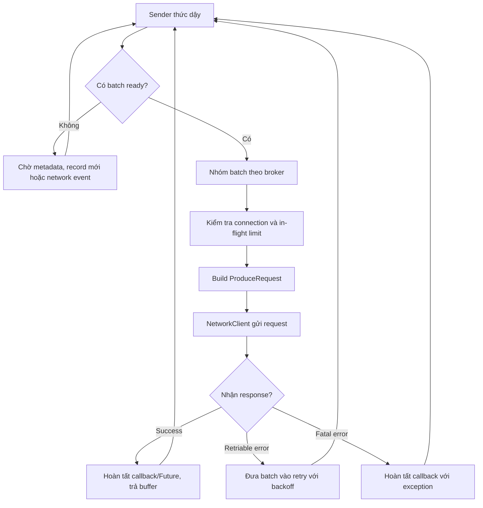

# Record accumulator, sender thread và cơ chế gom lô

## Mục tiêu

`KafkaProducer.send()` thường trả về trước khi broker xác nhận record. Producer Java nhận record từ luồng ứng dụng, serialize và chọn partition, đưa record vào bộ đệm theo partition, rồi một sender thread gom các batch thành request và gửi tới broker. Hiểu đường đi này giúp giải thích vì sao Kafka có throughput cao, vì sao `linger.ms` ảnh hưởng latency, và vì sao producer có thể block dù API gửi là bất đồng bộ.

Bài học này đi sâu vào `RecordAccumulator`, `ProducerBatch`, `BufferPool`, sender thread và cơ chế batching của Kafka Producer. Sau bài học, bạn có thể:

- Mô tả đường đi của một record từ `send()` đến callback sau broker acknowledgement.
- Phân biệt batch theo partition với ProduceRequest theo broker.
- Giải thích vai trò của `batch.size`, `linger.ms`, `buffer.memory` và `max.block.ms`.
- Hiểu backpressure khi buffer đầy và cách sender thread giải phóng bộ nhớ.
- Cấu hình batching, compression, idempotence và retry theo mục tiêu throughput/latency/durability.
- Quan sát producer metrics để xác định batch nhỏ, queue lâu, buffer pressure hoặc broker/network chậm.

## 1. Bức tranh tổng thể của producer

KafkaProducer là thread-safe; nhiều luồng ứng dụng có thể dùng chung một instance. Mỗi producer có một sender thread nền làm nhiệm vụ gửi request và xử lý response. Việc gom lô diễn ra ở client trước khi dữ liệu được gửi đến broker.

```mermaid
flowchart LR
    A[Application threads] -->|send(record)| P[KafkaProducer]
    P --> S[Serialize + partition selection]
    S --> R[RecordAccumulator]
    R --> Q[Per-partition queues\nProducerBatch]
    Q -->|ready batches| T[Sender thread]
    T --> N[NetworkClient]
    N --> B[Kafka broker]
    B -->|ProduceResponse| N
    N --> T
    T --> C[Callbacks / Future completion]
```

Một record đi qua các bước chính:

1. Luồng ứng dụng gọi `producer.send(record, callback)`.
2. Producer chạy interceptor, serialize key/value và xác định partition.
3. Producer lấy metadata cần thiết và append record vào batch của partition trong `RecordAccumulator`.
4. Sender thread kiểm tra partition nào đã sẵn sàng gửi, gom các batch theo broker đích và tạo ProduceRequest.
5. `NetworkClient` gửi request bất đồng bộ và nhận response từ broker.
6. Producer hoàn tất Future và gọi callback cho từng record trong batch; buffer batch được giải phóng hoặc tái sử dụng.

`send()` không đồng nghĩa với “record đã đến broker”. Nó thường chỉ có nghĩa record đã được chấp nhận vào luồng gửi của client. Ứng dụng cần theo dõi callback/Future để biết kết quả gửi.

## 2. Đường đi chi tiết của `send()`

### 2.1. Kiểm tra và chuẩn bị record

Khi gọi `send()`, producer thực hiện một số công việc trên luồng gọi:

- Kiểm tra producer chưa bị đóng và record hợp lệ.
- Chạy producer interceptors nếu được cấu hình.
- Lấy metadata topic/partition; nếu metadata chưa có, producer có thể chờ cập nhật metadata.
- Serialize key và value thành byte array.
- Xác định partition qua partitioner hoặc partition được chỉ định trong `ProducerRecord`.
- Kiểm tra kích thước record/batch theo giới hạn client.

Việc serialize và partitioning nằm trên đường gọi `send()`. Serializer hoặc custom partitioner chạy lâu sẽ làm chậm luồng ứng dụng trước khi record được đưa vào accumulator. `max.block.ms` không giới hạn thời gian chạy bên trong serializer/partitioner do ứng dụng cung cấp.

### 2.2. Append vào RecordAccumulator

`RecordAccumulator` quản lý buffer và các batch đang chờ gửi. Dữ liệu được tổ chức theo topic-partition. Khi record đến:

1. Producer tìm deque batch đang mở của partition đích.
2. Nếu batch hiện tại còn đủ chỗ, record được append vào batch đó.
3. Nếu batch đầy hoặc không còn batch phù hợp, producer yêu cầu một buffer từ `BufferPool` và tạo `ProducerBatch` mới.
4. Batch mới được đưa vào deque của partition và chờ sender thread gửi.

Các record chỉ có thể nằm trong cùng một batch khi chúng được route đến cùng partition. Record của hai partition khác nhau không trộn vào cùng `ProducerBatch`, kể cả khi chúng thuộc cùng topic.

### 2.3. Sender thread và NetworkClient

Sender thread chạy nền, đánh thức khi có record mới hoặc khi cần xử lý network response. Nó:

- Xác định batch đã sẵn sàng theo điều kiện kích thước, thời gian chờ, retry hoặc flush/close.
- Nhóm các batch theo broker leader tương ứng.
- Tạo một ProduceRequest có thể chứa nhiều record batch, mỗi batch thuộc một partition.
- Gửi request qua `NetworkClient` mà không bắt luồng ứng dụng chờ socket response.
- Theo dõi request đang in-flight, retry lỗi retriable và xử lý acknowledgement.
- Hoàn tất callback/Future và trả buffer về pool khi batch kết thúc.

Một ProduceRequest có thể chứa batch của nhiều partition nếu các partition đó có leader trên cùng broker. Nhưng một batch không chứa record của nhiều partition. Đây là điểm phân biệt quan trọng giữa batching theo partition và gom request theo broker.

## 3. RecordAccumulator và ProducerBatch

`RecordAccumulator` là bộ đệm trung tâm của producer. Mỗi topic-partition có một hàng đợi batch riêng. Một `ProducerBatch` chứa các record của cùng partition và được serialize thành record batch theo định dạng Kafka.

Ví dụ, producer đang gửi vào ba partition:

```text
RecordAccumulator
  commerce.orders-0 -> [Batch A: 16 KB] -> [Batch B: đang mở]
  commerce.orders-1 -> [Batch C: 12 KB]
  commerce.orders-2 -> [Batch D: đang mở]
```

Khi sender chạy, nếu partition 0 và partition 1 cùng có leader ở broker 1, request tới broker 1 có thể mang Batch A và Batch C. Batch D có thể được gửi tới broker khác nếu partition 2 có leader ở broker đó.

Accumulator giúp producer gom record trước khi thực hiện network I/O. Khi batch được gửi và hoàn tất, bộ nhớ của batch được trả lại `BufferPool` để record mới có thể sử dụng.

### 3.1. BufferPool

`BufferPool` quản lý phần lớn bộ nhớ producer dành cho record đang chờ gửi, theo giới hạn `buffer.memory`. Producer tái sử dụng các buffer thay vì cấp phát một mảng byte mới cho mỗi record batch.

Nếu ứng dụng gửi nhanh hơn tốc độ broker nhận và sender giải phóng buffer, các batch sẽ chiếm dần buffer pool. Khi không còn đủ bộ nhớ cho batch mới, luồng gọi `send()` có thể phải chờ buffer được giải phóng. Thời gian chờ bị giới hạn bởi `max.block.ms`; nếu không cấp phát được buffer trong thời gian đó, producer ném `BufferExhaustedException` (một lớp con của `TimeoutException`).

`buffer.memory` không phải giới hạn tuyệt đối cho toàn bộ heap của producer. Producer còn dùng bộ nhớ cho metadata, request in-flight, compression, object Java, serializer và các cấu trúc nội bộ khác.

## 4. Batching: batch.size và linger.ms

Batching giảm số request và chi phí xử lý trên client/broker. Kafka gom record theo partition, sau đó gửi batch khi đạt điều kiện sẵn sàng.

### 4.1. `batch.size`

`batch.size` đặt kích thước mục tiêu/tối đa cho batch theo byte. Giá trị mặc định trong Kafka Producer 4.1 là `16384` byte (16 KiB).

- Batch nhỏ dễ được gửi khi chưa có nhiều record, làm tăng số request và overhead.
- Batch lớn có cơ hội gom nhiều record hơn, giảm request rate và thường cải thiện compression ratio.
- Batch lớn cũng giữ nhiều buffer hơn cho các partition đang hoạt động, có thể làm tăng memory pressure.
- Đây là giới hạn gom lô cho mỗi partition, không phải tổng kích thước của cả ProduceRequest.

Không nên hiểu `batch.size` là giới hạn kích thước message đơn lẻ của toàn hệ thống. Kích thước record/batch còn chịu giới hạn của `max.request.size` ở producer và `max.message.bytes`/cấu hình tương ứng ở broker/topic. Một record quá lớn không thể được giải quyết chỉ bằng cách tăng `batch.size`; cần đối chiếu giới hạn hai phía.

### 4.2. Partitioning ảnh hưởng đến batching

Với partitioner mặc định của Kafka 4.1:

- Nếu record có key và không chỉ định partition, producer chọn partition dựa trên hash của key.
- Nếu record không có key và không chỉ định partition, producer dùng sticky partitioning: gửi vào một partition trong một khoảng để batch ở partition đó có cơ hội đạt `batch.size`, sau đó chuyển sang partition khác.
- Nếu chỉ định partition trong `ProducerRecord`, producer dùng partition đó nếu hợp lệ.

Sticky partitioning giúp record không key tạo batch hiệu quả hơn so với round-robin từng record. Nếu cần phân phối đều hoặc có quy tắc riêng, có thể dùng custom partitioner, nhưng cần đánh giá tác động tới batching và ordering.

### 4.3. `linger.ms`

`linger.ms` cho producer một khoảng thời gian chờ để các record tiếp theo có cơ hội vào cùng batch. Batch được gửi khi:

- Batch đạt kích thước `batch.size` và có thể gửi ngay.
- Thời gian linger của batch đã hết.
- Flush/close hoặc các điều kiện sẵn sàng khác yêu cầu gửi.

Trong Kafka 4.1, mặc định `linger.ms` là `5 ms`. Giá trị mặc định trước Kafka 4.0 là `0`; Kafka 4.0 đổi mặc định thành 5 ms vì batch lớn hơn thường cải thiện hiệu suất mà không làm tăng latency tổng thể đáng kể trong nhiều workload.

`linger.ms` là giới hạn chờ thêm cho batching trong điều kiện bình thường, không phải cam kết latency end-to-end. Broker backpressure, queueing, retry, network và acknowledgement có thể làm thời gian hoàn tất dài hơn.

### 4.4. Batch theo partition

Batching hiệu quả phụ thuộc số record cùng đổ vào một partition trong một khoảng thời gian. Ví dụ:

- 10.000 record/giây dồn vào một partition thường tạo batch đầy nhanh.
- 10.000 record/giây chia đều cho 100 partition có thể tạo 100 luồng batch nhỏ, mỗi batch phải chờ lâu hơn mới đầy.
- Nếu key phân phối không đều, một partition nóng có batch lớn trong khi partition khác chỉ có batch nhỏ.

Vì vậy, tăng số partition có thể tăng khả năng song song, nhưng cũng phân tán lưu lượng và làm batch trung bình nhỏ hơn nếu throughput không tăng tương ứng. Hãy đo `batch-size-avg` và `records-per-request-avg` sau khi thay đổi partition count.

## 5. Sender thread: điều kiện sẵn sàng gửi

Sender không nhất thiết gửi mọi batch ngay khi record được append. Nó xem xét batch đã đầy, hết linger, đang retry hay cần flush. Sau đó sender gom các batch có thể gửi tới cùng broker.



Sender thread là tài nguyên quan trọng của một producer. Callback chạy trên luồng I/O của producer trong đường xử lý thông thường; callback làm việc nặng hoặc block có thể cản trở tiến độ xử lý response và gửi request tiếp theo. Callback nên ngắn, tránh gọi service ngoài hoặc chờ đồng bộ lâu. Nếu cần xử lý tiếp, hãy chuyển công việc sang executor riêng.

Một producer thường có một sender thread. Tạo quá nhiều KafkaProducer instance làm tăng số thread, connection, buffer pool và request in-flight. Trong đa số ứng dụng, nên tái sử dụng producer thread-safe thay vì tạo/đóng producer cho từng record.

## 6. Buffer pressure và backpressure

Producer có thể chịu áp lực bộ nhớ khi:

- Tốc độ publish cao hơn tốc độ broker xử lý.
- Broker hoặc network chậm, làm request in-flight tồn tại lâu.
- Có nhiều partition hoạt động và nhiều batch cùng được giữ trong buffer.
- Batch quá lớn hoặc linger quá dài so với throughput.
- Broker từ chối ghi do ISR thấp, quota hoặc lỗi tạm thời khiến retry giữ batch lâu hơn.

Khi buffer pool thiếu chỗ, `send()` có thể block để chờ memory. Đây là backpressure có chủ đích: producer không tiếp tục nhận vô hạn record rồi làm cạn heap.

### 6.1. `buffer.memory`

`buffer.memory` là tổng dung lượng buffer producer có thể sử dụng để giữ record chờ gửi. Mặc định trong Kafka 4.1 là `33554432` byte (32 MiB).

Tăng giá trị này có thể hấp thụ burst lớn hơn hoặc nhiều partition đang hoạt động hơn, nhưng không làm broker xử lý nhanh hơn. Nếu bottleneck là broker/network, buffer lớn chỉ trì hoãn thời điểm producer phải backpressure và tăng memory footprint.

### 6.2. `max.block.ms`

`max.block.ms` giới hạn thời gian các API như `send()` và `partitionsFor()` có thể block khi chờ metadata hoặc buffer. Mặc định phổ biến trong Kafka 4.1 là 60 giây. Nó không bao gồm thời gian chạy trong serializer/partitioner do người dùng cung cấp.

Nếu `send()` ném `TimeoutException` trước khi trả Future, kiểm tra:

- Buffer pool còn bao nhiêu byte và có bao nhiêu thread đang chờ.
- Sender có bị nghẽn do broker/network hoặc request in-flight không.
- Metadata có lấy được không; bootstrap và advertised listener có đúng không.
- Serializer/partitioner có chậm bất thường không (đây là thời gian riêng, không được tính trong max.block.ms).

### 6.3. `delivery.timeout.ms` khác `max.block.ms`

Hai timeout có vai trò khác nhau:

| Cấu hình | Phạm vi |
|---|---|
| `max.block.ms` | Thời gian API gọi từ ứng dụng có thể block khi chờ metadata hoặc buffer trước khi record được enqueue |
| `delivery.timeout.ms` | Thời gian tối đa để báo kết quả thành công/thất bại sau khi `send()` trả về; gồm thời gian chờ gửi, acknowledgement và retry |
| `request.timeout.ms` | Thời gian chờ phản hồi cho một request tới broker |

Trong Kafka 4.1, `delivery.timeout.ms` mặc định là 120 giây. Giá trị cần lớn hơn hoặc bằng `request.timeout.ms + linger.ms`. Khi thiết kế timeout, cần xét thời gian xử lý nghiệp vụ, retry và SLA của ứng dụng, không chỉ latency mạng.

## 7. Compression và hiệu quả batching

Kafka nén ở cấp record batch. Batch càng có nhiều record tương tự nhau thì compression thường càng hiệu quả. Vì vậy, batching và compression có quan hệ trực tiếp:

- Batch nhỏ: latency thấp hơn trong một số workload nhưng compression ratio thường kém hơn.
- Batch lớn: tận dụng dictionary/context nén tốt hơn, giảm byte truyền qua mạng và dung lượng log.
- Nén tiêu tốn CPU ở producer và broker; thuật toán nhanh có thể giảm CPU nhưng tỷ lệ nén có thể thấp hơn.

Các lựa chọn thường dùng gồm `none`, `gzip`, `snappy`, `lz4` và `zstd` (tùy phiên bản/client). Ví dụ:

```properties
compression.type=zstd
batch.size=32768
linger.ms=10
```

Đây là điểm bắt đầu để benchmark, không phải cấu hình tối ưu cho mọi workload. So sánh CPU, network throughput, `compression-rate-avg`, batch size và p95/p99 latency trước khi quyết định.

## 8. Retry, idempotence và ordering

Sender thread quản lý request in-flight và retry các lỗi có thể phục hồi, chẳng hạn lỗi leader transition hoặc lỗi mạng tạm thời. Retry giúp tăng khả năng gửi thành công, nhưng cần kiểm soát duplicate và thứ tự.

### 8.1. Idempotent producer

`enable.idempotence=true` cho phép broker nhận diện retry của producer bằng producer ID và sequence number, tránh ghi trùng do retry trong phạm vi đảm bảo của producer session. Với Kafka client hiện đại, idempotence được bật mặc định khi không có cấu hình xung đột; vẫn nên khai báo rõ trong cấu hình quan trọng để ý định được thể hiện.

Khi idempotence bật, các điều kiện cấu hình tương thích được Kafka kiểm soát, gồm `acks=all`, retries lớn hơn 0 và `max.in.flight.requests.per.connection` không vượt quá giới hạn hỗ trợ (5 trong client hiện đại). Không nên tắt idempotence chỉ để né lỗi cấu hình.

Idempotence bảo vệ duplicate do retry ở producer protocol. Nó không làm cho thao tác nghiệp vụ downstream trở thành idempotent và không thay thế `eventId`/dedup ở hệ thống tiêu thụ.

### 8.2. Ordering trong partition

Kafka bảo đảm thứ tự record theo offset trong một partition. Nếu các record của cùng một entity cần giữ thứ tự, hãy dùng key ổn định để chúng được route vào cùng partition. KafkaProducer cũng bảo đảm callback của các record gửi đến cùng partition được gọi theo thứ tự gửi.

Khi idempotence bật, producer có thể duy trì thứ tự trong các request in-flight theo các giới hạn của client. Nếu tắt idempotence và cho phép nhiều request in-flight, retry một batch cũ trong khi batch mới đã thành công có thể làm thứ tự quan sát bị đảo trong một số cấu hình. Với workload cần ordering chặt, hãy bật idempotence và không tự giảm `max.in.flight.requests.per.connection` nếu chưa hiểu tác động throughput.

### 8.3. Delivery timeout và retry

Thay vì chỉ tăng `retries` rất lớn, hãy thiết kế `delivery.timeout.ms`, `request.timeout.ms` và backoff theo SLA. Producer có thể báo lỗi trước khi hết số lần retry nếu delivery deadline đã hết hoặc lỗi là non-retriable.

Nếu callback nhận exception, ứng dụng cần phân loại lỗi:

- Lỗi tạm thời: cân nhắc retry ở tầng nghiệp vụ với idempotency key và backoff.
- Lỗi cấu hình/quyền/schema: sửa nguyên nhân; retry liên tục không giúp ích.
- Timeout với kết quả không xác định: broker có thể đã ghi record nhưng acknowledgement không về tới client; dùng event ID và thiết kế consumer idempotent để xử lý trường hợp gửi lại.

## 9. Ví dụ Java Producer

Ví dụ dưới đây tạo một producer dùng chung, bật batching, compression và idempotence. Cấu hình bootstrap server cần trỏ tới listener phù hợp với môi trường ứng dụng.

```java
import org.apache.kafka.clients.producer.KafkaProducer;
import org.apache.kafka.clients.producer.ProducerConfig;
import org.apache.kafka.clients.producer.ProducerRecord;
import org.apache.kafka.clients.producer.RecordMetadata;
import org.apache.kafka.common.serialization.StringSerializer;

import java.util.Properties;
import java.util.concurrent.Future;

public final class OrderPublisher implements AutoCloseable {
    private final KafkaProducer<String, String> producer;

    public OrderPublisher(String bootstrapServers) {
        Properties props = new Properties();
        props.put(ProducerConfig.BOOTSTRAP_SERVERS_CONFIG, bootstrapServers);
        props.put(ProducerConfig.KEY_SERIALIZER_CLASS_CONFIG,
                StringSerializer.class.getName());
        props.put(ProducerConfig.VALUE_SERIALIZER_CLASS_CONFIG,
                StringSerializer.class.getName());

        props.put(ProducerConfig.ACKS_CONFIG, "all");
        props.put(ProducerConfig.ENABLE_IDEMPOTENCE_CONFIG, true);
        props.put(ProducerConfig.BATCH_SIZE_CONFIG, 32 * 1024);
        props.put(ProducerConfig.LINGER_MS_CONFIG, 10);
        props.put(ProducerConfig.BUFFER_MEMORY_CONFIG, 64L * 1024 * 1024);
        props.put(ProducerConfig.COMPRESSION_TYPE_CONFIG, "zstd");
        props.put(ProducerConfig.DELIVERY_TIMEOUT_MS_CONFIG, 120_000);

        this.producer = new KafkaProducer<>(props);
    }

    public Future<RecordMetadata> publish(String orderId, String json) {
        ProducerRecord<String, String> record =
                new ProducerRecord<>("commerce.orders.events.v1", orderId, json);

        return producer.send(record, (metadata, exception) -> {
            if (exception != null) {
                // Ghi log và chuyển lỗi đến cơ chế xử lý phù hợp.
                System.err.println("Publish failed for order " + orderId + ": "
                        + exception.getMessage());
                return;
            }

            System.out.printf("topic=%s partition=%d offset=%d%n",
                    metadata.topic(), metadata.partition(), metadata.offset());
        });
    }

    @Override
    public void close() {
        producer.close();
    }
}
```

Trong ví dụ, `orderId` là key để event của cùng một đơn hàng thường đi vào cùng partition. Callback chỉ ghi kết quả ngắn gọn; trong ứng dụng thật, hãy dùng logger và chuyển xử lý nặng sang executor. Không gọi `producer.close()` sau từng lần publish; producer cần được quản lý theo vòng đời ứng dụng.

### 9.1. Gửi bất đồng bộ và đồng bộ

`send()` trả về `Future<RecordMetadata>`. Nếu gọi `get()` ngay sau mỗi `send()`, ứng dụng biến luồng gửi thành đồng bộ và làm mất lợi ích batching/concurrency:

```java
// Không nên dùng theo cách này cho luồng gửi throughput cao:
RecordMetadata metadata = producer.send(record).get();
```

Thay vào đó, gửi nhiều record liên tiếp và xử lý callback/Future khi hoàn tất. Chỉ dùng `get()` khi ứng dụng thực sự cần chờ kết quả tại điểm đó.

## 10. Ví dụ cấu hình Spring Kafka

Với Spring Boot, có thể cấu hình producer tương tự trong `application.yml`:

```yaml
spring:
  kafka:
    bootstrap-servers: localhost:9092
    producer:
      acks: all
      batch-size: 32768
      buffer-memory: 67108864
      compression-type: zstd
      properties:
        enable.idempotence: true
        linger.ms: 10
        delivery.timeout.ms: 120000
        max.in.flight.requests.per.connection: 5
```

Tên property Spring Boot có thể thay đổi theo phiên bản Spring Boot/Spring Kafka; kiểm tra metadata cấu hình của dependency đang dùng. Ví dụ không đặt `retries`: Kafka client hiện đại mặc định cho phép retry lỗi transient với số lần rất lớn (`Integer.MAX_VALUE`), còn `delivery.timeout.ms` là giới hạn tổng thời gian thực tế. Thông thường không cần đặt `retries` thủ công; hãy điều chỉnh delivery timeout theo SLA.

Khi dùng `KafkaTemplate`, việc gửi vẫn dựa trên KafkaProducer bên dưới. Tái sử dụng `KafkaTemplate`/producer factory được quản lý bởi Spring; không tự tạo một producer mới trong mỗi lần gọi service.

## 11. Flush và close

`flush()` chờ hoàn tất các record đã được gửi trước thời điểm gọi flush. Nó hữu ích ở ranh giới cần bảo đảm các send trước đó đã được xử lý, nhưng không nên gọi sau từng record vì sẽ phá batching.

`close()` dừng producer, chờ các request/record đang xử lý theo timeout đóng và giải phóng thread, connection, buffer. Đóng producer trong lifecycle shutdown của ứng dụng. Không bỏ qua việc đóng producer trong các chương trình CLI hoặc job ngắn hạn.

Không gọi `flush()` bên trong callback: KafkaProducer sẽ ném `KafkaException` vì thao tác này có thể gây deadlock trên I/O thread. Tránh gọi `close()` hoặc chờ đồng bộ trong callback; hãy để callback ngắn và chuyển công việc nặng sang executor riêng.

## 12. Quan sát producer và đánh giá batching

KafkaProducer cung cấp metrics qua JMX và API `producer.metrics()`. Một số metric hữu ích:

| Metric | Dùng để đánh giá |
|---|---|
| `batch-size-avg`, `batch-size-max` | Batch trung bình/cực đại; giá trị thấp có thể cho thấy ít record cùng partition hoặc linger quá ngắn |
| `records-per-request-avg` | Số record trung bình trong mỗi ProduceRequest |
| `compression-rate-avg` | Tỷ lệ nén trung bình của batch |
| `record-queue-time-avg`, `record-queue-time-max` | Thời gian các batch chứa record nằm trong producer queue trước khi gửi |
| `buffer-available-bytes` | Bộ nhớ buffer còn khả dụng |
| `bufferpool-wait-time-ns-total`, `bufferpool-wait-ratio` | Tổng thời gian và tỷ lệ producer phải chờ buffer |
| `waiting-threads` | Số luồng đang chờ buffer pool |
| `request-latency-avg`, `request-latency-max` | Latency request tới broker |
| `record-send-rate`, `record-retry-rate`, `record-error-rate` | Tốc độ gửi, retry và lỗi record |

Tên metric và nhóm JMX có thể thay đổi theo phiên bản client. Dùng metric list của đúng Kafka client để cấu hình dashboard.

### 12.1. Đọc một số dấu hiệu

- `batch-size-avg` thấp và `records-per-request-avg` thấp: kiểm tra lưu lượng mỗi partition, số partition, linger và cách phân phối key.
- `buffer-available-bytes` giảm liên tục, `waiting-threads` tăng: producer đang bị backpressure; kiểm tra broker, network, retries và tốc độ publish.
- `record-queue-time-avg` cao nhưng `request-latency-avg` thấp: thời gian chờ chủ yếu nằm trong queue/batching hoặc sender scheduling.
- `request-latency-avg` tăng cùng retry rate: kiểm tra broker load, network, ISR và lỗi leader transition.
- Compression ratio kém: xem batch size, dữ liệu có lặp lại hay không và thuật toán nén.

### 12.2. Quy trình benchmark

Khi tuning, thay đổi từng nhóm cấu hình và đo trên cùng workload:

1. Giữ nguyên record size, key distribution, partition count và broker topology.
2. Ghi baseline throughput, p50/p95/p99 latency, batch size, records/request, CPU và network.
3. Thử thay `linger.ms` trước để quan sát trade-off latency/batch size.
4. Thử tăng/giảm `batch.size` trong giới hạn memory hợp lý.
5. So sánh `compression.type` và CPU/network.
6. Thử tải burst để quan sát `buffer-available-bytes` và thời gian chờ buffer.
7. Kiểm tra retry, error rate và durability config vẫn đáp ứng yêu cầu.

Không kết luận cấu hình tốt chỉ dựa vào throughput trung bình. Hãy xem p99 latency, queue time, buffer pressure và tỷ lệ lỗi trong cả giai đoạn tải ổn định lẫn burst.

## 13. Các lỗi thường gặp

| Hiện tượng | Nguyên nhân thường gặp | Hướng xử lý |
|---|---|---|
| `send()` block lâu | Metadata chưa có hoặc buffer pool thiếu bộ nhớ | Kiểm tra bootstrap/metadata, `buffer.memory`, sender health và broker/network |
| `TimeoutException` khi append | Không cấp được buffer trong `max.block.ms` | Kiểm tra `waiting-threads`, buffer availability, request latency và tốc độ publish |
| Batch size luôn nhỏ | Ít record trên từng partition, nhiều partition hoặc linger thấp | Kiểm tra key distribution, partition count và thử tăng `linger.ms` |
| Throughput thấp, request rate cao | Batch nhỏ hoặc nhiều request nhỏ | Đo batch metrics, điều chỉnh batch size/linger và kiểm tra serialization |
| Memory producer tăng | Buffer lớn, nhiều partition/batch, callback giữ object hoặc nhiều producer instance | Tái sử dụng producer, kiểm tra buffer pool và heap allocation |
| Callback xử lý chậm | Callback block hoặc thực hiện I/O nặng trên sender thread | Chuyển việc nặng sang executor riêng |
| Retry tăng liên tục | Broker quá tải, network chập chờn, leader đổi hoặc ISR thiếu | Kiểm tra broker/network/ISR và delivery timeout; không chỉ tăng retries |
| Lỗi record quá lớn | Vượt `max.request.size` hoặc broker/topic message limit | Giảm payload, chia event hoặc đồng bộ giới hạn producer/broker/topic |

## 14. Bài thực hành và tự kiểm tra

### Thực hành A — Quan sát batching

1. Tạo topic `producer-batch-lab` với một partition.
2. Tạo producer gửi nhiều record có kích thước gần giống nhau.
3. Ghi lại `batch.size`, `linger.ms`, `records-per-request-avg` và `batch-size-avg`.
4. Thử `linger.ms=0`, sau đó `linger.ms=10` và `linger.ms=30`.
5. So sánh batch size, request rate, throughput và p95 latency.
6. Lặp lại với topic có 12 partition và phân phối key đều để thấy tác động của batch theo partition.

### Thực hành B — Quan sát backpressure

1. Dùng producer tạo tải cao hơn năng lực broker lab trong thời gian ngắn.
2. Giảm `buffer.memory` để dễ quan sát buffer pressure.
3. Theo dõi `buffer-available-bytes`, `waiting-threads`, `bufferpool-wait-ratio` và `record-queue-time-avg`.
4. Dừng tải và quan sát sender giải phóng batch, buffer được trả lại pool.
5. Giải thích vì sao tăng buffer chỉ hấp thụ burst và không giải quyết bottleneck dài hạn.

### Câu hỏi tự kiểm tra

1. `KafkaProducer.send()` thực hiện những công việc nào trên luồng gọi?
2. Vì sao record của hai partition khác nhau không nằm trong cùng `ProducerBatch`?
3. `RecordAccumulator` và `Sender` chịu trách nhiệm khác nhau thế nào?
4. `batch.size` và `linger.ms` phối hợp quyết định thời điểm gửi batch ra sao?
5. Vì sao tăng partition count có thể làm batch trung bình nhỏ hơn?
6. `buffer.memory` và `max.block.ms` liên quan thế nào khi producer bị backpressure?
7. `max.block.ms` khác `delivery.timeout.ms` ở giai đoạn nào?
8. Vì sao callback làm việc nặng có thể làm chậm producer?
9. Compression được thực hiện ở cấp nào và vì sao batch lớn thường nén hiệu quả hơn?
10. Những metric nào giúp phân biệt queue delay với request latency?

## Kết luận

Producer gom record theo partition trong `RecordAccumulator`; sender thread lấy các batch đã sẵn sàng, nhóm theo broker và gửi bằng `NetworkClient`. `batch.size` điều khiển kích thước gom lô, `linger.ms` tạo cơ hội gom thêm record, còn `buffer.memory` và `max.block.ms` kiểm soát backpressure khi producer không gửi kịp. Kết hợp batching, compression, idempotence và quan sát metrics giúp tối ưu throughput mà vẫn giữ latency, ordering và durability theo yêu cầu.

## Tài liệu tham khảo

- [Apache Kafka 4.1 — Producer configuration](https://kafka.apache.org/41/generated/producer_config.html)
- [Apache Kafka 4.1 — Producer API](https://kafka.apache.org/41/javadoc/org/apache/kafka/clients/producer/KafkaProducer.html)
- [Apache Kafka 4.1 — Producer metrics](https://kafka.apache.org/41/operations/monitoring/)
- [Apache Kafka — Producer internals: RecordAccumulator](https://github.com/apache/kafka/blob/4.1.0/clients/src/main/java/org/apache/kafka/clients/producer/internals/RecordAccumulator.java)
- [Apache Kafka — Producer internals: Sender](https://github.com/apache/kafka/blob/4.1.0/clients/src/main/java/org/apache/kafka/clients/producer/internals/Sender.java)
