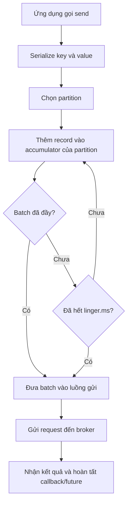

# `batch.size` và `linger.ms` trong đánh đổi độ trễ, thông lượng

Kafka producer không cần gửi từng record thành một request riêng. Producer gom các record thành batch theo partition rồi gửi chúng đến broker. Hai cấu hình ảnh hưởng trực tiếp đến cách gom batch là `batch.size` và `linger.ms`: `batch.size` xác định ngưỡng kích thước batch mà producer hướng tới, còn `linger.ms` quy định thời gian producer có thể chờ thêm record để batch đầy hơn trước khi gửi.

Tăng khả năng batching thường giúp giảm số request, tận dụng mạng và CPU hiệu quả hơn, đồng thời cải thiện hiệu quả nén. Đổi lại, producer có thể giữ record trong accumulator lâu hơn, làm tăng độ trễ gửi. Nếu chọn batch quá lớn hoặc chờ quá lâu, bộ nhớ producer bị chiếm dụng nhiều hơn và độ trễ p95/p99 có thể tăng. Vì vậy, không có một cặp giá trị tối ưu cho mọi workload; cần đo trên lưu lượng gần với production.

## Mục tiêu bài học

Sau bài học, bạn có thể:

- Giải thích cơ chế accumulator và batching theo từng partition.
- Phân biệt vai trò của `batch.size` và `linger.ms`.
- Phân tích ảnh hưởng đến latency, throughput, compression và bộ nhớ producer.
- Nhận diện tác động của số partition, key distribution và tốc độ phát record đến kích thước batch.
- Cấu hình hai tham số bằng Java Kafka client và Spring Kafka.
- Đọc các producer metrics để xác định khi nào cần tăng hoặc giảm batching.
- Thiết kế phép đo có kiểm soát thay vì điều chỉnh cấu hình theo cảm tính.

## 1. Vì sao producer cần batching?

Giả sử một dịch vụ phát 50.000 sự kiện mỗi giây. Nếu mỗi sự kiện được gửi trong một request riêng, producer và broker phải xử lý rất nhiều request nhỏ. Mỗi request đều có chi phí giao thức, lập lịch, xử lý mạng và xử lý ở broker. Việc gom nhiều record vào một batch giúp chia sẻ các chi phí đó cho nhiều record.

Batching mang lại một số lợi ích:

- Giảm số request cần gửi cho cùng một lượng record.
- Tăng lượng dữ liệu hữu ích trên mỗi lần truyền mạng.
- Giảm overhead xử lý request ở producer và broker.
- Tạo khối dữ liệu lớn hơn cho compression, thường cải thiện tỷ lệ nén.
- Có thể tăng throughput khi hệ thống đang bị giới hạn bởi request overhead hoặc chi phí mạng.

Batching cũng có chi phí. Producer cần giữ record trong bộ nhớ trước khi gửi, và đôi khi phải đợi thêm record đến. Với ứng dụng yêu cầu phản hồi rất nhanh cho từng sự kiện, thời gian chờ này có thể làm tăng latency. Mục tiêu tuning là tìm điểm cân bằng giữa hiệu quả truyền tải và thời gian chờ.

## 2. Producer gom record vào batch như thế nào?

Khi ứng dụng gọi `send(record)`, Kafka producer serialize key và value, xác định partition đích rồi thêm record vào accumulator của partition đó. Producer duy trì các batch đang hình thành cho những partition có dữ liệu cần gửi.



Đây là mô hình khái niệm. Producer còn có thể gửi batch vì các điều kiện khác như flush, đóng producer, áp lực bộ nhớ hoặc trạng thái request. Việc batch được gửi và việc broker xác nhận ghi thành công là hai giai đoạn khác nhau.

### 2.1. Batch được gom theo partition

Batch của producer gắn với partition đích. Các record thuộc những partition khác nhau không được trộn vào cùng một record batch của partition. Producer có thể gửi dữ liệu của nhiều partition trong một request mạng, nhưng mỗi partition vẫn có batch riêng trong request đó.

Điều này có ý nghĩa thực tế: số partition và cách phân bố key ảnh hưởng đến khả năng lấp đầy batch. Nếu một producer gửi dữ liệu vào rất nhiều partition với tốc độ thấp trên từng partition, mỗi batch có thể chỉ chứa vài record dù tổng throughput toàn producer khá cao.

Ví dụ:

```text
Producer accumulator

Partition 0: [record A] [record B] [record C] ---> Batch 0
Partition 1: [record D] [record E]             ---> Batch 1
Partition 2: [record F]                         ---> Batch 2

Các batch được gửi theo cơ chế request của producer.
```

Nếu một key nóng khiến phần lớn record đi vào một partition, batch của partition đó có thể đầy nhanh nhưng partition trở thành nút thắt. Nếu key phân tán đều trên nhiều partition nhưng tốc độ từng partition thấp, producer có thể tạo nhiều batch nhỏ. Cần nhìn cả số liệu theo partition lẫn tổng số liệu của producer.

## 3. `batch.size`: ngưỡng kích thước batch

`batch.size` được tính bằng byte và đặt kích thước mục tiêu cho batch record của mỗi partition. Producer cố gắng gom các record vào batch cho đến khi batch đạt ngưỡng này hoặc đến lúc batch cần được gửi theo một điều kiện khác.

Ví dụ cấu hình:

```properties
batch.size=32768
```

Giá trị trên tương đương 32 KiB. Nó chỉ là ví dụ cấu hình, không phải khuyến nghị mặc định cho mọi ứng dụng.

### 3.1. Tăng `batch.size` có thể cải thiện điều gì?

Khi batch có thể chứa nhiều record hơn:

- Producer có cơ hội gửi ít batch hơn cho cùng số record.
- Chi phí request và giao thức được chia sẻ cho nhiều record.
- Compression thường có nhiều dữ liệu để tìm mẫu lặp, nên có thể đạt tỷ lệ nén tốt hơn.
- Throughput có thể tăng nếu hệ thống đang bị giới hạn bởi overhead của các request nhỏ.

Tuy nhiên, batch lớn hơn chỉ hữu ích nếu tốc độ record trên từng partition đủ để lấp đầy batch hoặc thời gian chờ cho phép producer gom thêm record. Nếu traffic rất thưa, tăng `batch.size` có thể không thay đổi số record trong batch vì `linger.ms` hết hạn trước.

### 3.2. Đánh đổi của batch lớn

Batch lớn có thể tăng lượng bộ nhớ producer cần dành cho các partition đang hoạt động. `batch.size` là tham số áp dụng cho batch theo partition, nên số partition có dữ liệu đồng thời là yếu tố cần tính đến khi ước lượng memory pressure. Bộ nhớ thực tế còn phụ thuộc số batch đang chờ, kích thước record, compression và `buffer.memory`.

Batch lớn cũng có thể làm tăng thời gian chờ để gom đủ dữ liệu nếu traffic không liên tục. Ngoài ra, request lớn cần được kiểm tra tương thích với giới hạn ở producer, broker và topic như `max.request.size`, `message.max.bytes` hoặc `max.message.bytes` tùy cấu hình và phiên bản. Không nên tăng batch đến mức khiến request vượt giới hạn của hệ thống.

Một record đơn lẻ lớn hơn `batch.size` không đồng nghĩa producer sẽ cắt record thành nhiều record nhỏ. `batch.size` là ngưỡng batching, không phải cơ chế chia nhỏ payload hay giới hạn kích thước record. Kích thước record và request vẫn chịu các giới hạn riêng.

## 4. `linger.ms`: thời gian chờ gom thêm record

`linger.ms` cho producer biết có thể chờ thêm tối đa bao lâu để gom thêm record vào batch trước khi gửi batch chưa đầy. Giá trị được tính bằng mili giây.

Ví dụ:

```properties
linger.ms=5
```

Nếu batch chưa đầy, producer có thể đợi thêm record trong khoảng thời gian này. Nếu batch đầy trước khi hết thời gian chờ, producer có thể gửi ngay mà không cần đợi đủ `linger.ms`.

### 4.1. Tăng `linger.ms` thường giúp khi nào?

Tăng thời gian chờ có thể hữu ích khi lưu lượng đến không liên tục hoặc mỗi partition nhận record với tốc độ vừa phải. Thay vì gửi ngay batch chỉ có một vài record, producer có thêm thời gian gom record tiếp theo.

Ví dụ, một partition nhận khoảng 100 record mỗi mili giây có thể lấp đầy batch nhanh. Trong trường hợp đó, `linger.ms` nhỏ vẫn có thể tạo batch lớn vì batch đầy trước khi timer hết hạn. Ngược lại, nếu partition chỉ nhận một vài record trong vài mili giây, tăng linger có thể tăng số record mỗi batch.

### 4.2. Đánh đổi của thời gian chờ

Khi traffic thấp, record đầu tiên của batch có thể phải đợi gần hết khoảng linger để batch được gửi. Vì vậy, tăng `linger.ms` có thể làm tăng latency từ lúc ứng dụng gọi `send()` đến lúc producer phát request.

Khi traffic cao, batch thường đầy trước khi linger hết hạn, nên việc tăng linger có thể ít tác động đến latency thực tế. Tuy nhiên, không nên suy ra rằng linger luôn miễn phí: traffic thay đổi theo thời gian, phân bố theo partition và trạng thái buffer có thể khiến một số batch vẫn phải chờ.

`linger.ms` không phải timeout để broker xác nhận ghi. Nó điều khiển thời gian gom batch ở producer. Các tham số như `request.timeout.ms`, `delivery.timeout.ms` và `max.block.ms` giải quyết các khía cạnh timeout khác nhau.

## 5. Hai tham số phối hợp với nhau

`batch.size` và `linger.ms` cùng điều khiển điều kiện gom dữ liệu:

| Tình huống | Vai trò nổi bật | Hành vi có thể thấy |
|---|---|---|
| Traffic cao trên mỗi partition | `batch.size` | Batch đầy nhanh và được gửi trước khi linger hết hạn |
| Traffic thấp trên mỗi partition | `linger.ms` | Producer chờ thêm record để batch có nhiều dữ liệu hơn |
| Batch size nhỏ, traffic cao | `batch.size` | Batch được gửi thường xuyên, có thể tăng số request |
| Linger lớn, traffic thưa | `linger.ms` | Batch có thể lớn hơn nhưng record đầu phải chờ lâu hơn |
| Nhiều partition, ít record mỗi partition | Cả hai | Nhiều batch nhỏ; tăng linger có thể gom thêm nhưng tăng latency |

Một cách hình dung:

```text
Batch được gửi khi:
  - batch đạt ngưỡng batch.size, hoặc
  - thời gian chờ linger.ms đã hết,
  - hoặc một điều kiện gửi khác của producer được kích hoạt.
```

Không nên xem hai tham số như hai nút độc lập. Tăng `batch.size` nhưng giữ linger rất thấp có thể không tạo được batch lớn trong traffic thưa. Tăng linger nhưng batch size quá nhỏ cũng không giúp gom nhiều record hơn ngưỡng đã đặt.

## 6. Ảnh hưởng đến latency, throughput và compression

### 6.1. Latency

Latency gửi của producer có thể được nhìn thành nhiều phần: thời gian serialize và xếp hàng, thời gian chờ batch, thời gian request đi qua mạng và broker, thời gian chờ xác nhận theo `acks`, cùng các lần retry nếu có. `linger.ms` tác động trực tiếp đến thời gian chờ gom batch; `batch.size` tác động gián tiếp đến thời điểm batch đạt ngưỡng.

Khi ứng dụng có SLA chặt cho từng event, hãy theo dõi p50, p95 và p99. Giá trị trung bình có thể che khuất những khoảng thời gian mà batch chưa đầy phải đợi linger hoặc producer chịu buffer pressure.

### 6.2. Throughput

Throughput là lượng record hoặc byte được xử lý trong một đơn vị thời gian. Batching có thể tăng throughput bằng cách giảm overhead trên mỗi record. Tuy nhiên, nếu broker, disk, network, partition leader hoặc consumer là nút thắt, tăng batch có thể không cải thiện throughput tổng thể.

Đo cả records/sec và bytes/sec. Hai workload có cùng records/sec nhưng kích thước record khác nhau có thể có đặc tính batching và compression rất khác nhau.

### 6.3. Compression

Kafka nén dữ liệu theo record batch. Batch lớn hơn thường cung cấp nhiều dữ liệu hơn để thuật toán compression khai thác mẫu lặp, có thể giảm byte truyền qua mạng và byte lưu trữ. Tỷ lệ cải thiện phụ thuộc nội dung payload, codec, kích thước batch và chi phí CPU.

Nếu producer gửi nhiều batch rất nhỏ, compression có thể kém hiệu quả hơn. Tuy nhiên, không nên tăng linger quá mức chỉ để tối ưu compression nếu latency của ứng dụng không chấp nhận được. Hãy đo `compression-rate-avg`, byte rate và CPU cùng lúc.

### 6.4. Bộ nhớ và áp lực buffer

Producer giữ record trong buffer trước khi gửi. `buffer.memory` đặt tổng bộ nhớ mà producer dành cho các record đang chờ gửi. Nếu producer không thể gửi đủ nhanh, accumulator có thể đầy; các lệnh `send()` mới có thể phải chờ tối đa theo `max.block.ms` rồi phát sinh lỗi nếu vẫn không lấy được buffer.

Tăng `batch.size` và `linger.ms` có thể làm record nằm trong accumulator lâu hơn và tăng nhu cầu bộ nhớ khi nhiều partition hoạt động. Nếu buffer pressure tăng, hãy kiểm tra broker throughput, request latency, retries, số partition và kích thước record trước khi tiếp tục tăng batch.

## 7. Cấu hình bằng Java Kafka client

Ví dụ sau cấu hình batching tường minh cho một producer:

```java
import java.util.Properties;
import org.apache.kafka.clients.producer.KafkaProducer;
import org.apache.kafka.clients.producer.ProducerConfig;
import org.apache.kafka.common.serialization.StringSerializer;

public class ProducerFactoryExample {
    public static KafkaProducer<String, String> createProducer() {
        Properties props = new Properties();
        props.put(ProducerConfig.BOOTSTRAP_SERVERS_CONFIG, "localhost:9092");
        props.put(ProducerConfig.KEY_SERIALIZER_CLASS_CONFIG,
            StringSerializer.class.getName());
        props.put(ProducerConfig.VALUE_SERIALIZER_CLASS_CONFIG,
            StringSerializer.class.getName());

        props.put(ProducerConfig.BATCH_SIZE_CONFIG, 32 * 1024);
        props.put(ProducerConfig.LINGER_MS_CONFIG, 5);
        props.put(ProducerConfig.BUFFER_MEMORY_CONFIG, 64L * 1024 * 1024);
        props.put(ProducerConfig.COMPRESSION_TYPE_CONFIG, "lz4");

        return new KafkaProducer<>(props);
    }
}
```

Giá trị trong ví dụ là điểm bắt đầu cho một phép thử, không phải cấu hình chuẩn cho mọi môi trường. `compression.type=lz4` cũng là lựa chọn minh họa; codec cần được chọn theo phiên bản client/broker, CPU, yêu cầu tương thích và kết quả benchmark. Producer phải được đóng đúng cách để flush các record còn lại và giải phóng tài nguyên.

### 7.1. Gửi bất đồng bộ để tạo cơ hội batching

Producer API vốn bất đồng bộ. Nếu ứng dụng gọi `send()` rồi lập tức gọi `get()` cho từng record, luồng gửi bị chặn chờ xác nhận và có thể làm giảm số record đang chờ để gom batch.

Ví dụ gửi nhiều record mà xử lý kết quả qua callback:

```java
for (OrderEvent event : events) {
    ProducerRecord<String, String> record = new ProducerRecord<>(
        "orders",
        event.orderId(),
        event.toJson()
    );

    producer.send(record, (metadata, exception) -> {
        if (exception != null) {
            // Ghi nhận lỗi và chuyển sang chính sách xử lý phù hợp.
            return;
        }

        // Có thể ghi nhận partition và offset để quan sát.
    });
}
```

Ứng dụng vẫn cần kiểm soát số lượng record đang gửi, xử lý lỗi callback và bảo đảm thứ tự nghiệp vụ theo thiết kế. Gửi bất đồng bộ không có nghĩa được phép bỏ qua backpressure hoặc để hàng đợi trong ứng dụng tăng vô hạn.

### 7.2. Đừng gọi `flush()` sau mỗi record

`flush()` yêu cầu producer gửi các record đang được buffer và chờ các request đang gửi hoàn tất theo API. Gọi `flush()` sau từng record làm mất phần lớn cơ hội gom batch, tăng số request và có thể làm throughput giảm mạnh.

Thông thường chỉ flush tại ranh giới cần thiết như trước khi đóng producer, trong một thao tác điều phối đặc biệt hoặc khi ứng dụng thực sự cần bảo đảm các record đã được gửi trước khi tiếp tục. Không dùng flush như cơ chế xác nhận cho từng message trong luồng thông thường.

## 8. Cấu hình bằng Spring Kafka

Spring Boot cho phép đặt cấu hình Kafka producer trong `application.yml` hoặc `application.properties`. Ví dụ YAML:

```yaml
spring:
  kafka:
    bootstrap-servers: localhost:9092
    producer:
      key-serializer: org.apache.kafka.common.serialization.StringSerializer
      value-serializer: org.apache.kafka.common.serialization.StringSerializer
      batch-size: 32768
      properties:
        linger.ms: 5
        buffer.memory: 67108864
        compression.type: lz4
```

`batch-size` là thuộc tính Spring Boot được ánh xạ đến `batch.size`. `linger.ms`, `buffer.memory` và `compression.type` là Kafka producer properties được chuyển qua `properties`. Cấu trúc cấu hình cụ thể có thể thay đổi theo phiên bản Spring Boot; hãy đối chiếu metadata/configuration reference của dependency đang sử dụng.

Nếu tự tạo `ProducerFactory`, có thể đặt các thuộc tính tương ứng trong map cấu hình:

```java
Map<String, Object> props = new HashMap<>();
props.put(ProducerConfig.BOOTSTRAP_SERVERS_CONFIG, "localhost:9092");
props.put(ProducerConfig.KEY_SERIALIZER_CLASS_CONFIG, StringSerializer.class);
props.put(ProducerConfig.VALUE_SERIALIZER_CLASS_CONFIG, StringSerializer.class);
props.put(ProducerConfig.BATCH_SIZE_CONFIG, 32 * 1024);
props.put(ProducerConfig.LINGER_MS_CONFIG, 5);

ProducerFactory<String, String> producerFactory =
    new DefaultKafkaProducerFactory<>(props);
KafkaTemplate<String, String> kafkaTemplate =
    new KafkaTemplate<>(producerFactory);
```

Spring Kafka không thay đổi cơ chế batching bên dưới. `KafkaTemplate` vẫn gửi qua Kafka producer client, nên các nguyên tắc về batch theo partition, linger, buffer và compression vẫn áp dụng.

## 9. Đọc metrics để biết batch có hiệu quả không

Không thể kết luận batching tốt chỉ bằng việc tăng `batch.size` hoặc `linger.ms`. Hãy xem các producer metrics cùng với latency và throughput của ứng dụng.

| Metric | Ý nghĩa quan sát | Cách diễn giải |
|---|---|---|
| `batch-size-avg` | Kích thước batch trung bình | So sánh với `batch.size`; batch quá nhỏ có thể cho thấy traffic thưa hoặc nhiều partition |
| `records-per-request-avg` | Số record trung bình trong một request | Cho biết hiệu quả gom record trên request |
| `record-queue-time-avg` | Thời gian record nằm trong producer trước khi gửi | Tăng có thể phản ánh linger hoặc áp lực hàng đợi |
| `request-latency-avg` | Độ trễ request broker | Giúp phân biệt thời gian chờ batch với thời gian broker/network |
| `compression-rate-avg` | Tỷ lệ nén của dữ liệu batch | Đánh giá hiệu quả compression theo workload |
| `bufferpool-wait-time` | Thời gian producer chờ lấy buffer | Tăng là dấu hiệu cần điều tra buffer pressure hoặc broker không theo kịp |
| `record-send-rate` | Tốc độ gửi record | Dùng để đối chiếu throughput trước/sau tuning |
| `record-error-rate` và `record-retry-rate` | Tỷ lệ lỗi và retry | Đảm bảo tuning không làm tăng lỗi hoặc che khuất vấn đề broker |

Tên metric, đơn vị và cách xuất có thể khác theo phiên bản client hoặc hệ thống metrics. Dùng JMX/metrics exporter đang triển khai để xác nhận metric thực tế. Đặc biệt, `batch-size-avg` thấp không tự động có nghĩa batch size cấu hình quá nhỏ; có thể mỗi partition nhận quá ít record trong khoảng linger.

### 9.1. Đọc kết hợp các dấu hiệu

- `batch-size-avg` thấp, `records-per-request-avg` thấp và queue time thấp: producer có thể đang gửi batch nhỏ do traffic thưa hoặc số partition lớn. Thử tăng linger có kiểm soát và quan sát latency.
- Batch trung bình gần ngưỡng, request rate cao: có thể batch đang đầy nhanh. Tăng batch size có thể giảm số request nếu memory và latency cho phép.
- Queue time tăng cùng buffer wait: producer có thể đang bị nghẽn gửi hoặc buffer. Kiểm tra broker/network/retry trước khi tăng batch size.
- Compression tốt hơn nhưng p99 tăng vượt SLA: giảm linger hoặc batch size, hoặc xem lại codec và tải CPU.
- Throughput không đổi dù batch tăng: nút thắt có thể nằm ở broker, disk, network, partition leader hoặc consumer chứ không phải batching.

## 10. Quy trình tuning có kiểm soát

Hãy dùng benchmark hoặc traffic replay với kích thước record, số partition, phân bố key và tốc độ gửi gần với production. Thay đổi một nhóm tham số có chủ đích và giữ nguyên các điều kiện khác để so sánh.

Một quy trình thực tế:

1. **Ghi baseline:** lưu throughput records/sec và bytes/sec, p50/p95/p99 send latency, batch-size-avg, records-per-request-avg, queue time, buffer wait, retry và CPU.
2. **Xác định SLA:** chốt giới hạn latency, yêu cầu độ bền, mức mất dữ liệu chấp nhận được và mục tiêu throughput.
3. **Kiểm tra workload:** ghi nhận kích thước record, số partition hoạt động, key skew, số producer instance và traffic theo từng partition.
4. **Thử linger:** giữ batch size cố định, tăng `linger.ms` từng bước nhỏ. Quan sát batch size, queue time và p99.
5. **Thử batch size:** giữ linger tại giá trị phù hợp, thay đổi `batch.size` để xem request rate, throughput và memory.
6. **Thử compression:** nếu phù hợp, benchmark codec cùng batch settings vì hiệu quả nén phụ thuộc cả payload và batch.
7. **Chạy đủ lâu:** bao gồm giai đoạn warm-up, tải ổn định và giai đoạn burst; tránh kết luận từ một khoảng đo ngắn.
8. **Kiểm tra lỗi và phục hồi:** xác nhận retries, buffer wait, delivery timeout và hành vi khi broker chậm vẫn trong giới hạn.
9. **Chọn cấu hình:** chọn phương án đạt SLA với throughput và tài nguyên phù hợp; lưu lại cấu hình, workload và kết quả để có thể tái lập.

Ví dụ ma trận thử nghiệm:

| Lần thử | `batch.size` | `linger.ms` | Mục đích |
|---|---:|---:|---|
| A | 16 KiB | 0 ms | Baseline ít chờ |
| B | 16 KiB | 5 ms | Đo ảnh hưởng của linger |
| C | 32 KiB | 5 ms | Đo ảnh hưởng của batch size |
| D | 64 KiB | 5 ms | Kiểm tra lợi ích khi batch lớn hơn |
| E | 32 KiB | 10 ms | Kiểm tra thêm thời gian gom batch |

Các giá trị trên chỉ là ma trận ví dụ. Chọn bước thử theo SLA, lưu lượng và phiên bản Kafka. Đừng thay đồng thời `batch.size`, `linger.ms`, `acks`, compression, số partition và concurrency rồi quy toàn bộ thay đổi kết quả cho một tham số.

## 11. Các yếu tố khác ảnh hưởng đến batching

### 11.1. Số partition và phân bố key

Vì batch được gom theo partition, số partition càng nhiều thì lưu lượng tổng càng bị chia nhỏ nếu tốc độ gửi không tăng tương ứng. Một producer gửi 10.000 record/giây vào 10 partition có thể có cơ hội lấp batch khác với producer gửi cùng lượng đó vào 100 partition.

Key skew cũng làm phân bố batch không đồng đều. Một partition có thể liên tục tạo batch đầy trong khi nhiều partition khác chỉ có batch nhỏ. Tuning producer không thể sửa hoàn toàn vấn đề phân bố key; cần kiểm tra partitioner và thiết kế key.

### 11.2. Kích thước record

Với record nhỏ, batching thường có nhiều lợi ích vì overhead trên mỗi record tương đối lớn. Với record lớn, batch có thể đạt ngưỡng chỉ sau vài record. Cần đo cả số record/batch và byte/batch để hiểu đúng hiệu quả.

### 11.3. `buffer.memory` và `max.block.ms`

`buffer.memory` giới hạn bộ nhớ producer dành cho các record đang chờ gửi. `max.block.ms` giới hạn thời gian các lời gọi như `send()` có thể chờ khi cần metadata hoặc buffer. Nếu producer bị nghẽn, tăng `batch.size` mà không xem xét `buffer.memory` có thể làm áp lực bộ nhớ nặng hơn.

### 11.4. `compression.type`

Compression hoạt động trên batch. Batch lớn hơn có thể cải thiện compression ratio, nhưng codec có chi phí CPU khác nhau. Nếu CPU producer đã bão hòa, codec nặng có thể làm throughput giảm dù byte truyền thấp hơn. Benchmark phải ghi nhận cả CPU và network.

### 11.5. `acks`, retry và delivery timeout

`acks` quyết định mức xác nhận producer chờ từ broker; retries và idempotence ảnh hưởng cách producer xử lý lỗi tạm thời. `delivery.timeout.ms` đặt giới hạn tổng thời gian gửi thành công trước khi record được xem là thất bại. Các tham số này ảnh hưởng send latency nhưng không phải cơ chế batching. Khi request latency cao, hãy phân biệt phần thời gian chờ batch với thời gian chờ broker xác nhận.

## 12. Những sai lầm thường gặp

| Sai lầm | Hệ quả | Cách xử lý |
|---|---|---|
| Tăng `batch.size` thật lớn mà không đo | Tăng bộ nhớ, có thể không cải thiện batch nếu traffic thưa | Tuning theo số liệu trên từng partition |
| Đặt `linger.ms` cao để tối đa hóa batch | Tăng latency của record ở tải thấp | Ràng buộc theo SLA p95/p99 |
| Nghĩ `linger.ms` là thời gian broker xử lý | Chẩn đoán sai nguyên nhân latency | Phân biệt queue time, request latency và delivery timeout |
| Gọi `flush()` sau mỗi record | Phá cơ hội batching và tăng request overhead | Flush tại ranh giới cần thiết, không trong luồng từng record |
| Gọi `send().get()` liên tục cho từng record | Chặn producer thread của ứng dụng, giảm concurrency | Dùng callback/future và giới hạn số record đang chờ |
| Chỉ nhìn tổng throughput | Bỏ qua partition nóng và batch nhỏ ở partition khác | Theo dõi metrics và phân bố tải theo partition |
| Chỉ đo latency trung bình | Bỏ qua tail latency | Theo dõi p50, p95 và p99 |
| Tăng batch mà quên giới hạn request | Có thể gặp lỗi kích thước request/record | Kiểm tra producer, broker và topic size limits |

## 13. Bài tập tự kiểm tra

Một producer gửi sự kiện đơn hàng vào 48 partition. Mỗi partition chỉ nhận record rải rác, `batch-size-avg` thấp, `records-per-request-avg` gần 1 và p99 latency còn dư ngân sách 8 ms. Hãy trả lời:

1. Vì sao tổng throughput của producer có thể cao nhưng batch ở từng partition vẫn nhỏ?
2. Thử tăng `linger.ms` có thể cải thiện điều gì và ảnh hưởng đến metric nào?
3. Nếu tăng `batch.size` nhưng giữ `linger.ms` rất thấp, batch có nhất thiết lớn hơn không?
4. Vì sao tăng `buffer.memory` không phải giải pháp đầu tiên khi `bufferpool-wait-time` tăng?
5. Nếu batch lớn hơn cải thiện compression nhưng p99 vượt SLA, bạn sẽ điều chỉnh theo hướng nào?
6. Vì sao không nên gọi `flush()` sau từng record để chắc chắn dữ liệu được gửi?

Gợi ý: batching diễn ra theo partition; linger giúp gom thêm record khi batch chưa đầy; batch size là ngưỡng kích thước; buffer wait có thể là dấu hiệu producer không gửi kịp; và cần đo cả latency tail, throughput, CPU, network cùng compression.

## Kết luận

`batch.size` xác định ngưỡng kích thước batch theo partition, còn `linger.ms` cho producer thời gian gom thêm record khi batch chưa đầy. Tăng hai tham số có thể giảm request overhead, tăng throughput và cải thiện compression, nhưng cũng có thể tăng latency và áp lực bộ nhớ. Hãy tuning dựa trên traffic mỗi partition, phân bố key, kích thước record, producer metrics và SLA p95/p99. Cấu hình tốt là cấu hình đạt mục tiêu của workload thực tế với tài nguyên và độ trễ có thể chấp nhận được.
