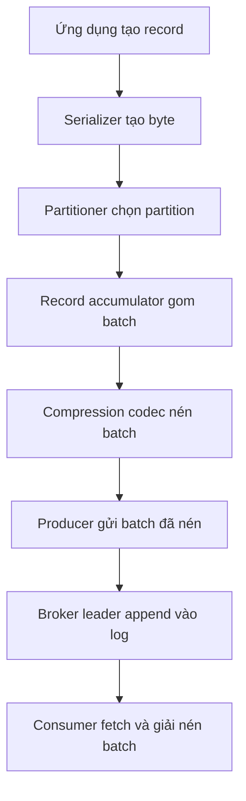
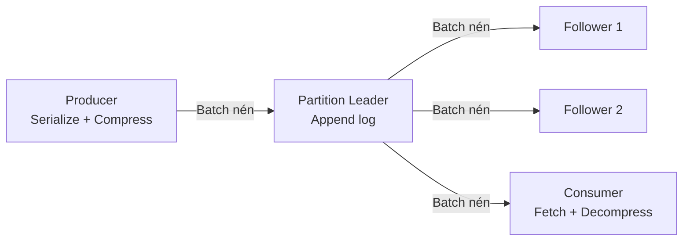

# `compression.type` và chi phí CPU, mạng, lưu trữ

## Vì sao cần nén record trước khi gửi vào Kafka?

Một topic có thể nhận hàng chục hoặc hàng trăm MB dữ liệu mỗi giây. Nếu mỗi record được truyền và lưu ở dạng nguyên bản, producer cần nhiều băng thông hơn, broker ghi nhiều byte hơn xuống log và follower phải sao chép nhiều dữ liệu hơn. Nén giúp giảm lượng byte truyền qua mạng và chiếm trên đĩa, đổi lại producer và consumer phải dùng CPU để nén và giải nén.

Kafka hỗ trợ nhiều codec thông qua cấu hình `compression.type`, gồm `none`, `gzip`, `snappy`, `lz4` và `zstd`. Không có codec tốt nhất cho mọi workload. Một codec nén mạnh có thể tiết kiệm storage và network nhưng làm tăng CPU hoặc latency; codec rất nhanh có thể dùng ít CPU hơn nhưng để lại nhiều byte hơn.

Mục tiêu của việc chọn compression là cân bằng ba nhóm tài nguyên:

- **CPU:** nén ở producer, giải nén ở consumer và có thể nén lại ở broker nếu cấu hình yêu cầu.
- **Network:** giảm byte từ producer đến leader, giữa leader và follower, và từ broker đến consumer.
- **Storage:** giảm dung lượng log trên mỗi replica, nhờ đó kéo dài retention hoặc giảm chi phí đĩa.

Với module KAFKA, cần hiểu mối quan hệ này để điều phối producer bằng Java/Spring Kafka, tăng throughput mà vẫn giữ độ trễ, consumer lag và chi phí cụm trong giới hạn.

## 1. Kafka nén dữ liệu ở cấp record batch

### 1.1 Nén theo batch, không phải từng record riêng lẻ

Producer serialize key và value thành byte, chọn partition, sau đó gom các record của cùng partition vào một record batch. Codec được áp dụng lên batch trước khi producer gửi request. Vì vậy, nhiều record có nội dung lặp lại trong cùng batch thường nén hiệu quả hơn việc nén từng record nhỏ độc lập.

Ví dụ, nhiều sự kiện JSON có cùng tên field như `orderId`, `eventType`, `createdAt` thường có phần byte lặp lại. Khi các record nằm chung batch, codec có thể khai thác sự lặp lại đó. Một batch nhỏ chỉ có một vài record có thể không đạt tỷ lệ nén tốt như batch đầy.



Nén theo batch là lý do `batch.size` và `linger.ms` có thể ảnh hưởng đến tỷ lệ nén. Nếu producer gửi record quá thưa hoặc có quá nhiều partition với ít dữ liệu trên mỗi partition, batch có thể không đầy và hiệu quả nén giảm.

### 1.2 Batch size và linger ảnh hưởng thế nào?

`batch.size` đặt kích thước mục tiêu của batch cho mỗi partition. `linger.ms` cho phép producer chờ thêm một khoảng ngắn để gom thêm record vào batch trước khi gửi. Hai cấu hình này có thể cải thiện batching và nén, nhưng tăng thời gian chờ hoặc bộ nhớ cần thiết.

| Cấu hình | Khi tăng giá trị | Lợi ích có thể có | Chi phí có thể có |
|---|---|---|---|
| `batch.size` | Batch có thể lớn hơn | Nén hiệu quả hơn, giảm số request | Dùng thêm buffer; batch có thể không đầy nếu traffic thấp |
| `linger.ms` | Producer chờ lâu hơn để gom batch | Batch đầy hơn, giảm request overhead | Tăng latency chờ gửi, nhất là khi tải thấp |
| `compression.type` | Chọn codec nén | Giảm byte trên mạng và đĩa | Tăng CPU và thời gian xử lý |

Không nên tăng `batch.size` hoặc `linger.ms` chỉ để đạt tỷ lệ nén cao. Hãy kiểm tra p95/p99 produce latency, số request, batch size thực tế và throughput. Với hệ thống yêu cầu phản hồi nhanh, mức linger nhỏ có thể phù hợp hơn dù tỷ lệ nén thấp hơn một chút.

## 2. Các codec Kafka hỗ trợ

Kafka producer hỗ trợ các giá trị phổ biến sau cho `compression.type`:

| Codec | Đặc điểm thường gặp | Khi nên thử | Đánh đổi cần đo |
|---|---|---|---|
| `none` | Không nén, CPU thấp nhất | Payload đã nén, dữ liệu nhỏ hoặc CPU là bottleneck | Network và storage cao hơn |
| `gzip` | Tỷ lệ nén thường tốt | Network/storage đắt, payload có nhiều phần lặp | CPU và latency nén/giải nén có thể cao |
| `snappy` | Ưu tiên tốc độ, mức nén vừa phải | Workload cần nén nhanh với CPU tương đối thấp | Có thể tiết kiệm byte ít hơn gzip hoặc zstd |
| `lz4` | Giải nén nhanh, throughput cao, CPU thường thấp | Luồng dữ liệu lớn, nhạy với latency | Tỷ lệ nén tùy payload và có thể thấp hơn codec nén mạnh |
| `zstd` | Cân bằng tốt giữa tỷ lệ nén và tốc độ ở nhiều workload | Cần giảm network/storage mà vẫn giữ hiệu năng | CPU và tỷ lệ nén phụ thuộc compression level |

Đây là xu hướng tương đối, không phải bảng xếp hạng cố định. Kết quả thực tế phụ thuộc CPU, phiên bản thư viện, kích thước batch, entropy của payload, compression level và tải đồng thời. Hãy benchmark bằng dữ liệu thật trước khi chọn codec cho production.

### 2.1 `none`

`none` bỏ qua bước nén. Producer tiết kiệm CPU và có thể giảm độ trễ xử lý mỗi batch. Đổi lại, producer gửi nhiều byte hơn, broker lưu nhiều dữ liệu hơn và follower sao chép nhiều byte hơn.

Codec này có thể hợp lý khi payload đã được nén bên trong, ví dụ ảnh JPEG, video, file ZIP hoặc dữ liệu đã mã hóa. Nén thêm một payload có entropy cao thường không giảm đáng kể dung lượng, thậm chí có thể làm batch lớn hơn do overhead định dạng.

### 2.2 `gzip`

`gzip` thường cho tỷ lệ nén tốt trên dữ liệu văn bản có nhiều chuỗi lặp. Nó có thể giảm đáng kể dung lượng JSON log hoặc event có cấu trúc, nhưng chi phí CPU nén và giải nén thường cao hơn các codec ưu tiên tốc độ.

Hãy thử gzip khi network hoặc storage là giới hạn chính và CPU còn đủ headroom. Đo cả producer latency lẫn CPU consumer vì chi phí giải nén xuất hiện ở phía đọc.

### 2.3 `snappy`

`snappy` hướng đến tốc độ nén/giải nén nhanh với mức nén vừa phải. Nó là lựa chọn đáng thử khi cần giảm một phần network và storage mà không muốn chi phí CPU quá lớn.

Nếu payload vốn đã rất nhỏ hoặc ít lặp lại, lợi ích có thể không đáng kể. So sánh với `lz4` và `zstd` bằng batch size và workload tương đương.

### 2.4 `lz4`

`lz4` thường phù hợp với luồng có throughput cao và yêu cầu độ trễ thấp vì tốc độ giải nén rất tốt. Nó thường giảm network và disk mà không tiêu tốn quá nhiều CPU so với codec nén mạnh.

Với consumer group có nhiều instance, chi phí giải nén cộng lại vẫn đáng kể. Hãy đo CPU trên consumer trong khi đọc ở tốc độ production, đặc biệt khi mỗi record còn cần deserialize, validate và cập nhật database.

### 2.5 `zstd`

`zstd` cung cấp nhiều mức nén và thường đạt cân bằng tốt giữa tỷ lệ nén với tốc độ. Mức nén cao hơn có thể giảm byte nhiều hơn nhưng tăng CPU và latency. Cấu hình compression level cụ thể phụ thuộc Kafka client và phiên bản thư viện; hãy kiểm tra thuộc tính được hỗ trợ bởi phiên bản đang chạy thay vì sao chép một giá trị từ môi trường khác.

Zstd là ứng viên tốt để benchmark khi cần tiết kiệm đáng kể network/storage nhưng vẫn muốn throughput cao. So sánh ít nhất một mức mặc định và một mức nén cao hơn để xem phần tiết kiệm bổ sung có xứng đáng với CPU tăng thêm hay không.

## 3. Chi phí compression phân bố ở đâu trong cluster?

### 3.1 Producer chịu chi phí nén

Producer thực hiện serialization, gom batch và nén trước khi gửi. Vì vậy CPU của ứng dụng producer tăng khi bật codec. Nếu producer chạy cùng service xử lý nghiệp vụ, CPU dành cho compression có thể cạnh tranh với thread xử lý request, GC và logic domain.

Nếu producer gửi nhiều partition, mỗi partition có accumulator/batch riêng. Nhiều partition ít traffic có thể tạo nhiều batch nhỏ, giảm hiệu quả nén và tăng overhead request. Đây là một lý do cần xem xét cả partition count lẫn batching khi đo compression.

### 3.2 Network producer-to-broker và replication

Producer gửi batch đã nén đến partition leader nên đường truyền từ client đến broker có thể giảm byte. Follower fetch dữ liệu từ leader và thường sao chép record batch đã nén, vì vậy traffic replication cũng có thể giảm khi batch được giữ nguyên codec.

Điều này đặc biệt có giá trị với cluster nhiều broker hoặc nhiều rack/AZ, nơi replication traffic chiếm phần đáng kể của network nội bộ. Tuy nhiên, nếu broker phải giải nén rồi nén lại do cấu hình codec hoặc chuyển đổi message format, broker sẽ chịu thêm CPU và có thể làm thay đổi kích thước dữ liệu truyền tiếp.

### 3.3 Broker lưu log đã nén

Kafka lưu record batch trong log segment. Với cấu hình giữ nguyên codec từ producer, batch đã nén có thể được lưu trực tiếp trong log. Dung lượng disk giảm theo tỷ lệ nén thực tế, qua đó có thể kéo dài retention hoặc giảm số đĩa cần cấp phát.

Broker vẫn cần lưu index, metadata và các cấu trúc phục vụ truy cập log. Vì vậy, tổng dung lượng không giảm chính xác theo cùng tỷ lệ với payload. Khi tính storage, hãy cộng overhead và headroom cho segment đang ghi, compaction, replica recovery và biến động lưu lượng.

### 3.4 Consumer phải giải nén

Consumer fetch batch từ broker và giải nén trước khi ứng dụng nhận record để xử lý. Network egress từ broker có thể thấp hơn, nhưng CPU consumer tăng. Nếu consumer bị giới hạn CPU, lag có thể tăng dù broker gửi ít byte hơn.

Với nhiều consumer group đọc cùng topic, mỗi group vẫn phải nhận và giải nén dữ liệu của mình. Compression tiết kiệm network trên mỗi luồng fetch, nhưng không loại bỏ chi phí deserialize, validate và xử lý nghiệp vụ.



## 4. Cấu hình `compression.type` ở producer và topic

### 4.1 Cấu hình ở producer

`compression.type` của producer quyết định codec được dùng khi nén record batch. Giá trị thường là `none`, `gzip`, `snappy`, `lz4` hoặc `zstd`.

Ví dụ cấu hình Java producer:

```java
Properties props = new Properties();
props.put(ProducerConfig.BOOTSTRAP_SERVERS_CONFIG, "localhost:9092");
props.put(ProducerConfig.KEY_SERIALIZER_CLASS_CONFIG,
        StringSerializer.class.getName());
props.put(ProducerConfig.VALUE_SERIALIZER_CLASS_CONFIG,
        StringSerializer.class.getName());
props.put(ProducerConfig.COMPRESSION_TYPE_CONFIG, "zstd");
props.put(ProducerConfig.BATCH_SIZE_CONFIG, 32 * 1024);
props.put(ProducerConfig.LINGER_MS_CONFIG, 5);

KafkaProducer<String, String> producer = new KafkaProducer<>(props);
```

Trong ví dụ, producer dùng zstd và chờ tối đa một khoảng ngắn để gom batch. Giá trị `batch.size` và `linger.ms` chỉ là điểm bắt đầu minh họa; cần đo theo throughput và latency thực tế.

### 4.2 Cấu hình trong Spring Boot

Spring Boot có thể cấu hình producer bằng thuộc tính `compression-type`:

```yaml
spring:
  kafka:
    producer:
      compression-type: lz4
      batch-size: 32768
      properties:
        linger.ms: 5
        enable.idempotence: true
```

Nếu cần truyền trực tiếp thuộc tính Kafka client, có thể dùng `spring.kafka.producer.properties.compression.type`. Không nên khai báo hai nơi với giá trị mâu thuẫn; hãy xác nhận cấu hình cuối cùng mà Kafka producer nhận được.

### 4.3 Topic có thể giữ nguyên hoặc ghi đè codec

Topic config `compression.type` điều khiển cách broker xử lý codec của record batch. Các giá trị thường gặp gồm:

- `producer`: giữ codec mà producer đã dùng.
- `uncompressed`: broker ghi dữ liệu không nén.
- `gzip`, `snappy`, `lz4`, `zstd`: yêu cầu broker dùng codec tương ứng cho dữ liệu của topic.

Ví dụ đặt topic giữ nguyên codec do producer gửi:

```bash
kafka-configs.sh --bootstrap-server kafka-1:9092 \
  --entity-type topics --entity-name orders \
  --alter --add-config compression.type=producer
```

Nếu topic yêu cầu một codec khác với codec producer sử dụng, broker có thể phải giải nén và nén lại batch để đáp ứng cấu hình topic. Điều này tiêu tốn CPU trên broker. Nếu mục tiêu là để producer quyết định codec và giữ nguyên batch nén, dùng `compression.type=producer` ở cấp topic.

Tên và phạm vi cấu hình có thể thay đổi theo phiên bản Kafka. Hãy kiểm tra cấu hình topic thực tế bằng lệnh describe/configs và tài liệu của phiên bản broker đang chạy.

## 5. Tính tỷ lệ nén và dung lượng tiết kiệm

Để so sánh codec, định nghĩa tỷ lệ nén:

\[
CompressionRatio = \frac{CompressedBytes}{UncompressedBytes}
\]

Ví dụ ratio bằng 0,35 nghĩa là batch sau nén còn khoảng 35% kích thước ban đầu. Phần byte tiết kiệm được là:

\[
SpaceSaved = 1 - CompressionRatio
\]

Với ratio 0,35, mức tiết kiệm xấp xỉ 65%. Nếu ratio lớn hơn 1, batch sau nén lớn hơn dữ liệu ban đầu; codec đang tạo thêm overhead thay vì tiết kiệm.

### 5.1 Ví dụ dung lượng retention

Giả sử một topic nhận trung bình 50 MB/s dữ liệu chưa nén, retention 7 ngày, compression ratio thực tế 0,35 và replication factor 3.

Dung lượng dữ liệu chưa nén cho một bản sao trong 7 ngày:

\[
50 \times 604800 = 30,240,000\ MB \approx 30.24\ TB
\]

Sau nén, một bản sao cần khoảng:

\[
30.24 \times 0.35 = 10.584\ TB
\]

Với replication factor 3, tổng dung lượng log trên toàn bộ replica xấp xỉ:

\[
10.584 \times 3 = 31.752\ TB
\]

So với khoảng 90,72 TB nếu không nén, ví dụ này tiết kiệm gần 59 TB trước overhead. Khi cấp phát disk, vẫn cần cộng index, segment, compaction, headroom vận hành và phần dự phòng khi reassignment hoặc broker phục hồi.

### 5.2 Ví dụ network

Nếu producer tạo 50 MB/s dữ liệu nguyên bản và ratio đo được là 0,35, luồng producer-to-leader có thể giảm còn khoảng 17,5 MB/s payload nén. Với RF=3, leader còn phải phục vụ hai follower; nếu batch được giữ nguyên codec, lượng traffic replication payload tổng cộng có thể xấp xỉ 35 MB/s cho hai luồng follower, chưa tính protocol overhead.

Nếu có ba consumer group cùng đọc toàn bộ topic, mỗi group tạo thêm luồng fetch riêng. Compression giảm byte trên mỗi luồng, nhưng tổng network egress vẫn phụ thuộc số group, tốc độ đọc và việc các consumer có đọc cùng thời điểm hay không.

### 5.3 Tỷ lệ nén không cố định

Không dùng một tỷ lệ nén đo từ vài record mẫu để tính dung lượng cả năm. Tỷ lệ thay đổi theo loại event, kích thước batch, key/value serializer, trường dữ liệu lặp lại và thời gian. Hãy đo theo topic và theo từng giai đoạn tải nếu payload thay đổi đáng kể.

## 6. Loại payload quyết định hiệu quả nén

| Payload | Khả năng nén thường gặp | Gợi ý |
|---|---|---|
| JSON có tên field lặp lại | Khá tốt | Thử lz4, zstd và gzip |
| Log text nhiều mẫu lặp | Tốt | Benchmark zstd/gzip nếu storage quan trọng |
| Avro/Protobuf có schema và dữ liệu số | Phụ thuộc cấu trúc và batch | So sánh lz4 với zstd; không mặc định rằng binary luôn khó nén |
| Chuỗi UUID hoặc ID ngẫu nhiên | Thấp đến trung bình | Đo bằng dữ liệu thật; tránh kỳ vọng ratio cao |
| Ảnh JPEG, video, ZIP hoặc payload đã nén | Thường thấp | Thử `none` hoặc codec rất nhanh |
| Payload đã mã hóa | Thường rất thấp | Nén trước khi mã hóa ở tầng ứng dụng nếu có thể; tránh nén lại ciphertext |

Nén hiệu quả khi batch có tính dư thừa: chuỗi ký tự lặp, field name lặp, giá trị có mẫu hoặc cấu trúc tương tự. Dữ liệu ngẫu nhiên, ciphertext và payload đã nén thường không còn nhiều mẫu để codec khai thác.

## 7. Cân bằng CPU, network và storage

### 7.1 Khi network là bottleneck

Nếu producer hoặc broker thường xuyên chạm giới hạn network, chọn codec có tỷ lệ nén tốt hơn có thể tăng lượng record truyền được trong cùng băng thông. Tuy nhiên, cần chắc chắn producer và consumer còn CPU để nén/giải nén. Nếu CPU đã bão hòa, codec nén mạnh có thể làm throughput giảm.

### 7.2 Khi storage là bottleneck

Nếu retention dài và disk là chi phí lớn, codec có tỷ lệ nén tốt có thể giảm dung lượng trên tất cả replica. Với RF=3, mỗi byte giảm trên một replica có thể tạo ra mức tiết kiệm tổng lớn hơn ba lần trên cluster. Cần tính cả overhead và tỷ lệ nén thực tế sau khi batch được lưu.

### 7.3 Khi CPU là bottleneck

Nếu producer hoặc consumer đã dùng CPU cao, hãy thử `lz4`, `snappy` hoặc `none` tùy dữ liệu và mức network/storage còn chịu được. Cũng cần xem compression có làm tăng GC, thread contention hoặc thời gian xử lý batch không.

### 7.4 Khi latency là yêu cầu quan trọng

Codec nén mạnh có thể làm tăng thời gian trước khi request được gửi và thời gian consumer giải nén. Batching lớn hoặc linger dài cũng làm tăng thời gian chờ. Hãy đo p95/p99 end-to-end, không chỉ đo throughput trung bình.

| Tình huống chính | Codec nên thử đầu tiên | Điều cần theo dõi |
|---|---|---|
| CPU hạn chế, latency thấp | `lz4`, `snappy`, hoặc `none` | CPU producer/consumer, p99 latency |
| Network hạn chế | `zstd`, `gzip`, `lz4` | Byte in/out, CPU, request latency |
| Storage và retention là ưu tiên | `zstd`, `gzip` | Compression ratio, disk growth, CPU |
| Payload đã nén/mã hóa | `none` hoặc `lz4` để thử | Ratio có thể gần 1 hoặc lớn hơn 1 |
| Cần lựa chọn cân bằng | `lz4` và `zstd` | CPU trên mỗi MB tiết kiệm, throughput và p99 |

Đây là thứ tự thử nghiệm gợi ý, không phải cấu hình mặc định cho production. Kết quả cần dựa trên benchmark.

## 8. Benchmark codec một cách công bằng

Để so sánh `gzip`, `snappy`, `lz4` và `zstd`, hãy giữ các yếu tố khác giống nhau:

1. Dùng cùng tập payload đại diện cho dữ liệu production, gồm record trung bình và record lớn.
2. Giữ nguyên partition count, key distribution, producer concurrency và consumer group.
3. Giữ cùng `batch.size`, `linger.ms`, serializer, compression level phù hợp và replication factor.
4. Chạy warm-up trước khi lấy số liệu, sau đó đo đủ lâu để thấy tải ổn định.
5. Ghi nhận throughput record/giây và MB/giây, p95/p99 produce latency, CPU producer/broker/consumer và network.
6. Đo dung lượng log thực tế sau khi retention/segment ổn định, không chỉ lấy kích thước file tạm.
7. Kiểm tra consumer lag, replication lag và ISR trong suốt thử nghiệm.
8. Lặp lại từng codec trong điều kiện tương đương, tránh chạy nhiều benchmark cạnh tranh cùng một cluster.

Một bảng kết quả có thể dùng cấu trúc sau:

| Codec | Compression ratio | Producer CPU | Broker CPU | Consumer CPU | Network MB/s | Disk growth | p99 latency |
|---|---:|---:|---:|---:|---:|---:|---:|
| none | 1,00 | ... | ... | ... | ... | ... | ... |
| gzip | ... | ... | ... | ... | ... | ... | ... |
| snappy | ... | ... | ... | ... | ... | ... | ... |
| lz4 | ... | ... | ... | ... | ... | ... | ... |
| zstd | ... | ... | ... | ... | ... | ... | ... |

Chọn codec theo mục tiêu kinh doanh. Nếu zstd tiết kiệm thêm 10% disk nhưng làm producer CPU tăng đến mức p99 vượt SLA, đó có thể không phải lựa chọn phù hợp. Nếu lz4 dùng CPU thấp nhưng network vẫn dưới giới hạn và storage đáp ứng retention, nó có thể là phương án tốt hơn.

## 9. Các metric cần theo dõi

### 9.1 Producer

Theo dõi `compression-rate-avg` và `compression-rate-max` nếu Kafka client phiên bản đang dùng cung cấp, cùng `batch-size-avg`, `record-send-rate`, `request-size-avg`, `record-retry-rate` và `bufferpool-wait-time`. Đối chiếu tỷ lệ nén với CPU producer, throughput và p95/p99 latency.

### 9.2 Broker

Theo dõi bytes in/out, network utilization, disk write throughput, disk utilization, request handler idle, CPU và replication traffic. Nếu topic yêu cầu broker recompress batch, hãy quan sát CPU broker và độ trễ produce để xác định chi phí chuyển đổi codec.

### 9.3 Consumer

Theo dõi CPU, fetch rate, bytes consumed, deserialize time, processing time và consumer lag. Nếu network bytes giảm nhưng CPU consumer tăng và lag tăng, giải nén hoặc xử lý nghiệp vụ có thể đã trở thành bottleneck.

Tên metric cụ thể và cách expose có thể thay đổi theo phiên bản Kafka/client. Hãy kiểm tra metric có sẵn trong JMX hoặc client metrics của môi trường đang chạy, rồi đặt dashboard theo baseline của workload.

## 10. Các lỗi thường gặp khi bật compression

| Lỗi | Hậu quả | Cách khắc phục |
|---|---|---|
| Chọn gzip chỉ vì ratio cao | CPU producer/consumer tăng và latency vượt SLA | Benchmark cả lz4, snappy, zstd |
| Nén payload đã nén hoặc mã hóa | Hầu như không giảm byte, đôi khi batch lớn hơn | Dùng `none` hoặc codec nhanh; nén trước khi mã hóa nếu kiểm soát được payload |
| Batch quá nhỏ | Compression ratio thấp và request overhead cao | Điều chỉnh `batch.size`, `linger.ms` theo latency budget |
| Quá nhiều partition với traffic thưa | Batch trên từng partition không đầy | Đánh giá partition count và phân bố traffic |
| Chỉ đo CPU producer | Bỏ qua chi phí giải nén trên consumer | Đo cả producer, broker và consumer |
| Topic ép codec khác producer | Broker có thể phải recompress, tăng CPU | Dùng `compression.type=producer` nếu muốn giữ codec producer |
| Dùng ratio từ dữ liệu mẫu nhỏ | Ước lượng sai storage/retention | Benchmark payload và batch đại diện |
| Tăng compression level không đo latency | Tiết kiệm thêm ít byte nhưng CPU tăng mạnh | So sánh mức nén theo chi phí CPU trên mỗi byte tiết kiệm |

## 11. Quy trình chọn codec cho production

1. Xác định bottleneck hiện tại là CPU, network, disk hay latency.
2. Lấy mẫu payload thật theo topic và đo tỷ lệ nén với batch size dự kiến.
3. Chạy benchmark `none`, `lz4`, `snappy` và `zstd`; thêm `gzip` nếu storage/network là ưu tiên.
4. Chọn codec đáp ứng throughput và p99 latency trong khi CPU còn headroom.
5. Kiểm tra topic `compression.type` để biết broker giữ nguyên hay chuyển đổi codec.
6. Triển khai theo từng producer/topic, theo dõi CPU, bytes in/out, disk growth, ISR và consumer lag.
7. So sánh số liệu sau triển khai với baseline và rollback nếu SLA hoặc độ ổn định giảm.

Nếu nhiều producer khác nhau ghi cùng topic, hãy thống nhất chiến lược codec. Topic có `compression.type=producer` cho phép từng producer gửi codec của mình, nhưng sự đa dạng codec có thể làm consumer cần hỗ trợ đầy đủ các codec và làm khó việc so sánh chi phí. Một chính sách codec thống nhất giúp vận hành dễ dự đoán hơn.

## Kết luận

`compression.type` quyết định codec nén record batch ở producer. Nén giúp giảm byte truyền qua network và lưu trên disk, nhưng tăng CPU nén ở producer, giải nén ở consumer và có thể tăng CPU broker nếu broker phải đổi codec. Hiệu quả phụ thuộc dữ liệu, batch size, linger, compression level và topology replication.

Khi chọn codec cho KAFKA, hãy benchmark trên payload và cấu hình gần production, đo đồng thời CPU, network, disk, throughput, p99 latency và consumer lag. Dùng `lz4` hoặc `snappy` khi ưu tiên tốc độ, thử `zstd` hoặc `gzip` khi cần tiết kiệm byte nhiều hơn, và giữ `none` cho dữ liệu đã nén hoặc khi chi phí CPU lớn hơn lợi ích. Quyết định cuối cùng nên dựa trên chi phí tài nguyên tổng thể của producer, broker và consumer, không chỉ một tỷ lệ nén riêng lẻ.
