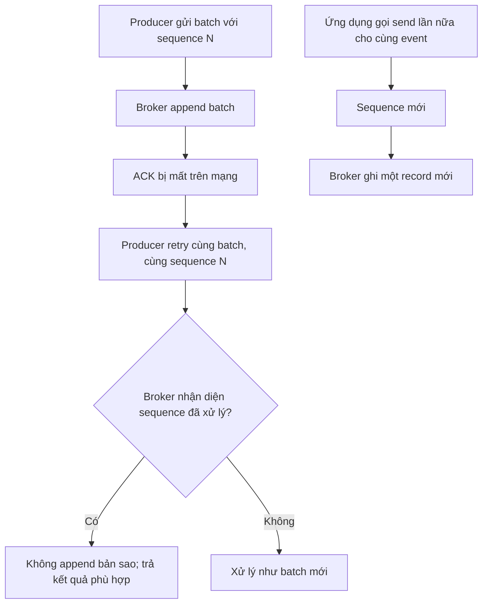
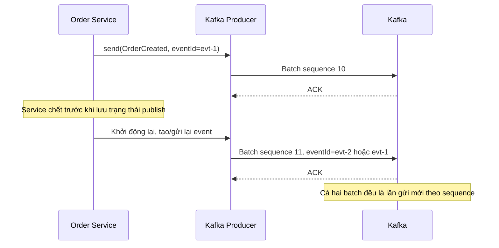
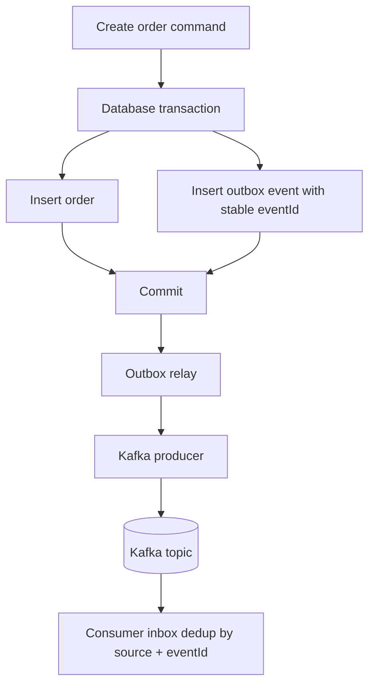

# Giới hạn khử trùng của producer so với sự kiện nghiệp vụ trùng

Kafka producer có cơ chế idempotence để tránh ghi lặp một record batch khi client phải retry do lỗi mạng hoặc broker phản hồi không rõ ràng. Cơ chế này rất quan trọng, nhưng phạm vi của nó hẹp hơn khái niệm khử trùng sự kiện ở tầng nghiệp vụ.

Một producer idempotent không tự hiểu rằng hai payload cùng `eventId`, cùng `orderId` hay cùng nội dung là một sự kiện. Nếu ứng dụng gọi `send()` hai lần cho cùng một event, Kafka có thể ghi hai record riêng biệt. Muốn ngăn cùng một nghiệp vụ được thực hiện lặp, hệ thống cần định danh command/event ổn định và có cơ chế idempotency ở tầng ứng dụng hoặc consumer.

## 1. Hai loại trùng lặp khác nhau

Hãy phân biệt hai tình huống:

1. **Duplicate do retry ở giao thức gửi:** producer đã gửi một batch, broker có thể đã append batch nhưng response bị mất. Kafka client gửi lại chính batch đó. Producer idempotence giúp broker nhận ra lần retry và không append thêm bản sao.
2. **Duplicate do nghiệp vụ hoặc ứng dụng:** một API request được gửi lại, một outbox relay phát lại event, hai service cùng tạo event cho một hành động hoặc code gọi `send()` lần nữa. Đây là một lần gửi mới theo góc nhìn producer; idempotence không tự biết nó trùng với event trước.

| Tình huống | Ví dụ | Producer idempotence xử lý? |
|---|---|---|
| Broker đã ghi batch nhưng ACK bị mất; client retry nội bộ cùng batch | Retry do timeout/network | Có, trong phạm vi producer identity và sequence được Kafka quản lý |
| Ứng dụng gọi `send()` lần thứ hai với cùng event object | Hai lần gọi API gửi | Không tự deduplicate |
| Client HTTP retry cùng lệnh tạo đơn, service phát event lần nữa | Cùng command được xử lý hai lần | Không |
| Outbox relay gửi event, chết trước khi đánh dấu đã gửi, rồi gửi lại | Cùng outbox row được publish lại | Không tự deduplicate lần gửi mới |
| Hai producer instance độc lập gửi cùng event | Hai producer ID khác nhau | Không |



Điểm cốt lõi: producer idempotence nhận diện lần retry của một lần gửi ở cấp protocol. Nó không so sánh nội dung nghiệp vụ giữa các lần gọi `send()`.

## 2. Producer idempotence hoạt động như thế nào?

Khi idempotence được bật, Kafka cấp cho producer một **Producer ID (PID)**. Producer duy trì sequence number theo từng topic-partition và gắn thông tin này vào record batch. Broker theo dõi PID, epoch và sequence để phát hiện batch đã được xử lý.

Ví dụ producer gửi ba batch tới partition 2:

| Batch | PID | Partition | Sequence range minh họa |
|---|---:|---:|---:|
| Batch A | 7401 | 2 | 0-9 |
| Batch B | 7401 | 2 | 10-19 |
| Batch C | 7401 | 2 | 20-29 |

Nếu response của Batch B bị mất và client retry Batch B, request retry vẫn mang cùng PID và sequence tương ứng. Broker có thể nhận ra batch đó đã được ghi, tránh append thêm một bản sao. Sequence được quản lý riêng theo partition, vì vậy không phải một bộ đếm toàn cục cho tất cả topic.

Idempotence cần được cấu hình với các điều kiện phù hợp. Các thiết lập thường dùng là:

```properties
acks=all
enable.idempotence=true
max.in.flight.requests.per.connection=5
```

Kafka yêu cầu `acks=all`, retries lớn hơn 0 và `max.in.flight.requests.per.connection` không vượt quá 5 khi dùng idempotence. Các phiên bản Kafka hiện đại thường bật idempotence mặc định nếu không có cấu hình xung đột; trong hệ thống quan trọng, khai báo rõ ràng giúp cấu hình và ý định dễ kiểm tra hơn. `delivery.timeout.ms` vẫn giới hạn tổng thời gian producer cố gắng hoàn tất một lần gửi, nên retries rất lớn không có nghĩa producer retry vô hạn.

### Idempotence có phạm vi nào?

Producer idempotence bảo vệ retry nội bộ của producer đối với batch đã gửi, dựa trên danh tính producer và sequence do Kafka quản lý. Nó không phải một bảng deduplication lưu mọi event ID từng xuất hiện trong topic.

Các trường hợp sau vẫn có thể tạo duplicate nghiệp vụ:

- Ứng dụng tạo một `ProducerRecord` mới cho cùng event rồi gọi `send()` lần nữa. Producer gán sequence mới.
- Ứng dụng khởi động producer mới và phát lại cùng event đã được ghi trước đó. Producer session mới có thể có PID mới.
- Hai instance ứng dụng cùng nhận một command và mỗi instance tạo một event rồi gửi.
- Một producer phát cùng event vào hai topic hoặc hai partition theo hai lần gửi độc lập.

Kafka không đọc `eventId` trong JSON để tự so sánh, cũng không hash value để quyết định bỏ record. Hai record có key và value giống hệt nhau vẫn có thể là hai record khác nhau với offset khác nhau.

## 3. Vì sao retry ở tầng ứng dụng có thể tạo duplicate?

Giả sử Order Service tạo event `OrderCreated` cho đơn `order-1042`. Producer gửi thành công nhưng ứng dụng không nhận được kết quả vì timeout ở tầng gọi hoặc tiến trình bị dừng trước khi lưu trạng thái đã publish.

Khi service chạy lại, nếu nó tạo một event mới và gọi `send()` lại, producer xem đó là một lần gửi mới. Cơ chế idempotence không thể biết lần gửi mới đại diện cho cùng một lần tạo đơn.



Nếu ứng dụng giữ nguyên `eventId=evt-1`, consumer có thể nhận ra cùng một event và loại bỏ lần xử lý trùng. Nếu ứng dụng tạo `eventId=evt-2`, consumer không có cơ sở biết hai event thực ra xuất phát từ cùng command trừ khi có thêm command ID hoặc khóa nghiệp vụ.

## 4. Phân biệt command ID, event ID và Kafka key

Ba giá trị thường bị dùng lẫn nhau nhưng phục vụ các mục đích khác nhau:

| Giá trị | Vai trò | Ví dụ |
|---|---|---|
| `commandId` / idempotency key | Nhận diện một yêu cầu nghiệp vụ mà client có thể gửi lại | `checkout-request-88` |
| `eventId` | Nhận diện một lần phát sinh event cụ thể | `evt-01934f2a` |
| Kafka record key | Định tuyến record vào partition và giữ ordering theo thực thể | `order-1042` |
| `correlationId` | Liên kết nhiều hoạt động trong cùng quy trình | `checkout-flow-88` |

Một command có thể tạo nhiều event. Mỗi event cần `eventId` riêng, trong khi các event có thể chia sẻ `correlationId`. Nhiều event của cùng một đơn hàng thường dùng `orderId` làm Kafka key để đi vào cùng partition; `eventId` vẫn nằm trong payload hoặc header để deduplication.

Đặt `eventId` làm Kafka key cũng không khiến Kafka tự loại bỏ record trùng. Hai record cùng key vẫn được append với hai offset khác nhau. Key phục vụ partitioning và log compaction, không phải unique constraint.

## 5. Chặn command trùng ngay tại ranh giới nghiệp vụ

Nếu client có thể retry một lệnh tạo đơn vì không nhận được HTTP response, Order Service nên nhận một idempotency key ổn định từ client hoặc tạo command ID ở ranh giới tin cậy. Service lưu key này với kết quả xử lý trong database và đặt unique constraint để hai request đồng thời không tạo hai đơn.

Ví dụ bảng lưu command đã xử lý:

```sql
CREATE TABLE processed_commands (
    command_id   VARCHAR(120) PRIMARY KEY,
    result_id    VARCHAR(120) NOT NULL,
    processed_at TIMESTAMP WITH TIME ZONE NOT NULL
);
```

Luồng xử lý:

1. Nhận command cùng `commandId`.
2. Bắt đầu transaction database.
3. Thử ghi `commandId` vào bảng `processed_commands`.
4. Nếu key đã tồn tại, đọc kết quả đã lưu và trả lại kết quả cũ.
5. Nếu key mới, tạo đơn hàng, tạo `eventId`, ghi event vào outbox và lưu kết quả command trong cùng transaction.
6. Commit transaction.

Unique constraint là lớp bảo vệ quan trọng khi hai request có cùng idempotency key đến đồng thời. Chỉ kiểm tra bằng một câu `SELECT` trước khi insert có thể gặp race condition: cả hai request cùng thấy chưa tồn tại rồi cùng tiếp tục. Hãy dùng unique constraint và xử lý conflict trong transaction.

Ví dụ này chống việc cùng command được thực hiện hai lần. Nó không thay thế deduplication ở consumer, vì event vẫn có thể được relay hoặc giao lại.

## 6. Transactional Outbox: giữ event ID ổn định khi publish lại

Một lỗi phổ biến là ghi đơn vào database rồi gửi Kafka trong hai thao tác độc lập. Database có thể commit nhưng publish thất bại; hoặc Kafka đã nhận event nhưng database rollback. Transactional Outbox lưu thay đổi nghiệp vụ và ý định phát event trong cùng transaction database.

Ví dụ cấu trúc outbox:

```sql
CREATE TABLE outbox_events (
    event_id       VARCHAR(120) PRIMARY KEY,
    aggregate_id   VARCHAR(120) NOT NULL,
    event_type     VARCHAR(200) NOT NULL,
    payload        TEXT NOT NULL,
    occurred_at    TIMESTAMP WITH TIME ZONE NOT NULL,
    published_at   TIMESTAMP WITH TIME ZONE NULL
);
```

Order Service tạo event ID một lần và lưu payload đã tạo vào outbox trong transaction cùng với đơn hàng. Relay đọc row chưa publish và gửi đúng payload đó lên Kafka. Nếu relay nhận ACK rồi chết trước khi cập nhật `published_at`, lần chạy sau có thể gửi lại cùng row. `eventId` không đổi, nên consumer có thể deduplicate.



Outbox thường cung cấp khả năng phát ít nhất một lần (at-least-once) nếu relay retry cho tới khi xác nhận. Nó không tự tạo exactly-once end-to-end. Consumer vẫn phải xử lý an toàn khi cùng một outbox event được gửi lại.

### Producer idempotence vẫn hữu ích trong outbox relay

Relay có thể dùng producer idempotence để xử lý retry nội bộ của Kafka client khi gửi một batch. Tuy nhiên, nếu relay đã hoàn tất một lần `send()` rồi sau đó chủ động đọc lại row và gọi `send()` lần nữa, đó là lần gửi mới. Event ID ổn định cho phép consumer nhận diện hai lần giao này.

## 7. Deduplicate ở consumer bằng Inbox

Consumer là nơi thường có đủ ngữ cảnh để quyết định một event đã được áp dụng vào nghiệp vụ hay chưa. Một mẫu phổ biến là **Inbox**: lưu dấu event đã xử lý bằng unique key và cập nhật dữ liệu nghiệp vụ trong cùng transaction database.

Ví dụ:

```sql
CREATE TABLE processed_events (
    source       VARCHAR(300) NOT NULL,
    event_id     VARCHAR(120) NOT NULL,
    processed_at TIMESTAMP WITH TIME ZONE NOT NULL,
    PRIMARY KEY (source, event_id)
);
```

Consumer dùng cặp `(source, eventId)` nếu event tuân theo CloudEvents; nếu hệ thống đảm bảo event ID duy nhất toàn cục, có thể dùng `eventId` làm khóa. Luồng xử lý:

1. Nhận event và đọc `source`, `eventId`.
2. Bắt đầu transaction database.
3. Insert cặp định danh vào inbox.
4. Nếu unique constraint báo trùng, không áp dụng lại thay đổi nghiệp vụ.
5. Nếu insert thành công, cập nhật trạng thái nghiệp vụ trong cùng transaction.
6. Commit database transaction rồi commit Kafka offset theo chính sách consumer.

Nếu database transaction rollback, cả dấu inbox và cập nhật nghiệp vụ đều rollback. Nếu database đã commit nhưng consumer chết trước khi commit offset, Kafka có thể giao lại record; inbox nhận ra event đã xử lý và tránh áp dụng lần hai.

Với lời gọi ra hệ thống ngoài như cổng thanh toán, transaction database không bao trùm HTTP request. Hãy truyền idempotency key của nhà cung cấp nếu có, lưu trạng thái workflow và thiết kế retry/compensation. Không thể tuyên bố exactly-once cho một lời gọi ngoài chỉ nhờ bật producer idempotence.

## 8. Kafka transaction giải quyết điều gì?

Kafka transaction mở rộng khả năng của producer idempotent để ghi nhiều record vào một transaction và phối hợp commit offset khi xử lý consume-transform-produce. Một transactional producer thường cấu hình `transactional.id` ổn định cho logical producer, gọi `initTransactions()`, `beginTransaction()`, gửi record, rồi commit hoặc abort transaction.

Consumer muốn chỉ nhìn thấy dữ liệu đã commit dùng:

```properties
isolation.level=read_committed
```

Với luồng consume-transform-produce, ứng dụng có thể gửi output record và offset input vào cùng transaction Kafka. Điều này hỗ trợ exactly-once processing trong phạm vi Kafka: output và offset được commit hoặc abort cùng nhau.

`transactional.id` còn giúp Kafka nhận diện các phiên bản producer cùng logical identity và fence producer cũ bằng epoch khi một producer mới khởi tạo cùng ID. ID này cần ổn định qua restart của cùng logical producer và không được dùng đồng thời bởi hai producer instance đang hoạt động độc lập. Tuy nhiên, nó không phải khóa nghiệp vụ. Nếu một ứng dụng xử lý lại cùng command sau khi transaction trước đã commit và bắt đầu transaction mới, event vẫn có thể được ghi thêm lần nữa.

Kafka transaction không tự bao trùm database quan hệ, HTTP API, email hay hệ thống bên ngoài. Khi cần nhất quán giữa database và Kafka, hãy dùng Outbox/CDC hoặc một workflow có cơ chế idempotency và phục hồi phù hợp.

## 9. Log compaction không phải cơ chế chặn duplicate khi produce

Topic có `cleanup.policy=compact` giữ lại giá trị mới nhất theo key trong quá trình log cleaner chạy. Nếu hai record cùng key được gửi, cả hai vẫn có thể được append và consumer có thể đọc cả hai trước khi compaction dọn bản cũ.

| Cơ chế | Mục đích | Có chặn duplicate nghiệp vụ ngay lúc produce? |
|---|---|---|
| Producer idempotence | Chống duplicate do retry cùng batch | Không |
| Event ID + consumer inbox | Nhận diện và bỏ qua lần giao lại cùng event | Có ở tầng xử lý consumer |
| Unique constraint cho command ID | Chặn cùng command tạo tác động lặp | Có ở ranh giới nghiệp vụ/database |
| Log compaction | Giữ trạng thái mới nhất theo key sau quá trình cleanup | Không |
| Kafka transaction | Commit/abort nhóm record và offset trong Kafka | Không tự deduplicate cùng event qua hai transaction riêng |

Không dùng compaction để thay thế inbox hoặc unique constraint. Nó phục vụ topic lưu trạng thái theo key, không đảm bảo consumer chỉ nhìn thấy một bản ghi của key đó.

## 10. Ví dụ cấu hình Java/Spring Kafka

### Bật producer idempotence

Ví dụ cấu hình producer Java:

```java
import java.util.Properties;

import org.apache.kafka.clients.producer.KafkaProducer;
import org.apache.kafka.clients.producer.ProducerConfig;
import org.apache.kafka.common.serialization.StringSerializer;

Properties props = new Properties();
props.put(ProducerConfig.BOOTSTRAP_SERVERS_CONFIG, "localhost:9092");
props.put(ProducerConfig.KEY_SERIALIZER_CLASS_CONFIG,
          StringSerializer.class.getName());
props.put(ProducerConfig.VALUE_SERIALIZER_CLASS_CONFIG,
          StringSerializer.class.getName());
props.put(ProducerConfig.ACKS_CONFIG, "all");
props.put(ProducerConfig.ENABLE_IDEMPOTENCE_CONFIG, true);
props.put(ProducerConfig.MAX_IN_FLIGHT_REQUESTS_PER_CONNECTION, 5);
// Kafka client mặc định retries > 0; có thể đặt rõ nếu muốn cấu hình tường minh.
props.put(ProducerConfig.RETRIES_CONFIG, Integer.MAX_VALUE);
props.put(ProducerConfig.DELIVERY_TIMEOUT_MS_CONFIG, 120_000);
```

Đây là cấu hình bảo vệ retry ở producer client. Nó không thay thế event ID, command ID hoặc deduplication trong database.

Với Spring Boot, cấu hình tương ứng có thể viết:

```yaml
spring:
  kafka:
    bootstrap-servers: localhost:9092
    producer:
      acks: all
      properties:
        enable.idempotence: true
        max.in.flight.requests.per.connection: 5
        retries: 2147483647
        delivery.timeout.ms: 120000
```

### Gửi event có ID ổn định

Event ID phải được tạo tại thời điểm nghiệp vụ tạo event và được lưu cùng outbox row. Relay chỉ đọc lại event đã lưu, không tạo ID mới cho mỗi lần publish:

```java
public record OrderCreated(
    String eventId,
    String orderId,
    Instant occurredAt,
    BigDecimal total
) {}

// deserialize(...) là hàm của relay để đọc payload đã lưu trong outbox.
public void publish(OutboxEvent row) {
    OrderCreated event = deserialize(row.payload());

    kafkaTemplate.send(
        "orders.events",
        event.orderId(),   // Kafka key để giữ thứ tự theo đơn hàng
        event               // eventId ổn định nằm trong payload
    );
}
```

Không tạo `UUID.randomUUID()` ngay bên trong `publish()` nếu phương thức này được gọi lại cho cùng outbox row. Hãy tạo ID khi ghi outbox, sau đó tái sử dụng nguyên event đã lưu.

## 11. Chọn lớp idempotency theo loại lỗi

| Lớp | Khóa nhận diện | Chặn trường hợp nào? | Nơi triển khai |
|---|---|---|---|
| Producer protocol idempotence | PID + epoch + sequence theo partition | Retry nội bộ của cùng producer batch | Kafka producer/broker |
| Command idempotency | `commandId` hoặc HTTP idempotency key | Client gửi lại cùng lệnh nghiệp vụ | API/service + database unique constraint |
| Event identity | `source` + `eventId` | Cùng event được relay hoặc giao lại | Event envelope/outbox |
| Consumer inbox | `source` + `eventId` | Consumer nhận cùng event nhiều lần | Consumer + database transaction |
| Kafka transaction | `transactional.id` + transaction/offset | Atomic output và offset trong Kafka | Producer/consumer Kafka |

Một hệ thống đáng tin cậy thường kết hợp nhiều lớp. Producer idempotence giảm duplicate do retry giao thức; command idempotency ngăn một yêu cầu tạo nghiệp vụ hai lần; outbox giữ event ID ổn định; consumer inbox ngăn tác động nghiệp vụ bị áp dụng lặp.

## 12. Bài thực hành: quan sát giới hạn của producer idempotence

Thực hiện trên Kafka local với một topic thử nghiệm. Dùng producer cấu hình `acks=all` và `enable.idempotence=true`.

1. Gửi một record và quan sát topic/partition/offset.
2. Tạo tình huống retry nội bộ ở môi trường thử nghiệm, ví dụ mô phỏng lỗi mạng ngắn trong lúc producer đang gửi; quan sát producer retry và kiểm tra không có bản sao do retry protocol.
3. Gọi `send()` hai lần cho cùng payload và cùng key; đọc topic để thấy hai record riêng biệt có offset khác nhau.
4. Gửi hai record có cùng `eventId` nhưng từ hai producer instance; quan sát cả hai record vẫn có thể xuất hiện.
5. Thêm `eventId` vào payload và triển khai consumer inbox có unique constraint; gửi lại cùng event rồi xác minh tác động nghiệp vụ chỉ xảy ra một lần.
6. Thử gửi lại cùng `commandId` tới API tạo đơn; xác minh service trả lại kết quả cũ và không tạo đơn mới.
7. Thử outbox relay dừng sau khi Kafka ACK nhưng trước khi đánh dấu row đã publish; khi relay chạy lại, event được gửi lại với cùng ID và consumer inbox bỏ qua lần giao trùng.

Không gây lỗi mạng hoặc dừng broker trên môi trường production. Bài thực hành cần chạy trong môi trường lab có thể phục hồi.

## 13. Những nhầm lẫn thường gặp

- **Cho rằng `enable.idempotence=true` loại bỏ mọi event trùng:** nó bảo vệ retry cùng batch trong protocol, không so sánh event ID hay payload.
- **Cho rằng hai lần `send()` cùng object là một lần gửi:** mỗi lần gọi là một lần gửi mới, thường nhận sequence mới.
- **Dùng Kafka key làm khóa duy nhất:** key định tuyến partition; Kafka vẫn lưu nhiều record cùng key.
- **Tạo event ID trong mỗi lần retry:** cùng một event bị biến thành nhiều ID khác nhau, làm consumer khó deduplicate.
- **Dùng correlation ID để deduplicate:** nhiều event hợp lệ có thể chia sẻ một correlation ID.
- **Cho rằng `transactional.id` ngăn cùng event được gửi qua hai transaction:** transaction mới có thể commit một bản ghi nghiệp vụ đã xuất hiện trong transaction trước.
- **Cho rằng log compaction xóa duplicate ngay:** compaction chạy bất đồng bộ và consumer có thể đã đọc tất cả record trước đó.
- **Chỉ deduplicate ở producer:** duplicate vẫn có thể xuất hiện do outbox replay, producer khác, client retry hoặc consumer redelivery.
- **Cho rằng producer ACK nghĩa là consumer xử lý xong:** ACK chỉ phản ánh kết quả ghi vào Kafka theo cấu hình producer.

Producer idempotence giải quyết duplicate do retry ở cấp giao thức gửi. Sự kiện nghiệp vụ trùng cần được nhận diện bằng command ID và event ID ổn định, lưu dấu trong database hoặc inbox, và xử lý cùng transaction nghiệp vụ phù hợp. Kết hợp producer idempotence, transactional outbox và consumer deduplication giúp hệ thống chống lặp ở từng ranh giới mà không nhầm một bảo đảm cục bộ với exactly-once end-to-end.
