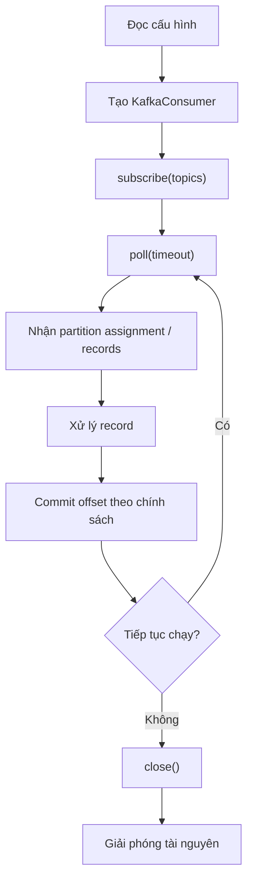

# Vòng đời KafkaConsumer và cấu hình tối thiểu

`KafkaConsumer` là client Java dùng để đọc record từ topic và tham gia consumer group. Để consumer hoạt động đúng, ứng dụng cần tạo client với cấu hình phù hợp, đăng ký topic, gọi `poll()` liên tục, xử lý record, quản lý offset và đóng consumer khi dừng. Các bước này tạo thành vòng đời cơ bản của một consumer.

Consumer có trạng thái và tham gia điều phối group. Nó không giống một HTTP client có thể gọi một lần rồi bỏ đó: `poll()` vừa lấy record vừa giúp client duy trì tiến trình tham gia group, nhận assignment và xử lý rebalance. Hiểu vòng đời này là nền tảng để triển khai service Java/Spring Kafka ổn định.

## 1. Vòng đời tổng quát

Một ứng dụng dùng `KafkaConsumer` trực tiếp thường đi qua các giai đoạn:

1. Đọc cấu hình và tạo `KafkaConsumer`.
2. Gọi `subscribe()` để đăng ký một hoặc nhiều topic.
3. Gọi `poll()` để tham gia consumer group, nhận partition assignment và lấy record.
4. Xử lý record theo thứ tự phù hợp với nghiệp vụ.
5. Commit offset theo chính sách đã chọn.
6. Lặp lại `poll()` trong khi ứng dụng còn hoạt động.
7. Dừng nhận công việc, hoàn tất phần xử lý phù hợp và gọi `close()` để giải phóng tài nguyên.



`subscribe()` chỉ đăng ký ý định nhận dữ liệu. Quá trình tham gia group và nhận partition thường diễn ra trong các lần `poll()` tiếp theo. Vì vậy, sau khi subscribe, ứng dụng phải bắt đầu poll để consumer được đưa vào group và nhận assignment.

## 2. Các cấu hình tối thiểu

Để một consumer đọc topic bằng consumer group, cấu hình thường cần có:

| Cấu hình | Ví dụ | Ý nghĩa |
|---|---|---|
| `bootstrap.servers` | `localhost:9092` | Danh sách broker dùng để kết nối ban đầu và lấy metadata |
| `group.id` | `order-service` | Định danh consumer group; các consumer cùng group chia sẻ partition assignment |
| `key.deserializer` | `StringDeserializer` | Chuyển byte của key thành kiểu Java |
| `value.deserializer` | `StringDeserializer` | Chuyển byte của value thành kiểu Java |
| `enable.auto.commit` | `false` | Tắt commit offset tự động để ứng dụng chủ động commit sau xử lý |
| `auto.offset.reset` | `earliest` | Chọn vị trí bắt đầu khi group chưa có committed offset hợp lệ |

Ví dụ tạo `Properties` cho consumer đọc chuỗi:

```java
Properties props = new Properties();
props.put(ConsumerConfig.BOOTSTRAP_SERVERS_CONFIG, "localhost:9092");
props.put(ConsumerConfig.GROUP_ID_CONFIG, "order-service");
props.put(ConsumerConfig.KEY_DESERIALIZER_CLASS_CONFIG,
        StringDeserializer.class.getName());
props.put(ConsumerConfig.VALUE_DESERIALIZER_CLASS_CONFIG,
        StringDeserializer.class.getName());
props.put(ConsumerConfig.ENABLE_AUTO_COMMIT_CONFIG, "false");
props.put(ConsumerConfig.AUTO_OFFSET_RESET_CONFIG, "earliest");
```

`bootstrap.servers` có thể chứa nhiều broker để client có thêm điểm kết nối ban đầu. Client lấy metadata từ cluster rồi kết nối đến broker leader của các partition được gán. Danh sách bootstrap không cần liệt kê mọi broker trong cluster.

### Chọn `group.id`

`group.id` xác định nhóm logic mà consumer tham gia. Các consumer có cùng `group.id` phối hợp chia partition của topic; một partition tại một thời điểm được gán cho tối đa một consumer trong cùng group. Những group khác nhau có thể đọc độc lập cùng topic, mỗi group duy trì offset riêng.

Ví dụ:

- `order-service` đọc topic `orders` để cập nhật trạng thái đơn hàng.
- `analytics-service` đọc cùng topic để tổng hợp số liệu.

Hai ứng dụng dùng hai group ID khác nhau nên không chia nhau record; mỗi group có tiến độ đọc riêng. Nếu khởi chạy hai instance của `order-service` với cùng group ID, Kafka phân phối partition giữa hai instance.

Với `subscribe()`, `group.id` thường là bắt buộc. Nếu dùng `assign()` để tự gán partition thủ công, ứng dụng có thể không dùng group coordination theo cách thông thường; khi đó cần tự quản lý assignment và offset phù hợp.

### Chọn `auto.offset.reset`

`auto.offset.reset` chỉ được áp dụng khi group chưa có committed offset hợp lệ cho partition, chẳng hạn group mới hoặc offset cũ đã nằm ngoài phạm vi log còn giữ.

| Giá trị | Hành vi |
|---|---|
| `earliest` | Bắt đầu từ offset sớm nhất còn có thể đọc |
| `latest` | Bắt đầu từ cuối log tại thời điểm cần reset |
| `none` | Ném lỗi nếu không tìm được committed offset hợp lệ |

Đặt `earliest` không làm một group đã có offset tự quay về đầu topic. Muốn replay, hãy chủ động reset offset bằng công cụ quản trị hoặc dùng group ID mới theo quy trình được kiểm soát.

## 3. Tạo KafkaConsumer và subscribe topic

Sau khi chuẩn bị cấu hình, tạo consumer và đăng ký topic:

```java
KafkaConsumer<String, String> consumer = new KafkaConsumer<>(props);
consumer.subscribe(List.of("orders"));
```

Consumer có thể subscribe nhiều topic:

```java
consumer.subscribe(List.of("orders", "payments"));
```

Khi dùng `subscribe()`, group coordinator quản lý membership và partition assignment. Khi thành viên group thay đổi, topic partition thay đổi hoặc metadata liên quan thay đổi, Kafka có thể thực hiện rebalance để phân phối lại partition.

Một lựa chọn khác là `assign()`:

```java
consumer.assign(List.of(new TopicPartition("orders", 0)));
```

`assign()` giao partition trực tiếp cho ứng dụng và không dùng cơ chế tự động phân phối partition của group theo cách `subscribe()` thực hiện. Đây là lựa chọn cho trường hợp đặc biệt cần kiểm soát assignment; ứng dụng phải tự xử lý nhiều trách nhiệm hơn như phối hợp consumer, ownership và offset. Không gọi `subscribe()` và `assign()` đồng thời để điều khiển cùng một consumer.

## 4. `poll()` là trung tâm của vòng đời consumer

`poll(Duration)` lấy các record hiện có và tham gia tiến trình điều phối consumer group. Một vòng lặp consumer cơ bản:

```java
while (running) {
    ConsumerRecords<String, String> records =
            consumer.poll(Duration.ofMillis(500));

    for (ConsumerRecord<String, String> record : records) {
        processOrder(record.key(), record.value());
    }
}
```

Nếu chưa có record, `poll()` có thể trả về tập record rỗng sau thời gian chờ. Ứng dụng vẫn cần tiếp tục poll để duy trì hoạt động của consumer, tham gia rebalance và nhận dữ liệu mới.

Không nên thay `poll()` bằng một vòng `sleep()` dài. Nếu ứng dụng không poll trong thời gian vượt `max.poll.interval.ms`, group có thể xem consumer là không còn tiến triển và phân phối lại partition cho thành viên khác. Khi đó consumer cũ có thể mất assignment và cần xử lý lại theo trạng thái group mới.

Một số cấu hình liên quan đến poll:

| Cấu hình | Vai trò |
|---|---|
| `max.poll.records` | Số record tối đa trả về trong một lần poll |
| `max.poll.interval.ms` | Khoảng tối đa giữa các lần poll trước khi consumer bị xem là không tiến triển |
| `session.timeout.ms` | Khoảng thời gian group coordinator chờ heartbeat trước khi xem member mất kết nối, trong các cơ chế group áp dụng cấu hình này |
| `heartbeat.interval.ms` | Tần suất heartbeat theo cấu hình group protocol tương ứng |

Kafka client hiện đại có thể dùng background heartbeat, nhưng ứng dụng vẫn phải gọi poll đúng nhịp để xử lý dữ liệu và duy trì tiến trình group. Heartbeat không thay thế yêu cầu poll thường xuyên.

## 5. Xử lý record và commit offset

Mỗi `ConsumerRecord` cung cấp các thông tin như topic, partition, offset, key, value, timestamp và headers. Offset là vị trí của record trong một partition, không phải số thứ tự toàn cục của topic.

Khi `enable.auto.commit=true`, client tự commit offset định kỳ theo `auto.commit.interval.ms`. Cách này đơn giản nhưng có thể commit tiến độ poll trước khi ứng dụng hoàn tất side effect, tùy cách xử lý batch. Nếu service cần kiểm soát rõ việc xử lý thành công rồi mới lưu tiến độ, thường đặt `enable.auto.commit=false` và commit thủ công.

Ví dụ commit đồng bộ sau khi xử lý toàn bộ batch:

```java
Properties props = new Properties();
props.put(ConsumerConfig.BOOTSTRAP_SERVERS_CONFIG, "localhost:9092");
props.put(ConsumerConfig.GROUP_ID_CONFIG, "order-service");
props.put(ConsumerConfig.KEY_DESERIALIZER_CLASS_CONFIG,
        StringDeserializer.class.getName());
props.put(ConsumerConfig.VALUE_DESERIALIZER_CLASS_CONFIG,
        StringDeserializer.class.getName());
props.put(ConsumerConfig.ENABLE_AUTO_COMMIT_CONFIG, "false");
props.put(ConsumerConfig.AUTO_OFFSET_RESET_CONFIG, "earliest");

try (KafkaConsumer<String, String> consumer = new KafkaConsumer<>(props)) {
    consumer.subscribe(List.of("orders"));

    while (true) {
        ConsumerRecords<String, String> records =
                consumer.poll(Duration.ofMillis(500));

        for (ConsumerRecord<String, String> record : records) {
            processOrder(record.key(), record.value());
        }

        if (!records.isEmpty()) {
            consumer.commitSync();
        }
    }
}
```

Đây là vòng lặp tối giản; ứng dụng chạy dài hạn cần có điều kiện dừng và cơ chế shutdown như phần sau. Nếu `processOrder()` ném lỗi trước khi commit, offset của batch chưa được commit bởi đoạn mã này. Khi consumer khởi động lại, record có thể được đọc lại. Vì vậy, side effect nên idempotent, ví dụ dùng `eventId` hoặc khóa nghiệp vụ duy nhất để tránh ghi trùng vào database.

`commitSync()` commit offset đã xử lý theo trạng thái consumer tại thời điểm gọi và chờ kết quả commit. Không commit trước khi xử lý xong nếu muốn tránh bỏ qua record khi ứng dụng lỗi. Với xử lý song song hoặc chỉ xử lý thành công một phần batch, không nên commit mù toàn bộ offset; cần theo dõi offset liên tục đã xử lý theo từng partition và chỉ commit đến vị trí an toàn.

## 6. Một chương trình consumer Java có vòng đời đầy đủ

Ví dụ dưới đây minh họa tạo consumer, subscribe, poll, xử lý, commit sau batch và dừng an toàn khi nhận tín hiệu shutdown. `wakeup()` là phương thức đặc biệt có thể gọi từ thread khác để đánh thức một consumer đang ở trong `poll()`; thao tác `close()` vẫn được thực hiện trên thread sở hữu consumer.

```java
import java.time.Duration;
import java.util.List;
import java.util.Properties;
import java.util.concurrent.atomic.AtomicBoolean;

import org.apache.kafka.clients.consumer.ConsumerConfig;
import org.apache.kafka.clients.consumer.ConsumerRecord;
import org.apache.kafka.clients.consumer.ConsumerRecords;
import org.apache.kafka.clients.consumer.KafkaConsumer;
import org.apache.kafka.common.errors.WakeupException;
import org.apache.kafka.common.serialization.StringDeserializer;

public class OrderConsumerApp {
    public static void main(String[] args) {
        Properties props = new Properties();
        props.put(ConsumerConfig.BOOTSTRAP_SERVERS_CONFIG, "localhost:9092");
        props.put(ConsumerConfig.GROUP_ID_CONFIG, "order-service");
        props.put(ConsumerConfig.KEY_DESERIALIZER_CLASS_CONFIG,
                StringDeserializer.class.getName());
        props.put(ConsumerConfig.VALUE_DESERIALIZER_CLASS_CONFIG,
                StringDeserializer.class.getName());
        props.put(ConsumerConfig.ENABLE_AUTO_COMMIT_CONFIG, "false");
        props.put(ConsumerConfig.AUTO_OFFSET_RESET_CONFIG, "earliest");

        AtomicBoolean running = new AtomicBoolean(true);

        try (KafkaConsumer<String, String> consumer = new KafkaConsumer<>(props)) {
            Runtime.getRuntime().addShutdownHook(new Thread(() -> {
                running.set(false);
                consumer.wakeup();
            }, "consumer-shutdown"));

            consumer.subscribe(List.of("orders"));

            try {
                while (running.get()) {
                    ConsumerRecords<String, String> records =
                            consumer.poll(Duration.ofMillis(500));

                    for (ConsumerRecord<String, String> record : records) {
                        processOrder(record.key(), record.value());
                    }

                    if (!records.isEmpty()) {
                        consumer.commitSync();
                    }
                }
            } catch (WakeupException e) {
                if (running.get()) {
                    throw e;
                }
                // Wakeup do shutdown hook yêu cầu vòng lặp kết thúc.
            }
        }
        // try-with-resources gọi close() sau khi vòng lặp kết thúc.
    }

    private static void processOrder(String orderId, String event) {
        System.out.printf("Processing order %s: %s%n", orderId, event);
    }
}
```

Ví dụ minh họa lifecycle cơ bản. Ứng dụng production cần thay `processOrder()` bằng logic nghiệp vụ có xử lý lỗi, logging, metrics và idempotency. Nếu một record trong batch thất bại, không nên commit offset của cả batch như thể mọi record đã thành công; cần xác định chính sách retry, cách ly record lỗi hoặc dừng xử lý để đọc lại.

Trong ví dụ, shutdown hook chỉ đổi cờ và gọi `wakeup()`. Nó không gọi `close()` trực tiếp vì KafkaConsumer không thread-safe; `close()` được thực hiện khi luồng main thoát khỏi khối try-with-resources.

## 7. KafkaConsumer không thread-safe

`KafkaConsumer` không được thiết kế để nhiều thread cùng gọi các phương thức như `poll()`, `subscribe()`, `commitSync()` hoặc `close()` đồng thời. Mô hình đơn giản và an toàn là một consumer được sở hữu bởi một thread; thread đó thực hiện toàn bộ thao tác consumer.

Nếu cần xử lý nghiệp vụ song song, có thể chuyển record sang worker pool, nhưng phải quản lý chặt:

- Không commit offset vượt qua record chưa xử lý xong trong cùng partition.
- Tạm dừng partition bằng `pause()` khi worker queue đầy và tiếp tục bằng `resume()` khi có capacity.
- Giữ thứ tự theo key/partition nếu nghiệp vụ yêu cầu ordering.
- Tiếp tục gọi `poll()` đủ thường xuyên để group coordination hoạt động.
- Khi rebalance, không giao cùng partition cho worker cũ và consumer mới cùng xử lý mà không có cơ chế ownership.

Một phương án khác là chạy nhiều consumer instance, mỗi instance trên một thread và dùng cùng `group.id`. Kafka sẽ phân phối partition giữa chúng. Số consumer có thể xử lý song song hữu ích trong một group bị giới hạn bởi số partition được gán.

## 8. Rebalance và listener quản lý partition

Khi consumer group thay đổi thành viên hoặc assignment, Kafka thực hiện rebalance. Consumer có thể nhận partition mới hoặc bị thu hồi partition cũ. Trong khoảng chuyển giao, ứng dụng cần hoàn tất phần xử lý an toàn và lưu offset đúng trước khi mất quyền sở hữu partition.

Có thể đăng ký `ConsumerRebalanceListener`:

```java
consumer.subscribe(List.of("orders"), new ConsumerRebalanceListener() {
    @Override
    public void onPartitionsRevoked(Collection<TopicPartition> partitions) {
        // Hoàn tất xử lý đã biết là an toàn và commit offset phù hợp.
        consumer.commitSync();
    }

    @Override
    public void onPartitionsAssigned(Collection<TopicPartition> partitions) {
        // Khởi tạo state hoặc tài nguyên theo partition nếu cần.
    }
});
```

Đây là ví dụ đơn giản cho xử lý đồng bộ trên cùng thread. Trong hệ thống xử lý song song, không nên commit toàn bộ offset một cách mù quáng trong `onPartitionsRevoked()`; chỉ commit các offset liên tục đã xử lý thành công và đảm bảo worker của partition bị thu hồi đã dừng hoặc bàn giao an toàn.

Rebalance có thể xảy ra khi consumer mới tham gia, consumer rời group, consumer không poll đúng hạn, partition thay đổi hoặc một số thay đổi metadata khác. Theo dõi log rebalance và thời gian xử lý batch giúp phát hiện nguyên nhân group churn.

## 9. Đóng consumer và graceful shutdown

`close()` đóng network connection, giải phóng tài nguyên nội bộ và rời consumer group. Có thể đặt timeout:

```java
consumer.close(Duration.ofSeconds(10));
```

Trong ứng dụng Java dài hạn, nên dừng nhận công việc mới, đánh thức poll nếu cần, xử lý hoặc kết thúc batch hiện tại theo deadline, commit offset an toàn rồi đóng consumer. `close()` không thay thế commit offset theo nghiệp vụ; với manual commit, ứng dụng phải chủ động quyết định offset nào đã xử lý xong.

`wakeup()` là cách chuẩn để yêu cầu thread đang ở trong `poll()` thoát sớm. Thread khác có thể gọi `wakeup()`, nhưng các thao tác consumer còn lại vẫn nên nằm trên thread sở hữu consumer. Khi `poll()` ném `WakeupException`, kiểm tra cờ shutdown: nếu ứng dụng đang dừng thì thoát vòng lặp; nếu không, xử lý như lỗi cần báo cáo.

Nếu consumer được quản lý bởi Spring Kafka listener container, Spring điều phối vòng đời listener và consumer. Khi ứng dụng dừng, hãy để container dừng theo lifecycle của Spring và cấu hình thời gian shutdown phù hợp; không tự đóng consumer do framework tạo bên trong listener.

## 10. Cấu hình bổ sung khi đưa vào production

Sau cấu hình tối thiểu, cần cân nhắc thêm các thuộc tính theo workload:

| Cấu hình | Mục đích | Lưu ý |
|---|---|---|
| `client.id` | Đặt tên client để nhận diện trong log/metrics | Nên phân biệt service và instance |
| `max.poll.records` | Giới hạn số record một poll trả về | Batch lớn cần thời gian xử lý và memory lớn hơn |
| `max.poll.interval.ms` | Giới hạn thời gian giữa các lần poll | Phải đủ dài cho xử lý batch nhưng vẫn phát hiện consumer bị kẹt |
| `fetch.min.bytes` | Lượng dữ liệu tối thiểu mong muốn cho fetch response | Tăng có thể cải thiện throughput, đổi lại latency |
| `fetch.max.wait.ms` | Thời gian broker chờ để gom đủ dữ liệu fetch | Cân bằng latency và throughput |
| `max.partition.fetch.bytes` | Giới hạn dữ liệu fetch cho mỗi partition | Phải tương thích với kích thước record batch lớn |
| `session.timeout.ms` | Timeout phát hiện member mất kết nối theo group protocol | Phụ thuộc broker và group protocol được dùng |
| `heartbeat.interval.ms` | Nhịp heartbeat ở group protocol tương ứng | Thường đặt nhỏ hơn session timeout theo khuyến nghị phiên bản |

Không nên sao chép một bộ cấu hình production mà không đo tải. Hãy xác định kích thước record, số partition, thời gian xử lý mỗi batch, throughput và SLA latency rồi điều chỉnh từng cấu hình.

## 11. Cấu hình consumer với Spring Boot và Spring Kafka

Với ứng dụng Spring Boot, cấu hình consumer thường được khai báo trong `application.yml`; `ConcurrentKafkaListenerContainerFactory` hoặc auto-configuration của Spring Boot tạo listener container và quản lý consumer.

```yaml
spring:
  kafka:
    bootstrap-servers: localhost:9092
    consumer:
      group-id: order-service
      enable-auto-commit: false
      auto-offset-reset: earliest
      key-deserializer: org.apache.kafka.common.serialization.StringDeserializer
      value-deserializer: org.apache.kafka.common.serialization.StringDeserializer
    listener:
      ack-mode: record
```

Ví dụ listener:

```java
@Component
public class OrderListener {
    @KafkaListener(topics = "orders", groupId = "order-service")
    public void onMessage(ConsumerRecord<String, String> record) {
        processOrder(record.key(), record.value());
    }
}
```

Với listener container, Spring điều phối poll loop, rebalance callback, commit theo acknowledgement mode và lifecycle shutdown. `ack-mode` cần được chọn theo cách xử lý và cấu hình container; ví dụ `record` chỉ phù hợp khi listener xử lý record đồng bộ và chỉ trả về sau khi nghiệp vụ hoàn tất. Với xử lý bất đồng bộ, cần cấu hình acknowledgement và container theo API của phiên bản Spring Kafka đang dùng.

Không nên trộn việc tự tạo `KafkaConsumer` với consumer do listener container quản lý cho cùng một luồng xử lý. Hãy chọn một mô hình lifecycle rõ ràng để tránh đóng consumer sai thread hoặc commit offset ngoài container.

## 12. Những hiểu nhầm thường gặp

- **“Gọi `subscribe()` là consumer đã bắt đầu đọc.”** Consumer cần `poll()` để tham gia group, nhận assignment và lấy record.
- **“`auto.offset.reset=earliest` luôn đọc từ đầu topic.”** Cấu hình chỉ áp dụng khi không có committed offset hợp lệ.
- **“Mỗi consumer group chỉ có thể đọc topic một lần.”** Các group khác nhau đọc độc lập và giữ offset riêng.
- **“Có thể dùng KafkaConsumer từ nhiều thread.”** Consumer không thread-safe; chỉ `wakeup()` được thiết kế để gọi từ thread khác trong mô hình này.
- **“`close()` tự bảo đảm mọi record đã xử lý và offset đã commit.”** Ứng dụng phải quản lý xử lý và commit theo semantics nghiệp vụ.
- **“Leader election luôn làm consumer group rebalance.”** Partition leader có thể đổi mà assignment của group vẫn giữ nguyên.
- **“Tăng `max.poll.records` luôn tăng throughput.”** Batch lớn có thể làm xử lý vượt `max.poll.interval.ms`, tăng memory và gây rebalance.
- **“Spring listener cần tự đóng KafkaConsumer.”** Listener container sở hữu consumer và quản lý lifecycle.

## 13. Checklist triển khai

- [ ] `bootstrap.servers`, `group.id` và deserializer khớp với cluster/topic/payload.
- [ ] `auto.offset.reset` được chọn đúng cho group mới và tình huống mất committed offset.
- [ ] `enable.auto.commit` được đặt theo chính sách xử lý; manual commit chỉ thực hiện sau xử lý thành công.
- [ ] `poll()` chạy liên tục và thời gian xử lý batch phù hợp với `max.poll.interval.ms`.
- [ ] Một KafkaConsumer chỉ được điều khiển bởi một thread; dùng `wakeup()` cho shutdown từ thread khác.
- [ ] Rebalance listener không commit vượt offset đã xử lý liên tục.
- [ ] Side effect có tính idempotent để chịu được việc record được phát lại.
- [ ] `close(Duration)` được gọi trong lifecycle shutdown với deadline phù hợp.
- [ ] Spring listener container được để framework quản lý, không tự đóng consumer nội bộ.
- [ ] Có metrics cho consumer lag, poll interval, rebalance, commit failure và processing latency.

Vòng đời `KafkaConsumer` xoay quanh `subscribe()`, `poll()`, xử lý record, commit offset và `close()`. Cấu hình tối thiểu xác định broker, group, deserializer và vị trí bắt đầu khi chưa có offset. Khi kết hợp poll loop đúng nhịp, commit sau xử lý, một thread sở hữu consumer và shutdown có kiểm soát, ứng dụng Java/Spring Kafka có nền tảng vững chắc để mở rộng sang retry, rebalance và xử lý song song.
