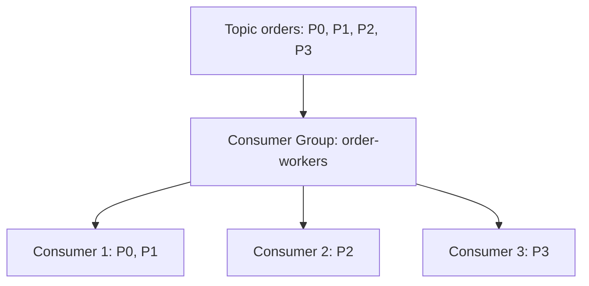

# `assign` trực tiếp và khác biệt với tham gia consumer group

## Hai cách consumer nhận partition

Kafka Java Consumer có hai cách xác định partition sẽ đọc. Ứng dụng có thể đăng ký topic bằng `subscribe()` để tham gia cơ chế quản lý consumer group, hoặc chỉ định chính xác partition bằng `assign()`. Cả hai cách đều dùng `poll()` để lấy record, nhưng quyền phân công partition, hành vi khi scale và trách nhiệm vận hành rất khác nhau.

- **`subscribe()`**: consumer đăng ký topic với một `group.id`. Group coordinator và partition assignor phối hợp chia partition giữa các thành viên cùng group. Khi thành viên hoặc partition thay đổi, group có thể rebalance.
- **`assign()`**: ứng dụng tự chỉ định danh sách `TopicPartition` cho consumer. Consumer không tham gia cơ chế group membership để Kafka tự phân công partition; ứng dụng chịu trách nhiệm quyết định ai đọc partition nào và cập nhật assignment khi topology thay đổi.

`assign()` phù hợp với các pipeline cần quyền kiểm soát rõ ràng, xử lý partition theo cấu hình cố định hoặc tích hợp với bộ điều phối bên ngoài. `subscribe()` thường phù hợp hơn khi muốn thêm/bớt instance mà Kafka tự cân bằng tải trong consumer group.

Trong module KAFKA, hiểu khác biệt này giúp triển khai consumer Java/Spring Kafka đúng cách, kiểm soát offset, ordering, retry và khả năng mở rộng khi xử lý event streaming.

## 1. Consumer group hoạt động với `subscribe()` như thế nào?

### 1.1 Group coordinator phân công partition

Các consumer dùng cùng `group.id` tạo thành một consumer group. Mỗi consumer đăng ký các topic cần đọc. Group coordinator phối hợp quá trình group membership và rebalance; partition assignor xác định partition nào được giao cho thành viên nào.

Trong cùng một consumer group, một partition chỉ được gán cho tối đa một consumer member tại một thời điểm. Nhiều consumer group khác nhau vẫn có thể đọc độc lập cùng một topic.



Khi một consumer mới tham gia, một consumer rời group, hoặc số partition của topic thay đổi, Kafka có thể chạy rebalance để phân công lại partition. Rebalance giúp group thích nghi với thay đổi membership, nhưng trong khoảng chuyển giao có thể làm giảm hoặc tạm dừng việc xử lý tùy assignor và giao thức rebalance.

### 1.2 Đăng ký topic bằng `subscribe()`

Ví dụ consumer đăng ký topic `orders`:

```java
Properties props = new Properties();
props.put(ConsumerConfig.BOOTSTRAP_SERVERS_CONFIG, "localhost:9092");
props.put(ConsumerConfig.GROUP_ID_CONFIG, "order-workers");
props.put(ConsumerConfig.KEY_DESERIALIZER_CLASS_CONFIG,
        StringDeserializer.class.getName());
props.put(ConsumerConfig.VALUE_DESERIALIZER_CLASS_CONFIG,
        StringDeserializer.class.getName());
props.put(ConsumerConfig.ENABLE_AUTO_COMMIT_CONFIG, false);
props.put(ConsumerConfig.AUTO_OFFSET_RESET_CONFIG, "earliest");

KafkaConsumer<String, String> consumer = new KafkaConsumer<>(props);
consumer.subscribe(List.of("orders"));

try {
    while (true) {
        ConsumerRecords<String, String> records =
                consumer.poll(Duration.ofMillis(500));

        for (ConsumerRecord<String, String> record : records) {
            processOrder(record);
        }

        if (!records.isEmpty()) {
            consumer.commitSync();
        }
    }
} finally {
    consumer.close();
}
```

`subscribe()` khai báo ý định đọc topic; việc phân công partition diễn ra qua group protocol và có thể cần các lần `poll()` để hoàn tất quá trình tham gia group. Ứng dụng không nên giả định rằng ngay sau lệnh `subscribe()` thì `assignment()` đã chứa đầy đủ partition.

## 2. `assign()` chỉ định partition trực tiếp

### 2.1 Tạo `TopicPartition` và gán cho consumer

`TopicPartition` gồm tên topic và số partition. Ứng dụng tạo danh sách các partition cần đọc rồi gọi `assign()`:

```java
String topic = "orders";
TopicPartition partition0 = new TopicPartition(topic, 0);
TopicPartition partition1 = new TopicPartition(topic, 1);

consumer.assign(List.of(partition0, partition1));
```

Consumer này sẽ đọc đúng hai partition được chỉ định. Kafka không tự chọn thêm partition khác cho consumer, cũng không tự chuyển partition sang instance khác khi consumer dừng.

Một ví dụ đầy đủ với manual assignment:

```java
Properties props = new Properties();
props.put(ConsumerConfig.BOOTSTRAP_SERVERS_CONFIG, "localhost:9092");
props.put(ConsumerConfig.GROUP_ID_CONFIG, "orders-manual-readers");
props.put(ConsumerConfig.KEY_DESERIALIZER_CLASS_CONFIG,
        StringDeserializer.class.getName());
props.put(ConsumerConfig.VALUE_DESERIALIZER_CLASS_CONFIG,
        StringDeserializer.class.getName());
props.put(ConsumerConfig.ENABLE_AUTO_COMMIT_CONFIG, false);
props.put(ConsumerConfig.AUTO_OFFSET_RESET_CONFIG, "earliest");

KafkaConsumer<String, String> consumer = new KafkaConsumer<>(props);
TopicPartition partition = new TopicPartition("orders", 0);
consumer.assign(List.of(partition));

try {
    while (true) {
        ConsumerRecords<String, String> records =
                consumer.poll(Duration.ofMillis(500));

        for (ConsumerRecord<String, String> record : records) {
            processOrder(record);
        }

        if (!records.isEmpty()) {
            consumer.commitSync();
        }
    }
} finally {
    consumer.close();
}
```

Ví dụ dùng `group.id` để lưu offset của consumer trong một namespace group ổn định. `group.id` không khiến Kafka tự phân công partition cho consumer đang dùng `assign()`; việc gán partition vẫn do ứng dụng quyết định.

### 2.2 `assign()` không kích hoạt group rebalance

Khi dùng `assign()`, consumer không tham gia group membership protocol để nhận partition từ group coordinator. Vì vậy:

- Kafka không tự cân bằng partition giữa các consumer dùng manual assignment.
- Consumer mới khởi động không tự nhận phần partition của consumer đã dừng.
- Thay đổi số partition của topic không tự cập nhật danh sách `TopicPartition` mà ứng dụng đã gán.
- Ứng dụng cần tự quản lý ownership, phân phối assignment và chuyển giao khi instance thay đổi.

Điều này tạo ra quyền kiểm soát cao hơn, nhưng cũng chuyển trách nhiệm điều phối từ Kafka sang ứng dụng hoặc hệ thống quản lý bên ngoài.

### 2.3 Không trộn `subscribe()` và `assign()` cho cùng consumer

`subscribe()` và `assign()` là hai cơ chế xác định partition assignment. Hãy chọn một chế độ cho mỗi consumer. Gọi `subscribe()` sau khi đã manual assign sẽ thay đổi subscription state; gọi `assign()` sau khi đã subscribe sẽ chuyển sang assignment tường minh. Không nên luân phiên hai API như thể chúng là hai bộ lọc có thể cộng dồn.

Nếu muốn đổi chế độ, hãy thực hiện như một thay đổi trạng thái có chủ đích, xử lý offset và ownership trước khi chuyển. Trong thiết kế thông thường, một consumer instance nên duy trì một chế độ rõ ràng trong suốt vòng đời.

## 3. So sánh `assign()` và `subscribe()`

| Khía cạnh | `subscribe()` | `assign()` |
|---|---|---|
| Cách nhận partition | Group coordinator/assignor phân công | Ứng dụng chỉ định `TopicPartition` |
| Tham gia group membership | Có | Không tham gia group protocol để phân công partition |
| Rebalance tự động | Có | Không |
| Scale instance | Group tự phân công lại khi membership thay đổi | Ứng dụng/hệ thống ngoài phải cập nhật assignment |
| Xử lý consumer chết | Group có thể giao partition cho member còn lại | Cần hệ thống bên ngoài phát hiện và gán lại partition |
| Phát hiện partition mới | Subscription topic được group quản lý; rebalance có thể cập nhật assignment | Ứng dụng phải refresh metadata và gọi `assign()` lại |
| Quyền kiểm soát | Ít chi tiết hơn, vận hành đơn giản hơn | Kiểm soát chính xác partition và thời điểm gán |
| Nguy cơ trùng partition giữa instance | Group protocol ngăn cùng partition được giao cho hai member trong cùng group | Có thể xảy ra nếu ứng dụng gán trùng partition |
| Trường hợp phù hợp | Worker pool, service scale ngang, consumer thông thường | Đọc partition cố định, xử lý chuyên biệt, orchestration tự quản lý |

Điểm quan trọng: `group.id` vẫn có thể được dùng để lưu/commit offset khi manual assignment, nhưng nó không biến `assign()` thành cơ chế group-managed assignment. Offset được lưu theo group ID và partition; ownership của partition vẫn do ứng dụng tự quyết.

## 4. Quản lý offset khi dùng manual assignment

### 4.1 Offset vẫn được lưu theo group ID

Khi consumer có `group.id`, offset đã commit được lưu theo cặp group ID và topic-partition. Consumer dùng `assign()` có thể tiếp tục từ offset đã commit của partition nếu không seek sang vị trí khác và cấu hình reset phù hợp.

`auto.offset.reset` chỉ áp dụng khi group chưa có offset hợp lệ cho partition hoặc offset hiện tại không còn trong log. Ví dụ `earliest` yêu cầu bắt đầu từ offset sớm nhất còn được giữ; `latest` bắt đầu từ cuối log tại thời điểm reset cần thiết. Nó không tự ghi đè offset đã commit hợp lệ.

### 4.2 Commit sau khi xử lý thành công

Với manual assignment, ứng dụng vẫn cần chọn thời điểm commit. Một cách đơn giản là tắt auto commit, xử lý hết batch trả về từ `poll()`, rồi gọi `commitSync()`:

```java
props.put(ConsumerConfig.ENABLE_AUTO_COMMIT_CONFIG, false);

ConsumerRecords<String, String> records =
        consumer.poll(Duration.ofMillis(500));

for (ConsumerRecord<String, String> record : records) {
    processOrder(record); // Chỉ trả về khi xử lý nghiệp vụ thành công
}

if (!records.isEmpty()) {
    consumer.commitSync();
}
```

Nếu `processOrder()` ném lỗi giữa batch, không nên commit toàn bộ vị trí đã poll một cách mù quáng. Cần xác định record nào đã xử lý thành công, record nào chưa xử lý, và commit offset an toàn cho từng partition. Nếu side effect ở database đã thành công nhưng commit offset thất bại, record có thể được đọc lại; handler nên idempotent.

### 4.3 Commit offset cụ thể

Offset commit là vị trí tiếp theo mà consumer muốn đọc. Nếu record cuối cùng xử lý thành công ở offset 41, offset cần commit là 42:

```java
Map<TopicPartition, OffsetAndMetadata> offsets = new HashMap<>();
offsets.put(partition, new OffsetAndMetadata(lastProcessedOffset + 1));
consumer.commitSync(offsets);
```

Khi xử lý nhiều record song song trong cùng partition, chỉ commit offset cao nhất của chuỗi liên tục đã xử lý thành công. Nếu offset 42 chưa xong nhưng offset 43 đã xong, commit 44 có thể làm lần khởi động sau bỏ qua record 42. Vì vậy, quản lý offset phải gắn với thứ tự hoàn tất nghiệp vụ, không chỉ thứ tự nhận record.

### 4.4 Seek để điều khiển vị trí đọc

Manual assignment thường đi kèm `seek()` khi cần replay hoặc bắt đầu ở vị trí cụ thể:

```java
consumer.assign(List.of(partition));
consumer.seek(partition, 100L);
```

Lệnh này đặt vị trí đọc về offset 100 của partition. `seekToBeginning()` và `seekToEnd()` có thể đưa consumer về đầu hoặc cuối log hiện có. Việc seek không xóa offset đã commit; nó thay đổi vị trí đọc trong consumer hiện tại. Nếu sau đó commit, offset mới sẽ trở thành tiến độ được lưu cho group ID.

Trước khi seek về offset cũ, hãy kiểm tra retention. Nếu offset đã bị xóa do retention, broker có thể báo lỗi out-of-range và consumer phải xử lý theo chính sách reset phù hợp.

## 5. Phân phối partition khi có nhiều consumer dùng `assign()`

### 5.1 Ứng dụng phải tự chia partition

Giả sử topic `orders` có 6 partition và có 3 instance. Một kế hoạch manual assignment có thể là:

| Instance | Partition được gán |
|---|---|
| consumer-1 | 0, 1 |
| consumer-2 | 2, 3 |
| consumer-3 | 4, 5 |

Kế hoạch này phải được lưu ở cấu hình hoặc tạo bởi một bộ điều phối bên ngoài. Nếu cả ba instance đều gọi `assign()` với danh sách partition 0 đến 5, cả ba sẽ đọc cùng toàn bộ dữ liệu. Kafka không phát hiện và không ngăn việc gán trùng như group coordinator.

### 5.2 Dùng metadata để khám phá partition

Consumer có thể gọi `partitionsFor(topic)` để lấy metadata partition hiện có:

```java
List<PartitionInfo> metadata = consumer.partitionsFor("orders");

List<TopicPartition> partitions = metadata.stream()
        .map(info -> new TopicPartition(info.topic(), info.partition()))
        .toList();

consumer.assign(partitions);
```

Đoạn code trên gán tất cả partition của topic cho một consumer. Nếu chạy trên nhiều instance, mỗi instance cần lọc danh sách theo một quy tắc chia partition riêng. Không dùng nguyên đoạn code trên cho mọi instance trong một cụm worker nếu không muốn tất cả đọc trùng dữ liệu.

### 5.3 Ví dụ chia partition theo instance index

Với số lượng instance cố định, có thể chia partition theo `instanceIndex` và `instanceCount`:

```java
List<TopicPartition> owned = metadata.stream()
        .filter(info -> info.partition() % instanceCount == instanceIndex)
        .map(info -> new TopicPartition(info.topic(), info.partition()))
        .toList();

consumer.assign(owned);
```

Ví dụ 6 partition và 3 instance: instance 0 nhận 0, 3; instance 1 nhận 1, 4; instance 2 nhận 2, 5. Đây chỉ là cách chia minh họa. Khi `instanceCount` thay đổi, phần lớn partition có thể đổi chủ; ứng dụng cần phối hợp dừng xử lý, commit offset và chuyển giao ownership an toàn.

Một phép chia đơn giản theo modulo không cân bằng theo throughput nếu partition có lưu lượng khác nhau. Với workload lệch tải, bộ điều phối có thể dùng trọng số hoặc mapping ổn định hơn, nhưng vẫn phải bảo đảm mỗi partition chỉ có một owner hoạt động tại một thời điểm nếu nghiệp vụ yêu cầu xử lý đơn nhất.

## 6. Xử lý consumer restart và ownership

Vì Kafka không quản lý assignment cho consumer dùng `assign()`, ứng dụng cần có quy trình ownership rõ ràng:

1. Bộ điều phối quyết định instance nào sở hữu partition.
2. Instance owner tạo consumer và gọi `assign()` với danh sách partition được giao.
3. Consumer đọc record, xử lý tuần tự theo partition và commit offset sau khi hoàn tất.
4. Khi instance cần dừng, nó ngừng nhận việc mới, hoàn tất hoặc hủy xử lý đang chạy theo chính sách, rồi commit offset an toàn.
5. Bộ điều phối chuyển ownership cho instance khác.
6. Instance mới gán partition và tiếp tục từ offset đã commit.

Nếu instance cũ vẫn chạy sau khi lease/ownership hết hạn, hai instance có thể cùng đọc partition. Đây là split-brain ở tầng ứng dụng. Kafka manual assignment không cung cấp fencing ownership tổng quát cho nhiều consumer độc lập cùng group. Hệ thống điều phối cần lease, fencing token hoặc cơ chế khóa/epoch ở hệ thống đích nếu yêu cầu chỉ một owner được phép tạo side effect.

Đặc biệt, commit offset theo cùng group ID không phải khóa độc quyền. Hai consumer manual assign cùng partition có thể cùng đọc và commit; commit sau có thể ghi đè tiến độ trước. Hãy bảo đảm assignment không trùng và chuyển giao owner có kiểm soát.

## 7. Khi nào nên chọn `assign()`?

### 7.1 Trường hợp phù hợp

- Một ứng dụng chỉ cần đọc một partition cố định để kiểm tra, backfill hoặc replay dữ liệu.
- Một pipeline có bộ điều phối riêng đã quyết định owner của từng partition.
- Cần gán partition cụ thể theo shard, tenant hoặc ranh giới xử lý đặc biệt.
- Một tác vụ quản trị cần đọc một phạm vi partition rõ ràng và không cần group rebalance.
- Ứng dụng muốn kiểm soát chính xác partition và vị trí seek trong một quy trình chuyên biệt.

### 7.2 Trường hợp nên dùng `subscribe()`

- Nhiều instance cùng xử lý một topic và cần tự cân bằng khi scale.
- Service chạy trên Kubernetes, số replica thay đổi thường xuyên.
- Muốn Kafka quản lý group membership, partition assignment và rebalance.
- Muốn giảm phần logic orchestration và ownership tự viết trong ứng dụng.

`assign()` không nhanh hơn `subscribe()` một cách mặc định. Nó bỏ qua group assignment/rebalance, nhưng ứng dụng phải tự giải quyết discovery, ownership, failover và scale. Tổng chi phí vận hành có thể cao hơn nếu hệ thống không thực sự cần quyền kiểm soát thủ công.

## 8. Sử dụng manual assignment trong Spring Kafka

Với Spring Kafka, listener có thể được cấu hình để đăng ký topic và tham gia group management, hoặc chỉ định partition trực tiếp.

Listener dùng group management thường khai báo topic và group ID:

```java
@KafkaListener(topics = "orders", groupId = "order-workers")
public void listen(OrderEvent event) {
    processOrder(event);
}
```

Listener chỉ định partition tường minh bằng `topicPartitions`:

```java
@KafkaListener(
    groupId = "orders-manual-readers",
    topicPartitions = @TopicPartition(
        topic = "orders",
        partitions = {"0", "1"}
    )
)
public void listenAssigned(OrderEvent event) {
    processOrder(event);
}
```

Khi dùng `topicPartitions`, Spring Kafka tạo container với assignment cụ thể thay vì để group assignor chia partition như listener `topics`. `groupId` vẫn có thể dùng cho offset management. Nếu chạy nhiều instance, cần bảo đảm cấu hình partition của từng instance không trùng ngoài chủ đích.

Với manual assignment và `concurrency` lớn hơn số partition được gán, một số child container có thể không có partition để đọc. Hãy tính số partition trên mỗi listener container và xác nhận cách Spring Kafka phân chia assignment trong phiên bản đang sử dụng.

## 9. Những lỗi thường gặp

| Lỗi | Hậu quả | Cách xử lý |
|---|---|---|
| Nghĩ `assign()` tự cân bằng partition | Instance mới không nhận partition của instance cũ | Tự quản lý ownership hoặc chuyển sang `subscribe()` |
| Tất cả instance assign cùng danh sách | Nhiều instance đọc trùng record | Chia partition rõ ràng và kiểm tra assignment thực tế |
| Dùng cùng `group.id` và gán trùng partition | Offset commit có thể xung đột, side effect trùng | Một owner cho mỗi partition và cơ chế fencing nếu cần |
| Tăng số instance nhưng không đổi assignment | Instance mới không có việc hoặc owner cũ quá tải | Cập nhật mapping và chuyển giao partition |
| Topic tăng partition nhưng danh sách assign không đổi | Partition mới không được đọc | Refresh metadata và cập nhật assignment |
| Commit trước khi xử lý thành công | Có thể bỏ qua record sau restart | Commit sau xử lý và thiết kế idempotency |
| Commit offset cao hơn record chưa hoàn tất | Record chưa xử lý bị bỏ qua | Chỉ commit offset của chuỗi xử lý liên tục đã hoàn tất |
| Seek về offset đã hết retention | Consumer gặp offset out-of-range | Kiểm tra earliest/latest và chính sách replay |
| Dùng `subscribe()` rồi `assign()` tùy tiện | Subscription/assignment state bị thay thế | Chọn một chế độ rõ ràng cho vòng đời consumer |

## 10. Checklist trước khi đưa manual assignment vào production

- Danh sách partition được giao cho mỗi instance có nguồn quản lý rõ ràng.
- Không có hai instance cùng sở hữu một partition ngoài chủ đích.
- Có cơ chế phát hiện instance chết và chuyển ownership.
- Có quy trình graceful shutdown, commit offset và bàn giao partition.
- Tắt auto commit nếu cần kiểm soát offset theo kết quả xử lý.
- Consumer xử lý tuần tự theo partition hoặc quản lý contiguous completed offset khi chạy bất đồng bộ.
- Side effect có idempotency hoặc fencing khi có nguy cơ hai owner cùng chạy.
- Có kế hoạch khi topic tăng partition hoặc số instance thay đổi.
- Giám sát assignment, offset commit, lag, lỗi poll và thời gian xử lý.
- Kiểm thử restart, network partition và tình huống instance cũ chưa dừng nhưng owner mới đã nhận partition.

## Kết luận

`subscribe()` đăng ký topic và tham gia consumer group để Kafka tự quản lý membership, phân công partition và rebalance. `assign()` chỉ định trực tiếp `TopicPartition`; nó không tham gia group protocol để phân công, không tự cân bằng khi instance thay đổi và không ngăn hai consumer manual assignment đọc trùng partition.

`group.id` vẫn có thể dùng làm namespace lưu offset khi gọi `assign()`, nhưng không phải cơ chế khóa hay ownership. Nếu chọn manual assignment, ứng dụng phải tự chia partition, phát hiện lỗi, chuyển giao owner, cập nhật khi topic thay đổi và commit offset an toàn. Với worker pool cần scale ngang thông thường, `subscribe()` thường đơn giản hơn; hãy dùng `assign()` khi có yêu cầu rõ ràng về quyền kiểm soát partition và đã có thiết kế orchestration tương ứng.
