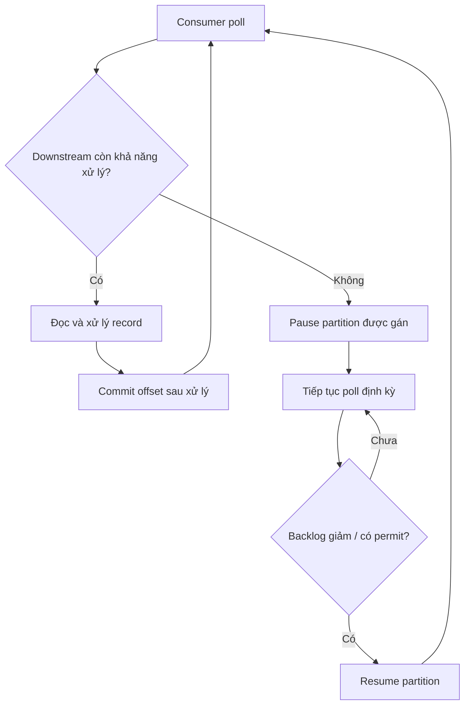
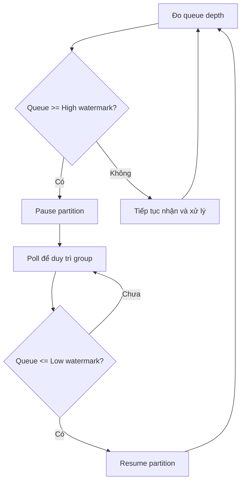

# pause, resume và điều tiết tốc độ xử lý

Kafka consumer có thể tạm dừng việc nhận record từ một hoặc nhiều partition bằng `pause()` và tiếp tục nhận bằng `resume()`. Hai API này giúp ứng dụng điều tiết tốc độ xử lý khi downstream chậm, hàng đợi nội bộ gần đầy hoặc consumer cần tuân thủ giới hạn throughput. Trong thời gian partition bị pause, ứng dụng vẫn phải gọi `poll()` định kỳ để duy trì hoạt động của consumer group và xử lý rebalance.

Điểm cốt lõi là `pause()` điều khiển việc consumer lấy record từ partition; nó không dừng producer, không xóa dữ liệu và không tự commit offset. Dữ liệu mới vẫn được Kafka lưu theo retention, còn consumer lag có thể tăng trong thời gian tạm dừng. Khi resume, consumer tiếp tục đọc từ vị trí hiện tại theo offset và chính sách commit của ứng dụng.

Bài này trình bày cách dùng `KafkaConsumer.pause()`/`resume()` trong đúng consumer thread, kết hợp token bucket để giới hạn số record mỗi giây, xử lý heartbeat và rebalance, kiểm soát backlog bằng high/low watermark, rồi mở rộng sang Spring Kafka listener container. Đây là kỹ thuật quan trọng khi xây dựng hệ thống KAFKA với Java/Spring Kafka, nơi tốc độ đọc cần cân bằng với khả năng xử lý database, HTTP service hoặc hệ thống downstream.

## 1. pause và resume hoạt động như thế nào?

Kafka consumer đọc dữ liệu từ các partition đang được gán cho nó. `assignment()` trả về tập partition hiện tại; ứng dụng có thể tạm dừng tất cả hoặc chỉ một phần partition:

```java
Set<TopicPartition> assigned = consumer.assignment();
consumer.pause(assigned);

// Khi hệ thống sẵn sàng nhận dữ liệu trở lại:
consumer.resume(assigned);
```

Các API liên quan:

| API | Tác dụng |
|---|---|
| `assignment()` | Trả về các partition đang được gán cho consumer |
| `pause(Collection<TopicPartition>)` | Tạm dừng fetch/return record từ các partition chỉ định |
| `resume(Collection<TopicPartition>)` | Tiếp tục fetch/return record từ các partition đã pause |
| `paused()` | Trả về tập partition hiện đang ở trạng thái pause |
| `poll(Duration)` | Lấy record mới và thực hiện các hoạt động nền của consumer, kể cả khi partition đang pause |

`pause()` không làm mất assignment, không thay đổi committed offset và không tạo rebalance chỉ vì ứng dụng gọi pause. Partition vẫn thuộc consumer hiện tại cho đến khi group coordinator thay đổi assignment vì một sự kiện khác.

Pause chỉ có hiệu lực với các lần poll tiếp theo. Những record đã được trả về trong `ConsumerRecords` của lần poll hiện tại vẫn thuộc trách nhiệm của ứng dụng; nếu queue downstream gần đầy, cần tính cả batch đang nằm trong bộ nhớ và đặt `max.poll.records`/queue capacity phù hợp.



Consumer chỉ ngừng nhận record từ các partition đã pause. Các partition khác vẫn có thể tiếp tục được poll. Đây là ưu điểm khi một partition có downstream chậm nhưng những partition khác vẫn xử lý bình thường.

## 2. Vì sao vẫn phải poll khi đã pause?

`KafkaConsumer` thực hiện nhiều công việc trong `poll()`: lấy dữ liệu, gửi heartbeat hoặc phối hợp heartbeat theo phiên bản client, tham gia group coordination và xử lý rebalance callback. Vì vậy, không nên gọi `pause()` rồi `Thread.sleep()` trong thời gian dài mà không poll.

Hai timeout cần phân biệt:

| Cấu hình | Ý nghĩa | Hệ quả khi vượt ngưỡng |
|---|---|---|
| `session.timeout.ms` | Khoảng thời gian coordinator chờ heartbeat hợp lệ trước khi xem consumer là mất kết nối | Consumer có thể bị loại khỏi group nếu heartbeat không đến |
| `max.poll.interval.ms` | Thời gian tối đa giữa hai lần gọi `poll()` khi dùng group management | Consumer xử lý quá lâu mà không poll có thể bị xem là không còn tiến triển và bị rebalance |

Khi pause, vòng lặp vẫn nên gọi `poll()` với timeout ngắn, ví dụ 100 ms. Các partition đã pause sẽ không trả record trong những lần poll tiếp theo, nhưng consumer vẫn có thể duy trì group membership và xử lý thay đổi assignment.

Không nên dùng đoạn sau trong consumer thread:

```java
consumer.pause(consumer.assignment());
Thread.sleep(60_000); // Không poll trong một phút
consumer.resume(consumer.paused());
```

Nếu thời gian ngủ vượt `max.poll.interval.ms`, group có thể rebalance và partition có thể được giao cho consumer khác. Hãy thay khoảng chờ bằng vòng lặp `poll()` định kỳ trong khi partition đang pause.

## 3. Những tình huống nên pause/resume

| Tình huống | Điều kiện pause | Điều kiện resume |
|---|---|---|
| Database chậm hoặc connection pool gần cạn | Số tác vụ chờ hoặc thời gian truy vấn vượt ngưỡng | Database phục hồi, backlog giảm |
| Hàng đợi nội bộ gần đầy | Queue đạt high watermark | Queue giảm xuống low watermark |
| API downstream giới hạn request | Đã dùng hết token/request quota | Có token mới hoặc quota được cấp lại |
| Bảo trì downstream | Hệ thống đích tạm ngừng nhận request | Health check xác nhận downstream hoạt động |
| Điều tiết throughput | Hết permit trong token bucket | Token được refill |
| Một partition có dữ liệu lỗi cần cô lập | Chỉ partition đó cần tạm dừng để điều tra | Lỗi đã được xử lý hoặc chuyển sang quy trình phục hồi |

Pause/resume là một dạng backpressure ở phía consumer. Producer vẫn tiếp tục ghi vào Kafka; broker vẫn lưu record theo retention. Vì thế, cần theo dõi disk usage và consumer lag nếu pause kéo dài.

## 4. Điều tiết tốc độ bằng token bucket

Token bucket là thuật toán giới hạn tốc độ phổ biến. Một bucket chứa tối đa `capacity` token. Theo thời gian, token được bổ sung với tốc độ `refillRatePerSecond`. Mỗi record cần lấy một token trước khi xử lý.

Ví dụ bucket có sức chứa 10 token và refill 10 token/giây:

- Khi bắt đầu, ứng dụng có thể xử lý tối đa 10 record ngay lập tức.
- Sau đó token được bổ sung trung bình 10 token mỗi giây.
- Nếu consumer xử lý nhanh hơn giới hạn, bucket cạn và consumer pause partition cho đến khi có token.
- Nếu consumer xử lý chậm hơn giới hạn, token có thể tích lũy đến tối đa 10, tạo khả năng burst khi có dữ liệu mới.

Nếu muốn tốc độ đều hơn và burst nhỏ, đặt `capacity=1`. Nếu downstream cho phép burst ngắn, có thể đặt capacity lớn hơn nhưng giữ refill rate theo quota thực tế.

### 4.1. Cài đặt TokenBucket

```java
package com.example.kafkaconsumer.rate;

public final class TokenBucket {
    private final double capacity;
    private final double refillRatePerSecond;
    private double tokens;
    private long lastRefillNanos;

    public TokenBucket(double capacity, double refillRatePerSecond) {
        if (capacity < 1 || refillRatePerSecond <= 0) {
            throw new IllegalArgumentException("Invalid token bucket configuration");
        }
        this.capacity = capacity;
        this.refillRatePerSecond = refillRatePerSecond;
        this.tokens = capacity;
        this.lastRefillNanos = System.nanoTime();
    }

    public boolean tryAcquire() {
        refill();
        if (tokens < 1.0) {
            return false;
        }
        tokens -= 1.0;
        return true;
    }

    private void refill() {
        long now = System.nanoTime();
        long elapsedNanos = now - lastRefillNanos;
        double elapsedSeconds = elapsedNanos / 1_000_000_000.0;

        tokens = Math.min(capacity,
                tokens + elapsedSeconds * refillRatePerSecond);
        lastRefillNanos = now;
    }
}
```

`System.nanoTime()` phù hợp để đo khoảng thời gian vì nó là đồng hồ monotonic, không bị thay đổi khi đồng hồ hệ thống được đồng bộ hoặc chỉnh giờ. Lớp mẫu không cần `synchronized` vì chỉ được gọi từ consumer thread. Nếu chia sẻ limiter giữa nhiều thread, cần bảo vệ trạng thái hoặc dùng một implementation thread-safe.

Token bucket trong ví dụ là giới hạn cục bộ của một consumer instance. Nếu chạy bốn instance, mỗi instance có capacity 10 và refill 10 token/giây, tổng tốc độ có thể đạt khoảng 40 record/giây sau giai đoạn burst. Nếu nghiệp vụ yêu cầu một quota chung cho toàn bộ consumer group hoặc toàn hệ thống, cần chia quota giữa các instance hoặc dùng một rate limiter phân tán/dịch vụ quota chung. Kafka broker quota là cơ chế khác, thường dùng để giới hạn tài nguyên theo client ID hoặc user ở phía broker.

## 5. Consumer Java pause/resume theo token bucket

Ví dụ sau dùng `max.poll.records=1` để mỗi lần poll trả tối đa một record. Nhờ vậy một permit tương ứng với tối đa một record. Producer có thể tiếp tục ghi trong khi consumer pause; record mới vẫn nằm trong topic.

Các cấu hình chính:

```java
Properties properties = new Properties();
properties.put(ConsumerConfig.BOOTSTRAP_SERVERS_CONFIG,
        "localhost:9092");
properties.put(ConsumerConfig.GROUP_ID_CONFIG,
        "orders-rate-limited-consumer");
properties.put(ConsumerConfig.KEY_DESERIALIZER_CLASS_CONFIG,
        StringDeserializer.class.getName());
properties.put(ConsumerConfig.VALUE_DESERIALIZER_CLASS_CONFIG,
        StringDeserializer.class.getName());
properties.put(ConsumerConfig.ENABLE_AUTO_COMMIT_CONFIG, "false");
properties.put(ConsumerConfig.AUTO_OFFSET_RESET_CONFIG, "earliest");
properties.put(ConsumerConfig.MAX_POLL_RECORDS_CONFIG, "1");
properties.put(ConsumerConfig.MAX_POLL_INTERVAL_MS_CONFIG, "300000");
properties.put(ConsumerConfig.SESSION_TIMEOUT_MS_CONFIG, "45000");
```

Vòng lặp consumer:

```java
package com.example.kafkaconsumer;

import com.example.kafkaconsumer.rate.TokenBucket;
import org.apache.kafka.clients.consumer.ConsumerConfig;
import org.apache.kafka.clients.consumer.ConsumerRebalanceListener;
import org.apache.kafka.clients.consumer.ConsumerRecord;
import org.apache.kafka.clients.consumer.ConsumerRecords;
import org.apache.kafka.clients.consumer.KafkaConsumer;
import org.apache.kafka.clients.consumer.OffsetAndMetadata;
import org.apache.kafka.common.errors.WakeupException;
import org.apache.kafka.common.TopicPartition;
import org.apache.kafka.common.serialization.StringDeserializer;

import java.time.Duration;
import java.util.Collection;
import java.util.List;
import java.util.Map;
import java.util.Properties;
import java.util.concurrent.atomic.AtomicBoolean;

public class RateLimitedConsumer {
    private static final String TOPIC = "orders.created";
    private static final Duration POLL_TIMEOUT = Duration.ofMillis(100);

    public static void main(String[] args) {
        Properties properties = new Properties();
        properties.put(ConsumerConfig.BOOTSTRAP_SERVERS_CONFIG, "localhost:9092");
        properties.put(ConsumerConfig.GROUP_ID_CONFIG, "orders-rate-limited-consumer");
        properties.put(ConsumerConfig.KEY_DESERIALIZER_CLASS_CONFIG,
                StringDeserializer.class.getName());
        properties.put(ConsumerConfig.VALUE_DESERIALIZER_CLASS_CONFIG,
                StringDeserializer.class.getName());
        properties.put(ConsumerConfig.ENABLE_AUTO_COMMIT_CONFIG, "false");
        properties.put(ConsumerConfig.AUTO_OFFSET_RESET_CONFIG, "earliest");
        properties.put(ConsumerConfig.MAX_POLL_RECORDS_CONFIG, "1");
        properties.put(ConsumerConfig.MAX_POLL_INTERVAL_MS_CONFIG, "300000");
        properties.put(ConsumerConfig.SESSION_TIMEOUT_MS_CONFIG, "45000");

        TokenBucket limiter = new TokenBucket(10, 10);
        AtomicBoolean throttled = new AtomicBoolean(false);
        AtomicBoolean running = new AtomicBoolean(true);

        KafkaConsumer<String, String> consumer = new KafkaConsumer<>(properties);
        Thread shutdownHook = new Thread(() -> {
            running.set(false);
            consumer.wakeup();
        }, "consumer-shutdown");
        Runtime.getRuntime().addShutdownHook(shutdownHook);

        try (consumer) {
            consumer.subscribe(List.of(TOPIC), new ConsumerRebalanceListener() {
                @Override
                public void onPartitionsRevoked(Collection<TopicPartition> partitions) {
                    // The application commits after each successfully processed record.
                }

                @Override
                public void onPartitionsAssigned(Collection<TopicPartition> partitions) {
                    // A newly assigned partition must also stay paused during throttling.
                    if (throttled.get() && !partitions.isEmpty()) {
                        consumer.pause(partitions);
                    }
                }
            });

            try {
                while (running.get()) {
                    if (!limiter.tryAcquire()) {
                        throttled.set(true);
                        consumer.pause(consumer.assignment());

                        // Keep polling while paused so group coordination can continue.
                        while (running.get() && !limiter.tryAcquire()) {
                            consumer.poll(POLL_TIMEOUT);
                        }

                        consumer.resume(consumer.paused());
                        throttled.set(false);
                    }

                    if (!running.get()) {
                        break;
                    }

                    ConsumerRecords<String, String> records = consumer.poll(POLL_TIMEOUT);
                    for (ConsumerRecord<String, String> record : records) {
                        process(record);

                        TopicPartition partition = new TopicPartition(
                                record.topic(), record.partition());
                        consumer.commitSync(Map.of(partition,
                                new OffsetAndMetadata(record.offset() + 1)));
                    }
                }
            } catch (WakeupException exception) {
                if (running.get()) {
                    throw exception;
                }
            }
        } finally {
            try {
                Runtime.getRuntime().removeShutdownHook(shutdownHook);
            } catch (IllegalStateException ignored) {
                // The JVM is already shutting down and the hook is running.
            }
        }
    }

    private static void process(ConsumerRecord<String, String> record) {
        // Deserialize, validate and execute the business operation.
        System.out.printf("key=%s partition=%d offset=%d value=%s%n",
                record.key(), record.partition(), record.offset(), record.value());
    }
}
```

Trong ví dụ, consumer lấy permit trước mỗi lần poll. Nếu bucket hết token, consumer pause các partition hiện được gán và tiếp tục poll mỗi 100 ms cho đến khi có token. `onPartitionsAssigned` pause cả partition mới được giao trong thời gian throttling, vì trạng thái pause không nên được giả định tự động áp dụng cho assignment mới.

Một permit có thể bị tiêu thụ dù poll không trả record. Đây là lựa chọn bảo thủ giúp bảo đảm tốc độ xử lý không vượt giới hạn; khi topic có dữ liệu liên tục, số record được xử lý sẽ bám gần refill rate sau burst ban đầu. `max.poll.records=1` làm ví dụ dễ kiểm soát nhưng có overhead poll cao; khi tối ưu throughput, có thể dùng batch lớn hơn và cấp token cho từng record trong batch, đồng thời quản lý buffer và offset cẩn thận.

`process(record)` phải hoàn tất trong khoảng thời gian phù hợp với `max.poll.interval.ms`. Nếu xử lý nghiệp vụ có thể kéo dài nhiều phút, nên thiết kế worker pool có giới hạn, pause khi queue đầy và chỉ commit offset của các record đã hoàn tất theo thứ tự an toàn.

## 6. Commit offset khi có pause và rate limit

Ví dụ tắt auto commit và gọi `commitSync()` sau khi xử lý từng record. Điều này tạo semantics at-least-once:

- Nếu xử lý thành công và commit thành công, group tiếp tục từ offset kế tiếp.
- Nếu ứng dụng dừng sau khi xử lý nhưng trước commit, record có thể được đọc lại.
- Nếu xử lý thất bại, không commit offset của record đó; ứng dụng cần quyết định retry, dừng consumer hoặc chuyển record sang dead-letter topic theo chính sách.

Vì vậy, hàm xử lý nên idempotent, chẳng hạn lưu `eventId` đã xử lý hoặc dùng khóa nghiệp vụ có ràng buộc duy nhất trong database. Pause/resume không tự commit và cũng không làm offset quay lại.

Trong production, commit sau từng record có thể tốn nhiều request. Có thể gom offset theo partition và commit theo batch, nhưng chỉ commit đến offset liên tục cao nhất mà mọi record trước đó trong partition đã xử lý thành công. Không commit offset của record đang xử lý hoặc record bị bỏ qua vì retry; nếu không, consumer có thể bỏ mất dữ liệu khi khởi động lại.

## 7. Điều tiết bằng high/low watermark

Khi consumer đưa record vào một queue nội bộ để worker xử lý bất đồng bộ, có thể dùng hai ngưỡng:

- **High watermark:** queue đạt mức cao, ví dụ 80% dung lượng; pause các partition để ngăn nhận thêm dữ liệu.
- **Low watermark:** queue giảm xuống mức thấp, ví dụ 30%; resume partition để tiếp tục đọc.

Không nên dùng một ngưỡng duy nhất cho cả pause và resume. Nếu pause ở 80% và resume ngay khi queue xuống 79%, consumer có thể liên tục pause/resume khi queue dao động quanh ngưỡng. Hai ngưỡng tách biệt tạo hysteresis và giảm trạng thái bật/tắt liên tục.



Ví dụ chính sách với queue có 1.000 phần tử:

| Ngưỡng | Giá trị | Hành động |
|---|---:|---|
| High watermark | 800 | Pause partition khi queue đạt từ 800 phần tử |
| Low watermark | 300 | Resume khi queue giảm còn 300 phần tử hoặc ít hơn |
| Hard limit | 1.000 | Không cho phép queue vượt sức chứa; đây là hàng rào bảo vệ cuối cùng |

Khi dùng worker pool, consumer thread là nơi duy nhất gọi `poll`, `pause`, `resume`, `seek` và commit. Worker thread chỉ báo queue depth hoặc kết quả xử lý qua thread-safe queue/atomic state. Consumer thread đọc trạng thái đó ở vòng poll kế tiếp rồi thực hiện pause/resume.

## 8. Thread safety và điều phối consumer

`KafkaConsumer` không thread-safe. Không gọi trực tiếp `pause()`, `resume()`, `poll()`, `commitSync()` hoặc `seek()` từ một scheduler/worker thread trong khi consumer thread đang chạy.

Một cách tổ chức an toàn:

1. Consumer thread sở hữu `KafkaConsumer` và thực hiện toàn bộ API call.
2. Worker thread xử lý nghiệp vụ, cập nhật queue hoặc gửi tín hiệu điều khiển.
3. Consumer thread đọc tín hiệu, kiểm tra high/low watermark và gọi pause/resume.
4. Nếu cần đánh thức consumer đang chờ poll, dùng `consumer.wakeup()` từ thread khác; bắt `WakeupException` trong consumer thread và xử lý shutdown có kiểm soát.

Ví dụ tín hiệu điều khiển đơn giản:

```java
AtomicBoolean downstreamBusy = new AtomicBoolean(false);

// Worker thread chỉ cập nhật trạng thái:
downstreamBusy.set(true);

// Consumer thread kiểm tra trong vòng lặp poll:
if (downstreamBusy.get()) {
    consumer.pause(consumer.assignment());
} else {
    consumer.resume(consumer.paused());
}
```

Đoạn mã minh họa quyền sở hữu API. Trong ứng dụng có nhiều lý do pause cùng lúc, không dùng một boolean chung để resume toàn bộ partition. Ví dụ partition có thể đang pause vì rate limit nhưng đồng thời downstream đang bảo trì. Hãy quản lý nguyên nhân pause riêng và chỉ resume khi tất cả điều kiện pause đã được gỡ bỏ.

## 9. Pause/resume với Spring Kafka

Spring Kafka cung cấp pause/resume ở cấp listener container. Đây là cách thuận tiện khi ứng dụng dùng `@KafkaListener` và để framework quản lý consumer thread, polling, rebalance và lifecycle.

Khai báo listener có ID:

```java
import com.example.kafkaconsumer.event.OrderCreatedEvent;
import org.springframework.kafka.annotation.KafkaListener;
import org.springframework.stereotype.Component;

@Component
public class OrderListener {

    @KafkaListener(
            id = "ordersListener",
            topics = "orders.created",
            groupId = "order-service")
    public void onMessage(OrderCreatedEvent event) {
        // Xử lý nghiệp vụ.
    }
}
```

Điều khiển container bằng `KafkaListenerEndpointRegistry`:

```java
import org.springframework.kafka.config.KafkaListenerEndpointRegistry;
import org.springframework.kafka.listener.MessageListenerContainer;
import org.springframework.stereotype.Component;

@Component
public class OrderConsumerFlowControl {
    private final KafkaListenerEndpointRegistry registry;

    public OrderConsumerFlowControl(KafkaListenerEndpointRegistry registry) {
        this.registry = registry;
    }

    public void pauseOrders() {
        MessageListenerContainer container =
                registry.getListenerContainer("ordersListener");
        if (container != null) {
            container.pause();
        }
    }

    public void resumeOrders() {
        MessageListenerContainer container =
                registry.getListenerContainer("ordersListener");
        if (container != null) {
            container.resume();
        }
    }
}
```

Container `pause()` là yêu cầu tạm dừng; việc pause consumer được thực hiện ở nhịp poll phù hợp của container. Spring Kafka tiếp tục poll để duy trì group membership. `resume()` yêu cầu tiếp tục đọc. Có thể kiểm tra trạng thái bằng các API trạng thái pause của container theo phiên bản Spring Kafka đang dùng.

Các phương thức `pause()` và `resume()` của listener container được thiết kế để ứng dụng có thể yêu cầu điều khiển từ thread khác; container áp dụng trạng thái ở consumer thread. Đây là điểm khác với KafkaConsumer trực tiếp, nơi ứng dụng phải tự bảo đảm mọi API call được thực hiện trên thread sở hữu consumer.

Nếu chỉ muốn tạm dừng một số partition, `MessageListenerContainer` hỗ trợ các thao tác `pausePartition()` và `resumePartition()` ở các phiên bản Spring Kafka có API này. Điều đó hữu ích khi một partition có downstream chậm nhưng các partition khác vẫn có thể xử lý.

Không dùng `Thread.sleep()` trong listener để điều tiết tốc độ. Listener chạy trên consumer thread; ngủ lâu có thể làm trễ poll, kéo dài thời gian xử lý batch và vượt `max.poll.interval.ms`. Hãy điều khiển container pause/resume và để container tiếp tục poll theo cơ chế của framework.

## 10. Cấu hình liên quan đến tốc độ tiêu thụ

Pause/resume nên được phối hợp với các cấu hình consumer:

| Cấu hình | Vai trò | Lưu ý |
|---|---|---|
| `max.poll.records` | Giới hạn số record trả về trong một lần poll | Không phải giới hạn record/giây |
| `max.poll.interval.ms` | Giới hạn thời gian giữa các lần poll | Tăng nếu xử lý batch lâu, nhưng cần xem lại rebalance và thời gian phục hồi |
| `session.timeout.ms` | Thời gian coordinator chờ heartbeat | Không thay thế `max.poll.interval.ms` |
| `fetch.min.bytes` | Lượng dữ liệu tối thiểu broker cố gắng gom trước khi trả fetch | Có thể tăng throughput nhưng làm tăng latency khi lưu lượng thấp |
| `fetch.max.wait.ms` | Thời gian broker chờ để đáp ứng `fetch.min.bytes` | Điều khiển thời gian chờ fetch, không phải thời gian xử lý nghiệp vụ |
| `max.partition.fetch.bytes` | Giới hạn dữ liệu fetch tối đa cho mỗi partition trong một request | Ảnh hưởng bộ nhớ và kích thước dữ liệu fetch |

`max.poll.records` là giới hạn batch, không đảm bảo một tốc độ cố định. Ví dụ đặt 100 chỉ có nghĩa một poll trả tối đa 100 record; nếu ứng dụng poll 20 lần mỗi giây, tốc độ tiềm năng vẫn có thể lên đến hàng nghìn record/giây. Muốn giới hạn rate, cần token bucket, fixed window hoặc cơ chế quota phù hợp.

## 11. Theo dõi hiệu quả pause/resume

Theo dõi các chỉ số sau để biết việc điều tiết có hiệu quả:

| Chỉ số | Ý nghĩa |
|---|---|
| Records consumed/sec | Tốc độ record consumer thực sự xử lý |
| Consumer lag | Khoảng cách giữa vị trí consumer và log end offset |
| Pause duration | Tổng thời gian partition ở trạng thái pause |
| Pause/resume count | Số lần chuyển trạng thái; tăng bất thường có thể do watermark quá sát |
| Processing latency | Thời gian xử lý một record hoặc batch |
| Queue depth | Số tác vụ đang chờ downstream |
| Commit latency/error | Thời gian và tỷ lệ lỗi khi commit offset |
| Rebalance count | Tần suất group phải phân phối lại partition |
| Poll interval | Thời gian giữa các lần gọi poll |

Nếu pause duration tăng nhưng consumer lag vẫn tăng nhanh, producer đang ghi nhanh hơn năng lực xử lý được cấp. Khi đó cần xem lại throughput downstream, số consumer/partition, quota rate và retention. Nếu pause/resume count quá cao, hãy tách high/low watermark xa hơn hoặc dùng thời gian cooldown.

## 12. Lỗi thường gặp và cách xử lý

| Hiện tượng | Nguyên nhân có thể có | Hướng xử lý |
|---|---|---|
| Consumer bị rebalance khi đang pause | Ứng dụng không gọi poll định kỳ hoặc xử lý nghiệp vụ quá lâu | Tiếp tục poll trong lúc pause; điều chỉnh `max.poll.interval.ms` dựa trên thời gian xử lý thực tế |
| Gọi resume nhưng consumer vẫn không đọc | Partition không còn thuộc assignment, hoặc một cơ chế khác vẫn đang pause | Kiểm tra `assignment()`, `paused()` và các nguyên nhân pause |
| Consumer lag tăng liên tục | Rate limit thấp hơn tốc độ producer hoặc downstream không phục hồi | Đo tốc độ ghi/đọc, queue và năng lực downstream; điều chỉnh quota có kiểm soát |
| Pause/resume liên tục | Chỉ dùng một watermark hoặc queue dao động quanh ngưỡng | Dùng high/low watermark và cooldown |
| Queue nội bộ vẫn tràn | Pause áp dụng sau khi đã fetch một batch; queue không có hard limit | Giới hạn `max.poll.records`, queue capacity và pause sớm khi gần high watermark |
| Offset bị nhảy qua record chưa xử lý | Commit offset cao hơn record đã hoàn tất | Chỉ commit offset liên tục cao nhất đã xử lý thành công theo từng partition |
| Duplicate sau khi resume hoặc restart | Xử lý xong nhưng dừng trước commit | Dùng consumer idempotent theo `eventId`; giữ commit sau xử lý |
| Gọi `pause()` từ worker thread gây lỗi/không ổn định | `KafkaConsumer` không thread-safe | Gửi tín hiệu cho consumer thread để gọi API |
| Một partition không resume dù queue đã giảm | Partition mới được assign trong lúc throttling hoặc trạng thái pause không được quản lý | Pause partition mới trong rebalance callback và đồng bộ trạng thái theo assignment |

## 13. Bài tập thực hành

1. Tạo consumer group `orders-rate-limited-consumer` và đặt token bucket 10 token, refill 10 token/giây.
2. Gửi 100 record liên tục; đo records/second trước và sau khi bật rate limiter.
3. Đặt capacity bằng 1 để giảm burst; so sánh latency và throughput với capacity bằng 10.
4. Pause tất cả partition trong 10 giây nhưng vẫn gọi poll mỗi 100 ms; quan sát group không bị loại chỉ vì pause.
5. Tạo queue xử lý bất đồng bộ, pause khi queue đạt 80% và resume khi queue xuống 30%.
6. Dừng một consumer khác trong group khi consumer hiện tại đang pause; quan sát rebalance và xác nhận partition mới được pause theo chính sách.
7. Tắt auto commit, xử lý record rồi commit thủ công; dừng ứng dụng giữa xử lý và commit để quan sát record được đọc lại.
8. Thử pause một partition thay vì toàn bộ assignment; xác nhận các partition khác vẫn tiếp tục được đọc.

## 14. Tiêu chí hoàn thành

- Giải thích được sự khác nhau giữa `pause`, `resume` và `poll`.
- Gọi các API `KafkaConsumer` trên consumer thread.
- Duy trì poll định kỳ trong thời gian partition pause.
- Dùng token bucket hoặc watermark để điều tiết tốc độ.
- Xử lý assignment mới trong rebalance khi consumer đang throttling.
- Commit offset sau khi xử lý thành công và hiểu semantics at-least-once.
- Theo dõi consumer lag, pause duration, queue depth và rebalance.
- Biết cách điều khiển `MessageListenerContainer` trong Spring Kafka.

## 15. Ghi nhớ

| Khái niệm | Vai trò |
|---|---|
| `pause()` | Tạm dừng nhận record từ partition được chọn |
| `resume()` | Tiếp tục nhận record từ partition đã pause |
| `poll()` | Duy trì hoạt động consumer và lấy record khi partition được phép đọc |
| Token bucket | Giới hạn tốc độ trung bình và cho phép burst có kiểm soát |
| High/low watermark | Tạo backpressure dựa trên độ sâu queue |
| `max.poll.records` | Giới hạn số record mỗi poll, không phải rate limit |
| Manual commit | Chỉ xác nhận offset sau khi xử lý thành công |
| Spring listener container | Quản lý pause/resume và poll lifecycle cho `@KafkaListener` |

Pause/resume giúp consumer thích ứng với tốc độ xử lý thực tế của downstream. Hãy gọi API trên đúng consumer thread, tiếp tục poll khi pause, phối hợp rate limiter với offset commit và xử lý rebalance. Khi được thiết kế đúng, consumer có thể kiểm soát throughput và backlog mà vẫn duy trì group membership, ordering trong partition và khả năng đọc lại dữ liệu sau sự cố.
