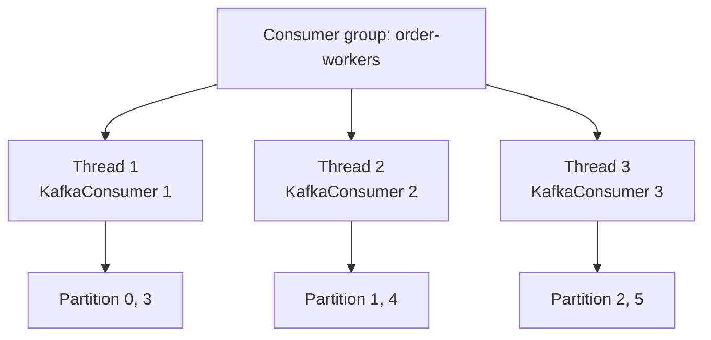
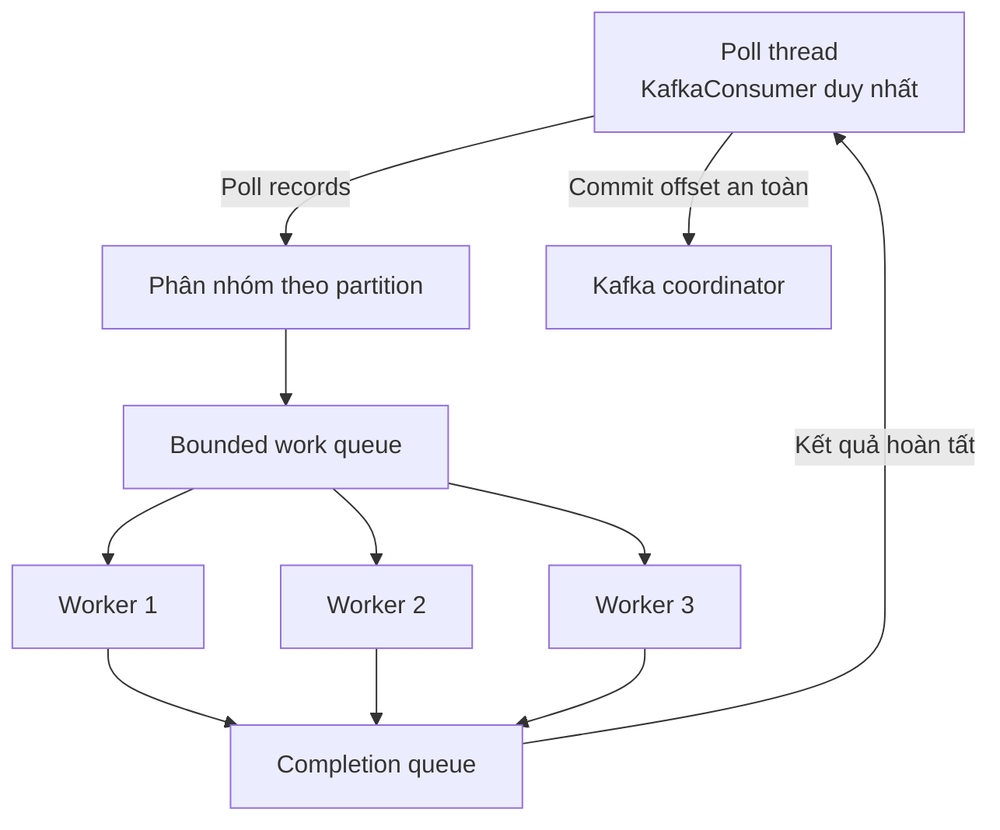
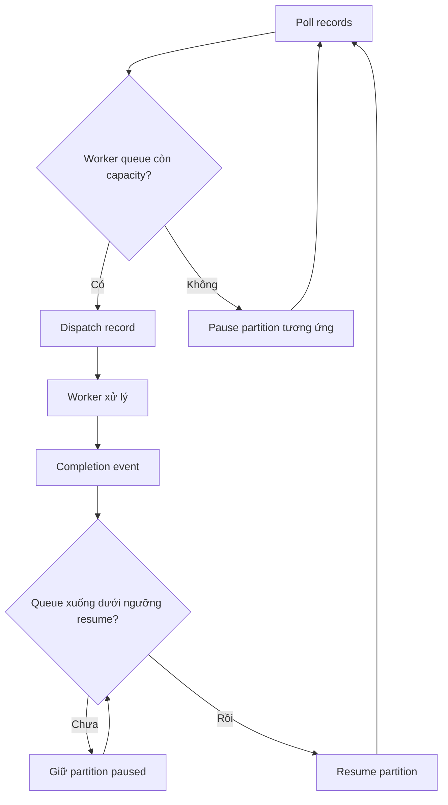

# Mô hình đa luồng và giới hạn an toàn của KafkaConsumer

## Mục tiêu

`KafkaConsumer` của Kafka Java client không được thiết kế để nhiều thread cùng gọi API trên một instance. Nếu nhiều thread đồng thời gọi `poll()`, `commitSync()`, `seek()` hoặc thay đổi subscription, consumer có thể rơi vào trạng thái không xác định và ứng dụng dễ gặp lỗi khó tái hiện. Muốn tăng khả năng xử lý song song, cần chọn mô hình sở hữu consumer rõ ràng và phối hợp offset, partition cùng vòng đời thread.

Sau bài học này, bạn có thể:

- Giải thích giới hạn thread-safety của `KafkaConsumer` và ngoại lệ `wakeup()`.
- So sánh mô hình một consumer cho mỗi thread với mô hình một poll thread và worker pool.
- Thiết kế backpressure bằng bounded queue, `pause()` và `resume()`.
- Bảo đảm chỉ commit offset của các record đã xử lý xong theo thứ tự an toàn của từng partition.
- Xử lý rebalance khi worker còn tác vụ đang chạy.
- Cấu hình `max.poll.records`, `max.poll.interval.ms` và số consumer phù hợp.
- Hiểu cách Spring Kafka quản lý concurrency và consumer thread.

## 1. Vì sao KafkaConsumer không thread-safe?

Một `KafkaConsumer` instance quản lý nhiều trạng thái liên quan chặt chẽ: subscription, partition assignment, vị trí đọc của từng partition, heartbeat/group membership, network client, fetch buffer và trạng thái commit. Các API như `poll()`, `subscribe()`, `seek()` hay `commitSync()` cùng đọc và thay đổi những trạng thái này.

KafkaConsumer vì vậy được thiết kế theo mô hình một thread sở hữu. Trong suốt thời gian hoạt động, chỉ thread sở hữu consumer mới được gọi các API thông thường trên instance đó. Tài liệu Kafka nêu một ngoại lệ quan trọng: `wakeup()` có thể được gọi từ thread khác để đánh thức một consumer đang chờ trong `poll()`.

Các API cần được gọi từ thread sở hữu gồm:

- `poll()` và `subscribe()`.
- `assign()`, `unsubscribe()` và `assignment()`.
- `commitSync()`, `commitAsync()` và các thao tác đọc committed offset.
- `seek()`, `position()`, `pause()` và `resume()`.
- `close()` và các thao tác quản lý vòng đời consumer.

Không nên chia sẻ một `KafkaConsumer` cho nhiều thread rồi dùng `synchronized` quanh từng lời gọi như cách sửa mặc định. Việc khóa có thể tuần tự hóa các lời gọi nhưng vẫn làm kiến trúc khó kiểm soát, dễ deadlock và không giải quyết việc thread nào chịu trách nhiệm poll, rebalance hoặc commit.

```mermaid
flowchart TD
    A[KafkaConsumer instance] --> B[Subscription và assignment]
    A --> C[Position và offset]
    A --> D[Network / fetch state]
    A --> E[Group membership]
    T[Single owner thread] -->|poll / commit / seek / pause / resume| A
    X[Shutdown thread] -->|wakeup() - thread-safe exception| A
```

### 1.1. Ngoại lệ `wakeup()`

`wakeup()` được thiết kế để thread khác yêu cầu consumer thoát khỏi một thao tác đang chờ, thường là `poll()`. Khi được đánh thức, lời gọi đang chờ sẽ ném `WakeupException`. Thread sở hữu consumer bắt exception và quyết định dừng vòng lặp hay tiếp tục chạy.

`wakeup()` không phải cách gửi lệnh tùy ý để thread khác thực hiện `commit`, `seek` hoặc `close`. Nó chỉ đánh thức consumer. Sau khi poll thread tỉnh dậy, chính poll thread mới thực hiện các thao tác còn lại.

### 1.2. Vì sao gọi đồng thời dễ gây lỗi?

Ví dụ một thread đang `poll()` và cập nhật vị trí đọc, trong khi thread khác gọi `seek()` để tua partition hoặc `commitSync()` để xác nhận offset. Hai thao tác có thể quan sát trạng thái ở những thời điểm khác nhau. Khi rebalance diễn ra, assignment cũng có thể thay đổi trong lúc thread khác đang thao tác trên trạng thái cũ.

Hậu quả thường gặp:

- Exception liên quan đến consumer đang được sử dụng bởi thread khác.
- Commit offset không đúng với record thực sự đã xử lý.
- Mất thứ tự xử lý trong một partition.
- Tác vụ của partition cũ tiếp tục chạy sau khi partition đã được giao cho consumer khác.
- Shutdown treo vì một thread chờ thread khác đang giữ trạng thái consumer.

## 2. Hai mô hình đa luồng phổ biến

Có hai cách tiếp cận thường dùng. Cả hai đều giữ nguyên nguyên tắc mỗi consumer chỉ có một thread sở hữu.

| Tiêu chí | Một consumer cho mỗi thread | Một poll thread + worker pool |
|---|---|---|
| Consumer instance | Mỗi thread sở hữu một instance riêng | Một poll thread sở hữu consumer; worker không gọi API consumer |
| Parallelism | Kafka phân partition giữa các consumer trong group | Ứng dụng phân record đã poll cho worker |
| Ordering | Dễ giữ thứ tự nếu mỗi consumer xử lý tuần tự | Phải điều phối thứ tự hoàn tất theo từng partition |
| Offset commit | Có thể commit sau xử lý trong thread consumer | Poll thread commit dựa trên thông báo hoàn tất từ worker |
| Backpressure | Thường tự nhiên qua tốc độ poll/processing | Phải giới hạn queue và pause/resume partition |
| Rebalance | Consumer xử lý trong vòng đời poll của chính nó | Phải phối hợp partition revoke với các worker đang chạy |
| Độ phức tạp | Thấp hơn | Cao hơn, nhưng tách biệt poll và xử lý |
| Phù hợp | Tác vụ xử lý tuần tự theo partition | Công việc cần worker pool và thời gian xử lý không đồng đều |

Không có mô hình nào tự động nhanh hơn trong mọi tình huống. Hãy chọn theo yêu cầu ordering, độ dài tác vụ, số partition, khả năng kiểm soát offset và độ phức tạp mà đội ngũ có thể vận hành.

## 3. Mô hình một consumer cho mỗi thread

Đây là cách đơn giản để mở rộng consumer: tạo một `KafkaConsumer` riêng cho từng thread. Các consumer dùng cùng `group.id`, vì vậy Kafka group coordinator phân partition của topic cho các consumer member. Mỗi thread chỉ thao tác với consumer mà nó sở hữu.



Mỗi consumer tự poll, xử lý record và commit offset. Nếu một consumer thread dừng, group rebalance sẽ giao partition của nó cho consumer member còn lại hoặc member mới.

### 3.1. Ví dụ tạo consumer theo thread

```java
import java.time.Duration;
import java.util.List;
import java.util.Properties;
import java.util.concurrent.atomic.AtomicBoolean;

import org.apache.kafka.clients.consumer.ConsumerConfig;
import org.apache.kafka.clients.consumer.ConsumerRecord;
import org.apache.kafka.clients.consumer.ConsumerRecords;
import org.apache.kafka.clients.consumer.KafkaConsumer;
import org.apache.kafka.common.errors.WakeupException;
import org.apache.kafka.common.serialization.StringDeserializer;

public final class ConsumerWorker implements Runnable {
    private final KafkaConsumer<String, String> consumer;
    private final AtomicBoolean running = new AtomicBoolean(true);

    public ConsumerWorker(String bootstrapServers, String groupId) {
        Properties props = new Properties();
        props.put(ConsumerConfig.BOOTSTRAP_SERVERS_CONFIG, bootstrapServers);
        props.put(ConsumerConfig.GROUP_ID_CONFIG, groupId);
        props.put(ConsumerConfig.KEY_DESERIALIZER_CLASS_CONFIG,
                StringDeserializer.class.getName());
        props.put(ConsumerConfig.VALUE_DESERIALIZER_CLASS_CONFIG,
                StringDeserializer.class.getName());
        props.put(ConsumerConfig.ENABLE_AUTO_COMMIT_CONFIG, false);
        props.put(ConsumerConfig.AUTO_OFFSET_RESET_CONFIG, "earliest");

        this.consumer = new KafkaConsumer<>(props);
    }

    @Override
    public void run() {
        try (consumer) {
            consumer.subscribe(List.of("orders"));

            while (running.get()) {
                try {
                    ConsumerRecords<String, String> records =
                            consumer.poll(Duration.ofMillis(250));

                    for (ConsumerRecord<String, String> record : records) {
                        process(record);
                    }

                    // Commit sau khi toàn bộ record của poll này xử lý thành công.
                    consumer.commitSync();
                } catch (WakeupException e) {
                    if (running.get()) {
                        throw e;
                    }
                    // Shutdown đã yêu cầu wakeup: thoát vòng lặp bình thường.
                }
            }
        }
    }

    public void shutdown() {
        running.set(false);
        consumer.wakeup(); // Được phép gọi từ thread shutdown.
    }

    private void process(ConsumerRecord<String, String> record) {
        System.out.printf("topic=%s partition=%d offset=%d key=%s value=%s%n",
                record.topic(), record.partition(), record.offset(),
                record.key(), record.value());
        // Thực hiện xử lý nghiệp vụ tại đây.
    }
}
```

Trong ví dụ, `shutdown()` chỉ thay đổi cờ và gọi `wakeup()`. Consumer vẫn được đóng trong `run()` bằng try-with-resources, tức thread sở hữu thực hiện `close()`. Nếu `process()` ném lỗi, vòng lặp dừng trước `commitSync()`; các record chưa commit có thể được đọc lại sau khi ứng dụng phục hồi.

### 3.2. Khởi chạy nhiều worker

```java
int workerCount = 3;
ExecutorService executor = Executors.newFixedThreadPool(workerCount);
List<ConsumerWorker> workers = new ArrayList<>();

for (int i = 0; i < workerCount; i++) {
    ConsumerWorker worker = new ConsumerWorker(
            "localhost:9092,localhost:9093,localhost:9094",
            "order-workers");
    workers.add(worker);
    executor.submit(worker);
}
```

Khi ứng dụng shutdown, gọi `shutdown()` trên từng worker để đánh thức poll, sau đó chờ executor kết thúc theo timeout phù hợp. Phần quản lý lifecycle cần lưu lại `Future` hoặc dùng cơ chế điều phối shutdown để phát hiện worker không dừng đúng hạn.

### 3.3. Giới hạn số thread

Số consumer thread không nên lớn hơn nhu cầu partition một cách tùy tiện. Trong một group, mỗi partition tại một thời điểm chỉ được gán cho tối đa một member. Nếu topic có sáu partition nhưng tạo mười consumer, ít nhất bốn consumer có thể không nhận partition.

Nhiều consumer hơn partition làm tăng kết nối, heartbeat và chi phí quản lý mà không tăng mức song song đọc của topic. Khi cần throughput cao hơn, hãy đánh giá số partition, thời gian xử lý và tài nguyên broker trước khi tăng số consumer.

## 4. Mô hình một poll thread và worker pool

Trong mô hình này, chỉ một thread gọi API `KafkaConsumer`. Thread đó poll record rồi gửi tác vụ sang worker pool để xử lý song song. Worker nhận dữ liệu record và thực hiện nghiệp vụ, nhưng không được gọi `poll()`, `commitSync()`, `seek()`, `pause()` hoặc bất kỳ API thông thường nào trên consumer.



Mô hình này tận dụng worker pool để xử lý các partition khác nhau đồng thời. Nhưng ứng dụng phải giải quyết ba vấn đề khó hơn:

1. Không để worker queue tăng vô hạn khi tốc độ poll cao hơn tốc độ xử lý.
2. Chỉ commit offset khi mọi record trước đó trong partition đã xử lý thành công.
3. Khi partition bị revoke, dừng nhận việc mới và xử lý tác vụ đang chạy trước khi mất quyền sở hữu partition.

## 5. Backpressure bằng bounded queue và pause/resume

Nếu poll thread liên tục lấy record rồi đưa vào một queue không giới hạn, worker chậm sẽ khiến queue tăng mãi. Hệ quả là heap tăng, GC kéo dài, độ trễ xử lý tăng và cuối cùng consumer có thể vượt `max.poll.interval.ms`.

Hãy dùng bounded queue hoặc semaphore để giới hạn số record đang chờ xử lý. Khi một partition đã có quá nhiều record in-flight, poll thread gọi `pause()` cho partition đó. Khi worker xử lý xong và queue xuống dưới ngưỡng thấp, poll thread gọi `resume()`.



`pause()` và `resume()` phải được gọi trên poll thread. Partition bị pause vẫn thuộc assignment của consumer, chỉ tạm ngừng fetch record mới từ partition đó. Poll thread vẫn phải tiếp tục gọi `poll()` để xử lý heartbeat, rebalance callback và các sự kiện group khác.

Không nên dừng poll hoàn toàn trong lúc worker xử lý. Nếu khoảng thời gian giữa hai lần `poll()` vượt `max.poll.interval.ms`, consumer có thể bị xem là không còn tiến triển và group sẽ rebalance.

### 5.1. Ngưỡng pause/resume

Ví dụ đặt ngưỡng:

```text
MAX_IN_FLIGHT_PER_PARTITION = 100
RESUME_BELOW_PER_PARTITION = 40
```

Khi số tác vụ đang chờ của partition đạt 100, poll thread pause partition. Khi số tác vụ giảm xuống dưới 40, poll thread resume partition. Dùng hai ngưỡng khác nhau tạo hysteresis, tránh pause/resume liên tục quanh một ngưỡng duy nhất.

Ngưỡng thực tế phải dựa trên kích thước payload, thời gian xử lý, số worker và heap budget. Đừng chỉ đếm record nếu một record có thể chiếm bộ nhớ rất lớn.

## 6. Commit offset an toàn khi xử lý song song

Đây là điểm dễ sai nhất của worker-pool pattern.

Giả sử một partition có các record offset 10, 11 và 12. Poll thread gửi cả ba record cho ba worker. Worker xử lý offset 12 xong trước, tiếp theo offset 10, còn offset 11 vẫn đang chạy.

Nếu ứng dụng commit offset 13 ngay khi worker 12 hoàn tất, Kafka có thể bắt đầu đọc từ offset 13 sau restart. Record 10 và 11 khi đó bị bỏ qua dù chưa xử lý xong. Vì vậy không được commit offset lớn nhất vừa hoàn tất nếu các record trước nó còn pending.

Chỉ commit vị trí tiếp theo sau **record hoàn tất liên tục cuối cùng** trong thứ tự đã giao của partition. Giả sử vị trí tiếp tục đọc trước batch là offset 10. Khi offset 12 xong trước, vẫn giữ commit ở 10; không commit 13. Khi offset 10 hoàn tất, có thể commit 11. Khi offset 11 hoàn tất, có thể tiến commit lên 13 vì cả 10, 11 và 12 đã hoàn tất.

Kafka offset có thể có khoảng trống do control record, transaction filtering hoặc log compaction. Vì vậy, tracker thực tế nên theo dõi thứ tự các record đã giao cho ứng dụng trong từng partition, thay vì giả định mọi số nguyên offset đều xuất hiện. Khi prefix các record đã giao hoàn tất, commit `offset + 1` của record cuối cùng trong prefix đó.

### 6.1. Mô hình completion tracker

Poll thread có thể duy trì một hàng đợi theo thứ tự cho từng `TopicPartition`:

| Record | Trạng thái worker | Có thể tiến commit qua record? |
|---|---|---|
| offset 10 | Hoàn tất | Có |
| offset 11 | Đang xử lý | Chưa |
| offset 12 | Hoàn tất | Chưa, vì offset 11 đứng trước còn pending |

Khi offset 11 hoàn tất, tracker loại bỏ liên tiếp các entry đã hoàn tất ở đầu hàng đợi và cập nhật commit candidate tới offset 13. Poll thread mới thực hiện `commitSync()` hoặc `commitAsync()` với map offset theo partition.

Lưu ý rằng **commit an toàn không đồng nghĩa thứ tự side effect đã được giữ**. Nếu worker xử lý offset 12 trước offset 10, nghiệp vụ ở hệ thống đích vẫn có thể xảy ra sai thứ tự dù tracker không commit vượt qua offset 10. Nếu thứ tự sự kiện trong cùng partition có ý nghĩa, hãy chỉ cho phép một tác vụ đang chạy trên mỗi partition (hoặc dùng một serial executor/queue riêng cho từng partition). Chỉ chạy song song giữa các partition hoặc giữa các key mà nghiệp vụ cho phép xử lý độc lập.

### 6.2. Commit offset tường minh

```java
Map<TopicPartition, OffsetAndMetadata> offsets = new HashMap<>();
offsets.put(partition, new OffsetAndMetadata(lastContiguousOffset + 1));

// Chỉ poll thread gọi API này sau khi nhận completion event.
consumer.commitSync(offsets);
```

Đây là phần minh họa thao tác commit; `lastContiguousOffset` phải do completion tracker xác định theo thứ tự record đã giao và hoàn tất. Không lấy offset lớn nhất của mọi worker rồi commit trực tiếp.

### 6.3. At-least-once và idempotency

Nếu worker đã cập nhật database nhưng ứng dụng dừng trước khi commit Kafka offset, record có thể được đọc lại. Đây là hành vi at-least-once thường gặp. Consumer phải có idempotency, chẳng hạn unique constraint theo event ID hoặc transaction lưu dấu đã xử lý cùng cập nhật nghiệp vụ.

Commit offset sau xử lý giúp tránh bỏ qua record chưa hoàn tất, nhưng không tạo exactly-once giữa Kafka và một database tùy ý. Nếu cần phối hợp chặt chẽ, phải dùng Kafka transaction cho luồng Kafka-to-Kafka hoặc thiết kế transaction/idempotency ở database.

## 7. Rebalance khi worker còn tác vụ đang chạy

Với `subscribe()`, Kafka group có thể rebalance khi consumer gia nhập, rời nhóm, mất heartbeat, vượt `max.poll.interval.ms` hoặc partition topology thay đổi. Trong worker-pool pattern, rebalance cần phối hợp poll thread với worker pool.

Khi partition bị revoke, poll thread cần:

1. Ngừng dispatch record mới của partition sắp bị revoke.
2. Pause hoặc đánh dấu partition không còn nhận việc mới trong trạng thái ứng dụng.
3. Chờ các tác vụ đang chạy hoàn tất trong một khoảng thời gian có giới hạn nếu quy trình cho phép.
4. Commit chỉ phần offset có prefix hoàn tất liên tục và còn quyền sở hữu.
5. Dọn completion tracker, queue và trạng thái in-flight của partition bị revoke.

Nếu không thể drain worker trước khi callback kết thúc, không commit offset của các tác vụ chưa hoàn tất. Sau rebalance, consumer mới sẽ đọc lại các record đó. Tác vụ cũ có thể vẫn hoàn tất muộn, do đó xử lý nghiệp vụ cần idempotent.

Với partition đã bị mất quyền sở hữu (`onPartitionsLost` ở các phiên bản API hỗ trợ), không nên cố commit offset như thể consumer vẫn còn quyền. Hãy dừng dispatch và xử lý kết quả muộn theo chính sách idempotency.

### 7.1. ConsumerRebalanceListener

```java
consumer.subscribe(List.of("orders"), new ConsumerRebalanceListener() {
    @Override
    public void onPartitionsRevoked(Collection<TopicPartition> partitions) {
        // Được gọi trên poll thread.
        // Ngừng dispatch, drain task có giới hạn và commit prefix đã hoàn tất.
        stopDispatch(partitions);
        drainCompletedTasks(partitions);
        commitCompletedOffsets(partitions);
        clearPartitionState(partitions);
    }

    @Override
    public void onPartitionsAssigned(Collection<TopicPartition> partitions) {
        // Khởi tạo tracker/queue cho assignment mới.
        initializePartitionState(partitions);
    }
});
```

Các hàm `stopDispatch`, `drainCompletedTasks`, `commitCompletedOffsets`, `clearPartitionState` và `initializePartitionState` là phần logic của ứng dụng, không phải API Kafka. Không chờ worker vô thời hạn trong rebalance callback vì callback chạy trên poll thread và có thể làm group bị treo trong quá trình chuyển assignment.

## 8. Điều chỉnh `max.poll.records` và `max.poll.interval.ms`

Hai cấu hình này ảnh hưởng trực tiếp tới consumer có xử lý lâu hoặc dispatch sang worker pool.

| Cấu hình | Vai trò | Tác động |
|---|---|---|
| `max.poll.records` | Số record tối đa trả về trong một lần `poll()` | Giới hạn kích thước batch ứng dụng nhận mỗi lần; không giới hạn tổng số record broker lưu |
| `max.poll.interval.ms` | Khoảng thời gian tối đa giữa các lần `poll()` trước khi member bị xem là không tiến triển | Nếu xử lý đồng bộ quá lâu hoặc poll thread bị block, group có thể rebalance |
| `session.timeout.ms` | Thời gian coordinator chờ heartbeat trước khi xem member mất kết nối | Liên quan phát hiện mất member; khác với giới hạn tiến triển bằng poll interval |
| `heartbeat.interval.ms` | Chu kỳ heartbeat khi client dùng cơ chế heartbeat nền | Thường được cấu hình nhỏ hơn session timeout theo khuyến nghị phiên bản |

Với mô hình xử lý đồng bộ trong consumer thread, hãy ước lượng thời gian xử lý tối đa của toàn bộ batch:

\[
T_{batch} \approx N_{records} \times T_{process,max}
\]

Nếu thời gian batch có thể vượt `max.poll.interval.ms`, cần giảm `max.poll.records`, tối ưu xử lý hoặc chuyển sang mô hình worker pool có poll thread tiếp tục poll. Công thức chỉ là ước lượng bảo thủ khi xử lý tuần tự; tải thực tế còn phụ thuộc phân phối thời gian xử lý và I/O.

Trong worker-pool pattern, poll thread có thể tiếp tục gọi `poll()` trong khi worker xử lý. Nhưng nếu poll thread bị block khi đẩy task vào queue đầy hoặc chờ drain worker quá lâu, vẫn có nguy cơ vượt poll interval. Vì vậy queue phải có giới hạn và thao tác dispatch phải có thời gian chặn được kiểm soát.

## 9. Spring Kafka và concurrency

Spring Kafka listener container quản lý vòng đời `KafkaConsumer` và poll loop. Khi cấu hình `concurrency`, container tạo nhiều consumer child, mỗi child sở hữu một KafkaConsumer riêng. Các consumer này tham gia group theo `group.id` và nhận partition assignment từ Kafka.

Ví dụ:

```yaml
spring:
  kafka:
    consumer:
      bootstrap-servers: localhost:9092,localhost:9093,localhost:9094
      group-id: order-service
      enable-auto-commit: false
      auto-offset-reset: earliest
    listener:
      concurrency: 3
      ack-mode: record
```

Hoặc dùng annotation:

```java
@KafkaListener(
        topics = "orders",
        groupId = "order-service",
        concurrency = "3"
)
public void handle(ConsumerRecord<String, String> record) {
    processOrder(record.value());
}
```

`concurrency=3` yêu cầu container tạo ba consumer child cho listener đó. Nó không có nghĩa Spring chia sẻ một KafkaConsumer cho ba thread. Số child thực tế có thể nhận partition còn phụ thuộc số partition, subscription và các member khác trong group.

### 9.1. Không chuyển KafkaConsumer ra khỏi container

Trong `@KafkaListener`, hãy xử lý record trong listener hoặc dùng cơ chế async listener được Spring Kafka hỗ trợ cho phiên bản đang sử dụng. Không lấy `Consumer` từ listener rồi đưa sang một executor tùy ý để gọi `poll`, `commit`, `seek` hoặc `pause` ở thread khác.

Nếu dùng manual acknowledgment hoặc xử lý bất đồng bộ, phải hiểu semantics ack của container, `AckMode`, `asyncAcks` và thứ tự commit. Với async listener, Spring Kafka có hỗ trợ kiểu trả về bất đồng bộ ở các phiên bản mới, nhưng cách commit/retry và rebalance cần theo tài liệu đúng phiên bản. Không giả định gọi `Acknowledgment.acknowledge()` tùy ý từ mọi thread là an toàn trong mọi cấu hình.

### 9.2. Khi nào dùng concurrency của Spring?

Hãy ưu tiên concurrency của listener container khi mục tiêu là tăng số consumer member và phân partition giữa các thread. Chỉ xây worker pool riêng khi có yêu cầu xử lý song song bên trong một consumer hoặc cần điều phối tài nguyên đặc biệt; khi đó phải thiết kế ack, offset và rebalance kỹ lưỡng.

## 10. Ví dụ poll thread nhận completion từ worker

Mẫu dưới đây minh họa ranh giới sở hữu: poll thread duy nhất gọi API consumer; worker chỉ xử lý record và gửi completion event về. Phần tracker phải được triển khai theo quy tắc contiguous completion đã mô tả ở trên.

```java
record WorkItem(TopicPartition partition, long offset,
                String key, String value) {}

record WorkCompleted(TopicPartition partition, long offset,
                     Throwable error) {}

// Đây là skeleton minh họa. Giới hạn số tác vụ in-flight và dùng queue có
// capacity hữu hạn trong triển khai thực tế.
BlockingQueue<WorkCompleted> completed = new LinkedBlockingQueue<>();
ThreadPoolExecutor workers = new ThreadPoolExecutor(
        4, 4, 0L, TimeUnit.MILLISECONDS,
        new ArrayBlockingQueue<>(512));

// Đoạn này chạy duy nhất trên poll thread.
while (running) {
    drainCompletionsAndAdvanceTrackers(completed);

    ConsumerRecords<String, String> records =
            consumer.poll(Duration.ofMillis(100));

    for (ConsumerRecord<String, String> record : records) {
        WorkItem item = new WorkItem(
                new TopicPartition(record.topic(), record.partition()),
                record.offset(), record.key(), record.value());

        // registerDispatched phải ghi nhận record theo thứ tự partition
        // trước khi submit để completion không đến trước trạng thái tracker.
        registerDispatched(item);
        workers.submit(() -> {
            Throwable failure = null;
            try {
                processBusiness(item);
            } catch (Throwable t) {
                failure = t;
            }
            completed.offer(new WorkCompleted(
                    item.partition(), item.offset(), failure));
        });
    }

    drainCompletionsAndAdvanceTrackers(completed);
    commitOnlyContiguousCompletedOffsets(consumer);
}
```

Các hàm `registerDispatched`, `drainCompletionsAndAdvanceTrackers`, `commitOnlyContiguousCompletedOffsets` và `processBusiness` là logic minh họa cần được hiện thực hóa. Trong code production:

- Giới hạn tổng số tác vụ in-flight; completion queue ở trên chỉ tăng tối đa theo số tác vụ đang chạy/đang chờ nếu giới hạn này được thực thi. Có thể thay nó bằng bounded queue có capacity ít nhất bằng giới hạn in-flight.
- Trước khi poll/dispatch, theo dõi capacity của worker queue và số record đã fetch nhưng chưa dispatch. Pause partition khi sắp hết capacity; nếu một poll đã trả về nhiều record hơn số slot còn trống, giữ chúng trong pending buffer có giới hạn thay vì bỏ record hoặc submit vô hạn.
- Xử lý `RejectedExecutionException` bằng cách giữ record trong pending buffer và pause partition; không được đánh dấu record đã xử lý hoặc bỏ record khỏi tracker.
- Không bắt `Throwable` rồi bỏ qua; phân loại lỗi nghiệp vụ, lỗi hệ thống và lỗi nghiêm trọng theo chính sách.
- Khi worker thất bại, không đánh dấu record là hoàn tất thành công. Dùng retry, pause partition hoặc dead-letter flow theo thiết kế.
- Chỉ poll thread gọi commit và pause/resume.
- Nếu cần giữ thứ tự side effect, dùng serial executor/queue cho từng partition; completion tracker chỉ bảo vệ commit offset, không tự tuần tự hóa xử lý.
- Khi shutdown/rebalance, ngừng submit task mới và xử lý completion của task đang chạy có giới hạn.

## 11. Các lỗi thường gặp

| Hiện tượng | Nguyên nhân | Cách xử lý |
|---|---|---|
| `KafkaConsumer is not safe for multi-threaded access` | Nhiều thread gọi API trên cùng consumer | Một thread sở hữu consumer; thread khác chỉ gửi tín hiệu qua queue hoặc `wakeup()` |
| Consumer bị rebalance khi xử lý lâu | Thời gian giữa các lần poll vượt `max.poll.interval.ms` | Giảm batch, tối ưu xử lý hoặc tách poll thread khỏi worker |
| Heap tăng liên tục | Poll nhanh hơn tốc độ worker, queue không giới hạn | Dùng bounded queue, giới hạn in-flight và pause/resume |
| Offset nhảy qua record chưa xử lý | Commit offset lớn nhất hoàn tất thay vì prefix hoàn tất | Track completion theo từng partition và commit contiguous prefix |
| Record cùng partition xử lý sai thứ tự | Nhiều worker xử lý song song cùng partition | Tuần tự hóa theo partition hoặc dùng completion tracker và kiểm soát thứ tự nghiệp vụ |
| Record bị xử lý lặp sau rebalance | Worker đã làm side effect nhưng offset chưa commit | Thiết kế consumer idempotent và commit sau xử lý thành công |
| Worker cũ tiếp tục ghi sau khi partition bị revoke | Không drain/fence tác vụ khi rebalance | Ngừng dispatch, drain có giới hạn, dùng idempotency hoặc fencing ở hệ thống đích |
| Shutdown bị treo trong poll | Không đánh thức poll thread | Gọi `wakeup()` từ thread shutdown và để owner thread đóng consumer |
| Spring listener dùng chung Consumer giữa executor | Chuyển object Consumer ra khỏi container thread | Dùng listener container concurrency hoặc async listener được hỗ trợ |

## 12. Checklist thiết kế đa luồng

- [ ] Mỗi `KafkaConsumer` có đúng một thread sở hữu.
- [ ] Chỉ thread sở hữu gọi `poll`, commit, seek, pause, resume, subscribe và close.
- [ ] Thread khác chỉ dùng `wakeup()` để đánh thức poll thread khi shutdown.
- [ ] Số consumer thread phù hợp với số partition và tài nguyên cluster.
- [ ] `max.poll.records` và `max.poll.interval.ms` phù hợp thời gian xử lý.
- [ ] Worker queue có giới hạn và có backpressure.
- [ ] Poll thread tiếp tục poll khi partition đang pause.
- [ ] Offset commit theo prefix record đã hoàn tất của từng partition.
- [ ] Rebalance dừng dispatch, drain task có giới hạn và dọn state partition.
- [ ] Worker có thể hoàn tất muộn sau revoke; side effect phải idempotent/fenced.
- [ ] Spring Kafka concurrency dùng consumer instance riêng do container quản lý.
- [ ] Có metric cho poll latency, processing time, in-flight count, queue depth, rebalance và commit failure.

## 13. Câu hỏi tự kiểm tra

1. Vì sao `KafkaConsumer` không thread-safe? Những API nào chỉ được gọi từ owner thread?
2. Vì sao `wakeup()` là ngoại lệ và `close()` không phải cách shutdown từ thread khác?
3. Mô hình một consumer cho mỗi thread giữ thread-safety như thế nào?
4. Trong poll-thread/worker-pool pattern, vì sao worker không được gọi `commitSync()`?
5. Nếu offset 12 hoàn tất trước offset 10 và 11, consumer có thể commit 13 ngay không? Vì sao?
6. Vì sao completion tracker cần theo dõi thứ tự record đã giao thay vì giả định mọi số offset liên tiếp đều xuất hiện?
7. `pause()` khác `unsubscribe()` như thế nào? Vì sao vẫn phải tiếp tục `poll()` khi partition bị pause?
8. Điều gì xảy ra nếu poll thread bị block lâu hơn `max.poll.interval.ms`?
9. Khi partition bị revoke nhưng worker vẫn đang xử lý, ứng dụng cần làm gì với offset và side effect?
10. Spring Kafka `concurrency=3` tạo ra ba thread dùng chung một consumer hay ba consumer instance riêng?

## Tài liệu tham khảo

- [Apache Kafka — KafkaConsumer API](https://kafka.apache.org/documentation/#consumerapi): thread safety, `wakeup()`, poll, pause/resume, commit và rebalance listener.
- [Apache Kafka — Consumer Configurations](https://kafka.apache.org/documentation/#consumerconfigs): `max.poll.records`, `max.poll.interval.ms`, heartbeat và session timeout.
- [Apache Kafka — Consumer Design](https://kafka.apache.org/documentation/#design_consumerposition): vị trí đọc, committed offset và semantics xử lý lại.
- [Spring for Apache Kafka — Message Listener Containers](https://docs.spring.io/spring-kafka/reference/kafka/receiving-messages/message-listener-container.html): listener concurrency, child container, acknowledgment và quản lý consumer.
- [Spring for Apache Kafka — Asynchronous Listener Return Types](https://docs.spring.io/spring-kafka/reference/kafka/receiving-messages/async-returns.html): hỗ trợ xử lý listener bất đồng bộ và cách container phối hợp acknowledgment.

> Tăng số thread chỉ có ích khi partition, worker capacity và cách commit offset được thiết kế tương ứng. Giữ một owner thread cho mỗi KafkaConsumer là ranh giới an toàn quan trọng nhất; mọi xử lý song song phải được điều phối bên ngoài instance consumer.
