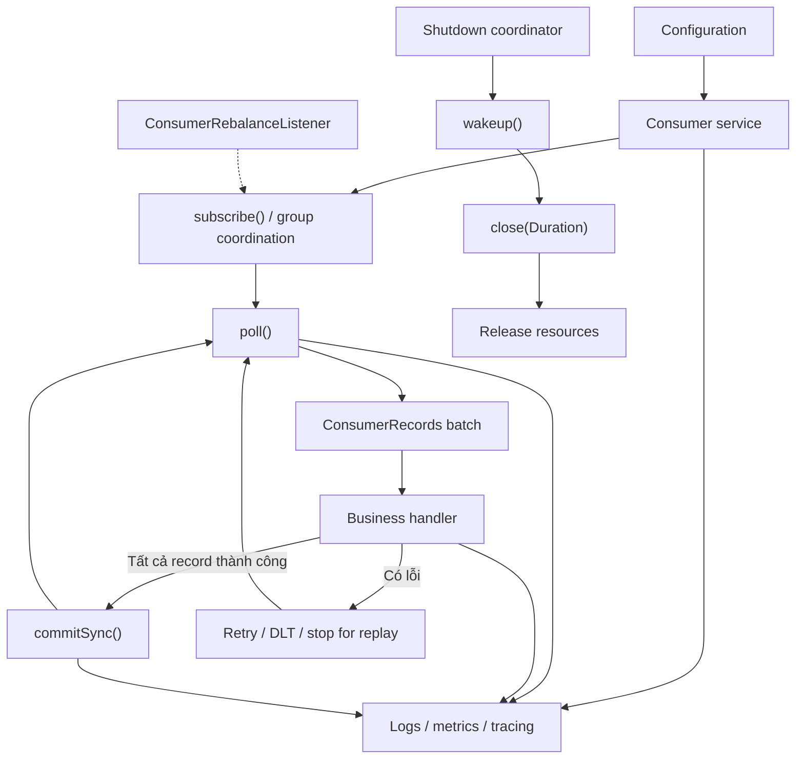

# Xây dựng consumer Java hoàn chỉnh có quản lý vòng đời

Một Kafka consumer chạy trong production cần làm nhiều việc hơn việc gọi `poll()` rồi xử lý record. Ứng dụng phải khởi tạo client từ cấu hình có kiểm soát, tham gia consumer group, xử lý batch, commit offset đúng thời điểm, phản ứng với rebalance, quản lý lỗi và dừng an toàn khi service nhận tín hiệu shutdown.

Bài này ghép các phần đó thành một ứng dụng Java có vòng đời rõ ràng. Trọng tâm là mô hình một `KafkaConsumer` do một thread sở hữu, xử lý đồng bộ theo batch và commit sau khi xử lý thành công. Đây là nền tảng dễ kiểm soát để mở rộng sang xử lý song song, retry topic, dead-letter topic hoặc Spring Kafka.

## 1. Kiến trúc của một consumer service

Một consumer service thường có các thành phần sau:

- **Configuration:** địa chỉ bootstrap broker, group ID, deserializer, security, timeout và fetch/poll limits.
- **KafkaConsumer:** quản lý kết nối, group membership, partition assignment, fetch và offset.
- **Poll loop:** lấy batch record và duy trì tiến trình tham gia group.
- **Business handler:** xác thực và thực hiện nghiệp vụ cho từng record.
- **Offset manager:** chỉ commit tiến độ đã xử lý an toàn.
- **Rebalance listener:** xử lý việc partition được giao hoặc thu hồi.
- **Lifecycle coordinator:** ngừng nhận việc mới, đánh thức poll và đóng consumer theo deadline.
- **Observability:** log, metric và trace giúp theo dõi lag, xử lý, commit và rebalance.



Điểm quan trọng là thứ tự giữa xử lý và commit. Nếu commit trước khi nghiệp vụ hoàn tất, ứng dụng có thể bỏ qua record khi gặp lỗi. Nếu xử lý thành công nhưng chưa commit mà process dừng, record có thể được đọc lại. Mô hình này thường đạt **at-least-once**; vì vậy side effect của ứng dụng cần idempotent.

## 2. Xác định cấu hình theo workload

Ví dụ dưới đây dùng chuỗi làm key/value, một consumer group và manual commit:

```java
private static Properties buildConsumerProperties() {
    Properties props = new Properties();
    props.put(ConsumerConfig.BOOTSTRAP_SERVERS_CONFIG,
            "broker-1:9092,broker-2:9092,broker-3:9092");
    props.put(ConsumerConfig.GROUP_ID_CONFIG, "order-projection-v1");
    props.put(ConsumerConfig.CLIENT_ID_CONFIG, "order-projection-instance-1");
    props.put(ConsumerConfig.KEY_DESERIALIZER_CLASS_CONFIG,
            StringDeserializer.class.getName());
    props.put(ConsumerConfig.VALUE_DESERIALIZER_CLASS_CONFIG,
            StringDeserializer.class.getName());

    props.put(ConsumerConfig.ENABLE_AUTO_COMMIT_CONFIG, "false");
    props.put(ConsumerConfig.AUTO_OFFSET_RESET_CONFIG, "earliest");
    props.put(ConsumerConfig.MAX_POLL_RECORDS_CONFIG, "200");
    props.put(ConsumerConfig.MAX_POLL_INTERVAL_MS_CONFIG, "300000");
    props.put(ConsumerConfig.SESSION_TIMEOUT_MS_CONFIG, "45000");
    props.put(ConsumerConfig.HEARTBEAT_INTERVAL_MS_CONFIG, "15000");

    return props;
}
```

Đây là cấu hình minh họa. Các giá trị phải được điều chỉnh theo phiên bản Kafka, group protocol, thời gian xử lý batch và SLA của service.

| Cấu hình | Cách chọn |
|---|---|
| `bootstrap.servers` | Cung cấp nhiều broker có thể truy cập để bootstrap và lấy metadata |
| `group.id` | Dùng ID ổn định cho cùng một ứng dụng logic; đổi ID sẽ tạo tiến độ group độc lập |
| `client.id` | Đặt tên nhận diện instance trong log và metric |
| Deserializer | Phải khớp serializer/schema mà producer dùng; payload có schema phức tạp nên có quy trình versioning |
| `enable.auto.commit` | Đặt `false` khi ứng dụng cần commit sau xử lý |
| `auto.offset.reset` | Chọn vị trí bắt đầu chỉ khi không có committed offset hợp lệ |
| `max.poll.records` | Giới hạn số record mỗi batch để thời gian xử lý nằm trong poll interval |
| `max.poll.interval.ms` | Đặt lớn hơn thời gian xử lý batch tối đa có kiểm soát |
| `session.timeout.ms` và `heartbeat.interval.ms` | Chọn theo group protocol và cấu hình broker tương ứng |

`auto.offset.reset=earliest` không tua lại một group đã có committed offset. Khi cần replay, hãy reset offset có kiểm soát hoặc dùng group ID mới, đồng thời tính đến side effect có thể chạy lại.

### Cấu hình kết nối bảo mật

Trong môi trường production, bổ sung cấu hình theo listener của cluster, ví dụ:

```properties
security.protocol=SASL_SSL
sasl.mechanism=SCRAM-SHA-512
sasl.jaas.config=org.apache.kafka.common.security.scram.ScramLoginModule required username="order-reader" password="${KAFKA_PASSWORD}";
```

Đoạn cấu hình chỉ minh họa cơ chế. Secret phải được lấy từ secret manager hoặc biến môi trường được quản lý; không commit mật khẩu thật vào source code hay file cấu hình. Principal cần có quyền `Read` trên topic và quyền cần thiết trên consumer group.

## 3. Poll loop và quy tắc commit

Với manual commit, một vòng lặp đơn giản có dạng:

```java
while (running) {
    ConsumerRecords<String, String> records =
            consumer.poll(Duration.ofMillis(1000));

    for (ConsumerRecord<String, String> record : records) {
        process(record);
    }

    if (!records.isEmpty()) {
        consumer.commitSync();
    }
}
```

Trong mô hình đồng bộ này, commit chỉ diễn ra sau khi toàn bộ record trong batch đã xử lý thành công. Nếu handler ném lỗi giữa batch, chương trình không đi tới `commitSync()`; các record đã xử lý trước đó có thể được đọc lại. Đây là lựa chọn an toàn theo hướng at-least-once khi side effect idempotent.

Offset commit là **offset tiếp theo cần đọc**, không phải offset cuối đã xử lý. `commitSync()` không có tham số commit vị trí hiện tại của các partition mà consumer đang quản lý. Nếu xử lý song song hoặc chỉ thành công một phần batch, phải tự theo dõi offset liên tục đã hoàn tất theo từng partition và commit `OffsetAndMetadata` tương ứng. Không commit vượt qua một record còn đang xử lý.

Ví dụ commit offset tường minh theo partition:

```java
Map<TopicPartition, OffsetAndMetadata> offsets = new HashMap<>();
offsets.put(new TopicPartition("orders", 0), new OffsetAndMetadata(125L));
offsets.put(new TopicPartition("orders", 1), new OffsetAndMetadata(87L));
consumer.commitSync(offsets);
```

Ở ví dụ, offset `125` có nghĩa lần đọc tiếp theo của partition 0 bắt đầu từ vị trí 125. Các giá trị phải được tính từ những record đã xử lý liên tục và thành công, không lấy đơn giản offset lớn nhất đã hoàn tất nếu vẫn còn gap ở phía trước.

## 4. Xử lý lỗi nghiệp vụ và lỗi Kafka

Không phải lỗi nào cũng nên retry theo cùng một cách:

| Nhóm lỗi | Ví dụ | Hướng xử lý |
|---|---|---|
| Lỗi tạm thời | Database timeout, HTTP 503, broker tạm unavailable | Retry có giới hạn, backoff và jitter; không block poll loop quá lâu |
| Lỗi dữ liệu | Schema không hợp lệ, thiếu field bắt buộc | Cách ly record, ghi nhận nguyên nhân và chuyển DLT nếu chính sách cho phép |
| Lỗi nghiệp vụ | Trạng thái đơn hàng không hợp lệ | Áp dụng quy tắc domain; có thể reject, quarantine hoặc chờ sự kiện phụ thuộc |
| Lỗi deserialization | Byte không giải mã được | Cấu hình error handling phù hợp để lỗi không làm mất khả năng quan sát record |
| Lỗi commit/rebalance | Commit thất bại do partition đã bị thu hồi hoặc group thay đổi | Không giả định offset đã lưu; xử lý lại an toàn khi record được phát lại |

Retry ngay trong poll loop bằng `Thread.sleep()` dài có thể khiến consumer không poll kịp `max.poll.interval.ms`. Với retry lâu, nên cân nhắc pause partition, chuyển công việc sang cơ chế retry topic có backoff hoặc đưa record lỗi vào dead-letter topic (DLT). Khi gửi DLT, chỉ commit offset nguồn sau khi việc ghi DLT đã được xác nhận theo semantics đã chọn; nếu không, có thể mất record ở luồng nguồn mà DLT chưa có bản sao.

Không nuốt exception rồi tiếp tục commit cả batch. Nếu một record không được xử lý nhưng offset batch vẫn được commit vượt qua nó, record đó sẽ bị bỏ qua trong group.

## 5. Rebalance: bàn giao partition an toàn

Kafka có thể rebalance khi instance mới tham gia, instance rời group, consumer không poll đúng hạn hoặc metadata/partition thay đổi. Consumer nhận callback khi partition bị thu hồi hoặc được gán.

Trong một consumer xử lý đồng bộ, các record của batch trước đó đã được xử lý và commit trước lần poll tiếp theo. Khi callback `onPartitionsRevoked()` chạy, có thể commit phần tiến độ cuối cùng đang an toàn trước khi bàn giao partition:

```java
ConsumerRebalanceListener rebalanceListener = new ConsumerRebalanceListener() {
    @Override
    public void onPartitionsRevoked(Collection<TopicPartition> partitions) {
        if (!partitions.isEmpty()) {
            try {
                consumer.commitSync();
            } catch (CommitFailedException e) {
                // Partition có thể đã mất ownership; các record chưa commit sẽ được đọc lại.
                logger.log(Level.WARNING, "Không commit được trước rebalance", e);
            }
        }
    }

    @Override
    public void onPartitionsAssigned(Collection<TopicPartition> partitions) {
        logger.info(() -> "Assigned partitions: " + partitions);
    }
};
```

Callback được gọi trong tiến trình poll trên thread sở hữu consumer. Ví dụ trên giả định xử lý đồng bộ và không có record nào còn chạy ở worker khác. Nếu xử lý song song, cần dừng hoặc bàn giao worker của partition bị thu hồi và chỉ commit các offset liên tục đã hoàn tất. Không commit toàn bộ offset một cách mù quáng khi worker còn xử lý.

## 6. Xây dựng ứng dụng Java hoàn chỉnh

Ví dụ sau kết hợp cấu hình, subscribe, poll, xử lý đồng bộ, manual commit, rebalance callback và graceful shutdown. Mô hình một thread sở hữu consumer giúp các thao tác KafkaConsumer luôn tuần tự; shutdown hook chỉ gọi `wakeup()` để đánh thức poll.

```java
import java.time.Duration;
import java.util.Collection;
import java.util.List;
import java.util.Properties;
import java.util.concurrent.CountDownLatch;
import java.util.concurrent.TimeUnit;
import java.util.concurrent.atomic.AtomicBoolean;
import java.util.logging.Level;
import java.util.logging.Logger;

import org.apache.kafka.clients.consumer.ConsumerConfig;
import org.apache.kafka.clients.consumer.ConsumerRebalanceListener;
import org.apache.kafka.clients.consumer.ConsumerRecord;
import org.apache.kafka.clients.consumer.ConsumerRecords;
import org.apache.kafka.clients.consumer.KafkaConsumer;
import org.apache.kafka.common.TopicPartition;
import org.apache.kafka.common.errors.CommitFailedException;
import org.apache.kafka.common.errors.WakeupException;
import org.apache.kafka.common.serialization.StringDeserializer;

public final class OrderConsumerApplication {
    private static final Logger LOGGER =
            Logger.getLogger(OrderConsumerApplication.class.getName());
    private static final String TOPIC = "orders";

    public static void main(String[] args) {
        Properties props = buildProperties();
        KafkaConsumer<String, String> consumer = new KafkaConsumer<>(props);
        AtomicBoolean running = new AtomicBoolean(true);
        CountDownLatch consumerStopped = new CountDownLatch(1);

        Thread shutdownHook = new Thread(() -> {
            running.set(false);
            try {
                consumer.wakeup();
            } catch (IllegalStateException ignored) {
                // Consumer đã đóng trong lúc JVM bắt đầu shutdown.
            }

            try {
                if (!consumerStopped.await(20, TimeUnit.SECONDS)) {
                    LOGGER.warning("Consumer chưa dừng trong shutdown deadline");
                }
            } catch (InterruptedException e) {
                Thread.currentThread().interrupt();
            }
        }, "kafka-consumer-shutdown");

        Runtime.getRuntime().addShutdownHook(shutdownHook);

        try {
            try (consumer) {
                consumer.subscribe(List.of(TOPIC), new ConsumerRebalanceListener() {
                    @Override
                    public void onPartitionsRevoked(
                            Collection<TopicPartition> partitions) {
                        if (!partitions.isEmpty()) {
                            try {
                                consumer.commitSync();
                            } catch (CommitFailedException e) {
                                LOGGER.log(Level.WARNING,
                                        "Commit thất bại trước rebalance", e);
                            }
                        }
                    }

                    @Override
                    public void onPartitionsAssigned(
                            Collection<TopicPartition> partitions) {
                        LOGGER.info(() -> "Assigned: " + partitions);
                    }
                });

                try {
                    while (running.get()) {
                        ConsumerRecords<String, String> records =
                                consumer.poll(Duration.ofMillis(1000));

                        for (ConsumerRecord<String, String> record : records) {
                            processOrder(record);
                        }

                        if (!records.isEmpty()) {
                            consumer.commitSync();
                        }
                    }
                } catch (WakeupException e) {
                    if (running.get()) {
                        throw e;
                    }
                    // Shutdown hook gọi wakeup() để kết thúc poll loop.
                }
            }
        } finally {
            running.set(false);
            consumerStopped.countDown();
        }
    }

    private static Properties buildProperties() {
        Properties props = new Properties();
        props.put(ConsumerConfig.BOOTSTRAP_SERVERS_CONFIG,
                "localhost:9092");
        props.put(ConsumerConfig.GROUP_ID_CONFIG,
                "order-projection-v1");
        props.put(ConsumerConfig.CLIENT_ID_CONFIG,
                "order-projection-instance-1");
        props.put(ConsumerConfig.KEY_DESERIALIZER_CLASS_CONFIG,
                StringDeserializer.class.getName());
        props.put(ConsumerConfig.VALUE_DESERIALIZER_CLASS_CONFIG,
                StringDeserializer.class.getName());
        props.put(ConsumerConfig.ENABLE_AUTO_COMMIT_CONFIG, "false");
        props.put(ConsumerConfig.AUTO_OFFSET_RESET_CONFIG, "earliest");
        props.put(ConsumerConfig.MAX_POLL_RECORDS_CONFIG, "200");
        props.put(ConsumerConfig.MAX_POLL_INTERVAL_MS_CONFIG, "300000");
        return props;
    }

    private static void processOrder(ConsumerRecord<String, String> record) {
        LOGGER.info(() -> String.format(
                "Processing topic=%s partition=%d offset=%d key=%s value=%s",
                record.topic(), record.partition(), record.offset(),
                record.key(), record.value()));

        // Thay bằng nghiệp vụ thật; thao tác cần idempotent theo event/order ID.
    }
}
```

Ví dụ giả định Java 17 trở lên để dùng `List.of()` và try-with-resources với biến đã khai báo. Cần bổ sung các import logging/collection tương ứng nếu tách code thành nhiều lớp. `processOrder()` chỉ là placeholder; trong ứng dụng thật, exception nghiệp vụ phải được xử lý theo retry/DLT hoặc làm poll loop dừng để record chưa commit được đọc lại.

Shutdown hook đặt cờ dừng và gọi `wakeup()`; nó không gọi `poll()`, `commitSync()` hay `close()` từ thread khác. Thread main thoát khỏi vòng lặp và khối try-with-resources sẽ đóng consumer. Hook chờ có giới hạn để JVM dành thời gian cho consumer đóng. Nếu handler không kết thúc trong deadline, process manager có thể buộc kết thúc process; khi đó record chưa commit có thể được phát lại.

## 7. Giới hạn xử lý song song

`KafkaConsumer` không thread-safe. Không cho nhiều thread cùng gọi `poll()`, `commitSync()`, `subscribe()` hoặc `close()` trên một instance. Nếu cần xử lý song song, có hai hướng phổ biến:

**Nhiều consumer instance trong cùng group.** Mỗi instance có thread riêng và Kafka phân phối partition giữa chúng. Mức song song hữu ích bị giới hạn bởi số partition được gán.

**Một consumer và worker pool.** Consumer thread poll rồi giao record cho worker. Khi dùng mô hình này, phải quản lý offset hoàn tất theo từng partition, giữ thứ tự theo key nếu cần, pause/resume partition khi queue đầy và dừng worker trước khi partition bị thu hồi. Không commit offset của record phía sau nếu record phía trước trong cùng partition vẫn chưa xử lý xong.

Với worker pool, `max.poll.interval.ms` chỉ là một phần bài toán. Consumer thread vẫn cần poll đều, còn worker queue phải bounded để tạo backpressure thay vì tích lũy vô hạn trong heap.

## 8. Tích hợp với Spring Kafka

Trong ứng dụng Spring Boot, thường để `ConcurrentMessageListenerContainer` quản lý KafkaConsumer thay vì tự viết poll loop. Spring điều phối lifecycle, rebalance callback, error handler và commit theo acknowledgement mode.

Ví dụ cấu hình:

```yaml
spring:
  kafka:
    bootstrap-servers: localhost:9092
    consumer:
      group-id: order-projection-v1
      enable-auto-commit: false
      auto-offset-reset: earliest
      key-deserializer: org.apache.kafka.common.serialization.StringDeserializer
      value-deserializer: org.apache.kafka.common.serialization.StringDeserializer
    listener:
      ack-mode: record
      concurrency: 3
```

Ví dụ listener:

```java
@Component
public class OrderEventListener {
    @KafkaListener(topics = "orders", groupId = "order-projection-v1")
    public void onMessage(ConsumerRecord<String, String> record) {
        processOrder(record);
    }
}
```

`concurrency` tạo số consumer/container worker theo cấu hình listener; số partition giới hạn số consumer có thể nhận partition trong cùng group. Với `ack-mode: record`, container commit theo từng record sau khi listener xử lý thành công theo semantics của container. Nếu listener ném exception, error handler quyết định retry, recover hoặc chuyển DLT theo cấu hình.

Khi dùng Spring, không tự lấy consumer nội bộ rồi gọi `close()`. Hãy dừng nguồn tạo công việc và để ApplicationContext/container quản lý lifecycle. Thời gian graceful shutdown của ứng dụng phải đủ cho listener dừng và xử lý các record đang chạy.

## 9. Theo dõi consumer trong production

Một consumer có thể đang chạy nhưng vẫn không đáp ứng SLA nếu lag tăng hoặc xử lý quá chậm. Theo dõi ít nhất các nhóm sau:

| Chỉ số | Câu hỏi cần trả lời |
|---|---|
| Consumer lag theo group/partition | Consumer có bắt kịp tốc độ producer không? |
| Records consumed rate | Consumer xử lý được bao nhiêu record mỗi giây? |
| Processing latency p95/p99 | Nghiệp vụ mất bao lâu cho mỗi record/batch? |
| Poll interval và poll idle | Consumer có poll đều và có đủ thời gian xử lý không? |
| Rebalance count/duration | Group có churn hoặc partition assignment liên tục thay đổi không? |
| Commit latency/failure | Offset có được lưu ổn định không? |
| Retry/DLT rate | Có loại lỗi nào đang lặp lại hoặc làm tắc luồng không? |
| JVM heap/GC và worker queue depth | Consumer có bị áp lực bộ nhớ hoặc backpressure không? |

Log nên chứa `group.id`, `client.id`, topic, partition, offset và event ID để truy vết. Không ghi payload nhạy cảm đầy đủ vào log. Khi lag tăng, đối chiếu tốc độ đầu vào, processing latency, partition assignment, downstream database/API và rebalance trước khi chỉ tăng số consumer.

## 10. Các quyết định cần chốt trước production

| Quyết định | Câu hỏi thiết kế |
|---|---|
| Delivery semantics | Chấp nhận at-least-once hay cần phối hợp transaction Kafka? |
| Offset | Auto commit hay manual commit sau xử lý? |
| Idempotency | Làm sao chống side effect lặp khi record được replay? |
| Retry | Retry tại chỗ, pause partition, retry topic hay DLT? |
| Ordering | Có cần thứ tự theo key/partition? Có xử lý song song trong partition không? |
| Rebalance | Làm gì với worker và offset khi partition bị thu hồi? |
| Shutdown | Grace period bao lâu, xử lý queue còn lại thế nào? |
| Security | TLS/SASL, principal và ACL topic/group ra sao? |
| Capacity | Số partition, `max.poll.records`, concurrency và downstream capacity có tương thích? |
| Recovery | Làm sao replay, reset offset và đối soát sau sự cố? |

Không có một cấu hình consumer phù hợp mọi service. Hãy chọn semantics và chính sách lỗi trước, sau đó mới tối ưu batch, concurrency, timeout và fetch dựa trên tải thực tế.

## 11. Những lỗi triển khai thường gặp

- **Commit trước khi xử lý:** có thể bỏ qua record khi ứng dụng lỗi sau commit.
- **Commit cả batch khi một record thất bại:** offset vượt qua record chưa xử lý và làm mất cơ hội replay.
- **Xử lý batch quá lâu:** vượt `max.poll.interval.ms`, gây rebalance và duplicate processing.
- **Dùng chung KafkaConsumer giữa nhiều thread:** gây race condition và lỗi trạng thái client.
- **Retry bằng sleep dài trong poll loop:** làm consumer không poll và ảnh hưởng group membership.
- **Đóng consumer từ shutdown hook thread:** vi phạm mô hình thread ownership; dùng `wakeup()` để đánh thức poll.
- **Worker queue không giới hạn:** heap tăng không kiểm soát khi downstream chậm.
- **Không idempotent:** record được phát lại tạo side effect trùng.
- **Không giám sát lag và rebalance:** service có thể sống nhưng không hoàn thành công việc đúng SLA.

## 12. Checklist trước khi triển khai

- [ ] Cấu hình bootstrap, group ID, client ID, deserializer và security đã được quản lý.
- [ ] Manual commit chỉ thực hiện sau khi record/batch xử lý thành công.
- [ ] Side effect idempotent hoặc có cơ chế đối soát khi replay.
- [ ] Poll interval đủ cho thời gian xử lý tối đa có kiểm soát.
- [ ] Consumer chỉ được sở hữu bởi một thread; shutdown dùng `wakeup()`.
- [ ] Rebalance callback bàn giao partition và commit offset an toàn.
- [ ] Retry có giới hạn; record poison có chính sách quarantine/DLT.
- [ ] Worker queue bounded nếu xử lý bất đồng bộ.
- [ ] Graceful shutdown có deadline và không đóng consumer khi worker còn sử dụng.
- [ ] Spring listener container được để framework quản lý lifecycle.
- [ ] Có dashboard/alert cho lag, processing latency, rebalance, commit và DLT.
- [ ] Đã thử broker unavailable, handler exception, rebalance và SIGTERM trong môi trường kiểm thử.

Một consumer Java hoàn chỉnh là một service có trách nhiệm rõ ràng từ lúc tạo client đến lúc đóng client. Khi cấu hình đúng, poll đều, xử lý trước commit, bàn giao partition an toàn và dừng bằng `wakeup()` cùng `close()` trên thread sở hữu consumer, ứng dụng có thể phục hồi sau lỗi và vận hành ổn định. Các cơ chế retry, DLT, xử lý song song và Spring Kafka được xây dựng trên nền tảng lifecycle này.
