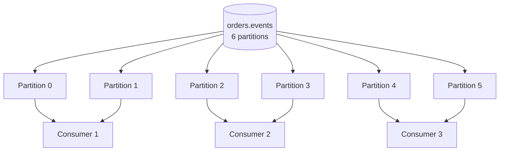
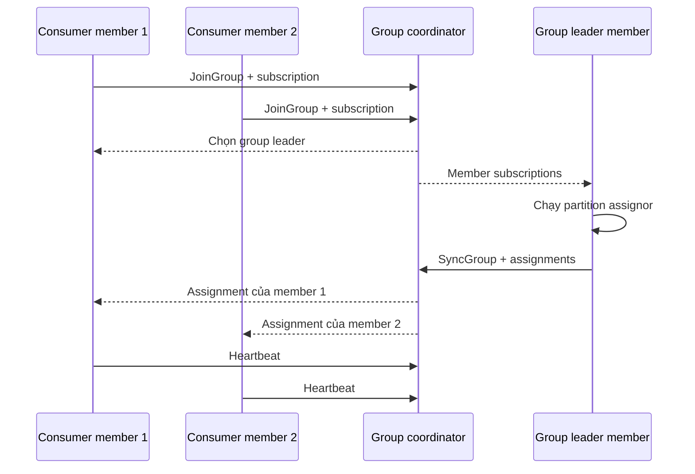
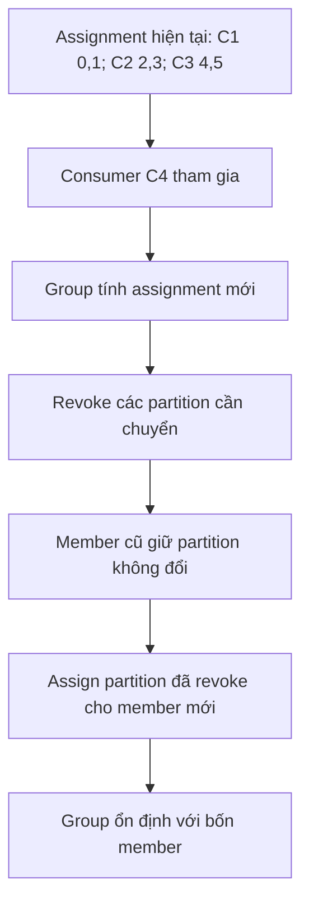

# Phân chia partition cho thành viên trong consumer group

Một consumer group có thể gồm nhiều consumer instance cùng đọc một hoặc nhiều topic. Kafka phân chia các partition mà group đăng ký cho những thành viên đang hoạt động. Mỗi partition tại một thời điểm chỉ được giao cho tối đa một member trong cùng group, nhờ đó các member có thể xử lý song song mà không cùng đọc một partition theo cơ chế group assignment thông thường.

Việc phân chia partition ảnh hưởng trực tiếp đến khả năng song song, mức cân bằng tải, ordering và thời gian gián đoạn khi group rebalance. Muốn thiết kế group hợp lý, cần hiểu vai trò của group coordinator, group leader, partition assignor, các chiến lược Range/RoundRobin/Sticky và cách Kafka chuyển assignment khi member tham gia hoặc rời nhóm.

## 1. Partition assignment là gì?

Giả sử topic `orders.events` có sáu partition và Payment Service chạy ba consumer instance với cùng `group.id=payment-service`. Kafka cần giao sáu partition cho ba member. Một assignment cân bằng có thể là:

| Consumer member | Partition được giao |
|---|---|
| `payment-1` | 0, 1 |
| `payment-2` | 2, 3 |
| `payment-3` | 4, 5 |

Các member cùng group chia nhau công việc đọc topic. Nếu Reporting Service dùng group ID khác, group đó nhận assignment độc lập và vẫn đọc được toàn bộ sáu partition.



Assignment được thực hiện riêng cho từng consumer group. Vì vậy, hai group đọc cùng topic không chia partition với nhau. Ví dụ Payment Service và Reporting Service đều có thể nhận mọi event từ `orders.events`, miễn là chúng dùng hai group ID khác nhau.

## 2. Những quy tắc cơ bản của assignment

### Một partition chỉ có một owner trong cùng group

Với group assignment tự động, một partition tại một thời điểm được gán cho tối đa một member trong group. Một consumer có thể nhận nhiều partition; số partition không bắt buộc bằng số consumer.

Nếu topic có sáu partition và group có tám member cùng subscribe topic đó, tối đa sáu member có thể nhận partition; hai member còn lại không có partition để đọc. Thêm consumer vượt quá số partition không làm tăng khả năng đọc song song của topic đó.

### Một consumer có thể sở hữu nhiều partition

Ví dụ topic có tám partition nhưng chỉ có hai member. Mỗi member có thể được giao bốn partition. Consumer poll các partition được giao và quản lý offset riêng cho từng topic-partition.

### Assignment phụ thuộc subscription

Consumer chỉ có thể nhận partition của topic mà nó đăng ký. Nếu các member trong group subscribe tập topic khác nhau, assignor phải phân chia partition sao cho member chỉ nhận partition thuộc subscription của mình. Khả năng cân bằng phụ thuộc tập subscription của các member và chiến lược assignor.

### Assignment không phải partition leadership

Partition assignment quyết định **consumer member nào đọc partition** trong một group. Partition leader quyết định **broker nào phục vụ produce/fetch** cho partition. Đây là hai khái niệm khác nhau:

- Group assignor giao partition cho consumer member.
- Kafka broker leader phục vụ đọc/ghi dữ liệu của partition.
- Consumer được giao partition vẫn kết nối đến broker đang phục vụ partition theo metadata của Kafka.

## 3. Các vai trò trong quá trình phân chia partition

Trong consumer group theo giao thức classic, có ba vai trò cần phân biệt:

| Vai trò | Trách nhiệm |
|---|---|
| Group coordinator | Broker quản lý trạng thái group, heartbeat, thành viên, rebalance và offset commit |
| Group leader | Một consumer member được chọn trong group; nhận subscription metadata và tính assignment theo assignor |
| Partition assignor | Thuật toán quyết định partition nào được giao cho member nào |

Group coordinator được xác định dựa trên `group.id` và partition tương ứng trong topic nội bộ `__consumer_offsets`. Consumer gửi các yêu cầu tham gia group, heartbeat và commit offset tới coordinator. Coordinator điều phối các bước của giao thức group.

Trong giao thức classic, một member được chọn làm group leader. Member này nhận thông tin subscription của các thành viên và chạy partition assignor để tạo assignment. Kết quả được gửi lại coordinator rồi coordinator phân phối assignment cho từng member. Group leader ở đây là consumer instance, không phải KRaft controller và cũng không phải partition leader của topic.



Chi tiết này mô tả giao thức classic. Kafka có giao thức consumer group mới trong các phiên bản mới hơn; với giao thức mới, một số công việc assignment được chuyển về phía broker. Phần lựa chọn assignor và hành vi cụ thể cần căn cứ phiên bản broker/client đang sử dụng.

## 4. RangeAssignor: chia theo từng topic thành các dải partition

`RangeAssignor` chia partition của từng topic thành các dải liên tiếp cho các member theo thứ tự. Nếu số partition không chia hết cho số consumer, một số member đầu danh sách nhận thêm một partition.

Ví dụ topic `orders.events` có bảy partition và ba consumer:

| Member | Partition |
|---|---|
| Consumer A | 0, 1, 2 |
| Consumer B | 3, 4 |
| Consumer C | 5, 6 |

RangeAssignor dễ hiểu và tạo các dải partition liên tiếp. Tuy nhiên, khi group subscribe nhiều topic, thuật toán chia từng topic riêng biệt nên tải tổng giữa các member có thể không cân bằng.

Ví dụ có hai topic, mỗi topic ba partition; cả hai consumer đều subscribe cả hai topic:

| Topic | Consumer A | Consumer B |
|---|---|---|
| `orders.events` | 0, 1 | 2 |
| `payments.events` | 0, 1 | 2 |
| Tổng partition | 4 | 2 |

Mỗi topic được chia khá đều, nhưng tổng số partition trên Consumer A gấp đôi Consumer B. Đây là một trường hợp RangeAssignor có thể tạo độ lệch khi nhiều topic cùng tham gia group.

## 5. RoundRobinAssignor: luân phiên trên tập partition

`RoundRobinAssignor` sắp xếp các topic/partition và luân phiên giao partition cho các member có subscribe topic tương ứng. Khi các member có cùng subscription, cách chia này thường tạo tổng số partition đồng đều hơn giữa các member so với RangeAssignor.

Với hai topic, mỗi topic có ba partition và hai member cùng subscribe cả hai topic, assignment minh họa có thể là:

| Member | Partition được giao |
|---|---|
| Consumer A | `orders.events-0`, `orders.events-2`, `payments.events-1` |
| Consumer B | `orders.events-1`, `payments.events-0`, `payments.events-2` |

Mỗi member nhận ba partition. Assignment thực tế phụ thuộc thứ tự topic, partition và member trong group; bảng chỉ minh họa nguyên tắc luân phiên.

Khi subscription khác nhau, assignor chỉ giao partition cho member có đăng ký topic tương ứng. Vì thế, không phải mọi trường hợp RoundRobin đều tạo số partition bằng nhau tuyệt đối.

## 6. StickyAssignor: cân bằng nhưng hạn chế di chuyển partition

Khi một member mới tham gia hoặc một member rời group, Kafka cần tính lại assignment. Nếu thuật toán phân chia lại toàn bộ partition một cách thiếu ổn định, nhiều partition có thể bị chuyển sang consumer khác dù không cần thiết. Điều này làm tăng chi phí revoke/assign, khởi tạo state và xử lý lại dữ liệu chưa commit.

`StickyAssignor` hướng đến hai mục tiêu:

1. Giữ assignment cân bằng giữa các member theo điều kiện subscription.
2. Giảm số partition phải chuyển owner so với assignment trước đó.

Ví dụ ban đầu:

| Member | Assignment ban đầu |
|---|---|
| Consumer A | 0, 1, 2 |
| Consumer B | 3, 4, 5 |

Consumer C tham gia. Một assignment mới có thể là:

| Member | Assignment sau khi thêm C |
|---|---|
| Consumer A | 0, 1 |
| Consumer B | 3, 4 |
| Consumer C | 2, 5 |

Chỉ hai partition chuyển owner sang Consumer C; các partition còn lại giữ member cũ. Mục tiêu là giảm chuyển dịch không cần thiết, không phải cam kết tuyệt đối rằng assignment chỉ thay đổi đúng một partition trong mọi tình huống.

## 7. CooperativeStickyAssignor và cooperative rebalance

Trong eager rebalance, group thường thu hồi toàn bộ assignment hiện tại trước khi phân phối assignment mới. Trong thời gian rebalance, consumer có thể tạm ngừng đọc partition, làm tăng thời gian gián đoạn.

Cooperative rebalance cho phép thu hồi từng phần. `CooperativeStickyAssignor` kết hợp tính chất sticky với giao thức cooperative: chỉ những partition cần chuyển owner mới được revoke trong một vòng rebalance; các partition vẫn thuộc member cũ có thể tiếp tục được giữ.

Ví dụ group có sáu partition và ba consumer, sau đó thêm consumer thứ tư:



Cooperative rebalance có thể cần nhiều vòng để hoàn tất việc chuyển partition, vì một partition phải được revoke từ owner cũ trước khi giao cho owner mới. Vì vậy, trạng thái assignment có thể thay đổi theo từng bước. Ưu điểm là giảm số partition bị dừng đọc cùng lúc.

Khi dùng `CooperativeStickyAssignor`, listener xử lý revoke phải hoàn tất công việc cần thiết trước khi partition được giao cho member khác. Không được tiếp tục xử lý một partition sau khi đã nhường ownership.

## 8. Rebalance xảy ra khi nào?

Rebalance là quá trình group điều chỉnh assignment để phản ánh thành viên và subscription hiện tại. Các nguyên nhân phổ biến:

- Consumer mới tham gia group.
- Consumer đóng hoặc rời group một cách chủ động.
- Consumer mất heartbeat hoặc vượt thời gian session timeout.
- Consumer không gọi `poll()` trong thời gian vượt `max.poll.interval.ms` theo giao thức classic.
- Subscription topic thay đổi.
- Số partition của topic thay đổi.
- Coordinator hoặc một phần hạ tầng group thay đổi khiến group cần tái đồng bộ.

Trong eager rebalance, member thường revoke toàn bộ partition rồi nhận assignment mới. Trong cooperative rebalance, member chỉ revoke phần partition cần chuyển. Dù dùng chiến lược nào, ứng dụng cần chuẩn bị cho việc partition được giao lại và xử lý an toàn với record đang chạy dở.

### Rebalance listener

Java Kafka Consumer cung cấp `ConsumerRebalanceListener` với các callback chính:

| Callback | Thời điểm | Công việc thường làm |
|---|---|---|
| `onPartitionsRevoked` | Trước khi partition bị thu hồi | Hoàn tất xử lý đang dở, commit offset phù hợp, flush state |
| `onPartitionsAssigned` | Khi partition mới được giao | Khởi tạo state, seek nếu có chính sách offset riêng |
| `onPartitionsLost` | Khi member đã mất quyền sở hữu partition | Dọn tài nguyên; tránh commit offset như thể vẫn còn ownership |

Callback và thứ tự gọi có thể khác theo protocol/assignor. `onPartitionsLost` đặc biệt hữu ích khi member phát hiện quyền sở hữu đã mất và không thể thực hiện các thao tác như trong một revoke có kiểm soát.

Ví dụ đăng ký listener với Java Consumer:

```java
consumer.subscribe(List.of("orders.events"), new ConsumerRebalanceListener() {
    @Override
    public void onPartitionsRevoked(Collection<TopicPartition> partitions) {
        // Hoàn tất hoặc dừng xử lý đang dở cho các partition sắp nhường.
        // Commit các offset đã xử lý an toàn và flush state nếu cần.
        checkpointStore.flush(partitions);
    }

    @Override
    public void onPartitionsAssigned(Collection<TopicPartition> partitions) {
        // Khởi tạo state cho partition vừa nhận; không giả định assignment cố định.
        checkpointStore.initialize(partitions);
    }

    @Override
    public void onPartitionsLost(Collection<TopicPartition> partitions) {
        // Ownership đã mất: dọn state cục bộ, không commit như thể còn sở hữu.
        checkpointStore.discard(partitions);
    }
});
```

`checkpointStore` là thành phần minh họa của ứng dụng, không phải API Kafka. Trong code thực tế, chỉ commit offset đã xử lý xong và thuộc các partition đang revoke; với cooperative rebalance, không commit hoặc dừng xử lý các partition vẫn đang được giữ.

## 9. Cấu hình assignor trong Java Consumer

Ví dụ cấu hình consumer dùng `CooperativeStickyAssignor`:

```java
import java.util.List;
import java.util.Properties;

import org.apache.kafka.clients.consumer.ConsumerConfig;
import org.apache.kafka.clients.consumer.KafkaConsumer;
import org.apache.kafka.clients.consumer.CooperativeStickyAssignor;
import org.apache.kafka.common.serialization.StringDeserializer;

Properties props = new Properties();
props.put(ConsumerConfig.BOOTSTRAP_SERVERS_CONFIG, "localhost:9092");
props.put(ConsumerConfig.GROUP_ID_CONFIG, "payment-service");
props.put(ConsumerConfig.KEY_DESERIALIZER_CLASS_CONFIG,
          StringDeserializer.class.getName());
props.put(ConsumerConfig.VALUE_DESERIALIZER_CLASS_CONFIG,
          StringDeserializer.class.getName());
props.put(ConsumerConfig.PARTITION_ASSIGNMENT_STRATEGY_CONFIG,
          CooperativeStickyAssignor.class.getName());

KafkaConsumer<String, String> consumer = new KafkaConsumer<>(props);
consumer.subscribe(List.of("orders.events"));
```

Trong một group, các member cần tương thích về giao thức và chiến lược assignment. Khi triển khai thay đổi assignor trên một hệ thống đang chạy, cần xem quy trình rolling upgrade và compatibility của phiên bản Kafka client; không nên đổi assignor tùy tiện giữa các instance đang hoạt động.

### Cấu hình trong Spring Boot

Có thể cấu hình assignor qua consumer properties:

```yaml
spring:
  kafka:
    bootstrap-servers: localhost:9092
    consumer:
      group-id: payment-service
      key-deserializer: org.apache.kafka.common.serialization.StringDeserializer
      value-deserializer: org.apache.kafka.common.serialization.StringDeserializer
      properties:
        partition.assignment.strategy: org.apache.kafka.clients.consumer.CooperativeStickyAssignor
```

Với `@KafkaListener`, Spring Kafka quản lý consumer container và việc subscribe. Thuộc tính `concurrency` tạo nhiều consumer instance/container trong cùng listener group (với cùng group ID), sau đó Kafka phân chia partition giữa các member:

```java
@KafkaListener(
    topics = "orders.events",
    groupId = "payment-service",
    concurrency = "3"
)
public void handle(String event) {
    paymentService.process(event);
}
```

Nếu topic có ba partition, concurrency bằng ba có thể cho phép ba consumer instance cùng nhận partition. Nếu concurrency lớn hơn số partition có thể được giao, một số consumer sẽ idle. Nếu nhiều listener/container dùng cùng group ID và subscription, chúng cùng tham gia một assignment chung.

## 10. Static membership: giảm rebalance khi instance khởi động lại

Mặc định, consumer group nhận biết member thông qua membership động. Khi một consumer tạm thời dừng và khởi động lại, group có thể thực hiện rebalance. Với ứng dụng triển khai rolling restart hoặc có thời gian khởi động ngắn, điều này có thể tạo rebalance không cần thiết.

Static membership cho phép cấu hình `group.instance.id` ổn định cho một logical consumer instance. Khi instance khởi động lại với cùng ID trong khoảng thời gian phù hợp, Kafka có thể nhận diện nó là member cũ và giảm việc thay đổi assignment.

Ví dụ:

```properties
group.id=payment-service
group.instance.id=payment-worker-1
session.timeout.ms=45000
```

Mỗi member đang hoạt động trong cùng group phải có `group.instance.id` duy nhất. Nếu hai instance đồng thời dùng cùng ID, một instance có thể bị fenced hoặc bị loại khỏi group. Không dùng cùng một giá trị cho mọi replica của Deployment; hãy tạo ID ổn định và duy nhất theo từng replica.

Static membership không loại bỏ mọi rebalance. Thay đổi partition, subscription, member ID, timeout hoặc trạng thái coordinator vẫn có thể yêu cầu group điều chỉnh assignment. Nó chủ yếu giảm churn do member tạm thời rời group rồi quay lại với cùng identity.

## 11. Số consumer, số partition và khả năng song song

Với một topic mà mọi member trong group đều subscribe đầy đủ, số consumer có partition được giao tối đa bằng số partition của topic. Tuy nhiên, điều đó không có nghĩa cứ tăng partition hoặc consumer là throughput sẽ tăng tuyến tính.

| Partition | Consumer member | Hệ quả |
|---:|---:|---|
| 6 | 1 | Một consumer xử lý cả sáu partition |
| 6 | 3 | Có thể giao khoảng hai partition mỗi consumer |
| 6 | 6 | Mỗi consumer có thể nhận một partition |
| 6 | 8 | Hai consumer không có partition |
| 12 | 6 | Có thể giao khoảng hai partition mỗi consumer |

Hiệu năng thực tế còn phụ thuộc tốc độ xử lý record, downstream database/API, số thread xử lý, batch size, network và consumer lag. Nếu một partition có key nóng, consumer sở hữu partition đó có thể quá tải trong khi các member khác còn nhàn rỗi.

Tăng partition có thể tăng song song nhưng cũng ảnh hưởng ordering theo key khi partitioner ánh xạ key vào số partition mới. Cần chọn partition count dựa trên throughput, số consumer dự kiến, phân phối key và yêu cầu ordering.

### Một consumer nhận nhiều partition nhưng xử lý thế nào?

Một consumer có thể poll record từ nhiều partition. Nếu ứng dụng chuyển record sang worker thread để xử lý bất đồng bộ, cần giữ thứ tự và quản lý offset cẩn thận. Consumer chỉ nên commit offset khi các record trước đó trong partition đã được xử lý theo chính sách. Nếu xử lý song song không kiểm soát, offset có thể tiến vượt qua record còn đang chạy, gây mất xử lý khi restart.

## 12. Quan sát assignment và trạng thái group

Kafka CLI hỗ trợ xem member và partition assignment:

```bash
kafka-consumer-groups.sh \
  --bootstrap-server localhost:9092 \
  --describe \
  --group payment-service \
  --members \
  --verbose
```

Lệnh có thể hiển thị member ID, client ID, host và các partition được giao tùy phiên bản. Để xem offset và lag:

```bash
kafka-consumer-groups.sh \
  --bootstrap-server localhost:9092 \
  --describe \
  --group payment-service
```

Những thông tin cần quan sát:

| Thông tin | Ý nghĩa |
|---|---|
| Member ID / client ID | Nhận diện consumer member và client instance |
| Host | Máy hoặc container đang chạy consumer |
| Assignment | Các topic-partition member đang sở hữu |
| Current offset | Offset đã commit của group |
| Log end offset | Vị trí cuối của partition tại thời điểm truy vấn |
| Lag | Khoảng cách giữa log end offset và current offset theo cách công cụ tính |
| Rebalance rate | Tần suất group phải phân chia lại partition |

Nếu group thường xuyên rebalance, hãy kiểm tra heartbeat, session timeout, `max.poll.interval.ms`, thời gian xử lý trong mỗi poll, lỗi deserialization và việc container bị restart. Lag cao chỉ ra consumer đang tụt lại; nó không tự chứng minh assignor mất cân bằng. Cần đối chiếu số partition mỗi member, throughput xử lý và downstream latency.

## 13. Các lưu ý về giao thức consumer mới

Giao thức classic sử dụng group leader member để tính assignment với các assignor phía client như Range, RoundRobin, Sticky hoặc CooperativeSticky. Kafka có giao thức consumer group mới nhằm chuyển một số trách nhiệm assignment và điều phối sang broker, đồng thời hỗ trợ rebalance incremental tốt hơn.

Trong các phiên bản Kafka mới có hỗ trợ giao thức này, cấu hình `group.protocol` và assignor phía broker có thể ảnh hưởng cách assignment được tính. Không nên sao chép cấu hình của giao thức classic sang cluster mới mà không kiểm tra phiên bản broker, client và tài liệu tương ứng. Khi nâng cấp, cần lập kế hoạch tương thích giữa các member để tránh một group có cấu hình protocol không thống nhất.

## 14. Những lỗi thường gặp khi thiết kế consumer group

- **Dùng cùng `group.id` cho hai dịch vụ cần nhận toàn bộ event:** hai dịch vụ sẽ chia partition với nhau; hãy dùng group ID riêng.
- **Tăng consumer nhiều hơn partition:** member dư sẽ không có partition, không tăng song song của topic.
- **Cho rằng mỗi consumer chỉ nhận một partition:** một member có thể nhận nhiều partition.
- **Nhầm group leader với partition leader hoặc KRaft controller:** đây là các vai trò khác nhau.
- **Chọn assignor mà không xem subscription:** các member subscribe khác nhau có thể tạo assignment không cân bằng.
- **Không xử lý revoke callback:** ứng dụng có thể mất công việc đang dở hoặc commit offset sai khi partition chuyển owner.
- **Dùng cooperative assignor nhưng vẫn xử lý partition đã revoke:** có thể gây xử lý trùng hoặc cạnh tranh ownership.
- **Đặt `group.instance.id` giống nhau cho nhiều replica:** member có thể bị fencing hoặc rời group ngoài ý muốn.
- **Chỉ tăng concurrency để xử lý lag:** nếu downstream là nút thắt hoặc partition không đủ, tăng consumer không giải quyết được nguyên nhân.
- **Không kiểm tra compatibility khi đổi assignor/protocol:** các member có thể không tham gia group ổn định.

## 15. Bài thực hành: so sánh các chiến lược assignment

Tạo topic `orders.events` có sáu partition và chạy ba consumer trong cùng group `payment-service`.

1. Cấu hình `RangeAssignor`, khởi động ba consumer và dùng CLI xem assignment.
2. Dừng một consumer, quan sát rebalance và cách partition được giao lại.
3. Khởi động lại đủ ba consumer, đổi sang `RoundRobinAssignor` trong môi trường lab và so sánh phân phối.
4. Thử thêm topic `payments.events` có ba partition, cho tất cả consumer subscribe cả hai topic; quan sát sự khác biệt giữa Range và RoundRobin.
5. Thử `StickyAssignor`, thêm hoặc bỏ một member và ghi lại số partition bị chuyển owner.
6. Thử `CooperativeStickyAssignor`, quan sát callback revoke/assign và thời gian group trở lại trạng thái ổn định.
7. Cấu hình `group.instance.id` duy nhất cho từng member, restart một instance và quan sát hành vi static membership.
8. Tăng concurrency vượt số partition và xác định consumer nào không được giao partition.

Chỉ thay assignor khi toàn bộ member trong group được cấu hình tương thích. Thực hiện thí nghiệm trên môi trường local/lab, không đổi đồng loạt cấu hình consumer group production khi chưa có kế hoạch rolling upgrade.

## 16. Tổng kết

Partition assignment quyết định consumer member nào chịu trách nhiệm đọc từng partition trong một group. Group coordinator quản lý membership và offset; với giao thức classic, group leader cùng partition assignor tính assignment; các chiến lược Range, RoundRobin, Sticky và CooperativeSticky tạo ra những cách cân bằng và chuyển partition khác nhau.

Khi thiết kế group, hãy chọn số partition phù hợp với mức song song, dùng group ID riêng cho từng ứng dụng cần đọc độc lập, chọn assignor phù hợp với số topic và yêu cầu giảm rebalance, đồng thời xử lý đúng callback revoke/assign. Theo dõi assignment, lag và rebalance rate sẽ giúp phát hiện sớm tình trạng mất cân bằng hoặc group không ổn định.
