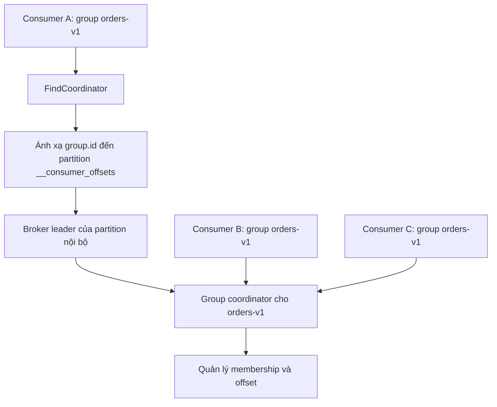
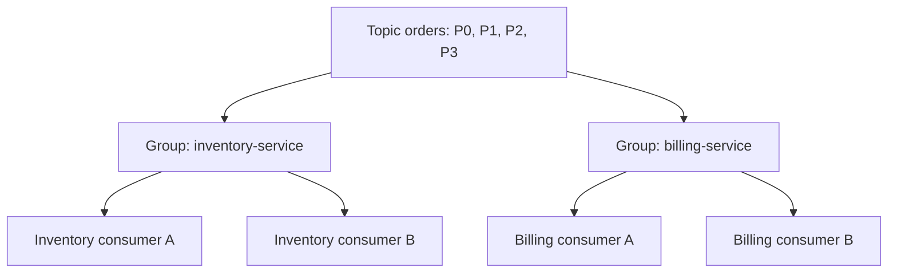
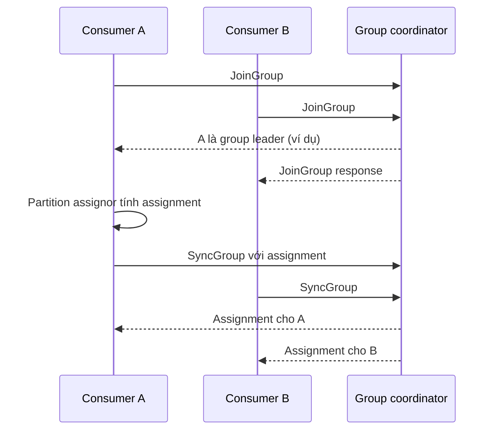
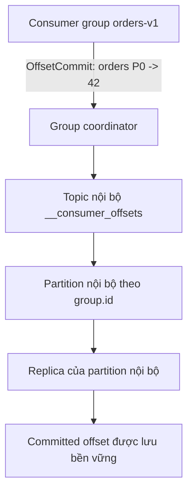

# Group coordinator, membership và lưu trữ offset

## Consumer group cần một nơi điều phối chung

Kafka cho phép nhiều consumer cùng đọc một topic theo mô hình consumer group. Các consumer có cùng `group.id` phối hợp để chia partition; trong cùng group, một partition chỉ được giao cho một member tại một thời điểm. Khi một consumer tham gia, rời đi hoặc mất kết nối, group cần xác định lại membership và phân công partition.

Kafka dùng **group coordinator** để quản lý vòng đời group và tiến độ đọc đã commit. Coordinator xử lý yêu cầu tham gia group, heartbeat, rời group và commit offset. Thông tin group cùng offset được lưu bền vững trong topic nội bộ `__consumer_offsets`, nhờ vậy tiến độ đọc có thể tồn tại qua lần restart của consumer hoặc broker.

Ba khái niệm cần phân biệt:

- **Membership:** consumer instance nào đang là thành viên của group.
- **Assignment:** partition nào được giao cho từng member.
- **Committed offset:** vị trí tiếp theo mà group đã xác nhận xử lý và muốn đọc tiếp.

Membership và assignment có thể thay đổi khi rebalance; committed offset được lưu riêng theo `group.id`, topic và partition. Một member rời group không đồng nghĩa offset của group bị xóa.

## 1. Group coordinator là gì?

### 1.1 Mỗi group có coordinator quản lý

Group coordinator là broker chịu trách nhiệm điều phối một consumer group cụ thể. Coordinator không nhất thiết là broker đang giữ partition leader của topic nghiệp vụ mà consumer đọc. Nó được xác định từ `group.id` thông qua partition tương ứng của topic nội bộ `__consumer_offsets`.

Ở mức khái niệm, Kafka thực hiện các bước sau khi consumer cần tìm coordinator:

1. Consumer gửi yêu cầu `FindCoordinator` với `group.id`.
2. Kafka ánh xạ group ID đến một partition của `__consumer_offsets`.
3. Broker đang là leader của partition nội bộ đó đóng vai trò group coordinator cho group.
4. Consumer gửi các yêu cầu group như join, heartbeat, leave hoặc offset commit đến coordinator.



Các group khác nhau có thể được điều phối bởi các broker khác nhau, tùy partition leader của `__consumer_offsets`. Một broker có thể làm coordinator cho nhiều group.

### 1.2 Coordinator không phải KRaft controller

Group coordinator là vai trò của broker ở data plane, quản lý consumer group và offset. KRaft active controller quản lý metadata và trạng thái cluster ở control plane. Hai vai trò có thể nằm trên cùng một node trong mô hình combined broker/controller, nhưng nhiệm vụ và giao thức của chúng khác nhau.

Coordinator có thể thay đổi khi leader của partition `__consumer_offsets` thay đổi. Khi đó consumer có thể nhận lỗi coordinator unavailable hoặc not coordinator, tìm coordinator mới rồi thử lại theo cơ chế client. Ứng dụng nên dùng Kafka client chuẩn và xử lý retry/timeout phù hợp thay vì hard-code địa chỉ coordinator.

### 1.3 `__consumer_offsets` là topic nội bộ

Kafka lưu metadata group và committed offset trong topic nội bộ `__consumer_offsets`. Topic này được phân vùng và replication để có thể lưu trữ trạng thái group bền vững. Mỗi record offset gắn với group, topic và partition; vì vậy hai group đọc cùng một topic sẽ có tiến độ độc lập.

Ứng dụng thông thường không ghi event nghiệp vụ trực tiếp vào `__consumer_offsets`. Đây là topic nội bộ do Kafka quản lý. Không xóa, chỉnh sửa hoặc thay đổi cấu hình của nó tùy tiện vì có thể làm mất tiến độ consumer group hoặc ảnh hưởng hoạt động coordinator.

## 2. Membership: consumer tham gia và duy trì group như thế nào?

### 2.1 `group.id` xác định group logic

Các consumer dùng cùng `group.id` được xem là thành viên của cùng một group khi tham gia group protocol. Ví dụ ba instance của `order-service` cùng dùng `group.id=order-workers` sẽ chia partition của topic `orders`.

Một ứng dụng khác như `billing-service` nên dùng group ID riêng nếu cần nhận toàn bộ sự kiện độc lập. Nếu billing dùng cùng group ID với inventory, hai ứng dụng sẽ cạnh tranh nhận partition và mỗi record chỉ được giao cho một member trong group, thay vì cả hai ứng dụng đều nhận được.



Mỗi group có assignment và committed offset riêng. Vì vậy, inventory có thể đã đọc đến offset 100 trong partition 0 trong khi billing mới đọc đến offset 75 của cùng partition.

### 2.2 Dynamic membership

Với dynamic membership, consumer tham gia group và được cấp member ID. Khi consumer khởi động, nó gửi yêu cầu join; coordinator tổ chức rebalance để các member thống nhất assignment. Khi consumer rời group bình thường, nó có thể gửi yêu cầu leave. Nếu consumer crash hoặc mất mạng, coordinator phát hiện qua heartbeat/session timeout.

Dynamic membership phù hợp với các service có số instance thay đổi thường xuyên. Khi scale deployment từ 3 lên 5 instance, các consumer mới tham gia group và Kafka phân công lại partition dựa trên assignor.

### 2.3 Static membership với `group.instance.id`

Static membership cho phép một consumer có định danh instance ổn định thông qua `group.instance.id`. Khi instance restart trong thời gian phù hợp, Kafka có thể nhận diện nó là cùng thành viên logic thay vì xem như một member hoàn toàn mới. Điều này giúp giảm rebalance không cần thiết khi rollout hoặc restart ngắn.

Ví dụ cấu hình Java:

```java
props.put(ConsumerConfig.GROUP_ID_CONFIG, "order-workers");
props.put(ConsumerConfig.GROUP_INSTANCE_ID_CONFIG, "order-worker-0");
```

Mỗi instance trong cùng group phải có `group.instance.id` duy nhất. Nếu hai tiến trình cùng dùng một ID, broker có thể loại member cũ hoặc từ chối member mới do trùng định danh.

Static membership có đánh đổi: khi instance mất kết nối, group có thể chờ session timeout trước khi thu hồi membership và phân công lại partition. Điều này giảm rebalance do restart ngắn nhưng có thể làm chậm failover khi instance thực sự đã chết. Chọn timeout theo thời gian restart dự kiến và mục tiêu phục hồi.

## 3. Heartbeat, poll và phát hiện member lỗi

### 3.1 Heartbeat duy trì membership

Consumer gửi heartbeat đến group coordinator để cho biết member còn hoạt động. Nếu coordinator không nhận heartbeat trong thời gian `session.timeout.ms`, member có thể bị xem là mất kết nối và group bắt đầu rebalance.

`heartbeat.interval.ms` xác định nhịp gửi heartbeat của consumer trong các giao thức áp dụng cấu hình client này. Thông thường giá trị cần nhỏ hơn `session.timeout.ms` đủ nhiều để có thể chịu một số heartbeat bị trễ hoặc mất. Không nên đặt heartbeat quá sát session timeout.

### 3.2 `max.poll.interval.ms` kiểm soát thời gian xử lý giữa các lần poll

Consumer cần tiếp tục gọi `poll()` để duy trì tiến trình xử lý và group protocol. Nếu ứng dụng xử lý một batch quá lâu và không gọi `poll()` trong khoảng `max.poll.interval.ms`, Kafka có thể xem consumer không còn tiến triển và kích hoạt việc rời group/rebalance. Với dynamic member, consumer có thể chủ động rời group; với static member, việc thu hồi assignment có thể chờ session timeout theo quy tắc của giao thức.

Đây là lý do không nên xử lý một lượng record lớn trong thời gian quá dài trên thread poll. Nếu logic nghiệp vụ chậm, có thể giảm `max.poll.records`, tối ưu xử lý, hoặc chuyển công việc sang worker pool nhưng phải quản lý offset và thứ tự hoàn tất cẩn thận.

### 3.3 Các timeout cần phối hợp

| Cấu hình | Vai trò | Khi đặt quá thấp hoặc quá cao |
|---|---|---|
| `heartbeat.interval.ms` | Nhịp heartbeat trong giao thức classic | Quá thấp tạo nhiều request; quá cao làm phát hiện lỗi chậm hơn |
| `session.timeout.ms` | Thời gian không heartbeat trước khi member bị xem là mất | Quá thấp dễ false failure; quá cao kéo dài failover |
| `max.poll.interval.ms` | Giới hạn thời gian giữa các lần poll | Quá thấp có thể loại consumer xử lý chậm; quá cao làm phát hiện consumer không tiến triển lâu hơn |
| `max.poll.records` | Số record tối đa trả về trong một lần poll | Batch lớn có thể xử lý quá lâu; batch nhỏ tăng số vòng poll |

Giá trị hợp lý phụ thuộc thời gian xử lý record, kích thước batch, độ trễ downstream và phiên bản group protocol. Với consumer group protocol mới, một số cấu hình heartbeat/session được quản lý phía broker thay vì dùng đúng các thuộc tính client classic; cần kiểm tra giao thức đang bật.

## 4. Join, rebalance và partition assignment

### 4.1 Quy trình group protocol classic

Trong giao thức classic, một lần tham gia group thường có các bước chính:

1. Consumer gửi `JoinGroup` đến coordinator để tham gia group.
2. Coordinator xác định các member và chọn group leader trong số member theo protocol.
3. Group leader nhận thông tin subscription của các member và dùng partition assignor để tính assignment.
4. Group leader gửi kết quả assignment trong `SyncGroup`.
5. Coordinator trả assignment cho từng member; các consumer bắt đầu xử lý partition được giao.

Các assignor phổ biến gồm Range, RoundRobin, Sticky và CooperativeSticky. Chúng có cách phân phối partition và hành vi khi rebalance khác nhau. Ví dụ, CooperativeSticky cố gắng giảm số partition phải thu hồi trong rebalance bằng cách chuyển giao tăng dần.



Sơ đồ mô tả giao thức classic ở mức khái niệm. Chi tiết message và vai trò leader có thể khác trong giao thức consumer group mới.

### 4.2 Các trạng thái group

Trong giao thức classic, group có thể đi qua các trạng thái như:

- `Empty`: chưa có member hoạt động.
- `PreparingRebalance`: coordinator chuẩn bị rebalance và thu thập thông tin member.
- `CompletingRebalance`: assignment đang được đồng bộ đến các member.
- `Stable`: group đã có assignment ổn định.
- `Dead`: group không còn tồn tại hoặc đang được xóa.

Nếu group liên tục chuyển giữa PreparingRebalance và Stable, có thể đang xảy ra rebalance storm. Nguyên nhân thường gặp gồm consumer restart liên tục, heartbeat timeout, xử lý vượt `max.poll.interval.ms`, lỗi network hoặc cấu hình static member trùng ID.

### 4.3 Cooperative và eager rebalance

Với eager rebalance, các member có thể phải thu hồi toàn bộ partition assignment trước khi nhận assignment mới. Trong khoảng chuyển giao, group có thể tạm dừng xử lý trên diện rộng.

Cooperative rebalance cho phép thu hồi và chuyển giao một phần partition theo nhiều vòng, giảm phạm vi gián đoạn. Tuy vậy, consumer vẫn cần tuân thủ callback revoke/assign, commit offset phù hợp và không tiếp tục xử lý partition đã bị thu hồi.

### 4.4 Giao thức consumer group mới

Các phiên bản Kafka mới hỗ trợ consumer group protocol mới (thường được cấu hình bằng `group.protocol=consumer`), bên cạnh giao thức classic. Protocol mới chuyển thêm trách nhiệm điều phối assignment về phía broker, hỗ trợ heartbeat và rebalance theo hướng incremental hơn. Cấu hình assignor và timeout có thể khác so với classic.

Không nên giả định mọi cluster hoặc client đang dùng protocol mới. Khả năng sử dụng phụ thuộc phiên bản broker, client và cấu hình triển khai. Khi nâng cấp, hãy kiểm tra compatibility matrix, cấu hình group protocol và hành vi rebalance trong môi trường thử nghiệm trước khi bật production.

## 5. Offset là gì và được lưu ở đâu?

### 5.1 Offset là vị trí tiếp theo cần đọc

Mỗi record trong một partition có offset riêng. Consumer commit offset để ghi nhận vị trí tiếp theo mà group muốn đọc sau khi restart hoặc rebalance.

Nếu consumer xử lý thành công record offset 41, nó thường commit offset 42. Offset commit không phải offset của record cuối cùng vừa xử lý; nó là vị trí kế tiếp.

Offset được lưu theo ba thành phần logic:

- `group.id`: consumer group sở hữu tiến độ.
- Topic: luồng dữ liệu được đọc.
- Partition: log cụ thể trong topic.

Do đó, hai group đọc cùng partition có thể commit hai offset khác nhau mà không ghi đè tiến độ của nhau.

### 5.2 Offset commit nằm trong `__consumer_offsets`

Khi consumer gửi `OffsetCommit`, group coordinator xác thực member/generation theo giao thức áp dụng và ghi offset vào partition tương ứng của `__consumer_offsets`. Topic nội bộ này được cấu hình replication và log compaction để giữ trạng thái offset mới nhất theo key.



Coordinator chịu trách nhiệm tiếp nhận và phản hồi commit. Dữ liệu offset được lưu trong `__consumer_offsets`, không nằm trong bộ nhớ riêng của consumer. Khi consumer restart hoặc một member khác nhận partition, nó có thể lấy offset đã commit để tiếp tục.

### 5.3 Offset và assignment có vòng đời khác nhau

Assignment là trạng thái tạm thời: partition đang thuộc member nào. Offset là tiến độ của group cho từng partition. Khi member rời group và partition được giao cho member khác, committed offset vẫn còn để member mới tiếp tục.

Consumer dùng `assign()` trực tiếp vẫn có thể khai báo `group.id` và commit offset vào `__consumer_offsets`. Khi đó, group coordinator vẫn xử lý yêu cầu lưu offset, nhưng consumer không tham gia group membership để coordinator phân công partition hoặc chạy rebalance cho nó. `group.id` xác định namespace offset; nó không tự tạo ownership độc quyền cho partition.

Nếu group không có member trong một thời gian dài, offset có thể hết hạn theo chính sách retention của broker. Vì vậy, `__consumer_offsets` không phải nơi lưu lịch sử đọc vô thời hạn. Hãy cấu hình và giám sát retention theo yêu cầu vận hành.

## 6. Commit offset và bảo đảm xử lý

### 6.1 Auto commit

Nếu `enable.auto.commit=true`, consumer client định kỳ commit offset dựa trên vị trí đã poll. Cách này đơn giản, nhưng offset có thể được commit trước khi ứng dụng hoàn tất side effect của toàn bộ record đã nhận. Nếu tiến trình lỗi, record chưa xử lý xong có thể bị bỏ qua khi khởi động lại.

Auto commit phù hợp khi logic xử lý đơn giản và ứng dụng chấp nhận semantics tương ứng. Với xử lý nghiệp vụ quan trọng, thường nên tắt auto commit và commit sau khi xử lý thành công.

### 6.2 Manual commit

Ví dụ consumer Java tắt auto commit và commit sau khi xử lý batch:

```java
props.put(ConsumerConfig.GROUP_ID_CONFIG, "order-workers");
props.put(ConsumerConfig.ENABLE_AUTO_COMMIT_CONFIG, false);

KafkaConsumer<String, String> consumer = new KafkaConsumer<>(props);
consumer.subscribe(List.of("orders"));

while (true) {
    ConsumerRecords<String, String> records =
            consumer.poll(Duration.ofMillis(500));

    for (ConsumerRecord<String, String> record : records) {
        processOrder(record); // Hoàn tất side effect trước khi commit
    }

    if (!records.isEmpty()) {
        consumer.commitSync();
    }
}
```

Nếu xử lý thất bại giữa batch, không commit toàn bộ batch một cách mù quáng. Cần commit offset an toàn cho từng partition và bảo đảm các record trước offset commit đã xử lý thành công. Nếu database commit thành công nhưng offset commit thất bại, record có thể được đọc lại; consumer nên idempotent.

### 6.3 `commitSync()` và `commitAsync()`

`commitSync()` chờ phản hồi commit và thường được dùng khi cần biết commit đã hoàn tất trước khi tiếp tục hoặc đóng consumer. `commitAsync()` gửi commit không chờ hoàn tất ngay, có thể cải thiện throughput nhưng cần xử lý callback/error và thứ tự commit cẩn thận. Một commit async cũ hoàn tất muộn có thể ghi đè tiến độ mới hơn nếu ứng dụng không quản lý thứ tự request phù hợp.

### 6.4 Offset reset khi chưa có offset hợp lệ

`auto.offset.reset` quyết định vị trí bắt đầu khi group chưa có committed offset hợp lệ hoặc offset đã commit nằm ngoài phạm vi log còn giữ:

- `earliest`: bắt đầu từ offset sớm nhất còn có thể đọc.
- `latest`: bắt đầu từ cuối log hiện tại.
- `none`: ném lỗi nếu không tìm thấy offset hợp lệ.

Chính sách này không tự động ghi đè offset đã commit hợp lệ. Nếu cần replay hoặc điều chỉnh tiến độ group, hãy dùng công cụ quản trị offset có chủ đích.

## 7. Ví dụ Spring Kafka

### 7.1 Khai báo group ID

```java
@KafkaListener(topics = "orders", groupId = "order-workers")
public void onOrder(OrderEvent event) {
    orderService.handle(event);
}
```

Các instance của service dùng cùng group ID sẽ chia partition thông qua container và group protocol. Một service khác cần nhận toàn bộ event nên dùng group ID riêng.

### 7.2 Cấu hình consumer trong Spring Boot

```yaml
spring:
  kafka:
    consumer:
      group-id: order-workers
      enable-auto-commit: false
      auto-offset-reset: earliest
      properties:
        max.poll.records: 200
        max.poll.interval.ms: 300000
```

Tên thuộc tính và giá trị mặc định cần được kiểm tra theo phiên bản Spring Boot, Spring Kafka và Kafka client. Khi dùng listener container, Spring Kafka có thể quản lý acknowledgement và offset commit dựa trên `AckMode`; đừng giả định đoạn code manual commit của KafkaConsumer thuần áp dụng nguyên xi cho listener container.

### 7.3 Theo dõi group bằng CLI

Liệt kê group:

```bash
kafka-consumer-groups.sh --bootstrap-server kafka-1:9092 --list
```

Xem member, partition assignment, committed offset và lag:

```bash
kafka-consumer-groups.sh --bootstrap-server kafka-1:9092 \
  --describe --group order-workers --members --verbose
```

Xem offset theo partition:

```bash
kafka-consumer-groups.sh --bootstrap-server kafka-1:9092 \
  --describe --group order-workers
```

Lệnh describe giúp đối chiếu CURRENT-OFFSET, LOG-END-OFFSET và LAG. Lag là chênh lệch giữa vị trí cuối log và tiến độ group, nhưng cần diễn giải theo tốc độ ghi/đọc và trạng thái partition; một con số lag tức thời không đủ kết luận consumer bị lỗi.

## 8. Coordinator failure và khả năng phục hồi

### 8.1 Broker coordinator bị lỗi

Nếu broker đang làm group coordinator dừng, consumer có thể tạm thời không commit offset hoặc không hoàn tất group request. Khi leader của partition `__consumer_offsets` được bầu lại trên broker khác, client có thể tìm coordinator mới và tiếp tục.

Trong khoảng chuyển đổi, có thể xuất hiện lỗi `NOT_COORDINATOR`, `COORDINATOR_NOT_AVAILABLE` hoặc timeout. Kafka client có retry và refresh coordinator metadata. Ứng dụng nên xử lý lỗi tạm thời theo retry policy, đồng thời không giả định commit timeout chắc chắn thất bại: commit có thể đã được lưu nhưng response bị mất.

### 8.2 Partition `__consumer_offsets` bị under-replicated

Nếu replica của `__consumer_offsets` không theo kịp leader, việc lưu committed offset và metadata group có thể bị ảnh hưởng. Theo dõi ISR, under-replicated partitions và offline partitions của topic nội bộ này như một phần sức khỏe cluster.

Replication factor của `__consumer_offsets` được quản lý bằng cấu hình broker như `offsets.topic.replication.factor` khi topic nội bộ được tạo; giá trị yêu cầu phải phù hợp số broker có sẵn. Thay đổi cấu hình sau khi topic đã tồn tại không tự động bảo đảm mọi partition cũ được tăng replica; cần kiểm tra assignment thực tế và dùng quy trình reassignment nếu cần.

### 8.3 Offset retention

Offset của group không được giữ mãi khi group không hoạt động. Broker có cấu hình `offsets.retention.minutes` để kiểm soát thời gian giữ offset của group không còn hoạt động theo quy tắc Kafka. Khi offset hết hạn, lần đọc tiếp theo có thể áp dụng `auto.offset.reset`.

Nếu cần giữ khả năng replay lâu dài, hãy dựa vào retention của topic nghiệp vụ và quy trình reset/replay có kiểm soát. Không nên dựa vào việc committed offset tồn tại vĩnh viễn.

## 9. Phân biệt group coordinator với các thành phần khác

| Thành phần | Nhiệm vụ | Quản lý dữ liệu/trạng thái nào? |
|---|---|---|
| Group coordinator | Quản lý membership, heartbeat, rebalance protocol và offset commit | Trạng thái consumer group và committed offset |
| Group leader trong protocol classic | Tính assignment dựa trên metadata member và assignor | Assignment trong lần rebalance |
| Partition leader | Nhận produce/fetch cho một partition | Record log của topic partition |
| KRaft active controller | Quản lý metadata và trạng thái cluster | Metadata log của cluster |
| Consumer member | Poll record và thực hiện xử lý nghiệp vụ | Trạng thái xử lý trong ứng dụng và vị trí đọc cục bộ |

Group coordinator không phải partition leader của topic nghiệp vụ và cũng không phải KRaft active controller. Group leader trong protocol classic cũng không phải coordinator: coordinator quản lý giao thức group, còn group leader member tính assignment theo assignor trong giao thức classic.

## 10. Những lỗi thường gặp

| Lỗi | Hậu quả | Cách khắc phục |
|---|---|---|
| Nhiều service dùng chung `group.id` dù cần nhận độc lập | Các service cạnh tranh partition và bỏ lỡ event của nhau | Dùng group ID riêng cho từng ứng dụng độc lập |
| Nghĩ `group.id` là tên consumer instance | Không phân biệt được group với member | Dùng group ID cho logic group; dùng `group.instance.id` nếu cần static membership |
| Xử lý lâu hơn `max.poll.interval.ms` | Member có thể bị loại và group rebalance | Giảm batch, tối ưu xử lý hoặc thiết kế worker pool có quản lý offset |
| Heartbeat/session timeout không phù hợp | False failure hoặc failover chậm | Đo thời gian xử lý và restart rồi hiệu chỉnh timeout |
| Static member dùng trùng `group.instance.id` | Member bị fencing hoặc từ chối tham gia | Đảm bảo ID duy nhất và ổn định theo instance |
| Commit trước khi side effect thành công | Record có thể bị bỏ qua sau restart | Commit sau xử lý và dùng idempotency |
| Xem offset là trạng thái của từng member | Mất tiến độ khi member thay đổi | Hiểu offset được lưu theo group/topic/partition |
| Xóa `__consumer_offsets` để xử lý group lỗi | Mất committed offset và metadata group | Dùng CLI/API quản trị và quy trình khôi phục phù hợp |
| Nhầm group coordinator với KRaft controller | Chẩn đoán sai thành phần khi cluster lỗi | Phân biệt control plane metadata và group protocol |

## 11. Checklist vận hành consumer group

Trước khi đưa consumer group vào production, hãy xác nhận:

- Mỗi ứng dụng cần đọc độc lập có `group.id` riêng.
- Số partition đủ cho mức song song mong muốn.
- Group protocol và partition assignor tương thích với phiên bản broker/client.
- Heartbeat, session timeout, max poll interval và max poll records phù hợp thời gian xử lý.
- Static membership chỉ bật khi có định danh instance duy nhất và hiểu rõ thời gian failover.
- Offset commit gắn với kết quả xử lý; consumer có khả năng xử lý trùng an toàn.
- Retention của topic đủ dài cho thời gian gián đoạn và replay dự kiến.
- `__consumer_offsets` có replication và tài nguyên phù hợp.
- Dashboard theo dõi group state, member count, rebalance, committed offset, lag và lỗi coordinator.
- Đã diễn tập consumer restart, coordinator broker restart, mất replica của `__consumer_offsets` và reset offset.

## Kết luận

Group coordinator quản lý membership, heartbeat, rebalance protocol và offset commit cho từng consumer group. Kafka tìm coordinator dựa trên partition của `__consumer_offsets`; committed offset được lưu theo group ID, topic và partition để member khác có thể tiếp tục đọc sau rebalance hoặc restart. Membership, assignment và offset có vòng đời riêng nên không nên xem chúng là một trạng thái duy nhất.

Khi triển khai KAFKA, hãy chọn group ID theo ứng dụng cần đọc độc lập, hiểu dynamic/static membership, điều chỉnh heartbeat và poll timeout theo workload, rồi commit offset sau khi xử lý an toàn. Theo dõi cả group coordinator lẫn sức khỏe `__consumer_offsets`, và phân biệt chúng với partition leader cùng KRaft controller. Đây là nền tảng để consumer group mở rộng, phục hồi và giữ tiến độ xử lý có thể dự đoán.
