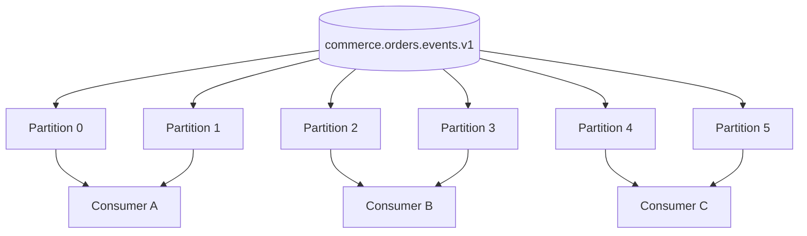

# Theo dõi group state, assignment và consumer lag

## Mục tiêu

Consumer group là đơn vị phối hợp nhiều consumer để cùng đọc một hoặc nhiều topic. Khi vận hành, chỉ biết process consumer đang chạy là chưa đủ. Cần biết group có đang ổn định không, thành viên nào đang tham gia, partition được giao cho ai, offset đã commit đến đâu và lag đang tăng hay giảm.

Bài học này hướng dẫn theo dõi consumer group bằng Kafka CLI, AdminClient và JMX metrics. Sau bài học, bạn có thể:

- Đọc group state và nhận biết rebalance kéo dài hoặc group không có thành viên.
- Xem member list và partition assignment để tìm consumer không nhận partition hoặc phân phối không đều.
- Tính và diễn giải consumer lag theo từng topic-partition.
- Phân biệt consumer lag với replica lag, processing delay và backlog nghiệp vụ.
- Theo dõi heartbeat, poll interval, commit latency và rebalance metrics.
- Xây dựng runbook chẩn đoán group không ổn định hoặc lag tăng liên tục.

## 1. Consumer group gồm những gì?

Consumer group có một `group.id` và một tập thành viên cùng phối hợp đọc các partition. Trong một group, mỗi partition tại một thời điểm chỉ được giao cho tối đa một member. Các group có `group.id` khác nhau đọc độc lập cùng topic và có offset riêng.

Ví dụ topic `commerce.orders.events.v1` có sáu partition và group `order-processor` có ba consumer:



Sơ đồ chỉ minh họa một assignment có thể xảy ra. Kafka không cam kết mọi member luôn nhận đúng số partition bằng nhau; kết quả phụ thuộc assignor, số topic/partition, subscription và protocol của group.

Các thành phần cần theo dõi:

| Thành phần | Vai trò |
|---|---|
| Group ID | Định danh nhóm và namespace của committed offsets |
| Group coordinator | Broker điều phối membership, heartbeat và offset commit của group |
| Member | Một consumer đang tham gia group, có member ID, client ID và host |
| Assignment | Tập topic-partition đang được giao cho từng member |
| Committed offset | Vị trí tiếp theo group đã lưu cho từng topic-partition |
| Group state | Trạng thái phối hợp hiện tại, ví dụ Stable hoặc đang rebalance |

Kafka lưu committed offsets trong internal topic `__consumer_offsets`. Không cần đọc hoặc sửa trực tiếp topic này để giám sát thông thường; dùng Kafka CLI hoặc AdminClient.

## 2. Kiểm tra danh sách consumer group

Dùng `kafka-consumer-groups.sh` để liệt kê group đã được broker ghi nhận:

Ví dụ dưới đây dùng Bash trên Linux/macOS. Trên Windows, dùng script tương ứng trong `bin\windows`, ví dụ `bin\windows\kafka-consumer-groups.bat` và giữ nguyên các tham số.

```bash
bin/kafka-consumer-groups.sh \
  --bootstrap-server localhost:9092 \
  --list
```

Danh sách này có thể chứa group hiện không có member nhưng vẫn còn committed offsets. Vì vậy, `--list` không phải danh sách process đang chạy trên máy.

Để xem thông tin offset và lag của một group:

```bash
bin/kafka-consumer-groups.sh \
  --bootstrap-server localhost:9092 \
  --describe \
  --group order-processor
```

Nếu cluster bật SASL/SSL, thêm `--command-config client.properties` với thông tin kết nối và xác thực phù hợp:

```bash
bin/kafka-consumer-groups.sh \
  --bootstrap-server kafka.example.com:9093 \
  --command-config client.properties \
  --describe --group order-processor
```

## 3. Đọc group state

Xem trạng thái group:

```bash
bin/kafka-consumer-groups.sh \
  --bootstrap-server localhost:9092 \
  --describe \
  --group order-processor \
  --state
```

Output thường cho biết group ID, coordinator, assignment strategy/protocol, state và số member. Tên cột có thể khác theo phiên bản Kafka và group protocol.

### 3.1. Các trạng thái thường gặp

Với classic consumer group protocol, các trạng thái thường thấy gồm:

| State | Ý nghĩa | Cách diễn giải vận hành |
|---|---|---|
| `Stable` | Group đã hoàn tất assignment và các member đang hoạt động | Trạng thái bình thường nếu lag và heartbeat cũng ổn định |
| `PreparingRebalance` | Coordinator đang chuẩn bị một lần rebalance | Member có thể đang rời nhóm, timeout hoặc subscription thay đổi |
| `CompletingRebalance` | Coordinator đang hoàn tất việc đồng bộ assignment | Theo dõi member không join/sync kịp hoặc rebalance bị kéo dài |
| `Empty` | Không còn member hoạt động trong group | Có thể là consumer đã dừng; committed offsets vẫn có thể còn được giữ |
| `Dead` | Metadata group đã bị loại bỏ | Group không còn tồn tại trong coordinator state |
| `Unknown` | Client/tool không xác định được state | Kiểm tra broker, protocol và phiên bản CLI |

Group dùng consumer group protocol mới có thể hiển thị các state liên quan đến assignment/reconciliation như `Assigning` hoặc `Reconciling`, tùy phiên bản. Không nên áp một bảng state của classic protocol cho mọi cluster; hãy đọc state cùng `group.protocol`, broker version và CLI version.

Một lần chuyển qua `PreparingRebalance` hoặc `CompletingRebalance` không nhất thiết là sự cố. Điều đáng chú ý là group liên tục lặp qua các state này, không trở lại trạng thái ổn định hoặc có thời gian rebalance tăng bất thường.

### 3.2. Group Empty không đồng nghĩa mất offset

Khi tất cả consumer dừng, group có thể ở trạng thái `Empty`. Committed offsets vẫn có thể tồn tại trong `__consumer_offsets` đến khi bị xóa theo chính sách retention hoặc group bị xóa. Khi member mới tham gia với cùng group ID, nó có thể tiếp tục từ committed offsets còn hợp lệ.

Do đó:

- `Empty` + committed offsets tồn tại: group tạm không có member nhưng có thể tiếp tục từ vị trí cũ.
- `Empty` + chưa có committed offset: member mới sẽ chịu ảnh hưởng của `auto.offset.reset`.
- `Dead`: metadata group đã bị loại bỏ; không coi đây là một group đang chờ consumer quay lại.

## 4. Xem member và partition assignment

Để xem member đang tham gia group:

```bash
bin/kafka-consumer-groups.sh \
  --bootstrap-server localhost:9092 \
  --describe \
  --group order-processor \
  --members
```

Thêm `--verbose` để hiển thị partition assignment của từng member:

```bash
bin/kafka-consumer-groups.sh \
  --bootstrap-server localhost:9092 \
  --describe \
  --group order-processor \
  --members --verbose
```

Các trường thường hữu ích:

- `CONSUMER-ID`/member ID: định danh member trong group hiện tại.
- `HOST`: địa chỉ máy hoặc container chạy consumer.
- `CLIENT-ID`: tên client được cấu hình trong consumer.
- `ASSIGNMENT`: các topic-partition member đang sở hữu.

Ví dụ minh họa:

```text
GROUP            CONSUMER-ID       HOST          CLIENT-ID       ASSIGNMENT
order-processor  consumer-a-...    /10.0.0.11   order-worker-1  orders-0, orders-1
order-processor  consumer-b-...    /10.0.0.12   order-worker-2  orders-2, orders-3
order-processor  consumer-c-...    /10.0.0.13   order-worker-3  orders-4, orders-5
```

Đây chỉ là ví dụ định dạng; output thật phụ thuộc phiên bản CLI và assignor.

### 4.1. Diễn giải assignment

Giả sử topic có sáu partition:

- Có ba member và sáu partition: tối đa ba member có thể nhận partition của topic này; assignment minh họa có thể chia hai partition mỗi member.
- Có tám member và sáu partition: ít nhất hai member không nhận partition của topic này.
- Có một member và sáu partition: member đó có thể nhận cả sáu partition, nhưng throughput bị giới hạn bởi khả năng xử lý của một consumer.

Với nhiều topic có số partition khác nhau, assignment tổng thể có thể không đều. Một member có thể nhận partition của nhiều topic, trong khi member khác nhận ít hơn. Hãy đọc assignment theo từng topic-partition, không chỉ so sánh số member.

### 4.2. Assignor và rebalance

Assignment strategy quyết định partition được phân phối thế nào. Các assignor thường gặp trong classic protocol gồm:

| Assignor | Đặc điểm |
|---|---|
| RangeAssignor | Chia partition theo từng topic thành các dải cho member; có thể tạo phân phối không đều giữa nhiều topic |
| RoundRobinAssignor | Phân phối lần lượt partition trên các member đủ điều kiện tham gia |
| StickyAssignor | Cố gắng phân phối cân bằng đồng thời giảm số partition phải chuyển khi rebalance |
| CooperativeStickyAssignor | Kết hợp sticky assignment với cooperative/incremental rebalance để giảm việc thu hồi toàn bộ partition cùng lúc |

Tên assignor và khả năng sử dụng phụ thuộc protocol/client version. Với consumer group protocol mới, assignment có thể do server-side assignor điều phối; không giả định cấu hình `partition.assignment.strategy` của classic protocol vẫn quyết định toàn bộ hành vi.

Hai protocol thường được phân biệt như sau:

| Protocol | Cách phối hợp |
|---|---|
| `classic` | Consumer group leader phối hợp assignment theo assignor phía client; heartbeat/session timeout chủ yếu do client cấu hình |
| `consumer` | Coordinator/broker điều phối assignment theo server-side assignor và consumer reconcile assignment tăng dần; heartbeat/session timeout được quản lý theo cấu hình phía broker |

Chỉ dùng `group.protocol=consumer` khi broker và client version hỗ trợ protocol này. Khi chuyển protocol, kiểm tra cấu hình assignor, heartbeat/session timeout và hành vi rebalance theo tài liệu của đúng release.

### 4.3. Số consumer và số partition

Trong một group, một partition không được xử lý đồng thời bởi hai member theo assignment bình thường. Vì vậy, số partition là giới hạn trên của số consumer có thể đồng thời nhận partition của một topic. Tăng số consumer vượt số partition không tự tăng mức song song của topic đó.

Trước khi tăng partition count, cân nhắc key distribution, ordering theo key, dung lượng broker và tác động đến assignment. Tăng partition có thể thay đổi mapping key-partition của một số partitioner và làm các record cùng key trong quá khứ/tương lai nằm ở partition khác nhau.

## 5. Đọc consumer lag

Chạy lệnh describe cơ bản:

```bash
bin/kafka-consumer-groups.sh \
  --bootstrap-server localhost:9092 \
  --describe --group order-processor
```

Output thường có các cột:

| Cột | Ý nghĩa |
|---|---|
| `TOPIC` | Topic đang được group đọc |
| `PARTITION` | Partition cụ thể |
| `CURRENT-OFFSET` | Committed offset của group, tức offset tiếp theo cần đọc |
| `LOG-END-OFFSET` | End offset hiện tại mà tool lấy được từ broker |
| `LAG` | Khoảng cách giữa log end offset và committed offset |
| `CONSUMER-ID` | Member đang sở hữu partition, nếu có |
| `HOST` | Host của member |
| `CLIENT-ID` | Client ID của member |

Ví dụ:

```text
GROUP            TOPIC   PARTITION  CURRENT-OFFSET  LOG-END-OFFSET  LAG
order-processor  orders  0          1200            1250            50
order-processor  orders  1          980             980             0
order-processor  orders  2          700             760             60
```

Partition 0 có lag 50 offset, partition 1 đang bắt kịp log, partition 2 có lag 60 offset. Group lag tổng theo ví dụ là 110 offset.

### 5.1. Công thức lag

Với mỗi partition:

`lag = log-end-offset - current-offset`

Ví dụ, log end offset là `1250`, committed offset là `1200`, lag là `50`. Vì committed offset là offset tiếp theo cần đọc, phép trừ cho biết khoảng offset còn lại đến end offset.

Lag trong CLI là khoảng cách offset, không phải lúc nào cũng bằng số event nghiệp vụ chưa xử lý. Offset có thể có khoảng trống do compaction, transaction aborted hoặc record bị loại bỏ theo log semantics. Với topic transaction và consumer `read_committed`, consumer còn bị giới hạn bởi Last Stable Offset; log end offset và vị trí consumer có thể khác nhau trong lúc transaction chưa kết thúc.

Nếu `CURRENT-OFFSET` không tồn tại, CLI có thể hiển thị `-` và lag cũng không có giá trị để tính. Trường hợp này cần kiểm tra group đã từng commit chưa và `auto.offset.reset` sẽ áp dụng thế nào khi consumer bắt đầu.

### 5.2. Lag bằng 0 có nghĩa gì?

Lag bằng 0 cho biết committed offset đã ở cuối log theo mốc mà công cụ đo tại thời điểm truy vấn. Nó không chứng minh:

- Tất cả side effect nghiệp vụ đã thành công.
- Không có record bị bỏ qua do commit quá sớm.
- Consumer không có queue xử lý nội bộ đang chờ.
- Consumer sẽ tiếp tục bắt kịp khi traffic tăng.
- Không có partition khác hoặc group khác đang lag.

Đặc biệt, nếu consumer commit offset trước khi xử lý xong hoặc dùng auto commit với xử lý bất đồng bộ không an toàn, lag có thể bằng 0 dù công việc nghiệp vụ vẫn còn dang dở.

### 5.3. Lag không phải thời gian trễ

Lag 10.000 offset có thể tương đương vài giây nếu topic có throughput rất cao, nhưng có thể là nhiều giờ nếu topic ít traffic. Muốn ước lượng độ trễ thời gian, kết hợp:

- Thời điểm event được tạo (`event timestamp`) và thời điểm consumer xử lý.
- Tốc độ record vào topic và tốc độ consumer xử lý.
- Xu hướng lag theo thời gian, không chỉ một snapshot.
- Phân phối lag giữa các partition.

Theo dõi cả `records-lag-max` và thời gian xử lý event nếu SLA được định nghĩa bằng giây/phút.

## 6. Theo dõi group bằng Kafka CLI

Một bộ lệnh kiểm tra thường dùng:

```bash
# Liệt kê group
bin/kafka-consumer-groups.sh --bootstrap-server localhost:9092 --list

# Xem state và coordinator
bin/kafka-consumer-groups.sh --bootstrap-server localhost:9092 --describe --group order-processor --state

# Xem member
bin/kafka-consumer-groups.sh --bootstrap-server localhost:9092 --describe --group order-processor --members

# Xem assignment chi tiết
bin/kafka-consumer-groups.sh --bootstrap-server localhost:9092 --describe --group order-processor --members --verbose

# Xem offset và lag theo partition
bin/kafka-consumer-groups.sh --bootstrap-server localhost:9092 --describe --group order-processor
```

Nếu kết quả thay đổi liên tục, chạy các lệnh vài lần cách nhau một khoảng thời gian và so sánh. Một snapshot đơn lẻ không thể cho biết lag đang tăng, giảm hay chỉ dao động trong lúc rebalance.

Không dùng `--reset-offsets` để “sửa lag” khi chưa xác định nguyên nhân. Reset offset thay đổi vị trí đọc của group và có thể khiến dữ liệu bị bỏ qua hoặc xử lý lại. Đây là thao tác thay đổi hành vi tiêu thụ, không phải lệnh giám sát.

## 7. Theo dõi bằng Java AdminClient

Ứng dụng quản trị hoặc health dashboard có thể dùng `Admin`/`AdminClient` để lấy group description và committed offsets mà không cần tự parse output CLI.

Ví dụ đọc state, member assignment và offsets:

```java
Properties props = new Properties();
props.put(AdminClientConfig.BOOTSTRAP_SERVERS_CONFIG, "localhost:9092");

String groupId = "order-processor";

try (Admin admin = Admin.create(props)) {
    ConsumerGroupDescription description = admin
            .describeConsumerGroups(List.of(groupId))
            .describedGroups()
            .get(groupId)
            .get();

    System.out.println("group=" + description.groupId());
    System.out.println("state=" + description.state());
    System.out.println("protocol=" + description.partitionAssignor());

    description.members().forEach(member -> {
        System.out.println("member=" + member.consumerId()
                + ", client=" + member.clientId()
                + ", host=" + member.host()
                + ", partitions=" + member.assignment().topicPartitions());
    });

    Map<TopicPartition, OffsetAndMetadata> offsets = admin
            .listConsumerGroupOffsets(groupId)
            .partitionsToOffsetAndMetadata()
            .get();

    offsets.forEach((partition, offset) ->
            System.out.println(partition + " committed=" + offset.offset()));
}
```

Đoạn code minh họa API AdminClient; cần bổ sung import và cấu hình security theo ứng dụng. `partitionAssignor()` phản ánh thông tin assignor mà API cung cấp; với group protocol mới, cách diễn giải có thể khác classic assignor.

Để tính lag bằng code, lấy end offset cho các partition tương ứng qua `Admin.listOffsets()` với `OffsetSpec.latest()`, sau đó so sánh với committed offsets. Khi triển khai, cần xử lý partition chưa có committed offset, topic bị xóa và lỗi authorization. Nếu cần latency nghiệp vụ, lấy thêm timestamp từ event hoặc metrics của consumer; offset distance không thay thế được event processing delay.

## 8. Metrics cần theo dõi

Kafka consumer phát JMX metrics theo các nhóm như `consumer-coordinator-metrics`, `consumer-fetch-manager-metrics` và `consumer-metrics`. Tên metric cụ thể có thể thay đổi theo Kafka client version; xác minh trên đúng phiên bản đang chạy.

### 8.1. Lag và fetch

| Metric phổ biến | Ý nghĩa |
|---|---|
| `records-lag` | Lag theo offset của từng partition được consumer theo dõi |
| `records-lag-max` | Lag lớn nhất giữa các partition của consumer |
| `records-consumed-rate` | Tốc độ consumer nhận record |
| `bytes-consumed-rate` | Tốc độ byte được consumer đọc |
| `fetch-latency-avg`, `fetch-latency-max` | Thời gian fetch response |
| `fetch-rate` | Tốc độ fetch request |

### 8.2. Group coordination và commit

| Metric phổ biến | Ý nghĩa |
|---|---|
| `assigned-partitions` | Số partition đang được giao cho consumer |
| `heartbeat-rate` | Tốc độ gửi heartbeat |
| `heartbeat-response-time-max` | Thời gian phản hồi heartbeat lớn nhất |
| `last-heartbeat-seconds-ago` | Thời gian từ heartbeat gần nhất |
| `commit-latency-avg`, `commit-latency-max` | Độ trễ commit offset |
| `commit-rate` | Tốc độ commit offset |
| `rebalance-total` | Tổng số lần rebalance được ghi nhận |
| `rebalance-latency-avg`, `rebalance-latency-max` | Thời gian rebalance |
| `time-between-poll-max` | Khoảng thời gian lớn nhất giữa các lần poll |

Không phải mọi metric đều có trên mọi phiên bản hoặc mọi group protocol. Có metric thuộc từng consumer instance, không phải một số tổng hợp duy nhất cho cả group; dashboard cần tổng hợp theo group ID và member/client ID.

### 8.3. Kết hợp metric để tìm nguyên nhân

- Lag tăng, `records-consumed-rate` thấp và fetch latency cao: kiểm tra broker, network, fetch throttling hoặc partition leader.
- Lag tăng, fetch latency thấp nhưng processing delay cao: consumer đọc được record nhưng xử lý nghiệp vụ chậm.
- `rebalance-total` tăng nhanh, state thường xuyên không Stable: kiểm tra poll interval, heartbeat, restart, subscription và member churn.
- `assigned-partitions=0` trong khi group có member: kiểm tra subscription, topic metadata, assignor và số partition.
- Commit latency cao hoặc commit rate giảm: kiểm tra coordinator, network, retry và ứng dụng commit quá thường xuyên.
- `time-between-poll-max` gần hoặc vượt `max.poll.interval.ms`: batch xử lý quá lâu hoặc consumer thread bị block.

## 9. Phân biệt các loại lag

Không phải mọi backlog đều là consumer lag:

| Loại lag | Đo lường | Nơi điều tra |
|---|---|---|
| Consumer lag | Log end offset so với committed offset của group | Consumer group, poll loop, processing, commit |
| Replica lag | Follower replica so với leader | ISR, replica fetcher, broker network/disk |
| Processing backlog | Record đã được poll nhưng còn nằm trong queue/worker chưa hoàn tất | Executor, application queue, database/API downstream |
| Event-time delay | Thời gian từ `occurredAt` đến lúc xử lý | Timestamp event, clock sync, pipeline latency |

Ví dụ: consumer poll record rồi enqueue vào worker pool, sau đó commit offset sớm. Kafka consumer lag có thể về 0 trong khi processing backlog vẫn tăng. Vì vậy, hệ thống production nên xuất metric queue depth và thời gian xử lý nghiệp vụ bên cạnh Kafka lag.

## 10. Runbook chẩn đoán consumer group

Khi dashboard báo lag cao hoặc group không ổn định, kiểm tra theo thứ tự:

1. **Xác nhận group ID:** bảo đảm đang truy vấn đúng môi trường, cluster và `group.id`.
2. **Kiểm tra state:** dùng `--state`; xác định group Stable, Empty hay đang rebalance.
3. **Kiểm tra member:** dùng `--members --verbose`; xem member nào còn hoạt động, host/client ID và partition assignment.
4. **Kiểm tra lag theo partition:** dùng `--describe`; tìm partition lag cao nhất, không chỉ nhìn tổng.
5. **Xem xu hướng:** lặp lại truy vấn hoặc xem dashboard để biết lag tăng liên tục hay đang giảm sau burst.
6. **Kiểm tra consumer metrics:** fetch rate, records consumed, time between poll, heartbeat, commit latency và rebalance rate.
7. **Kiểm tra ứng dụng:** thời gian xử lý, thread pool, queue depth, database/API latency, GC pause và lỗi deserialization.
8. **Kiểm tra broker:** request latency, network, partition leader, ISR và coordinator load.
9. **Đánh giá capacity:** so sánh số partition, số consumer active, throughput mỗi member và key skew.
10. **Thay đổi có kiểm soát:** tăng consumer chỉ khi còn partition để phân phối; tăng partition hoặc thay assignor cần đánh giá ordering và tác động rebalance.

### 10.1. Group liên tục rebalance

Các nguyên nhân thường gặp:

- Consumer xử lý batch lâu hơn `max.poll.interval.ms`.
- Consumer process restart/crash hoặc container health check liên tục kill process.
- Heartbeat không tới coordinator do network, GC pause hoặc CPU starvation.
- Subscription hoặc topic partition thay đổi.
- Member dùng cấu hình group protocol/assignor không tương thích.

Kiểm tra log consumer để tìm `Rebalance`, `Heartbeat`, `JoinGroup`, `SyncGroup`, `CommitFailedException` và timeout. Nếu processing chậm, giảm `max.poll.records`, tách worker có quản lý offset hoặc điều chỉnh poll interval theo thời gian xử lý thực tế.

### 10.2. Lag tăng dù group Stable

Stable chỉ nói group đã hoàn tất assignment. Lag vẫn có thể tăng nếu tốc độ event vào lớn hơn tốc độ xử lý. Kiểm tra:

- `records-consumed-rate` có thấp hơn tốc độ produce không.
- Có partition nóng do key skew không.
- Consumer có đủ CPU, thread và downstream capacity không.
- Có lỗi lặp khiến record retry hoặc xử lý lâu không.
- Số consumer active đã đạt giới hạn partition chưa.

Nếu consumer count đã bằng hoặc vượt partition count, thêm consumer không tăng song song cho topic đó. Cần tối ưu processing hoặc đánh giá partitioning/capacity.

### 10.3. Group Empty nhưng lag lớn

Nếu group không có member, committed offset vẫn có thể cũ trong khi producer tiếp tục ghi. Lag tăng là điều bình thường vì không có consumer đọc. Kiểm tra deployment/replica count, autoscaling, lỗi startup, cấu hình group ID và quyền truy cập topic trước khi reset offset.

## 11. Alert và dashboard gợi ý

Một dashboard hữu ích nên có:

- Group state và member count.
- Partition assignment theo member.
- Lag hiện tại, lag lớn nhất và lag theo từng partition.
- Lag trend theo 5 phút/15 phút/1 giờ.
- Records consumed rate và bytes consumed rate.
- Rebalance count/rate và rebalance latency.
- Heartbeat age, time-between-poll và commit latency.
- Application processing latency và worker queue depth.

Alert nên dựa trên ngưỡng theo SLA và thời gian duy trì, không chỉ một snapshot:

- Group production không có member trong thời gian bất thường.
- Group không đạt Stable sau thời gian rebalance dự kiến.
- Lag lớn hơn ngưỡng và tiếp tục tăng trong nhiều cửa sổ liên tiếp.
- Một partition có lag vượt xa các partition còn lại (partition skew).
- Rebalance rate hoặc commit latency tăng đột biến.
- Processing queue depth tăng trong khi Kafka lag thấp, dấu hiệu commit trước khi xử lý xong.

Không áp một ngưỡng lag cố định cho mọi topic. Topic 100 record/giây và topic 100.000 record/giây có ý nghĩa rất khác nhau khi cùng lag 10.000 offset.

## 12. Bài thực hành và tự kiểm tra

### Thực hành A — Theo dõi group state và assignment

1. Tạo topic `group-monitor-lab` với sáu partition.
2. Khởi động ba consumer cùng `group.id=group-monitor-lab`.
3. Chạy `--describe --group group-monitor-lab --state` và ghi lại state/member count.
4. Chạy `--members --verbose` và ghi assignment của từng member.
5. Dừng một consumer, quan sát rebalance và assignment mới.
6. Khởi động lại consumer, quan sát member list và state khi group ổn định.
7. Thử chạy bảy consumer cho sáu partition và xác định member không có assignment.

### Thực hành B — Đo consumer lag

1. Gửi một lượng record đã biết vào mỗi partition.
2. Khởi động consumer group và ghi committed offset/log end offset.
3. Tạm dừng xử lý nhưng giữ consumer chạy, quan sát lag tăng.
4. Cho consumer xử lý nhanh hơn tốc độ produce và quan sát lag giảm.
5. Tạo một partition nóng bằng cách dùng key phân phối lệch.
6. So sánh group lag tổng với lag lớn nhất theo partition.

### Câu hỏi tự kiểm tra

1. Vì sao `--list` không phải danh sách consumer process đang chạy?
2. Group state `Empty` có thể vẫn giữ committed offsets không?
3. `PreparingRebalance` và `CompletingRebalance` cho biết điều gì?
4. `--members --verbose` cung cấp thêm thông tin gì so với `--members`?
5. Vì sao số consumer vượt số partition không làm tăng concurrency của topic?
6. Công thức lag theo partition là gì? Vì sao lag không luôn bằng số event nghiệp vụ?
7. Lag bằng 0 có chứng minh side effect đã hoàn tất không?
8. Consumer lag khác replica lag và processing backlog như thế nào?
9. Metric nào giúp phát hiện consumer không gọi `poll()` đủ thường xuyên?
10. Khi group Stable nhưng lag vẫn tăng, nên kiểm tra những thành phần nào?

## Kết luận

Theo dõi consumer group cần kết hợp state, member assignment, committed offsets, lag và metrics của ứng dụng. Kafka CLI cho cái nhìn nhanh theo group và partition; AdminClient hỗ trợ tích hợp vào công cụ quản trị; JMX metrics cho biết xu hướng fetch, heartbeat, commit và rebalance. Lag là khoảng cách offset, không phải thước đo đầy đủ cho thời gian trễ hoặc công việc nghiệp vụ còn dang dở. Kết hợp các góc nhìn này giúp xác định đúng bottleneck và mở rộng consumer group theo số partition cùng năng lực xử lý thực tế.

## Tài liệu tham khảo

- [Apache Kafka 4.1 — Basic Kafka Operations: Managing Consumer Groups](https://kafka.apache.org/41/operations/basic-kafka-operations/)
- [Apache Kafka 4.1 — KafkaConsumer API](https://kafka.apache.org/41/javadoc/org/apache/kafka/clients/consumer/KafkaConsumer.html)
- [Apache Kafka 4.1 — Admin API](https://kafka.apache.org/41/javadoc/org/apache/kafka/clients/admin/Admin.html)
- [Apache Kafka 4.1 — Monitoring](https://kafka.apache.org/41/operations/monitoring/)
- [Apache Kafka 4.1 — Consumer Configuration](https://kafka.apache.org/41/configuration/consumer-configs/)
