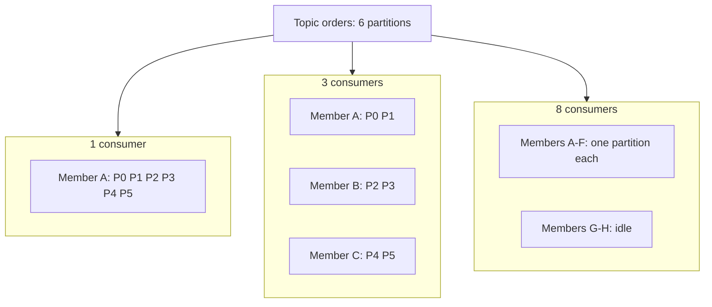
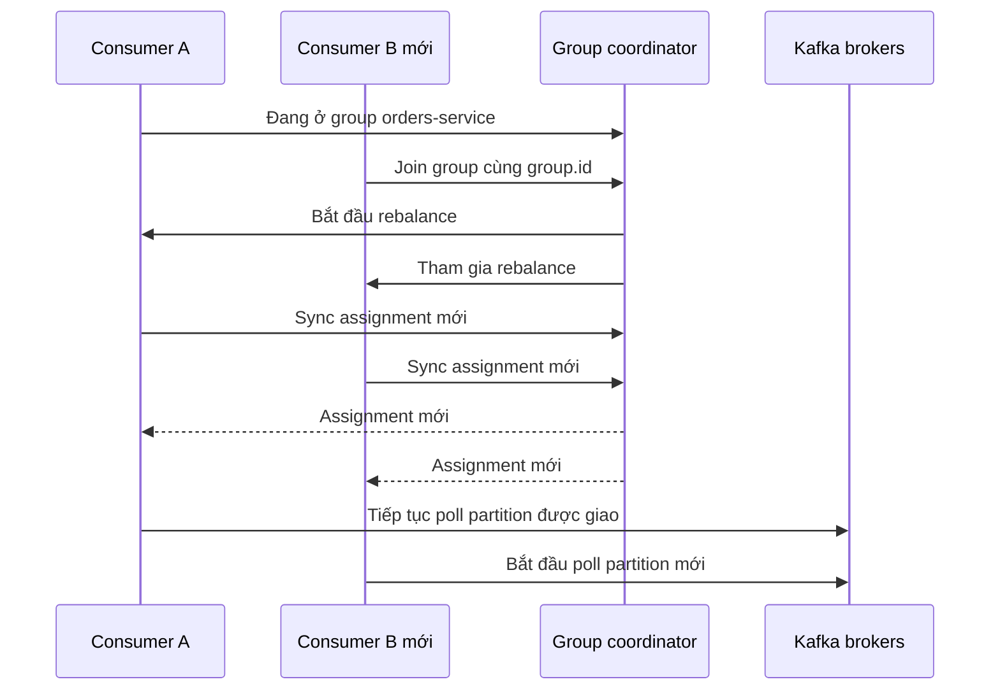

# Thay đổi số thành viên theo tải và tránh mở rộng vượt năng lực

## Mục tiêu

Consumer group cho phép nhiều consumer cùng chia partition để xử lý luồng sự kiện song song. Khi lượng record tăng, thêm consumer có thể giúp giảm lag; khi tải giảm, bớt consumer giúp tiết kiệm CPU, memory và kết nối. Tuy nhiên, tăng số member không làm Kafka xử lý nhanh hơn vô hạn. Số partition, tốc độ xử lý của từng consumer, broker, network và hệ thống downstream đều đặt giới hạn cho khả năng mở rộng.

Sau bài học này, bạn có thể:

- Giải thích cách Kafka phân partition cho member khi số consumer thay đổi.
- Ước lượng số consumer hữu ích dựa trên partition count và năng lực xử lý.
- Phân biệt scale-out consumer với việc tăng partition hoặc tạo consumer group mới.
- Dùng consumer lag, tốc độ vào/ra và tài nguyên hệ thống để quyết định scale.
- Thiết kế ngưỡng scale-out/scale-in có thời gian ổn định và cooldown để tránh dao động.
- Nhận biết khi nào bottleneck nằm ở partition, broker, consumer hay downstream.
- Mở rộng và thu hẹp Spring Kafka/Kubernetes một cách có kiểm soát.

## 1. Consumer group mở rộng bằng cách chia partition

Kafka phân phối các partition của topic đã subscribe cho các member trong cùng một consumer group. Mỗi partition tại một thời điểm chỉ được giao cho tối đa một member trong group. Một member có thể nhận nhiều partition; nếu số member lớn hơn số partition được phân phối, một số member sẽ không có partition để xử lý.

Ví dụ topic `orders` có sáu partition:

| Số member | Phân phối minh họa | Kết quả |
|---:|---|---|
| 1 | Member A nhận P0–P5 | Một consumer xử lý toàn bộ partition |
| 2 | A nhận P0–P2, B nhận P3–P5 | Hai member chia tải |
| 3 | Mỗi member nhận hai partition | Có thêm mức song song |
| 6 | Mỗi member nhận một partition | Đạt tối đa sáu member có partition |
| 8 | Sáu member có partition, hai member rảnh | Thêm hai member không tăng song song đọc topic này |



Với một topic có `P` partition và một group có `N` member, số member có thể nhận ít nhất một partition không vượt quá `min(N, P)`. Đây là giới hạn song song theo partition của topic đó, không phải lời khuyên luôn đặt `N=P`. Một consumer có thể xử lý nhiều partition; số member phù hợp còn tùy năng lực CPU, memory, I/O, thời gian xử lý và yêu cầu vận hành.

Nếu group subscribe nhiều topic, cần xét tổng số partition được subscribe và assignment thực tế trên tất cả topic. Một consumer không có partition của topic A vẫn có thể nhận partition của topic B.

## 2. Scale-out, scale-in và rebalance

Khi thêm member có cùng `group.id`, Kafka group coordinator đưa member mới vào group và thực hiện rebalance để phân phối lại partition. Khi member rời group, coordinator cũng phải phân phối lại partition của member đó cho các member còn lại.



Trong quá trình rebalance, một số partition có thể tạm dừng xử lý. Vì vậy scale-out không tạo thêm năng lực tức thời ngay khi tăng replica. Ứng dụng cần thời gian để thành viên gia nhập, hoàn tất assignment và bắt đầu tiêu thụ.

### 2.1. Scale-out

Scale-out là tăng số consumer member trong cùng group. Tất cả instance cần dùng cùng `group.id` để chia nhau partition. Sau rebalance, các partition được phân phối lại theo assignor đã thương lượng.

Ví dụ topic có 12 partition, group có ba member. Tăng lên sáu member có thể giảm số partition mỗi member từ khoảng bốn xuống khoảng hai, giúp tăng song song nếu mỗi member trước đó đã gần chạm giới hạn xử lý.

### 2.2. Scale-in

Scale-in là giảm số member. Member bị dừng cần rời group có kiểm soát để Kafka giao partition cho các member còn lại. Nếu process bị kill đột ngột, group phát hiện member mất kết nối theo cơ chế heartbeat/session và thực hiện rebalance sau đó.

Trước khi dừng member, ứng dụng nên:

1. Ngừng nhận công việc mới hoặc ngừng dispatch record mới theo lifecycle của ứng dụng.
2. Hoàn tất hoặc xử lý an toàn các record đang chạy trong khoảng thời gian shutdown cho phép.
3. Commit offset đã xử lý thành công theo chính sách của consumer.
4. Đóng consumer để rời group sạch sẽ.
5. Để member còn lại nhận partition được phân phối lại.

Nếu không kịp hoàn tất công việc trước khi shutdown, không commit offset của record chưa xử lý xong. Record có thể được đọc lại; consumer phải idempotent để tránh side effect trùng.

### 2.3. Rebalance có chi phí

Thay đổi số member thường làm group rebalance. Nếu scale lên xuống liên tục, hệ thống dành nhiều thời gian chuyển partition thay vì xử lý record. Với workload biến động nhanh, autoscaler cần ngưỡng ổn định, cửa sổ quan sát và cooldown để tránh thrashing.

Cooperative assignment có thể giảm số partition phải thu hồi trong một lần rebalance so với eager assignment, nhưng không xóa bỏ mọi chi phí rebalance. Có thể cân nhắc `CooperativeStickyAssignor` nếu phiên bản Kafka client và toàn bộ member trong group hỗ trợ cấu hình tương thích.

## 3. Giới hạn mở rộng do partition

Partition là đơn vị song song cơ bản của consumer group. Nếu topic chỉ có bốn partition, tăng group lên mười consumer không tạo ra mười luồng đọc độc lập cho topic đó. Tối đa bốn member nhận partition; các member còn lại rảnh.

| Tình huống | Có nên tăng consumer? | Hướng xử lý |
|---|---|---|
| 12 partition, 2 consumer đều CPU cao và lag tăng | Có thể | Scale-out từng bước, theo dõi throughput sau rebalance |
| 6 partition, 6 consumer nhưng lag vẫn tăng | Thêm consumer thường không giúp | Kiểm tra xử lý mỗi partition, broker, key skew và downstream |
| 6 partition, 10 consumer, 4 member idle | Không | Giảm member hoặc tăng partition nếu workload và ordering cho phép |
| 1 partition có lag cao, các partition khác gần bằng 0 | Thêm member có thể không giúp | Tìm hot key/partition; xem lại key distribution và thiết kế partition |
| Broker fetch/network đã bão hòa | Thêm consumer có thể làm tệ hơn | Tối ưu broker/network, batch, compression hoặc mở rộng cluster |

### 3.1. Khi nào cần tăng partition?

Nếu số partition hiện tại thấp hơn mức song song cần thiết, có thể cân nhắc tăng partition. Đây là thay đổi ở topic, khác với tăng số consumer. Việc tăng partition có các hệ quả:

- Kafka không tự di chuyển record cũ sang partition mới; dữ liệu hiện tại vẫn nằm ở partition cũ.
- Với partitioner theo key mặc định, thay đổi số partition có thể làm key mới được ánh xạ sang partition khác. Các event cùng key được ghi trước và sau thay đổi có thể nằm ở hai partition khác nhau, ảnh hưởng ordering theo aggregate.
- Tăng partition làm tăng metadata, file log, replica traffic và chi phí broker.
- Số partition nên được lập kế hoạch theo throughput, số consumer tối đa, retention, replication và giới hạn hạ tầng.

Không tăng partition chỉ để giải quyết một consumer chậm do database hoặc HTTP service downstream. Hãy tìm bottleneck trước khi thay đổi topology topic.

## 4. Không nhầm scale-out với tạo group mới

Các instance cần cùng `group.id` để chia partition. Nếu mỗi replica của ứng dụng dùng một group ID khác nhau, Kafka xem chúng là các consumer group độc lập. Mỗi group sẽ nhận toàn bộ luồng topic theo assignment riêng.

| Thay đổi | Hành vi Kafka | Mục đích thường dùng |
|---|---|---|
| Tăng số instance, giữ nguyên `group.id` | Các instance chia partition trong một group | Scale-out một ứng dụng xử lý |
| Tăng số instance, mỗi instance có `group.id` khác | Mỗi group đọc toàn bộ topic độc lập | Nhiều ứng dụng/projection cần nhận toàn bộ event |
| Tăng concurrency của listener nhưng giữ group ID | Tạo thêm consumer member trong group | Tăng song song trong một instance ứng dụng |
| Tăng partition count | Tăng số đơn vị có thể phân phối | Tăng giới hạn song song của topic, kèm hệ quả ordering và vận hành |

Ví dụ ba pod cùng dùng `group.id=orders-projection` sẽ chia partition. Nếu pod thứ nhất dùng `orders-projection-1`, pod thứ hai dùng `orders-projection-2`, pod thứ ba dùng `orders-projection-3`, mỗi pod nhận toàn bộ luồng và có thể tạo ba lần side effect. Đây thường là lỗi cấu hình khi mục tiêu là scale-out.

## 5. Đo tải trước khi quyết định số consumer

Không nên scale chỉ dựa trên CPU hoặc một giá trị lag tại một thời điểm. Hãy theo dõi đồng thời tốc độ record đi vào, tốc độ xử lý, lag theo partition, tuổi của record cũ nhất và năng lực các hệ thống phụ thuộc.

### 5.1. Các chỉ số quan trọng

| Chỉ số | Ý nghĩa | Dùng để quyết định |
|---|---|---|
| Consumer lag theo partition | Khoảng cách giữa log end offset và committed offset | Xác định partition nào đang tụt lại |
| Lag growth rate | Lag tăng hay giảm theo thời gian | Xác định consumer có theo kịp tốc độ producer không |
| Oldest record age | Tuổi của record chưa xử lý lâu nhất | Đánh giá SLA độ trễ nghiệp vụ |
| Records consumed rate | Tốc độ consumer nhận/xử lý record | So sánh năng lực với tốc độ đầu vào |
| Processing latency | Thời gian xử lý một record/batch | Phát hiện consumer hoặc downstream chậm |
| CPU và heap | Mức sử dụng tài nguyên consumer | Xem còn dư năng lực để scale trong instance không |
| GC pause | Thời gian JVM dừng để garbage collection | Nhận biết memory pressure |
| Fetch/request latency | Độ trễ lấy dữ liệu từ broker | Phân biệt bottleneck ở Kafka/network |
| Rebalance count/duration | Tần suất và thời gian rebalance | Phát hiện scale dao động hoặc member không ổn định |
| Downstream latency/error | Độ trễ và lỗi database/API đích | Tránh scale consumer làm quá tải dependency |

Lag nên được quan sát theo từng partition. Một tổng lag lớn có thể che giấu tình trạng một partition nóng trong khi các partition khác gần như rảnh. Ngược lại, lag tăng tạm thời trong lúc rebalance không nhất thiết có nghĩa cần scale ngay.

### 5.2. Đo năng lực xử lý của một consumer

Đo trong điều kiện gần với production: cùng kích thước record, cùng xử lý nghiệp vụ, cùng số partition và cùng downstream. Gọi:

- \(\lambda\): tốc độ record đi vào group (record/giây).
- \(\mu\): năng lực xử lý bền vững của một consumer member (record/giây) trong tải thử nghiệm.
- \(\rho\): mức sử dụng mục tiêu, nhỏ hơn 1 để giữ headroom.
- \(N\): số member cần thiết theo ước lượng tải.

Ước lượng ban đầu:

\[
N_{required} = \left\lceil \frac{\lambda}{\rho \times \mu} \right\rceil
\]

Ví dụ hệ thống nhận 4.000 record/giây. Một member xử lý ổn định 1.000 record/giây. Chọn mức sử dụng mục tiêu 70%:

\[
N_{required} = \left\lceil \frac{4000}{0.7 \times 1000} \right\rceil = 6
\]

Nếu topic có 12 partition và downstream còn đủ năng lực, sáu member là một điểm bắt đầu để thử nghiệm. Nếu topic chỉ có bốn partition, thêm lên sáu member không thể tạo sáu member cùng nhận partition của topic đó; cần xem lại partitioning hoặc giảm tốc độ đầu vào.

Đây chỉ là mô hình xấp xỉ. Năng lực thực tế còn phụ thuộc phân phối partition, record size, batch, key skew, số worker nội bộ và tốc độ downstream. Khi một partition nóng, tổng năng lực của các member rảnh không nhất thiết bù được bottleneck của partition đó.

### 5.3. Xác định bottleneck trước khi scale

| Dấu hiệu | Bottleneck có thể | Hành động phù hợp |
|---|---|---|
| CPU consumer cao, processing latency cao, lag tăng trên nhiều partition | Xử lý ứng dụng | Scale-out trong giới hạn partition; tối ưu code và batch |
| CPU thấp nhưng fetch latency cao, lag nhiều partition | Broker/network hoặc fetch config | Kiểm tra broker request queue, network, disk và replication |
| Một partition lag rất cao, các partition khác rảnh | Hot partition/key skew | Kiểm tra key, phân phối dữ liệu và thiết kế partition |
| Consumer nhanh nhưng database connection pool bão hòa | Downstream database | Tăng/điều chỉnh năng lực database hoặc giới hạn concurrency |
| Lag tăng trong lúc rebalance liên tục | Group membership không ổn định | Sửa autoscaling threshold, shutdown và timeout |
| Heap/GC tăng khi tăng member | Mỗi instance có footprint lớn hoặc batch quá lớn | Giảm batch/in-flight, tăng memory hợp lý, tối ưu payload |

Không scale-out khi database đã quá tải hoặc rate limit API đã chạm ngưỡng. Thêm consumer trong trường hợp đó chỉ tăng số request đồng thời, làm downstream chậm hơn và khiến lag tiếp tục tăng.

## 6. Chính sách autoscaling có hysteresis

Autoscaler nên phản ứng với xu hướng tải trong một cửa sổ thời gian, không phản ứng với một mẫu đo đơn lẻ. Dùng ngưỡng scale-out và scale-in khác nhau để tránh dao động quanh cùng một điểm.

Ví dụ chính sách minh họa:

| Điều kiện | Hành động |
|---|---|
| Lag tăng liên tục 5 phút và oldest record age vượt SLO; CPU consumer còn headroom; downstream khỏe | Tăng 1–2 member |
| Lag ổn định hoặc giảm, processing latency trong SLO | Giữ nguyên số member |
| Lag thấp liên tục 15 phút, CPU thấp và queue không tăng | Giảm 1 member |
| Vừa scale xong | Chờ cooldown trước quyết định scale tiếp |
| Số member đã đạt giới hạn partition hữu ích | Không tăng member; chẩn đoán partition/broker/downstream |
| Downstream error/latency vượt ngưỡng | Dừng scale-out hoặc giảm concurrency để bảo vệ dependency |

Các khoảng 5/15 phút và số member là ví dụ. Hãy điều chỉnh theo tốc độ biến động tải và thời gian rebalance của cluster.

### 6.1. Scale-out từng bước

Tăng một lượng member vừa phải, chờ rebalance hoàn tất và đo lại throughput/lag. Nếu throughput không tăng tương ứng, dừng tăng và kiểm tra bottleneck. Tăng gấp nhiều lần có thể gây rebalance lớn, tạo nhiều kết nối cùng lúc và làm broker/downstream nhận burst tải.

### 6.2. Scale-in thận trọng

Scale-in chậm hơn scale-out để tránh member bị dừng trong khi partition đang xử lý batch dài. Xác nhận lag thấp, không có tác vụ quá hạn và các instance có thể shutdown graceful. Nếu workload có đợt tăng theo chu kỳ, đặt minimum replica đủ để hấp thụ burst và tránh cold start quá lâu.

### 6.3. Giới hạn trên và dưới

Thiết lập:

- Minimum member để duy trì mức xử lý nền và yêu cầu availability.
- Maximum member không vượt nhu cầu partition hữu ích, đồng thời phù hợp CPU, memory, broker connection và downstream capacity.
- Cooldown sau scale-out/scale-in.
- Giới hạn tốc độ tăng/giảm member trong một khoảng thời gian.
- Hành vi khi metric không có dữ liệu: giữ trạng thái an toàn hoặc dùng fallback đã kiểm thử, không mặc định scale vô hạn.

## 7. Spring Kafka: concurrency và số instance ứng dụng

Spring Kafka có thể tăng số consumer thông qua `concurrency` của listener container. Khi triển khai nhiều instance ứng dụng (ví dụ nhiều pod), tổng số consumer member là tích của số instance và concurrency trên mỗi instance, nếu mỗi listener container đều có cấu hình đó.

\[
N_{members} = N_{instances} \times concurrency
\]

Ví dụ ba pod, mỗi pod có `concurrency=2`, tạo tổng cộng sáu consumer member trong group.

```yaml
spring:
  kafka:
    consumer:
      bootstrap-servers: localhost:9092,localhost:9093,localhost:9094
      group-id: orders-projection
      enable-auto-commit: false
      auto-offset-reset: earliest
    listener:
      concurrency: 2
      ack-mode: record
```

Listener:

```java
@KafkaListener(
        topics = "orders",
        groupId = "orders-projection",
        concurrency = "${app.kafka.listener-concurrency:2}"
)
public void onOrder(ConsumerRecord<String, String> record) {
    orderProjection.apply(record.key(), record.value());
}
```

Nếu ứng dụng chạy ba pod và `app.kafka.listener-concurrency=2`, group có sáu member. Khi scale Kubernetes deployment lên năm pod, tổng member thành mười. Nếu topic chỉ có sáu partition, tối đa sáu member nhận partition; các member còn lại idle.

Hãy chọn một trong hai trục scale hoặc phối hợp có chủ đích:

- Tăng số pod để có thêm CPU/memory và failure isolation.
- Tăng `concurrency` để tạo thêm consumer thread trong mỗi pod.

Tăng cả hai cùng lúc có thể nhân số member nhanh hơn dự kiến. Hãy tính tổng member trước khi thay đổi deployment.

## 8. Kubernetes và graceful scale-in

Khi autoscaler giảm số pod, Kubernetes gửi `SIGTERM` và chờ trong `terminationGracePeriodSeconds` trước khi force kill. Consumer cần thời gian dừng nhận công việc, hoàn tất record đang xử lý và đóng Kafka consumer.

Ví dụ cấu hình deployment rút gọn:

```yaml
spec:
  replicas: 3
  template:
    spec:
      terminationGracePeriodSeconds: 60
      containers:
        - name: orders-consumer
          image: example/orders-consumer:1.0.0
          env:
            - name: SPRING_KAFKA_CONSUMER_GROUP_ID
              value: orders-projection
            - name: SPRING_KAFKA_LISTENER_CONCURRENCY
              value: "2"
```

`replicas=3` và concurrency bằng hai tạo sáu member. Thời gian grace 60 giây chỉ là ví dụ; phải đủ cho shutdown thực tế nhưng không giữ pod quá lâu.

Với Spring Kafka, cấu hình container shutdown timeout và xử lý listener đang chạy cần phù hợp phiên bản. Ứng dụng phải đóng context đúng lifecycle để listener container dừng poll và commit theo AckMode. Không chỉ dựa vào Kubernetes để tự bảo đảm offset được commit.

### 8.1. Static membership có phù hợp autoscaling không?

`group.instance.id` cho phép consumer dùng static membership. Nếu một member tạm thời restart với cùng instance ID trong thời gian session phù hợp, Kafka có thể tránh rebalance không cần thiết. Tuy nhiên:

- Mỗi member phải có `group.instance.id` duy nhất trong group.
- ID cần ổn định cho đúng logical instance; không dùng cùng một ID cho nhiều pod đồng thời.
- Nếu pod autoscaling tạo instance mới với ID mới, đó vẫn là member mới và group cần rebalance.
- Static membership có thể trì hoãn phát hiện member biến mất trong một số tình huống; cần cân nhắc session timeout và thời gian shutdown.

Không bật static membership bằng cách gán cùng một giá trị cố định cho mọi replica. Nếu dùng Kubernetes StatefulSet, ordinal có thể tạo ID ổn định cho từng pod, nhưng vẫn phải xử lý thay đổi số replica và vòng đời instance cẩn thận.

## 9. Thực hành scale consumer theo tải

Phần lab dùng topic `orders` có sáu partition và một consumer group `orders-lab`. Có thể chạy consumer Java/Spring Boot trên máy local hoặc nhiều container. Mọi instance cần cùng `group.id`.

### 9.1. Xác nhận partition count

```bash
bin/kafka-topics.sh --bootstrap-server localhost:9092 \
  --describe --topic orders
```

Ghi lại số partition và broker leader. Với bài lab này giả sử topic có sáu partition.

### 9.2. Chạy một consumer member

Khởi động một instance ứng dụng với:

```properties
spring.kafka.consumer.group-id=orders-lab
spring.kafka.listener.concurrency=1
```

Gửi record đều đặn vào topic và quan sát lag:

```bash
bin/kafka-consumer-groups.sh --bootstrap-server localhost:9092 \
  --describe --group orders-lab
```

Ghi lại records consumed rate, lag theo partition, CPU và thời gian xử lý.

### 9.3. Tăng lên ba rồi sáu member

Khởi động thêm instance với cùng group ID, trước tiên tổng concurrency là ba, sau đó là sáu. Mỗi lần thay đổi:

1. Chờ rebalance kết thúc.
2. Xem assignment bằng lệnh:

```bash
bin/kafka-consumer-groups.sh --bootstrap-server localhost:9092 \
  --describe --group orders-lab --members --verbose
```

3. Ghi nhận số partition mỗi member, lag, throughput, processing latency và CPU.
4. So sánh thời gian hệ thống cần để bắt kịp sau khi tải producer ổn định.

### 9.4. Tăng vượt sáu member

Tăng tổng số member lên tám. Quan sát rằng topic chỉ có sáu partition nên có tối đa sáu member nhận partition; hai member còn lại không có assignment từ topic này. Nếu group subscribe thêm topic khác, hãy xem assignment tổng thể trước khi kết luận member idle.

Giảm số member về ba hoặc một. Quan sát rebalance, lag tăng tạm thời và khả năng các member còn lại xử lý tải. Thử shutdown graceful và so sánh với việc dừng process đột ngột trong môi trường lab.

### 9.5. Bảng kết quả

| Tổng member | Active member dự kiến | Partition/member trung bình | Throughput | Lag sau ổn định | Ghi chú |
|---:|---:|---:|---:|---:|---|
| 1 | 1 | 6 | Đo thực tế | Đo thực tế | Baseline |
| 3 | 3 | 2 | Đo thực tế | Đo thực tế | Scale-out |
| 6 | Tối đa 6 | 1 | Đo thực tế | Đo thực tế | Tối đa member có partition |
| 8 | Tối đa 6 | Một số member idle | Đo thực tế | Đo thực tế | Kiểm tra overscaling |

Không điền số throughput giả định. Mục tiêu là quan sát điểm mà tăng member không còn làm throughput tăng đáng kể, hoặc làm latency/lag xấu đi do broker/downstream bị quá tải.

## 10. Theo dõi consumer group bằng CLI và metrics

Liệt kê group:

```bash
bin/kafka-consumer-groups.sh --bootstrap-server localhost:9092 --list
```

Xem trạng thái và lag:

```bash
bin/kafka-consumer-groups.sh --bootstrap-server localhost:9092 \
  --describe --group orders-projection
```

Xem member và partition assignment:

```bash
bin/kafka-consumer-groups.sh --bootstrap-server localhost:9092 \
  --describe --group orders-projection --members --verbose
```

Xem group state:

```bash
bin/kafka-consumer-groups.sh --bootstrap-server localhost:9092 \
  --describe --group orders-projection --state
```

Trong dashboard, nên có ít nhất:

- Tổng lag và lag lớn nhất theo partition.
- Oldest record age hoặc consumer processing delay.
- Records consumed rate và producer incoming rate.
- Số member, số partition được giao và member idle.
- Rebalance count/duration.
- CPU, memory, GC và queue depth trên từng instance.
- Downstream request rate, latency, error rate và connection pool usage.

Lag là một chỉ báo quan trọng nhưng không phải toàn bộ SLA. Nếu consumer commit offset trước khi side effect hoàn tất, Kafka lag có thể thấp trong khi nghiệp vụ vẫn còn việc tồn đọng. Với worker pool hoặc async processing, hãy theo dõi thêm số tác vụ in-flight và oldest pending task age.

## 11. Các lỗi mở rộng thường gặp

| Hiện tượng | Nguyên nhân | Cách xử lý |
|---|---|---|
| Tăng consumer nhưng throughput không tăng | Đã chạm giới hạn partition hoặc bottleneck nằm ở downstream | Kiểm tra assignment, per-partition lag, processing latency và downstream |
| Một số consumer idle | Member nhiều hơn số partition được subscribe | Giảm member hoặc lập kế hoạch tăng partition nếu phù hợp |
| Lag tăng mạnh sau mỗi lần scale | Rebalance thường xuyên hoặc startup chậm | Tăng cooldown, scale từng bước, kiểm tra assignor và readiness |
| Tạo nhiều group ID ngoài ý muốn | Mỗi pod có group ID riêng | Dùng một group ID ổn định cho các instance cùng ứng dụng |
| Database quá tải sau scale-out | Tăng consumer làm tăng concurrency tới DB | Đặt giới hạn connection/concurrency, backpressure và scale downstream |
| Một partition luôn lag cao | Hot key hoặc dữ liệu lệch | Phân tích key distribution, thiết kế lại partition strategy nếu cần |
| Scale-in gây xử lý lặp | Pod dừng trước khi commit hoặc side effect không idempotent | Graceful shutdown, commit đúng và deduplicate |
| Rebalance kéo dài | Nhiều member thay đổi, xử lý revoke chậm hoặc broker/network bất ổn | Kiểm tra rebalance logs, callback và cooperative assignor |
| Autoscaler dao động liên tục | Dùng một ngưỡng, không có cửa sổ/cooldown | Thêm hysteresis, stabilization window và giới hạn tốc độ scale |
| Tăng partition gây ordering thay đổi | Key được ánh xạ sang partition mới | Đánh giá ordering theo aggregate và có kế hoạch migration dữ liệu |

## 12. Checklist trước khi bật autoscaling

- [ ] Các replica cùng một ứng dụng dùng chung `group.id`.
- [ ] Đã biết số partition được subscribe và giới hạn member có ích.
- [ ] Đã đo throughput bền vững của một consumer trong tải gần production.
- [ ] Có lag theo partition, lag growth và oldest record age.
- [ ] Có metric CPU, memory, GC, processing latency và downstream saturation.
- [ ] Scale-out chỉ xảy ra khi lag tăng bền vững và downstream còn headroom.
- [ ] Scale-in có ngưỡng thấp hơn scale-out, stabilization window và cooldown.
- [ ] Maximum replicas không vượt giới hạn partition hữu ích hoặc năng lực downstream.
- [ ] Shutdown graceful, commit offset an toàn và xử lý rebalance được kiểm thử.
- [ ] `group.instance.id` chỉ dùng khi có định danh duy nhất, ổn định cho từng member.
- [ ] Có giới hạn tốc độ thay đổi replica để tránh rebalance liên tục.
- [ ] Đã kiểm tra hành vi khi metrics mất hoặc autoscaler không truy cập được Kafka.

## 13. Câu hỏi tự kiểm tra

1. Vì sao một topic có sáu partition không thể tận dụng mười consumer member trong cùng group để đọc mười luồng song song?
2. Scale-out consumer khác tăng partition ở những điểm nào?
3. Vì sao các replica cùng ứng dụng phải dùng chung `group.id`?
4. Điều gì xảy ra khi mỗi pod tự tạo một group ID riêng?
5. Những metric nào giúp phân biệt consumer thiếu năng lực với downstream đang quá tải?
6. Vì sao lag tổng không đủ để phát hiện một hot partition?
7. Hysteresis và cooldown giúp tránh vấn đề gì khi autoscaling?
8. Với Spring Kafka có ba pod và concurrency bằng hai, tổng số consumer member là bao nhiêu?
9. Vì sao tăng partition có thể ảnh hưởng ordering theo key?
10. Khi scale-in, ứng dụng cần làm gì với record đang xử lý và committed offset?

## Tài liệu tham khảo

- [Apache Kafka — Consumer Configurations](https://kafka.apache.org/documentation/#consumerconfigs): group ID, partition assignment, poll và consumer settings.
- [Apache Kafka — Consumer Group Protocol](https://kafka.apache.org/documentation/#intro_consumers): consumer group, member, partition assignment và rebalance.
- [Apache Kafka — Monitoring](https://kafka.apache.org/documentation/#monitoring): broker và client metrics để theo dõi tải, request và consumer.
- [Spring for Apache Kafka — Message Listener Containers](https://docs.spring.io/spring-kafka/reference/kafka/receiving-messages/message-listener-container.html): listener concurrency, container lifecycle và consumer management.
- [Kubernetes — Horizontal Pod Autoscaling](https://kubernetes.io/docs/tasks/run-application/horizontal-pod-autoscale/): scale số pod theo metric và hành vi autoscaling.

> Tăng consumer chỉ giúp khi còn partition để chia và các thành phần phía sau còn đủ năng lực. Hãy scale theo lag và năng lực xử lý đo được, giữ cùng `group.id`, đồng thời giới hạn tốc độ thay đổi member để rebalance không trở thành bottleneck.
# Thay đổi số thành viên theo tải và tránh mở rộng vượt năng lực

Consumer group cho phép nhiều consumer chia nhau đọc các partition của topic. Khi tải tăng, có thể thêm consumer để tăng khả năng xử lý song song; khi tải giảm, có thể giảm số consumer để tiết kiệm tài nguyên. Tuy nhiên, thêm thành viên không phải lúc nào cũng làm hệ thống nhanh hơn.

Trong một consumer group thông thường, mỗi partition chỉ được gán cho tối đa một consumer tại một thời điểm. Vì vậy, số partition là giới hạn trên của số consumer có thể thực sự xử lý dữ liệu song song. Mặt khác, database, API, thread pool, CPU và network phía sau cũng có giới hạn riêng. Nếu mở rộng consumer vượt quá các giới hạn đó, hệ thống có thể tăng rebalance, retry và lỗi downstream mà throughput không tăng.

Bài học này trình bày cách xác định số consumer phù hợp theo tải, đo năng lực thực tế, thiết kế autoscaling, giảm tác động rebalance và tránh mở rộng vượt số partition hoặc năng lực xử lý của toàn hệ thống.

## 1. Consumer group chia tải như thế nào?

Các consumer có cùng `group.id` thuộc một consumer group. Kafka phân công partition của các topic mà group đăng ký cho các consumer member. Trong một consumer group thông thường, một partition chỉ được một member sở hữu tại một thời điểm; nhiều consumer group khác nhau vẫn có thể đọc cùng partition độc lập.

Ví dụ topic `orders` có 6 partition và group `orders-processor` có 3 consumer:

| Consumer | Partition được gán |
|---|---|
| Consumer A | orders-0, orders-1 |
| Consumer B | orders-2, orders-3 |
| Consumer C | orders-4, orders-5 |

Nếu tăng group lên 6 consumer, mỗi consumer có thể nhận một partition. Nếu tăng lên 8 consumer, ít nhất 2 consumer không có partition để đọc.

~~~mermaid
flowchart TD
    T["Topic orders: 6 partitions"] --> G["Consumer group orders-processor"]
    G --> A["Consumer A: P0, P1"]
    G --> B["Consumer B: P2, P3"]
    G --> C["Consumer C: P4, P5"]
~~~

Kafka thực hiện phân công khi group join, leave hoặc khi số partition thay đổi. Quá trình phân công lại được gọi là **rebalance**.

### 1.1. Giới hạn song song theo số partition

Với một group chỉ đọc một topic có P partition:

\[
N_{\text{active}} \leq \min(N_{\text{consumer}}, P)
\]

Với group đăng ký nhiều topic, giới hạn trên được tính theo tổng số partition mà group được phép đọc:

\[
N_{\text{active}} \leq \min(N_{\text{consumer}}, P_{\text{total}})
\]

Đây là giới hạn lý thuyết. Assignment strategy, subscription và cách phân bố partition có thể khiến số partition thực tế giữa các member không hoàn toàn bằng nhau.

Ví dụ:

| Số partition | Số consumer | Consumer có partition | Consumer rảnh |
|---:|---:|---:|---:|
| 6 | 2 | 2 | 0 |
| 6 | 3 | 3 | 0 |
| 6 | 6 | 6 | 0 |
| 6 | 8 | Tối đa 6 | Tối thiểu 2 |
| 6 | 12 | Tối đa 6 | Tối thiểu 6 |

Tăng consumer từ 3 lên 6 có thể tăng mức song song. Tăng từ 6 lên 12 không tăng mức song song của topic này vì chỉ có 6 partition.

Consumer dư thừa vẫn tham gia group membership và có thể làm tăng chi phí quản lý group. Không nên tạo nhiều member hơn số partition chỉ với kỳ vọng tăng throughput.

### 1.2. Partition cũng giới hạn khả năng scale của một key

Nếu producer dùng key để giữ các event của cùng một thực thể trong cùng partition, những event đó được xử lý theo thứ tự trong partition. Kafka không chia một partition cho nhiều consumer trong cùng group chỉ để tăng tốc xử lý key đó.

Nếu một partition có lượng event lớn hơn hẳn các partition còn lại, một consumer có thể bị nóng trong khi các consumer khác rảnh. Thêm consumer không tự chia nhỏ partition nóng. Cần xem lại key, phân bố dữ liệu, xử lý nghiệp vụ hoặc thiết kế partition nếu yêu cầu ordering cho phép.

## 2. Xác định năng lực xử lý trước khi scale

Số consumer phù hợp phụ thuộc vào lượng event đến, năng lực xử lý của một consumer và giới hạn của dịch vụ downstream.

Gọi:

- \(\lambda\): tốc độ event đến, tính bằng record/giây.
- \(\mu\): năng lực xử lý bền vững của một consumer, tính bằng record/giây.
- \(P\): số partition mà group đọc.
- \(U\): mức sử dụng mục tiêu của mỗi consumer, nhỏ hơn 1 để giữ headroom.

Ước lượng ban đầu:

\[
N_{\text{need}} =
\left\lceil \frac{\lambda}{\mu \times U} \right\rceil
\]

Số consumer có thể triển khai còn phải giới hạn theo partition và năng lực downstream:

\[
N_{\text{target}} =
\min(N_{\text{need}}, P, N_{\text{downstream-safe}})
\]

Các công thức này chỉ là ước lượng. Năng lực thực tế còn phụ thuộc kích thước record, độ lệch partition, batching, thời gian I/O, CPU, retry, commit và thời gian rebalance.

### 2.1. Ví dụ ước lượng

Giả sử:

- Tốc độ đầu vào là 1.800 record/giây.
- Một consumer xử lý ổn định 400 record/giây.
- Mức sử dụng mục tiêu là 75%.
- Topic có 12 partition.
- Database chịu được tối đa 6 luồng xử lý đồng thời.

Năng lực mục tiêu mỗi consumer:

\[
400 \times 0.75 = 300 \text{ record/giây}
\]

Số consumer cần theo tải:

\[
\left\lceil \frac{1800}{300} \right\rceil = 6
\]

Giới hạn partition là 12 và giới hạn downstream là 6, do đó 6 consumer là điểm bắt đầu hợp lý để benchmark.

Nếu thêm consumer thứ 7, số luồng ghi database có thể vượt năng lực đã kiểm chứng. Throughput không nhất thiết tăng; thay vào đó có thể tăng connection wait, lock contention và latency.

### 2.2. Đo năng lực trên tải thật

Không lấy tốc độ trong một bài benchmark nhỏ làm năng lực production. Hãy đo với:

- Kích thước record và tỷ lệ record lớn gần với dữ liệu thật.
- Số partition và key distribution giống môi trường triển khai.
- Cùng serializer/deserializer, compression và logic nghiệp vụ.
- Cùng database, HTTP service, cache và cấu hình connection pool.
- Cùng mức retry, commit và acknowledgment.
- Thời gian chạy đủ dài để quan sát GC, cache, connection pool và consumer lag.

Đo cả throughput lẫn latency. Một cấu hình xử lý được nhiều record hơn nhưng làm p99 latency hoặc tỷ lệ lỗi tăng mạnh có thể không phải cấu hình tốt.

## 3. Khi nào nên tăng số consumer?

Không nên scale chỉ vì CPU cao hoặc lag tăng trong một thời điểm ngắn. Cần xác định consumer group có thực sự thiếu năng lực xử lý hay đang bị chặn ở một thành phần khác.

Các tín hiệu nên quan sát cùng nhau:

| Tín hiệu | Dấu hiệu thiếu consumer | Điều cần loại trừ |
|---|---|---|
| Consumer group lag | Lag tăng liên tục trong một khoảng thời gian | Producer đột ngột tăng tải hoặc consumer đang bị pause |
| Lag theo partition | Nhiều partition cùng tăng | Một partition nóng hoặc key skew |
| Processing rate | Tổng tốc độ xử lý thấp hơn tốc độ đến | Downstream chậm hoặc lỗi khiến retry |
| CPU consumer | CPU cao và ổn định | GC, serialization hoặc code xử lý kém hiệu quả |
| `poll-idle-ratio-avg` | Thấp, ứng dụng dành nhiều thời gian xử lý | Consumer có thể đang bị nghẽn CPU hoặc downstream |
| Downstream latency | Database/API vẫn còn headroom | Connection pool, quota, lock hoặc rate limit |
| Assigned partitions | Mỗi consumer đang có nhiều partition | Group đã đạt giới hạn partition |

Nếu lag tăng nhưng consumer CPU thấp và database latency cao, thêm consumer có thể làm database quá tải hơn. Nếu lag tăng trên hầu hết partition, consumer đang bận và downstream còn headroom, tăng member có thể giúp.

### 3.1. Phân biệt lag tăng do tải với lag tăng do lỗi

Một consumer có thể không xử lý được dữ liệu vì:

- Database mất kết nối.
- HTTP service trả lỗi hoặc throttling.
- Một loại record khiến xử lý mất thời gian bất thường.
- Consumer liên tục retry cùng một record.
- Consumer bị rebalance nhiều lần.
- `max.poll.interval.ms` bị vượt quá.
- Partition leader hoặc broker có vấn đề.

Autoscaler chỉ nhìn lag có thể tăng số consumer trong khi nguyên nhân là dịch vụ downstream đang lỗi. Cần kết hợp lag, processing rate, error rate, retry rate, poll interval và sức khỏe downstream.

## 4. Thiết kế autoscaling theo lag và năng lực

Autoscaling consumer group thường dùng lag như tín hiệu chính, nhưng cần kết hợp với tốc độ tăng/giảm lag và mức sử dụng tài nguyên.

### 4.1. Theo dõi cả mức lag và xu hướng lag

Một giá trị lag lớn có thể là backlog cũ đang được xử lý nhanh dần. Ngược lại, lag hiện tại nhỏ nhưng tăng đều có thể báo hiệu sắp vượt SLA.

Theo dõi:

- Tổng lag của group.
- Lag lớn nhất theo partition.
- Tốc độ tăng/giảm lag theo thời gian.
- Tốc độ record được consume và xử lý thành công.
- Tốc độ record producer đưa vào.
- Thời gian ước tính để drain backlog.
- Thời gian xử lý p95/p99 và lỗi downstream.

Nếu tốc độ xử lý tổng là C và tốc độ record đến là \(\lambda\), khi \(C > \lambda\), thời gian ước tính để xử lý backlog L là:

\[
T_{\text{drain}} \approx \frac{L}{C - \lambda}
\]

Nếu \(C \leq \lambda\), backlog không thể giảm bền vững trong trạng thái hiện tại. Cần tăng năng lực, giảm tải hoặc xử lý nguyên nhân bottleneck.

### 4.2. Quy tắc scale up và scale down

Một chính sách thực tế nên có:

- **Minimum replicas:** số consumer tối thiểu để duy trì hoạt động và khả năng phục hồi.
- **Maximum replicas:** không vượt số partition hữu ích và giới hạn downstream.
- **Scale-up threshold:** lag hoặc lag growth vượt ngưỡng trong một cửa sổ thời gian.
- **Scale-down threshold:** lag thấp, processing rate ổn định và tài nguyên còn dư trong thời gian đủ dài.
- **Cooldown/stabilization window:** chờ rebalance và tải ổn định trước lần thay đổi tiếp theo.
- **Scale step limit:** giới hạn số member tăng hoặc giảm trong một lần để tránh thay đổi assignment quá lớn.

Ví dụ chính sách minh họa cho topic 12 partition:

| Điều kiện | Hành động |
|---|---|
| Lag thấp, consumer xử lý dưới 50% năng lực trong 15 phút | Giảm 1 consumer nếu vẫn trên mức tối thiểu |
| Lag tăng liên tục trong 5 phút, CPU cao và downstream còn headroom | Tăng 1 hoặc 2 consumer |
| Lag tăng nhưng database latency/error tăng | Giữ số consumer, xử lý bottleneck downstream |
| Consumer count đã bằng 12 | Không scale consumer vượt giới hạn partition |
| Group đang rebalance | Chờ group ổn định trước khi đánh giá lần scale tiếp theo |

Các ngưỡng trên chỉ là ví dụ. Hãy xác định threshold từ SLA, benchmark, kích thước backlog và thời gian phục hồi thực tế.

### 4.3. Hysteresis tránh scale dao động

Nếu scale up ở lag 10.000 và scale down ngay khi lag về 9.900, hệ thống có thể liên tục tăng giảm member. Mỗi lần thay đổi đều có thể gây rebalance và làm giảm throughput tạm thời.

Dùng hai ngưỡng khác nhau:

- Chỉ scale up khi lag vượt ngưỡng cao trong một khoảng thời gian.
- Chỉ scale down khi lag xuống dưới ngưỡng thấp trong thời gian dài hơn.
- Thêm cooldown sau mỗi lần thay đổi replicas.
- Giữ mức tối thiểu để tránh tắt/mở consumer liên tục khi tải dao động.

~~~mermaid
flowchart TD
    A["Thu thập lag, processing rate, CPU và downstream health"] --> B{"Group đang rebalance?"}
    B -->|Có| C["Chờ group ổn định"]
    C --> A
    B -->|Không| D{"Lag tăng bền vững và consumer bận?"}
    D -->|Có| E{"Còn partition và downstream capacity?"}
    E -->|Có| F["Scale up có giới hạn"]
    E -->|Không| G["Tối ưu bottleneck hoặc tăng partition khi phù hợp"]
    D -->|Không| H{"Lag thấp lâu dài và còn headroom?"}
    H -->|Có| I["Scale down từng bước"]
    H -->|Không| J["Giữ số member hiện tại"]
    F --> K["Cooldown và đo lại"]
    I --> K
    G --> K
    J --> K
    K --> A
~~~

## 5. Vì sao scale consumer có thể gây rebalance?

Khi một consumer gia nhập hoặc rời group, Kafka cần phân công lại partition. Với protocol classic, quá trình rebalance truyền thống có thể tạo khoảng thời gian consumer dừng xử lý để hoàn tất việc phân công.

Một lần scale có thể gây:

1. Consumer mới khởi động và tham gia group.
2. Group coordinator phát hiện membership thay đổi.
3. Các member phối hợp để tính assignment mới.
4. Một số partition bị thu hồi và chuyển sang member khác.
5. Consumer mới nhận partition và bắt đầu fetch.
6. Consumer khôi phục state hoặc cache cần thiết rồi tiếp tục xử lý.

Trong thời gian đó, throughput có thể giảm. Nếu autoscaler tăng/giảm member liên tục, chi phí rebalance có thể lớn hơn lợi ích của việc thêm consumer.

### 5.1. Chọn assignment strategy

Với classic group protocol, Kafka 4.4 hỗ trợ các strategy phổ biến:

| Strategy | Đặc điểm | Khi cân nhắc |
|---|---|---|
| `RangeAssignor` | Chia partition theo từng topic và theo dải | Đơn giản; có thể tạo phân bố chưa đều giữa nhiều topic |
| `RoundRobinAssignor` | Phân phối lần lượt trên các partition được đăng ký | Có thể phân bố đều hơn khi nhiều topic |
| `StickyAssignor` | Cố giữ assignment cũ trong khi cân bằng lại | Hạn chế di chuyển partition không cần thiết |
| `CooperativeStickyAssignor` | Sticky assignment với cooperative rebalance, thu hồi partition theo từng bước | Giảm thời gian dừng toàn group khi thay đổi membership |

Kafka 4.4 mặc định khai báo danh sách [`RangeAssignor`, `CooperativeStickyAssignor`]; `RangeAssignor` đứng trước nên được chọn trong cấu hình mặc định. Với classic protocol, có thể chuyển sang cooperative sticky bằng cách cấu hình strategy tương thích trên toàn bộ consumer member và thực hiện rollout theo hướng dẫn nâng cấp.

Ví dụ:

~~~properties
partition.assignment.strategy=org.apache.kafka.clients.consumer.CooperativeStickyAssignor
~~~

Không trộn các strategy không tương thích trong cùng một giai đoạn triển khai. Hãy kiểm thử assignment và rebalance trong môi trường staging trước khi rollout production.

## 6. Consumer rebalance protocol mới trong Kafka 4.4

Kafka 4.0 đưa Next Generation Consumer Rebalance Protocol (KIP-848) lên trạng thái GA. Protocol mới có thiết kế incremental, không cần một global synchronization barrier như classic protocol, giúp group lớn giảm thời gian rebalance.

Tuy nhiên, trong Kafka 4.4, Java consumer vẫn mặc định dùng `group.protocol=classic`. Muốn sử dụng protocol mới, client phải bật rõ:

~~~properties
group.protocol=consumer
~~~

Khi dùng `group.protocol=consumer`:

- Assignment được điều phối ở phía broker.
- Broker có các assignor mặc định như `uniform` và `range`; `uniform` là lựa chọn mặc định trong cấu hình broker mặc định.
- Client có thể chọn server-side assignor qua `group.remote.assignor`.
- Heartbeat interval và session timeout được quản lý ở broker bằng `group.consumer.heartbeat.interval.ms` và `group.consumer.session.timeout.ms`.
- Các client config `heartbeat.interval.ms`, `session.timeout.ms` và `partition.assignment.strategy` không còn áp dụng.
- Việc nâng cấp group cần kiểm tra tương thích broker/client và quy trình chuyển đổi protocol.

Ví dụ chọn server-side assignor:

~~~properties
group.protocol=consumer
group.remote.assignor=uniform
~~~

Protocol mới không làm biến mất giới hạn số partition, giới hạn downstream hoặc nhu cầu thiết kế autoscaling. Nó cải thiện quá trình phối hợp membership và assignment.

Không bật protocol mới chỉ bằng cách sao chép cấu hình vào một ứng dụng cũ. Hãy xác nhận phiên bản broker, client, assignor và kế hoạch rolling upgrade trước khi chuyển đổi.

## 7. Static membership giảm rebalance khi restart ngắn

Mặc định, consumer tham gia group như dynamic member. Khi tiến trình dừng và khởi động lại, group có thể xem đó là member rời đi rồi member mới gia nhập, dẫn đến rebalance.

Static membership dùng `group.instance.id` để định danh ổn định một consumer instance:

~~~properties
group.id=orders-processor
group.instance.id=orders-processor-0
~~~

Kafka chỉ cho phép một member dùng cùng `group.instance.id` trong group tại một thời điểm. Có thể dùng static membership cùng session timeout lớn hơn để tránh rebalance khi một instance tạm thời restart hoặc mất kết nối ngắn.

Lưu ý:

- Mỗi instance phải có ID duy nhất và ổn định qua lần restart.
- Không dùng cùng một ID cho hai replica chạy đồng thời.
- Nếu ID được tạo ngẫu nhiên mỗi lần khởi động, static membership mất tác dụng.
- Session timeout lớn có thể làm group phát hiện lỗi thật chậm hơn khi instance chết hẳn.
- Static membership không giải quyết việc thêm/bớt số consumer thường xuyên do autoscaler.

Static membership phù hợp với workload có số replica tương đối ổn định và restart ngắn. Với autoscaling thay đổi số member thường xuyên, hãy cân nhắc chi phí và độ phức tạp trước khi bật.

## 8. Tránh mở rộng vượt năng lực downstream

Kafka có thể phân phối partition cho nhiều consumer, nhưng mỗi consumer thường gọi một hoặc nhiều dịch vụ phía sau:

- Database connection pool.
- REST/gRPC service.
- Cache hoặc search engine.
- Object storage.
- Thread pool xử lý nghiệp vụ.
- Hệ thống gửi email, thanh toán hoặc thông báo.

Nếu mỗi consumer mở 10 kết nối database và group có 20 consumer, ứng dụng có thể tạo tới 200 kết nối đồng thời. Nếu database chỉ chịu được 80 kết nối cho workload này, tăng consumer có thể làm hệ thống chậm hơn.

### 8.1. Tính concurrency downstream

Giả sử:

- Database có 100 connection dành cho service.
- 20 connection cần giữ cho tác vụ quản trị và workload khác.
- Mỗi consumer sử dụng tối đa 4 connection đồng thời.

Giới hạn consumer theo connection pool:

\[
N_{\text{db}} =
\left\lfloor \frac{100 - 20}{4} \right\rfloor = 20
\]

Nếu topic có 32 partition, giới hạn partition là 32 nhưng giới hạn database chỉ là 20. Không nên tăng consumer vượt 20 nếu mỗi consumer thực sự dùng đủ 4 connection.

Nếu consumer có thể mở nhiều request song song, cần tính tổng concurrency theo worker pool và số replica, không chỉ số consumer Kafka.

### 8.2. Scale consumer không chữa được mọi bottleneck

| Bottleneck | Dấu hiệu | Hướng xử lý |
|---|---|---|
| CPU consumer | CPU cao, processing time cao | Tối ưu code, serializer, batch và allocation; sau đó mới tăng consumer nếu còn partition |
| Database | Connection wait, lock, query latency tăng | Tối ưu query/index, batch write, pool và giới hạn concurrency |
| HTTP downstream | 429/5xx, latency và retry tăng | Rate limit, backoff, circuit breaker hoặc tăng năng lực dịch vụ |
| Một partition nóng | Lag một partition cao hơn nhiều partition khác | Kiểm tra key skew, phân vùng dữ liệu và khả năng xử lý tuần tự |
| Kafka broker/network | Fetch latency, throttle hoặc network cao | Kiểm tra broker, quota, network và phân bố leader |
| Rebalance liên tục | Rebalance rate tăng, assigned partitions thay đổi thường xuyên | Giảm scale oscillation, xử lý poll chậm và chọn protocol/assignor phù hợp |

## 9. Điều chỉnh số record mỗi lần poll và thời gian xử lý

Tăng consumer count không phải cách duy nhất để tăng throughput. Có thể điều chỉnh lượng record nhận trong một lần poll và cách xử lý trong ứng dụng.

### 9.1. max.poll.records

`max.poll.records` giới hạn số record tối đa mà một lần `poll()` trả về. Mặc định Kafka 4.4 là 500.

Giảm giá trị này khi:

- Mỗi record xử lý lâu.
- Batch quá lớn làm vượt `max.poll.interval.ms`.
- Bộ nhớ hoặc thời gian xử lý tăng cao.

Tăng giá trị này khi:

- Xử lý theo batch hiệu quả.
- Consumer có đủ CPU/memory.
- Thời gian xử lý cả batch vẫn nằm trong poll interval.

Cấu hình này không thay đổi số partition và không trực tiếp tăng số consumer song song. Nó điều chỉnh kích thước batch trả về cho ứng dụng.

### 9.2. max.poll.interval.ms

`max.poll.interval.ms` giới hạn khoảng thời gian giữa hai lần gọi `poll()` khi dùng consumer group management. Mặc định Kafka 4.4 là 300.000 ms.

Nếu xử lý batch lâu hơn giới hạn, consumer có thể bị xem là không còn tiến triển và group sẽ phân công lại partition. Khi scale hoặc xử lý tải lớn, hãy tính:

- Số record tối đa trong batch.
- Thời gian xử lý p95/p99 mỗi record.
- Thời gian gọi downstream.
- Thời gian retry.
- Thời gian commit và rebalance callback.

Không tăng `max.poll.interval.ms` tùy tiện để che giấu một consumer bị treo. Nếu xử lý lâu, hãy giảm batch size, dùng worker pool có giới hạn và tiếp tục poll theo thiết kế an toàn.

## 10. Tăng partition khi số consumer đã đạt giới hạn

Nếu group đã có một consumer cho mỗi partition mà lag vẫn tăng, thêm consumer không tạo thêm mức song song. Có thể cần tăng partition count, nhưng đây là quyết định kiến trúc chứ không phải thao tác autoscaling tức thời.

Trước khi tăng partition, cân nhắc:

- Tổng số partition và replica làm tăng metadata, file log và chi phí broker.
- Partition mới có thể làm thay đổi cách hash key ánh xạ sang partition.
- Event cũ và mới của cùng key có thể nằm ở partition khác nhau sau khi tăng partition count.
- Kafka không bảo đảm ordering toàn cục giữa các partition.
- Số partition cần phù hợp với throughput, retention, replication và năng lực broker.
- Tăng partition không giúp nếu bottleneck là database hoặc API downstream.

Nếu ordering theo key là yêu cầu nghiệp vụ, hãy kiểm tra tác động của partition expansion trước khi thay đổi. Có thể cần versioned routing, key design hoặc một kế hoạch migration riêng.

### 10.1. Cẩn thận với auto.offset.reset=latest

Khi tăng partition, consumer group có thể phát hiện partition mới sau một khoảng thời gian. Nếu `auto.offset.reset=latest`, consumer không có committed offset cho partition mới có thể bắt đầu ở log end và bỏ qua record đã được producer ghi vào trước khi consumer phát hiện partition đó.

Kafka 4.4 khuyến nghị cân nhắc `by_duration:<duration>` để bao phủ khoảng thời gian discovery. Với classic protocol, khoảng thời gian cần tính đến `metadata.max.age.ms` và thời gian rebalance; với consumer protocol mới, partition được đẩy trong heartbeat nên cửa sổ có thể ngắn hơn.

Không đổi `auto.offset.reset` cho các group đang có committed offset hợp lệ với kỳ vọng nó sẽ reset toàn bộ group. Chính sách này chỉ áp dụng khi offset chưa tồn tại hoặc không còn hợp lệ.

## 11. Spring Kafka: concurrency và số replica

Spring Kafka có thể tạo nhiều consumer con từ một listener container bằng concurrency.

Ví dụ:

~~~java
@Bean
ConcurrentKafkaListenerContainerFactory<String, String>
kafkaListenerContainerFactory(
        ConsumerFactory<String, String> consumerFactory) {

    var factory =
            new ConcurrentKafkaListenerContainerFactory<String, String>();

    factory.setConsumerFactory(consumerFactory);
    factory.setConcurrency(3);

    return factory;
}
~~~

Hoặc đặt concurrency trên listener:

~~~java
@KafkaListener(
    topics = "orders",
    groupId = "orders-processor",
    concurrency = "3"
)
public void consume(String payload) {
    process(payload);
}
~~~

Nếu chạy 4 pod và mỗi pod có concurrency 3, group có tổng cộng 12 consumer member. Với topic 8 partition, tối đa 8 member có partition; 4 member còn lại không có việc đọc.

Khi autoscaling pod, cần tính tổng consumer:

\[
N_{\text{group}} =
N_{\text{pod}} \times N_{\text{concurrency per pod}}
\]

Ví dụ topic có 12 partition, mỗi pod concurrency 2:

| Số pod | Consumer trong group | Consumer tối đa có partition |
|---:|---:|---:|
| 2 | 4 | 4 |
| 3 | 6 | 6 |
| 4 | 8 | 8 |
| 6 | 12 | 12 |
| 8 | 16 | 12 |

Hãy cấu hình concurrency theo số partition và năng lực mỗi pod. Không nên đồng thời tăng pod replicas và concurrency mà không tính tổng member của group.

Trong Spring Kafka, container quản lý lifecycle của consumer con và rebalance. Không tự tạo một `KafkaConsumer` khác bên trong listener để xử lý cùng group nếu chưa có thiết kế assignment rõ ràng.

## 12. Scale down an toàn

Scale down cũng tạo rebalance vì consumer rời group và partition được giao lại. Trước khi dừng instance:

1. Ngừng nhận thêm công việc mới nếu có thể.
2. Chờ các record đang xử lý hoàn tất trong giới hạn shutdown.
3. Commit offset an toàn theo tiến độ thực tế.
4. Đóng consumer đúng cách để rời group.
5. Cho member còn lại nhận partition được chuyển giao.
6. Quan sát lag và rebalance sau khi group ổn định.

Nếu kill process ngay lập tức, group phải chờ phát hiện member mất kết nối và thực hiện rebalance. Nếu ứng dụng xử lý record lâu, cần thiết kế graceful shutdown và giới hạn thời gian chờ để không treo deployment.

Scale down từng bước thường dễ kiểm soát hơn giảm nhiều member cùng lúc. Sau mỗi lần giảm, đo lại throughput và lag trước lần tiếp theo.

## 13. Quan sát consumer group bằng công cụ và metrics

### 13.1. Xem member và partition assignment

Dùng lệnh:

~~~bash
bin/kafka-consumer-groups.sh \
  --bootstrap-server localhost:9092 \
  --group orders-processor \
  --describe \
  --members \
  --verbose
~~~

Lệnh hiển thị member và partition assignment, giúp xác định:

- Có consumer nào không được gán partition không.
- Partition có bị tập trung vào một số member không.
- Số member thực tế có khớp số pod/concurrency dự kiến không.
- Assignment có thay đổi liên tục sau các lần scale không.

Xem lag theo partition:

~~~bash
bin/kafka-consumer-groups.sh \
  --bootstrap-server localhost:9092 \
  --group orders-processor \
  --describe
~~~

### 13.2. Metrics cần theo dõi

| Metric | Ý nghĩa |
|---|---|
| `assigned-partitions` | Số partition hiện đang được gán cho consumer |
| `rebalance-total` | Tổng số lần consumer tham gia rebalance |
| `rebalance-rate-per-hour` | Tần suất rebalance |
| `rebalance-latency-avg` / `rebalance-latency-max` | Thời gian rebalance |
| `records-consumed-rate` | Tốc độ record consumer đọc |
| `records-lag-max` | Lag lớn nhất theo partition tại consumer |
| `time-between-poll-max` | Khoảng cách lớn nhất giữa các lần poll |
| `poll-idle-ratio-avg` | Tỷ lệ thời gian consumer poll idle thay vì xử lý record |
| `fetch-latency-avg` | Độ trễ fetch request |
| `commit-latency-avg` | Độ trễ commit offset |

Lưu ý: `records-lag-max` của Java consumer dựa trên current position, không phải committed offset. Khi autoscaling theo consumer group backlog, hãy dùng group lag từ công cụ quản lý group hoặc hệ thống exporter phù hợp; không coi một metric lag phía consumer là committed group lag.

Theo dõi thêm CPU, memory, GC, network, thread pool, connection pool, database latency, HTTP error rate và downstream queue.

### 13.3. Nhận biết scale không hiệu quả

Nếu số consumer tăng nhưng:

- `records-consumed-rate` gần như không đổi.
- `assigned-partitions` không tăng hoặc có nhiều member bằng 0.
- Lag vẫn tăng.
- Rebalance rate và latency tăng.
- Database/API latency hoặc error rate tăng.

thì cần dừng scale và tìm bottleneck. Không tiếp tục tăng replicas chỉ vì autoscaler còn có thể tăng.

## 14. Ví dụ thiết kế chính sách cho topic orders

Giả sử:

- Topic `orders` có 12 partition.
- Consumer xử lý nghiệp vụ và ghi vào database.
- Mỗi consumer xử lý bền vững khoảng 300 record/giây ở mức tải mục tiêu.
- Database chịu được tối đa 8 consumer đồng thời.
- Tốc độ đầu vào dao động từ 600 đến 1.800 record/giây.

Một chính sách ban đầu:

| Thuộc tính | Giá trị ví dụ |
|---|---:|
| Minimum consumer | 2 |
| Maximum consumer | 8 |
| Partition count | 12 |
| Consumer target utilization | 70–75% |
| Scale-up | Lag tăng bền vững và CPU/processing time cho thấy consumer bận |
| Scale-down | Lag thấp ổn định, downstream còn headroom trong thời gian dài |
| Scale step | Tăng/giảm 1–2 member mỗi lần |
| Cooldown | Chờ group ổn định và quan sát sau mỗi lần thay đổi |

Ở tốc độ 600 record/giây, hai consumer có thể đủ nếu mỗi consumer đạt 300 record/giây ở điều kiện thực tế. Khi tải tăng lên 1.800 record/giây, có thể cần 6–8 consumer tùy headroom và throughput đã đo.

Không scale lên 12 chỉ vì topic có 12 partition. Database hiện chỉ chịu được 8 consumer; 4 partition còn lại có thể vẫn chờ trong backlog, nhưng hệ thống không được phép làm database quá tải để cố tiêu thụ hết ngay lập tức.

Nếu tải tiếp tục tăng và 8 consumer đã bão hòa, cần benchmark lại database, tối ưu batch write hoặc tăng năng lực downstream trước khi tăng member vượt giới hạn đã xác minh.

## 15. Các lỗi thường gặp khi scale consumer group

| Triệu chứng | Nguyên nhân có thể | Hướng xử lý |
|---|---|---|
| Tăng consumer nhưng throughput không tăng | Consumer count đã bằng số partition | Tăng partition nếu kiến trúc cho phép hoặc tối ưu xử lý mỗi partition |
| Nhiều consumer không có partition | Số member vượt tổng partition được assign | Giảm replicas hoặc điều chỉnh concurrency |
| Lag tăng dù consumer count cao | Downstream bottleneck hoặc partition nóng | Kiểm tra DB/API, key skew và lag theo partition |
| Rebalance liên tục khi autoscale | Scale threshold dao động hoặc member restart thường xuyên | Dùng hysteresis, cooldown và graceful shutdown |
| Consumer mất assignment sau xử lý chậm | Vượt `max.poll.interval.ms` | Giảm batch, tối ưu xử lý hoặc tách worker/poll thread an toàn |
| Một consumer quá tải, consumer khác rảnh | Assignment không cân bằng hoặc partition có tải lệch | Kiểm tra assignor, partition skew và key design |
| Database connection exhaustion | Tổng concurrency vượt connection pool | Giới hạn consumer và worker theo năng lực database |
| Scale down làm record bị xử lý lặp | Instance bị dừng trước khi commit an toàn | Graceful shutdown, commit checkpoint và idempotent handler |
| Tăng partition làm mất record mới ở consumer | Partition mới không có committed offset và reset về latest | Dùng reset strategy phù hợp, ví dụ by_duration, và kiểm thử discovery window |

## 16. Quy trình triển khai scaling

1. **Đo tải đầu vào:** lấy record/giây, byte/giây, peak, p95/p99 và xu hướng backlog.
2. **Đo năng lực consumer:** benchmark từng consumer với logic và downstream thật.
3. **Đo giới hạn downstream:** connection pool, request quota, latency, throughput và error rate.
4. **Kiểm tra partition count:** xác định mức song song tối đa và partition nóng.
5. **Chọn assignment strategy:** cân nhắc Range, RoundRobin, Sticky hoặc CooperativeSticky cho classic protocol; xem xét consumer protocol mới khi broker/client hỗ trợ.
6. **Đặt min/max replicas:** giới hạn theo partition và năng lực downstream.
7. **Thiết kế autoscaling:** dùng lag, lag growth, processing rate, CPU và downstream health; đặt hysteresis, cooldown và scale step.
8. **Kiểm thử scale up:** thêm một member, quan sát assignment, rebalance, throughput và lag.
9. **Kiểm thử scale down:** dừng graceful, kiểm tra commit, duplicate và rebalance.
10. **Kiểm thử sự cố:** kill một consumer, làm chậm database và tạo partition skew.
11. **Theo dõi sau triển khai:** xác nhận throughput tăng mà latency, lỗi và rebalance vẫn nằm trong SLO.
12. **Tài liệu hóa giới hạn:** ghi rõ số partition, max consumer, concurrency/pod và downstream capacity đã benchmark.

### Checklist trước production

- [ ] Số consumer không vượt số partition hữu ích của group.
- [ ] Đã benchmark throughput mỗi consumer với dữ liệu thật.
- [ ] Đã đo giới hạn database/API và connection pool.
- [ ] Autoscaler quan sát lag, lag growth và processing rate.
- [ ] Có min/max replicas, hysteresis, cooldown và scale step limit.
- [ ] Đã xác định assignment strategy và tác động rebalance.
- [ ] Hiểu classic và consumer group protocol trong Kafka 4.4.
- [ ] Nếu dùng static membership, `group.instance.id` duy nhất và ổn định.
- [ ] `max.poll.records` và `max.poll.interval.ms` phù hợp thời gian xử lý.
- [ ] Scale down có graceful shutdown và commit an toàn.
- [ ] Đã kiểm thử partition skew và downstream throttling.
- [ ] Đã đánh giá ordering và `auto.offset.reset` trước khi tăng partition.
- [ ] Có metric cho assigned partitions, lag, processing rate và rebalance.
- [ ] Đã xác định hành động khi consumer đã đạt maximum nhưng lag vẫn tăng.

## 17. Tài liệu tham khảo

- [Apache Kafka 4.4 – KafkaConsumer Javadoc](https://kafka.apache.org/44/javadoc/org/apache/kafka/clients/consumer/KafkaConsumer.html)
- [Apache Kafka 4.4 – Consumer and Share Consumer Configs](https://kafka.apache.org/44/configuration/consumer-configs/)
- [Apache Kafka 4.4 – Consumer Rebalance Protocol](https://kafka.apache.org/44/operations/consumer-rebalance-protocol/)
- [Apache Kafka 4.4 – Group Configs](https://kafka.apache.org/44/configuration/group-configs/)
- [Apache Kafka 4.4 – Monitoring](https://kafka.apache.org/44/operations/monitoring/)
- [Spring Kafka – Listener Container Concurrency](https://docs.spring.io/spring-kafka/reference/kafka/receiving-messages/message-listener-container.html)

Mở rộng consumer group hiệu quả đòi hỏi cân bằng số partition, năng lực consumer và khả năng tiếp nhận của downstream. Hãy scale dựa trên lag kéo dài cùng bằng chứng về thiếu năng lực xử lý, giới hạn số member theo partition và giữ ổn định group bằng assignment strategy, cooldown cùng quy trình dừng an toàn.
