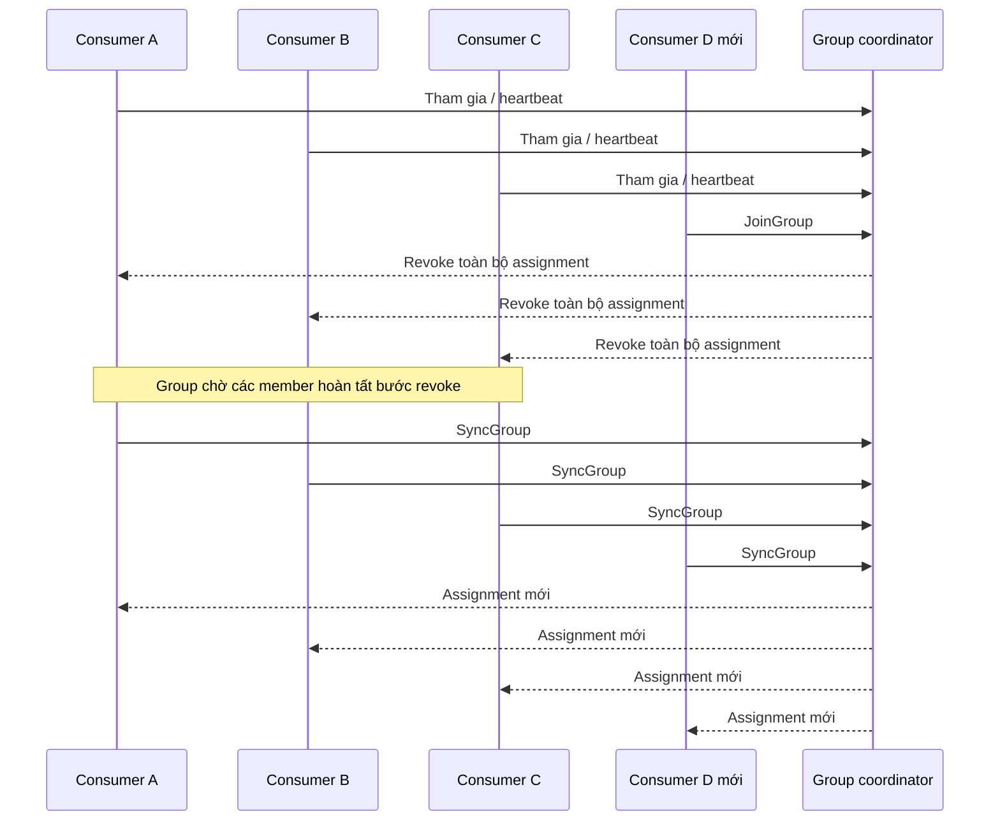

# Eager rebalance và cooperative rebalance

Khi thành viên consumer group thay đổi, subscription thay đổi hoặc topic có thêm partition, Kafka cần phân chia lại partition cho các consumer đang hoạt động. Quá trình này gọi là **rebalance**. Rebalance giúp group tiếp tục đọc dữ liệu đúng ownership, nhưng có thể làm consumer tạm ngừng xử lý, tăng độ trễ và tạo tải cho các dịch vụ phía sau.

Trong giao thức consumer group classic, hai cách bàn giao partition thường gặp là **eager rebalance** và **cooperative rebalance**. Eager thu hồi toàn bộ assignment hiện tại trước khi giao assignment mới. Cooperative chỉ thu hồi các partition thực sự cần chuyển owner, nhờ đó giảm phạm vi gián đoạn. `CooperativeStickyAssignor` là chiến lược phổ biến kết hợp cooperative protocol với mục tiêu giữ assignment ổn định.

## 1. Rebalance giải quyết vấn đề gì?

Giả sử topic `orders.events` có sáu partition và group `payment-service` đang chạy ba consumer:

| Member | Assignment hiện tại |
|---|---|
| Consumer A | 0, 1 |
| Consumer B | 2, 3 |
| Consumer C | 4, 5 |

Khi Consumer C dừng, partition 4 và 5 cần được giao cho các member còn lại. Khi Consumer D tham gia, group có thêm một member và có thể phân phối lại partition để tăng khả năng xử lý song song.

Kafka cần bảo đảm một partition không đồng thời thuộc quyền sở hữu của hai member trong cùng group theo assignment protocol. Vì thế, trước khi partition chuyển sang member mới, member cũ phải nhường ownership. Rebalance điều phối quá trình thu hồi và cấp phát đó.

Các nguyên nhân thường kích hoạt rebalance:

- Consumer mới tham gia group hoặc consumer chủ động rời group.
- Consumer không gửi heartbeat hoặc vượt thời gian timeout.
- Consumer không gọi `poll()` kịp thời và vượt `max.poll.interval.ms` trong giao thức classic.
- Subscription topic của member thay đổi.
- Topic được thêm partition.
- Coordinator thay đổi hoặc group cần khôi phục trạng thái sau lỗi.

Rebalance không phải là lỗi. Rebalance thường xuyên ngoài dự kiến mới là dấu hiệu cần điều tra, vì nó có thể làm giảm throughput và tăng consumer lag.

## 2. Eager rebalance: thu hồi toàn bộ rồi cấp phát lại

Với eager rebalance, khi group cần thay đổi assignment, các member thu hồi toàn bộ partition hiện tại. Sau khi group hoàn tất bước đồng bộ và tính assignment mới, các partition được giao lại cho member tương ứng.

Ví dụ ban đầu có ba consumer:

| Member | Trước rebalance |
|---|---|
| A | 0, 1 |
| B | 2, 3 |
| C | 4, 5 |

Consumer D tham gia. Một assignment mới cân bằng có thể là:

| Member | Sau rebalance |
|---|---|
| A | 0, 1 |
| B | 2, 3 |
| C | 4 |
| D | 5 |

Ngay cả khi A và B vẫn giữ nguyên partition sau khi tính toán, trong eager protocol chúng vẫn phải revoke assignment cũ trước khi nhận assignment mới. Vì vậy, group có thể tạm dừng việc tiêu thụ trên phạm vi rộng hơn số partition thực sự thay đổi.



### Ưu điểm và hạn chế

| Khía cạnh | Eager rebalance |
|---|---|
| Cách thu hồi | Thu hồi toàn bộ partition đang được giao trong group |
| Tính đơn giản | Dễ hình dung, có lịch sử hỗ trợ rộng |
| Thời gian gián đoạn | Có thể lớn vì cả partition không đổi cũng bị revoke |
| State cục bộ | Consumer có thể phải flush/khởi tạo lại nhiều state hơn |
| Phù hợp | Group nhỏ, workload ít nhạy với thời gian dừng hoặc hệ thống cũ cần giữ compatibility |

Eager không có nghĩa Kafka mất record. Nếu ứng dụng commit offset đúng và xử lý idempotent, group có thể tiếp tục từ tiến độ đã lưu. Tuy nhiên, nếu consumer dừng sau khi side effect đã hoàn tất nhưng trước khi commit offset, record có thể được giao lại; rebalance không tự giải quyết duplicate nghiệp vụ.

## 3. Cooperative rebalance: chỉ thu hồi partition cần chuyển

Cooperative rebalance dùng cơ chế thu hồi từng phần (incremental cooperative assignment). Khi assignment thay đổi, assignor cố gắng giữ nguyên các partition vẫn thuộc member cũ và chỉ revoke partition cần chuyển sang member khác.

Vẫn dùng ví dụ ba consumer A, B, C đang sở hữu sáu partition. Consumer D tham gia. Assignment mong muốn cuối cùng:

| Member | Assignment cuối |
|---|---|
| A | 0, 1 |
| B | 2, 3 |
| C | 4 |
| D | 5 |

Chỉ partition 5 cần chuyển từ C sang D. Trong vòng đầu, C được yêu cầu revoke partition 5; A và B có thể giữ 0-3, C tiếp tục giữ partition 4. Sau khi partition 5 đã được nhường, group hoàn tất vòng tiếp theo để giao partition đó cho D.

```mermaid
flowchart TD
    A[Assignment hiện tại\nA: 0,1 | B: 2,3 | C: 4,5] --> B[Consumer D tham gia]
    B --> C[Assignor tính assignment đích]
    C --> D[Revoke partition 5 từ C]
    D --> E[Partition 0-4 tiếp tục thuộc owner cũ]
    E --> F[Group chạy vòng đồng bộ tiếp theo]
    F --> G[Assign partition 5 cho D]
    G --> H[Assignment ổn định\nA: 0,1 | B: 2,3 | C: 4 | D: 5]
```

Cooperative rebalance có thể cần nhiều vòng để hoàn tất một lần thay đổi assignment. Partition phải được revoke khỏi owner cũ trước khi được giao cho owner mới; Kafka không cho phép hai member cùng sở hữu partition trong cùng group chỉ để rút ngắn quá trình.

### Ưu điểm và giới hạn

| Khía cạnh | Cooperative rebalance |
|---|---|
| Cách thu hồi | Chỉ revoke partition cần chuyển owner |
| Partition không đổi | Có thể tiếp tục được member hiện tại giữ và xử lý |
| Thời gian gián đoạn | Thường giảm so với eager khi chỉ một phần assignment thay đổi |
| Số vòng | Có thể cần nhiều vòng để bàn giao partition |
| Độ phức tạp ứng dụng | Cần xử lý revoke từng phần chính xác, không giả định mọi partition đều bị thu hồi |
| Phù hợp | Group lớn, stateful consumer hoặc workload nhạy với gián đoạn rebalance |

Cooperative không loại bỏ rebalance và không bảo đảm zero downtime. Consumer vẫn cần phối hợp với coordinator, xử lý partition revoke/lost và chịu được thời gian group hội tụ.

## 4. Eager và cooperative khác nhau ở đâu?

| Tiêu chí | Eager | Cooperative |
|---|---|---|
| Phạm vi revoke | Toàn bộ assignment của member trong group | Chỉ partition cần chuyển |
| Partition không đổi | Cũng bị revoke rồi giao lại | Có thể tiếp tục ở owner cũ |
| Cách hội tụ | Thường hoàn tất trong một vòng đồng bộ assignment | Có thể cần nhiều vòng |
| Gián đoạn tiêu thụ | Phạm vi rộng hơn | Thường hẹp hơn |
| Callback revoke | Thường nhận toàn bộ partition đã giao | Nhận tập partition thực sự bị revoke trong vòng đó |
| Yêu cầu tương thích | Dùng assignor/protocol eager | Các member cần hỗ trợ cooperative protocol và cấu hình tương thích |
| Ví dụ assignor | `RangeAssignor`, `RoundRobinAssignor`, `StickyAssignor` ở chế độ eager | `CooperativeStickyAssignor` |

`StickyAssignor` và `CooperativeStickyAssignor` có chung mục tiêu giảm di chuyển partition, nhưng không giống nhau về giao thức. Sticky assignor có thể giữ assignment ổn định trong eager rebalance; CooperativeStickyAssignor bổ sung khả năng thu hồi từng phần.

## 5. Vai trò của assignor và group protocol

Trong giao thức classic, consumer group dùng group coordinator để quản lý membership và rebalance. Một member được chọn làm group leader; member này chạy partition assignor để tính assignment dựa trên subscription của các consumer.

Assignor quyết định partition nào thuộc member nào. Rebalance protocol quyết định cách thu hồi và cấp lại assignment:

- Eager assignor yêu cầu thu hồi toàn bộ assignment trước khi nhận assignment mới.
- Cooperative assignor cho phép incremental assignment và chỉ thu hồi các partition cần chuyển.

`CooperativeStickyAssignor` là lựa chọn phổ biến để bật cooperative rebalance cho Java consumer classic protocol. Không thể chỉ cấu hình một member sang cooperative trong khi các member còn lại vẫn dùng assignor eager không tương thích rồi kỳ vọng group hoạt động ổn định.

Kafka có consumer group protocol mới trong các phiên bản mới hơn, với một số trách nhiệm assignment được chuyển về broker. Cách cấu hình assignor và quy trình rebalance của protocol mới khác classic. Khi dùng `group.protocol=consumer`, hãy kiểm tra tài liệu đúng phiên bản broker/client và cấu hình server-side assignor; không áp dụng máy móc ví dụ `partition.assignment.strategy` của classic protocol.

## 6. ConsumerRebalanceListener: xử lý revoke và assign an toàn

Java Kafka Consumer cung cấp `ConsumerRebalanceListener` để ứng dụng phản ứng khi partition bị thu hồi hoặc được giao. Các callback chính:

| Callback | Ý nghĩa | Công việc phù hợp |
|---|---|---|
| `onPartitionsRevoked` | Partition sắp được nhường trong rebalance có kiểm soát | Dừng nhận việc mới cho partition đó, hoàn tất công việc an toàn, commit offset đã xử lý, flush state |
| `onPartitionsAssigned` | Partition mới được giao cho consumer | Khôi phục state, chuẩn bị tài nguyên và tiếp tục từ offset phù hợp |
| `onPartitionsLost` | Consumer đã mất ownership, không còn thời gian bàn giao an toàn | Dừng xử lý, dọn state cục bộ; tránh commit như thể vẫn còn quyền sở hữu |

Trong eager rebalance, `onPartitionsRevoked` thường nhận toàn bộ assignment cũ. Trong cooperative rebalance, callback chỉ nhận tập partition bị thu hồi ở vòng hiện tại; các partition còn lại có thể vẫn thuộc consumer. Vì vậy, không được xóa toàn bộ state của consumer mỗi lần nhận callback nếu còn partition đang được giữ.

Ví dụ Java Consumer:

```java
import java.time.Duration;
import java.util.Collection;
import java.util.Map;

import org.apache.kafka.clients.consumer.ConsumerRebalanceListener;
import org.apache.kafka.clients.consumer.KafkaConsumer;
import org.apache.kafka.clients.consumer.OffsetAndMetadata;
import org.apache.kafka.common.TopicPartition;

KafkaConsumer<String, String> consumer = new KafkaConsumer<>(props);

consumer.subscribe(List.of("orders.events"), new ConsumerRebalanceListener() {
    @Override
    public void onPartitionsRevoked(Collection<TopicPartition> partitions) {
        // Chỉ lấy offset đã xử lý xong cho các partition sắp revoke.
        Map<TopicPartition, OffsetAndMetadata> offsets =
            processingState.completedOffsets(partitions);

        if (!offsets.isEmpty()) {
            consumer.commitSync(offsets, Duration.ofSeconds(5));
        }

        processingState.flushAndPause(partitions);
    }

    @Override
    public void onPartitionsAssigned(Collection<TopicPartition> partitions) {
        processingState.restore(partitions);
    }

    @Override
    public void onPartitionsLost(Collection<TopicPartition> partitions) {
        // Ownership đã mất; không commit offset ở callback này.
        processingState.discard(partitions);
    }
});
```

`processingState` là lớp do ứng dụng tự triển khai, không phải API Kafka. Đoạn code minh họa ý tưởng; trong ứng dụng thực tế, cần bảo đảm chỉ commit offset của record đã hoàn tất theo thứ tự an toàn, và chỉ xử lý state thuộc các partition được callback thông báo.

### Quy tắc quan trọng khi xử lý revoke

1. Ngừng giao thêm công việc mới cho partition sắp revoke.
2. Chờ hoặc hủy an toàn các tác vụ đang chạy theo chính sách ứng dụng.
3. Chỉ commit offset của phần xử lý đã hoàn tất; không commit vượt qua record còn đang chạy.
4. Flush state hoặc checkpoint trước khi nhường ownership nếu ứng dụng có state cục bộ.
5. Xóa hoặc giải phóng state chỉ cho partition thực sự bị revoke/lost.

Nếu xử lý bất đồng bộ bằng worker pool, poll thread cần theo dõi tiến độ riêng theo partition. Không commit offset cao hơn record chưa hoàn tất chỉ vì record sau đã xử lý xong; nếu không, sau rebalance record chưa hoàn tất có thể bị bỏ qua.

## 7. Cấu hình CooperativeStickyAssignor trong Java

Với Kafka Java Consumer classic protocol, có thể cấu hình:

```java
Properties props = new Properties();
props.put(ConsumerConfig.BOOTSTRAP_SERVERS_CONFIG,
          "localhost:9092");
props.put(ConsumerConfig.GROUP_ID_CONFIG,
          "payment-service");
props.put(ConsumerConfig.KEY_DESERIALIZER_CLASS_CONFIG,
          StringDeserializer.class.getName());
props.put(ConsumerConfig.VALUE_DESERIALIZER_CLASS_CONFIG,
          StringDeserializer.class.getName());
props.put(ConsumerConfig.PARTITION_ASSIGNMENT_STRATEGY_CONFIG,
          CooperativeStickyAssignor.class.getName());

KafkaConsumer<String, String> consumer = new KafkaConsumer<>(props);
consumer.subscribe(List.of("orders.events"));
```

Các member của cùng group phải có cấu hình assignor tương thích. Nếu một member chưa hỗ trợ cooperative protocol hoặc vẫn dùng eager assignor không tương thích, group có thể không thực hiện được rebalance như mong muốn.

### Cấu hình Spring Boot

Với Spring Boot và Spring Kafka dùng classic consumer protocol, cấu hình tương ứng:

```yaml
spring:
  kafka:
    bootstrap-servers: localhost:9092
    consumer:
      group-id: payment-service
      properties:
        partition.assignment.strategy: org.apache.kafka.clients.consumer.CooperativeStickyAssignor
```

Spring Kafka listener container quản lý subscribe và rebalance callback nội bộ. Nếu cần logic dọn state hoặc checkpoint theo partition, có thể cấu hình `ConsumerAwareRebalanceListener` trên container factory:

```java
factory.getContainerProperties().setConsumerRebalanceListener(
    new ConsumerAwareRebalanceListener() {
        @Override
        public void onPartitionsRevokedBeforeCommit(
                Consumer<?, ?> consumer,
                Collection<TopicPartition> partitions) {
            stateStore.flush(partitions);
        }

        @Override
        public void onPartitionsAssigned(
                Consumer<?, ?> consumer,
                Collection<TopicPartition> partitions) {
            stateStore.restore(partitions);
        }
    }
);
```

Tên callback và API cụ thể phụ thuộc phiên bản Spring Kafka. Hãy kiểm tra Javadoc của phiên bản dự án; không đăng ký nhiều listener ghi đè lẫn nhau nếu container factory đã có logic rebalance cần thiết.

## 8. Chuyển từ eager sang cooperative

Không nên đổi assignor trên một member rồi để các member còn lại chạy cấu hình cũ tùy ý. Khi group đang hoạt động, các member cần thống nhất protocol và có thể cần rolling migration theo nhiều giai đoạn.

Một kế hoạch triển khai an toàn ở mức khái quát:

1. Kiểm tra phiên bản broker và tất cả Kafka client có hỗ trợ cooperative assignor.
2. Kiểm tra group có member dùng thư viện hoặc cấu hình không tương thích hay không.
3. Lập kế hoạch rolling restart để các member chuyển sang cấu hình tương thích theo hướng dẫn migration của phiên bản Kafka đang dùng.
4. Quan sát rebalance, assignment, consumer lag và lỗi join/sync trong từng đợt.
5. Khi toàn bộ member đã chạy cấu hình cooperative ổn định, loại bỏ cấu hình eager cũ nếu migration path yêu cầu.
6. Kiểm tra lại hành vi khi thêm/bớt member và khi một broker/coordinator gặp sự cố.

Kafka từng hỗ trợ cách chuyển đổi theo giai đoạn bằng cách khai báo đồng thời assignor eager cũ và cooperative mới trong danh sách chiến lược, sau đó loại bỏ eager assignor sau khi tất cả member đã nâng cấp. Cách cụ thể phụ thuộc phiên bản client; hãy làm theo hướng dẫn migration của release đang triển khai thay vì sao chép một cấu hình chung cho mọi phiên bản.

## 9. Ảnh hưởng của rebalance tới offset và nghiệp vụ

Rebalance thay đổi owner của partition, không tự xóa dữ liệu và cũng không tự bảo đảm side effect của ứng dụng chỉ xảy ra một lần. Có hai cửa sổ lỗi thường gặp:

- Consumer đã cập nhật database nhưng chưa commit offset rồi mất partition: member mới có thể đọc lại record và thực hiện lại side effect.
- Consumer commit offset trước khi nghiệp vụ hoàn tất rồi mất partition: member mới tiếp tục sau offset đã commit, khiến record chưa xử lý bị bỏ qua.

Vì vậy, commit offset sau khi xử lý thành công và thiết kế consumer idempotent. Với database, có thể ghi inbox event ID và cập nhật nghiệp vụ trong cùng transaction. Với stateful processor, cần flush checkpoint trước khi nhường partition và khôi phục state khi nhận assignment.

Cooperative rebalance làm giảm phạm vi partition bị dừng, nhưng không thay thế commit đúng, inbox/deduplication hoặc transaction. Những bảo đảm này nằm ở tầng xử lý dữ liệu.

## 10. Quan sát và chẩn đoán rebalance

Dùng Kafka CLI để xem group members, assignment, offset và lag:

```bash
kafka-consumer-groups.sh \
  --bootstrap-server localhost:9092 \
  --describe \
  --group payment-service \
  --members \
  --verbose
```

Những metric và log nên theo dõi:

| Tín hiệu | Điều cần quan sát |
|---|---|
| Rebalance rate | Group có rebalance liên tục hay chỉ khi deploy/scale |
| Rebalance latency | Mất bao lâu để group trở lại trạng thái ổn định |
| Partition revoked/assigned | Bao nhiêu partition bị chuyển owner trong mỗi lần |
| Consumer lag | Lag có tăng mạnh trong khoảng rebalance không |
| `JoinGroup` / `SyncGroup` errors | Member có lỗi giao thức, timeout hoặc cấu hình không tương thích không |
| Heartbeat/session timeout | Member có mất liên lạc với coordinator không |
| `max.poll.interval.ms` | Thời gian xử lý giữa các lần poll có vượt giới hạn không |
| Consumer restart | Container hoặc JVM có crash/restart liên tục không |

### Các tình huống thường gặp

| Triệu chứng | Nguyên nhân có thể | Hướng xử lý |
|---|---|---|
| Rebalance xảy ra liên tục | Consumer xử lý lâu, poll chậm, downstream bị nghẽn | Đo thời gian xử lý, giảm batch hoặc chuyển xử lý sang worker pool có backpressure |
| Eager rebalance làm lag tăng mạnh | Toàn bộ partition bị thu hồi mỗi lần group đổi | Đánh giá cooperative assignor và tối ưu tần suất deploy/scale |
| Cooperative rebalance kéo dài nhiều vòng | Partition chưa được revoke đúng hoặc member không hội tụ | Kiểm tra callback revoke, member health và assignor compatibility |
| Member bị loại khi xử lý batch lớn | Vượt `max.poll.interval.ms` | Điều chỉnh batch/time budget hoặc xử lý bất đồng bộ có kiểm soát |
| Partition được giao lại nhưng state thiếu | State không được flush hoặc restore đúng callback | Bổ sung checkpoint và phục hồi state theo topic-partition |
| Lỗi `INCONSISTENT_GROUP_PROTOCOL` hoặc join/sync thất bại | Member dùng protocol/assignor không tương thích | Đồng bộ cấu hình và phiên bản client theo kế hoạch rolling migration |

Không nên tăng `session.timeout.ms` hoặc `max.poll.interval.ms` ngay khi thấy rebalance. Trước tiên xác định member rời group do heartbeat, poll timeout, lỗi ứng dụng hay triển khai. Tăng timeout có thể giảm rebalance giả do jitter nhưng cũng làm phát hiện consumer chết chậm hơn.

## 11. Bài thực hành: so sánh eager và cooperative

Chạy Kafka local với topic `orders.events` có sáu partition và group `payment-service` gồm ba consumer.

1. Cấu hình `RangeAssignor` hoặc `RoundRobinAssignor`, khởi động ba consumer và ghi lại assignment.
2. Thêm consumer thứ tư, quan sát log revoke/assign và thời gian group tạm ngừng đọc.
3. Khởi động lại group trong lab với `CooperativeStickyAssignor` trên tất cả member.
4. Thêm consumer thứ tư lần nữa và ghi lại tập partition thực sự bị revoke trong từng vòng.
5. So sánh số partition bị chuyển owner, thời gian rebalance và consumer lag giữa hai cách.
6. Tạm dừng một consumer đang xử lý để kiểm tra `onPartitionsRevoked` và việc commit offset.
7. Mô phỏng consumer mất ownership đột ngột để kiểm tra `onPartitionsLost` và khả năng xử lý record giao lại.
8. Kiểm tra consumer idempotency để xác nhận event có thể được giao lại mà không tạo side effect lặp.

Chỉ dừng consumer hoặc mô phỏng lỗi trên môi trường lab. Không đổi assignor hay cưỡng bức rebalance trên production nếu chưa có kế hoạch triển khai và theo dõi.

## 12. Những nhầm lẫn thường gặp

- **Cho rằng cooperative không có rebalance:** cooperative vẫn rebalance, nhưng chỉ revoke partition cần chuyển.
- **Cho rằng cooperative luôn hoàn tất trong một vòng:** có thể cần nhiều vòng để owner cũ nhường partition trước khi owner mới nhận.
- **Đồng nhất StickyAssignor với CooperativeStickyAssignor:** Sticky giữ assignment ổn định; CooperativeSticky hỗ trợ incremental revoke.
- **Cho rằng eager chỉ revoke partition thay đổi:** eager protocol thu hồi toàn bộ assignment trước khi cấp lại.
- **Xóa toàn bộ state trong mỗi `onPartitionsRevoked`:** với cooperative rebalance, consumer có thể vẫn giữ các partition khác.
- **Tiếp tục xử lý partition sau khi đã revoke:** có thể tạo xử lý đồng thời hoặc side effect ngoài ownership.
- **Commit mọi offset trong callback revoke:** chỉ commit offset đã xử lý xong cho partition đang nhường; không commit vượt qua công việc đang dở.
- **Cho rằng cooperative loại bỏ duplicate:** record vẫn có thể được giao lại khi offset chưa commit hoặc side effect chưa nguyên tử.
- **Chỉ nâng cấp một member sang cooperative:** các member phải tương thích về protocol và assignor.
- **Tăng timeout để chữa mọi rebalance:** cần tìm nguyên nhân gốc như poll chậm, GC pause, downstream latency hoặc lỗi mạng.

Eager rebalance đơn giản nhưng thu hồi toàn bộ assignment, nên có thể gây gián đoạn rộng khi group thay đổi. Cooperative rebalance giảm gián đoạn bằng cách chỉ chuyển những partition cần thiết và có thể hoàn tất qua nhiều vòng. Dù chọn cách nào, consumer vẫn phải xử lý revoke/assign đúng, commit offset an toàn, quản lý state theo partition và bảo đảm nghiệp vụ idempotent khi record được giao lại.
