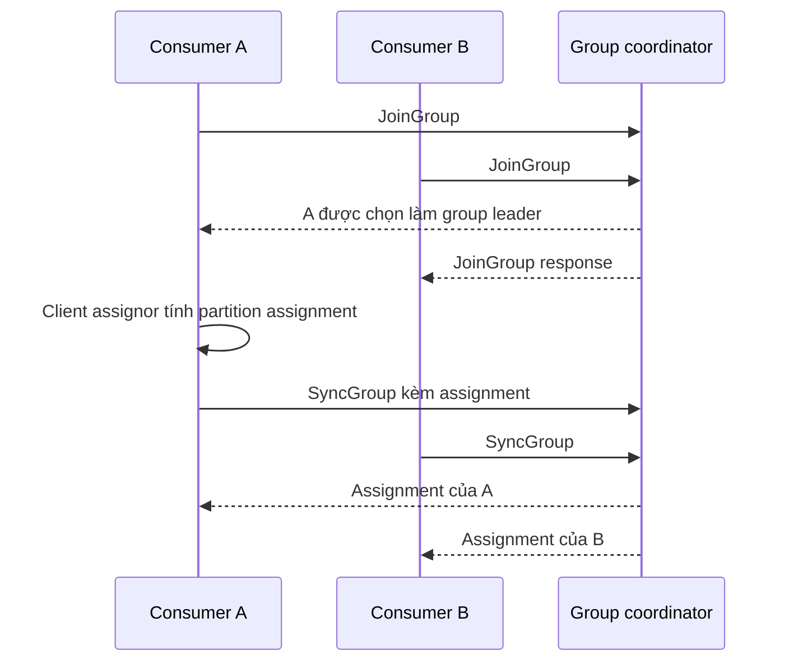
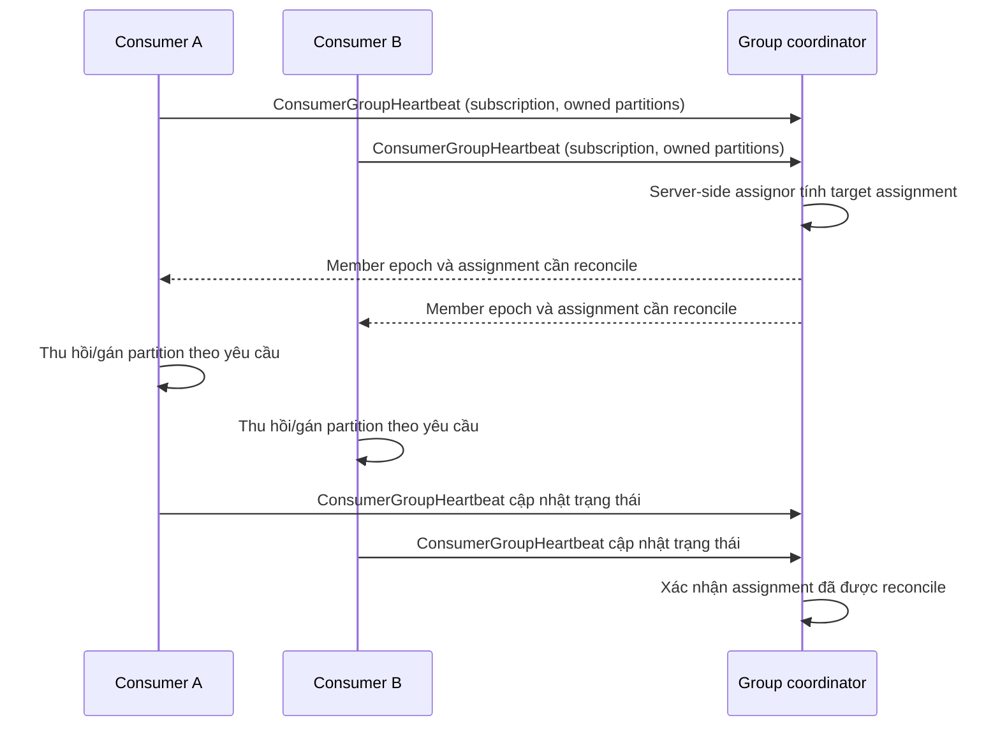
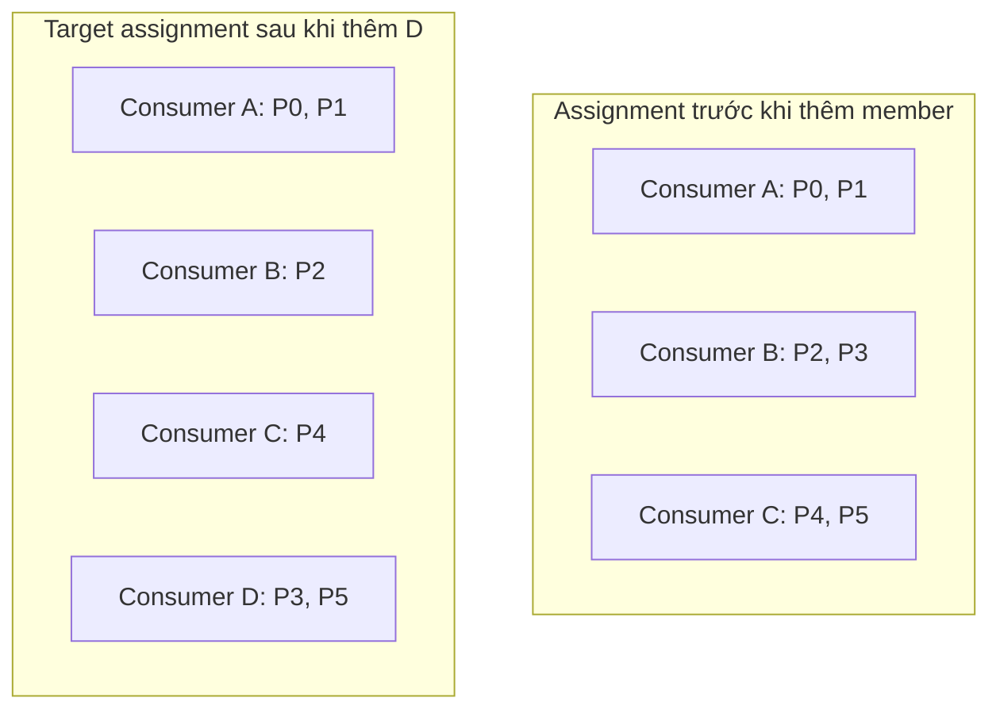

# Consumer group protocol mới và khác biệt với classic protocol

## Vì sao Kafka cần một consumer group protocol mới?

Consumer group cho phép nhiều consumer cùng chia partition của một topic. Khi một member tham gia, rời group hoặc bị xem là mất kết nối, Kafka phải tính lại assignment để mỗi partition được xử lý bởi một member phù hợp. Quá trình này gọi là rebalance.

Trong **classic consumer group protocol**, coordinator quản lý membership và generation, nhưng việc tính partition assignment chủ yếu diễn ra ở phía client. Coordinator chọn một member làm group leader; member đó chạy partition assignor rồi gửi kết quả để coordinator phân phối cho các thành viên. Với eager rebalance, toàn bộ member có thể phải thu hồi assignment trước khi nhận assignment mới. Cách này hoạt động tốt nhưng có thể tạo khoảng dừng xử lý đáng kể khi group lớn hoặc membership thay đổi thường xuyên.

**Consumer group protocol mới**, được phát triển qua KIP-848 và hỗ trợ ổn định trong Kafka 4.0 trở lên, chuyển việc tính assignment về phía broker và thiết kế rebalance theo hướng incremental. Coordinator có thể điều chỉnh assignment của từng member, thu hồi những partition cần chuyển giao và để các member không bị ảnh hưởng tiếp tục xử lý. Giao thức mới cũng dùng API heartbeat dành cho consumer group mới và cơ chế epoch của member để theo dõi tiến độ đồng bộ assignment.

Mục tiêu là giảm thời gian gián đoạn khi rebalance, loại bỏ vai trò group leader phía client trong giao thức classic và làm cho việc điều phối có thể mở rộng tốt hơn. Protocol mới không thay đổi ý nghĩa cơ bản của topic, partition, offset hay committed offset; nó thay đổi cách Kafka quản lý membership và phân công partition.

Trong module KAFKA, cần hiểu cả hai giao thức để triển khai Java/Spring Kafka, chọn cấu hình consumer group phù hợp, kiểm soát rebalance, retry, ordering và vận hành cụm theo đúng phiên bản broker/client.

## 1. Classic protocol hoạt động như thế nào?

### 1.1 Coordinator và group leader phía client

Trong classic protocol, mỗi group có một group coordinator là broker chịu trách nhiệm xử lý các yêu cầu group. Consumer tìm coordinator bằng `group.id`, sau đó gửi các yêu cầu tham gia và duy trì membership.

Trong quá trình rebalance classic, một member được chọn làm **group leader**. Đây là một consumer client, không phải KRaft active controller và cũng không phải partition leader. Group leader nhận subscription của các member, chạy partition assignor ở phía client và gửi assignment trong `SyncGroup`. Coordinator lưu và phân phối kết quả cho các member còn lại.



Các bước trên mô tả classic protocol ở mức khái niệm. Chi tiết thay đổi theo phiên bản và loại rebalance, nhưng điểm cốt lõi là client group leader tham gia tính assignment.

### 1.2 Các API chính

Classic protocol dùng một nhóm API để phối hợp membership:

| API | Vai trò |
|---|---|
| `FindCoordinator` | Tìm broker đang làm coordinator cho group |
| `JoinGroup` | Tham gia group và trao đổi thông tin subscription/protocol |
| `SyncGroup` | Đồng bộ partition assignment từ coordinator đến member |
| `Heartbeat` | Duy trì membership và báo member còn hoạt động |
| `LeaveGroup` | Thông báo member rời group một cách chủ động |
| `OffsetCommit` | Lưu committed offset cho group và partition |

Coordinator theo dõi generation của group. Generation thay đổi khi group rebalance hoàn tất; yêu cầu từ member thuộc generation cũ có thể bị từ chối để tránh một member cũ tiếp tục commit hoặc hành động trên assignment đã hết hiệu lực.

### 1.3 Eager rebalance và cooperative rebalance trong classic

Classic protocol có thể sử dụng eager assignor hoặc cooperative assignor. Với eager rebalance, các member thu hồi toàn bộ partition assignment rồi chờ assignment mới. Trong thời gian đó, group có thể tạm ngừng xử lý trên diện rộng.

CooperativeSticky assignor hỗ trợ chuyển giao từng phần: chỉ những partition cần chuyển mới bị thu hồi, các partition không đổi có thể tiếp tục được xử lý. Cách này giảm gián đoạn so với eager, nhưng vẫn sử dụng classic group protocol và cơ chế group leader phía client.

Vì vậy, không nên đồng nhất hai khái niệm:

- **Cooperative rebalance** là cách classic protocol giảm phạm vi thu hồi partition.
- **Consumer group protocol mới** thay đổi cả giao thức điều phối, đưa assignment về broker và dùng cơ chế reconciliation theo member epoch.

## 2. Consumer group protocol mới hoạt động như thế nào?

### 2.1 Coordinator tính assignment ở phía broker

Với protocol mới, consumer không gửi `JoinGroup` và `SyncGroup` theo luồng classic để bầu một client group leader tính assignment. Thay vào đó, member trao đổi với coordinator bằng API `ConsumerGroupHeartbeat`.

Consumer gửi thông tin cần thiết để duy trì membership, bao gồm định danh member, subscription và trạng thái partition mà member đang sở hữu. Coordinator dùng server-side assignor để tính target assignment cho group. Kết quả được truyền về từng member qua phản hồi heartbeat và các lần trao đổi tiếp theo.



Sơ đồ là luồng khái niệm. Trong thực tế, heartbeat và reconciliation có thể diễn ra qua nhiều vòng; không phải mọi member đều nhận cùng một assignment hoặc phải dừng cùng lúc.

### 2.2 Không còn group leader phía client

Trong protocol mới, coordinator chịu trách nhiệm tính assignment bằng assignor chạy phía broker. Không có một consumer member được bầu làm group leader để tính assignment và gửi `SyncGroup` như classic protocol.

Điều này có một số lợi ích:

- Giảm sự phụ thuộc vào một client member cụ thể trong quá trình tính assignment.
- Cho phép coordinator cập nhật assignment theo trạng thái group ở phía broker.
- Tránh phải gửi toàn bộ kết quả assignment qua một member leader.
- Hỗ trợ rebalance incremental và reconciliation riêng cho từng member.

Group coordinator vẫn là broker quản lý group; nó không trở thành KRaft controller. Partition leader vẫn là broker phục vụ produce/fetch của một partition. Ba vai trò này cần được phân biệt khi đọc log và chẩn đoán sự cố.

### 2.3 `ConsumerGroupHeartbeat` và member epoch

API `ConsumerGroupHeartbeat` kết hợp việc duy trì membership với trao đổi trạng thái subscription/assignment. Coordinator dùng **member epoch** để xác định phiên bản trạng thái của một member. Khi assignment thay đổi, epoch giúp phân biệt trạng thái hiện tại với trạng thái cũ và ngăn member dùng assignment đã lỗi thời.

Khái niệm này thay đổi cách theo dõi tiến trình so với generation-centric flow của classic protocol. Ứng dụng vẫn gọi `poll()` và xử lý record qua KafkaConsumer như bình thường; phần giao thức heartbeat, epoch và reconciliation do client/broker phối hợp thực hiện.

## 3. Incremental rebalance và reconciliation

### 3.1 Chỉ chuyển partition thực sự cần chuyển

Giả sử topic có sáu partition và ba member. Khi member thứ tư tham gia, coordinator có thể tạo target assignment mới. Những partition vẫn thuộc member cũ có thể tiếp tục được xử lý; chỉ partition cần chuyển sang member mới mới phải được thu hồi và bàn giao.



Trong ví dụ, A giữ nguyên P0/P1; B chỉ cần chuyển P3; C chỉ cần chuyển P5. A không cần dừng xử lý các partition không đổi chỉ vì một member mới tham gia group.

### 3.2 Target assignment và current assignment

Coordinator có thể xác định target assignment mới trước khi mọi member đã chuyển xong. Trong giai đoạn chuyển tiếp, current assignment của một member và target assignment mà coordinator mong muốn có thể khác nhau.

Member thực hiện reconciliation bằng cách:

1. So sánh partition đang sở hữu với target assignment.
2. Dừng nhận hoặc xử lý thêm record trên partition cần thu hồi.
3. Hoàn tất hoặc hủy công việc đang chạy theo chính sách ứng dụng.
4. Gọi callback revoke/lost phù hợp và commit offset an toàn nếu có thể.
5. Cập nhật assignment, bắt đầu xử lý partition mới được giao.
6. Gửi heartbeat để báo trạng thái assignment đã được cập nhật.

Coordinator tiếp tục điều chỉnh epoch và trạng thái group cho đến khi các member đạt target assignment. Vì vậy, rebalance có thể hoàn tất theo từng member thay vì một thời điểm dừng chung cho toàn group.

### 3.3 Member không bị ảnh hưởng có thể tiếp tục xử lý

Điểm khác biệt lớn là member có assignment không đổi không nhất thiết phải dừng xử lý trong suốt quá trình rebalance. Điều này giảm khoảng trống throughput ở các group lớn.

Tuy nhiên, incremental không có nghĩa rebalance không có chi phí. Member bị thu hồi partition vẫn cần hoàn tất bàn giao; coordinator vẫn phải cập nhật metadata; consumer vẫn có thể nhận callback và cần đảm bảo không có hai member cùng tạo side effect cho một partition trong giai đoạn chuyển quyền.

## 4. So sánh classic protocol và protocol mới

| Khía cạnh | Classic protocol | Consumer group protocol mới |
|---|---|---|
| API membership chính | `JoinGroup`, `SyncGroup`, `Heartbeat` | `ConsumerGroupHeartbeat` |
| Nơi tính assignment | Client-side assignor trên group leader | Server-side assignor tại coordinator |
| Group leader phía client | Có trong luồng classic | Không có vai trò này |
| Theo dõi phiên bản member | Group generation và member metadata | Member epoch và trạng thái reconciliation |
| Rebalance | Eager hoặc cooperative tùy assignor | Incremental reconciliation là mô hình nền tảng |
| Heartbeat/session | Chủ yếu cấu hình ở client bằng `heartbeat.interval.ms`, `session.timeout.ms` | Broker quản lý heartbeat/session cho protocol mới |
| Chọn assignor | `partition.assignment.strategy` phía client | Server-side assignor; có thể chọn bằng `group.remote.assignor` nếu được hỗ trợ |
| Phạm vi cập nhật | Có thể thu hồi toàn bộ assignment với eager; cooperative chuyển từng phần | Coordinator cập nhật target assignment theo member |
| Offset storage | `__consumer_offsets` | Vẫn dùng `__consumer_offsets` |
| Ứng dụng xử lý record | `poll()`, deserialize và xử lý như trước | `poll()`, deserialize và xử lý như trước |

Protocol mới thay đổi cách group điều phối membership và assignment. Nó không thay đổi cách producer ghi record, không thay đổi thứ tự offset trong partition và không tự cung cấp exactly-once cho side effect ở database.

## 5. Cấu hình consumer group protocol mới

### 5.1 Chọn protocol ở Kafka consumer client

Trong Kafka Java client hỗ trợ protocol mới, có thể chọn bằng `group.protocol`:

```java
Properties props = new Properties();
props.put(ConsumerConfig.BOOTSTRAP_SERVERS_CONFIG, "localhost:9092");
props.put(ConsumerConfig.GROUP_ID_CONFIG, "order-workers");
props.put(ConsumerConfig.GROUP_PROTOCOL_CONFIG, "consumer");
props.put(ConsumerConfig.KEY_DESERIALIZER_CLASS_CONFIG,
        StringDeserializer.class.getName());
props.put(ConsumerConfig.VALUE_DESERIALIZER_CLASS_CONFIG,
        StringDeserializer.class.getName());
props.put(ConsumerConfig.ENABLE_AUTO_COMMIT_CONFIG, false);
props.put(ConsumerConfig.MAX_POLL_RECORDS_CONFIG, 200);

KafkaConsumer<String, String> consumer = new KafkaConsumer<>(props);
consumer.subscribe(List.of("orders"));
```

Giá trị `consumer` chọn protocol mới; `classic` chọn giao thức classic. Trong các phiên bản client mà protocol mới chưa được hỗ trợ hoặc chưa được bật, cấu hình này không thể được sử dụng. Hãy kiểm tra tài liệu đúng phiên bản Kafka broker và Java client trước khi triển khai.

### 5.2 Chọn server-side assignor

Classic protocol dùng `partition.assignment.strategy` phía client để lựa chọn assignor. Protocol mới sử dụng assignor chạy phía broker. Client có thể cung cấp `group.remote.assignor` để yêu cầu một server-side assignor cụ thể nếu broker và phiên bản hỗ trợ.

Không nên sao chép danh sách assignor classic vào `partition.assignment.strategy` rồi kỳ vọng protocol mới dùng chúng. Hãy kiểm tra các assignor server-side được broker hỗ trợ, cấu hình mặc định và khả năng tương thích của chúng với subscription pattern của ứng dụng.

Các cấu hình thường cần kiểm tra gồm:

| Cấu hình | Phạm vi | Vai trò |
|---|---|---|
| `group.protocol` | Consumer client | Chọn `classic` hoặc `consumer` |
| `group.remote.assignor` | Consumer client | Yêu cầu server-side assignor cụ thể nếu được hỗ trợ |
| `group.consumer.assignors` | Broker | Danh sách assignor phía broker được phép sử dụng |
| `partition.assignment.strategy` | Consumer client, classic | Chọn assignor phía client cho classic protocol |

Tên và giá trị hợp lệ cần được xác nhận theo phiên bản broker/client. Nếu client yêu cầu một remote assignor mà broker không hỗ trợ, group có thể không khởi tạo được assignment như mong muốn.

### 5.3 Heartbeat và session timeout được quản lý phía broker

Trong classic protocol, các cấu hình thường thấy là `heartbeat.interval.ms` và `session.timeout.ms` phía consumer. Với protocol mới, heartbeat interval và session timeout được điều khiển theo cấu hình broker dành cho consumer group protocol mới. Vì vậy, thay đổi hai thuộc tính classic ở client không nhất thiết điều chỉnh heartbeat của protocol mới.

Ở các phiên bản hỗ trợ KIP-848, những cấu hình broker thường gặp gồm `group.consumer.heartbeat.interval.ms` và `group.consumer.session.timeout.ms`. Chúng xác định nhịp heartbeat và thời gian session của consumer group protocol mới. Hãy kiểm tra giá trị mặc định, giới hạn min/max và cách cấu hình trong tài liệu của đúng phiên bản broker.

`max.poll.interval.ms` vẫn là cấu hình cần quan tâm vì nó liên quan đến tiến độ gọi `poll()` và thời gian ứng dụng xử lý giữa các lần poll. Heartbeat duy trì membership và tiến độ xử lý ứng dụng là hai vấn đề liên quan nhưng không đồng nhất. Đừng tăng session timeout để che giấu một consumer xử lý batch quá lâu; hãy đo thời gian xử lý và điều chỉnh batch/concurrency phù hợp.

## 6. Callback và xử lý partition khi assignment thay đổi

Ứng dụng có thể dùng `ConsumerRebalanceListener` để xử lý thời điểm partition được thu hồi hoặc được gán. Với incremental rebalance, callback có thể chỉ nhận tập partition bị thay đổi thay vì toàn bộ assignment.

```java
consumer.subscribe(List.of("orders"), new ConsumerRebalanceListener() {
    @Override
    public void onPartitionsRevoked(Collection<TopicPartition> partitions) {
        // Dừng công việc mới trên các partition sắp được thu hồi.
        // Commit offset an toàn nếu đã hoàn tất xử lý liên quan.
    }

    @Override
    public void onPartitionsAssigned(Collection<TopicPartition> partitions) {
        // Khởi tạo trạng thái cục bộ cho partition vừa được giao.
    }

    @Override
    public void onPartitionsLost(Collection<TopicPartition> partitions) {
        // Partition đã mất ownership; không giả định còn có thể commit.
    }
});
```

Callback được gọi trên luồng consumer theo quy tắc của Kafka client. Không thực hiện công việc kéo dài hoặc block trong callback vì có thể làm chậm poll và quá trình reconciliation. Hãy giới hạn thao tác ở việc dừng nhận việc, chốt trạng thái cần thiết và chuyển giao tài nguyên.

### 6.1 Revoke khác với lost

- **Revoked:** consumer được thông báo partition sẽ được thu hồi theo quá trình rebalance; ứng dụng có thể hoàn tất xử lý và commit offset an toàn trước khi bàn giao.
- **Lost:** consumer đã mất quyền sở hữu partition, có thể do member bị loại hoặc partition được chuyển đi ngoài quy trình bàn giao bình thường. Ứng dụng không nên giả định commit vẫn hợp lệ.
- **Assigned:** consumer được giao partition và có thể khởi tạo state hoặc bắt đầu đọc theo offset đã commit.

Với cooperative/incremental rebalance, không được giả định callback revoke luôn chứa toàn bộ partition của consumer. Hãy thao tác đúng trên tập partition được truyền vào callback.

### 6.2 Xử lý bất đồng bộ phải theo dõi offset liên tục

Nếu consumer chuyển record sang worker pool, các record trong cùng partition có thể hoàn tất không theo thứ tự nhận. Trước khi revoke partition, ứng dụng cần ngừng giao việc mới, đợi hoặc hủy các công việc đang chạy theo chính sách, rồi chỉ commit offset của chuỗi record liên tục đã hoàn tất.

Nếu commit offset vượt qua một record chưa xử lý xong, member mới có thể bắt đầu sau record đó và làm mất cơ hội xử lý. Nếu không commit, record có thể được đọc lại; vì vậy side effect nên idempotent.

## 7. Offset và delivery semantics có thay đổi không?

Protocol mới không thay đổi mô hình lưu committed offset. Offset vẫn được lưu trong `__consumer_offsets` theo `group.id`, topic và partition. Khi partition chuyển từ member A sang member B, member B tiếp tục từ committed offset theo chính sách reset hiện hành.

Các nguyên tắc xử lý vẫn giữ nguyên:

- Commit sau khi side effect thành công để giảm nguy cơ mất record, nhưng chấp nhận khả năng đọc trùng khi commit thất bại.
- Dùng idempotency hoặc inbox/deduplication để xử lý duplicate an toàn.
- Chỉ commit offset của phần dữ liệu đã hoàn tất liên tục theo thứ tự partition.
- Không coi rebalance incremental là bảo đảm exactly-once.

Protocol mới giảm gián đoạn do phân công partition, nhưng không thay thế thiết kế retry, transaction hoặc xử lý lỗi của ứng dụng. Nếu một consumer đang xử lý record và partition bị thu hồi, side effect đang chạy vẫn cần được xử lý theo chính sách nghiệp vụ.

## 8. Điều kiện tương thích và kế hoạch chuyển đổi

### 8.1 Kiểm tra phiên bản broker và client

Protocol mới được hỗ trợ ổn định từ Kafka 4.0. Các bản Kafka trước đó có thể đã có giai đoạn thử nghiệm hoặc triển khai từng phần, nhưng không nên suy ra khả năng production chỉ từ việc một cấu hình xuất hiện trong client. Cần kiểm tra đồng thời:

- Broker hỗ trợ consumer group protocol mới.
- Kafka Java client hỗ trợ `group.protocol=consumer`.
- Spring Kafka/Spring Boot đang dùng phiên bản Kafka client tương thích.
- Các broker và client được cấu hình để group có thể sử dụng cùng protocol.
- Server-side assignor được chọn tồn tại và hỗ trợ subscription cần thiết.

Không trộn member classic và member protocol mới trong cùng một group nếu phiên bản và quy trình migration không hỗ trợ rõ ràng. Hãy chuyển đổi đồng bộ theo group, thử nghiệm hành vi join/rebalance và có kế hoạch rollback về classic khi cần.

### 8.2 Các bước migration đề xuất

1. **Lập baseline:** ghi lại rebalance count, rebalance duration, consumer lag, thời gian xử lý và số partition/member.
2. **Xác nhận compatibility:** kiểm tra phiên bản broker, Java client, Spring Kafka và server-side assignor.
3. **Kiểm thử riêng:** tạo group thử nghiệm dùng `group.protocol=consumer`, chạy cùng tải và kịch bản scale/restart.
4. **Kiểm tra callback:** xác nhận revoke/assigned/lost hoạt động đúng với logic commit offset và worker pool.
5. **Chuyển từng group:** cập nhật cấu hình các member của cùng group theo một kế hoạch thống nhất; tránh để các instance chạy hai protocol không tương thích.
6. **Theo dõi:** so sánh thời gian rebalance, lag, lỗi coordinator, CPU broker và lỗi xử lý.
7. **Rollback có kiểm soát:** nếu phát sinh lỗi, dừng rollout, xác định trạng thái group và committed offset, rồi chuyển lại classic theo đúng quy trình phiên bản.

Không thay đổi đồng thời protocol, assignor, số partition và cách commit offset trong cùng một lần triển khai nếu không cần thiết. Giữ ít biến thay đổi giúp xác định nguyên nhân khi kết quả khác kỳ vọng.

## 9. Theo dõi và chẩn đoán rebalance

Khi so sánh classic với protocol mới, không chỉ nhìn số lần rebalance. Hãy đo thời gian member mất assignment, thời gian group đạt trạng thái ổn định và ảnh hưởng đến throughput.

| Nhóm chỉ số | Cần quan sát | Câu hỏi cần trả lời |
|---|---|---|
| Membership | Member count, join/leave, heartbeat timeout | Có member rời group ngoài dự kiến không? |
| Rebalance | Số lần, thời gian, partition revoked/assigned | Rebalance có làm group ngừng xử lý quá lâu không? |
| Assignment | Partition trên từng member, target/current assignment | Tải có cân bằng và chuyển giao đúng không? |
| Offset | Committed offset và commit failure | Có mất tiến độ hoặc commit vượt dữ liệu đã xử lý không? |
| Consumer | Poll interval, processing latency, lag | Ứng dụng có xử lý chậm hoặc ngừng poll không? |
| Broker | Coordinator request latency, CPU, network, `__consumer_offsets` health | Coordinator có bị quá tải hoặc mất khả năng commit không? |

Tên metric và group state hiển thị có thể khác theo phiên bản và protocol. Dùng JMX/client metrics của đúng bản Kafka, log coordinator và lệnh quản trị group để xây dựng dashboard. Không áp dụng máy móc tên trạng thái classic cho group chạy protocol mới.

Có thể xem group và member bằng CLI:

```bash
kafka-consumer-groups.sh --bootstrap-server kafka-1:9092 \
  --describe --group order-workers --members --verbose
```

Kiểm tra trạng thái group:

```bash
kafka-consumer-groups.sh --bootstrap-server kafka-1:9092 \
  --describe --group order-workers --state
```

Hãy kết hợp kết quả CLI với log consumer và coordinator. Nếu group thường xuyên thay đổi assignment, kiểm tra restart loop, timeout, lỗi mạng, thời gian xử lý vượt `max.poll.interval.ms`, và việc rollout có tạo nhiều member join/leave đồng thời hay không.

## 10. Ví dụ Spring Kafka

Với Spring Kafka, listener vẫn khai báo topic và group ID như thông thường. Protocol được cấu hình ở Kafka consumer properties mà listener container sử dụng:

```yaml
spring:
  kafka:
    consumer:
      group-id: order-workers
      properties:
        group.protocol: consumer
        max.poll.records: 200
        max.poll.interval.ms: 300000
```

Listener:

```java
@KafkaListener(topics = "orders")
public void onOrder(OrderEvent event) {
    orderService.handle(event);
}
```

Các instance của service dùng cùng group ID sẽ tham gia cùng consumer group. Spring Kafka không tự biến logic xử lý nghiệp vụ thành incremental-safe: ứng dụng vẫn cần idempotency, xử lý callback nếu có, quản lý transaction và tránh xử lý vượt thời gian poll.

Nếu cấu hình assignor phía broker hoặc group protocol qua Spring Boot, hãy xác nhận các property được truyền đến Kafka client và tương thích với phiên bản thư viện. Khi dùng `ConcurrentKafkaListenerContainerFactory`, concurrency tạo nhiều consumer instance; số instance và partition count vẫn quyết định mức song song tối đa.

## 11. Những hiểu lầm thường gặp

**“Protocol mới chỉ là CooperativeSticky được bật mặc định.”** Không đúng. CooperativeSticky là một assignor của classic protocol; protocol mới chuyển assignment sang broker và sử dụng API heartbeat cùng member epoch.

**“Protocol mới không có rebalance.”** Vẫn có rebalance và chuyển giao partition. Khác biệt là quá trình được thực hiện incremental theo member thay vì bắt buộc cả group dừng cùng lúc.

**“Không còn group coordinator.”** Coordinator vẫn tồn tại. Nó đảm nhiệm thêm việc tính và quản lý target assignment ở phía broker.

**“Group leader client chỉ đổi tên thành active controller.”** Không đúng. Protocol mới không có client group leader tính assignment; KRaft active controller là vai trò quản lý metadata cluster và không thay thế group coordinator.

**“`partition.assignment.strategy` vẫn điều khiển assignor của protocol mới.”** Đây là cấu hình phía client của classic protocol. Protocol mới dùng server-side assignor; kiểm tra cấu hình `group.remote.assignor` và assignor broker được hỗ trợ.

**“Protocol mới làm offset commit và delivery semantics khác đi.”** Offset vẫn được lưu trong `__consumer_offsets`; ứng dụng vẫn cần commit đúng thời điểm và xử lý duplicate.

**“Có thể chuyển từng instance sang protocol mới mà không cần quan tâm các member khác.”** Việc chuyển protocol cần được lập kế hoạch theo group và compatibility của broker/client. Không trộn cấu hình không tương thích trong một group đang chạy.

## 12. Checklist trước khi bật protocol mới

- Broker và Kafka client hỗ trợ consumer group protocol mới; phiên bản Spring Kafka tương thích.
- Đã xác định rõ group nào cần chuyển đổi và có kế hoạch rollout/rollback.
- Tất cả member trong group được cấu hình protocol tương thích.
- Server-side assignor đáp ứng cách subscription và partition cần phân phối.
- Heartbeat/session timeout được cấu hình theo broker cho protocol mới.
- `max.poll.interval.ms`, `max.poll.records` và thời gian xử lý được đo phù hợp.
- Callback revoke/assigned/lost không block và xử lý offset an toàn.
- Worker pool không commit vượt qua record chưa hoàn tất.
- Consumer idempotent để chịu được việc đọc lại sau failover/rebalance.
- Dashboard theo dõi member, assignment, rebalance duration, lag, commit failure và coordinator health.
- Đã thử nghiệm scale up/down, restart, network interruption và coordinator failover trong môi trường staging.

## Kết luận

Classic consumer group protocol dùng `JoinGroup`, `SyncGroup` và `Heartbeat`; group coordinator quản lý membership nhưng một member phía client được chọn làm group leader để tính assignment. Protocol mới dựa trên KIP-848, dùng `ConsumerGroupHeartbeat`, member epoch và server-side assignor. Coordinator tính target assignment và các member reconcile dần, chỉ chuyển những partition cần thay đổi.

Protocol mới giúp giảm gián đoạn do rebalance, đặc biệt ở group lớn và môi trường thường xuyên scale. Tuy nhiên, nó không loại bỏ việc bàn giao partition, không thay đổi committed offset và không thay thế idempotency hoặc retry trong ứng dụng. Khi triển khai KAFKA, hãy kiểm tra phiên bản broker/client, chọn server-side assignor, điều chỉnh timeout theo protocol, kiểm thử callback và đo kết quả trước khi chuyển production. Điều đó giúp tận dụng incremental rebalance mà vẫn giữ tiến độ và thứ tự xử lý của hệ thống.
