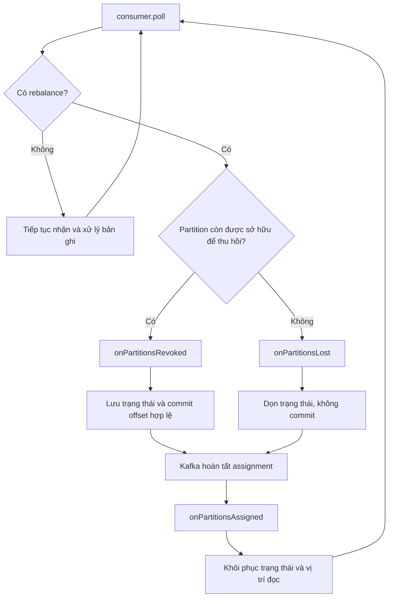

# ConsumerRebalanceListener và các callback thu hồi, cấp phát

Trong Kafka, một consumer group chia quyền đọc các partition của topic cho những consumer đang hoạt động. Khi thành viên tham gia hoặc rời nhóm, subscription thay đổi, hoặc coordinator cần phân phối lại partition, Kafka thực hiện **rebalance**. Trong thời gian đó, quyền sở hữu partition có thể thay đổi. Nếu ứng dụng đang giữ trạng thái trong bộ nhớ, xử lý bất đồng bộ hoặc tự quản lý offset, nó cần biết partition nào sắp rời khỏi consumer và partition nào vừa được giao.

`ConsumerRebalanceListener` là điểm móc của Kafka Java Consumer để ứng dụng xử lý những thời điểm này. Listener thường được dùng để hoàn tất công việc đang xử lý, lưu checkpoint, giải phóng trạng thái cục bộ trước khi nhường partition, rồi khôi phục trạng thái khi nhận partition mới. Hiểu đúng từng callback giúp tránh commit offset sai quyền sở hữu, mất trạng thái và tạo ra nhiều bản ghi trùng lặp ngoài dự kiến.

## Mục tiêu học tập

Sau bài học, người học có thể:

- Giải thích vai trò của `ConsumerRebalanceListener` trong vòng đời consumer group.
- Phân biệt `onPartitionsRevoked`, `onPartitionsAssigned` và `onPartitionsLost`.
- Đăng ký listener khi gọi `subscribe()` và triển khai commit offset theo từng partition.
- Khôi phục trạng thái hoặc điều chỉnh vị trí đọc khi partition được cấp phát.
- Xử lý rebalance theo cách tương thích với cooperative assignment và xử lý bất đồng bộ.
- Tích hợp callback vào Spring Kafka mà không xung đột với cơ chế commit của listener container.

## 1. Vì sao ứng dụng cần biết thời điểm rebalance?

Giả sử topic `orders` có sáu partition và consumer group `order-workers` có hai consumer. Mỗi consumer đang sở hữu một phần partition. Ứng dụng có thể đang giữ bộ đếm, cache, trạng thái tổng hợp hoặc checkpoint riêng cho các partition đó. Khi một consumer mới tham gia, Kafka có thể phân phối lại quyền sở hữu. Một partition trước đó do consumer A xử lý có thể được giao cho consumer B.

Nếu A tiếp tục ghi trạng thái sau khi đã mất quyền sở hữu, A và B có thể cùng cập nhật một dữ liệu logic. Nếu A commit offset sau khi partition đã được giao cho B, A có thể ghi đè tiến độ của B. Ngược lại, nếu A dừng mà không lưu tiến độ đã xử lý, B có thể đọc lại một số bản ghi. Đọc lại thường là hành vi có thể xảy ra trong mô hình at-least-once; ứng dụng cần thiết kế xử lý idempotent để chịu được điều đó.

Listener giúp ứng dụng phản ứng tại các mốc vòng đời mà Kafka cung cấp. Listener không tự làm cho việc xử lý trở thành exactly-once, cũng không tự lưu trạng thái nghiệp vụ. Ứng dụng vẫn phải quyết định dữ liệu nào đã xử lý thành công, thời điểm nào được commit và trạng thái nào cần lưu bền vững.

## 2. Ba callback và ý nghĩa của chúng

`ConsumerRebalanceListener` có ba callback cần hiểu rõ. Hai callback đầu có mặt từ những phiên bản Kafka client ban đầu; `onPartitionsLost` được bổ sung từ Kafka client 2.4.0.

| Callback | Thời điểm và ý nghĩa | Việc phù hợp để thực hiện |
|---|---|---|
| `onPartitionsRevoked(partitions)` | Kafka thông báo các partition sắp bị thu hồi trong một lần rebalance. Consumer thường vẫn còn cơ hội hoàn tất thao tác với các partition này. | Dừng nhận thêm việc cho các partition sắp rời, chờ xử lý đang chạy hoàn tất trong giới hạn hợp lý, lưu trạng thái và commit offset đã xử lý thành công. Sau đó xóa trạng thái cục bộ của đúng các partition được truyền vào. |
| `onPartitionsAssigned(partitions)` | Kafka đã hoàn tất việc cấp phát partition cho consumer. Callback chạy trước khi consumer tiếp tục lấy dữ liệu từ các partition mới được cấp. | Khởi tạo tài nguyên theo partition, nạp checkpoint hoặc state store, và gọi `seek()` nếu ứng dụng chủ động phục hồi từ một vị trí đọc riêng. |
| `onPartitionsLost(partitions)` | Consumer đã mất quyền sở hữu các partition được liệt kê, chẳng hạn do hết thời gian phiên hoặc không hoàn tất rebalance đúng hạn. Consumer không còn có thể giả định mình là chủ sở hữu hợp lệ. | Dọn trạng thái tạm và ngừng tác động lên partition đã mất. Không commit offset cho các partition này vì một consumer khác có thể đã tiếp quản. |

### 2.1. `onPartitionsRevoked`: hoàn tất trước khi nhường partition

Đây thường là nơi lưu checkpoint và commit offset cuối cùng của những partition sắp bị thu hồi. Khi callback được gọi, hãy chỉ xử lý danh sách `partitions` mà Kafka truyền vào. Với eager assignor, một lần rebalance thường thu hồi toàn bộ assignment hiện tại. Với cooperative assignor, callback có thể chỉ nhận một tập con; các partition còn lại tiếp tục thuộc consumer hiện tại.

Offset commit phải thể hiện **vị trí tiếp theo cần đọc**, không phải offset của bản ghi cuối cùng đã xử lý. Nếu bản ghi có offset `41` đã được xử lý thành công, offset cần commit là `42`. Chỉ cập nhật offset đã hoàn tất xử lý nghiệp vụ. Nếu ứng dụng xử lý song song, không được commit vượt qua một bản ghi cũ hơn vẫn chưa hoàn tất trong cùng partition.

Ví dụ, consumer đã xử lý đến offset `41` của partition `orders-2`. Trong callback, ứng dụng có thể commit `42` cho đúng partition đó. Nếu xử lý bản ghi `42` vẫn đang chạy, commit `43` sẽ khiến lần đọc tiếp theo bỏ qua bản ghi chưa hoàn tất.

### 2.2. `onPartitionsAssigned`: chuẩn bị trước khi đọc

Callback này cho biết partition nào vừa được giao cho consumer. Ứng dụng có thể mở state store, nạp dữ liệu cục bộ hoặc khôi phục checkpoint. Nếu checkpoint bên ngoài Kafka quyết định vị trí đọc, ứng dụng có thể gọi `consumer.seek(partition, nextOffset)`.

Không phải lúc nào danh sách được cấp phát cũng chứa toàn bộ partition mà consumer đang sở hữu. Với cooperative assignment, callback tập trung vào các partition mới được cấp; những partition vẫn thuộc consumer có thể không xuất hiện trong danh sách. Vì vậy, không nên xóa hoặc khởi tạo lại toàn bộ trạng thái consumer chỉ vì callback được gọi. Hãy khởi tạo theo từng partition trong danh sách.

Nếu ứng dụng không có checkpoint riêng, hãy để Kafka sử dụng committed offset của consumer group cùng cấu hình `auto.offset.reset` khi chưa có offset hợp lệ. Chỉ gọi `seek()` khi có quy tắc phục hồi rõ ràng; `seek()` sẽ thay đổi vị trí đọc hiện tại của partition.

### 2.3. `onPartitionsLost`: xử lý khi quyền sở hữu đã mất

`onPartitionsLost` khác với `onPartitionsRevoked` ở trạng thái quyền sở hữu. Với partition đã mất, consumer không nên cố commit offset hoặc ghi tiếp dữ liệu dựa trên giả định rằng mình vẫn đang sở hữu partition. Một consumer khác có thể đã nhận partition và bắt đầu xử lý.

Callback này phù hợp để loại bỏ trạng thái trong bộ nhớ, hủy công việc chưa bắt đầu nếu có thể và đánh dấu các tác vụ đang chạy là không còn quyền cập nhật kết quả. Các tác vụ bên ngoài cần cơ chế fencing, khóa có thời hạn hoặc kiểm tra phiên bản để ngăn consumer cũ ghi đè kết quả của consumer mới. Nếu client Kafka cũ hơn 2.4.0, interface chưa có callback này; cần kiểm tra phiên bản client trước khi triển khai phương thức.

Trong Kafka client có `onPartitionsLost`, implementation mặc định của phương thức này gọi `onPartitionsRevoked` để tương thích với listener cũ. Vì vậy, nếu logic trong `onPartitionsRevoked` thực hiện commit offset, ứng dụng cần override `onPartitionsLost` để phân biệt rõ trường hợp mất quyền sở hữu và chỉ dọn trạng thái mà không commit. Ví dụ ở phần sau override cả hai callback để giữ đúng ranh giới này.

## 3. Trình tự callback trong một lần rebalance

Trong một lần rebalance thông thường, consumer xử lý phần partition sắp thu hồi, sau đó Kafka hoàn tất assignment và thông báo phần partition được cấp. Nếu partition đã mất quyền sở hữu trước khi consumer kịp thu hồi theo cách bình thường, callback mất partition được dùng để báo tình huống đó.



Callback được thực thi trên thread gọi `poll()`. Việc đăng ký listener không có nghĩa callback chạy ngay; consumer cần tham gia group và gọi `poll()` để tiến trình group diễn ra. Các callback phải hoàn thành đủ nhanh để consumer tiếp tục tiến trình group đúng hạn.

## 4. Đăng ký listener trong Kafka Java Consumer

Đăng ký listener bằng overload `subscribe()` nhận danh sách topic và `ConsumerRebalanceListener`:

```java
KafkaConsumer<String, String> consumer = new KafkaConsumer<>(properties);

Map<TopicPartition, OffsetAndMetadata> processedOffsets = new HashMap<>();
PartitionStateStore stateStore = createStateStore();

ConsumerRebalanceListener rebalanceListener = new ConsumerRebalanceListener() {
    @Override
    public void onPartitionsRevoked(Collection<TopicPartition> partitions) {
        Map<TopicPartition, OffsetAndMetadata> offsetsToCommit = new HashMap<>();

        for (TopicPartition partition : partitions) {
            // Lưu state nghiệp vụ trước khi xác nhận tiến độ đọc.
            stateStore.flush(partition);

            OffsetAndMetadata nextOffset = processedOffsets.get(partition);
            if (nextOffset != null) {
                offsetsToCommit.put(partition, nextOffset);
            }
        }

        // Chỉ commit các partition sắp được thu hồi.
        if (!offsetsToCommit.isEmpty()) {
            consumer.commitSync(offsetsToCommit);
        }

        for (TopicPartition partition : partitions) {
            processedOffsets.remove(partition);
            stateStore.closePartition(partition);
        }
    }

    @Override
    public void onPartitionsAssigned(Collection<TopicPartition> partitions) {
        for (TopicPartition partition : partitions) {
            Long nextOffset = stateStore.loadNextOffset(partition);
            if (nextOffset != null) {
                consumer.seek(partition, nextOffset);
            }
        }
    }

    @Override
    public void onPartitionsLost(Collection<TopicPartition> partitions) {
        for (TopicPartition partition : partitions) {
            // Quyền sở hữu đã mất: chỉ dọn state tạm, không commit.
            processedOffsets.remove(partition);
            stateStore.discardVolatileState(partition);
        }
    }
};

consumer.subscribe(Collections.singleton("orders"), rebalanceListener);
```

`PartitionStateStore` trong ví dụ là abstraction do ứng dụng cung cấp, không phải class có sẵn trong Kafka. Nó đại diện cho nơi lưu trạng thái theo partition. Các phương thức `flush`, `loadNextOffset`, `closePartition` và `discardVolatileState` cần được triển khai theo loại state store mà ứng dụng sử dụng.

Trong vòng lặp xử lý, chỉ ghi nhận offset sau khi xử lý nghiệp vụ thành công:

```java
ConsumerRecords<String, String> records = consumer.poll(Duration.ofMillis(500));

for (ConsumerRecord<String, String> record : records) {
    processOrder(record); // Chỉ trả về khi xử lý thành công.

    TopicPartition partition = new TopicPartition(
        record.topic(), record.partition());

    // Kafka cần offset tiếp theo sẽ đọc.
    processedOffsets.put(
        partition,
        new OffsetAndMetadata(record.offset() + 1));
}
```

Ví dụ giả định việc xử lý và cập nhật `processedOffsets` diễn ra tuần tự trên consumer thread. Nếu ứng dụng chuyển xử lý sang worker thread, cần bổ sung cơ chế theo dõi công việc đang chạy và offset liên tục đã hoàn tất cho từng partition. Không thể lấy offset lớn nhất đã hoàn tất rồi commit ngay nếu vẫn còn offset nhỏ hơn chưa xử lý xong.

### 4.1. Vì sao commit theo map partition-offset?

`commitSync(Map<TopicPartition, OffsetAndMetadata>)` cho phép chỉ định offset của các partition cần commit. Trong `onPartitionsRevoked`, cách này giới hạn commit vào các partition sắp rời consumer. Gọi `commitSync()` không tham số có thể commit tiến độ của nhiều partition khác đang tiếp tục được consumer sở hữu; điều đó làm tăng phạm vi tác động của callback và dễ gây nhầm lẫn khi dùng cooperative assignment.

Thứ tự trong ví dụ là lưu state nghiệp vụ trước, rồi commit offset Kafka. Nếu ứng dụng dừng giữa hai bước, bản ghi có thể được đọc lại; thao tác ghi state cần idempotent hoặc có cơ chế phối hợp giao dịch phù hợp. Nếu commit offset trước khi lưu state, consumer mới có thể bắt đầu sau một offset mà state tương ứng chưa được lưu, dẫn đến bỏ sót hiệu ứng nghiệp vụ.

Khi không có state store riêng, có thể bỏ các thao tác `PartitionStateStore` và chỉ commit offset đã xử lý thành công trong callback thu hồi. Không nên thêm `seek()` nếu không có nguồn checkpoint cần khôi phục.

## 5. Rebalance với eager và cooperative assignor

Hai chiến lược assignment ảnh hưởng trực tiếp đến cách đọc danh sách partition trong callback.

| Đặc điểm | Eager assignment | Cooperative assignment |
|---|---|---|
| Cách phân phối lại | Thu hồi assignment hiện tại rồi cấp lại assignment mới. | Chuyển giao từng phần, giữ lại partition không cần di chuyển. |
| `onPartitionsRevoked` | Thường nhận toàn bộ partition hiện tại của consumer. | Nhận các partition thực sự cần thu hồi; có thể chỉ là một tập con. |
| `onPartitionsAssigned` | Nhận assignment mới sau khi hoàn tất rebalance. | Nhận các partition mới được cấp; partition đang giữ có thể không xuất hiện. |
| Cách quản lý state | Có thể phải đóng và khởi tạo lại nhiều partition trong một lần rebalance. | Cần cập nhật state theo từng partition, giữ nguyên state của partition không bị thu hồi. |

Với cooperative assignor, đừng viết callback theo giả định rằng mỗi lần rebalance sẽ xóa sạch assignment hiện tại. Hãy duyệt đúng collection được truyền vào và thao tác độc lập trên từng partition. Cách làm này cũng giúp listener chịu được thay đổi số consumer và các lần rebalance liên tiếp.

## 6. Tích hợp callback trong Spring Kafka

Spring Kafka cung cấp `ConsumerAwareRebalanceListener`, mở rộng ý tưởng của Kafka `ConsumerRebalanceListener` và cho callback truy cập đối tượng `Consumer`. Listener được cấu hình trên `ContainerProperties` của listener container:

```java
container.getContainerProperties().setConsumerRebalanceListener(
    new ConsumerAwareRebalanceListener() {
        @Override
        public void onPartitionsRevokedBeforeCommit(
                Consumer<?, ?> consumer,
                Collection<TopicPartition> partitions) {
            // Dừng nhận việc mới và flush state trước commit của container.
            flushPartitionState(partitions);
        }

        @Override
        public void onPartitionsRevokedAfterCommit(
                Consumer<?, ?> consumer,
                Collection<TopicPartition> partitions) {
            // Dọn tài nguyên sau khi container hoàn tất commit.
            closePartitionState(partitions);
        }

        @Override
        public void onPartitionsAssigned(
                Consumer<?, ?> consumer,
                Collection<TopicPartition> partitions) {
            // Khôi phục state cho các partition vừa được giao.
            restorePartitionState(consumer, partitions);
        }

        @Override
        public void onPartitionsLost(
                Consumer<?, ?> consumer,
                Collection<TopicPartition> partitions) {
            // Dọn state của partition đã mất; không commit tại đây.
            discardPartitionState(partitions);
        }
    });
```

Các hàm `flushPartitionState`, `closePartitionState`, `restorePartitionState` và `discardPartitionState` là logic của ứng dụng. `onPartitionsRevokedBeforeCommit` và `onPartitionsRevokedAfterCommit` giúp phân biệt thao tác trước và sau lần commit do container quản lý. Khi sử dụng các chế độ acknowledgment và commit của Spring Kafka, hãy để listener container quản lý offset theo cấu hình đó; chỉ tự gọi commit từ callback khi đã hiểu rõ cách nó tương tác với cơ chế commit hiện tại. API cụ thể có thể khác theo phiên bản Spring Kafka, vì vậy cần đối chiếu dependency đang dùng trước khi triển khai.

Không đăng ký đồng thời nhiều listener có trách nhiệm commit cùng một partition nếu chưa xác định rõ thứ tự và quyền sở hữu commit. Nếu listener chỉ cần quản lý state, hãy để container thực hiện commit và dùng các callback trước/sau commit đúng mục đích.

## 7. Xử lý công việc bất đồng bộ và bảo toàn thứ tự

Kafka Java Consumer không an toàn khi nhiều thread cùng gọi các phương thức của cùng một consumer instance. Callback được gọi trên thread `poll()`, vì vậy worker thread không nên tự gọi `commitSync`, `seek` hoặc các phương thức điều khiển consumer. Worker có thể báo kết quả xử lý về consumer thread thông qua queue hoặc cấu trúc đồng bộ do ứng dụng quản lý.

Khi nhận `onPartitionsRevoked`, quy trình an toàn cho ứng dụng xử lý bất đồng bộ thường gồm:

1. Đánh dấu các partition trong danh sách thu hồi là không nhận thêm công việc mới.
2. Chờ các tác vụ đang chạy của những partition đó hoàn tất trong một khoảng thời gian có giới hạn.
3. Tính offset liên tục lớn nhất đã xử lý thành công cho từng partition.
4. Lưu state cần thiết và commit đúng các offset đó.
5. Giải phóng tài nguyên và loại bỏ trạng thái gắn với các partition đã thu hồi.

Nếu hết thời gian chờ mà vẫn còn tác vụ chưa hoàn tất, ứng dụng phải có chính sách rõ ràng: hủy tác vụ có thể hủy, để tác vụ hoàn tất nhưng không commit phần chưa chắc chắn, hoặc dựa vào idempotency để chấp nhận việc xử lý lại. Không được commit vượt qua dữ liệu chưa hoàn tất chỉ để rút ngắn rebalance.

Với `onPartitionsLost`, không thể dùng quy trình commit cuối như callback thu hồi bình thường. Hãy đánh dấu các tác vụ cũ là không còn quyền ghi. Nếu một worker thread vẫn có thể ghi vào database sau khi partition đã được giao cho consumer khác, cần kiểm tra fencing token, generation hoặc version của bản ghi tại nơi ghi dữ liệu. Callback chỉ cung cấp tín hiệu vòng đời; nó không tự chặn được side effect đã chạy bên ngoài Kafka.

## 8. Những lỗi triển khai thường gặp

| Lỗi | Hậu quả | Cách khắc phục |
|---|---|---|
| Commit offset của bản ghi cuối thay vì offset kế tiếp. | Consumer có thể đọc lại bản ghi cuối đã xử lý. | Commit `record.offset() + 1` sau khi xử lý thành công. |
| Commit offset của tất cả partition trong callback thu hồi. | Có thể tác động đến tiến độ của partition vẫn được giữ, đặc biệt với cooperative assignment. | Tạo map chỉ chứa các partition trong tham số callback. |
| Commit trong `onPartitionsLost`. | Commit có thể đến từ consumer đã mất quyền sở hữu và xung đột với consumer mới. | Không commit; dọn state tạm và dựa vào xử lý idempotent. |
| Xóa toàn bộ cache khi nhận `onPartitionsRevoked`. | Làm mất state của partition không bị thu hồi trong cooperative rebalance. | Chỉ flush và xóa state của partition được truyền vào. |
| Thực hiện truy vấn mạng hoặc chờ worker vô thời hạn trong callback. | `poll()` bị chặn, rebalance kéo dài và consumer có thể tiếp tục mất quyền sở hữu. | Giới hạn thời gian callback, tối ưu thao tác lưu state và thiết kế dừng worker có timeout. |
| Gọi `seek()` cho mọi partition khi được cấp. | Ghi đè vị trí đọc đã commit và có thể phát lại hoặc bỏ qua dữ liệu. | Chỉ seek khi có checkpoint hợp lệ và xác định rõ chính sách phục hồi. |
| Mong đợi listener chạy khi dùng `assign()`. | Callback không được gọi theo cơ chế group subscription. | Dùng `subscribe()` nếu cần rebalance do group quản lý; với `assign()`, tự quản lý vòng đời partition. |

Một lưu ý khác là không nên dựa vào callback để bảo đảm mọi lần dừng ứng dụng đều lưu được state. Sự cố tiến trình, mất máy hoặc mất kết nối có thể khiến consumer không có cơ hội chạy callback thu hồi. Dữ liệu quan trọng cần được lưu bền vững trong quá trình xử lý hoặc có chiến lược phục hồi độc lập.

## 9. Kiểm thử hành vi rebalance

Nên kiểm thử listener trong một consumer group có nhiều partition và nhiều consumer. Một kịch bản cơ bản là tạo topic có sáu partition, khởi chạy hai consumer cùng group, rồi khởi chạy consumer thứ ba. Quan sát callback và xác nhận rằng mỗi partition chỉ được quản lý bởi consumer đang sở hữu nó.

Các tình huống nên có trong kiểm thử:

- **Consumer mới tham gia:** xác nhận callback thu hồi/cấp phát được gọi và state được khởi tạo cho partition mới.
- **Consumer đóng bình thường:** xác nhận offset đã xử lý được commit trong callback thu hồi.
- **Consumer dừng đột ngột:** mô phỏng mất session để kiểm tra đường xử lý partition bị mất và khả năng đọc lại bản ghi.
- **Cooperative rebalance:** xác nhận callback chỉ cập nhật partition bị chuyển giao, còn state của partition được giữ vẫn tồn tại.
- **Xử lý song song:** tạo một tác vụ chậm ở offset nhỏ và tác vụ nhanh ở offset lớn; xác nhận consumer không commit vượt qua offset chưa hoàn tất.
- **Khôi phục checkpoint:** xác nhận `seek()` đưa consumer về đúng offset tiếp theo và không ghi đè committed offset khi không có checkpoint.

Khi quan sát log, nên ghi nhận consumer group, member/client ID, topic, partition, danh sách partition trong từng callback và offset được commit. Không ghi payload nhạy cảm vào log chỉ để theo dõi rebalance. Các thông tin này giúp phân biệt một lần rebalance bình thường với tình huống consumer mất quyền sở hữu hoặc callback xử lý quá lâu.

## 10. Checklist khi viết listener

- [ ] Đã đăng ký listener trên overload `subscribe()` phù hợp.
- [ ] Mỗi callback chỉ thao tác trên partition được truyền vào.
- [ ] Offset được cập nhật sau khi xử lý thành công và commit theo offset kế tiếp.
- [ ] `onPartitionsRevoked` hoàn tất state và commit trong thời gian hợp lý.
- [ ] `onPartitionsAssigned` khôi phục state theo từng partition và chỉ `seek()` khi có checkpoint hợp lệ.
- [ ] `onPartitionsLost` không commit và ngăn tác vụ cũ ghi tiếp dữ liệu.
- [ ] Callback không gọi `poll()` lồng nhau hoặc chặn vô thời hạn.
- [ ] Xử lý bất đồng bộ chỉ commit offset liên tục đã hoàn tất.
- [ ] Listener tương thích với eager hoặc cooperative assignor đang cấu hình.
- [ ] Cơ chế commit của Spring Kafka không bị trùng với commit thủ công.
- [ ] Ứng dụng vẫn phục hồi được khi tiến trình chết mà không chạy callback.

## 11. Câu hỏi tự kiểm tra

1. Vì sao `onPartitionsRevoked` là vị trí phù hợp để commit offset cuối cùng của partition sắp chuyển giao?
2. Nếu bản ghi offset `108` đã xử lý thành công, ứng dụng cần commit offset nào? Vì sao?
3. `onPartitionsLost` khác `onPartitionsRevoked` ở quyền sở hữu partition như thế nào?
4. Vì sao không nên xóa state của toàn bộ partition trong mỗi lần cooperative rebalance?
5. Khi xử lý bất đồng bộ, điều kiện nào phải đúng trước khi commit offset của một partition?
6. Điều gì xảy ra nếu ứng dụng dùng `assign()` nhưng mong đợi `ConsumerRebalanceListener` quản lý callback?
7. Trong Spring Kafka, vì sao cần phân biệt callback trước commit và sau commit của listener container?

## Kết luận

`ConsumerRebalanceListener` cho ứng dụng biết khi nào cần nhường và khi nào bắt đầu sở hữu partition. `onPartitionsRevoked` dành cho việc hoàn tất state và commit offset hợp lệ; `onPartitionsAssigned` dành cho khởi tạo hoặc phục hồi; `onPartitionsLost` dành cho dọn dẹp khi quyền sở hữu đã mất. Khi quản lý state theo từng partition, commit đúng offset kế tiếp và kiểm soát công việc bất đồng bộ, consumer có thể trải qua rebalance mà vẫn giữ được tiến độ xử lý có thể phục hồi.
