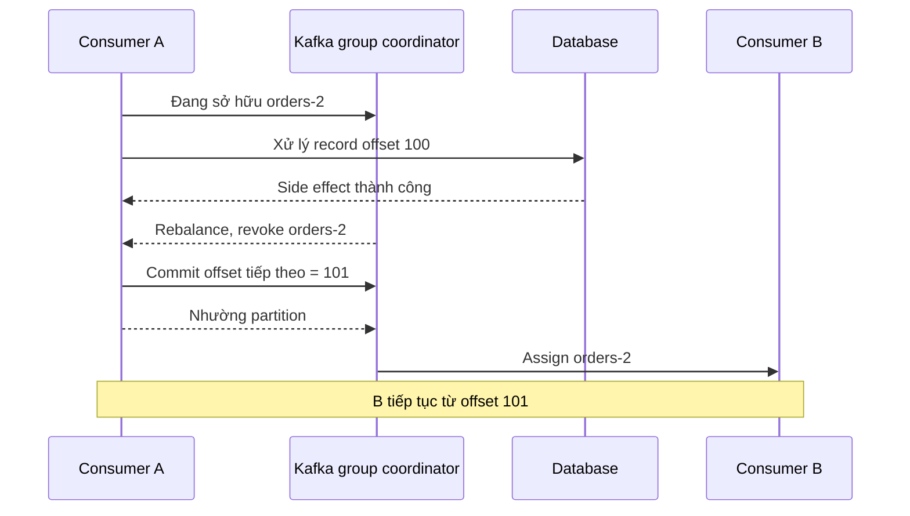
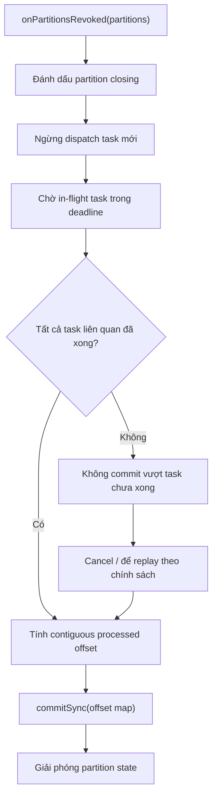

# Hoàn tất công việc và commit an toàn trước khi mất partition

Khi Kafka consumer group rebalance, một consumer có thể bị thu hồi partition đang xử lý và partition đó được giao cho consumer khác. Nếu ứng dụng đã tạo side effect nhưng chưa commit offset, consumer mới có thể đọc lại record. Nếu ứng dụng commit offset trước khi side effect hoàn tất, record có thể bị bỏ qua. Vì vậy, consumer cần một quy trình bàn giao rõ ràng: ngừng nhận thêm việc cho partition sắp mất, hoàn tất phần công việc có thể hoàn tất trong thời hạn cho phép, commit đúng offset liên tục đã xử lý thành công, rồi mới nhường quyền sở hữu.

Đây là một phần quan trọng của delivery semantics **at-least-once**. Kafka quản lý assignment và offset của group, còn ứng dụng phải bảo đảm side effect có thể chịu được việc record được phát lại. Một callback rebalance không tự làm cho database transaction, HTTP request hoặc worker thread bên ngoài Kafka trở nên atomic.

## 1. Vì sao phải hoàn tất công việc trước khi mất partition?

Consumer group chia partition giữa các member. Trong lúc rebalance, assignment cũ được thu hồi và assignment mới được tạo. Consumer có thể nhận callback `onPartitionsRevoked()` trước khi partition được chuyển giao; trong một số tình huống, consumer có thể nhận `onPartitionsLost()` khi partition đã mất quyền sở hữu.

Giả sử consumer A đang xử lý partition `orders-2`:

1. A đọc record offset 100.
2. A cập nhật database thành công.
3. A chưa commit offset 101.
4. Rebalance xảy ra và partition được giao cho consumer B.
5. B bắt đầu từ offset đã commit trước đó và đọc lại record offset 100.

Nếu thao tác database không idempotent, đơn hàng có thể bị cập nhật hai lần hoặc phát sinh side effect trùng. Ngược lại, nếu A commit offset 101 trước khi cập nhật database, rồi bị dừng giữa hai bước, B bắt đầu từ 101 và record 100 không được xử lý lại. Đây là nguy cơ mất xử lý do commit quá sớm.



Nếu A không kịp commit trước khi nhường partition, B có thể đọc lại offset 100. Đó là hành vi at-least-once bình thường; ứng dụng cần idempotency để xử lý an toàn.

## 2. Phân biệt revoke và lost

Kafka client cung cấp `ConsumerRebalanceListener` để ứng dụng tham gia quá trình bàn giao partition. Hai callback quan trọng nhất là `onPartitionsRevoked()` và `onPartitionsLost()`.

| Callback | Trạng thái ownership | Việc nên làm |
|---|---|---|
| `onPartitionsRevoked(partitions)` | Partition đang được thu hồi; consumer còn cơ hội thực hiện bước bàn giao | Ngừng dispatch việc mới cho các partition này, chờ công việc đang chạy trong giới hạn, commit offset an toàn, giải phóng state theo partition |
| `onPartitionsLost(partitions)` | Partition đã mất; member khác có thể đã được quyền xử lý | Không commit offset của partition đã mất; dừng/cancel worker cũ, xóa state local và để member mới tiếp tục từ committed offset |
| `onPartitionsAssigned(partitions)` | Consumer được giao partition | Khởi tạo state/worker cần thiết và tiếp tục từ vị trí consumer được phép đọc |

`onPartitionsLost()` được hỗ trợ trong các phiên bản Kafka client mới hơn (từ dòng 2.4). Với client cũ chưa có callback này, cần hiểu giới hạn API và dựa vào lỗi commit/ownership để tránh giả định rằng partition vẫn thuộc consumer.

**Không commit trong `onPartitionsLost()`.** Khi callback này chạy, consumer không còn bảo đảm quyền sở hữu partition. Commit từ member cũ có thể thất bại hoặc ghi tiến độ không phù hợp với member mới. Hãy bỏ state chưa commit và chấp nhận replay từ offset đã lưu trước đó.

Trong `onPartitionsRevoked()`, commit đồng bộ là lựa chọn dễ kiểm soát vì callback cần kết thúc bước bàn giao trước khi consumer nhường partition. Callback chạy trong tiến trình `poll()`, vì vậy thời gian drain và commit cũng góp vào khoảng thời gian giữa hai lần poll; nếu chờ quá lâu, consumer có thể vượt `max.poll.interval.ms`. Không chờ vô hạn một dịch vụ ngoài Kafka.

## 3. Offset commit là vị trí tiếp theo cần đọc

Offset commit lưu vị trí tiếp theo mà consumer group sẽ đọc, không phải offset cuối cùng đã xử lý. Nếu record offset 100 đã xử lý thành công, offset cần commit là 101.

```java
TopicPartition partition = new TopicPartition("orders", 2);
OffsetAndMetadata nextOffset = new OffsetAndMetadata(101L);

consumer.commitSync(Map.of(partition, nextOffset));
```

Khi commit nhiều partition, mỗi partition có offset tiến độ riêng. Không dùng một offset chung cho toàn topic hoặc toàn group.

Với log compaction, offset có thể có khoảng trống do record cũ bị loại khỏi log. Khoảng trống không có nghĩa consumer phải chờ một offset bị xóa; commit vẫn dùng vị trí tiếp theo sau record đã xử lý theo offset log.

### Commit tiến độ liên tục, không commit vượt qua record chưa xong

Giả sử partition có các record offset 10, 11, 12. Nếu ứng dụng xử lý thành công 10 và 12 nhưng 11 vẫn đang chạy, không được commit 13. Offset 13 sẽ khiến group bỏ qua record 11 khi khởi động lại.

Trong xử lý song song, ứng dụng phải duy trì watermark hoàn tất liên tục theo từng partition. Chỉ khi mọi record trước một vị trí đã hoàn tất, watermark mới được tiến lên. Cần phân biệt:

- **Consumer position:** vị trí consumer đã đọc/đưa ra từ `poll()`.
- **Processed position:** vị trí tiếp theo sau record đã xử lý thành công liên tục.
- **Committed position:** vị trí đã được group coordinator lưu thành công.

Ba vị trí này có thể khác nhau. Chỉ `processed position` mới phù hợp làm offset commit cho mô hình xử lý thủ công; `committed position` chỉ được cập nhật sau khi broker xác nhận commit thành công.

## 4. `commitSync()` và `commitAsync()` trước rebalance

`commitSync()` chờ kết quả commit và báo lỗi nếu không thể hoàn tất. Trong callback revoke, nó thường dễ reasoning hơn vì ứng dụng cần biết việc commit cuối cùng đã thành công hay chưa trước khi kết thúc bàn giao.

`commitAsync()` trả về ngay và nhận kết quả qua callback. Nó hữu ích cho commit định kỳ không muốn chặn poll loop, nhưng có một số rủi ro khi rebalance:

- Callback lỗi có thể đến sau khi partition đã được thu hồi.
- Kafka client gửi các commit async theo thứ tự gọi trên cùng consumer, nhưng callback có thể đến muộn so với luồng nghiệp vụ.
- Không được xem việc gọi `commitAsync()` là bằng chứng offset đã lưu.
- Nếu callback tự retry một offset cũ sau khi commit mới hơn đã thành công, ứng dụng có thể làm lùi tiến độ nếu không kiểm soát thứ tự.

Một chiến lược thường dùng là commit async trong lúc xử lý bình thường nếu có nhu cầu throughput, nhưng dùng `commitSync()` với offset an toàn trong `onPartitionsRevoked()`. Cần kiểm tra semantics và API version của Kafka client đang dùng; không trộn callback retry cũ với commit mới hơn một cách thiếu kiểm soát.

## 5. Theo dõi offset đã xử lý theo từng partition

Với xử lý đồng bộ, có thể ghi nhận offset tiếp theo sau mỗi record thành công. Khi cần commit, chỉ tạo map cho những partition có tiến độ mới.

Ví dụ helper cập nhật tiến độ trong một lớp theo dõi:

```java
final class ProcessedOffsetTracker {
    private final Map<TopicPartition, OffsetAndMetadata> processedOffsets =
            new HashMap<>();

    void processRecord(ConsumerRecord<String, String> record) {
        handleBusiness(record); // Chỉ trở về khi side effect thành công.

        TopicPartition tp = new TopicPartition(record.topic(), record.partition());
        processedOffsets.put(tp, new OffsetAndMetadata(record.offset() + 1));
    }

    private void handleBusiness(ConsumerRecord<String, String> record) {
        // Thực hiện side effect; ném exception nếu nghiệp vụ thất bại.
    }
}
```

Nếu `handleBusiness()` ném lỗi, map không được cập nhật cho record đó. Ứng dụng không được commit vượt qua record lỗi. Với consumer xử lý đồng bộ, thứ tự record trong mỗi partition được giữ khi lặp qua batch; vì vậy offset tiếp theo sau record cuối cùng xử lý thành công là một watermark an toàn cho partition đó.

Khi xử lý song song, đoạn helper trên chưa đủ: hai worker có thể hoàn tất không theo thứ tự. Khi đó phải lưu trạng thái hoàn tất của từng offset và chỉ tiến watermark qua chuỗi record liên tục không còn gap.

## 6. Gắn ConsumerRebalanceListener và commit phần partition bị thu hồi

Khi subscribe, truyền listener để xử lý các callback. Ví dụ dưới đây minh họa consumer xử lý đồng bộ, giữ offset tiếp theo đã xử lý thành công trong map và chỉ commit các partition liên quan khi revoke.

```java
Map<TopicPartition, OffsetAndMetadata> processedOffsets = new HashMap<>();

ConsumerRebalanceListener listener = new ConsumerRebalanceListener() {
    @Override
    public void onPartitionsRevoked(Collection<TopicPartition> partitions) {
        Map<TopicPartition, OffsetAndMetadata> offsetsToCommit = new HashMap<>();

        for (TopicPartition partition : partitions) {
            OffsetAndMetadata next = processedOffsets.get(partition);
            if (next != null) {
                offsetsToCommit.put(partition, next);
            }
        }

        if (!offsetsToCommit.isEmpty()) {
            try {
                consumer.commitSync(offsetsToCommit, Duration.ofSeconds(5));
            } catch (CommitFailedException e) {
                // Không được coi offset là đã commit; member mới sẽ replay phần chưa lưu.
                logger.warn("Commit trước revoke thất bại: {}", offsetsToCommit, e);
            }
        }

        // Sau callback, consumer không còn sở hữu các partition này.
        partitions.forEach(processedOffsets::remove);
    }

    @Override
    public void onPartitionsAssigned(Collection<TopicPartition> partitions) {
        logger.info("Partitions assigned: {}", partitions);
    }

    @Override
    public void onPartitionsLost(Collection<TopicPartition> partitions) {
        // Ownership đã mất: tuyệt đối không commit từ member cũ.
        partitions.forEach(processedOffsets::remove);
    }
};

consumer.subscribe(List.of("orders"), listener);
```

Đoạn mã là phần tích hợp listener; `consumer` và `logger` được tạo ở lớp quản lý consumer. Với Kafka client cũ chưa hỗ trợ `onPartitionsLost()`, bỏ override này và thiết kế tương thích với API của phiên bản đang dùng.

Trong callback revoke, chỉ commit map offset của các partition sắp bị thu hồi. Không dùng `consumer.commitSync()` không tham số nếu ứng dụng có xử lý bất đồng bộ hoặc quản lý offset riêng, vì vị trí consumer có thể đã vượt xa phần nghiệp vụ thực sự hoàn tất.

Nếu commit thất bại, không được ghi nhận tiến độ là đã lưu. Sau khi partition chuyển sang member mới, record sau committed offset cũ có thể được phát lại. Side effect cần idempotent để trường hợp này không gây sai lệch dữ liệu.

## 7. Quy trình bàn giao khi dùng worker pool

Một consumer thread có thể giao record cho worker pool để xử lý song song. Khi đó, rebalance phức tạp hơn vì partition có thể đang có nhiều task chạy ở các worker.

Khi nhận `onPartitionsRevoked(partitions)`, quy trình nên là:

1. Đánh dấu các partition bị thu hồi là **closing** để poll loop không dispatch thêm record của chúng.
2. Tạm dừng partition hoặc ngừng đưa record mới vào worker queue theo cơ chế quản lý hiện tại.
3. Chờ các task đang chạy của những partition đó hoàn tất trong deadline ngắn, có giới hạn.
4. Cập nhật watermark offset liên tục đã hoàn tất theo từng partition.
5. Commit đúng các watermark này bằng `commitSync(Map, Duration)`.
6. Giải phóng state, queue và ownership local của partition.

Nếu deadline hết mà task chưa xong, không commit vượt qua task đang chạy. Có thể hủy task nếu downstream hỗ trợ cancellation an toàn; nếu không, để record được replay và bảo đảm side effect idempotent. Callback không nên chờ vô hạn vì nó làm kéo dài rebalance và có thể gây thêm timeout.



Một partition có thể có nhiều record đã hoàn tất không liên tục. Ví dụ offset 20 và 22 đã xong nhưng 21 còn chạy; watermark an toàn vẫn chỉ là 21, tức vị trí tiếp theo sau offset 20. Chỉ khi 21 hoàn tất mới có thể tiến watermark qua 22.

### Giữ thứ tự và watermark liên tục

Nếu nghiệp vụ yêu cầu ordering theo partition, worker pool cần một trong các cơ chế:

- Chỉ cho phép một task đang chạy tại một thời điểm trên mỗi partition.
- Chia worker theo key/partition để các record liên quan được xử lý tuần tự.
- Duy trì completion tracker có thể tìm offset đầu tiên chưa hoàn tất và không commit vượt qua nó.

Không nên chỉ lấy `max(offset)` của các task hoàn tất. Giá trị lớn nhất không đại diện cho một chuỗi đã xử lý liên tục.

## 8. Phân biệt cooperative và eager rebalance

Với eager rebalance, group có thể thu hồi toàn bộ assignment hiện tại rồi phân phối lại. Callback revoke có thể nhận nhiều hoặc toàn bộ partition mà consumer đang sở hữu.

Với cooperative (incremental) rebalance, chỉ những partition cần chuyển mới bị thu hồi; các partition không đổi có thể tiếp tục được giữ. Điều này giảm thời gian dừng toàn bộ consumer group, nhưng ứng dụng vẫn phải xử lý chính xác tập `partitions` được truyền vào callback.

Trong cả hai chế độ:

- Chỉ dừng worker và commit state của partition thực sự bị revoke.
- Không xóa state của partition vẫn còn assignment.
- Không giả định thứ tự callback hoặc số partition revoke cố định.
- Giữ callback ngắn và idempotent để có thể xử lý nhiều lần bàn giao.

Cooperative rebalance không loại bỏ nhu cầu commit an toàn; nó chỉ giảm phạm vi partition phải dừng trong một lần chuyển giao.

## 9. Ví dụ poll loop với commit sau xử lý

Một vòng lặp tối giản có thể cập nhật offset sau khi từng record được xử lý thành công và commit các watermark đã biết:

```java
while (running) {
    ConsumerRecords<String, String> records =
            consumer.poll(Duration.ofMillis(500));

    for (ConsumerRecord<String, String> record : records) {
        handleBusiness(record);

        TopicPartition tp = new TopicPartition(record.topic(), record.partition());
        processedOffsets.put(tp, new OffsetAndMetadata(record.offset() + 1));
    }

    if (!processedOffsets.isEmpty()) {
        Map<TopicPartition, OffsetAndMetadata> snapshot =
                new HashMap<>(processedOffsets);
        consumer.commitSync(snapshot, Duration.ofSeconds(5));
        snapshot.keySet().forEach(processedOffsets::remove);
    }
}
```

Đây là ví dụ cho xử lý đồng bộ, một thread sở hữu consumer và không có worker bất đồng bộ. Nếu `handleBusiness()` ném lỗi, vòng lặp dừng trước khi commit; các record chưa commit có thể được đọc lại. Ứng dụng thực tế cần xử lý exception ở cấp service, ghi log/metric và quyết định retry hoặc dừng.

Trong một implementation production, cần phối hợp logic commit thường kỳ với callback revoke để không có hai nơi cùng sửa offset map một cách không nhất quán. Vì callback chạy trong poll thread, có thể dùng chung state local nếu tất cả thao tác consumer và offset tracker đều được điều khiển tuần tự bởi thread này.

## 10. Side effect bên ngoài Kafka và idempotency

Commit offset Kafka và ghi database là hai thao tác riêng. Không có transaction mặc định bao trùm cả hai hệ thống. Có hai thứ tự cơ bản:

| Thứ tự | Sự cố có thể xảy ra | Hệ quả |
|---|---|---|
| Commit offset rồi ghi database | Process chết sau commit nhưng trước DB write | Record bị bỏ qua khi đọc lại; side effect chưa xảy ra |
| Ghi database rồi commit offset | Process chết sau DB write nhưng trước commit | Record được đọc lại; DB write có thể lặp |

Với consumer thông thường, lựa chọn thứ hai thường được dùng để đạt at-least-once, kết hợp idempotency ở database. Ví dụ, dùng `eventId` làm unique key, upsert theo aggregate version hoặc lưu inbox table để nhận diện event đã xử lý.

Nếu consumer ghi output trở lại Kafka và cần atomicity giữa output records với offset input, có thể dùng Kafka transaction và `sendOffsetsToTransaction()` theo API tương ứng. Transaction Kafka không tự bao trùm database hay HTTP API bên ngoài. Với database, cân nhắc inbox/outbox, unique constraint, transaction local và quy trình đối soát.

## 11. Các lỗi thường gặp khi bàn giao partition

**Commit toàn bộ position hiện tại.** Consumer position có thể đã vượt qua record mà worker chưa xử lý xong. Hãy commit offset watermark của nghiệp vụ, không mặc định commit position là an toàn.

**Dùng `commitAsync()` rồi lập tức nhường partition.** Lệnh async chưa chắc đã hoàn tất. Dùng commit đồng bộ trong revoke nếu cần biết kết quả cuối trước khi kết thúc callback.

**Commit trong `onPartitionsLost()`.** Partition đã mất ownership; không cố ghi offset từ member cũ.

**Chờ worker vô hạn trong callback.** Rebalance kéo dài, member có thể vượt timeout và group tiếp tục churn. Dùng deadline và chấp nhận replay khi không kịp hoàn tất.

**Lấy offset lớn nhất của worker đã xong.** Có thể bỏ qua record phía trước còn đang chạy. Dùng contiguous watermark theo từng partition.

**Không dừng worker cũ sau revoke.** Worker có thể tiếp tục ghi database sau khi member mới bắt đầu xử lý cùng record. Cần cancel/bàn giao worker, fencing hoặc idempotency ở hệ thống đích.

**Cho rằng rebalance luôn revoke mọi partition.** Với cooperative rebalance, chỉ một phần assignment bị thu hồi; giữ nguyên state của partition vẫn được sở hữu.

## 12. Theo dõi và chẩn đoán

Các metric và log hữu ích:

| Chỉ số | Ý nghĩa |
|---|---|
| Rebalance count/rate | Group có rebalance quá thường xuyên không |
| Rebalance duration | Callback và quá trình chuyển assignment kéo dài bao lâu |
| Commit latency/failure | Commit có bị chậm hoặc thất bại trong lúc revoke không |
| Consumer lag theo partition | Partition nào đang tụt tiến độ |
| Processing in-flight count | Còn bao nhiêu task đang chạy khi nhận revoke |
| Oldest in-flight task age | Task nào đang giữ watermark không tiến lên |
| Duplicated event/idempotency conflict | Replay có tạo side effect trùng hay không |
| Lost partition callback count | Consumer có mất ownership trước khi hoàn tất revoke không |

Log nên chứa `group.id`, `client.id`, topic, partition, offset, event ID, callback type và thời gian xử lý. Tránh log toàn bộ payload nếu chứa dữ liệu nhạy cảm.

Khi rebalance thường xuyên, kiểm tra `max.poll.interval.ms`, thời gian xử lý batch, GC pause, downstream latency, worker queue và group membership. Khi commit revoke thất bại, kiểm tra coordinator, request timeout, assignment epoch và log group coordinator; đừng tự retry một offset cũ sau khi partition đã chuyển sang member khác.

## 13. Checklist triển khai

- [ ] `enable.auto.commit=false` khi ứng dụng tự quản lý commit.
- [ ] Offset commit là vị trí tiếp theo cần đọc và được tính riêng cho từng partition.
- [ ] Chỉ commit các record đã xử lý thành công liên tục; không commit vượt task còn chạy.
- [ ] `onPartitionsRevoked()` ngừng dispatch, drain task có deadline và commit offset an toàn.
- [ ] `onPartitionsLost()` chỉ dọn state/cancel worker; không commit từ member đã mất partition.
- [ ] `onPartitionsAssigned()` khởi tạo state cho partition mới mà không ảnh hưởng partition đang giữ.
- [ ] Worker cũ không tiếp tục side effect sau khi partition được chuyển giao; có idempotency/fencing phù hợp.
- [ ] Callback rebalance ngắn, không chờ vô hạn và có log/metric.
- [ ] Commit thất bại được xem là chưa lưu; record có thể replay.
- [ ] Cooperative rebalance chỉ dọn state của partition thực sự bị revoke.
- [ ] Có kiểm thử rebalance khi worker đang xử lý, commit timeout và process bị dừng.

Hoàn tất công việc và commit an toàn trước khi mất partition là sự phối hợp giữa poll thread, worker, offset tracker và rebalance callback. Hãy ngừng nhận việc mới cho partition bị thu hồi, chờ task đang chạy trong giới hạn, commit watermark liên tục đã xử lý thành công bằng `commitSync()` và chỉ giải phóng state sau khi bàn giao. Nếu partition đã mất ownership, không commit từ member cũ; để record chưa commit được phát lại và bảo vệ side effect bằng idempotency.
