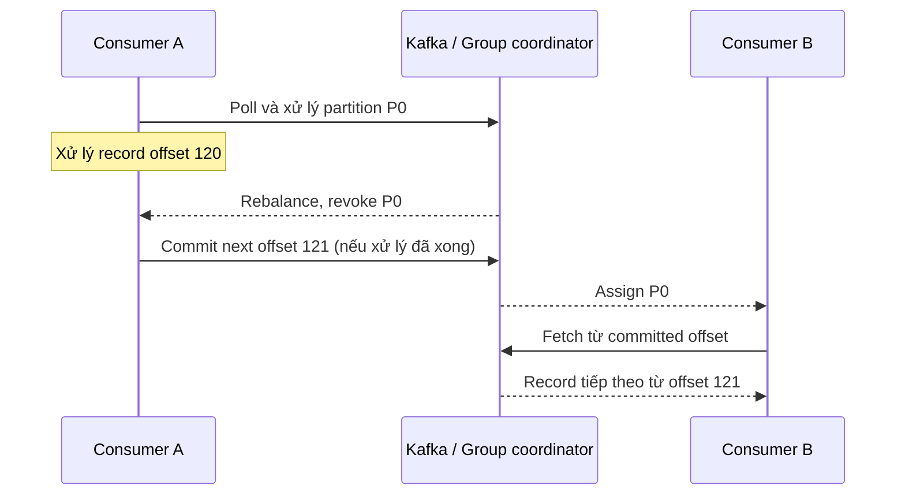
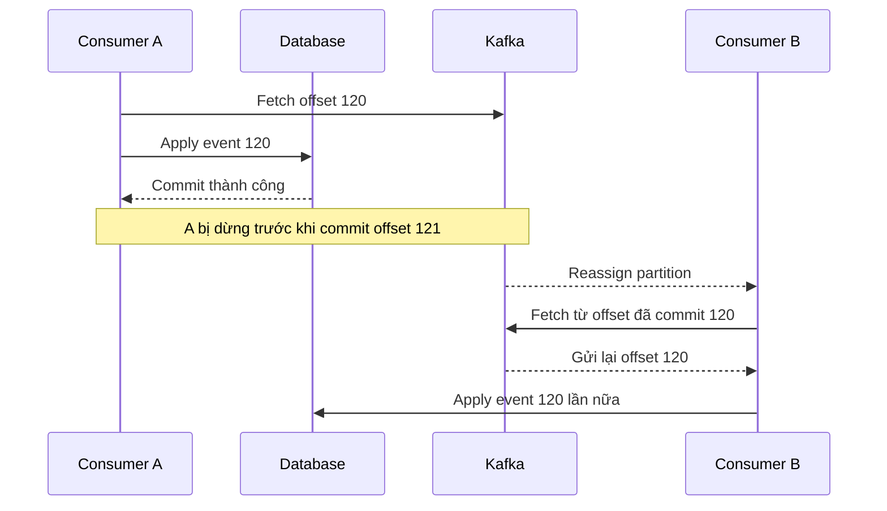

# Kiểm chứng thứ tự và bản ghi trùng trong thời gian rebalance

Kafka giữ thứ tự record trong từng partition theo offset. Khi consumer group rebalance, quyền sở hữu partition được chuyển từ consumer này sang consumer khác; consumer mới tiếp tục đọc từ offset đã commit gần nhất. Nếu consumer cũ đã thực hiện tác động nghiệp vụ nhưng chưa commit offset trước khi mất partition, consumer mới có thể đọc lại record đó. Đây là nguyên nhân phổ biến tạo bản ghi xử lý trùng trong mô hình at-least-once.

Rebalance tự nó không đảo thứ tự record trong log partition. Hiện tượng nhìn thấy record hoàn tất sai thứ tự thường xuất phát từ việc ứng dụng xử lý bất đồng bộ nhiều record cùng partition, để tác vụ cũ tiếp tục chạy sau khi partition đã bị revoke, hoặc commit offset vượt qua record chưa xử lý xong. Vì vậy, khi kiểm chứng cần theo dõi đồng thời `eventId`, sequence nghiệp vụ, partition, offset, consumer ID, thời điểm xử lý và committed offset.

Bài này xây dựng một kịch bản Java/Kafka để tạo rebalance có chủ đích, ghi log vòng đời partition, phát hiện duplicate bằng `eventId`, kiểm tra ordering theo key và phân tích cửa sổ giữa xử lý nghiệp vụ với commit offset. Nội dung áp dụng cho hệ thống KAFKA dùng Java/Spring Kafka, nơi consumer cần duy trì tính đúng đắn khi scale in/out, restart hoặc gặp lỗi đột ngột.

## 1. Rebalance ảnh hưởng đến quyền sở hữu partition

Một consumer group chia các partition của topic cho các consumer member. Trong cùng một group, tại một thời điểm, một partition chỉ được gán cho tối đa một member theo assignment hiện hành. Khi thành viên tham gia/rời group, subscription thay đổi hoặc coordinator phát hiện member không còn hoạt động, group có thể rebalance để phân phối lại partition.

Quá trình tổng quát:

1. Group coordinator phát hiện cần thay đổi assignment.
2. Consumer cũ nhận thông báo revoke đối với partition sẽ được thu hồi (phạm vi revoke phụ thuộc assignor).
3. Consumer cũ nên hoàn tất công việc đang xử lý an toàn và commit offset của những record đã xử lý thành công.
4. Group tạo assignment mới và thông báo partition được giao cho consumer mới.
5. Consumer mới đọc tiếp từ committed offset của group; nếu record đã xử lý nhưng offset chưa commit, record có thể được giao lại.



Nếu bước commit không xảy ra, Consumer B có thể nhận lại offset 120. Điều này không có nghĩa Kafka đã ghi hai bản sao của record trong log; đây là một lần giao hoặc xử lý lại cùng một record. Phân biệt `duplicate record in Kafka log` với `duplicate processing` là điều quan trọng khi điều tra.

## 2. Ordering được bảo đảm ở phạm vi nào?

Kafka bảo đảm thứ tự đọc trong một partition theo offset. Mỗi partition là một log có thứ tự. Kafka không cung cấp thứ tự tổng thể giữa các partition của cùng topic.

| Phạm vi | Bảo đảm / giới hạn |
|---|---|
| Một partition | Record được lưu và fetch theo thứ tự offset |
| Cùng key với partitioner ổn định | Thường được định tuyến vào cùng partition, do đó có thể giữ thứ tự theo key |
| Nhiều key ở nhiều partition | Không có thứ tự tổng thể giữa các partition |
| Nhiều consumer xử lý song song | Thứ tự hoàn tất tác vụ có thể khác thứ tự record được poll nếu ứng dụng tự tạo concurrency |
| Rebalance | Không tự đảo thứ tự log, nhưng có thể giao lại record chưa commit và làm hai tác vụ cũ/mới chồng lấn nếu ứng dụng không dừng in-flight work |

Ví dụ producer gửi các thay đổi của một đơn hàng với key `orderId=ORD-1001`:

| Sequence | Key | Value | Partition |
|---:|---|---|---:|
| 1 | `ORD-1001` | `CREATED` | 2 |
| 2 | `ORD-1001` | `PAID` | 2 |
| 3 | `ORD-1001` | `PACKED` | 2 |
| 4 | `ORD-1001` | `SHIPPED` | 2 |

Nếu producer dùng cùng key và partition mapping không thay đổi, các event này được ghi vào cùng partition. Consumer có thể xác nhận thứ tự bằng offset và sequence. Nếu producer không đặt key hoặc dùng key thay đổi, event của cùng đơn hàng có thể đi đến partition khác nhau và không có ordering liên partition.

Lưu ý khi tăng số partition: với partitioner mặc định, thay đổi số partition có thể làm key được định tuyến đến partition khác trong các lần gửi sau. Nếu cần ordering dài hạn theo thực thể qua các lần thay đổi topology, phải có kế hoạch partitioning và migration phù hợp, không chỉ dựa vào key một cách mặc định.

## 3. Phân biệt duplicate do rebalance với duplicate do producer

Một `eventId` xuất hiện nhiều lần trong log Kafka và một `eventId` được consumer xử lý nhiều lần là hai hiện tượng khác nhau.

| Hiện tượng | Nguyên nhân có thể có | Cách xác minh |
|---|---|---|
| Cùng `eventId` có nhiều offset trong log | Producer gửi lại ở tầng ứng dụng, retry không idempotent hoặc upstream phát lại | Đọc log theo partition, so sánh offset và timestamp của eventId |
| Cùng `eventId`, cùng partition/offset được log xử lý nhiều lần | Consumer đọc lại sau khi offset chưa commit hoặc log xử lý bị ghi lặp | So sánh log consumer với committed offset và các mốc revoke/assign |
| Hai consumer ghi nhận cùng event gần nhau | Consumer cũ tiếp tục xử lý async sau revoke trong khi consumer mới đọc lại từ committed offset | Log consumer ID, generation/assignment, task start/end và offset commit |
| Event hoàn tất theo sequence 2 rồi sequence 1 | Xử lý song song không tuần tự trong cùng partition hoặc tác vụ cũ chồng lấn sau rebalance | So sánh thứ tự poll, start/end processing và sequence theo key |

Producer idempotence (`enable.idempotence=true`) giúp Kafka nhận biết retry protocol của cùng producer session để tránh duplicate do retry ở tầng producer trong các điều kiện được hỗ trợ. Nó không ngăn consumer xử lý lại record khi offset chưa được commit. Consumer vẫn cần commit đúng thời điểm và xử lý nghiệp vụ idempotent nếu không thể giao dịch nguyên tử giữa Kafka offset và hệ thống ngoài.

## 4. Tạo dữ liệu kiểm chứng có eventId và sequence

Mỗi event cần có ba thông tin:

- `eventId`: UUID duy nhất cho từng lần phát sinh event, dùng phát hiện cùng event được xử lý nhiều lần.
- `orderId`: key ổn định, dùng giữ các event của cùng đơn hàng trong cùng partition.
- `sequence`: số tăng dần theo từng `orderId`, dùng phát hiện sai thứ tự nghiệp vụ.

Mô hình event:

```java
package com.example.kafkalab.event;

import java.time.Instant;

public record OrderLifecycleEvent(
        String eventId,
        String orderId,
        long sequence,
        String status,
        Instant occurredAt
) {
}
```

Producer dùng `orderId` làm key và bật idempotence:

```java
import com.example.kafkalab.event.OrderLifecycleEvent;
import com.fasterxml.jackson.databind.ObjectMapper;
import com.fasterxml.jackson.databind.SerializationFeature;
import com.fasterxml.jackson.datatype.jsr310.JavaTimeModule;
import org.apache.kafka.clients.producer.KafkaProducer;
import org.apache.kafka.clients.producer.ProducerConfig;
import org.apache.kafka.clients.producer.ProducerRecord;
import org.apache.kafka.common.serialization.StringSerializer;

import java.time.Instant;
import java.util.Properties;
import java.util.UUID;

Properties properties = new Properties();
properties.put(ProducerConfig.BOOTSTRAP_SERVERS_CONFIG,
        "localhost:9092");
properties.put(ProducerConfig.KEY_SERIALIZER_CLASS_CONFIG,
        StringSerializer.class.getName());
properties.put(ProducerConfig.VALUE_SERIALIZER_CLASS_CONFIG,
        StringSerializer.class.getName());
properties.put(ProducerConfig.ACKS_CONFIG, "all");
properties.put(ProducerConfig.ENABLE_IDEMPOTENCE_CONFIG, "true");

KafkaProducer<String, String> producer = new KafkaProducer<>(properties);
ObjectMapper mapper = new ObjectMapper()
        .registerModule(new JavaTimeModule())
        .disable(SerializationFeature.WRITE_DATES_AS_TIMESTAMPS);

for (long sequence = 1; sequence <= 100; sequence++) {
    OrderLifecycleEvent event = new OrderLifecycleEvent(
            UUID.randomUUID().toString(),
            "ORD-1001",
            sequence,
            "STEP-" + sequence,
            Instant.now());

    String json = mapper.writeValueAsString(event);
    ProducerRecord<String, String> record =
            new ProducerRecord<>("order-lifecycle-lab", event.orderId(), json);

    producer.send(record, (metadata, exception) -> {
        if (exception != null) {
            System.err.printf("send failed eventId=%s error=%s%n",
                    event.eventId(), exception.getMessage());
        } else {
            System.out.printf("sent eventId=%s key=%s partition=%d offset=%d%n",
                    event.eventId(), event.orderId(), metadata.partition(), metadata.offset());
        }
    });
}

producer.flush();
producer.close();
```

Đoạn mã cần các import tương ứng từ `java.util`, `java.time`, Jackson và Kafka Producer API. Trong project thực tế, quản lý producer bằng try-with-resources hoặc lifecycle của ứng dụng; ví dụ trên gọi `flush()` trước khi đóng để chờ các lần gửi đã xếp hàng được hoàn tất.

Với thử nghiệm nhiều đơn hàng, tạo một bộ đếm sequence riêng cho mỗi `orderId`. Không dùng một sequence toàn cục rồi so sánh giữa các partition, vì thứ tự tổng thể giữa partition không được Kafka bảo đảm.

## 5. Chuẩn bị topic và consumer group thử nghiệm

Tạo topic ba partition, replication factor phù hợp với số broker lab:

```bash
kafka-topics.sh \
  --bootstrap-server localhost:9092 \
  --create \
  --topic order-lifecycle-lab \
  --partitions 3 \
  --replication-factor 1
```

Nếu cluster có ít nhất ba broker và cần kiểm chứng replication cùng rebalance, có thể dùng replication factor ba. Với lab một broker, replication factor một chỉ đủ kiểm tra consumer group và ordering, không kiểm tra broker failure.

Consumer dùng chung group ID, ví dụ `order-lifecycle-audit`. Bắt đầu với một consumer để nó nhận cả ba partition. Sau đó khởi động consumer thứ hai với cùng group ID để kích hoạt rebalance và phân phối lại partition. Dừng consumer thứ hai rồi khởi động lại cũng tạo các lần chuyển assignment khác nhau.

Kiểm tra assignment và trạng thái group:

```bash
kafka-consumer-groups.sh \
  --bootstrap-server localhost:9092 \
  --describe \
  --group order-lifecycle-audit
```

Lệnh cho biết member, client ID, partition assignment, current offset, log end offset và lag. Thực hiện lệnh trong khi hai consumer đang chạy và sau khi rebalance ổn định để đối chiếu member sở hữu từng partition.

## 6. Consumer Java ghi nhận revoke, assign và commit

Consumer mẫu xử lý record tuần tự trên consumer thread, tắt auto commit và lưu next offset sau mỗi record thành công. Khi partition bị revoke, consumer commit offset cuối cùng đã xử lý thành công của chính các partition đó. Khi partition đã bị mất quyền sở hữu (`onPartitionsLost`), consumer không cố commit offset cũ.

```java
package com.example.kafkalab.consumer;

import org.apache.kafka.clients.consumer.ConsumerConfig;
import org.apache.kafka.clients.consumer.ConsumerRebalanceListener;
import org.apache.kafka.clients.consumer.KafkaConsumer;
import org.apache.kafka.clients.consumer.ConsumerRecord;
import org.apache.kafka.clients.consumer.ConsumerRecords;
import org.apache.kafka.clients.consumer.OffsetAndMetadata;
import org.apache.kafka.common.TopicPartition;
import org.apache.kafka.common.errors.WakeupException;
import org.apache.kafka.common.serialization.StringDeserializer;
import com.example.kafkalab.event.OrderLifecycleEvent;
import com.fasterxml.jackson.databind.ObjectMapper;
import com.fasterxml.jackson.datatype.jsr310.JavaTimeModule;

import java.io.IOException;
import java.time.Duration;
import java.util.Collection;
import java.util.HashMap;
import java.util.List;
import java.util.Map;
import java.util.Properties;
import java.util.UUID;
import java.util.concurrent.atomic.AtomicBoolean;

public class RebalanceAuditConsumer {
    private static final String TOPIC = "order-lifecycle-lab";
    private static final ObjectMapper MAPPER =
            new ObjectMapper().registerModule(new JavaTimeModule());
    private final String consumerId = UUID.randomUUID().toString();
    private final Map<TopicPartition, OffsetAndMetadata> nextOffsets = new HashMap<>();

    public static void main(String[] args) throws Exception {
        new RebalanceAuditConsumer().run();
    }

    public void run() throws IOException {
        Properties properties = new Properties();
        properties.put(ConsumerConfig.BOOTSTRAP_SERVERS_CONFIG, "localhost:9092");
        properties.put(ConsumerConfig.GROUP_ID_CONFIG, "order-lifecycle-audit");
        properties.put(ConsumerConfig.CLIENT_ID_CONFIG, "audit-" + consumerId);
        properties.put(ConsumerConfig.KEY_DESERIALIZER_CLASS_CONFIG,
                StringDeserializer.class.getName());
        properties.put(ConsumerConfig.VALUE_DESERIALIZER_CLASS_CONFIG,
                StringDeserializer.class.getName());
        properties.put(ConsumerConfig.ENABLE_AUTO_COMMIT_CONFIG, "false");
        properties.put(ConsumerConfig.AUTO_OFFSET_RESET_CONFIG, "earliest");
        properties.put(ConsumerConfig.MAX_POLL_RECORDS_CONFIG, "20");
        properties.put(ConsumerConfig.MAX_POLL_INTERVAL_MS_CONFIG, "300000");

        AtomicBoolean running = new AtomicBoolean(true);
        KafkaConsumer<String, String> consumer = new KafkaConsumer<>(properties);
        Thread shutdownHook = new Thread(() -> {
            running.set(false);
            consumer.wakeup();
        }, "consumer-shutdown-" + consumerId);
        Runtime.getRuntime().addShutdownHook(shutdownHook);

        try (consumer) {
            consumer.subscribe(List.of(TOPIC), new ConsumerRebalanceListener() {
                @Override
                public void onPartitionsRevoked(Collection<TopicPartition> partitions) {
                    Map<TopicPartition, OffsetAndMetadata> offsets = new HashMap<>();
                    for (TopicPartition partition : partitions) {
                        OffsetAndMetadata next = nextOffsets.get(partition);
                        if (next != null) {
                            offsets.put(partition, next);
                        }
                    }

                    if (!offsets.isEmpty()) {
                        consumer.commitSync(offsets);
                        offsets.keySet().forEach(nextOffsets::remove);
                    }
                    System.out.printf("consumer=%s revoked=%s committed=%s%n",
                            consumerId, partitions, offsets);
                }

                @Override
                public void onPartitionsAssigned(Collection<TopicPartition> partitions) {
                    System.out.printf("consumer=%s assigned=%s%n",
                            consumerId, partitions);
                }

                @Override
                public void onPartitionsLost(Collection<TopicPartition> partitions) {
                    // Ownership is already lost: do not commit offsets for these partitions.
                    partitions.forEach(nextOffsets::remove);
                    System.out.printf("consumer=%s lost=%s%n", consumerId, partitions);
                }
            });

            try {
                while (running.get()) {
                    ConsumerRecords<String, String> records =
                            consumer.poll(Duration.ofMillis(250));

                    for (ConsumerRecord<String, String> record : records) {
                        processSynchronously(record, consumerId);

                        TopicPartition partition = new TopicPartition(
                                record.topic(), record.partition());
                        nextOffsets.put(partition,
                                new OffsetAndMetadata(record.offset() + 1));
                    }

                    if (!nextOffsets.isEmpty()) {
                        consumer.commitSync(new HashMap<>(nextOffsets));
                    }
                }
            } catch (WakeupException exception) {
                if (running.get()) {
                    throw exception;
                }
            }
        } finally {
            try {
                Runtime.getRuntime().removeShutdownHook(shutdownHook);
            } catch (IllegalStateException ignored) {
                // JVM shutdown has already started.
            }
        }
    }

    private static void processSynchronously(
            ConsumerRecord<String, String> record, String consumerId) throws IOException {
        OrderLifecycleEvent event = MAPPER.readValue(
                record.value(), OrderLifecycleEvent.class);
        long startedAt = System.currentTimeMillis();
        System.out.printf(
                "PROCESS_START consumer=%s eventId=%s orderId=%s sequence=%d topic=%s partition=%d offset=%d time=%d%n",
                consumerId, event.eventId(), event.orderId(), event.sequence(),
                record.topic(), record.partition(), record.offset(), startedAt);

        // Replace with a synchronous, idempotent business operation.
        // In the lab, perform the test side effect here, then delay before returning
        // to widen the window before the next poll/offset commit.
        try {
            Thread.sleep(200);
        } catch (InterruptedException exception) {
            Thread.currentThread().interrupt();
            throw new IllegalStateException("Processing interrupted", exception);
        }

        long completedAt = System.currentTimeMillis();
        System.out.printf(
                "PROCESS_DONE consumer=%s eventId=%s orderId=%s sequence=%d partition=%d offset=%d time=%d%n",
                consumerId, event.eventId(), event.orderId(), event.sequence(),
                record.partition(), record.offset(), completedAt);
    }
}
```

Ví dụ giả định xử lý nghiệp vụ đồng bộ trong consumer thread. `nextOffsets` chỉ được cập nhật sau khi xử lý thành công; offset commit là `record.offset() + 1` vì Kafka lưu vị trí kế tiếp cần đọc. Khi một partition bị revoke, callback chỉ commit các offset đã xử lý của partition đó. Với cooperative rebalance, callback có thể chỉ nhận một phần partition bị thu hồi, vì vậy không xóa trạng thái của những partition vẫn được giữ.

`onPartitionsLost` được gọi trong những tình huống consumer không còn bảo đảm quyền sở hữu partition. Khi đã mất quyền sở hữu, không nên cố commit trạng thái cũ. API này có trong các phiên bản Kafka client hiện đại; nếu dùng client cũ hơn, cần kiểm tra phiên bản và áp dụng callback phù hợp.

### 6.1. Ghi nhận rebalance bằng Spring Kafka

Với `@KafkaListener`, có thể gắn `ConsumerAwareRebalanceListener` vào listener container để ghi nhận các giai đoạn trước commit, sau commit, assign và lost. Ví dụ cấu hình listener container:

```java
import org.apache.kafka.clients.consumer.Consumer;
import org.apache.kafka.common.TopicPartition;
import org.springframework.context.annotation.Bean;
import org.springframework.context.annotation.Configuration;
import org.springframework.kafka.config.ConcurrentKafkaListenerContainerFactory;
import org.springframework.kafka.core.ConsumerFactory;
import org.springframework.kafka.listener.ConsumerAwareRebalanceListener;
import org.springframework.kafka.listener.ContainerProperties;

import java.util.Collection;

@Configuration
public class RebalanceListenerConfiguration {

    @Bean
    ConcurrentKafkaListenerContainerFactory<String, String> auditContainerFactory(
            ConsumerFactory<String, String> consumerFactory) {
        var factory = new ConcurrentKafkaListenerContainerFactory<String, String>();
        factory.setConsumerFactory(consumerFactory);
        factory.getContainerProperties().setAckMode(ContainerProperties.AckMode.RECORD);
        factory.getContainerProperties().setConsumerRebalanceListener(
                new ConsumerAwareRebalanceListener() {
                    @Override
                    public void onPartitionsRevokedBeforeCommit(
                            Consumer<?, ?> consumer,
                            Collection<TopicPartition> partitions) {
                        System.out.println("REVOKED_BEFORE_COMMIT " + partitions);
                    }

                    @Override
                    public void onPartitionsRevokedAfterCommit(
                            Consumer<?, ?> consumer,
                            Collection<TopicPartition> partitions) {
                        System.out.println("REVOKED_AFTER_COMMIT " + partitions);
                    }

                    @Override
                    public void onPartitionsAssigned(
                            Consumer<?, ?> consumer,
                            Collection<TopicPartition> partitions) {
                        System.out.println("ASSIGNED " + partitions);
                    }

                    @Override
                    public void onPartitionsLost(
                            Consumer<?, ?> consumer,
                            Collection<TopicPartition> partitions) {
                        System.out.println("LOST " + partitions);
                    }
                });
        return factory;
    }
}
```

Gắn factory vào listener:

```java
@KafkaListener(
        topics = "order-lifecycle-lab",
        groupId = "order-lifecycle-audit",
        containerFactory = "auditContainerFactory")
public void onMessage(String payload) {
    // Xử lý đồng bộ và idempotent theo eventId.
}
```

Với `AckMode.RECORD`, container xác nhận offset sau khi listener xử lý thành công từng record. `onPartitionsRevokedBeforeCommit` và `onPartitionsRevokedAfterCommit` giúp quan sát thời điểm trước/sau lần commit khi partition được thu hồi. Không cần tự commit lại trong callback nếu container đã quản lý acknowledgement; hãy cấu hình ack mode rõ ràng và xác minh hành vi với phiên bản Spring Kafka đang dùng. Dù dùng `RECORD`, crash sau side effect nhưng trước khi commit vẫn có thể tạo replay, vì vậy consumer vẫn cần idempotency.

Trong ứng dụng thật, nên xử lý `CommitFailedException` và lỗi khi commit trong callback theo chính sách vận hành. Không được tiếp tục giả định offset đã commit nếu commit thất bại. Consumer mới có thể đọc lại record chưa được xác nhận.

## 7. Vì sao xử lý xong nhưng chưa commit tạo duplicate?

Giả sử consumer A đọc record offset 120:

1. Consumer A gọi database và cập nhật đơn hàng thành `PAID`.
2. Database commit thành công.
3. Trước khi consumer A commit Kafka offset 121, tiến trình bị kill hoặc partition bị revoke.
4. Consumer B được gán partition và đọc từ committed offset gần nhất là 120.
5. Consumer B thực hiện lại cập nhật `PAID` cho cùng event.

Kafka đang cung cấp at-least-once: record chưa được commit có thể được giao lại. Nếu thao tác database không idempotent, ví dụ cộng tiền vào số dư mà không kiểm tra `eventId`, tác động nghiệp vụ có thể bị nhân đôi.



Nếu consumer commit offset 121 trước khi cập nhật database, sự cố ở khoảng giữa commit và database write có thể làm mất tác động nghiệp vụ: Kafka sẽ không giao lại record 120 dù database chưa được cập nhật. Vì vậy, với tác động ngoài Kafka, thứ tự thường là xử lý nghiệp vụ thành công rồi mới commit offset, kết hợp idempotency để chịu được replay.

## 8. Đo duplicate và ordering từ log

Để kiểm chứng, thu thập tối thiểu các trường:

| Trường | Mục đích |
|---|---|
| `eventId` | Nhận diện cùng một event được xử lý nhiều lần |
| `orderId` | Nhóm event thuộc cùng thực thể và key Kafka |
| `sequence` | Phát hiện sai thứ tự nghiệp vụ theo orderId |
| `topic`, `partition`, `offset` | Xác định vị trí record trong log |
| `consumerId` | Biết member nào đã xử lý record |
| `processStart`, `processEnd` | Nhận biết tác vụ cũ/mới có chồng lấn và thứ tự hoàn tất |
| `commitOffset` | Xác định vị trí đã được group xác nhận |
| `rebalanceEvent` | Liên kết revoke/assign/lost với thời điểm xử lý |

Các phép kiểm tra:

1. **Duplicate processing:** nhóm log theo `eventId`; nếu cùng eventId có nhiều lần `PROCESS_DONE`, consumer đã xử lý lặp.
2. **Duplicate trong log:** nhóm record Kafka theo `eventId`; nếu cùng eventId có nhiều offset, producer/upstream đã ghi nhiều record.
3. **Ordering trong partition:** sắp theo offset và kiểm tra sequence của cùng key tăng theo quy tắc nghiệp vụ.
4. **Ordering hoàn tất:** sắp theo `processEnd`; nếu sequence sau hoàn tất trước sequence trước, ứng dụng đã tạo xử lý song song hoặc tác vụ chồng lấn.
5. **Replay sau rebalance:** tìm eventId được xử lý bởi consumer A trước revoke và bởi consumer B sau assign, rồi so sánh offset commit tại thời điểm chuyển giao.
6. **Missing event:** so sánh tập eventId producer đã nhận ack thành công với tập eventId consumer đã xử lý sau khi lag về 0.

Không kết luận mất dữ liệu chỉ từ sequence bị nhảy. Producer có thể không phát một sequence, hoặc event bị gửi thất bại. Tập đối chiếu chuẩn phải là các eventId đã được producer xác nhận thành công, hoặc một manifest dữ liệu thử nghiệm đã biết trước.

## 9. Tạo rebalance có chủ đích trong lab

Chạy thử theo trình tự:

1. Tạo topic `order-lifecycle-lab` với ba partition và phát 100 event cho cùng `orderId=ORD-1001`, sequence từ 1 đến 100.
2. Khởi động Consumer A với group `order-lifecycle-audit`; xác nhận A nhận các partition và bắt đầu xử lý.
3. Tăng thời gian xử lý có kiểm soát, ví dụ 200 ms mỗi record, để dễ quan sát revoke/assign và consumer lag.
4. Trong khi A đang xử lý, khởi động Consumer B với cùng group ID. Quan sát callback `onPartitionsRevoked` và `onPartitionsAssigned`.
5. Dừng Consumer B một cách graceful, rồi khởi động lại. Quan sát các lần phân phối lại.
6. Lặp lại thử nghiệm bằng cách dừng cưỡng bức một consumer trong lab để mô phỏng mất tiến trình trước khi commit. Nếu chạy bằng Docker Compose, dùng `docker compose kill <consumer-service>`; nếu chạy tiến trình Java trực tiếp trên Windows, có thể dùng `Stop-Process -Id <pid> -Force`.
7. Đối chiếu eventId, sequence, offset, consumerId và committed offset sau khi group ổn định.

Để tạo cửa sổ duplicate có chủ đích, thêm một khoảng chờ chỉ trong lab sau khi tác động nghiệp vụ đã hoàn tất nhưng trước lần commit offset kế tiếp. Dừng consumer trong khoảng chờ này. Khi consumer khác nhận partition, record chưa commit sẽ được đọc lại. Không dùng kỹ thuật này trên hệ thống production.

Có thể theo dõi group trong lúc thử nghiệm:

```bash
kafka-consumer-groups.sh \
  --bootstrap-server localhost:9092 \
  --describe \
  --group order-lifecycle-audit
```

Sau khi mọi consumer đã ổn định, đợi consumer lag về 0 rồi xuất log xử lý để phân tích. Nếu dùng console consumer, nhớ dùng group ID riêng cho lần audit hoặc không thay đổi committed offset của group đang được thử nghiệm.

## 10. Eager và cooperative rebalance

Hai kiểu phân phối ảnh hưởng đến số partition bị thu hồi trong một lần rebalance:

| Kiểu | Hành vi | Tác động quan sát |
|---|---|---|
| Eager | Thu hồi toàn bộ assignment hiện tại rồi tạo assignment mới | Có thể tạo khoảng dừng rộng hơn vì nhiều partition được revoke cùng lúc |
| Cooperative/incremental | Chỉ thu hồi những partition cần chuyển; partition không đổi có thể tiếp tục được giữ | Giảm gián đoạn và lượng partition phải chuyển trong mỗi vòng |

Cooperative rebalance không loại bỏ khả năng replay hoặc duplicate. Partition được chuyển vẫn cần xử lý revoke, commit offset và assignment đúng cách. Ứng dụng cũng không nên giả định callback revoke luôn chứa toàn bộ partition; với incremental cooperative assignor, chỉ một tập con có thể được revoke ở một vòng.

Với Kafka client hỗ trợ, có thể cấu hình cooperative sticky assignor:

```java
properties.put(ConsumerConfig.PARTITION_ASSIGNMENT_STRATEGY_CONFIG,
        "org.apache.kafka.clients.consumer.CooperativeStickyAssignor");
```

Hãy xác nhận tất cả consumer trong group có cấu hình assignor tương thích trước khi triển khai. Thay đổi assignor cần được rollout theo kế hoạch để tránh các member không tương thích gây rebalance lặp.

Static membership qua `group.instance.id` có thể giảm rebalance khi instance restart ngắn hạn và quay lại với cùng identity. Tuy nhiên, nó không đảm bảo không có duplicate; member bị mất có thể giữ slot cho đến khi session timeout và tác động thay đổi tùy cấu hình. Không tái sử dụng cùng `group.instance.id` cho hai tiến trình chạy đồng thời.

## 11. Giữ thứ tự khi xử lý bất đồng bộ

Kafka giao record theo thứ tự trong partition, nhưng ứng dụng có thể phá thứ tự nếu gửi mỗi record vào worker pool không có cơ chế tuần tự. Ví dụ:

- Offset 10 bắt đầu xử lý và mất 2 giây.
- Offset 11 bắt đầu sau đó nhưng chỉ mất 100 ms.
- Worker hoàn tất offset 11 trước offset 10.

Thứ tự fetch vẫn là 10 rồi 11, nhưng thứ tự side effect là 11 rồi 10. Rebalance có thể làm tình huống phức tạp hơn nếu worker của consumer cũ tiếp tục chạy sau khi partition đã được giao cho consumer mới.

Các nguyên tắc:

- Nếu cần ordering nghiêm ngặt theo partition, xử lý tuần tự trên consumer thread hoặc dùng một hàng đợi/worker tuần tự cho mỗi partition.
- Nếu xử lý song song theo key, bảo đảm cùng key luôn đi qua cùng lane/worker và các event của key được xử lý theo thứ tự.
- Không commit offset vượt qua record chưa hoàn tất ở phía trước trong thứ tự của partition.
- Khi revoke, ngừng nhận việc mới cho partition, chờ hoặc hủy tác vụ in-flight theo timeout, rồi commit chỉ những record đã hoàn tất an toàn.
- Nếu không thể dừng side effect đã chạy ở worker cũ, dùng idempotency key và fencing/version check tại hệ thống đích để ngăn tác vụ stale ghi đè trạng thái mới.

Với worker pool, theo dõi từng record và chỉ tiến committed offset đến vị trí kế tiếp sau chuỗi record đã hoàn tất liên tục theo thứ tự giao. Không chỉ lấy offset lớn nhất đã xong: nếu offset 11 xong nhưng offset 10 còn chạy, commit 12 sẽ bỏ qua offset 10 khi khởi động lại. Khi log có khoảng trống offset do compaction hoặc control record, “liên tục” ở đây là thứ tự record được consumer giao, không phải mọi số nguyên offset đều phải tồn tại.

## 12. Idempotency để xử lý replay an toàn

Với tác động database, một mẫu phổ biến là lưu `eventId` trong bảng inbox có unique constraint cùng transaction với thay đổi nghiệp vụ:

```sql
CREATE TABLE processed_events (
    event_id VARCHAR(100) PRIMARY KEY,
    processed_at TIMESTAMP NOT NULL
);
```

Trong một transaction database:

1. Thử insert `eventId` vào `processed_events`.
2. Nếu insert thành công, thực hiện cập nhật nghiệp vụ và commit transaction.
3. Nếu unique constraint báo event đã tồn tại, bỏ qua tác động lặp và xem xử lý trước đó là đã hoàn tất.
4. Sau khi transaction database thành công, consumer commit Kafka offset.

Nếu tiến trình dừng sau database commit nhưng trước Kafka offset commit, Kafka giao lại record; unique constraint phát hiện `eventId` đã xử lý và ngăn side effect bị áp dụng lần hai. Nếu insert và side effect không nằm trong cùng database transaction, cửa sổ lỗi vẫn tồn tại và phải được xử lý bằng thiết kế phù hợp.

Đối với cập nhật trạng thái theo sequence, có thể dùng optimistic condition để chỉ nhận phiên bản mới hơn:

```sql
UPDATE orders
SET status = :status,
    last_sequence = :sequence
WHERE order_id = :order_id
  AND last_sequence < :sequence;
```

Điều kiện sequence giúp một event cũ đến trễ không ghi đè trạng thái mới. Tuy nhiên, cần kiểm tra số dòng được cập nhật và xử lý trường hợp sequence bị thiếu theo quy tắc nghiệp vụ.

## 13. Exactly-once và giới hạn với hệ thống ngoài Kafka

Kafka transactions có thể hỗ trợ luồng consume-transform-produce exactly-once khi consumer đọc record, producer ghi output và offset đầu vào được gửi vào cùng transaction bằng `sendOffsetsToTransaction`. Consumer phía sau dùng `isolation.level=read_committed` để chỉ đọc các transaction đã commit.

Điều này bảo vệ tính nguyên tử của các thao tác Kafka-to-Kafka trong phạm vi transaction. Nó không tự biến một lần gọi database, REST API hoặc gửi email thành một phần của Kafka transaction. Với hệ thống ngoài Kafka, cần inbox/outbox, idempotency key, transactional integration hoặc cơ chế bù trừ phù hợp.

Không nhầm ba khái niệm:

| Cơ chế | Giải quyết vấn đề |
|---|---|
| Producer idempotence | Retry gửi record của producer không tạo duplicate protocol trong phạm vi producer session được hỗ trợ |
| Consumer offset commit | Xác nhận vị trí group đã xử lý; commit muộn có thể dẫn đến replay |
| Consumer idempotent/business inbox | Ngăn side effect nghiệp vụ bị áp dụng nhiều lần khi record được giao lại |
| Kafka transaction | Gộp output Kafka và offset input thành một đơn vị commit nguyên tử trong luồng Kafka-to-Kafka |

## 14. Checklist phân tích kết quả

Sau mỗi lần thử, lập bảng theo dõi:

| Chỉ số | Kết quả cần ghi |
|---|---|
| Rebalance start/end | Thời điểm bắt đầu và hoàn tất rebalance |
| Revoke/assign/lost | Consumer ID và tập partition tương ứng |
| Assignment owner | Consumer đang sở hữu từng partition trước/sau rebalance |
| Last committed offset | Offset đã commit trước khi partition chuyển giao |
| Last processed offset | Offset cuối đã hoàn tất xử lý nghiệp vụ |
| Duplicate processing count | Số eventId có nhiều lần xử lý hoàn tất |
| Duplicate log count | Số eventId có nhiều record/offset trong Kafka |
| Sequence violation | Số lần sequence theo orderId hoàn tất sai thứ tự hoặc có khoảng trống cần điều tra |
| Consumer lag | Lag trong rebalance và sau khi group ổn định |
| Recovery time | Thời gian từ khi thay đổi member đến khi consumer xử lý ổn định |

Kết quả đúng kỳ vọng cho một consumer xử lý đồng bộ, commit sau xử lý:

- Offset trong cùng partition được xử lý theo thứ tự tăng dần.
- Rebalance graceful commit các record đã hoàn tất trước revoke; consumer mới tiếp tục từ offset kế tiếp.
- Nếu kill consumer sau side effect nhưng trước commit, có thể thấy duplicate processing của cùng eventId.
- Sau khi group ổn định và consumer lag về 0, tất cả event đã được producer xác nhận phải có trong tập dữ liệu đã xử lý, có thể có lần xử lý lặp tùy cửa sổ commit.
- Không có ordering tổng thể giữa các partition; chỉ kiểm tra sequence theo key/partition.

## 15. Lỗi thường gặp

| Hiện tượng | Nguyên nhân | Cách xử lý |
|---|---|---|
| Duplicate xuất hiện sau rebalance | Side effect xong nhưng offset chưa commit | Dùng idempotency key/inbox và commit sau xử lý |
| Mất event sau restart | Commit offset trước khi side effect hoàn tất | Chỉ commit sau khi xử lý thành công |
| Sequence hoàn tất sai thứ tự | Worker pool xử lý record cùng partition không tuần tự | Tuần tự hóa theo partition hoặc key; chỉ commit contiguous completion |
| Consumer cũ và mới cùng ghi database | Worker cũ không dừng sau revoke | Drain/cancel in-flight task và dùng fencing/version check |
| Commit thất bại trong revoke callback | Consumer đã mất quyền sở hữu, coordinator thay đổi generation hoặc broker không sẵn sàng | Không giả định commit thành công; để consumer mới replay và xử lý idempotent |
| Rebalance lặp liên tục | Poll chậm, session timeout, network lỗi hoặc member khởi động/dừng liên tục | Kiểm tra `max.poll.interval.ms`, heartbeat, log và deployment |
| Cooperative assignor vẫn có duplicate | Cooperative giảm phạm vi chuyển partition nhưng không thay đổi semantics commit | Giữ revoke handling và idempotency như bình thường |
| Cùng key xuất hiện ở nhiều partition | Key/partitioner thay đổi hoặc số partition được mở rộng | Kiểm tra partition mapping và kế hoạch migration |

## 16. Ghi nhớ

| Khái niệm | Điều cần nhớ |
|---|---|
| Ordering | Kafka giữ thứ tự theo offset trong từng partition |
| Rebalance | Chuyển quyền sở hữu partition giữa consumer member |
| Duplicate processing | Record chưa commit có thể được giao lại sau khi partition chuyển consumer |
| `onPartitionsRevoked` | Cơ hội hoàn tất công việc và commit offset đã xử lý của partition bị thu hồi |
| `onPartitionsLost` | Partition đã mất quyền sở hữu; không commit trạng thái cũ |
| Cooperative rebalance | Chỉ chuyển partition cần thiết, nhưng không loại bỏ replay/duplicate |
| Idempotency | Bảo vệ side effect khi cùng event được xử lý lại |
| Contiguous commit | Chỉ commit qua các record đã hoàn tất theo thứ tự của partition |

Để kiểm chứng đúng trong thời gian rebalance, hãy ghi `eventId`, key, sequence, partition, offset, consumer ID và committed offset. Rebalance có thể khiến record chưa commit được giao lại; xử lý bất đồng bộ hoặc worker cũ còn chạy có thể tạo sai thứ tự side effect. Giữ xử lý tuần tự theo partition/key khi cần ordering, commit sau khi hoàn tất, và làm tác động nghiệp vụ idempotent để hệ thống chịu được replay.
