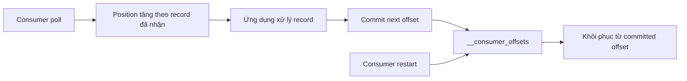
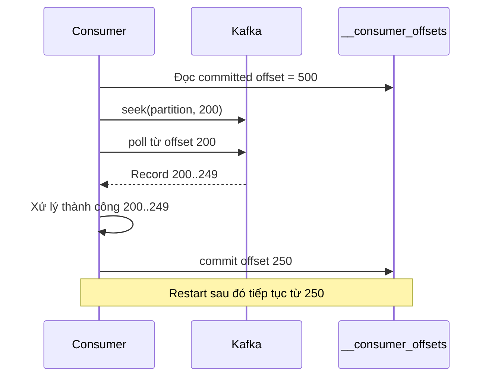

# seek, seekToBeginning và seekToEnd

Kafka consumer duy trì một vị trí đọc (position) riêng cho từng partition. Khi cần phát lại dữ liệu, bỏ qua backlog hoặc tiếp tục từ một offset do ứng dụng xác định, Java Kafka Consumer cung cấp ba API quan trọng: `seek()`, `seekToBeginning()` và `seekToEnd()`.

Các API này thay đổi vị trí đọc trong consumer hiện tại. Chúng không tự tạo bản sao record, không thay đổi thứ tự record trong partition và cũng không tự động ghi một committed offset mới cho consumer group. Muốn vị trí mới được dùng sau khi consumer khởi động lại, ứng dụng phải commit offset phù hợp hoặc quản lý offset theo một cơ chế riêng.

## 1. Position, committed offset và offset của partition

Trước khi gọi `seek`, cần phân biệt ba khái niệm:

| Khái niệm | Ý nghĩa | Ví dụ |
|---|---|---|
| Consumer position | Offset tiếp theo consumer sẽ đọc trong phiên hiện tại | Đã đọc đến offset 41 thì position thường là 42 |
| Committed offset | Vị trí tiếp theo group đã lưu để khôi phục khi consumer khởi động lại | Group commit 42 thì lần khởi động sau tiếp tục từ 42 |
| Partition end offset | Ranh giới cuối hiện tại của dữ liệu có thể đọc theo isolation level | Partition có end offset 1000 |

Position thay đổi khi consumer đọc record hoặc ứng dụng gọi `seek`. Committed offset là tiến độ được lưu cho group. Hai giá trị có thể khác nhau: consumer có thể đã đọc đến position 100 nhưng mới commit 90; nếu tiến trình dừng, group có thể đọc lại từ 90.

Offset có phạm vi trong từng topic-partition. Topic có nhiều partition không có một offset toàn cục. Nếu muốn replay nhiều partition, ứng dụng phải xác định vị trí riêng cho từng partition.



Committed offset thường biểu diễn **offset tiếp theo cần đọc**, không phải offset cuối cùng đã xử lý. Nếu xử lý thành công record offset 41, consumer thường commit 42.

## 2. `seek()`: đặt vị trí đọc tới một offset cụ thể

`seek(TopicPartition, long)` đặt position của consumer cho partition được chỉ định. Lần `poll()` tiếp theo sẽ lấy dữ liệu bắt đầu từ offset đó, nếu offset còn hợp lệ và có thể đọc.

Ví dụ, muốn đọc lại từ offset 120 của partition 0:

```java
TopicPartition partition = new TopicPartition("orders.events", 0);

consumer.assign(List.of(partition));
consumer.seek(partition, 120L);

ConsumerRecords<String, String> records =
    consumer.poll(Duration.ofSeconds(1));
```

`seek` chỉ được gọi cho partition mà consumer hiện đang sở hữu (đã được assign). Nếu gọi với partition chưa được assign, Kafka Consumer ném `IllegalStateException`. Offset phải là số không âm; offset ngoài phạm vi log có thể dẫn đến `OffsetOutOfRangeException` khi consumer cố đọc.

### `seek` không tự commit offset

Sau `seek(partition, 120)`, position trong consumer hiện tại được đặt về 120. Nếu group trước đó đã commit 500, committed offset vẫn là 500 cho tới khi ứng dụng commit một vị trí mới. Nếu consumer restart trước khi commit, group có thể khôi phục từ 500 và bỏ qua lần seek 120.

Muốn lưu vị trí mới cho lần khởi động sau, có thể commit position sau khi đã xử lý dữ liệu theo chính sách phù hợp:

```java
consumer.seek(partition, 120L);

ConsumerRecords<String, String> records =
    consumer.poll(Duration.ofSeconds(1));

process(records);
consumer.commitSync();
```

Đoạn code trên chỉ phù hợp nếu `process(records)` đã hoàn tất an toàn và consumer chỉ commit các offset tương ứng với dữ liệu đã xử lý. Với xử lý bất đồng bộ hoặc nhiều partition, nên commit map offset tường minh theo từng partition và chỉ commit phần đã hoàn tất liên tục.

Nếu `enable.auto.commit=true`, Kafka có thể tự commit position hiện tại theo chu kỳ. Khi replay cần kiểm soát chính xác, nên tắt auto commit và tự quản lý commit để tránh vô tình lưu một position chưa phản ánh kết quả nghiệp vụ.

## 3. `seekToBeginning()`: đọc từ đầu phần log còn được giữ

`seekToBeginning(Collection<TopicPartition>)` đặt position của các partition được chỉ định về offset sớm nhất hiện còn có thể đọc.

```java
Set<TopicPartition> partitions = consumer.assignment();
consumer.seekToBeginning(partitions);
```

Không nên hiểu “beginning” luôn là offset 0. Kafka có thể đã xóa các segment cũ theo retention hoặc loại bỏ record cũ qua log compaction. Nếu partition hiện chỉ còn dữ liệu bắt đầu từ offset 250, `seekToBeginning()` sẽ đưa consumer về vị trí sớm nhất còn khả dụng, chẳng hạn 250.

Offset trong log có thể có khoảng trống do compaction hoặc transaction. Vì vậy, sau khi seek về beginning, record đầu tiên consumer nhận được không nhất thiết có offset liên tiếp bằng 0 hoặc bằng offset trước đó cộng một.

### Khi nào dùng `seekToBeginning()`?

- Xây dựng lại projection hoặc read model từ các event còn được giữ.
- Chạy consumer replay trong một group riêng để kiểm tra hoặc tái tạo dữ liệu.
- Phát lại partition trong môi trường lab để quan sát hành vi xử lý.
- Khôi phục state cục bộ khi ứng dụng có quy trình rebuild rõ ràng.

Không nên gọi `seekToBeginning()` vô điều kiện sau mọi lần rebalance. Nếu consumer được giao lại partition trong một group đang hoạt động, việc rewind có thể khiến toàn bộ dữ liệu cũ được xử lý lại và tạo side effect trùng.

## 4. `seekToEnd()`: bỏ qua backlog và bắt đầu từ cuối log

`seekToEnd(Collection<TopicPartition>)` đặt position của các partition được chỉ định về end offset tại thời điểm consumer xác định vị trí đó. Sau khi position được đặt, consumer sẽ nhận các record được ghi sau ranh giới này.

```java
Set<TopicPartition> partitions = consumer.assignment();
consumer.seekToEnd(partitions);

ConsumerRecords<String, String> newRecords =
    consumer.poll(Duration.ofSeconds(1));
```

API `seekToEnd()` có thể xác định end offset một cách lazy: offset thực tế được lấy khi consumer cần position, ví dụ trong lần `poll()` hoặc khi gọi `position()`. Nếu cần chụp một ranh giới chính xác để ghi lại hoặc tái sử dụng, hãy lấy end offset bằng `endOffsets()` rồi gọi `seek()` với các giá trị đó.

### Ví dụ chụp ranh giới end offset

```java
Set<TopicPartition> partitions = consumer.assignment();
Map<TopicPartition, Long> endOffsets = consumer.endOffsets(partitions);

for (Map.Entry<TopicPartition, Long> entry : endOffsets.entrySet()) {
    consumer.seek(entry.getKey(), entry.getValue());
}
```

Khi sử dụng `isolation.level=read_committed`, end offset mà consumer nhìn thấy bị giới hạn bởi Last Stable Offset (LSO) nếu có transaction đang mở. Consumer `read_uncommitted` có thể nhìn thấy phạm vi dữ liệu rộng hơn. Vì vậy, ranh giới `seekToEnd()` phụ thuộc isolation level và trạng thái transaction, không nên đồng nhất máy móc với log end offset vật lý của leader.

### Khi nào dùng `seekToEnd()`?

- Bỏ qua backlog cũ khi khởi chạy một consumer chuyên nhận dữ liệu mới.
- Bắt đầu một luồng giám sát từ thời điểm hiện tại.
- Bỏ qua dữ liệu lịch sử trong một lần chạy có chủ đích.

Nếu cần một group mới chỉ nhận event phát sinh sau khi ứng dụng bắt đầu, có thể dùng group ID riêng và cấu hình `auto.offset.reset=latest`. `seekToEnd()` hữu ích khi ứng dụng muốn chủ động đặt vị trí cho các partition đã được assign.

## 5. So sánh ba API

| API | Vị trí đọc được đặt tới | Tình huống điển hình | Điều cần chú ý |
|---|---|---|---|
| `seek(tp, offset)` | Offset cụ thể do ứng dụng chỉ định | Replay từ checkpoint hoặc offset đã lưu | Offset phải còn hợp lệ và partition phải được assign |
| `seekToBeginning(partitions)` | Offset sớm nhất còn khả dụng của từng partition | Rebuild hoặc replay dữ liệu lịch sử | Không đảm bảo bắt đầu từ 0 do retention/compaction |
| `seekToEnd(partitions)` | End offset hiện tại theo isolation level | Bỏ qua backlog, chỉ nhận dữ liệu mới | Vị trí có thể được xác định lazy; dùng `endOffsets()` nếu cần snapshot chính xác |

Ba API đều thay đổi position trong consumer hiện tại. Chúng không tự sửa nội dung topic và không tự cập nhật committed offset trong `__consumer_offsets`.

## 6. Điều kiện tiên quyết: partition phải được assign

Kafka Consumer chỉ cho phép seek trên partition mà consumer đang sở hữu. Có hai cách phổ biến để sở hữu partition:

- `assign(Collection<TopicPartition>)`: ứng dụng tự chỉ định partition; consumer không tham gia cơ chế phân chia partition tự động của group.
- `subscribe(Collection<String>)`: consumer tham gia group và Kafka phân chia partition qua coordinator/assignor; assignment có sau khi consumer thực hiện poll và hoàn tất bước tham gia group.

Với `subscribe()`, đoạn code gọi `consumer.assignment()` ngay sau `subscribe()` thường nhận tập rỗng vì group chưa hoàn tất assignment. Hãy đợi `poll()` và dùng `ConsumerRebalanceListener.onPartitionsAssigned()` để thực hiện seek trên các partition vừa được giao.

Ví dụ group-managed consumer cần replay một offset cụ thể đúng một lần cho mỗi partition:

```java
Map<TopicPartition, Long> replayTargets = loadReplayOffsets();
Set<TopicPartition> pendingReplay = new HashSet<>(replayTargets.keySet());

consumer.subscribe(List.of("orders.events"), new ConsumerRebalanceListener() {
    @Override
    public void onPartitionsAssigned(Collection<TopicPartition> partitions) {
        for (TopicPartition partition : partitions) {
            if (pendingReplay.remove(partition)) {
                Long target = replayTargets.get(partition);
                if (target != null) {
                    consumer.seek(partition, target);
                }
            }
        }
    }

    @Override
    public void onPartitionsRevoked(Collection<TopicPartition> partitions) {
        // Commit offset đã xử lý an toàn và flush state nếu cần.
    }
});
```

`loadReplayOffsets()` là hàm của ứng dụng để đọc checkpoint đã chuẩn bị. Ví dụ này chỉ seek một lần cho các partition nằm trong danh sách replay; không rewind mỗi khi partition được giao lại sau rebalance thông thường. Nếu ứng dụng cần replay theo một chính sách khác, hãy xác định rõ thời điểm và phạm vi seek.

## 7. `auto.offset.reset` liên quan thế nào tới seek?

`auto.offset.reset` xác định cách consumer chọn vị trí ban đầu khi group chưa có committed offset hợp lệ hoặc offset đã nằm ngoài phạm vi log còn giữ. Các giá trị thường dùng:

| Giá trị | Hành vi khi cần reset offset |
|---|---|
| `earliest` | Bắt đầu từ offset sớm nhất còn khả dụng |
| `latest` | Bắt đầu từ end offset hiện tại |
| `none` | Ném lỗi nếu không tìm được committed offset hợp lệ |

Ví dụ:

```properties
group.id=order-replay
enable.auto.commit=false
auto.offset.reset=earliest
```

`auto.offset.reset` không chạy lại mỗi lần consumer khởi động. Nếu group đã có committed offset hợp lệ, consumer tiếp tục từ offset đó. Nếu ứng dụng gọi `seek()`, position được đặt theo lệnh seek; reset policy chỉ có vai trò khi consumer cần khởi tạo lại position do không có offset hợp lệ hoặc offset nằm ngoài log.

Nếu dữ liệu đã hết retention, committed offset có thể nằm trước beginning offset hiện tại. Khi consumer cần đọc từ offset không còn tồn tại, Kafka áp dụng reset policy nếu được cấu hình `earliest`/`latest`, hoặc báo lỗi với `none`. Đặt `earliest` không thể khôi phục dữ liệu đã bị retention xóa.

## 8. Commit sau khi seek và replay

Seek chỉ thay đổi position cục bộ. Khi replay đã xử lý thành công, ứng dụng cần quyết định có cập nhật committed offset của group hay không.

Ví dụ group có committed offset 500. Ứng dụng seek về 200, xử lý lại từ 200 đến 249 rồi commit 250. Khi restart, group tiếp tục từ 250. Nếu không commit, lần restart có thể quay lại 500 và không tiếp tục replay.



Commit offset quá sớm có thể làm mất xử lý; commit quá muộn có thể khiến record được giao lại. Với replay có side effect, cần idempotency hoặc một consumer group riêng để tránh làm thay đổi tiến độ của consumer production.

## 9. Replay an toàn bằng consumer group riêng

Nếu mục tiêu là chạy lại dữ liệu để rebuild báo cáo, kiểm tra lỗi hoặc tạo projection mới, cách an toàn thường là tạo group ID riêng thay vì rewind group đang phục vụ production.

Ví dụ:

```properties
group.id=orders-rebuild-2026-11
auto.offset.reset=earliest
enable.auto.commit=false
isolation.level=read_committed
```

Group mới có committed offset độc lập. Nó có thể đọc dữ liệu từ đầu phần log còn giữ mà không làm thay đổi offset của `payment-service` hoặc `notification-service`.

Khi replay, cần cân nhắc:

- Side effect của consumer có được phép thực hiện lại không?
- Database đích là projection riêng hay dữ liệu production hiện hữu?
- Event đã hết retention hoặc bị compaction chưa?
- Consumer có cần giữ ordering theo key/partition không?
- Tốc độ replay có gây tải quá mức lên broker và downstream không?
- Cần lưu checkpoint để tiếp tục replay sau khi tiến trình dừng không?

Không nên dùng group production để replay toàn bộ dữ liệu nếu chưa có kế hoạch rollback và kiểm soát side effect. Một consumer group riêng giúp cô lập tiến độ đọc, nhưng không tự cô lập database hoặc dịch vụ bên ngoài mà consumer gọi.

## 10. Replay từ offset hoặc thời điểm cụ thể

Khi đã biết offset, dùng `seek(tp, offset)`. Nếu chỉ biết timestamp, có thể dùng `offsetsForTimes()` để tìm offset đầu tiên có timestamp lớn hơn hoặc bằng thời điểm yêu cầu rồi seek tới offset đó.

```java
Map<TopicPartition, Long> timestamps = Map.of(
    partition, Instant.parse("2026-11-20T10:00:00Z").toEpochMilli()
);

Map<TopicPartition, OffsetAndTimestamp> offsets =
    consumer.offsetsForTimes(timestamps);

OffsetAndTimestamp match = offsets.get(partition);
if (match != null) {
    consumer.seek(partition, match.offset());
}
```

Nếu `offsetsForTimes()` trả về `null` cho partition, không có offset phù hợp theo timestamp được yêu cầu trong dữ liệu hiện còn. Ứng dụng cần quyết định bỏ qua partition, seek về end/beginning hoặc báo lỗi; không nên tự mặc định offset 0.

Timestamp dùng trong phép tra cứu phụ thuộc timestamp type và dữ liệu record. Nếu topic dùng `LogAppendTime`, timestamp phản ánh thời điểm broker append; nếu dùng `CreateTime`, nó phản ánh timestamp producer gửi. Điều này ảnh hưởng ý nghĩa của việc replay theo thời gian.

## 11. Spring Kafka: thực hiện seek từ listener

Spring Kafka cung cấp `ConsumerSeekAware` để listener nhận callback và điều khiển seek trên consumer do container quản lý. Đây là lựa chọn phù hợp khi cần đặt lại vị trí đọc trong `@KafkaListener`.

Ví dụ minh họa seek về beginning một lần khi listener nhận assignment ban đầu:

```java
@Component
public class OrderReplayListener implements ConsumerSeekAware {

    private final Set<TopicPartition> pendingInitialReplay;

    public OrderReplayListener(ReplayPlan replayPlan) {
        this.pendingInitialReplay = ConcurrentHashMap.newKeySet();
        this.pendingInitialReplay.addAll(replayPlan.partitions());
    }

    @Override
    public void registerSeekCallback(ConsumerSeekCallback callback) {
        // Container đăng ký callback dùng cho seek.
    }

    @Override
    public void onPartitionsAssigned(
            Map<TopicPartition, Long> assignments,
            ConsumerSeekCallback callback) {

        for (TopicPartition partition : assignments.keySet()) {
            if (pendingInitialReplay.remove(partition)) {
                callback.seekToBeginning(
                    partition.topic(), partition.partition());
            }
        }
    }

    @KafkaListener(topics = "orders.events", groupId = "orders-replay")
    public void listen(String event) {
        // Xử lý event theo chính sách replay.
    }
}
```

`ReplayPlan` là cấu hình do ứng dụng tự định nghĩa, cung cấp danh sách partition cần replay lúc khởi động. Không thêm mọi partition vào tập này trong mỗi lần rebalance. API `ConsumerSeekAware` và chữ ký callback có thể khác giữa các phiên bản Spring Kafka, vì vậy cần đối chiếu phiên bản thư viện của dự án.

Một cách khác là sử dụng `ConsumerSeekCallback.seek(topic, partition, offset)` để đặt offset cụ thể. Với seek từ bên ngoài poll thread, Spring Kafka cung cấp callback để container thực hiện seek đúng thread; không gọi trực tiếp `KafkaConsumer` do container quản lý từ một thread ứng dụng tùy ý.

## 12. Những lỗi thường gặp khi sử dụng seek

| Triệu chứng | Nguyên nhân có thể | Cách xử lý |
|---|---|---|
| `IllegalStateException` khi seek | Partition chưa được assign cho consumer | Chờ `poll()`/assignment hoặc dùng `assign()` trước khi seek |
| Consumer vẫn tiếp tục từ offset cũ sau restart | Seek chỉ đổi position nhưng chưa commit offset mới | Commit offset sau khi xử lý replay thành công |
| `OffsetOutOfRangeException` | Offset nằm ngoài dữ liệu còn giữ | Kiểm tra beginning/end offsets và reset policy |
| Replay tạo side effect trùng | Consumer xử lý lại event đã áp dụng trước đó | Dùng group riêng, inbox/dedup hoặc projection đích riêng |
| Consumer bỏ qua dữ liệu mới khi dùng seekToEnd | End offset được xác định lazy hoặc ranh giới không được ghi lại rõ | Chụp `endOffsets()` rồi seek offset cụ thể nếu cần ranh giới chính xác |
| Consumer đọc lại toàn bộ dữ liệu sau mỗi rebalance | `seekToBeginning()` được gọi vô điều kiện trong assignment callback | Chỉ áp dụng replay một lần hoặc theo checkpoint rõ ràng |
| Không replay được event rất cũ | Retention đã xóa dữ liệu hoặc compaction đã loại record cũ | Kiểm tra retention/compaction; dùng archive nếu cần lưu dài hạn |
| Consumer `read_committed` thấy ít record hơn | LSO đang thấp hơn log end do transaction chưa kết thúc hoặc record bị abort | Kiểm tra transaction state và isolation level |

## 13. Bài thực hành: so sánh seek, beginning và end

Tạo topic thử nghiệm `orders.events` có hai partition và gửi một số record có key `orderId`. Dùng một consumer group riêng để thực hành:

1. Gọi `assign()` cho partition 0 và `seek(partition, 3)`; xác minh record đầu tiên được đọc bắt đầu từ offset 3 nếu offset còn tồn tại.
2. Gọi `seekToBeginning()` và xác minh consumer đọc lại từ offset sớm nhất còn giữ.
3. Gọi `seekToEnd()`; sau khi position được xác định, gửi thêm record mới và xác minh consumer nhận dữ liệu phát sinh sau ranh giới end.
4. Dùng `endOffsets()` chụp ranh giới, gọi `seek()` tới offset đó và so sánh với `seekToEnd()`.
5. Commit offset sau một batch, dừng consumer rồi khởi động lại để kiểm tra committed offset.
6. Thử seek tới offset nhỏ hơn beginning offset để quan sát lỗi/reset behavior theo `auto.offset.reset`.
7. Tạo group ID mới với `auto.offset.reset=earliest` và so sánh với group đã có committed offset.
8. Thử `isolation.level=read_committed` trên topic có transactional producer để quan sát tác động của LSO.

Chạy các thử nghiệm trên môi trường lab. Không seek group production về đầu topic hoặc commit offset mới khi chưa đánh giá tác động đến các consumer đang chạy.

## 14. Checklist trước khi replay trong production

- Xác định rõ group ID và partition cần replay.
- Lưu committed offset hiện tại để có thể đối chiếu hoặc khôi phục tiến độ.
- Xác nhận offset đích vẫn nằm trong phạm vi dữ liệu còn giữ.
- Chọn `read_committed` hay `read_uncommitted` theo yêu cầu transaction.
- Đánh giá side effect và bảo đảm consumer idempotent.
- Ưu tiên group replay riêng khi cần rebuild hoặc kiểm tra dữ liệu lịch sử.
- Tắt auto commit nếu cần kiểm soát chính xác ranh giới replay.
- Commit offset chỉ sau khi dữ liệu tương ứng được xử lý thành công.
- Theo dõi consumer lag, throughput, disk/network và tải downstream trong lúc replay.
- Có kế hoạch dừng replay, tiếp tục từ checkpoint và xử lý record lỗi.

`seek()` cho phép đặt vị trí đọc chính xác; `seekToBeginning()` đưa consumer về phần log sớm nhất còn khả dụng; `seekToEnd()` bỏ qua backlog để bắt đầu từ cuối log theo isolation level. Cả ba chỉ điều khiển position của consumer hiện tại. Muốn replay bền vững qua restart, cần commit offset có chủ đích, quản lý assignment đúng và bảo vệ nghiệp vụ khỏi side effect trùng.
