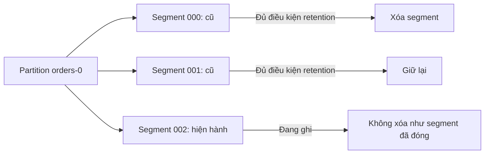

# Retention, offset hết hạn và `OffsetOutOfRangeException`

## Vì sao consumer có thể không đọc được offset đã lưu?

Kafka lưu record trong log của từng partition và giữ chúng theo chính sách retention. Consumer group cũng lưu committed offset để biết lần đọc tiếp theo cần bắt đầu ở đâu. Hai loại dữ liệu này có vòng đời độc lập:

- **Topic retention** quyết định record trong log được giữ bao lâu hoặc đến khi dung lượng đạt ngưỡng nào.
- **Consumer offset retention** quyết định committed offset của một group được giữ bao lâu khi group không còn hoạt động.

Một consumer có thể gặp tình huống committed offset vẫn còn nhưng record tương ứng đã bị xóa khỏi log do topic retention. Ngược lại, record trong topic vẫn còn nhưng committed offset của group đã hết hạn. Khi consumer yêu cầu broker đọc một offset nằm ngoài phạm vi log hiện tại, Kafka có thể trả về `OffsetOutOfRangeException`.

Hiểu rõ hai chính sách retention, ranh giới offset và cách reset giúp tránh bỏ sót dữ liệu khi consumer bị gián đoạn lâu, xử lý lag hoặc cần replay. Đây là phần quan trọng của module KAFKA, nơi ứng dụng Java/Spring Kafka cần quản lý offset, retry, ordering và phục hồi luồng event streaming.

## 1. Phân biệt retention của topic và retention của offset

### 1.1 Topic retention giữ record trong partition log

Topic retention kiểm soát dữ liệu nghiệp vụ được giữ trên broker. Với chính sách xóa (`cleanup.policy=delete`), Kafka có thể xóa các log segment đã đủ điều kiện theo thời gian hoặc dung lượng.

Các cấu hình thường gặp:

| Cấu hình | Phạm vi | Ý nghĩa |
|---|---|---|
| `retention.ms` | Topic | Thời gian tối đa dữ liệu được giữ theo chính sách delete |
| `retention.bytes` | Topic/partition | Giới hạn dung lượng log cho mỗi partition |
| `cleanup.policy` | Topic | Chọn `delete`, `compact` hoặc kết hợp `compact,delete` |
| `segment.bytes` | Topic/broker | Kích thước mục tiêu để roll log segment |
| `segment.ms` | Topic/broker | Thời gian tối đa trước khi roll segment theo thời gian |
| `log.retention.check.interval.ms` | Broker | Chu kỳ broker kiểm tra segment đủ điều kiện xóa |

`retention.bytes` được áp dụng theo từng partition, không phải một giới hạn tổng cho toàn topic. Nếu topic có 12 partition và mỗi partition có giới hạn 10 GB, tổng dung lượng log có thể xấp xỉ 120 GB trước overhead và sai lệch do segment.

### 1.2 Consumer offset retention giữ tiến độ group

Committed offset được lưu trong topic nội bộ `__consumer_offsets`. Broker có cấu hình `offsets.retention.minutes` để kiểm soát thời gian giữ offset của group không còn hoạt động theo quy tắc của phiên bản Kafka đang chạy.

Khi một group ngừng hoạt động lâu hơn thời gian retention, committed offset có thể bị xóa. Nếu group quay lại sau đó, consumer không còn offset hợp lệ để tiếp tục và `auto.offset.reset` sẽ quyết định vị trí bắt đầu.

Điều này không có nghĩa record trong topic nghiệp vụ bị xóa. Topic có thể vẫn giữ đủ dữ liệu để replay, trong khi group đã mất checkpoint cũ. Ngược lại, group offset có thể còn tồn tại dù dữ liệu cũ trong topic đã bị retention xóa.

### 1.3 Hai loại retention không thay thế nhau

| Tình huống | Topic data | Committed offset | Hệ quả |
|---|---|---|---|
| Topic còn dữ liệu, group offset còn | Còn | Còn | Consumer tiếp tục từ committed offset nếu offset vẫn hợp lệ |
| Topic đã xóa dữ liệu cũ, group offset còn | Một phần đã mất | Còn | Offset có thể thấp hơn log start và gây out-of-range |
| Topic còn dữ liệu, group offset hết hạn | Còn | Mất | Consumer dùng `auto.offset.reset` để chọn vị trí bắt đầu |
| Cả topic data và group offset đều hết hạn | Một phần hoặc toàn bộ đã mất | Mất | Không thể phục hồi lịch sử đã xóa chỉ bằng reset offset |

Vì vậy, khi thiết kế replay, cần xác định riêng thời gian lưu dữ liệu nghiệp vụ và thời gian lưu checkpoint của consumer group.

## 2. Kafka xóa dữ liệu theo segment như thế nào?

### 2.1 Partition log gồm nhiều segment

Mỗi partition được lưu thành nhiều log segment. Segment hiện hành nhận record mới; khi đạt ngưỡng kích thước hoặc thời gian, broker roll sang segment mới. Các segment đã đóng có thể được xét để xóa theo retention.



Kafka không xóa từng record ngay đúng thời điểm `retention.ms` hết hạn. Retention được thực thi theo segment và chu kỳ kiểm tra. Vì vậy, dữ liệu có thể tồn tại lâu hơn một chút so với thời gian cấu hình, tùy thời điểm roll segment và lần kiểm tra kế tiếp.

### 2.2 Retention theo thời gian

Ví dụ topic có `retention.ms=604800000` (7 ngày). Broker xem xét các segment có dữ liệu cũ hơn khoảng thời gian retention và xóa chúng khi segment đủ điều kiện. Đây là chính sách cho phép giữ dữ liệu trong một cửa sổ thời gian, không phải cam kết mọi record bị xóa chính xác sau 7 ngày tính từ timestamp ứng dụng.

Nếu producer gửi record với timestamp không phản ánh đúng thời điểm hoặc broker dùng timestamp policy khác, việc xác định tuổi segment cũng có thể khác kỳ vọng. Hãy hiểu cấu hình timestamp của topic và cách segment được roll khi thiết kế retention.

### 2.3 Retention theo dung lượng

`retention.bytes` giới hạn dung lượng log cho mỗi partition. Khi partition vượt giới hạn, broker có thể xóa segment cũ để đưa dung lượng về ngưỡng. Vì xóa theo segment, dung lượng thực tế không nhất thiết dừng chính xác tại con số cấu hình.

Nếu producer tăng throughput đột ngột, dữ liệu cũ có thể bị xóa nhanh hơn dự kiến dù `retention.ms` vẫn đặt dài. Khi cả giới hạn thời gian và dung lượng được cấu hình, điều kiện nào khiến segment đủ điều kiện xóa trước có thể quyết định cửa sổ dữ liệu thực tế.

### 2.4 Chính sách compact khác với delete

Với `cleanup.policy=compact`, Kafka giữ lại trạng thái mới nhất theo key trong log compaction. Các record cũ cùng key có thể bị loại bỏ khi compaction chạy; offset không được đánh lại liên tục, vì vậy consumer có thể nhìn thấy khoảng trống offset.

Record có key và value `null` là tombstone, biểu thị key bị xóa. Tombstone được giữ trong khoảng thời gian theo `delete.retention.ms` trước khi có thể bị dọn đi. Consumer cần bắt kịp log trong cửa sổ phù hợp nếu cần quan sát tombstone để xóa trạng thái tương ứng.

Với `cleanup.policy=compact,delete`, cả compaction và xóa theo retention đều có thể áp dụng. Compaction không phải kho lưu lịch sử event đầy đủ; nếu cần replay mọi sự kiện theo thời gian, hãy dùng topic có retention phù hợp và thiết kế lưu trữ riêng.

## 3. Log start offset và log end offset

### 3.1 Ranh giới đọc của partition

Để hiểu `OffsetOutOfRangeException`, cần biết hai ranh giới:

- **Log start offset (beginning offset):** offset sớm nhất mà partition còn cung cấp để đọc sau retention/compaction và các thay đổi log liên quan.
- **Log end offset:** vị trí tiếp theo sau record cuối cùng đã được append vào log. Đây là điểm cuối hiện tại, không phải offset của record cuối cùng.

Ví dụ partition có log start offset 120 và log end offset 250. Consumer có thể bắt đầu đọc từ offset 120 trở đi; offset 250 biểu thị cuối log hiện tại và khi seek đến đó consumer sẽ chờ record mới.

```text
Log start                                             Log end
    120                                                   250
     |----------------------------------------------------|
     record có thể đọc                         vị trí chờ record mới
```

Offset là số thứ tự trong log, không phải số lượng record hiện còn. Nếu compaction xóa một số record cũ, các offset còn lại không bị đánh số lại. Vì vậy, đọc từ 120 đến 250 không bảo đảm nhận được đúng 130 record.

### 3.2 Offset hợp lệ không nhất thiết phải tồn tại thành record

Một offset trong khoảng log start và log end có thể không còn record tương ứng do log compaction hoặc do các record control/batch đặc biệt. Điều này không đồng nghĩa offset nằm ngoài phạm vi.

Consumer đọc log theo offset và broker trả các record còn tồn tại tiếp theo. Không nên tự tăng offset bằng cách giả định mọi số nguyên trong khoảng đều đại diện cho một record có thể đọc.

### 3.3 Lấy ranh giới bằng Java Consumer

Kafka Java Consumer cung cấp `beginningOffsets()` và `endOffsets()`:

```java
Set<TopicPartition> partitions = Set.of(
        new TopicPartition("orders", 0),
        new TopicPartition("orders", 1)
);

Map<TopicPartition, Long> beginnings = consumer.beginningOffsets(partitions);
Map<TopicPartition, Long> ends = consumer.endOffsets(partitions);

for (TopicPartition partition : partitions) {
    System.out.printf("%s start=%d end=%d%n",
            partition,
            beginnings.get(partition),
            ends.get(partition));
}
```

Đối với consumer dùng `read_committed`, ranh giới nhìn thấy có thể chịu ảnh hưởng bởi transaction chưa kết thúc và last stable offset. Khi chẩn đoán, hãy ghi nhận `isolation.level` cùng log start/end offset thay vì chỉ nhìn một con số.

## 4. `OffsetOutOfRangeException` là gì?

`OffsetOutOfRangeException` xảy ra khi consumer yêu cầu broker fetch từ một offset không còn nằm trong phạm vi log hợp lệ của partition. Lỗi thường gặp khi committed offset cũ hơn log start offset do retention, hoặc khi offset nằm sau log end offset do log bị truncate, topic bị tạo lại hay ứng dụng seek sai vị trí.

### 4.1 Nguyên nhân phổ biến

1. **Consumer lag vượt retention:** consumer ngừng hoạt động lâu; broker xóa segment cũ trước khi consumer quay lại.
2. **Committed offset đã cũ:** group còn offset thấp hơn log start offset hiện tại.
3. **Offset bị reset hoặc seek sai:** ứng dụng gọi `seek()` đến một vị trí không còn tồn tại hoặc lớn hơn log end.
4. **Topic bị xóa rồi tạo lại:** topic cùng tên nhưng log mới bắt đầu ở offset thấp hơn hoặc khác với committed offset cũ.
5. **Log bị truncate sau phục hồi:** leader mới có end offset thấp hơn offset consumer đã lưu, ví dụ sau các tình huống mất dữ liệu hoặc thay đổi lịch sử log.
6. **Retention/compaction bị hiểu nhầm:** compaction tạo khoảng trống offset bình thường; chỉ khi offset yêu cầu nằm ngoài ranh giới log mới là out-of-range.

### 4.2 Ví dụ consumer lag vượt retention

Giả sử group `billing-workers` đã commit offset 100 của partition 0. Consumer ngừng chạy 10 ngày, trong khi topic chỉ giữ dữ liệu 7 ngày. Khi consumer quay lại, log start offset đã tăng lên 500.

```text
Committed offset của group: 100
Log start offset hiện tại:  500
Log end offset hiện tại:    900
```

Consumer muốn tiếp tục từ 100 nhưng broker không còn dữ liệu từ vị trí đó. Nếu client không có chính sách reset phù hợp, nó nhận `OffsetOutOfRangeException`. Nếu tự động reset về earliest, consumer bắt đầu từ 500 và bỏ qua khoảng dữ liệu 100–499 đã bị retention xóa. Kafka không thể phục hồi những record đã bị xóa khỏi mọi replica.

### 4.3 Offset lớn hơn log end

Một committed offset có thể lớn hơn log end hiện tại nếu topic/partition được tạo lại hoặc log bị truncate sau một sự cố. Ví dụ group commit offset 900 nhưng log mới chỉ có end offset 120. Reset về `earliest` sẽ đọc từ đầu log hiện tại; reset về `latest` sẽ bắt đầu từ 120 và bỏ qua dữ liệu hiện có.

Đây là lý do không nên mặc định mọi out-of-range đều cần reset về earliest. Cần xác định offset đang thấp hơn log start hay cao hơn log end, rồi chọn chính sách phù hợp với nghiệp vụ.

## 5. `auto.offset.reset` quyết định điều gì?

`auto.offset.reset` được áp dụng khi group không có committed offset hợp lệ cho partition, hoặc offset đã commit không còn hợp lệ trong log. Nó không ghi đè một committed offset còn hợp lệ.

| Giá trị | Hành vi | Hệ quả nghiệp vụ |
|---|---|---|
| `earliest` | Bắt đầu từ log start offset hiện có | Đọc lại toàn bộ dữ liệu còn giữ được; không khôi phục phần đã bị xóa |
| `latest` | Bắt đầu ở log end offset hiện tại | Bỏ qua backlog còn tồn tại và chỉ đọc record mới sau thời điểm reset |
| `none` | Không tự reset; ném lỗi khi cần chọn offset mới | Buộc ứng dụng/operator quyết định cách phục hồi |

Ở một số phiên bản Kafka client mới còn có lựa chọn theo thời lượng như `by_duration:<duration>`. Chỉ dùng khi broker/client đang triển khai hỗ trợ và đã kiểm tra semantics cụ thể.

### 5.1 `earliest` không có nghĩa offset 0

Nếu retention đã xóa offset 0 đến 499, `earliest` bắt đầu từ log start offset 500. Đây là record sớm nhất còn có thể đọc, không phải record đầu tiên từng được ghi.

### 5.2 `latest` có thể bỏ qua backlog

Nếu consumer group mất offset và dùng `latest`, consumer bắt đầu từ cuối log. Các record đã có trong topic trước thời điểm reset không được đọc bởi group đó. Chỉ chọn `latest` khi nghiệp vụ muốn bỏ qua backlog cũ hoặc khi có nguồn đồng bộ khác đã đảm bảo trạng thái.

### 5.3 `none` giúp tránh reset âm thầm

Với hệ thống tài chính hoặc xử lý sự kiện không được phép tự bỏ qua dữ liệu, `none` có thể phù hợp để buộc lỗi được phát hiện và xử lý có chủ đích. Nếu group chưa có committed offset hợp lệ, client có thể báo `NoOffsetForPartitionException`; nếu consumer fetch từ offset nằm ngoài log range, client có thể báo `OffsetOutOfRangeException`. Ứng dụng cần phân biệt hai trường hợp, ghi log group/topic/partition/offset, so sánh ranh giới log và thực hiện reset sau khi có quyết định vận hành.

## 6. Ví dụ Java xử lý offset out of range

### 6.1 Cấu hình để ứng dụng tự quyết định

```java
Properties props = new Properties();
props.put(ConsumerConfig.BOOTSTRAP_SERVERS_CONFIG, "localhost:9092");
props.put(ConsumerConfig.GROUP_ID_CONFIG, "billing-workers");
props.put(ConsumerConfig.KEY_DESERIALIZER_CLASS_CONFIG,
        StringDeserializer.class.getName());
props.put(ConsumerConfig.VALUE_DESERIALIZER_CLASS_CONFIG,
        StringDeserializer.class.getName());
props.put(ConsumerConfig.ENABLE_AUTO_COMMIT_CONFIG, false);
props.put(ConsumerConfig.AUTO_OFFSET_RESET_CONFIG, "none");
```

Với `none`, consumer không tự chọn earliest/latest khi cần khởi tạo hoặc phục hồi offset. Nếu committed offset cũ nằm ngoài log range, ứng dụng có thể nhận `OffsetOutOfRangeException` trong lúc poll. Nếu group chưa có committed offset, lỗi có thể là `NoOffsetForPartitionException`.

### 6.2 Đưa consumer về earliest còn giữ

Đoạn code sau minh họa một chính sách: khi offset out-of-range, seek các partition bị ảnh hưởng về log start offset hiện tại. Đây chỉ là lựa chọn phù hợp nếu nghiệp vụ chấp nhận đọc lại phần dữ liệu còn giữ và bỏ qua phần đã bị retention xóa.

```java
while (true) {
    ConsumerRecords<String, String> records;
    try {
        records = consumer.poll(Duration.ofMillis(500));
    } catch (OffsetOutOfRangeException exception) {
        Set<TopicPartition> invalidPartitions =
                exception.offsetOutOfRangePartitions().keySet();

        Map<TopicPartition, Long> beginnings =
                consumer.beginningOffsets(invalidPartitions);

        for (TopicPartition partition : invalidPartitions) {
            Long earliest = beginnings.get(partition);
            if (earliest != null) {
                consumer.seek(partition, earliest);
            }
        }
        continue;
    }

    for (ConsumerRecord<String, String> record : records) {
        processIdempotently(record);
    }

    if (!records.isEmpty()) {
        consumer.commitSync();
    }
}
```

Trong production, cần bổ sung log/metric cho từng lần reset, phân biệt offset thấp hơn log start với offset cao hơn log end, và tránh tự động chọn earliest cho mọi nguyên nhân. Nếu offset cao hơn end do topic bị tạo lại, cần xác minh đúng topic/cluster trước khi tiếp tục.

### 6.3 Kiểm tra trước khi seek

Có thể so sánh offset yêu cầu với hai ranh giới:

```java
Map<TopicPartition, Long> beginnings = consumer.beginningOffsets(partitions);
Map<TopicPartition, Long> ends = consumer.endOffsets(partitions);

for (TopicPartition partition : partitions) {
    long start = beginnings.get(partition);
    long end = ends.get(partition);
    long requested = requestedOffsets.get(partition);

    if (requested < start) {
        // Dữ liệu trước log start đã không còn trong log.
    } else if (requested > end) {
        // Offset yêu cầu vượt quá cuối log hiện tại.
    }
}
```

Đây là logic chẩn đoán minh họa; cần xử lý trường hợp metadata thay đổi giữa lúc lấy ranh giới và lúc seek/fetch. Broker vẫn là nguồn xác nhận cuối cùng khi consumer thực hiện fetch.

## 7. Cấu hình trong Spring Kafka

### 7.1 Chọn reset policy

Ví dụ cấu hình Spring Boot bắt đầu từ dữ liệu sớm nhất còn giữ nếu group chưa có offset hợp lệ:

```yaml
spring:
  kafka:
    consumer:
      group-id: billing-workers
      auto-offset-reset: earliest
      enable-auto-commit: false
```

Nếu cần buộc operator xử lý offset bất thường, có thể cấu hình `auto-offset-reset: none` nếu Kafka client đang dùng hỗ trợ giá trị đó. Khi đó, cần có quy trình quan sát và khôi phục lỗi từ consumer container; không nên chỉ dựa vào retry vô hạn.

### 7.2 Listener container và exception

Spring Kafka listener container gọi Kafka consumer ở bên dưới. Lỗi phát sinh ngay tại `poll()` như offset out-of-range có thể xuất hiện ở tầng container/consumer thay vì trong method `@KafkaListener`, vì listener chỉ nhận record sau khi poll thành công.

Hãy cấu hình logging, container error handling và giám sát phù hợp với phiên bản Spring Kafka. `DefaultErrorHandler` chủ yếu xử lý lỗi khi listener đang xử lý record; không nên mặc định rằng nó có thể sửa mọi lỗi fetch/offset xảy ra trước khi listener được gọi.

Nếu cần tự điều khiển seek/reset, hãy dùng các hook cấp container và API consumer-thread được tài liệu của phiên bản Spring Kafka hỗ trợ, hoặc quản lý KafkaConsumer trực tiếp trong một component chuyên biệt. Phải tuân thủ thread-safety: `KafkaConsumer` không thread-safe và chỉ được thao tác từ thread sở hữu nó.

## 8. Reset committed offset bằng công cụ quản trị

Kafka cung cấp `kafka-consumer-groups.sh` để xem và reset offset. Trước khi reset, consumer group cần ở trạng thái inactive (không có member đang hoạt động) theo yêu cầu của công cụ.

### 8.1 Xem offset và lag

```bash
kafka-consumer-groups.sh --bootstrap-server kafka-1:9092 \
  --describe --group billing-workers
```

Đối chiếu `CURRENT-OFFSET`, `LOG-END-OFFSET` và `LAG`. Nếu cần điều tra retention, hãy so sánh thêm beginning offset của partition để biết committed offset có thấp hơn log start hay không.

### 8.2 Dry run trước khi reset

Ví dụ đưa group về earliest offset còn giữ của topic `orders`:

```bash
kafka-consumer-groups.sh --bootstrap-server kafka-1:9092 \
  --group billing-workers --topic orders \
  --reset-offsets --to-earliest --dry-run
```

Chỉ sau khi kiểm tra kết quả dự kiến và xác nhận tác động nghiệp vụ, mới thực thi:

```bash
kafka-consumer-groups.sh --bootstrap-server kafka-1:9092 \
  --group billing-workers --topic orders \
  --reset-offsets --to-earliest --execute
```

Các lựa chọn reset khác có thể gồm `--to-latest`, `--to-offset`, `--shift-by` hoặc `--to-datetime` tùy phiên bản CLI. Phải kiểm tra phạm vi partition, thời điểm và số record có thể được đọc lại trước khi execute.

Reset offset thay đổi checkpoint của group; nó không khôi phục record đã bị retention xóa. Nếu cần dữ liệu cũ hơn log start, phải lấy từ backup, archive, nguồn phát lại khác hoặc bản sao lưu/cluster khác.

## 9. Thiết kế retention theo yêu cầu replay

### 9.1 Tính cửa sổ retention tối thiểu

Nếu hệ thống cần chịu được consumer gián đoạn tối đa \(T_{outage}\), thời gian phát hiện và xử lý sự cố \(T_{recovery}\), cùng khoảng dự phòng \(T_{buffer}\), cửa sổ retention nên thỏa:

\[
RetentionWindow \geq T_{outage} + T_{recovery} + T_{buffer}
\]

Ví dụ service có thể gián đoạn 2 ngày, cần thêm 1 ngày để phục hồi và catch up, đồng thời dành 2 ngày dự phòng thì retention nên ít nhất 5 ngày. Đây là mức tối thiểu theo thời gian; cần kiểm tra thêm retention theo dung lượng và tốc độ tăng dữ liệu.

### 9.2 Tính dung lượng lưu trữ

Ước lượng dung lượng log trên toàn bộ replica:

\[
Storage \approx IngressRate_{avg} \times RetentionSeconds
\times CompressionRatio \times ReplicationFactor
\]

Ví dụ topic nhận trung bình 20 MB/s, giữ 5 ngày, tỷ lệ nén 0,5 và RF=3:

\[
20 \times 432000 \times 0.5 \times 3
= 12,960,000\ MB \approx 12.96\ TB
\]

Đây là ước lượng dữ liệu replica trước overhead. Cần cộng index, segment, headroom, tăng trưởng, reassignment và phục hồi broker. Nếu cấu hình `retention.bytes`, phải kiểm tra giới hạn trên từng partition để một partition nóng không bị xóa dữ liệu nhanh hơn phần còn lại.

### 9.3 Consumer lag phải nằm trong retention window

Consumer lag cần được theo dõi theo cả số offset và thời gian backlog. Lag 1 triệu record có thể tương ứng vài phút với throughput lớn hoặc nhiều ngày với throughput thấp. Để đánh giá nguy cơ out-of-range, cần ước lượng thời gian consumer cần để catch up và so với cửa sổ retention còn lại.

Nếu tốc độ xử lý của consumer chỉ bằng hoặc thấp hơn tốc độ ghi mới, lag có thể không giảm. Khi đó, chỉ tăng retention sẽ trì hoãn thời điểm dữ liệu cũ bị xóa; cần tăng năng lực xử lý, giảm bottleneck hoặc điều chỉnh luồng dữ liệu.

## 10. Quy trình phục hồi khi gặp `OffsetOutOfRangeException`

1. **Ghi nhận ngữ cảnh:** group ID, topic, partition, committed/requested offset, `isolation.level` và thời điểm lỗi.
2. **Đọc ranh giới log:** lấy beginning offset và end offset của partition bị lỗi.
3. **Xác định nguyên nhân:** offset thấp hơn log start do retention, cao hơn log end do topic recreate/truncation, hay do ứng dụng seek sai.
4. **Đánh giá dữ liệu bị mất:** xác định khoảng offset không còn đọc được và liệu có archive/backup/source replay hay không.
5. **Chọn chính sách:** earliest để đọc phần còn giữ, latest để bỏ backlog, hoặc reset đến offset/datetime cụ thể sau khi được xác nhận.
6. **Dừng group trước reset quản trị:** bảo đảm không có member đang hoạt động nếu dùng CLI reset.
7. **Dry run và xác nhận:** xem offset mới cho từng partition, tính lượng record sẽ replay hoặc bỏ qua.
8. **Thực thi và khởi động lại:** reset offset hoặc seek theo chính sách đã chọn.
9. **Đối soát:** kiểm tra lag, duplicate, dữ liệu nghiệp vụ và tiến độ commit sau phục hồi.
10. **Ngăn tái diễn:** điều chỉnh retention, consumer capacity, alert lag và quy trình restart.

Không reset ngay về latest chỉ để xóa lỗi. Cách đó có thể làm consumer bỏ qua toàn bộ backlog còn giữ. Cũng không reset earliest một cách tự động nếu việc replay có thể tạo side effect trùng hoặc tải lớn lên database.

## 11. Những hiểu lầm thường gặp

**“Offset retention và topic retention là một.”** Không đúng. Một chính sách giữ record trong partition log; chính sách kia giữ committed offset của consumer group.

**“`earliest` luôn đọc từ offset 0.”** Nó đọc từ log start offset hiện tại, có thể lớn hơn 0 do retention.

**“Compaction làm offset chạy lại từ đầu.”** Compaction loại bỏ record cũ theo key nhưng không đánh lại offset; consumer có thể thấy khoảng trống offset bình thường.

**“Offset hết hạn đồng nghĩa topic đã mất dữ liệu.”** Không đúng. Group có thể mất checkpoint trong khi record vẫn còn trong topic.

**“OffsetOutOfRange luôn do retention.”** Có thể do seek sai, topic bị tạo lại hoặc log bị truncate khiến offset yêu cầu lớn hơn end offset.

**“Reset offset khôi phục record đã bị xóa.”** Reset chỉ thay đổi vị trí đọc. Dữ liệu đã bị xóa khỏi log không thể được khôi phục bằng reset.

**“`latest` an toàn vì consumer sẽ bắt đầu từ record mới nhất.”** Nó có thể bỏ qua backlog hiện còn trong topic. Chỉ dùng khi nghiệp vụ chấp nhận bỏ qua dữ liệu cũ.

## 12. Checklist vận hành

- `retention.ms` và `retention.bytes` phù hợp với thời gian gián đoạn và khả năng catch up.
- Đã phân biệt retention của topic với `offsets.retention.minutes`.
- `cleanup.policy` được chọn đúng theo yêu cầu event history hay trạng thái compacted.
- Đã tính dung lượng theo ingress trung bình, compression và replication factor.
- Theo dõi beginning/end offset, committed offset và lag theo partition.
- Có cảnh báo khi thời gian backlog tiến gần retention window.
- `auto.offset.reset` phù hợp với hậu quả nghiệp vụ khi mất offset.
- Có quy trình dry run, phê duyệt và execute khi reset group offset.
- Consumer có idempotency nếu replay có thể xử lý lại record.
- Có archive/backup hoặc nguồn phát lại khác nếu cần phục hồi dữ liệu cũ hơn retention.
- Đã thử nghiệm consumer dừng lâu hơn retention, group offset hết hạn và topic bị truncate/recreate trong staging.

## Kết luận

Topic retention quyết định record còn tồn tại trong partition log; offset retention quyết định committed offset của group còn được lưu hay không. Khi consumer yêu cầu offset thấp hơn log start hoặc cao hơn log end, broker có thể trả `OffsetOutOfRangeException`. `auto.offset.reset` chọn earliest, latest hoặc none khi không có offset hợp lệ, nhưng không thể khôi phục dữ liệu đã bị xóa.

Khi vận hành KAFKA, hãy thiết kế retention theo thời gian outage và catch-up, theo dõi lag so với log start, hiểu segment deletion và compaction, rồi xử lý out-of-range bằng cách kiểm tra ranh giới log trước khi reset. Với hệ thống nghiệp vụ quan trọng, cần dry run, đối soát và idempotency để replay an toàn. Điều đó giúp consumer phục hồi có kiểm soát và tránh âm thầm bỏ qua dữ liệu.
