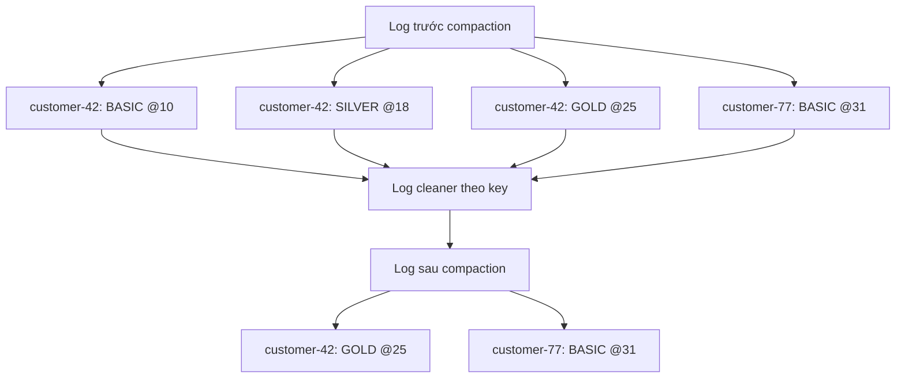
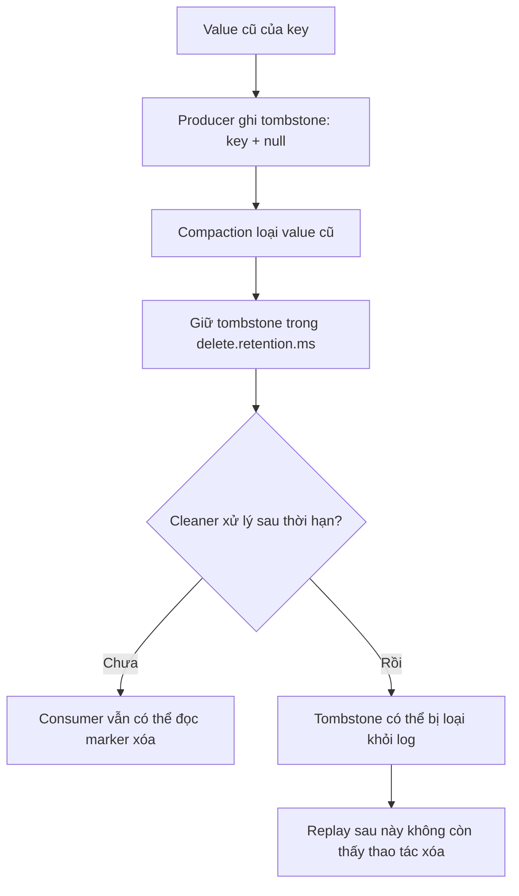

# Đọc lại trên compacted topic và những dữ liệu không thể phục hồi

Kafka cho phép consumer đọc lại dữ liệu bằng cách bắt đầu từ một offset cũ hoặc dùng một consumer group mới. Tuy nhiên, khả năng replay phụ thuộc vào dữ liệu còn tồn tại trong log. Với topic bật **log compaction**, Kafka chủ động loại bỏ các phiên bản cũ của cùng key; tombstone biểu diễn việc xóa key cũng có thể bị dọn sau một khoảng thời gian. Vì vậy, đọc lại compacted topic không đồng nghĩa khôi phục được toàn bộ lịch sử sự kiện.

Điểm cần phân biệt là **replay phần log còn lưu** và **khôi phục lịch sử đã bị xóa**. Offset reset chỉ thay đổi vị trí đọc. Nó không làm Kafka tái tạo record đã bị compaction hoặc retention loại bỏ. Nếu cần audit hay khôi phục dữ liệu lịch sử, hệ thống phải có nguồn lưu trữ khác như event log append-only, database backup hoặc archive.

## 1. Replay trong Kafka thực sự có nghĩa gì?

Mỗi partition là một log có offset tăng dần. Consumer group lưu committed offset riêng cho từng partition; khi consumer khởi động lại, nó thường tiếp tục từ vị trí đã commit. Replay là chủ động đưa vị trí đọc về một offset cũ để xử lý lại các record vẫn còn trong log.

Một số cách bắt đầu đọc lại:

- Tạo consumer group mới và dùng `auto.offset.reset=earliest` để đọc từ offset sớm nhất còn được giữ.
- Dừng toàn bộ consumer của một group rồi reset offset bằng `kafka-consumer-groups.sh`.
- Dùng API `seek()` để đặt vị trí đọc cho các partition được gán thủ công hoặc trong một quy trình kiểm soát riêng.
- Chọn offset theo timestamp bằng `offsetsForTimes()` nếu cần bắt đầu từ một mốc thời gian còn dữ liệu.

`auto.offset.reset=earliest` chỉ áp dụng khi group không có committed offset hợp lệ, ví dụ group mới hoặc offset đã nằm ngoài phạm vi log còn giữ. Nếu group đã có offset hợp lệ, Kafka tiếp tục từ offset đó; thay đổi cấu hình sang `earliest` không tự tua group về đầu topic.

“Đầu topic” trong ngữ cảnh replay có nghĩa là **log start offset hiện tại** của partition. Nó có thể lớn hơn 0 vì retention hoặc compaction đã loại bỏ dữ liệu cũ. Do đó, `earliest` không có nghĩa là offset 0 hoặc record đầu tiên từng được ghi.

## 2. Compacted topic giữ trạng thái mới nhất, không giữ mọi phiên bản

Với `cleanup.policy=compact`, Kafka log cleaner làm việc nền trên các segment đủ điều kiện để loại bỏ những record cũ có cùng key. Sau khi compaction hoàn tất một vùng log, dữ liệu còn lại thể hiện giá trị mới nhất theo key trong phạm vi log được giữ.

Ví dụ topic `customer-state` có các record sau:

| Offset | Key | Value | Ý nghĩa |
|---:|---|---|---|
| 10 | `customer-42` | `{"tier":"BASIC"}` | Trạng thái ban đầu |
| 18 | `customer-42` | `{"tier":"SILVER"}` | Cập nhật trạng thái |
| 25 | `customer-42` | `{"tier":"GOLD"}` | Trạng thái mới nhất |
| 31 | `customer-77` | `{"tier":"BASIC"}` | Một key khác |

Sau khi cleaner xử lý các segment tương ứng, Kafka có thể loại offset 10 và 18, chỉ giữ record mới nhất của `customer-42` tại offset 25 cùng trạng thái của các key khác. Offset không được đánh lại số; consumer có thể nhìn thấy khoảng trống giữa các offset.



Vì vậy, replay compacted topic có thể dựng lại **trạng thái hiện tại** của các key còn đại diện trong log. Nó không thể dựng lại các chuyển đổi BASIC → SILVER → GOLD nếu các phiên bản cũ đã bị cleaner loại bỏ.

Compaction là bất đồng bộ. Ngay sau khi ghi record mới, các phiên bản cũ có thể vẫn còn đọc được cho đến khi cleaner xử lý segment. Không nên dựa vào khoảng thời gian chưa compact để coi compacted topic là event history.

## 3. Tombstone và giới hạn phục hồi thao tác xóa

Trên compacted topic, một record có key khác null và value bằng null là **tombstone**. Nó đánh dấu rằng trạng thái của key cần bị xóa. Cleaner dùng tombstone để loại các phiên bản value cũ của cùng key, sau đó tombstone cũng có thể bị loại khỏi log khi đủ thời gian giữ.

Ví dụ:

| Offset | Key | Value | Ý nghĩa |
|---:|---|---|---|
| 25 | `customer-42` | `{"tier":"GOLD"}` | Key đang tồn tại |
| 40 | `customer-42` | `null` | Tombstone: xóa key |

Sau khi compaction xử lý, các value cũ của `customer-42` có thể biến mất. Tombstone được giữ trong khoảng thời gian cấu hình `delete.retention.ms` để consumer có cơ hội quan sát thao tác xóa. Sau thời hạn này, một lần compaction tiếp theo có thể loại tombstone khỏi log.

Điều đó dẫn đến hai tình huống khác nhau:

- Consumer đọc được tombstone: nó có thể xóa key khỏi projection, cache hoặc state store.
- Consumer bắt đầu đọc sau khi tombstone đã bị dọn: nó không thấy marker xóa. Nếu hệ thống đích còn giữ bản sao cũ, consumer có thể không biết rằng key từng bị xóa.



`delete.retention.ms` là khoảng giữ tombstone, không phải thời điểm xóa chính xác. Tombstone đủ điều kiện bị loại khi cleaner xử lý segment liên quan. Consumer cần hoàn thành quá trình quét để dựng snapshot trong thời gian phù hợp với chính sách giữ tombstone.

## 4. Vì sao đọc lại compacted topic có thể không khôi phục đủ dữ liệu?

Có nhiều nguyên nhân khiến một lần replay không nhìn thấy dữ liệu mà ứng dụng kỳ vọng:

| Nguyên nhân | Điều còn lại trong Kafka | Hệ quả khi replay |
|---|---|---|
| Compaction loại phiên bản cũ cùng key | Chỉ còn value mới nhất trong vùng đã compact | Không khôi phục được lịch sử thay đổi |
| Tombstone đã bị dọn | Có thể không còn record nào cho key đã xóa | Consumer không biết key từng bị xóa |
| `retention.ms` hoặc `retention.bytes` xóa segment | Các record trong segment cũ không còn | Log start offset tiến lên; replay không thể đọc phần đã xóa |
| Topic dùng `compact,delete` | Vừa compaction vừa xóa segment theo retention | Ngay cả value mới nhất cũng có thể mất khi segment bị xóa theo chính sách delete |
| Topic hoặc partition bị xóa/khởi tạo lại | Log cũ không còn trong topic hiện tại | Offset reset không thể khôi phục log cũ |
| Unclean leader election hoặc sự cố storage nghiêm trọng | Replica được chọn có thể thiếu record đã xác nhận | Một phần dữ liệu có thể mất khỏi lịch sử hiện hành |

Compaction không phải backup. Replication cũng không phải backup lịch sử: các replica sao chép cùng log và cùng chịu compaction/retention. Khi một record cũ bị compact hoặc segment bị xóa theo chính sách, bản sao replica không giữ lại phiên bản lịch sử độc lập để replay.

## 5. `earliest` chỉ đọc từ log start offset còn tồn tại

Giả sử partition từng có offset từ 0 đến 999. Sau retention hoặc compaction, log start offset hiện tại là 420 và log end offset là 1000. Một consumer group mới với `auto.offset.reset=earliest` sẽ bắt đầu từ offset sớm nhất còn có thể đọc, tức khoảng offset 420, không phải offset 0.

Nếu group đã commit offset 120 nhưng offset đó không còn nằm trong log, consumer gặp tình huống offset out of range. Chính sách `auto.offset.reset` quyết định cách client đặt lại vị trí:

- `earliest`: chuyển về log start offset còn lại.
- `latest`: chuyển về cuối log tại thời điểm reset.
- `none`: phát sinh lỗi để ứng dụng xử lý rõ ràng.

Chọn `latest` có thể khiến ứng dụng bỏ qua toàn bộ phần log còn lại trước vị trí cuối; chỉ dùng khi đó là hành vi mong muốn. Chọn `earliest` có thể đọc lại phần còn lại nhưng không khôi phục được dữ liệu đã xóa.

Có thể kiểm tra offset range bằng Admin API:

```java
try (AdminClient admin = AdminClient.create(adminProps)) {
    Map<TopicPartition, OffsetSpec> earliestRequests = new HashMap<>();
    Map<TopicPartition, OffsetSpec> latestRequests = new HashMap<>();

    for (TopicPartition partition : partitions) {
        earliestRequests.put(partition, OffsetSpec.earliest());
        latestRequests.put(partition, OffsetSpec.latest());
    }

    Map<TopicPartition, ListOffsetsResult.ListOffsetsResultInfo> earliest =
            admin.listOffsets(earliestRequests).all().get();
    Map<TopicPartition, ListOffsetsResult.ListOffsetsResultInfo> latest =
            admin.listOffsets(latestRequests).all().get();

    for (TopicPartition partition : partitions) {
        long start = earliest.get(partition).offset();
        long end = latest.get(partition).offset();
        System.out.printf("%s start=%d end=%d%n", partition, start, end);
    }
}
```

Đây là ví dụ kiểm tra range; `partitions` phải được lấy từ metadata topic và `adminProps` phải có quyền phù hợp. Với topic compacted, khoảng start/end không cho biết mọi offset ở giữa đều còn record, vì compaction tạo khoảng trống. Nó cũng không cho biết các phiên bản cũ đã bị xóa.

## 6. Đọc lại compacted topic để dựng snapshot

Một compacted topic thường được dùng làm changelog cho trạng thái mới nhất. Để dựng lại một projection từ đầu:

1. Tạo group mới hoặc reset group hiện tại khi group đã dừng hoàn toàn.
2. Bắt đầu từ log start offset còn tồn tại của từng partition.
3. Đọc tất cả record còn lại và upsert value theo key.
4. Khi gặp tombstone (value null), xóa key khỏi projection.
5. Theo dõi tiến độ quét và chỉ đánh dấu snapshot hoàn tất khi đã đọc đến ranh giới log phù hợp trên mọi partition.
6. Sau khi snapshot hoàn tất, chuyển sang xử lý các record mới theo cơ chế liên tục.

Consumer phải phân biệt value null thật sự với chuỗi `"null"`, JSON `null` hoặc payload rỗng. Những payload đó không phải tombstone ở cấp Kafka record.

### Thời gian quét và `delete.retention.ms`

Nếu quá trình dựng snapshot kéo dài hơn `delete.retention.ms`, cleaner có thể loại tombstone trong lúc consumer vẫn đang quét. Consumer bắt đầu ở offset cũ nhưng chưa tới vị trí tombstone có thể bỏ lỡ marker xóa nếu marker bị dọn trước khi nó đọc tới. Khi đó snapshot có thể giữ lại key đã bị xóa.

Vì vậy, thời gian giữ tombstone phải đủ dài cho consumer mới có thể quét hết log trong điều kiện thực tế. Hãy đo tốc độ bootstrap, kích thước topic, số partition, throughput consumer và thời gian phục hồi; không chọn `delete.retention.ms` chỉ theo mặc định.

Với yêu cầu snapshot nhất quán nghiêm ngặt, cần thiết kế quy trình snapshot/changelog có ranh giới rõ ràng, kiểm soát thời gian quét và khả năng phát lại thay đổi mới trong lúc snapshot diễn ra. Một lần `poll()` hết dữ liệu không tự chứng minh snapshot đã nhất quán trên mọi partition.

## 7. Reset offset an toàn bằng công cụ Kafka

Trước khi replay, cần xác định group, topic, partition và phạm vi dữ liệu còn giữ. Ví dụ xem tiến độ group:

```bash
kafka-consumer-groups.sh \
  --bootstrap-server localhost:9092 \
  --group customer-projection \
  --describe
```

Để xem trước việc đưa group về earliest cho topic compacted:

```bash
kafka-consumer-groups.sh \
  --bootstrap-server localhost:9092 \
  --group customer-projection \
  --topic customer-state \
  --reset-offsets \
  --to-earliest \
  --dry-run
```

Sau khi xác nhận group đã dừng và kết quả dry-run đúng phạm vi, mới thực hiện:

```bash
kafka-consumer-groups.sh \
  --bootstrap-server localhost:9092 \
  --group customer-projection \
  --topic customer-state \
  --reset-offsets \
  --to-earliest \
  --execute
```

Các phiên bản Kafka có thể khác nhau về tùy chọn và cách chỉ định partition. Hãy kiểm tra `--help` của đúng bản phân phối đang chạy. Offset reset thường yêu cầu consumer group không có member hoạt động; không chạy reset trong khi consumer vẫn đang xử lý.

`--to-earliest` đưa offset về vị trí sớm nhất còn tồn tại của partition. Với compacted topic, nó không khôi phục phiên bản cũ đã bị compaction loại bỏ và cũng không làm tombstone đã hết hạn xuất hiện trở lại.

Một cách khác là tạo group ID mới, cấu hình `auto.offset.reset=earliest` và chạy consumer mới. Cách này tránh thay đổi offset của group hiện hữu, nhưng cần quản lý group mới và bảo đảm hệ thống đích chấp nhận việc dựng lại state. Không tạo group mới nếu side effect không idempotent hoặc có thể gây gửi lại thông báo/thanh toán ngoài ý muốn.

## 8. Replay theo timestamp cũng không khôi phục dữ liệu đã xóa

`offsetsForTimes()` giúp tìm offset đầu tiên có timestamp lớn hơn hoặc bằng mốc thời gian trên từng partition. Nó hữu ích khi cần replay từ một thời điểm nghiệp vụ, nhưng chỉ tìm trong log còn tồn tại.

```java
Map<TopicPartition, Long> timestamps = new HashMap<>();
long replayFrom = Instant.parse("2026-01-01T00:00:00Z").toEpochMilli();

for (TopicPartition partition : partitions) {
    timestamps.put(partition, replayFrom);
}

Map<TopicPartition, OffsetAndTimestamp> positions =
        consumer.offsetsForTimes(timestamps);

for (TopicPartition partition : partitions) {
    OffsetAndTimestamp position = positions.get(partition);
    if (position != null) {
        consumer.seek(partition, position.offset());
    }
}
```

Đoạn mã giả định consumer đã `assign(partitions)` hoặc đã nhận assignment tương ứng trước khi gọi `seek()`. Nếu timestamp nằm trước log start offset, kết quả không thể đưa consumer về dữ liệu đã bị xóa. Với compacted topic, các record trung gian trước mốc đó có thể đã bị loại dù timestamp vẫn nằm trong khoảng lịch sử mong muốn.

## 9. Những dữ liệu nào thực sự không thể phục hồi từ Kafka?

Nếu không có bản sao lịch sử độc lập, các trường hợp sau không thể khôi phục chỉ bằng offset reset:

**Phiên bản cũ đã bị compaction loại bỏ.** Kafka chỉ còn trạng thái mới nhất theo key; offset cũ không còn record để đọc.

**Tombstone đã bị dọn.** Marker xóa và value cũ có thể đều đã biến mất. Replay không thể suy ra key từng tồn tại rồi bị xóa nếu không có audit/event log khác.

**Segment đã bị retention xóa.** Khi `retention.ms` hoặc `retention.bytes` làm segment hết hạn, record trong segment không còn trong log hiện hành. `earliest` chỉ bắt đầu ở phần còn lại.

**Topic bị xóa và tạo lại.** Topic mới không mang theo log cũ. Tạo lại topic cùng tên không phục hồi offset hoặc dữ liệu trước đó.

**Bản sao cuối cùng bị mất hoặc log bị truncate.** Unclean leader election có thể chọn replica ngoài ISR và làm mất record mà replica đó không có. Nếu không còn bản sao độc lập, Kafka không thể dựng lại phần log đã mất.

**Dữ liệu bị xóa thủ công hoặc storage bị hỏng vượt khả năng phục hồi.** Xóa log directory, mất disk hoặc thao tác vận hành sai có thể loại bỏ mọi bản sao còn lại của partition.

Các record transactional bị abort hoặc bị ẩn với consumer `read_committed` là một trường hợp khác: record có thể không được hiển thị theo isolation level, nhưng đó không đồng nghĩa offset reset có thể làm chúng trở thành committed. Cần phân biệt dữ liệu không nhìn thấy do transaction visibility với dữ liệu đã bị compaction/retention xóa.

## 10. Replication không thay thế backup và archive

Replication bảo vệ khả năng sẵn sàng và duy trì bản sao của log hiện hành trên nhiều broker. Nó không tạo bản lưu lịch sử bất biến. Khi leader và follower cùng áp dụng compaction hoặc retention, các phiên bản cũ bị loại trên các replica theo cùng chính sách.

Để có thể phục hồi dữ liệu lịch sử, hãy xác định nguồn lưu trữ độc lập với Kafka:

| Nhu cầu | Cơ chế phù hợp |
|---|---|
| Dựng lại trạng thái mới nhất | Compacted topic, changelog hoặc snapshot database |
| Audit mọi lần thay đổi | Append-only event topic với retention phù hợp và/hoặc archive bất biến |
| Khôi phục sau xóa nhầm topic | Backup/replication độc lập hoặc archive ngoài cluster |
| Replay sự kiện cũ sau compaction | Event store riêng, object storage archive hoặc nguồn dữ liệu chuẩn |
| Khôi phục projection sai | Rebuild từ event history còn đầy đủ hoặc snapshot đáng tin cậy cộng với changelog tiếp theo |

Kafka Connect Sink có thể chuyển event log sang object storage hoặc data lake, nhưng cần cấu hình format, partitioning, retention, kiểm tra completeness và quy trình restore. Một sink chỉ là backup khi dữ liệu đích thực sự giữ đủ lịch sử và có thể đọc lại độc lập.

Với dữ liệu quan trọng, nên xác định RPO/RTO, tần suất snapshot, thời gian giữ archive, quyền xóa, kiểm tra checksum và diễn tập restore. Backup chưa từng được thử khôi phục chưa chứng minh được khả năng phục hồi.

## 11. Quy trình quyết định trước khi replay

Trước khi reset offset, hãy trả lời các câu hỏi sau:

1. Topic là append-only hay compacted? Có dùng `compact,delete` không?
2. Log start/end offset hiện tại của từng partition là bao nhiêu?
3. Consumer group đang hoạt động không? Có worker nào còn xử lý record không?
4. Mục tiêu là dựng trạng thái mới nhất, chạy lại nghiệp vụ hay phục hồi lịch sử audit?
5. Key nào đã bị tombstone? Tombstone còn trong log hay có thể đã hết `delete.retention.ms`?
6. Side effect có idempotent không? Replay có thể gửi email, tạo thanh toán hoặc phát lệnh trùng không?
7. Có snapshot/archive/event log độc lập để khôi phục phần compaction hoặc retention đã xóa không?
8. Có thể kiểm chứng kết quả sau replay bằng count, event ID, aggregate version hoặc đối soát với nguồn chuẩn không?

Quy trình vận hành an toàn:

1. Dừng consumer group và xác nhận không còn member đang xử lý.
2. Lưu lại committed offsets hiện tại và trạng thái group để có thể đối chiếu.
3. Kiểm tra log start/end offsets, cleanup policy, retention và thời gian giữ tombstone.
4. Chọn replay từ phần log còn lại hay restore từ archive/snapshot.
5. Chạy `--dry-run` hoặc thử trên group/môi trường riêng trước khi reset group production.
6. Đảm bảo consumer xử lý tombstone, idempotency và lỗi theo đúng semantics.
7. Theo dõi lag, tốc độ replay, lỗi, DLT và dung lượng downstream.
8. Đối soát kết quả; chỉ chuyển traffic trở lại khi projection đạt trạng thái mong muốn.

## 12. Những hiểu nhầm thường gặp

- **“Reset về earliest sẽ đọc lại toàn bộ lịch sử.”** Earliest là log start offset còn tồn tại, không nhất thiết là 0.
- **“Compacted topic là event store.”** Compaction loại các phiên bản cũ cùng key; nó giữ trạng thái mới nhất chứ không bảo đảm lịch sử.
- **“Tombstone tồn tại mãi mãi.”** Tombstone được giữ theo `delete.retention.ms` và có thể bị cleaner loại bỏ.
- **“Tăng retention sau khi dữ liệu đã bị xóa sẽ khôi phục được.”** Cấu hình mới chỉ ảnh hưởng dữ liệu còn tồn tại trong tương lai; nó không tái tạo segment đã xóa.
- **“Replication factor cao là có backup.”** Replica sao chép cùng log và cùng chịu compaction/retention.
- **“Replay theo timestamp có thể lấy lại event cũ.”** Timestamp lookup chỉ tìm offset trong log còn giữ.
- **“Consumer group mới luôn bắt đầu từ offset 0.”** Nó bắt đầu từ earliest còn lại nếu cấu hình reset là earliest và không có offset hợp lệ.
- **“Đọc compacted topic một lần là snapshot nhất quán bất kể thời gian.”** Consumer cần quét trong thời gian phù hợp với tombstone retention và ranh giới dữ liệu mới.

## 13. Checklist bảo vệ khả năng replay

- [ ] Phân biệt topic sự kiện append-only với topic trạng thái compacted.
- [ ] Không dùng compacted topic làm nguồn audit duy nhất nếu cần mọi phiên bản.
- [ ] Chọn `delete.retention.ms` đủ cho thời gian bootstrap/snapshot thực tế.
- [ ] Đặt `retention.ms`, `retention.bytes` và `cleanup.policy` theo yêu cầu replay và lưu trữ.
- [ ] Theo dõi log start offset, consumer lag và tốc độ compaction/retention.
- [ ] Consumer xử lý tombstone như thao tác xóa; không nhầm null với payload rỗng hoặc JSON null.
- [ ] Replay chỉ thực hiện sau khi dừng group và lưu lại committed offset hiện tại.
- [ ] Side effect idempotent hoặc có quy trình đối soát khi chạy lại.
- [ ] Có event archive, snapshot hoặc backup độc lập cho dữ liệu cần phục hồi lịch sử.
- [ ] Định kỳ thử restore và kiểm chứng completeness của dữ liệu archive.

Đọc lại compacted topic có thể dựng lại trạng thái còn được Kafka giữ, nhưng không thể tái tạo phiên bản đã bị compaction, tombstone đã bị dọn hoặc segment đã hết retention. Hãy dùng offset reset để điều khiển vị trí đọc, dùng compacted topic cho state, và duy trì event history/backup độc lập khi nghiệp vụ cần phục hồi dữ liệu lịch sử.
