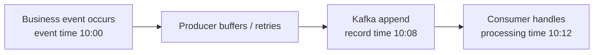

# Xử lý trễ, sự kiện trùng và sự kiện đến sai thứ tự

Trong hệ thống event streaming, thời điểm một sự kiện xảy ra có thể khác thời điểm Kafka nhận được nó và khác thời điểm consumer xử lý nó. Mạng chậm, retry, producer gửi song song, consumer rebalance hoặc hệ thống downstream tạm ngừng đều có thể làm event đến muộn, được giao lại hoặc hoàn tất sai thứ tự nghiệp vụ. Nếu không phân biệt các trường hợp này, ứng dụng có thể tính sai cửa sổ thời gian, cộng tiền hai lần hoặc để trạng thái cũ ghi đè trạng thái mới.

Bài này xây dựng cách xử lý ba tình huống trong Kafka và Java/Spring Kafka: event trễ theo event time, duplicate theo `eventId` và event đến sai thứ tự theo sequence của thực thể. Phần Kafka Streams trình bày watermark/stream-time và grace period cho cửa sổ event-time. Phần consumer trình bày idempotency, kiểm tra sequence, retry/DLT và các lựa chọn khi cần giữ ordering.

## 1. Phân biệt event time, ingestion time và processing time

Một record có thể có nhiều mốc thời gian khác nhau:

| Mốc thời gian | Ý nghĩa | Ví dụ |
|---|---|---|
| Event time | Thời điểm nghiệp vụ thực sự xảy ra, do nguồn phát event ghi nhận | Đơn hàng được thanh toán lúc 10:00:00 |
| Ingestion/record time | Thời điểm record được Kafka ghi vào log; phụ thuộc timestamp type của topic/broker | Broker nhận record lúc 10:00:08 |
| Processing time | Thời điểm consumer hoặc stream processor thực hiện logic | Ứng dụng xử lý record lúc 10:00:12 |

Nếu thiết bị ngoại tuyến phát lại event sau 20 phút, event time có thể là 10:00 nhưng ingestion time là 10:20. Nếu ứng dụng dùng processing time để tính doanh thu theo giờ phát sinh, doanh thu sẽ bị cộng vào giờ 10:20 thay vì giờ 10:00. Vì vậy, event cần mang timestamp nghiệp vụ rõ ràng, thường là `Instant` UTC.

Kafka record có timestamp riêng. Với `CreateTime`, producer cung cấp timestamp và broker lưu timestamp đó; với `LogAppendTime`, broker ghi đè bằng thời điểm append. Timestamp của record không tự động thay thế timestamp nghiệp vụ trong payload. Hãy giữ cả `occurredAt` trong event và record timestamp nếu cần đối chiếu.



## 2. Thiết kế event envelope có thể kiểm chứng

Một event nên có metadata đủ để phát hiện duplicate, xác định thứ tự và phân tích độ trễ:

```java
package com.example.events;

import java.math.BigDecimal;
import java.time.Instant;

public record PaymentCapturedEvent(
        String eventId,
        String paymentId,
        String orderId,
        long sequence,
        String eventType,
        Instant occurredAt,
        Instant producedAt,
        BigDecimal amount,
        String currency
) {
}
```

Ý nghĩa các trường:

- `eventId`: ID duy nhất của một sự kiện nghiệp vụ. Dùng để phát hiện cùng event được giao hoặc xử lý lại.
- `paymentId`/`orderId`: định danh thực thể. Chọn một key ổn định theo aggregate mà ứng dụng cần giữ thứ tự.
- `sequence`: số thứ tự tăng theo thực thể, được cấp tại nguồn có thẩm quyền.
- `occurredAt`: thời điểm nghiệp vụ xảy ra, dùng cho event-time processing.
- `producedAt`: thời điểm producer chuẩn bị phát event, hữu ích để đo độ trễ trước khi append.
- `eventType`, `amount`, `currency`: dữ liệu nghiệp vụ có schema rõ ràng.

Không tạo `sequence` bằng đồng hồ máy hoặc bằng số thứ tự toàn cục không có đồng bộ giữa producer. Sequence phải có ý nghĩa theo từng thực thể và được cấp nhất quán, ví dụ trong cùng transaction cập nhật aggregate ở database.

## 3. Event đến muộn là gì?

Event đến muộn là event có event time cũ hơn tiến độ thời gian mà hệ thống xử lý đã đi qua. Ví dụ hệ thống đang tổng hợp số giao dịch của cửa sổ 10:00–10:05 nhưng nhận được một event có `occurredAt=10:03` lúc processing time 10:09.

Event trễ không nhất thiết là lỗi. Các nguồn thường gửi event trễ vì:

- Thiết bị hoặc ứng dụng offline rồi đồng bộ lại.
- Producer retry sau timeout hoặc mất kết nối.
- Batch import dữ liệu lịch sử.
- Nhiều nguồn có độ trễ mạng khác nhau.
- Một partition ít dữ liệu làm tiến độ event-time của stream task khác với partition đang hoạt động.

Late và out-of-order là hai thuộc tính khác nhau. Một event có thể đến muộn theo `occurredAt` nhưng vẫn có sequence mới nhất; ngược lại, event có timestamp mới vẫn có thể mang sequence cũ do producer hoặc nguồn dữ liệu phát sai thứ tự. Hãy đo event lateness và sequence gap bằng hai phép kiểm tra riêng.

Ứng dụng cần quy định rõ event trễ được chấp nhận trong bao lâu, có cập nhật lại kết quả đã phát hay không, và event quá cũ sẽ được lưu ở đâu. Không nên âm thầm bỏ event chỉ vì nó đến sau một mốc processing time tùy ý.

## 4. Watermark, stream-time và grace period

Trong xử lý event-time, watermark là ước lượng tiến độ thời gian mà hệ thống cho rằng phần lớn event có timestamp nhỏ hơn mốc đó đã đến. Watermark không chứng minh tuyệt đối rằng sẽ không còn event cũ; event trễ hơn watermark vẫn có thể xuất hiện.

Kafka Streams sử dụng *stream-time* để quản lý tiến độ event-time của task. Stream-time được tiến lên theo timestamp của record được xử lý; nó không phải đồng hồ wall-clock chạy đều khi không có dữ liệu. Với window có grace period, record vẫn được chấp nhận trong khoảng grace sau khi window kết thúc theo stream-time. Khi stream-time vượt quá `windowEnd + grace`, record đến muộn cho window đó bị coi là late và không còn được cập nhật vào window đã đóng.

Ví dụ window 5 phút với grace 2 phút:

| Event time của record | Thời điểm stream-time quan sát | Kết quả |
|---|---|---|
| 10:03 | 10:04 | Được tính vào window 10:00–10:05 |
| 10:03 | 10:06 | Window chưa quá grace; vẫn có thể được chấp nhận |
| 10:03 | 10:08 | Stream-time đã vượt 10:07; record quá muộn và không còn cập nhật được window |

Mốc trong ví dụ là minh họa; điều kiện đóng window dựa trên stream-time thực tế của task, không dựa trực tiếp vào giờ trên máy. Stream-time tiến theo timestamp của record được xử lý. Khi một task đọc nhiều input partition, dữ liệu đến không đồng đều có thể ảnh hưởng thứ tự xử lý liên partition; `max.task.idle.ms` cho phép task chờ ngắn một partition đang tạm thời không có dữ liệu để giảm việc xử lý record từ partition khác quá sớm. Thiết lập này không tạo watermark wall-clock và cần được cân bằng với latency.

Grace period là chính sách nghiệp vụ: grace dài hơn giúp nhận thêm event trễ nhưng làm kết quả cuối cùng được xác nhận muộn hơn và state window tồn tại lâu hơn. Grace ngắn hơn giảm thời gian chờ và state, nhưng nhiều event trễ sẽ bị loại khỏi window.

## 5. Cấu hình event-time trong Kafka Streams

Ví dụ dùng timestamp nghiệp vụ từ payload. Trong ứng dụng thực tế, có thể dùng `TimestampExtractor` để đọc `occurredAt` sau khi deserialize event; nếu value là JSON string, cần parser phù hợp hoặc deserialize thành object trước khi đưa vào topology.

```java
import com.example.events.PaymentCapturedEvent;
import org.apache.kafka.clients.consumer.ConsumerRecord;
import org.apache.kafka.streams.processor.TimestampExtractor;

public class EventTimeExtractor implements TimestampExtractor {
    @Override
    public long extract(ConsumerRecord<Object, Object> record,
                        long partitionTime) {
        if (record.value() instanceof PaymentCapturedEvent event) {
            return event.occurredAt().toEpochMilli();
        }
        return record.timestamp();
    }
}
```

Cấu hình extractor cho Kafka Streams:

```java
Properties properties = new Properties();
properties.put(StreamsConfig.APPLICATION_ID_CONFIG, "payment-window-aggregator");
properties.put(StreamsConfig.BOOTSTRAP_SERVERS_CONFIG, "localhost:9092");
properties.put(StreamsConfig.DEFAULT_TIMESTAMP_EXTRACTOR_CLASS_CONFIG,
        EventTimeExtractor.class.getName());
```

Nếu event được deserialize ở `Consumed.with(...)`, hãy bảo đảm extractor nhận được kiểu value đã deserialize theo cách topology thực sự sử dụng. Với JSON string, extractor phải parse chuỗi hoặc timestamp nghiệp vụ cần được chuyển sang Kafka record timestamp ở producer. Không trả về timestamp tương lai/âm không hợp lệ; kiểm tra và quarantine event có timestamp lỗi.

Tạo window 5 phút và cho phép event trễ thêm 2 phút:

```java
Duration windowSize = Duration.ofMinutes(5);
Duration gracePeriod = Duration.ofMinutes(2);

TimeWindows windows = TimeWindows.ofSizeAndGrace(windowSize, gracePeriod);

KTable<Windowed<String>, Long> paymentCounts = builder
        .stream("payments.captured", Consumed.with(Serdes.String(), paymentSerde))
        .selectKey((key, event) -> event.orderId())
        .groupByKey(Grouped.with(Serdes.String(), paymentSerde))
        .windowedBy(windows)
        .count(Materialized.as("payment-counts-by-order-window"));
```

Ví dụ trên minh họa API Kafka Streams hiện đại; bổ sung import và `Serde` tương ứng với project. `count()` đếm record, do đó nếu producer phát duplicate thì duplicate vẫn bị tính. Event-time windowing không tự động deduplicate.

Nếu chỉ muốn phát kết quả cuối cùng sau khi window đóng, có thể dùng suppression:

```java
KTable<Windowed<String>, Long> finalCounts = paymentCounts.suppress(
        Suppressed.untilWindowCloses(Suppressed.BufferConfig.unbounded()));
```

Buffer suppression cần được cân nhắc kỹ vì `unbounded()` có thể tiêu thụ nhiều bộ nhớ khi số key/window lớn. Trong production, chọn buffer giới hạn và chính sách khi buffer đầy theo yêu cầu nghiệp vụ, đồng thời giám sát state store và changelog.

## 6. Chọn chính sách cho event đến muộn

Không có một chính sách late-event phù hợp cho mọi loại dữ liệu. Chọn theo yêu cầu kết quả:

| Chính sách | Khi phù hợp | Đánh đổi |
|---|---|---|
| Accept within grace | Dashboard/aggregate chấp nhận cập nhật muộn trong một khoảng xác định | Kết quả cuối cùng bị trễ đến hết grace |
| Recompute/backfill | Báo cáo tài chính hoặc dữ liệu lịch sử cần chính xác sau khi nguồn đồng bộ | Cần khả năng tính lại và quản lý phiên bản kết quả |
| Late-event side output | Cần lưu lại mọi event quá grace để điều tra hoặc xử lý batch | Cần topology/ứng dụng riêng để route và vận hành topic late |
| Drop with audit metric | Event quá hạn không còn giá trị nghiệp vụ và quy tắc cho phép loại bỏ | Có thể mất thông tin; phải có metric và audit rõ ràng |
| Update materialized state | Kết quả có thể được sửa khi event cũ đến sau | Consumer downstream phải chấp nhận update/retraction |

Kafka Streams window API bỏ qua record quá grace cho window đã đóng; nếu nghiệp vụ cần giữ chúng, hãy thiết kế nhánh kiểm tra late và ghi sang topic quarantine/late-events trước khi thông tin bị loại bỏ khỏi luồng aggregate. Không giả định `grace` tự tạo một topic chứa late records.

## 7. Phát hiện duplicate bằng eventId

Duplicate có thể xuất hiện ở nhiều tầng:

- Producer gửi lại cùng event ở tầng ứng dụng sau timeout.
- Producer retry request; idempotent producer xử lý duplicate protocol trong phạm vi session được hỗ trợ.
- Consumer xử lý xong side effect nhưng crash trước khi commit offset.
- Consumer retry hoặc retry topic giao lại cùng event.
- Upstream phát lại event vì job replay/backfill.

`enable.idempotence=true` ở producer không giải quyết duplicate do consumer replay. `eventId` phải ổn định qua mọi lần retry và replay của cùng một sự kiện nghiệp vụ. Không tạo UUID mới mỗi lần gửi lại cùng event, nếu không consumer sẽ không nhận ra chúng là một event.

Với dữ liệu cần deduplicate, lưu event ID đã xử lý trong kho bền vững. Ví dụ PostgreSQL:

```sql
CREATE TABLE processed_events (
    event_id       VARCHAR(100) PRIMARY KEY,
    aggregate_id   VARCHAR(100) NOT NULL,
    processed_at   TIMESTAMPTZ NOT NULL DEFAULT CURRENT_TIMESTAMP
);
```

Insert event ID và cập nhật dữ liệu nghiệp vụ trong cùng một database transaction:

```sql
INSERT INTO processed_events(event_id, aggregate_id)
VALUES (:event_id, :aggregate_id)
ON CONFLICT (event_id) DO NOTHING;
```

Nếu insert tạo một row mới, thực hiện side effect nghiệp vụ trong cùng transaction. Nếu không có row mới vì event ID đã tồn tại, bỏ qua side effect và coi record là đã xử lý. Sau khi transaction database commit thành công, mới commit Kafka offset. Không tách insert inbox và cập nhật nghiệp vụ thành hai transaction độc lập.

Ví dụ service dùng Spring `TransactionTemplate`:

```java
@Service
public class PaymentEventHandler {
    private final JdbcTemplate jdbc;
    private final TransactionTemplate transactionTemplate;

    public PaymentEventHandler(
            JdbcTemplate jdbc,
            TransactionTemplate transactionTemplate) {
        this.jdbc = jdbc;
        this.transactionTemplate = transactionTemplate;
    }

    public void handle(PaymentCapturedEvent event) {
        transactionTemplate.executeWithoutResult(status -> {
            int inserted = jdbc.update("""
                    INSERT INTO processed_events(event_id, aggregate_id)
                    VALUES (?, ?)
                    ON CONFLICT (event_id) DO NOTHING
                    """, event.eventId(), event.orderId());

            if (inserted == 0) {
                return; // Event đã được áp dụng trước đó.
            }

            int updated = jdbc.update("""
                    UPDATE orders
                    SET paid_amount = paid_amount + ?, updated_at = CURRENT_TIMESTAMP
                    WHERE order_id = ?
                    """, event.amount(), event.orderId());
            if (updated != 1) {
                throw new IllegalStateException("Order was not updated; roll back inbox insert");
            }
        });
    }
}
```

Các import cần có `JdbcTemplate`, `TransactionTemplate`, `Service` và kiểu event. Bảng `processed_events` và bảng `orders` phải nằm trong cùng datasource/transaction manager. Với event cập nhật trạng thái thay vì cộng dồn, cần thêm kiểm tra sequence ở bước update.

## 8. Giữ thứ tự bằng key và sequence

Kafka chỉ giữ thứ tự trong một partition. Nếu cần thứ tự theo đơn hàng, producer phải dùng `orderId` làm record key để các event cùng đơn hàng được route vào cùng partition với partitioner ổn định.

```java
String eventJson = mapper.writeValueAsString(event);
ProducerRecord<String, String> record =
        new ProducerRecord<>("payments.captured", event.orderId(), eventJson);
producer.send(record);
```

Đoạn gửi trên dùng `StringSerializer` cho cả key và value như ví dụ producer trước đó. Nếu gửi object trực tiếp, phải cấu hình serializer/Serde JSON tương ứng ở producer.

Điều này vẫn cần kiểm soát ở tầng ứng dụng:

- Nếu nhiều thread cùng gửi event cho một order, thứ tự gọi `send()` có thể không trùng với thứ tự sequence được cấp ở database.
- Nếu nhiều producer instance cùng phát event cho một order, Kafka ghi theo thứ tự record đến leader partition; idempotence của từng producer không tạo thứ tự toàn cục theo sequence giữa các producer. Dùng outbox/dispatcher có thứ tự theo aggregate hoặc sequence guard ở consumer.
- Nếu tăng số partition, partition mapping mặc định của key có thể thay đổi đối với event mới.
- Nếu consumer đưa record vào worker pool, side effect có thể hoàn tất khác thứ tự offset.
- Retry topic có thể khiến event sau đi đến main topic trước event cũ đang chờ retry.

Vì vậy, ngoài key, cần sequence tăng theo từng aggregate. Consumer kiểm tra sequence trước khi áp dụng:

| Sequence nhận được | Sequence hiện lưu | Hành động |
|---:|---:|---|
| 8 | 7 | Áp dụng event 8 |
| 8 | 8 | Cùng eventId: duplicate; eventId khác: sequence collision cần audit |
| 7 | 8 | Event cũ đến muộn; bỏ qua hoặc lưu audit theo chính sách |
| 10 | 8 | Thiếu sequence 9; giữ lại/retry hoặc đánh dấu gap để chờ event còn thiếu |

Không phải event nào có sequence nhỏ hơn hiện tại cũng là duplicate cùng event. Có thể đó là một event lịch sử hợp lệ đến trễ. Dùng `eventId` để nhận diện duplicate chính xác và dùng sequence để bảo vệ trạng thái aggregate khỏi event stale.

Với nghiệp vụ cần áp dụng đúng từng bước, có thể dùng điều kiện sequence trong câu lệnh cập nhật:

```sql
UPDATE orders
SET paid_amount = paid_amount + :amount,
    last_sequence = :sequence
WHERE order_id = :order_id
  AND last_sequence = :sequence - 1;
```

Nếu số row cập nhật bằng 1, sequence kế tiếp đã được áp dụng. Nếu bằng 0, đọc trạng thái hiện tại để phân loại: sequence đã xử lý (duplicate), sequence cũ (stale) hay đang có gap. Với gap, rollback transaction để cả insert `eventId` được hoàn tác, sau đó retry/reconcile theo chính sách; nếu commit inbox trong khi chưa áp dụng nghiệp vụ, lần giao lại sau sẽ bị nhận nhầm là duplicate đã hoàn tất. Với stale event được chấp nhận bỏ qua, có thể commit inbox cùng quyết định bỏ qua trong một transaction. Thực hiện câu lệnh này cùng bước insert `eventId` trong một database transaction để hai cơ chế không lệch nhau.

## 9. Xử lý event sai thứ tự: reject, buffer hay reconcile?

Khi sequence không đúng kỳ vọng, ứng dụng cần quyết định theo loại nghiệp vụ:

1. **Bỏ qua stale event:** phù hợp với snapshot/state update mà sequence mới hơn đã thay thế hoàn toàn trạng thái cũ.
2. **Buffer event có gap:** phù hợp khi cần nhận đủ chuỗi chuyển trạng thái; lưu event 10 chờ event 9 trong một khoảng timeout có giới hạn.
3. **Retry hoặc re-fetch nguồn:** phù hợp khi event thiếu có thể được phát lại từ upstream.
4. **Reconcile:** tải lại trạng thái chuẩn từ database/source of truth rồi áp dụng tiếp event mới.
5. **Quarantine/DLT:** phù hợp khi event không thể xử lý sau số lần thử cho phép hoặc dữ liệu không hợp lệ.

Buffer phải có giới hạn theo số event, dung lượng và thời gian. Nếu không có giới hạn, một gap sequence kéo dài có thể làm bộ nhớ tăng vô hạn. Khi timeout, phát cảnh báo và chuyển sang quy trình reconcile hoặc quarantine thay vì giữ partition mãi mãi.

## 10. Retry và Dead Letter Topic

Retry có thể thay đổi thứ tự quan sát. Ví dụ partition chứa sequence 1, 2, 3. Consumer xử lý sequence 1 lỗi và gửi nó sang retry topic; consumer tiếp tục xử lý 2 và 3. Khi sequence 1 được retry thành công sau cùng, downstream đã thấy 2, 3, 1.

| Chiến lược | Ordering | Khi dùng |
|---|---|---|
| Blocking retry tại consumer | Giữ partition chờ record lỗi; giảm throughput partition | Cần thứ tự nghiêm ngặt và lỗi thường ngắn hạn |
| Retry topic với delay | Có thể làm event sau đi trước event retry | Chấp nhận eventual ordering hoặc consumer có sequence guard |
| DLT | Event lỗi được cô lập để điều tra | Lỗi không retry được hoặc vượt số lần thử |
| Reorder buffer theo key | Có thể khôi phục thứ tự nếu sequence gap được lấp trong timeout | Event đến trễ có giới hạn và cần ordering nghiệp vụ |

Khi gửi event sang retry/DLT, giữ nguyên `eventId`, key, sequence, event time và headers gốc. Bổ sung metadata như `original-topic`, `original-partition`, `original-offset`, `delivery-attempt`, `failure-class` và `failed-at`. Không tạo eventId mới cho mỗi lần retry.

Ví dụ Spring Kafka dùng retry topic:

```java
@RetryableTopic(
        attempts = "4",
        backoff = @Backoff(delay = 1000, multiplier = 2.0),
        autoCreateTopics = "false",
        dltTopicSuffix = ".DLT")
@KafkaListener(topics = "payments.captured", groupId = "payment-service")
public void onPaymentCaptured(PaymentCapturedEvent event) {
    paymentEventHandler.handle(event);
}

@DltHandler
public void onDlt(PaymentCapturedEvent event) {
    // Ghi audit/alert; replay phải giữ eventId, key và sequence gốc.
}
```

Khai báo này cần import `RetryableTopic`, `DltHandler`, `KafkaListener` của Spring Kafka và `Backoff` từ Spring Retry; `PaymentEventHandler` được inject vào listener bean. `autoCreateTopics=false` yêu cầu topic retry/DLT đã được tạo và có số partition phù hợp. Non-blocking retry topics cải thiện khả năng tiếp tục xử lý record khác nhưng có thể phá ordering; nếu cần strict ordering, chọn blocking retry hoặc thiết kế sequence guard/reorder buffer. Kiểm tra phiên bản Spring Kafka vì các tùy chọn retry topic và hành vi mặc định có thể khác nhau.

## 11. Kafka Streams deduplication và state store

Với stream processing, dedup có thể được thực hiện bằng state store lưu `eventId` đã thấy. Mỗi event đến được kiểm tra trước khi cập nhật aggregate; nếu ID đã tồn tại trong retention window thì bỏ qua. State store cần có changelog để phục hồi sau restart và cần chính sách retention/expiry để dung lượng không tăng mãi.

Các điểm thiết kế:

- Chọn phạm vi dedup: toàn bộ lịch sử, trong một khoảng thời gian, hay trong vòng đời aggregate.
- Nếu event replay sau thời gian retention của state store, duplicate có thể được chấp nhận lại.
- Key của state store nên phân vùng phù hợp với topology và số task.
- Nếu cần atomicity Kafka-to-Kafka, bật processing guarantee exactly-once v2 và để Kafka Streams quản lý transaction/state changelog/output.
- Với side effect tới database/HTTP, vẫn cần idempotency ở hệ thống đích.

Không dùng cache in-memory đơn giản làm dedup store production: restart sẽ mất danh sách ID và nhiều instance không chia sẻ trạng thái.

## 12. Exactly-once không đồng nghĩa mọi side effect chỉ chạy một lần

Kafka có nhiều lớp semantics:

| Cơ chế | Bảo vệ |
|---|---|
| Producer idempotence | Retry protocol của producer không append duplicate do retry trong cùng producer session được hỗ trợ |
| Consumer manual commit | Kiểm soát vị trí group đã xác nhận; commit sau xử lý thường cho at-least-once |
| Database inbox/idempotency | Side effect database không bị áp dụng hai lần khi record replay |
| Kafka transaction | Atomic consume-transform-produce và commit offset input cùng output Kafka |
| Kafka Streams EOS | Atomicity giữa input offsets, state store/changelog và output Kafka theo processing guarantee |

Kafka transaction không tự bao gồm một transaction database hay REST API. Nếu ứng dụng cập nhật database rồi commit Kafka offset, vẫn có cửa sổ crash giữa hai hệ thống. Inbox/outbox hoặc một cơ chế phối hợp transaction là cần thiết để xử lý khoảng trống này.

## 13. Kiểm soát timestamp không hợp lệ và clock skew

Event time chỉ đáng tin khi nguồn tạo timestamp có quy tắc rõ ràng. Một số lỗi thường gặp:

- Đồng hồ thiết bị chạy nhanh/chậm so với UTC.
- Timestamp không có timezone bị diễn giải như local time.
- Producer gửi timestamp tương lai do cấu hình sai.
- Event replay dùng timestamp nhập dữ liệu thay vì timestamp nghiệp vụ gốc.
- Timestamp bị thiếu hoặc parse lỗi.

Khuyến nghị:

- Dùng ISO-8601 có timezone hoặc epoch milliseconds với quy ước UTC.
- Ghi `occurredAt` và `producedAt` riêng.
- Kiểm tra timestamp nằm trong miền hợp lệ so với thời gian nhận; không âm thầm thay timestamp nghiệp vụ bằng processing time.
- Gửi event timestamp sai sang topic quarantine có metadata nguồn và lý do.
- Theo dõi độ lệch `ingestionTime - eventTime` theo percentile và theo nguồn.

## 14. Metrics và quan sát

Để phân biệt late, duplicate và out-of-order, cần metrics riêng:

| Metric | Cách hiểu |
|---|---|
| Event lateness | `processingTime - eventTime` hoặc `ingestionTime - eventTime` theo định nghĩa thống nhất |
| Late event count | Số event nằm ngoài grace/window policy |
| Duplicate event count | Số lần eventId đã thấy được nhận lại |
| Sequence gap count | Số lần nhận sequence lớn hơn sequence kỳ vọng kế tiếp |
| Stale event count | Số event có sequence thấp hơn trạng thái đã áp dụng |
| Retry attempt count | Số lần gửi qua retry path theo loại lỗi |
| DLT count | Số event phải quarantine |
| Reorder buffer size/age | Số event đang chờ gap và tuổi của event chờ lâu nhất |
| Window update/finalization delay | Độ trễ từ cuối window đến lúc kết quả được phát cuối cùng |
| Consumer lag | Khoảng cách xử lý so với log end offset; không thay thế event lateness |

Consumer lag thấp không có nghĩa event không bị trễ: event lịch sử có thể vừa được ghi vào Kafka nên lag bằng 0 nhưng event time đã cũ nhiều giờ. Ngược lại, consumer lag cao không luôn có nghĩa event time cũ nếu producer vừa phát một lượng lớn event hiện thời.

## 15. Lab: tạo late event, duplicate và out-of-order event

Mục tiêu lab là tạo ba nhóm event có thể nhận diện rõ ràng rồi quan sát chính sách xử lý.

### Bước 1: tạo topic

```bash
kafka-topics.sh \
  --bootstrap-server localhost:9092 \
  --create \
  --topic payments.captured \
  --partitions 3 \
  --replication-factor 1
```

Với cluster nhiều broker, có thể tăng replication factor theo năng lực cluster. Topic có ba partition để quan sát phân phối theo key; tất cả event cùng `orderId` nên giữ cùng key.

### Bước 2: phát chuỗi event bình thường

Phát event cho cùng một `orderId` với sequence 1, 2, 3 và timestamp tăng dần. Ghi lại eventId, partition, offset từ callback producer.

### Bước 3: phát event đến muộn

Sau khi đã phát sequence 3, gửi một event lịch sử có `occurredAt` nằm trong window trước đó. Giữ sequence nghiệp vụ hợp lệ theo mô hình nguồn; nếu đó là event bị thiếu sequence 2 thì gửi sequence 2 để kiểm tra reorder/gap. Quan sát event có được chấp nhận trong grace period hay bị xem là late.

### Bước 4: phát duplicate

Gửi lại đúng payload và cùng `eventId` của sequence 2. Producer có thể append một record mới nếu đây là lần gửi ứng dụng độc lập; consumer phải nhận diện cùng eventId và bỏ qua side effect lần hai. So sánh offset để thấy duplicate trong log khác với duplicate processing.

### Bước 5: tạo out-of-order

Gửi sequence 1, 3, rồi 2 cho cùng key. Quan sát consumer phát hiện gap khi nhận sequence 3 và quyết định buffer, retry hoặc quarantine. Kiểm tra sequence guard ở database để event cũ không ghi đè trạng thái mới.

### Bước 6: thử retry topic

Cho sequence 1 lỗi tạm thời để đi vào retry topic, trong khi sequence 2 và 3 được xử lý ở main topic. Quan sát thứ tự downstream và xác nhận sequence guard có ngăn trạng thái bị cập nhật sai hay không.

### Bước 7: đối chiếu kết quả

- Nhóm log theo eventId để đếm duplicate processing.
- Nhóm record theo eventId và offset để xác định duplicate đã tồn tại trong Kafka log.
- Sắp theo partition/offset để kiểm tra thứ tự Kafka.
- Sắp theo orderId/sequence để kiểm tra thứ tự nghiệp vụ.
- Đo lateness và so sánh với grace period.
- Kiểm tra late topic, retry topic và DLT có giữ nguyên key/eventId/sequence hay không.

## 16. Troubleshooting

| Hiện tượng | Nguyên nhân có thể có | Cách xử lý |
|---|---|---|
| Event cũ cập nhật đè trạng thái mới | Không kiểm tra sequence hoặc event time | Dùng version/sequence guard và quy tắc stale event |
| Duplicate cộng tiền hai lần | Chỉ dựa vào producer idempotence | Dùng eventId và inbox trong cùng transaction database |
| Window aggregate bỏ qua event trễ | Stream-time đã vượt window end + grace | Tăng grace có kiểm soát hoặc route late event để backfill |
| Kết quả window phát quá muộn | Grace dài, stream-time tiến chậm hoặc suppression chờ window đóng | Đánh giá grace, partition activity và yêu cầu latency |
| Retry làm event sau đi trước | Non-blocking retry topic | Dùng blocking retry khi cần strict order hoặc sequence guard |
| Sequence gap tồn tại lâu | Event thiếu không được phát lại hoặc upstream mất dữ liệu | Timeout, alert, reconcile với source of truth và quarantine |
| Duplicate xuất hiện sau restart | Dedup chỉ lưu trong memory | Dùng database inbox hoặc Kafka Streams persistent state store |
| Lateness metric bất thường | Clock skew hoặc timezone parse sai | Chuẩn hóa UTC, kiểm tra nguồn timestamp và quarantine dữ liệu lỗi |

## 17. Tiêu chí hoàn thành

- Phân biệt event time, record/ingestion time và processing time.
- Giải thích watermark/stream-time và grace period trong Kafka Streams.
- Xác định event late theo window policy và chọn accept, backfill, side output hoặc drop có audit.
- Phát hiện duplicate bằng `eventId` ổn định qua retry/replay.
- Phân biệt producer idempotence với consumer/business idempotency.
- Giữ ordering theo key/partition và kiểm tra sequence theo aggregate.
- Xử lý sequence gap, stale event và retry/DLT theo chính sách rõ ràng.
- Theo dõi lateness, duplicate, sequence gap, retry, DLT và consumer lag bằng metric riêng.

## 18. Ghi nhớ

| Vấn đề | Cách kiểm soát chính |
|---|---|
| Event đến muộn | Event time, watermark/stream-time, grace và chính sách backfill |
| Event trùng | `eventId` ổn định, producer idempotence và database inbox |
| Event sai thứ tự | Key ổn định, sequence theo aggregate, tuần tự hóa xử lý và stale-event guard |
| Retry làm đảo thứ tự | Blocking retry hoặc sequence-aware processing |
| Window aggregate sai | Timestamp extractor đúng, grace phù hợp và dedup trước aggregate |
| Side effect ngoài Kafka | Transaction database + inbox/idempotency; Kafka EOS không bao trùm hệ thống ngoài |

Kafka lưu record theo thứ tự offset trong từng partition, nhưng ứng dụng phải tự xác định event time, nhận diện duplicate và bảo vệ thứ tự nghiệp vụ. Dùng `eventId` để chống xử lý lặp, sequence để nhận biết event stale hoặc gap, và watermark/grace để quản lý event-time window. Retry, rebalance và xử lý song song cần được thiết kế cùng các cơ chế này để luồng event vẫn đúng khi dữ liệu đến trễ hoặc không theo thứ tự dự kiến.
