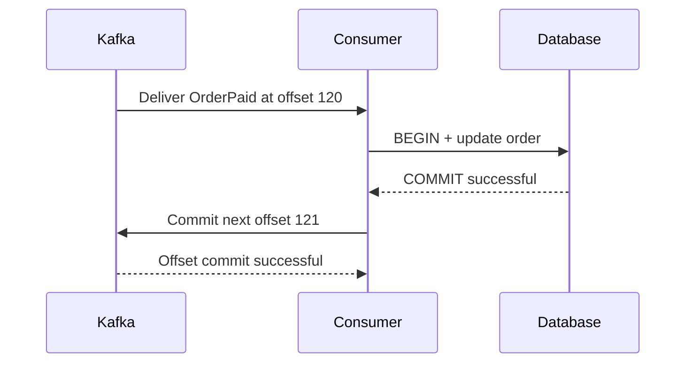
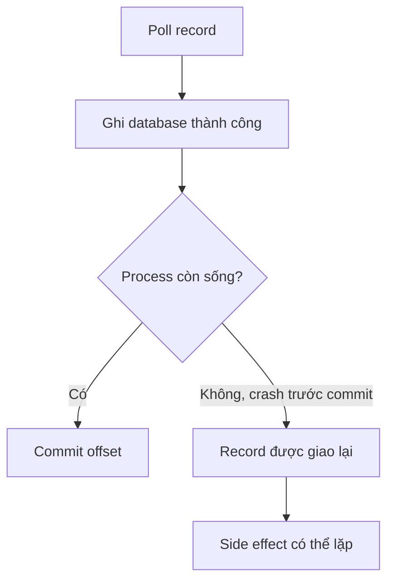
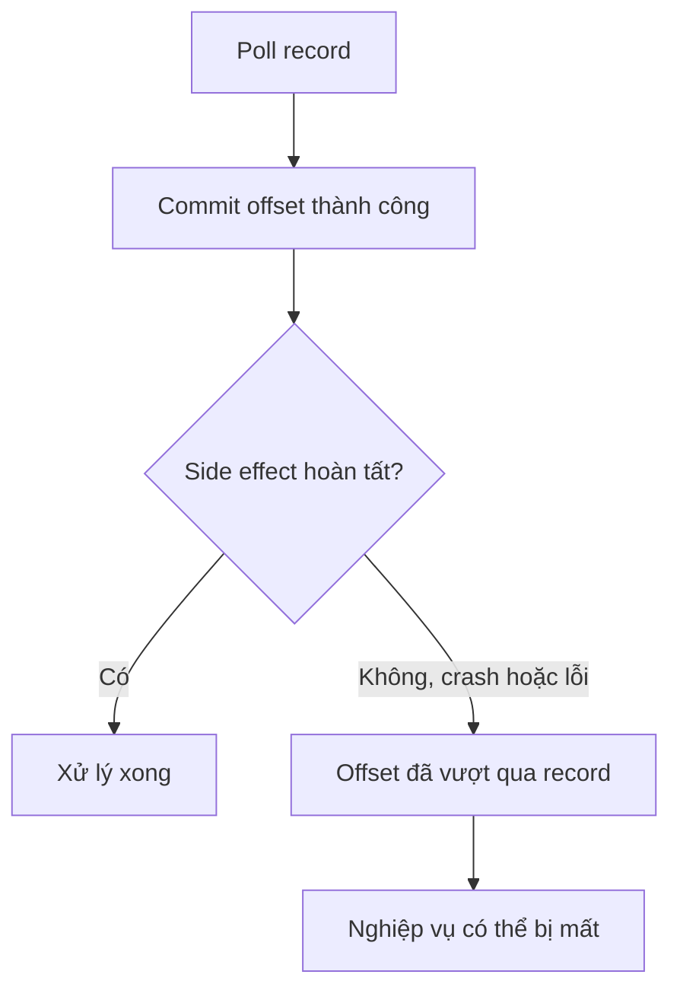
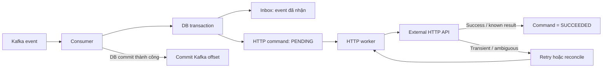
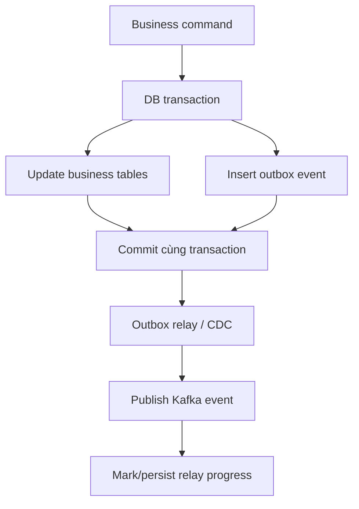

# Giới hạn bảo đảm khi gọi HTTP hoặc ghi cơ sở dữ liệu ngoài Kafka

Kafka hỗ trợ producer idempotence và transaction để kiểm soát việc ghi record, replication và offset trong phạm vi Kafka. Nhưng khi consumer gọi một HTTP API hoặc cập nhật database bên ngoài, side effect đó nằm ngoài transaction của Kafka. Một lần xử lý vì thế có thể thành công ở hệ thống ngoài nhưng thất bại trước khi offset được commit, hoặc offset đã được commit nhưng side effect chưa xảy ra.

Đây là ranh giới quan trọng của processing semantics: **Kafka không tự bảo đảm exactly-once cho HTTP request hoặc database write bên ngoài Kafka**. Để tránh mất nghiệp vụ và kiểm soát duplicate, ứng dụng thường kết hợp at-least-once delivery với idempotency, inbox/outbox, retry có giới hạn và đối soát.

## 1. Phân biệt delivery và side effect

Consumer đọc record từ một partition, thực hiện nghiệp vụ rồi commit offset. Offset commit lưu vị trí tiếp theo cần đọc. Kafka và hệ thống ngoài (database hoặc HTTP service) có hai cơ chế commit độc lập, nên không có một transaction mặc định bao trùm cả hai.

Ví dụ một consumer đọc `OrderPaid`, cập nhật database và sau đó commit offset:



Có hai thao tác độc lập:

- **Side effect:** cập nhật database, gọi API thanh toán, gửi email hoặc thực hiện hành động ở hệ thống khác.
- **Offset commit:** ghi nhận consumer group đã xử lý tới vị trí nào trong Kafka.

Kafka transaction có thể phối hợp nhiều output Kafka và offset input của một consumer group. Nó không tự enlist một database thông thường hoặc HTTP server vào cùng transaction.

## 2. Hai thứ tự commit và cửa sổ lỗi

Khi xử lý record rồi ghi database, có hai thứ tự cơ bản. Mỗi thứ tự có một loại rủi ro riêng.

### Side effect trước, commit offset sau

Đây là cách thường dùng để đạt at-least-once:

1. Consumer nhận record.
2. Database transaction cập nhật thành công.
3. Consumer commit offset.

Nếu process chết sau bước 2 nhưng trước bước 3, Kafka vẫn xem offset cũ là chưa commit và sẽ giao record lại. Database có thể nhận cùng nghiệp vụ lần thứ hai.



Hành vi này tránh bỏ qua record chỉ vì offset đã được lưu quá sớm, nhưng yêu cầu side effect idempotent hoặc có cơ chế nhận diện duplicate.

### Commit offset trước, side effect sau

Nếu consumer commit offset trước khi gọi database hoặc HTTP API:

1. Consumer nhận record.
2. Consumer commit offset thành công.
3. Process chết trước khi side effect hoàn tất.

Khi khởi động lại, consumer tiếp tục sau offset đã commit. Record không được giao lại theo tiến độ group, nên nghiệp vụ có thể bị mất.



Vì vậy, commit trước side effect tạo semantics gần at-most-once cho phần nghiệp vụ đó: tránh xử lý lại nhưng chấp nhận nguy cơ bỏ sót. Với đa số nghiệp vụ cần độ tin cậy, thường chọn side effect trước rồi commit offset, sau đó giải quyết duplicate bằng idempotency.

| Thứ tự | Nếu process chết ở khoảng giữa | Hệ quả |
|---|---|---|
| Side effect → commit offset | Side effect đã thành công, offset chưa commit | Record có thể được giao lại; cần chống duplicate |
| Commit offset → side effect | Offset đã commit, side effect chưa thành công | Record có thể bị bỏ qua; có nguy cơ mất nghiệp vụ |

## 3. Exactly-once trong Kafka có ranh giới rõ ràng

Kafka cung cấp các cơ chế sau:

- **Idempotent producer:** dùng producer ID, epoch và sequence để broker nhận diện retry/duplicate của producer trong phạm vi protocol được hỗ trợ.
- **Kafka transaction:** ghi atomically nhiều record vào các topic/partition Kafka và phối hợp offset consumer bằng `sendOffsetsToTransaction()`.
- **Consumer isolation `read_committed`:** chỉ đọc các record thuộc transaction đã commit, đồng thời tuân theo transaction visibility và Last Stable Offset.
- **Kafka Streams exactly-once processing:** phối hợp input offsets, output records và state changelog trong phạm vi Kafka Streams quản lý khi cấu hình processing guarantee tương ứng.

Các cơ chế đó không tự bao gồm:

- Ghi một row vào PostgreSQL, MySQL hoặc database khác.
- Gọi REST/gRPC API của payment provider hoặc dịch vụ nội bộ.
- Gửi email, SMS, push notification hoặc ghi file lên hệ thống ngoài.
- Thực hiện một side effect vật lý hoặc nghiệp vụ không hỗ trợ transaction/idempotency.

Ví dụ, Kafka Streams có thể bảo đảm trạng thái xử lý và output Kafka theo exactly-once v2, nhưng nếu processor gọi HTTP trực tiếp để thu tiền, HTTP request đó không được rollback khi Kafka transaction abort. Nếu task được chạy lại, API có thể bị gọi lần nữa.

**Exactly-once processing trong Kafka không đồng nghĩa exactly-once effect trên toàn bộ hệ thống phân tán.** Muốn bảo vệ side effect bên ngoài, phải dùng cơ chế mà hệ thống đích hỗ trợ hoặc thiết kế một workflow có thể retry và đối soát.

Về lý thuyết, một số database và middleware hỗ trợ XA/2-phase commit có thể tham gia distributed transaction nếu tất cả resource manager và transaction coordinator đều tích hợp đúng. Cách này có chi phí điều phối, tăng độ phức tạp và có thể giữ resource ở trạng thái prepared khi coordinator gặp sự cố. Một HTTP API thông thường không phải XA resource và không thể được enlist chỉ bằng cách gọi REST. Vì vậy, XA không phải bảo đảm mặc định của Kafka và không thay thế việc kiểm tra khả năng transaction thực tế của từng hệ thống.

## 4. Ghi database bằng inbox/idempotent consumer

Một cách phổ biến để xử lý Kafka → database là ghi dấu event đã xử lý và cập nhật dữ liệu nghiệp vụ trong **cùng một database transaction**. Mẫu này thường được gọi là inbox hoặc idempotent consumer.

### Bảng inbox và unique event ID

Mỗi event nên có `eventId` ổn định, duy nhất trong phạm vi nguồn phát. Database lưu event ID đã áp dụng với unique constraint. Khi Kafka giao lại cùng event, thao tác insert inbox không tạo thêm row và ứng dụng bỏ qua side effect đã hoàn tất.

Ví dụ schema PostgreSQL:

```sql
CREATE TABLE processed_events (
    event_id       VARCHAR(100) PRIMARY KEY,
    processed_at   TIMESTAMPTZ NOT NULL DEFAULT now()
);

CREATE TABLE orders (
    order_id       VARCHAR(100) PRIMARY KEY,
    status         VARCHAR(40) NOT NULL,
    version        BIGINT NOT NULL
);
```

Trong một transaction database, insert inbox trước rồi mới cập nhật order. Nếu event đã tồn tại, bỏ qua update. Nếu update nghiệp vụ thất bại, transaction rollback cả inbox row, để lần giao lại có thể thử lại.

Ví dụ Java dùng Spring `JdbcTemplate` và PostgreSQL `ON CONFLICT DO NOTHING`:

```java
@Service
public class OrderEventHandler {
    private final JdbcTemplate jdbc;

    public OrderEventHandler(JdbcTemplate jdbc) {
        this.jdbc = jdbc;
    }

    @Transactional
    public void applyOnce(OrderEvent event) {
        int inserted = jdbc.update("""
            INSERT INTO processed_events(event_id)
            VALUES (?)
            ON CONFLICT (event_id) DO NOTHING
            """, event.eventId());

        if (inserted == 0) {
            // Event đã được áp dụng trong một transaction trước đó.
            return;
        }

        jdbc.update("""
            UPDATE orders
               SET status = ?, version = ?
             WHERE order_id = ?
            """, event.status(), event.aggregateVersion(), event.orderId());
    }
}
```

`ON CONFLICT DO NOTHING` là cú pháp PostgreSQL; database khác có cú pháp upsert/ignore riêng. Điều quan trọng là thao tác insert inbox và cập nhật nghiệp vụ phải nằm trong cùng transaction trên cùng database. Không chỉ dùng `SELECT` kiểm tra event ID rồi insert sau, vì hai consumer có thể đồng thời vượt qua bước kiểm tra; unique constraint mới là lớp bảo vệ cuối cùng.

### Consumer commit sau khi database transaction hoàn tất

Với Spring Kafka, listener gọi service transaction ở database. Khi phương thức service trả về thành công, transaction database đã commit; container sau đó commit offset theo acknowledgement mode đã cấu hình.

```java
@Component
public class OrderListener {
    private final OrderEventHandler handler;

    public OrderListener(OrderEventHandler handler) {
        this.handler = handler;
    }

    @KafkaListener(topics = "order-events", groupId = "order-projection")
    public void onMessage(OrderEvent event) {
        handler.applyOnce(event);
    }
}
```

Cấu hình minh họa:

```yaml
spring:
  kafka:
    consumer:
      enable-auto-commit: false
      group-id: order-projection
    listener:
      ack-mode: record
```

Hãy kiểm tra cấu hình container và transaction manager của phiên bản Spring Kafka đang dùng. Ví dụ giả định listener xử lý đồng bộ, database transaction commit trước khi listener trả về và container chỉ commit offset sau khi listener thành công.

Nếu process chết sau database commit nhưng trước offset commit, Kafka giao event lại. Inbox unique constraint nhận ra event đã được áp dụng và không chạy side effect lần hai; listener trả về thành công và offset có thể tiến lên. Nếu database transaction rollback, inbox marker cũng rollback và record được retry theo error handling policy.

### Những giới hạn cần quản lý

- Event ID phải ổn định qua retry và replay; không tạo UUID mới mỗi lần consumer xử lý.
- Inbox table cần chính sách retention/cleanup phù hợp với thời gian replay tối đa. Xóa marker quá sớm có thể cho phép event cũ chạy lại.
- Nếu nhiều nguồn có thể phát cùng ID, dùng khóa ghép như `(source, event_id)`.
- Nếu aggregate cần thứ tự, lưu `aggregateVersion` và từ chối hoặc xử lý riêng event đến sai thứ tự.
- Inbox bảo vệ transaction trong database đó; nó không tự bảo vệ side effect ở một HTTP service khác.

## 5. Gọi HTTP API: timeout không cho biết side effect đã xảy ra hay chưa

HTTP call tạo một tình huống đặc biệt. Consumer gửi request đến dịch vụ ngoài nhưng timeout trước khi nhận response. Có thể đã xảy ra một trong các trường hợp:

1. Request chưa tới server; side effect chưa xảy ra.
2. Server nhận request nhưng chưa thực hiện nghiệp vụ.
3. Server đã thực hiện side effect nhưng response bị mất trên mạng.
4. Server đang xử lý và response đến sau timeout phía client.

Trong trường hợp 3, retry bằng request mới có thể thu tiền hoặc tạo lệnh hai lần. Consumer không thể suy ra từ timeout rằng server chưa làm gì.

### Idempotency key cho HTTP request

Nếu API đích hỗ trợ idempotency key, hãy gửi một key ổn định gắn với event/command và dùng lại key đó qua mọi lần retry.

```java
public PaymentResult charge(OrderPaid event) {
    String idempotencyKey = "charge:" + event.eventId();

    return httpClient.post()
            .uri("/payments")
            .header("Idempotency-Key", idempotencyKey)
            .body(event.toPaymentRequest())
            .retrieve()
            .body(PaymentResult.class);
}
```

Đây là ví dụ minh họa; header `Idempotency-Key` chỉ có tác dụng nếu API đích thực sự hỗ trợ và lưu kết quả theo key. Cần xác nhận với nhà cung cấp:

- Cùng key và cùng payload có trả lại kết quả cũ hay không.
- Cùng key nhưng payload khác được xử lý thế nào.
- Key được lưu trong bao lâu và có bao phủ toàn bộ retry/replay window không.
- Request đang xử lý có thể được query bằng idempotency key hay operation ID không.
- Những lỗi nào được retry và lỗi nào là kết quả nghiệp vụ cuối cùng.

Không tự giả định mọi HTTP `POST` đều hỗ trợ idempotency. HTTP method có semantics idempotent ở cấp giao thức không bảo đảm mọi implementation hoặc side effect phía sau đều thực sự idempotent.

### Khi API không hỗ trợ idempotency

Nếu dịch vụ đích không có idempotency key hoặc khả năng tra cứu operation, không thể bảo đảm exactly-once side effect chỉ bằng Kafka consumer. Các lựa chọn thực tế gồm:

- Tạo command ID ở hệ thống nguồn và yêu cầu API đích lưu command ID duy nhất.
- Ghi trạng thái command vào database local rồi để worker thực hiện HTTP với retry có kiểm soát.
- Nếu timeout, tra cứu trạng thái nghiệp vụ trước khi gửi lại thay vì mù quáng retry.
- Định kỳ đối soát dữ liệu giữa hệ thống nguồn và đích để phát hiện command thiếu hoặc trùng.
- Dùng workflow/Saga với bước bù trừ khi không thể rollback side effect đã xảy ra.

Nếu không có idempotency, operation lookup hoặc reconciliation đáng tin cậy, phải chấp nhận rằng kết quả sau timeout có thể không xác định. Không có cấu hình Kafka nào tự loại bỏ sự mơ hồ đó.

## 6. Đưa HTTP command qua database để kiểm soát retry

Một kiến trúc hữu ích là để Kafka listener chỉ ghi nhận command vào database trong transaction, sau đó commit offset. Một worker riêng đọc các command pending và gọi HTTP API.



Trong cùng database transaction:

1. Insert event ID vào inbox với unique constraint.
2. Nếu event mới, insert một command row với trạng thái `PENDING` và idempotency key ổn định.
3. Commit database transaction.
4. Consumer commit offset Kafka sau khi listener hoàn tất.

Worker lấy command pending, gọi API và cập nhật trạng thái `SUCCEEDED`, `FAILED` hoặc `UNKNOWN/RECONCILE`. Có thể lưu attempt count, `next_attempt_at`, response code, operation ID và lỗi gần nhất.

Mẫu này tách tiến trình Kafka poll khỏi thời gian HTTP chậm, cho phép retry có backoff và quan sát command. Tuy nhiên, worker vẫn cần idempotency key ở API đích hoặc khả năng tra cứu để xử lý crash sau khi API đã thành công nhưng trước khi database cập nhật trạng thái command.

## 7. Transactional outbox cho chiều database → Kafka

Một vấn đề liên quan xuất hiện khi service vừa cập nhật database vừa phát event Kafka. Nếu database commit trước rồi process chết trước `producer.send()`, database có thay đổi nhưng event không được phát. Nếu gửi Kafka trước rồi database rollback, Kafka có thể chứa event cho thay đổi chưa tồn tại.

Transactional outbox giải quyết dual write bằng cách ghi thay đổi nghiệp vụ và outbox row trong cùng database transaction:



Ví dụ bảng outbox:

```sql
CREATE TABLE outbox_events (
    event_id       VARCHAR(100) PRIMARY KEY,
    aggregate_id   VARCHAR(100) NOT NULL,
    event_type     VARCHAR(100) NOT NULL,
    payload        JSONB NOT NULL,
    created_at     TIMESTAMPTZ NOT NULL DEFAULT now(),
    published_at   TIMESTAMPTZ
);
```

Service cập nhật đơn hàng và insert outbox event trong cùng transaction. Một relay worker hoặc CDC connector đọc outbox rồi publish event. Nếu relay publish thành công nhưng crash trước khi ghi nhận đã publish, event có thể được phát lại; consumer downstream vẫn cần idempotency theo `event_id`.

Outbox loại bỏ khoảng trống giữa database commit và việc ghi nhận ý định phát event. Nó không biến Kafka và database thành một transaction duy nhất, và không tự bảo đảm relay chỉ publish đúng một lần.

## 8. Retry, backoff và dead-letter topic

Retry là cần thiết với lỗi tạm thời như timeout, HTTP 503 hoặc database connection reset. Nhưng retry vô hạn hoặc retry ngay lập tức có thể làm nghẽn partition và tạo retry storm.

Một chính sách retry nên xác định:

- **Retryable errors:** timeout, throttling, lỗi kết nối và lỗi server tạm thời.
- **Non-retryable errors:** payload sai schema, dữ liệu thiếu bắt buộc hoặc lỗi nghiệp vụ không thể tự hết.
- **Backoff:** tăng thời gian chờ theo exponential backoff và thêm jitter để tránh nhiều consumer retry cùng lúc.
- **Retry budget:** giới hạn số lần hoặc tổng thời gian retry trước khi chuyển sang trạng thái cần can thiệp.
- **DLT:** lưu record không xử lý được cùng metadata lỗi, attempt, timestamp và source topic/partition/offset.
- **Replay policy:** chỉ phát lại sau khi nguyên nhân được xử lý; giữ event ID để side effect vẫn idempotent.

Nếu retry tại chỗ bằng cách chờ lâu trong listener, consumer có thể không poll kịp và bị rebalance. Với retry chậm, có thể dùng retry topic theo cấp thời gian, pause/resume partition có kiểm soát hoặc lưu command pending trong database.

Khi chuyển record sang DLT Kafka rồi commit offset nguồn, cần tránh cửa sổ lỗi giữa hai thao tác. Nếu DLT publish thành công nhưng offset chưa commit, record có thể được gửi DLT lần nữa. Với consume-transform-produce chỉ nằm trong Kafka, Kafka transaction có thể phối hợp DLT output và offset input trong cùng transaction. Nếu DLT là database hoặc hệ thống ngoài Kafka, cần inbox/outbox/idempotency tương ứng.

## 9. Saga và compensating action

Một workflow có thể gồm nhiều side effect ở nhiều hệ thống, ví dụ tạo đơn hàng, giữ hàng trong kho và thu tiền. Không có transaction Kafka nào rollback được mọi hệ thống ngoài khi bước sau thất bại.

Saga chia workflow thành các bước cục bộ có trạng thái và định nghĩa hành động bù trừ:

| Bước | Hành động | Bù trừ khi bước sau thất bại |
|---|---|---|
| 1 | Tạo order ở trạng thái `PENDING` | Hủy order hoặc chuyển `CANCELLED` |
| 2 | Reserve inventory | Release reservation |
| 3 | Charge payment | Refund/void payment theo khả năng provider |
| 4 | Confirm order | Giữ trạng thái cuối hoặc phát thông báo kết quả |

Compensating action không phải rollback database toàn cục. Nó là một nghiệp vụ mới để đưa hệ thống về trạng thái chấp nhận được. Hành động bù trừ cũng có thể thất bại, cần retry, idempotency và trạng thái theo dõi riêng.

Kafka có thể vận chuyển command/event giữa các bước Saga, nhưng coordinator hoặc choreography logic phải quản lý correlation ID, timeout, retry, duplicate và trạng thái workflow.

## 10. Ma trận sự cố khi kết hợp Kafka với hệ thống ngoài

| Điểm crash/lỗi | Trạng thái có thể xảy ra | Cách bảo vệ |
|---|---|---|
| Trước side effect | Chưa có thay đổi ngoài Kafka, offset chưa commit | Retry record |
| Trong HTTP call, client timeout | Kết quả bên ngoài chưa rõ | Dùng idempotency key/operation lookup; đánh dấu ambiguous và reconcile |
| Side effect thành công, trước offset commit | Kafka giao lại record | Inbox/unique event ID hoặc API idempotency |
| Offset commit trước side effect | Record không được giao lại dù side effect chưa xảy ra | Tránh thứ tự này cho nghiệp vụ cần không mất dữ liệu |
| DB transaction rollback | Không có business update và inbox marker nếu cùng transaction | Để record retry |
| DB commit xong, process chết trước offset commit | Event được giao lại nhưng inbox marker còn | Duplicate trở thành no-op |
| Outbox commit xong, relay chưa publish | Event còn pending trong outbox | Relay tiếp tục đọc và publish |
| Relay publish xong, chưa đánh dấu published | Có thể publish trùng | Event ID ổn định và consumer idempotent |
| DLT publish xong, offset nguồn chưa commit | Record có thể vào DLT lần nữa | Kafka transaction nếu cả hai ở Kafka; nếu không, dedupe |

## 11. Ví dụ chọn semantics theo loại nghiệp vụ

| Nghiệp vụ | Mục tiêu | Thiết kế phù hợp |
|---|---|---|
| Cập nhật read model trong database | Không mất event, chấp nhận replay | DB transaction + inbox unique event ID; commit Kafka offset sau DB commit |
| Tạo thanh toán qua provider | Tránh thu tiền trùng | Stable idempotency key, query operation status, retry có kiểm soát và reconciliation |
| Phát event sau khi cập nhật database | Không để DB commit mà thiếu event | Transactional outbox + relay/CDC; downstream idempotent |
| Consume rồi phát event Kafka khác | Atomic input offset và output Kafka | Kafka transaction + `sendOffsetsToTransaction()`; consumer downstream `read_committed` |
| Gửi email/thông báo | Chấp nhận retry nhưng tránh gửi trùng | Notification command table, provider idempotency nếu có, dedupe và delivery status |
| Workflow nhiều dịch vụ | Phục hồi khi một bước thất bại | Saga, state machine, timeout và compensating action |

Chọn semantics dựa trên hậu quả nghiệp vụ của duplicate và mất dữ liệu. Với payment, duplicate có thể gây thiệt hại trực tiếp; với cache projection, upsert idempotent thường đủ; với email, cần quyết định có thể gửi trùng hay cần provider dedupe.

## 12. Quan sát và vận hành

Để hiểu side effect ngoài Kafka, chỉ theo dõi consumer lag là chưa đủ. Cần theo dõi cả trạng thái workflow và hệ thống đích:

- Kafka: consumer lag, poll/processing latency, commit failure, rebalance, retry rate và DLT rate.
- Database: transaction latency, deadlock, unique constraint conflict, inbox/outbox backlog và connection pool.
- HTTP: request latency, timeout, status code, retry count, idempotency conflict và operation status.
- Workflow: số command `PENDING`, `UNKNOWN`, `FAILED`, thời gian ở mỗi trạng thái và số lần reconciliation.
- Dữ liệu: event ID, correlation ID, aggregate ID/version và trạng thái trước/sau.

Log và trace nên mang cùng `eventId`/`correlationId` xuyên Kafka, consumer, database và HTTP request. Không ghi token, credential hoặc payload nhạy cảm đầy đủ vào log.

## 13. Checklist thiết kế

- [ ] Xác định rõ side effect nào nằm trong Kafka và side effect nào ở hệ thống ngoài.
- [ ] Chọn thứ tự side effect → offset commit nếu cần at-least-once; không commit offset trước khi side effect hoàn tất.
- [ ] Gán event ID ổn định và dùng unique constraint/inbox để chống duplicate database write.
- [ ] Ghi inbox marker và business update trong cùng database transaction.
- [ ] Với HTTP, dùng idempotency key ổn định nếu API hỗ trợ; xác nhận TTL và hành vi khi payload khác.
- [ ] Có cách tra cứu operation hoặc reconciliation khi HTTP timeout tạo kết quả không rõ.
- [ ] Dùng outbox khi cần phát Kafka event cùng với database update.
- [ ] Retry có giới hạn, backoff, jitter và phân loại lỗi; poison message có DLT/quarantine.
- [ ] Không block poll loop quá lâu; dùng retry topic hoặc command worker cho công việc chậm.
- [ ] Dùng Kafka transaction chỉ cho atomicity trong phạm vi Kafka; không quảng bá nó như transaction bao trùm HTTP/DB.
- [ ] Dùng Saga/compensation cho workflow nhiều hệ thống không có distributed transaction.
- [ ] Có metrics, correlation ID, runbook và kiểm thử crash ở mọi cửa sổ giữa side effect và offset commit.

Kafka có thể bảo đảm các thao tác Kafka trong phạm vi producer/consumer transaction, nhưng HTTP và database bên ngoài có vòng đời commit riêng. Cách thiết kế thực tế là ưu tiên không mất nghiệp vụ bằng at-least-once, làm side effect idempotent bằng inbox hoặc idempotency key, dùng outbox cho chiều database → Kafka, và dùng retry/reconciliation/Saga khi kết quả bên ngoài không chắc chắn. Nhờ đó, hệ thống chịu được replay và crash mà không phải giả định rằng một transaction Kafka có thể điều khiển mọi hệ thống khác.
