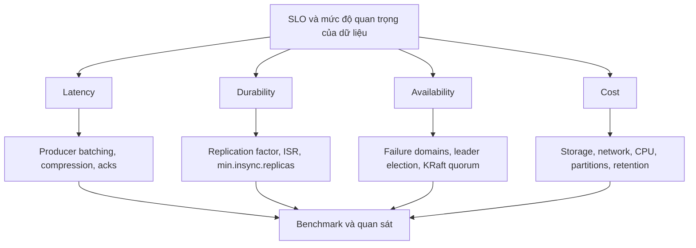

# Đánh đổi giữa độ trễ, độ bền, tính sẵn sàng và chi phí

## Mục tiêu

Không có một cấu hình Kafka tối ưu cho mọi workload. Tăng replication, chờ nhiều replica xác nhận và đặt retention dài giúp bảo vệ dữ liệu nhưng làm tăng network traffic, storage và đôi khi latency. Giảm acknowledgement hoặc cho phép bầu leader không đồng bộ có thể giúp hệ thống tiếp tục hoạt động trong một số sự cố, nhưng làm tăng nguy cơ mất record. Batching và compression cải thiện throughput, nhưng có thể tăng thời gian chờ hoặc CPU.

Bài học này cung cấp cách đánh giá bốn mục tiêu thường xung đột: latency, durability, availability và cost. Bạn sẽ dùng các cấu hình producer, topic, broker và KRaft để thiết kế profile theo SLO thay vì chọn thông số riêng lẻ.

Sau bài học, bạn có thể:

- Phân biệt latency, durability, availability và cost trong một pipeline Kafka.
- Giải thích tác động của `acks`, replication factor, ISR và `min.insync.replicas`.
- Đánh giá trade-off giữa clean/unclean leader election và khả năng tiếp tục ghi.
- Chọn `batch.size`, `linger.ms`, compression và retention theo workload.
- Tách biệt quorum controller KRaft với ISR của data partition.
- Thiết kế profile cho dữ liệu quan trọng, sự kiện thông thường và telemetry có thể mất.
- Xây dựng benchmark và SLO để xác minh cấu hình thực tế.

## 1. Bốn mục tiêu cần cân bằng

| Mục tiêu | Câu hỏi cần trả lời | Chỉ số thường theo dõi |
|---|---|---|
| Latency (độ trễ) | Record mất bao lâu từ lúc producer gửi đến khi được xác nhận và consumer xử lý? | Produce latency p50/p95/p99, request latency, queue time, event-to-process delay |
| Durability (độ bền) | Khi broker, disk hoặc network gặp sự cố, dữ liệu đã xác nhận có còn không? | RF, ISR, under-replicated partitions, min ISR, producer errors, recovery time |
| Availability (tính sẵn sàng) | Producer/consumer có tiếp tục đọc ghi khi node hoặc failure domain bị lỗi không? | Partition availability, offline partitions, ISR size, controller quorum health, error rate |
| Cost (chi phí) | Cần bao nhiêu storage, network, CPU, memory và vận hành để đạt SLO? | Disk usage, network bytes, CPU, broker count, partition count, retention footprint |

Các mục tiêu không hoàn toàn độc lập. Ví dụ, `acks=all` tăng độ bền của ghi nhưng có thể làm producer nhận lỗi khi ISR không đủ. Tăng replication factor tăng số bản sao nhưng làm tăng storage và traffic replication. Tăng `linger.ms` có thể cải thiện batching và throughput nhưng thêm thời gian chờ trong điều kiện lưu lượng thấp.



Trước khi chọn cấu hình, xác định loại record nào có thể mất, có thể xử lý lại hoặc được phép chậm. Cấu hình tốt là cấu hình đáp ứng được các yêu cầu đó với chi phí có thể chấp nhận.

## 2. Latency: độ trễ từ producer đến consumer

Latency không chỉ là thời gian broker ghi record. Tổng thời gian một event đi qua hệ thống có thể gồm:

1. Thời gian serialize, partitioning và chờ buffer ở producer.
2. Thời gian chờ gom batch (`linger.ms`).
3. Thời gian network từ producer đến broker.
4. Thời gian leader append và chờ replica acknowledgement.
5. Thời gian consumer fetch, xử lý nghiệp vụ và commit offset.

Vì vậy, khi nói “Kafka latency”, hãy chỉ rõ đang đo produce request latency, thời gian broker acknowledgement hay end-to-end event latency.

### 2.1. `acks` và thời gian xác nhận

`acks` xác định producer cần đợi mức xác nhận nào từ broker:

| Giá trị | Hành vi | Trade-off |
|---|---|---|
| `acks=0` | Producer không chờ broker acknowledgement | Latency phía producer thấp, nhưng không biết broker có nhận record hay không; nguy cơ mất dữ liệu cao |
| `acks=1` | Leader xác nhận sau khi append vào log cục bộ | Thường nhanh hơn `all`, nhưng leader có thể lỗi trước khi follower replicate record |
| `acks=all` (`-1`) | Leader chờ toàn bộ replica hiện thuộc ISR xác nhận | Tăng durability; thời gian xác nhận phụ thuộc replica chậm nhất trong ISR và network |

`acks=all` không có nghĩa chờ mọi replica được gán cho partition bất kể trạng thái. Nó chờ tất cả replica hiện thuộc ISR. `min.insync.replicas` quy định số ISR tối thiểu để chấp nhận ghi với `acks=all`; hai cấu hình này cần được thiết kế cùng nhau.

Ví dụ: partition có RF=3, ISR gồm broker 1, 2, 3. Với `acks=all`, producer phải đợi cả ba ISR xác nhận. Nếu broker 3 bị loại khỏi ISR và ISR còn broker 1, 2, producer chỉ cần đợi hai replica hiện tại, miễn là số lượng đó đáp ứng `min.insync.replicas`.

Với `acks=1`, producer có thể nhận acknowledgement từ leader trước khi follower sao chép xong. Tuy nhiên, record chưa nhất thiết hiển thị cho consumer ngay lúc đó: Kafka chỉ cho consumer đọc record sau khi record được replicate tới toàn bộ ISR và điều kiện min ISR được đáp ứng. Nếu leader lỗi trước khi follower nhận record, producer đã nhận thành công vẫn có thể không ngăn được mất dữ liệu khi failover. `acks=0` còn yếu hơn vì producer không chờ broker acknowledgement.

### 2.2. Batching và latency

Các cấu hình thường ảnh hưởng đến thời gian chờ ở producer:

| Cấu hình | Tác động khi tăng |
|---|---|
| `linger.ms` | Có thể gom batch lớn hơn và giảm request rate; tăng thời gian chờ của batch chưa đầy |
| `batch.size` | Cho phép batch lớn hơn; cần đủ buffer và lưu lượng trên từng partition để tận dụng |
| `compression.type` | Giảm byte truyền/lưu; có thể tăng CPU và thời gian nén/giải nén |
| `buffer.memory` | Hấp thụ burst tốt hơn; không làm broker xử lý nhanh hơn và tăng memory footprint |

Nếu workload có lưu lượng cao, batch thường đầy trước khi hết linger. Khi lưu lượng thấp, `linger.ms` có thể là phần latency dễ thấy hơn. Không tăng `linger.ms` chỉ vì muốn batch lớn; hãy đo p99 latency và `batch-size-avg` cùng lúc.

### 2.3. `acks=all` và tail latency

Với `acks=all`, thời gian xác nhận bị ảnh hưởng bởi replica chậm nhất trong ISR. Một broker có disk chậm, network cross-zone nghẽn hoặc CPU quá tải có thể làm p95/p99 produce latency tăng dù leader vẫn khỏe.

Không nên loại replica chậm khỏi ISR một cách tùy tiện chỉ để giảm latency. Việc đó có thể làm giảm số bản sao đang bảo vệ dữ liệu và khiến `min.insync.replicas` không còn đạt. Trước hết cần điều tra disk I/O, network, throttling và tải broker.

## 3. Durability: bảo vệ record đã được xác nhận

Durability phụ thuộc vào số bản sao, trạng thái đồng bộ, chính sách acknowledgement và cách leader được bầu sau lỗi.

### 3.1. Replication factor

Replication factor (RF) là số replica được gán cho mỗi partition:

| RF | Số bản sao | Nhận xét |
|---:|---:|---|
| 1 | 1 | Không có replica dự phòng; broker lỗi có thể làm partition unavailable hoặc mất dữ liệu nếu storage mất |
| 2 | 2 | Có một bản sao bổ sung nhưng khả năng chịu lỗi phụ thuộc broker nào lỗi và min ISR |
| 3 | 3 | Cấu hình phổ biến cho production; có thể duy trì một broker lỗi nếu replica phân bố đúng và ISR còn đủ |
| 5 | 5 | Tăng số bản sao và khả năng chịu nhiều lỗi hơn trong một số topology, nhưng tăng mạnh storage/network và acknowledgement fan-out |

RF=3 không tự động bảo đảm ba bản sao luôn đồng bộ. Một replica có thể lag và bị loại khỏi ISR. Durability của record đã xác nhận còn phụ thuộc producer `acks`, ISR tại thời điểm ghi và cấu hình leader election.

### 3.2. `min.insync.replicas`

`min.insync.replicas` (min ISR) là số replica in-sync tối thiểu cần có để broker chấp nhận produce request với `acks=all`.

Ví dụ cấu hình thường gặp cho topic quan trọng:

```text
replication.factor = 3
min.insync.replicas = 2
producer acks = all
```

Hành vi:

- ISR có 3 replica: ghi được; leader chờ cả 3 replica hiện trong ISR.
- Một replica lỗi, ISR còn 2: vẫn ghi được; leader chờ cả 2 replica trong ISR.
- ISR chỉ còn 1: broker từ chối ghi `acks=all` vì không đạt min ISR.

Đây là lựa chọn ưu tiên durability: hệ thống có thể ngừng nhận ghi trong lúc chỉ còn một replica, thay vì chấp nhận ghi trên một bản sao duy nhất. Khi replica phục hồi và ISR đạt ít nhất 2, producer có thể ghi trở lại.

`min.insync.replicas` không phải số voter của KRaft controller quorum. Đây là chính sách ghi cho data partition; controller quorum là cơ chế đồng thuận metadata riêng.

### 3.3. Clean và unclean leader election

Khi leader lỗi, Kafka cần chọn replica mới làm leader:

- Clean leader election chọn replica trong ISR. Replica này đã theo kịp log theo tiêu chí ISR và là lựa chọn an toàn hơn cho dữ liệu đã commit.
- Unclean leader election cho phép chọn replica ngoài ISR nếu không còn ISR khả dụng. Partition có thể hoạt động trở lại sớm hơn, nhưng replica mới có thể thiếu record đã được xác nhận trước đó.

Trong Kafka 4.1, `unclean.leader.election.enable` mặc định là `false`. Với hệ thống ưu tiên durability, giữ cấu hình này để tránh bầu replica out-of-sync làm leader. Nếu bật unclean election, cần chấp nhận rõ nguy cơ mất dữ liệu.

Các phiên bản có Eligible Leader Replicas (ELR) có thể xét tập replica đủ điều kiện riêng theo quy tắc của phiên bản trước khi dùng unclean election. ELR không đồng nghĩa với việc mọi replica ngoài ISR đều an toàn để làm leader; khi vận hành cluster có ELR, hãy theo dõi trạng thái ELR và dùng đúng tài liệu phiên bản.

Không nhầm “partition không có leader” với “Kafka bị hỏng”. Nếu không còn ISR khả dụng và unclean election bị tắt, partition có thể tạm unavailable để bảo vệ dữ liệu. Đây là trade-off chủ động giữa availability và consistency/durability.

### 3.4. Idempotent producer và transaction

`enable.idempotence=true` giúp broker nhận diện retry của cùng producer bằng producer ID và sequence number, tránh duplicate do retry trong phạm vi đảm bảo của producer session.

Idempotence không tự tạo transaction với database hoặc API ngoài Kafka. Nếu cần consume-transform-produce nguyên tử trong Kafka, dùng transactional producer, `transactional.id`, `sendOffsetsToTransaction()` và consumer downstream `isolation.level=read_committed`.

Nếu kết quả nằm ở database hoặc dịch vụ ngoài, cần idempotency key, inbox/outbox hoặc transaction phù hợp ở hệ thống đích. Không coi `acks=all` là bảo đảm exactly-once cho toàn bộ ứng dụng.

### 3.5. Acknowledgement không phải fsync từng record

Broker append record vào log và tận dụng page cache của hệ điều hành; Kafka không mặc định gọi `fsync` xuống thiết bị lưu trữ cho từng record trước mỗi acknowledgement. `acks=all` xác nhận theo replication/ISR semantics, không phải cam kết mọi replica đã flush từng record xuống platter/flash vật lý. Durability thực tế còn phụ thuộc replication, failure domain, hệ điều hành, filesystem, write cache của storage controller và chất lượng thiết bị lưu trữ. Không bật flush đồng bộ cho từng message chỉ để thay thế replication; hãy đánh giá rõ throughput và latency nếu thay đổi flush policy của broker.

## 4. Availability: tiếp tục phục vụ khi có lỗi

Availability có nhiều lớp: broker data plane, partition leader, controller quorum, consumer group và các dependency bên ngoài.

### 4.1. Broker và partition availability

RF cao giúp có nhiều replica có thể trở thành leader sau lỗi. Tuy nhiên, để tiếp tục ghi với `acks=all`, ISR phải còn ít nhất `min.insync.replicas`. Một cấu hình RF=3/min ISR=2 thường tiếp tục ghi được sau khi mất một replica, nhưng có thể ngừng ghi nếu chỉ còn một replica in-sync.

Khi thiết kế, phải trả lời hai câu hỏi riêng:

- Cần bao nhiêu replica để giữ dữ liệu?
- Có thể chấp nhận ghi trên bao nhiêu replica khi một phần cluster lỗi?

Đặt min ISR thấp làm tăng khả năng tiếp tục ghi nhưng giảm mức bảo vệ. Đặt min ISR cao làm tăng yêu cầu an toàn nhưng có thể giảm write availability khi broker bảo trì hoặc lỗi.

### 4.2. Rack awareness và failure domain

Nếu ba replica cùng nằm trên một rack hoặc cùng một availability zone, một sự cố ở failure domain đó có thể làm mất cả ba replica dù RF=3.

Đặt `broker.rack` khác nhau cho broker theo rack/AZ và dùng rack-aware replica assignment để phân phối replica qua các failure domain:

```properties
# Trên broker thuộc AZ A
broker.rack=az-a

# Trên broker thuộc AZ B
broker.rack=az-b

# Trên broker thuộc AZ C
broker.rack=az-c
```

Với ba AZ và RF=3, mục tiêu là mỗi partition có một replica ở mỗi AZ nếu cluster có đủ broker và rack-aware assignment được áp dụng. Xác minh kết quả bằng replica assignment thực tế; chỉ đặt `broker.rack` không tự sửa mọi topic đã tồn tại hoặc bảo đảm phân bố đúng nếu topology không đủ.

Replication liên AZ tăng khả năng chịu lỗi zone nhưng làm tăng network latency và chi phí data transfer. Cần đo độ trễ cross-zone và tính toán chi phí network khi đặt broker ở nhiều AZ.

### 4.3. KRaft controller quorum là lớp riêng

KRaft controller quorum quản lý metadata và bầu controller leader. Với ba controller voter, cần đa số hai voter để duy trì quorum. Nên phân bố controller trên các failure domain khác nhau.

Data partition ISR và KRaft controller quorum giải quyết hai vấn đề khác nhau:

| Cơ chế | Bảo vệ | Khi không còn đủ thành viên |
|---|---|---|
| Partition ISR | Replica dữ liệu của từng partition | Ghi `acks=all` có thể bị từ chối khi ISR thấp hơn min ISR; partition có thể mất leader khả dụng |
| KRaft controller quorum | Metadata log và điều phối cluster | Không thể thực hiện các thay đổi metadata cần quorum hoặc bầu controller leader mới |

Mất controller quorum không đồng nghĩa mọi broker lập tức ngừng phục vụ mọi request dữ liệu; các broker có thể tiếp tục một số hoạt động data-plane với metadata hiện có. Tuy nhiên, cluster không thể quản lý thay đổi metadata hoặc phục hồi leadership bình thường cho đến khi quorum được khôi phục. Vì vậy, controller quorum vẫn là thành phần critical của availability tổng thể.

### 4.4. Consumer availability

Consumer group cần member hoạt động và assignment ổn định. Thêm consumer chỉ tăng concurrency đến giới hạn số partition được subscribe. Nếu một consumer bị restart liên tục hoặc xử lý vượt `max.poll.interval.ms`, group rebalance và throughput có thể giảm.

Để tăng availability cho consumer:

- Chạy nhiều instance ở các failure domain khác nhau.
- Giữ `group.id` ổn định và cấu hình graceful shutdown.
- Chọn assignor/rebalance protocol phù hợp để giảm thời gian ngừng xử lý khi member thay đổi.
- Tắt auto commit nếu xử lý bất đồng bộ hoặc cần kiểm soát offset chặt.
- Thiết kế consumer idempotent để có thể xử lý lại sau restart.

## 5. Cost: storage, network, CPU và vận hành

### 5.1. Storage theo replication factor và retention

Ước lượng đơn giản:

`Storage xấp xỉ = ingress bytes/second × retention seconds × replication factor`

Ví dụ, một topic nhận trung bình 10 MB/s, giữ 7 ngày và RF=3:

```text
10 MB/s × 86.400 s/ngày × 7 ngày × 3
= 18.144.000 MB
≈ 18,1 TB (đơn vị thập phân)
```

Đây là ước lượng dung lượng record thô trên các replica, chưa tính overhead của index, segment, filesystem, compression, biến động traffic, headroom và các bản sao lưu khác. Compression có thể giảm dung lượng thực tế tùy dữ liệu.

Tăng retention từ 7 lên 14 ngày gần như nhân đôi dung lượng nếu ingress và compression ratio không đổi. Tăng RF từ 3 lên 5 làm tăng storage replica khoảng 5/3 lần.

### 5.2. Network replication

Producer gửi một bản ghi đến leader; leader replication record sang follower. Với RF=3, mỗi record được lưu trên ba replica, vì vậy cluster cần chuyển thêm dữ liệu cho hai bản sao follower (bỏ qua protocol overhead, batching và compression).

Replication liên rack/AZ tạo network traffic và có thể phát sinh phí data transfer. Cần sizing network dựa trên peak ingress, replication factor, compression ratio, fetch traffic, consumer traffic và recovery/reassignment khi broker quay lại.

### 5.3. CPU và compression

Compression giảm byte truyền qua network và lưu trên disk, nhưng producer/broker/consumer phải tiêu tốn CPU để nén/giải nén. `lz4` hoặc `snappy` thường ưu tiên tốc độ; `zstd` hoặc `gzip` có thể cho tỷ lệ nén cao hơn tùy dữ liệu và mức CPU.

Không chọn thuật toán chỉ theo tên. Benchmark với payload thực tế và đo CPU, network bytes, disk usage, compression ratio và p99 latency.

### 5.4. Partition và chi phí vận hành

Mỗi partition tạo thêm log, index, metadata, file/segment và công việc replication/leader management. Quá nhiều partition có thể làm tăng:

- Bộ nhớ và metadata mà broker/controller phải quản lý.
- File descriptor, log segment và chi phí recovery.
- Số replica fetch stream và request.
- Thời gian rebalance consumer group và lượng state cần khôi phục.
- Công sức monitoring, ACL, quota và lifecycle.

Không tạo partition chỉ để “có nhiều consumer”. Tính throughput mục tiêu, kích thước message, khả năng xử lý mỗi partition và giới hạn broker trước khi chọn partition count.

### 5.5. Retention và compaction

Retention là quyết định đồng thời về khả năng replay và chi phí:

- Giữ lâu giúp replay/backfill và điều tra incident nhưng cần nhiều storage.
- Giữ ngắn giảm storage nhưng có thể làm mất khả năng replay khi consumer ngừng quá lâu.
- Compaction giữ giá trị mới nhất theo key, phù hợp changelog/state; nó không giữ đầy đủ lịch sử event như append-only retention.
- Tiered storage (nếu triển khai và phiên bản hỗ trợ) có thể giảm chi phí lưu trữ dài hạn, nhưng cần tính chi phí đọc lại, latency và vận hành remote storage.

Không đặt retention chỉ dựa trên dung lượng. Hãy xét yêu cầu audit, replay, pháp lý, dữ liệu nhạy cảm và thời gian tối đa hệ thống downstream có thể ngừng.

## 6. Ma trận đánh đổi cấu hình

| Quyết định | Tăng mức bảo vệ/throughput | Chi phí hoặc rủi ro tăng |
|---|---|---|
| RF từ 1 lên 3 | Nhiều bản sao, tăng khả năng phục hồi broker | Storage và replication network tăng gần theo RF |
| `min.insync.replicas` từ 1 lên 2 | Tránh ghi `acks=all` khi chỉ còn một ISR | Write availability giảm khi ISR dưới 2 |
| `acks=1` lên `acks=all` | Producer chờ nhiều replica hơn | Tail latency và phụ thuộc replica/network tăng |
| Tắt unclean leader election | Tránh bầu replica ngoài ISR làm leader | Partition có thể unavailable khi không còn ISR khả dụng |
| Tăng `linger.ms` | Batch lớn hơn, giảm request rate, có thể tăng throughput | Tăng queueing latency khi batch chưa đầy |
| Tăng `batch.size` | Có thể tăng compression ratio và throughput | Buffer/memory per active partition tăng |
| Bật compression | Giảm network và disk bytes | CPU nén/giải nén tăng |
| Tăng retention | Tăng khả năng replay/audit | Storage và backup footprint tăng |
| Phân bố replica đa AZ | Chịu lỗi zone tốt hơn | Cross-AZ latency và network cost tăng |
| Tăng partition count | Tăng khả năng song song | Metadata, file, replication và rebalance overhead tăng |

## 7. Các profile tham khảo

Các profile sau là điểm bắt đầu để benchmark, không phải chuẩn bắt buộc. Cấu hình cuối cùng phải dựa trên SLO, failure model, traffic và phiên bản Kafka.

### 7.1. Dữ liệu quan trọng: đơn hàng, thanh toán, sổ cái

Ưu tiên durability và khả năng phục hồi:

```properties
# Producer
acks=all
enable.idempotence=true
compression.type=zstd
linger.ms=5

# Topic creation option (not a topic config)
replication.factor=3
# Topic config
min.insync.replicas=2

# Broker
unclean.leader.election.enable=false
```

Trong profile này, `replication.factor=3` là tham số khi tạo topic, không phải producer property hoặc topic config có thể alter. `min.insync.replicas` là topic/broker config; `unclean.leader.election.enable` được quản lý theo phạm vi broker/topic mà phiên bản Kafka hỗ trợ.

Thiết kế thêm:

- Phân bố replica trên ba rack/AZ nếu topology cho phép.
- Dùng transactional producer nếu cần atomic consume-transform-produce trong Kafka.
- Với database, dùng inbox/outbox hoặc idempotency key để xử lý duplicate.
- Đặt retention theo yêu cầu replay/audit và có backup phù hợp.
- Alert khi ISR dưới min ISR, partition offline hoặc under-replicated kéo dài.

Hệ quả: khi ISR chỉ còn một replica, producer `acks=all` bị từ chối ghi. Đây là hành vi có chủ đích để tránh xác nhận record trên một bản sao duy nhất.

### 7.2. Event thông thường: notification, workflow, integration

Ưu tiên cân bằng latency, durability và chi phí:

```properties
# Producer
acks=all
enable.idempotence=true
compression.type=lz4
linger.ms=5

# Topic creation option (not a topic config)
replication.factor=3
# Topic config
min.insync.replicas=2

# Broker
unclean.leader.election.enable=false
```

Profile này gần với profile dữ liệu quan trọng về durability; khác biệt chủ yếu nằm ở retention, schema, downstream idempotency và SLA latency. Có thể benchmark `lz4` với `zstd` hoặc điều chỉnh `linger.ms` nếu throughput/latency yêu cầu khác.

### 7.3. Telemetry có thể mất một phần

Với metrics hoặc telemetry không quan trọng, có thể ưu tiên throughput và chi phí:

```properties
# Producer: lựa chọn này chấp nhận ít bảo đảm hơn
acks=1
compression.type=lz4
linger.ms=10

# Topic: ví dụ vẫn giữ replica để phục hồi broker
replication.factor=2
```

`replication.factor` là tham số tạo topic, không phải producer property. `min.insync.replicas` chỉ được kiểm tra khi producer dùng `acks=all`; nó không bổ sung bảo vệ cho profile `acks=1`. `acks=1` không chờ follower xác nhận; record có thể mất nếu leader lỗi trước khi follower replicate. Chỉ chọn khi nguồn có thể phát lại, dữ liệu có thể tái tạo hoặc nghiệp vụ chấp nhận mất một phần. Nếu telemetry là đầu vào duy nhất cho quyết định an toàn, billing hoặc audit, không dùng profile này.

### 7.4. Luồng cần latency thấp

Ưu tiên giảm thời gian chờ:

```properties
acks=1
linger.ms=0
compression.type=none
```

Đây là profile giảm một số chi phí chờ/nén, nhưng giảm durability so với `acks=all`. Nếu dữ liệu vẫn cần bảo vệ, giữ `acks=all`, RF/min ISR phù hợp rồi tối ưu network, broker placement, batch và compression bằng benchmark. Không đánh đổi durability chỉ để giảm vài millisecond nếu nghiệp vụ không cho phép mất dữ liệu.

## 8. Cấu hình và kiểm tra bằng Kafka CLI

Tạo topic production mẫu với RF=3 và min ISR=2:

```bash
bin/kafka-topics.sh \
  --bootstrap-server localhost:9092 \
  --create \
  --topic commerce.orders.events.v1 \
  --partitions 12 \
  --replication-factor 3 \
  --config min.insync.replicas=2 \
  --config retention.ms=604800000
```

Lệnh trên cần cluster có đủ broker để phân bố ba replica cho mỗi partition. `unclean.leader.election.enable` là broker/topic configuration tùy phiên bản và cần được đặt theo chính sách cluster; kiểm tra cấu hình hiệu lực thay vì giả định giá trị ở một file local đã áp dụng toàn cụm.

Kiểm tra replica assignment và ISR:

```bash
bin/kafka-topics.sh \
  --bootstrap-server localhost:9092 \
  --describe --topic commerce.orders.events.v1
```

Kiểm tra topic config:

```bash
bin/kafka-configs.sh \
  --bootstrap-server localhost:9092 \
  --entity-type topics \
  --entity-name commerce.orders.events.v1 \
  --describe
```

Kiểm tra broker config qua file triển khai hoặc công cụ quản trị cấu hình, đặc biệt:

```properties
unclean.leader.election.enable=false
broker.rack=az-a
```

`broker.rack` phải được đặt khác nhau theo failure domain của từng broker. Xác minh assignment thực tế có phân bố replica đúng yêu cầu.

## 9. SLO và benchmark trước khi chốt cấu hình

Đừng chỉ đo throughput trung bình. Với mỗi profile, xác định:

| Nhóm | Ví dụ SLO/điều kiện cần đặt |
|---|---|
| Latency | p95/p99 produce acknowledgement và event-to-consumer processing |
| Durability | Mức lỗi broker/AZ có thể chịu; có chấp nhận mất record đã ack không |
| Availability | Mục tiêu thời gian partition/producer/consumer có thể gián đoạn |
| Capacity | Peak records/s, MB/s, record size và burst duration |
| Recovery | Thời gian follower bắt kịp, thời gian khôi phục broker/partition |
| Cost | Storage/tháng, network cross-zone, broker/CPU và vận hành |

Quy trình benchmark:

1. Dùng payload, key distribution và partition count gần workload thật.
2. Đặt baseline cho producer throughput, p50/p95/p99, consumer lag và broker CPU/network/disk.
3. Thử từng biến: `acks`, RF/min ISR, `linger.ms`, `batch.size`, compression và retention.
4. Mô phỏng broker mất hoặc follower lag trong môi trường test; quan sát producer error và ISR.
5. Mô phỏng mất một failure domain nếu môi trường cho phép; xác minh rack awareness và controller quorum.
6. Đo thời gian replica catch-up sau khi broker trở lại.
7. Tính storage và network cost ở peak traffic, không chỉ average.
8. Chốt cấu hình cùng owner dữ liệu và SLO; lưu kết quả benchmark để so sánh sau nâng cấp.

### 9.1. Metrics quan trọng

| Metric | Dùng để đánh giá |
|---|---|
| Producer `request-latency-avg/max` | Latency request tới broker |
| Producer `record-queue-time-avg/max` | Thời gian record chờ trong producer queue |
| Producer `batch-size-avg` và `records-per-request-avg` | Hiệu quả batching |
| Producer `compression-rate-avg` | Hiệu quả compression |
| Broker `UnderReplicatedPartitions` | Partition chưa có đủ replica đồng bộ |
| Broker `UnderMinIsrPartitionCount` | Partition có ISR dưới min ISR |
| Broker `IsrShrinksPerSec` / `IsrExpandsPerSec` | Mức độ ISR thay đổi |
| Broker `OfflinePartitionsCount` | Partition không có leader khả dụng |
| Consumer `records-lag-max` | Lag lớn nhất theo partition ở consumer |
| KRaft quorum status/replication lag | Sức khỏe controller metadata quorum |

Tên metric và MBean có thể thay đổi theo phiên bản Kafka; xác minh bằng tài liệu monitoring của phiên bản triển khai. Đặt alert theo thời gian duy trì và SLO, không chỉ một giá trị tức thời.

## 10. Những nhầm lẫn thường gặp

| Nhầm lẫn | Cách hiểu đúng |
|---|---|
| RF=3 nghĩa là mọi record luôn có ba bản sao đồng bộ | Replica có thể lag và bị loại khỏi ISR; kiểm tra ISR tại thời điểm ghi |
| `acks=all` luôn chờ mọi replica được gán | Nó chờ các replica hiện trong ISR; min ISR quyết định ngưỡng tối thiểu để nhận ghi |
| `min.insync.replicas=2` tự làm producer chờ hai replica | Producer cần `acks=all`; min ISR là điều kiện chấp nhận ghi |
| `acks=1` nghĩa là record đã được lưu an toàn trên cluster | Chỉ leader xác nhận; record có thể mất nếu leader lỗi trước replication |
| `acks=all` đồng nghĩa exactly-once | Nó tăng durability của write; idempotence/transaction xử lý duplicate và atomicity ở phạm vi tương ứng |
| Tăng RF luôn tăng availability | RF tăng bản sao nhưng vẫn cần ISR/leader khả dụng; min ISR cao có thể từ chối ghi khi lỗi |
| Bật unclean leader election là tăng độ bền | Nó ưu tiên availability và có thể làm mất record chưa có trên replica được bầu |
| Ba controller voter giống ba ISR của topic | Controller quorum bảo vệ metadata; ISR bảo vệ log của từng partition |
| Tăng linger luôn tăng throughput mà không ảnh hưởng | Nó có thể tăng latency, nhất là khi lưu lượng thấp hoặc mỗi partition ít record |
| Nén luôn làm hệ thống nhanh hơn | Nén giảm network/disk bytes nhưng dùng CPU và có thể tăng latency |
| Lag bằng 0 nghĩa là hệ thống không có backlog | Consumer có thể commit sớm trong khi worker queue còn việc chưa hoàn tất |

## 11. Bài thực hành và tự kiểm tra

### Thực hành A — So sánh `acks` và min ISR

Thực hiện trên cluster lab có ít nhất ba broker:

1. Tạo topic `tradeoff-lab` với một partition, RF=3 và `min.insync.replicas=2`.
2. Gửi record bằng producer `acks=all`, `enable.idempotence=true`; xác nhận thành công khi ISR có ba replica.
3. Dừng một follower theo quy trình lab và chờ ISR còn hai replica.
4. Gửi tiếp record; quan sát producer vẫn ghi được với hai ISR.
5. Trong môi trường thử nghiệm cô lập, làm ISR giảm dưới hai; quan sát lỗi produce với `acks=all`.
6. Khôi phục broker, chờ ISR trở lại ba và xác nhận ghi tiếp được.
7. Lặp lại với `acks=1` để so sánh điều kiện acknowledgement; không dùng dữ liệu quan trọng.

### Thực hành B — Đo batching, compression và latency

1. Gửi cùng một tập payload với `linger.ms=0`, `5` và `20`.
2. Giữ nguyên partition count và key distribution.
3. So sánh `batch-size-avg`, `records-per-request-avg`, throughput và p99 latency.
4. Lặp lại với `compression.type=none`, `lz4` và `zstd`.
5. Ghi CPU, network bytes, disk bytes và compression ratio.
6. Chọn cấu hình đáp ứng latency SLO và capacity mục tiêu.

### Thực hành C — Ước lượng chi phí

1. Giả định ingress 5 MB/s, retention 14 ngày và RF=3.
2. Tính storage thô cần thiết cho các replica.
3. Thêm headroom cho index, segment, traffic peak và recovery.
4. Ước lượng replication traffic và cross-AZ transfer.
5. So sánh RF=2, RF=3 và retention 7/14/30 ngày.
6. Viết khuyến nghị cho owner dữ liệu và nêu rõ dữ liệu nào có thể mất hoặc phải replay.

### Câu hỏi tự kiểm tra

1. Latency end-to-end gồm những giai đoạn nào ngoài broker append?
2. `acks=1` khác `acks=all` về durability như thế nào?
3. Vì sao `acks=all` cần đi cùng `min.insync.replicas`?
4. Với RF=3/min ISR=2, producer `acks=all` sẽ phản ứng thế nào khi ISR chỉ còn một replica?
5. Unclean leader election đánh đổi điều gì?
6. Rack awareness giúp gì khi một availability zone gặp sự cố?
7. KRaft controller quorum khác partition ISR như thế nào?
8. Vì sao tăng RF làm tăng cả storage lẫn network traffic?
9. `linger.ms` và compression ảnh hưởng throughput/latency/CPU ra sao?
10. Tại sao lag bằng 0 không đủ để chứng minh processing backlog bằng 0?
11. Cần benchmark những chỉ số nào trước khi chốt profile production?

## Kết luận

Kafka không có cấu hình duy nhất tối ưu cho latency, durability, availability và cost cùng lúc. Hãy bắt đầu từ mức mất dữ liệu có thể chấp nhận, thời gian gián đoạn cho phép và latency SLO. Kết hợp `acks`, RF, ISR và min ISR để định nghĩa durability; phân bố replica và controller trên failure domain để tăng availability; điều chỉnh batching/compression để cân bằng latency và throughput; rồi tính storage/network/CPU theo retention và tải thực tế. Cuối cùng, benchmark cả tình huống bình thường lẫn failure để xác nhận trade-off đã chọn thực sự đáp ứng yêu cầu.

## Tài liệu tham khảo

- [Apache Kafka 4.1 — Design: Replication, ISR and durability](https://kafka.apache.org/41/design/design/#replication)
- [Apache Kafka 4.1 — Producer configuration](https://kafka.apache.org/41/generated/producer_config.html)
- [Apache Kafka 4.1 — Broker configuration](https://kafka.apache.org/41/configuration/broker-configs/)
- [Apache Kafka 4.1 — Topic-level configuration](https://kafka.apache.org/41/configuration/topic-configs/)
- [Apache Kafka 4.1 — Monitoring](https://kafka.apache.org/41/operations/monitoring/)
- [Apache Kafka 4.1 — KRaft operations](https://kafka.apache.org/41/operations/kraft/)
