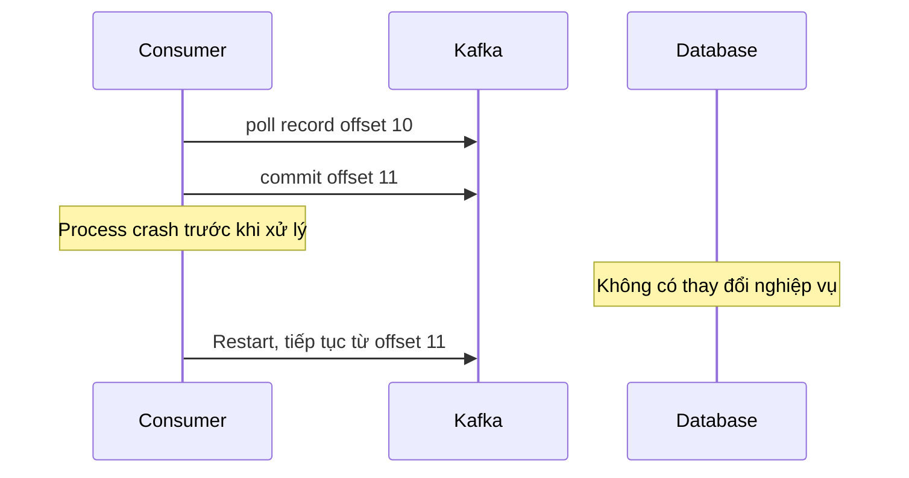
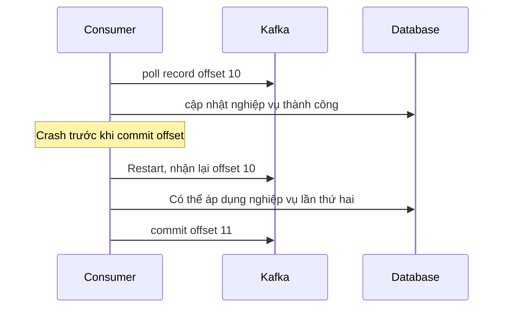
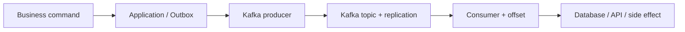
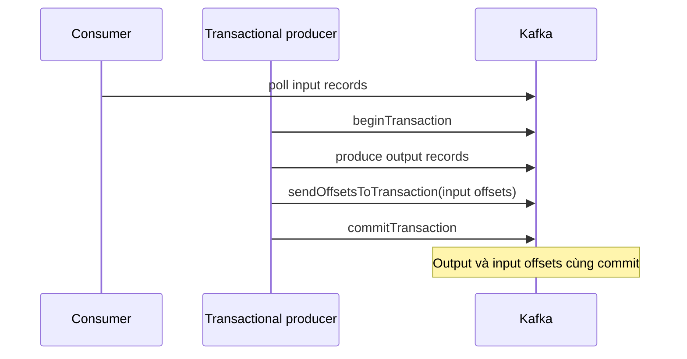

# Chọn ngữ nghĩa theo hậu quả nghiệp vụ của mất hoặc lặp sự kiện

Khi thiết kế một luồng Kafka, câu hỏi quan trọng không chỉ là hệ thống có gửi và nhận được record hay không. Cần xác định điều gì xảy ra nếu một sự kiện không được xử lý, hoặc nếu cùng một sự kiện được giao và áp dụng nhiều lần. Hai lỗi này có hậu quả rất khác nhau tùy nghiệp vụ: mất một mẫu telemetry có thể chấp nhận được, nhưng mất một giao dịch thanh toán có thể gây sai lệch tài chính; gửi lại một email có thể gây khó chịu, còn ghi nợ tài khoản hai lần có thể tạo thiệt hại trực tiếp.

Kafka cung cấp nhiều cơ chế để kiểm soát delivery và processing, nhưng không có một cấu hình duy nhất bảo đảm mọi hệ thống đều “exactly once” từ đầu đến cuối. Cần chọn ngữ nghĩa ở từng ranh giới: producer gửi vào Kafka, broker lưu và replication, consumer đọc và commit offset, rồi ứng dụng cập nhật database hoặc gọi dịch vụ bên ngoài. Ngữ nghĩa toàn luồng phụ thuộc vào cách các ranh giới này phối hợp.

## 1. Bắt đầu từ hậu quả của mất và lặp

Trước khi chọn cấu hình, hãy trả lời hai câu hỏi cho từng loại event:

1. Nếu event không tạo ra tác động nghiệp vụ, điều gì sẽ sai? Có thể bỏ qua, có thể tính lại, hay sẽ mất tiền, mất audit trail hoặc vi phạm nghĩa vụ?
2. Nếu event tạo tác động hai lần, điều gì sẽ sai? Có thể ghi đè cùng một trạng thái, hay sẽ gửi hai khoản thanh toán, tạo hai đơn hàng hoặc cấp quyền hai lần?

| Loại dữ liệu/nghiệp vụ | Hậu quả khi mất | Hậu quả khi lặp | Hướng thiết kế thường phù hợp |
|---|---|---|---|
| Metrics, telemetry tần suất cao | Thiếu một vài mẫu; có thể chấp nhận theo SLO | Mẫu trùng làm sai phép đếm nếu không có event ID | Có thể chọn at-most-once ở một số luồng; sampling và aggregation cần được tính đến |
| Clickstream, hành vi người dùng | Mất một phần dữ liệu phân tích | Đếm lượt click trùng làm sai báo cáo | At-least-once với event ID và dedup ở pipeline phân tích |
| Email/SMS/thông báo | Người dùng không nhận thông báo | Gửi trùng gây phiền hoặc tạo hành động lặp | At-least-once cùng idempotency key hoặc trạng thái gửi tại notification service |
| Tạo đơn hàng | Đơn không tồn tại dù khách đã đặt | Hai đơn cho cùng một yêu cầu | Command idempotency, outbox và consumer deduplication |
| Thanh toán/ghi sổ | Bỏ sót giao dịch, sai số dư | Ghi nợ/ghi có hai lần | Không chấp nhận mất; at-least-once delivery kết hợp ledger idempotency, unique business key và transaction phù hợp |
| Cập nhật read model/cache | Trạng thái có thể bị cũ | Áp dụng lại cùng bản cập nhật có thể tốn tài nguyên hoặc làm sai phép cộng | Upsert idempotent, entity version/sequence và replay có kiểm soát |
| Audit/security event | Mất bằng chứng hoặc dấu vết điều tra | Bản ghi lặp gây nhiễu điều tra nhưng thường vẫn phải giữ dấu vết gốc | Ưu tiên không mất; lưu event ID, dedup ở lớp báo cáo thay vì xóa dấu vết tùy tiện |

Không có một lựa chọn chung cho mọi topic. Cùng một event có thể cần at-least-once trên đường ingest, nhưng read model phía sau có thể xử lý idempotent để kết quả cuối cùng không đổi khi nhận lại event.

## 2. Ba ngữ nghĩa xử lý phổ biến

### At-most-once: tối đa một lần, có thể không lần nào

At-most-once ưu tiên tránh xử lý lặp. Hệ thống chấp nhận khả năng event không tạo ra tác động nếu lỗi xảy ra tại một thời điểm nhất định.

Với consumer Kafka, một cách triển khai điển hình là commit offset trước khi xử lý record. Nếu consumer commit thành công rồi crash trước khi hoàn tất nghiệp vụ, group sẽ tiếp tục từ offset sau record đó. Record vẫn còn trong Kafka log, nhưng ứng dụng có thể không bao giờ xử lý lại nó theo group này.



At-most-once có thể phù hợp khi bỏ lỡ một mẫu dữ liệu ít quan trọng tốt hơn việc xử lý hai lần. Nó không phù hợp nếu mỗi event đại diện cho một giao dịch phải được ghi nhận đầy đủ.

Ngữ nghĩa này mô tả việc consumer không replay record sau khi đã commit. Nó không tự ngăn một ứng dụng gọi API ngoài hai lần do timeout hoặc một producer khác phát cùng command. Nếu side effect bên ngoài có retry riêng, vẫn cần idempotency key tại hệ thống đích.

### At-least-once: ít nhất một lần, có thể lặp

At-least-once ưu tiên không bỏ sót công việc. Consumer xử lý record trước, sau đó mới commit offset. Nếu ứng dụng crash sau khi cập nhật database nhưng trước khi commit offset, Kafka giao lại record khi consumer khởi động hoặc group rebalance. Side effect có thể xảy ra lần thứ hai.



At-least-once thường là lựa chọn an toàn cho event quan trọng khi có thể xây dựng idempotency ở nơi tạo side effect. Giao lại record không nhất thiết làm nghiệp vụ bị lặp nếu consumer dùng event ID và database bảo đảm chỉ áp dụng event đó một lần.

### Exactly-once: tác động được tính một lần trong một phạm vi xác định

Exactly-once có nghĩa một kết quả được commit một lần trong phạm vi mà hệ thống kiểm soát được. Với Kafka, transaction có thể kết hợp output records và consumer offsets trong cùng một transaction Kafka. Điều này hỗ trợ exactly-once consume-transform-produce trong Kafka: hoặc output và offset cùng commit, hoặc cùng bị abort.

Exactly-once trong Kafka không tự động bao trùm database quan hệ, HTTP API, email provider hoặc hệ thống thanh toán bên ngoài. Nếu ứng dụng cập nhật database rồi commit Kafka offset trong hai transaction độc lập, vẫn tồn tại cửa sổ crash giữa hai thao tác. Muốn bảo đảm nghiệp vụ xuyên hệ thống, cần transaction boundary phù hợp, outbox/inbox, unique constraint hoặc API idempotency từ hệ thống đích.

| Ngữ nghĩa | Ưu tiên | Rủi ro chấp nhận | Cách consumer thường làm |
|---|---|---|---|
| At-most-once | Tránh xử lý lại | Có thể bỏ sót xử lý | Commit offset trước side effect |
| At-least-once | Không bỏ sót công việc | Có thể xử lý lặp | Side effect thành công rồi commit offset |
| Exactly-once trong Kafka | Atomic output và offset trong Kafka | Phụ thuộc transaction và isolation | Gửi output + commit input offset trong cùng Kafka transaction |
| Effectively-once ở nghiệp vụ | Kết quả nghiệp vụ không đổi khi event giao lại | Cần thiết kế idempotency/dedup và lưu dấu bền vững | At-least-once delivery + inbox/unique key/transaction ở hệ thống đích |

“Effectively-once” thường là cách mô tả kết quả nghiệp vụ đạt được nhờ idempotency, không phải một chế độ Kafka thay thế ba ngữ nghĩa trên.

## 3. Xem toàn bộ pipeline thay vì một cài đặt đơn lẻ

Một event thường đi qua nhiều ranh giới:



Mỗi ranh giới có lỗi riêng:

| Ranh giới | Câu hỏi cần quyết định | Cơ chế liên quan |
|---|---|---|
| Command vào service | Client retry có tạo hai nghiệp vụ không? | Idempotency key, command ID, unique constraint |
| Database ghi nghiệp vụ và event | DB commit nhưng Kafka publish thất bại thì sao? | Transactional Outbox hoặc CDC |
| Producer tới broker | Broker đã append nhưng ACK bị mất thì sao? | `acks`, retries, producer idempotence, replication |
| Broker lưu dữ liệu | Broker hỏng thì event đã xác nhận còn không? | Replication factor, ISR, `min.insync.replicas` |
| Consumer xử lý và commit offset | Side effect thành công nhưng commit thất bại thì sao? | At-least-once + consumer idempotency hoặc Kafka transaction |
| Consumer gọi hệ thống ngoài | API đích nhận request nhưng response bị mất thì sao? | Idempotency key phía đích, request ledger, workflow state |

Nếu một bước chỉ bảo đảm at-least-once, toàn pipeline vẫn có thể tạo duplicate dù producer bật idempotence. Ngược lại, producer gửi thành công không có nghĩa consumer đã hoàn thành nghiệp vụ.

At-least-once ở phía consumer chỉ bắt đầu có ý nghĩa sau khi record đã được ghi vào Kafka. Nếu service nguồn commit database nhưng không publish được event, consumer không thể tự khôi phục record chưa từng xuất hiện trong topic. Vì vậy, luồng bắt đầu từ database thường cần Outbox/CDC; đồng thời retention phải đủ dài để consumer có thời gian phục hồi trước khi record bị xóa.

## 4. Producer: bảo vệ việc gửi vào Kafka

Producer chịu trách nhiệm gửi record tới broker. Với event quan trọng, cấu hình thường được cân nhắc gồm:

```properties
acks=all
enable.idempotence=true
retries=2147483647
delivery.timeout.ms=120000
max.in.flight.requests.per.connection=5
```

Ý nghĩa:

- `acks=all`: leader chờ xác nhận theo tập ISR hiện tại.
- `enable.idempotence=true`: Kafka dùng producer ID và sequence để nhận diện retry của cùng batch, tránh append duplicate do retry protocol trong phạm vi hỗ trợ.
- `retries`: cho phép client thử lại khi gặp lỗi có thể retry; `delivery.timeout.ms` giới hạn tổng thời gian gửi.
- `max.in.flight.requests.per.connection`: khi idempotence bật, giá trị không vượt quá 5 để giữ các bảo đảm thứ tự/sequence của producer.

Kết hợp với cấu hình topic/broker `min.insync.replicas`, producer có thể từ chối ghi khi số replica đồng bộ thấp hơn mức tối thiểu. Đây là đánh đổi có chủ đích: hệ thống chấp nhận tạm thời không ghi được để giữ mức an toàn dữ liệu đã đặt.

Producer idempotence **không** loại bỏ hai lần gọi `send()` độc lập cho cùng event. Nếu ứng dụng retry command và tạo một `ProducerRecord` mới, Kafka có thể ghi một record mới. Cần `commandId` và `eventId` ổn định để xử lý duplicate ở tầng nghiệp vụ.

### ACK không phải xác nhận nghiệp vụ hoàn tất

Producer ACK cho biết Kafka đã xử lý request theo cấu hình xác nhận. Nó không cho biết:

- Consumer đã poll record hay chưa.
- Consumer đã commit offset hay chưa.
- Database đã cập nhật hay chưa.
- Email/payment API đã thực hiện side effect hay chưa.

Không nên cập nhật trạng thái đơn hàng thành “đã thanh toán” chỉ vì producer nhận được ACK cho event `PaymentRequested`. ACK đó chỉ xác nhận việc ghi event vào Kafka theo cấu hình producer.

## 5. Consumer: thứ tự xử lý và commit quyết định cửa sổ lỗi

Với consumer thông thường, có hai thứ tự chính:

### Commit trước, xử lý sau

```java
// Cấu hình consumer: enable.auto.commit=false
ConsumerRecords<String, OrderCreated> records =
    consumer.poll(Duration.ofMillis(500));

// At-most-once: commit trước side effect.
consumer.commitSync();

for (ConsumerRecord<String, OrderCreated> record : records) {
    orderProjection.apply(record.value());
}
```

Nếu process dừng sau `commitSync()` nhưng trước `apply()`, event sẽ bị bỏ qua ở lần đọc tiếp theo. Chỉ dùng cách này khi nghiệp vụ chấp nhận mất xử lý.

### Xử lý trước, commit sau

```java
ConsumerRecords<String, OrderCreated> records =
    consumer.poll(Duration.ofMillis(500));

for (ConsumerRecord<String, OrderCreated> record : records) {
    orderProjection.applyIdempotently(record.value());
}

// At-least-once: chỉ commit sau khi xử lý thành công.
consumer.commitSync();
```

Nếu process dừng sau khi `applyIdempotently()` thành công nhưng trước commit, record có thể được giao lại. Phương thức xử lý phải bảo đảm lần gọi lại không tạo thêm tác động nghiệp vụ.

Hai đoạn code là minh họa cho thứ tự. Trong ứng dụng thực tế, cần xử lý lỗi từng record, nhiều partition và offset đã xử lý liên tục. Không commit position cao hơn record còn đang chạy dở khi dùng worker thread hoặc xử lý song song.

### Tắt auto commit khi cần kiểm soát

```properties
enable.auto.commit=false
```

Khi auto commit bật, consumer có thể commit position theo chu kỳ mà ứng dụng không gắn trực tiếp với thời điểm side effect hoàn tất. Với xử lý quan trọng, thường nên tắt auto commit và commit rõ ràng sau khi đạt điều kiện nghiệp vụ.

## 6. Idempotency: làm cho việc xử lý lại không tạo thêm tác động

At-least-once thường được chọn khi mất event không thể chấp nhận. Để chịu được duplicate, consumer cần một định danh ổn định cho event và lưu dấu việc xử lý cùng với side effect trong một transaction phù hợp.

Ví dụ event:

```json
{
  "eventId": "evt-7f91",
  "eventType": "PaymentCaptured",
  "paymentId": "pay-1042",
  "orderId": "order-1042",
  "amount": 125000,
  "currency": "VND"
}
```

Database có thể dùng bảng inbox:

```sql
CREATE TABLE processed_events (
    consumer_name VARCHAR(120) NOT NULL,
    event_id      VARCHAR(120) NOT NULL,
    processed_at  TIMESTAMP WITH TIME ZONE NOT NULL,
    PRIMARY KEY (consumer_name, event_id)
);
```

Trong cùng database transaction:

1. Insert `(consumer_name, event_id)` vào `processed_events`.
2. Nếu unique key đã tồn tại, event đã được áp dụng trước đó; bỏ qua side effect và có thể commit Kafka offset.
3. Nếu insert thành công, cập nhật bảng nghiệp vụ.
4. Commit database transaction.
5. Sau khi transaction thành công, commit Kafka offset.

Nếu DB transaction rollback, cả dấu inbox và thay đổi nghiệp vụ đều rollback. Nếu DB đã commit nhưng consumer crash trước khi commit offset, Kafka giao lại event; unique constraint nhận diện event đã xử lý và ngăn side effect lần hai.

Không chỉ kiểm tra bằng câu `SELECT` rồi mới insert. Hai consumer hoặc hai request đồng thời có thể cùng thấy event chưa tồn tại. Unique constraint/database transaction mới là lớp đồng bộ đáng tin cậy.

### Idempotent update và entity version

Một số read model có thể dùng upsert idempotent thay vì bảng inbox. Ví dụ event mang `entityVersion`; consumer chỉ áp dụng khi version mới lớn hơn version hiện tại. Điều này giúp bỏ qua event cũ hoặc event lặp, nhưng cần định nghĩa rõ quy tắc version theo aggregate và không dùng timestamp hệ thống thay cho sequence nghiệp vụ nếu clock có thể lệch.

Với nghiệp vụ cộng dồn như trừ tiền, tăng số lượng hoặc cộng điểm, lặp một phép cộng không idempotent. Cần dedup bằng event ID hoặc dùng ledger có unique business transaction ID.

### Spring Kafka và thời điểm commit offset

Với listener container, `AckMode` quyết định khi nào container ghi nhận offset sau khi listener xử lý thành công. Khi không dùng transaction, các chế độ thường gặp gồm:

| AckMode | Hành vi khái quát | Đánh đổi |
|---|---|---|
| `RECORD` | Commit offset sau khi từng record listener xử lý thành công | Cửa sổ replay nhỏ hơn; nhiều lần commit hơn |
| `BATCH` | Commit offset sau khi tất cả record trong một poll batch được xử lý thành công | Hiệu quả commit tốt hơn; lỗi có thể làm batch được giao lại theo error handling |
| `MANUAL` | Listener gọi `Acknowledgment.acknowledge()`; container áp dụng commit theo semantics của chế độ manual | Ứng dụng kiểm soát thời điểm ack và phải tránh ack trước side effect |
| `MANUAL_IMMEDIATE` | Yêu cầu commit ngay khi acknowledge trên consumer thread | Kiểm soát trực tiếp hơn, nhưng cần tuân thủ thread và container contract |

Ví dụ cấu hình container factory:

```java
factory.getContainerProperties().setAckMode(
    ContainerProperties.AckMode.RECORD);
```

`RECORD` hoặc `BATCH` chỉ quyết định thời điểm container commit offset. Chúng không làm cho database update và Kafka offset commit trở thành một transaction nguyên tử. Nếu listener cập nhật DB xong rồi process chết trước khi offset commit, record vẫn có thể được giao lại; hãy dùng inbox/unique constraint trong cùng DB transaction. Khi dùng Kafka transaction manager, container có thể gửi offset vào Kafka transaction, nhưng transaction đó chỉ atomic với các thao tác Kafka nằm trong transaction.

## 7. Transactional Outbox: không để database và Kafka lệch nhau

Một service thường vừa cập nhật database vừa phát event. Nếu ghi DB rồi gửi Kafka bằng hai thao tác độc lập, có hai cửa sổ:

- DB commit thành công nhưng publish Kafka thất bại: trạng thái nghiệp vụ đã đổi nhưng không có event.
- Kafka publish thành công nhưng DB rollback: downstream nhận event cho một thay đổi không tồn tại.

Transactional Outbox lưu thay đổi nghiệp vụ và event cần phát trong cùng transaction database:

```sql
BEGIN;

UPDATE orders
SET status = 'CONFIRMED'
WHERE order_id = 'order-1042';

INSERT INTO outbox_events (
    event_id, aggregate_id, event_type, payload, created_at
) VALUES (
    'evt-7f91', 'order-1042', 'OrderConfirmed',
    '{"orderId":"order-1042"}', CURRENT_TIMESTAMP
);

COMMIT;
```

Relay hoặc CDC đọc outbox và publish event lên Kafka. Nếu relay gửi thành công nhưng chết trước khi đánh dấu row đã publish, event có thể được gửi lại. Do `eventId` được tạo và lưu một lần trong outbox, consumer có thể deduplicate lần giao lại.

Outbox thường cung cấp at-least-once publication cùng event identity ổn định. Nó giải quyết tính nhất quán giữa DB nguồn và ý định phát event; consumer vẫn cần idempotency để xử lý relay retry.

## 8. Exactly-once trong Kafka bằng transaction

Kafka transaction phù hợp với luồng consume-transform-produce mà input và output đều nằm trong Kafka. Ứng dụng có thể ghi output records và offset input trong cùng transaction:



Consumer downstream cần dùng:

```properties
isolation.level=read_committed
```

để chỉ đọc dữ liệu thuộc transaction đã commit. Consumer dùng `read_uncommitted` có thể thấy record thuộc transaction chưa commit hoặc đã abort.

Consumer tham gia luồng transactional consume-transform-produce cũng cần tắt auto commit để offset chỉ được lưu qua transaction:

```properties
enable.auto.commit=false
isolation.level=read_committed
```

Transactional producer cần có `transactional.id` ổn định cho logical producer instance:

```properties
transactional.id=order-transformer-0
enable.idempotence=true
acks=all
```

Mỗi producer đang hoạt động đồng thời phải có transactional ID riêng. Khi cùng logical instance khởi động lại, dùng lại ID của nó để Kafka có thể fence phiên cũ; không dùng chung một ID cho hai instance độc lập.

Pseudo-code Java minh họa:

```java
producer.initTransactions();

while (running) {
    ConsumerRecords<String, InputEvent> records =
        consumer.poll(Duration.ofMillis(500));

    if (records.isEmpty()) {
        continue;
    }

    producer.beginTransaction();
    try {
        for (ConsumerRecord<String, InputEvent> record : records) {
            OutputEvent output = transform(record.value());
            producer.send(new ProducerRecord<>(
                "derived.events", record.key(), output));
        }

        Map<TopicPartition, OffsetAndMetadata> offsets =
            nextOffsetsFor(records);

        producer.sendOffsetsToTransaction(
            offsets, consumer.groupMetadata());
        producer.commitTransaction();
    }
    catch (Exception ex) {
        producer.abortTransaction();
        throw ex;
    }
}
```

`nextOffsetsFor(records)` là hàm ứng dụng tính offset tiếp theo đã xử lý liên tục cho từng partition. Ví dụ chỉ commit offset lớn hơn record cuối cùng đã xử lý thành công liên tục; không được bỏ qua record đang chạy dở. Đây là pseudo-code tập trung vào transaction boundary; production code cần xử lý fencing, timeout, lỗi abort/commit và đóng tài nguyên đúng cách.

Kafka transaction không bao trùm cập nhật database hoặc gọi HTTP API. Nếu code gọi database trước khi commit Kafka transaction, crash vẫn có thể để lại DB đã đổi trong khi Kafka transaction abort. Dùng Outbox/Inbox hoặc workflow idempotent cho các hệ thống ngoài Kafka.

## 9. Chọn semantics cho từng kiểu nghiệp vụ

### Telemetry và metrics

Nếu event là mẫu CPU/memory được phát hàng nghìn lần mỗi giây và một vài mẫu bị mất không ảnh hưởng quyết định, at-most-once có thể giảm chi phí retry/commit. Nếu số liệu dùng cho billing hoặc audit, không nên áp dụng giả định “mẫu nào mất cũng được”; cần bảo đảm ingest và định danh mẫu phù hợp.

### Notification

Mất thông báo có thể khiến người dùng không biết trạng thái đơn hàng; gửi trùng có thể khiến người dùng nhận nhiều email/SMS. Thường chọn at-least-once để tránh bỏ sót, sau đó notification service dùng `(eventId, channel, recipient)` hoặc business key làm idempotency key. Với provider bên ngoài, truyền idempotency key nếu API hỗ trợ và lưu trạng thái gửi.

### Payment và ledger

Không nên dùng at-most-once cho việc ghi nhận giao dịch tiền. At-least-once delivery kết hợp ledger idempotent thường phù hợp: mỗi giao dịch có `paymentId` hoặc `transactionId` duy nhất; database đặt unique constraint; việc ghi ledger và dấu idempotency nằm trong cùng transaction. Nếu gọi cổng thanh toán bên ngoài, dùng idempotency key phía provider và đối soát trạng thái khi timeout mơ hồ.

### Read model và cache

Nếu event mang trạng thái mới cùng entity version, consumer có thể upsert theo version. Duplicate của cùng version không làm thay đổi kết quả; event version cũ không ghi đè version mới. Với event dạng delta như `balance += 100`, phải deduplicate trước khi cộng.

### Audit trail

Ưu tiên không mất event và giữ nguồn gốc. Nếu event trùng, có thể giữ raw log để điều tra rồi deduplicate trong view/reporting bằng event ID. Xóa record gốc vì “trùng” có thể làm mất bằng chứng cần thiết.

## 10. Retry, poison event và Dead Letter Topic

Retry giúp xử lý lỗi tạm thời như database unavailable hoặc HTTP 503. Tuy nhiên, retry không tự biến một consumer thành exactly-once. Nếu side effect đã thành công nhưng response bị mất, retry có thể lặp tác động.

Phân loại lỗi:

| Loại lỗi | Ví dụ | Cách xử lý |
|---|---|---|
| Lỗi tạm thời | Timeout DB, HTTP 503, broker/network ngắt quãng | Retry có backoff, giới hạn số lần/thời gian và giữ idempotency key |
| Lỗi dữ liệu vĩnh viễn | Payload sai schema, thiếu trường bắt buộc | Đưa vào DLT sau khi ghi đủ context để điều tra |
| Lỗi nghiệp vụ cần can thiệp | Tài khoản bị khóa, trạng thái đơn không hợp lệ | Retry theo chính sách nghiệp vụ hoặc chuyển workflow xử lý thủ công |
| Lỗi hạ tầng kéo dài | Database mất kết nối lâu | Pause/backpressure, circuit breaker hoặc retry có giới hạn |

Khi chuyển record sang DLT, cần bảo đảm bản ghi DLT được publish thành công trước khi commit offset nguồn. Nếu publish DLT và commit offset không nguyên tử, vẫn có thể có duplicate ở DLT hoặc giao lại record nguồn; consumer xử lý DLT nên giữ event ID và idempotent. Với luồng Kafka-to-Kafka có yêu cầu atomic, có thể dùng Kafka transaction để kết hợp publish DLT và commit offset nguồn.

Không dùng DLT như nơi “xóa” event lỗi khỏi tầm nhìn. Cần lưu original topic/partition/offset, event ID, exception class, thời điểm, số lần retry và lý do chuyển. Có quy trình sửa dữ liệu và replay DLT sau khi nguyên nhân được khắc phục.

## 11. Ordering cũng là một phần của semantics

Kafka bảo đảm thứ tự trong một partition, không bảo đảm thứ tự toàn cục giữa nhiều partition. Nếu event `OrderCreated`, `PaymentCaptured`, `OrderShipped` phải theo thứ tự cho cùng đơn hàng, hãy dùng `orderId` làm key để các event của đơn hàng đi vào cùng partition.

Retry topic hoặc xử lý bất đồng bộ có thể làm event sau hoàn tất trước event trước. Nếu nghiệp vụ yêu cầu ordering chặt, cần:

- Dùng key/partition theo aggregate.
- Giữ thứ tự xử lý trong từng partition hoặc quản lý sequence/version.
- Không commit offset vượt qua record trước đó còn đang xử lý.
- Khi retry, tránh đưa một event cũ sang luồng khác khiến event mới vượt lên trước nếu điều đó phá vỡ quy tắc nghiệp vụ.
- Consumer kiểm tra aggregate version và từ chối hoặc trì hoãn event đến sai thứ tự.

At-least-once kết hợp ordering không tự động cho kết quả đúng nếu ứng dụng xử lý song song không kiểm soát. Semantics phải bao gồm cả delivery, commit, idempotency và thứ tự áp dụng.

## 12. Bảng quyết định theo hậu quả nghiệp vụ

| Câu hỏi | Nếu câu trả lời là “có” | Hướng thiết kế nên xem xét |
|---|---|---|
| Mất một event có gây thiệt hại hoặc vi phạm audit? | Có | Tránh at-most-once; dùng at-least-once hoặc Kafka transaction trong phạm vi phù hợp |
| Lặp side effect có gây mất tiền/cấp quyền/gửi trùng? | Có | Bắt buộc idempotency key, unique constraint hoặc ledger/inbox |
| Input và output đều nằm trong Kafka? | Có | Xem xét Kafka transaction và `read_committed` |
| Cần cập nhật database cùng với phát event? | Có | Transactional Outbox/CDC ở phía ghi; Inbox ở phía nhận |
| Cần gọi API bên ngoài? | Có | Dùng idempotency key phía API, workflow state và đối soát timeout |
| Có thể tính lại dữ liệu từ nguồn khác? | Có | Có thể chấp nhận semantics nhẹ hơn cho một số luồng, nhưng phải kiểm chứng khả năng rebuild |
| Thứ tự theo entity là bắt buộc? | Có | Partition theo key, sequence/version và xử lý tuần tự trong phạm vi entity |

Quyết định nên được ghi thành hợp đồng cho từng event type: event có được phép mất không, duplicate được phát hiện bằng khóa nào, side effect nào được bảo vệ, offset commit khi nào, retry tối đa bao lâu và ai xử lý DLT.

## 13. Monitoring để kiểm chứng semantics khi vận hành

Không chỉ theo dõi consumer lag. Cần đo những tín hiệu cho thấy hệ thống đang mất hoặc lặp công việc:

| Tín hiệu | Điều nó cho biết |
|---|---|
| Producer error/retry rate và delivery timeout | Gửi tới Kafka có đang thất bại hoặc chậm không |
| Under-replicated partitions và ISR shrink | Mức an toàn replication có suy giảm không |
| Consumer lag và commit failure | Consumer có đang tụt lại hoặc không lưu tiến độ không |
| Duplicate event ID / inbox conflict count | Có bao nhiêu lần giao lại được nhận diện |
| Business unique-key conflict | Có command hoặc side effect trùng ở ranh giới nghiệp vụ không |
| DLT rate và oldest DLT age | Event lỗi đang tích tụ hay bị bỏ quên không |
| Outbox oldest unpublished age | Event trong DB có bị kẹt trước khi publish không |
| Transaction abort/timeout rate | Kafka transaction có thường xuyên không commit được không |
| Ordering/version gap | Consumer có nhận event sai thứ tự hoặc thiếu sequence không |

Đặt SLO theo nghiệp vụ, ví dụ tỷ lệ thanh toán được ghi nhận, thời gian outbox chờ publish, tỷ lệ notification gửi trùng hoặc số event DLT chưa xử lý. Một consumer lag bằng 0 không chứng minh mọi giao dịch đã được áp dụng đúng một lần.

## 14. Bài thực hành: kiểm chứng mất và lặp

Tạo topic `orders.events`, consumer group `payment-service` và database thử nghiệm có bảng `processed_events` với unique key `(consumer_name, event_id)`.

1. Gửi event có `eventId=evt-1` và xử lý theo at-least-once: cập nhật DB rồi cố ý dừng consumer trước khi commit offset.
2. Khởi động lại consumer, xác minh Kafka giao lại `evt-1` và inbox ngăn side effect thứ hai.
3. Thử commit offset trước khi cập nhật DB rồi dừng consumer; quan sát event không được xử lý lại theo group đó.
4. Bật producer idempotence và mô phỏng retry nội bộ; phân biệt retry cùng batch với hai lần gọi `send()` độc lập.
5. Triển khai Outbox: ghi order và event trong một DB transaction; dừng relay sau ACK nhưng trước khi đánh dấu published; xác minh consumer nhận cùng event ID và deduplicate.
6. Với luồng Kafka-to-Kafka, dùng transactional producer để gửi output và offset input cùng transaction; kiểm tra consumer `read_committed` không nhìn thấy output đã abort.
7. Đưa một payload sai schema vào DLT, xác minh source offset chỉ được commit sau khi DLT publish thành công theo chính sách đã chọn.
8. Đo duplicate count, commit failure, consumer lag và DLT age trong từng kịch bản.

Chỉ thực hiện fault injection trên môi trường lab. Không dừng database, broker hoặc consumer production để kiểm tra các cửa sổ lỗi.

## 15. Checklist thiết kế trước khi triển khai

- Xác định hậu quả cụ thể của mất một event và xử lý một event hai lần.
- Chọn at-most-once, at-least-once hoặc Kafka transaction theo từng ranh giới, không gán một nhãn cho toàn hệ thống.
- Cấu hình producer `acks`, idempotence, retry, timeout và replication phù hợp với yêu cầu độ bền.
- Tắt auto commit nếu cần gắn commit offset với kết quả xử lý.
- Commit offset sau khi side effect hoàn tất nếu chọn at-least-once.
- Dùng event ID ổn định và inbox/unique constraint để xử lý duplicate.
- Dùng command idempotency để chặn client retry tạo nghiệp vụ mới.
- Dùng Outbox/CDC khi database và Kafka phải phản ánh cùng một thay đổi.
- Dùng Kafka transaction khi cần atomic output và input offset trong Kafka.
- Dùng idempotency key của hệ thống đích cho API ngoài và có quy trình đối soát timeout.
- Xác định ordering theo partition key, aggregate version và retry policy.
- Có retry giới hạn, DLT, giám sát và quy trình replay.
- Kiểm thử crash ở từng cửa sổ: trước side effect, sau side effect, trước commit offset và sau commit.

## 16. Những nhầm lẫn thường gặp

- **Cho rằng at-least-once nghĩa là không có duplicate:** nó chấp nhận giao lại để tránh bỏ sót; consumer phải idempotent.
- **Cho rằng at-most-once làm Kafka xóa record:** record vẫn có thể nằm trong topic; group đã commit qua record nên ứng dụng không xử lý lại.
- **Cho rằng producer idempotence bảo vệ database:** nó chỉ xử lý duplicate do retry producer protocol trong phạm vi Kafka.
- **Cho rằng producer ACK nghĩa là event đã được xử lý:** ACK chỉ xác nhận request ghi vào Kafka theo cấu hình.
- **Cho rằng Kafka transaction bao trùm SQL transaction:** Kafka transaction chỉ atomic với các thao tác Kafka được đưa vào transaction đó.
- **Cho rằng Outbox tạo exactly-once publication:** relay có thể publish lại; event ID ổn định và consumer dedup mới bảo vệ side effect.
- **Cho rằng DLT là nơi có thể commit source offset trước khi publish:** nếu DLT publish thất bại, event có thể mất khỏi luồng xử lý.
- **Cho rằng cùng Kafka key sẽ tự deduplicate:** nhiều record cùng key vẫn được append và có offset riêng.
- **Cho rằng consumer lag thấp chứng minh nghiệp vụ đúng:** lag không phản ánh duplicate side effect hoặc event bị bỏ qua sau commit sớm.
- **Cho rằng exactly-once là một cờ bật cho cả hệ thống:** bảo đảm phải được xác định theo transaction boundary và hệ thống tham gia.

Chọn processing semantics là quyết định về rủi ro nghiệp vụ. Nếu mất event gây hậu quả lớn, ưu tiên at-least-once hoặc transaction trong phạm vi hỗ trợ rồi làm side effect idempotent. Nếu duplicate gây thiệt hại, dùng event/command ID, unique constraint, inbox và idempotency key ở hệ thống đích. Chỉ khi xác định rõ boundary, failure window và cách phục hồi thì các cấu hình Kafka mới tạo thành một bảo đảm có thể kiểm chứng.
