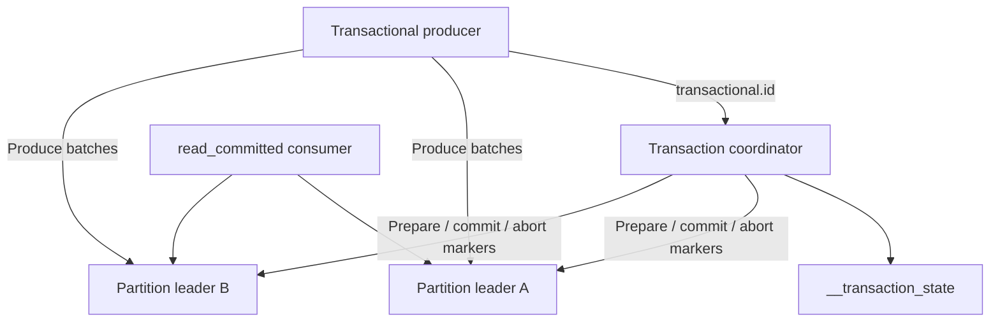
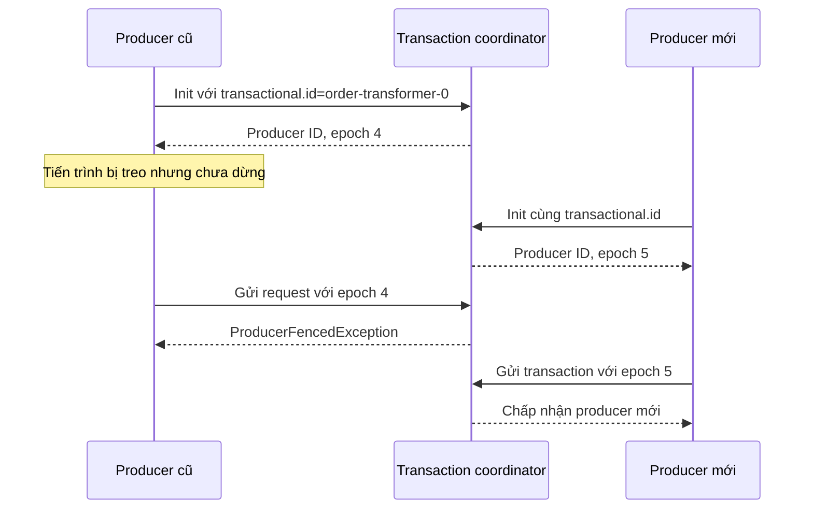

# `initTransactions`, `beginTransaction`, `commitTransaction` và `abortTransaction`

## Vòng đời của một Kafka transaction

Kafka transaction cho phép một producer ghi nhiều record vào một hoặc nhiều partition như một đơn vị giao dịch. Consumer dùng `read_committed` nhìn thấy record không thuộc transaction và record thuộc transaction đã commit; record của transaction đang mở hoặc đã abort sẽ không được trả về.

Trong Java Kafka Producer, vòng đời giao dịch được điều khiển bởi bốn API chính:

1. `initTransactions()` khởi tạo transactional producer, lấy hoặc khôi phục trạng thái producer và đăng ký epoch với transaction coordinator.
2. `beginTransaction()` mở một transaction mới.
3. `send()` gửi record vào các partition; producer gom các lần gửi vào transaction đang mở.
4. `commitTransaction()` xác nhận transaction thành công, hoặc `abortTransaction()` hủy transaction.

Các API này cần được gọi theo đúng thứ tự và với cấu hình `transactional.id`. Kafka dùng transaction coordinator, producer ID/epoch, transaction log và transaction markers để bảo đảm trạng thái giao dịch nhất quán trên các partition liên quan.

Trong module KAFKA, transaction là nền tảng để xây dựng luồng consume-transform-produce có thể commit output và consumer offset trong cùng một Kafka transaction. Tuy nhiên, transaction Kafka không tự bao trùm database hay hệ thống bên ngoài; những side effect đó vẫn cần thiết kế riêng.

## 1. Transactional producer cần cấu hình gì?

### 1.1 `transactional.id` bật chế độ giao dịch

Producer phải khai báo `transactional.id` khác null để sử dụng transaction API:

```java
Properties props = new Properties();
props.put(ProducerConfig.BOOTSTRAP_SERVERS_CONFIG, "localhost:9092");
props.put(ProducerConfig.KEY_SERIALIZER_CLASS_CONFIG,
        StringSerializer.class.getName());
props.put(ProducerConfig.VALUE_SERIALIZER_CLASS_CONFIG,
        StringSerializer.class.getName());
props.put(ProducerConfig.TRANSACTIONAL_ID_CONFIG, "order-transformer-0");

KafkaProducer<String, String> producer = new KafkaProducer<>(props);
```

`transactional.id` đại diện cho một logical producer identity ổn định. Khi một producer mới khởi động với cùng ID, Kafka có thể tăng producer epoch và fence producer cũ đang còn hoạt động. Cơ chế này giúp tránh hai tiến trình cùng tiếp tục ghi bằng một transactional identity.

Trong một ứng dụng chạy nhiều instance đồng thời, mỗi instance đang hoạt động cần có `transactional.id` riêng. Khi một instance restart và thay thế chính instance logic trước đó, nó có thể dùng lại ID của instance đó để Kafka fence producer cũ. Không gán cùng một ID cho tất cả pod đang chạy song song.

### 1.2 Idempotence được bật cùng transaction

Transactional producer yêu cầu idempotent delivery. Khi cấu hình `transactional.id`, Kafka producer bật các điều kiện cần thiết cho idempotence theo cấu hình client. Idempotence dùng producer ID và sequence number để broker nhận diện retry và tránh append trùng batch trong phạm vi Kafka hỗ trợ.

Các thuộc tính liên quan thường gồm:

| Cấu hình | Vai trò |
|---|---|
| `transactional.id` | Định danh logical producer và bật transactional mode |
| `enable.idempotence` | Bảo vệ khỏi duplicate do retry của producer |
| `acks=all` | Chờ xác nhận theo replication/ISR |
| `retries` | Cho phép client thử lại lỗi có thể retry |
| `max.in.flight.requests.per.connection` | Giới hạn request đồng thời; idempotence đặt các ràng buộc tương thích |

Không nên vô hiệu hóa idempotence hoặc đặt các thuộc tính xung đột với yêu cầu transactional producer. Hãy để Kafka client áp dụng defaults tương thích hoặc khai báo cấu hình đã được kiểm chứng theo phiên bản đang dùng.

### 1.3 Transaction coordinator và transaction log

Kafka chọn transaction coordinator để quản lý transaction theo `transactional.id`. Coordinator lưu trạng thái giao dịch trong topic nội bộ `__transaction_state`, theo dõi các partition tham gia, producer ID/epoch và kết quả commit/abort.

Transaction coordinator là vai trò của broker, khác với KRaft active controller và group coordinator. Một broker có thể đảm nhiệm nhiều vai trò khác nhau, nhưng mỗi vai trò quản lý một loại trạng thái riêng.



Transaction coordinator quản lý trạng thái giao dịch; partition leader lưu record batch và marker trên log của partition. Consumer kiểm tra transaction state/marker để xác định record nào được phép hiển thị với isolation level của nó.

## 2. `initTransactions()` khởi tạo producer

### 2.1 Gọi một lần cho mỗi producer lifecycle

Sau khi tạo `KafkaProducer`, ứng dụng gọi `initTransactions()` trước khi bắt đầu transaction đầu tiên:

```java
producer.initTransactions();
```

Lệnh này thực hiện các công việc cần thiết để producer sẵn sàng giao dịch, gồm tìm transaction coordinator, lấy producer ID và epoch phù hợp, đồng thời xử lý trạng thái transaction chưa hoàn tất của cùng `transactional.id` từ phiên trước.

`initTransactions()` có thể chờ coordinator khôi phục trạng thái và hoàn tất các transaction còn dang dở của producer identity cũ. Vì vậy, thời gian khởi tạo có thể dài hơn một thao tác khởi tạo producer thông thường, nhất là sau sự cố hoặc restart.

Thông thường, gọi `initTransactions()` một lần sau khi tạo producer và trước vòng xử lý. Không gọi lại trước từng transaction. Nếu producer rơi vào trạng thái fatal, hãy đóng producer và tạo lifecycle mới theo quy trình phục hồi phù hợp thay vì tùy tiện gọi lại init trên instance đã hỏng.

### 2.2 Producer fencing

Giả sử instance `order-transformer-0` bị treo nhưng chưa thoát. Hệ thống orchestration khởi động instance thay thế với cùng `transactional.id`. Khi producer mới khởi tạo, Kafka cấp epoch mới. Producer cũ dùng epoch cũ sẽ bị fence và không thể tiếp tục commit hoặc ghi transaction như trước.



Fencing chỉ hoạt động đúng khi `transactional.id` được quản lý theo logical producer slot. Nếu tất cả replica của một deployment dùng cùng ID, chúng có thể liên tục fence lẫn nhau và transaction không thể ổn định.

### 2.3 Đặt transactional ID ổn định và duy nhất

Một quy tắc thường dùng là kết hợp tên ứng dụng với shard/slot ổn định:

```text
payment-projector-0
payment-projector-1
payment-projector-2
```

Mỗi slot chỉ có một producer active. Khi instance ở slot 1 restart, nó dùng lại `payment-projector-1`; slot 2 không được dùng ID này. Với Kubernetes, cần thiết kế mapping dựa trên StatefulSet ordinal hoặc cơ chế lease/ownership ổn định, tránh tạo ID ngẫu nhiên mỗi lần restart nếu cần fence producer cũ của cùng slot.

## 3. `beginTransaction()` mở giao dịch

Sau khi gọi `initTransactions()`, producer có thể mở transaction:

```java
producer.beginTransaction();
```

Tại một thời điểm, một producer chỉ có một transaction đang mở. `beginTransaction()` bắt đầu phạm vi giao dịch mới; các record gửi bằng `send()` sau đó thuộc transaction này cho đến khi gọi commit hoặc abort.

Không gọi `beginTransaction()` lồng nhau. Hãy bảo đảm mỗi nhánh xử lý kết thúc transaction hiện tại bằng commit hoặc abort trước khi mở transaction tiếp theo.

### 3.1 Gửi nhiều record vào nhiều partition

Trong một transaction, producer có thể gửi nhiều record đến nhiều topic/partition:

```java
producer.beginTransaction();

producer.send(new ProducerRecord<>("orders-processed", "order-101", "processed"));
producer.send(new ProducerRecord<>("audit-events", "order-101", "updated"));
producer.send(new ProducerRecord<>("metrics", "orders", "1"));

producer.commitTransaction();
```

Nếu transaction commit thành công, các record thuộc transaction được đánh dấu commit và có thể hiển thị cho consumer `read_committed` theo tiến trình cập nhật partition. Nếu transaction bị abort, các record không được xem là dữ liệu committed đối với consumer `read_committed`.

### 3.2 Atomic visibility không có nghĩa tất cả partition ghi cùng một file

Kafka không ghi một file vật lý duy nhất cho mọi partition. Record được append vào log của từng partition, sau đó transaction coordinator điều phối trạng thái commit/abort bằng marker và transaction metadata.

Với consumer `read_committed`, transaction được xem là một đơn vị hiển thị: consumer không trả các record của transaction chưa commit hoặc đã abort. Các partition có thể nhận marker ở những thời điểm khác nhau; last stable offset (LSO) ngăn consumer đọc vượt qua vùng transaction chưa được quyết định.

Do đó, producer commit thành công là quyết định giao dịch ở cấp Kafka, còn thời điểm từng consumer fetch thấy dữ liệu có thể phụ thuộc việc marker và LSO được cập nhật trên partition liên quan.

## 4. `commitTransaction()` xác nhận giao dịch

### 4.1 Commit sau khi mọi lần gửi thành công

`commitTransaction()` yêu cầu producer hoàn tất các lần gửi trong transaction và yêu cầu transaction coordinator commit giao dịch. Lệnh này có thể block trong khi producer flush batch, coordinator xử lý trạng thái và marker được ghi vào các partition tham gia.

```java
producer.beginTransaction();
producer.send(new ProducerRecord<>("orders-processed", "101", "done"));
producer.send(new ProducerRecord<>("audit-events", "101", "order completed"));
producer.commitTransaction();
```

Đây là luồng thành công tối giản. Phần xử lý lỗi cần phân loại lỗi abortable và fatal như các mục tiếp theo. Không nên bắt mọi exception rồi mặc định tiếp tục dùng cùng producer.

### 4.2 Consumer phải dùng `read_committed`

Consumer mặc định thường dùng `isolation.level=read_uncommitted`. Khi đó, consumer có thể nhìn thấy record của transaction chưa kết thúc hoặc sau đó bị abort. Nếu yêu cầu chỉ đọc dữ liệu đã commit, cần cấu hình:

```java
props.put(ConsumerConfig.ISOLATION_LEVEL_CONFIG, "read_committed");
```

Với `read_committed`, consumer chỉ trả các record thuộc transaction đã commit và dừng ở last stable offset nếu có transaction đang mở ở phía trước. Điều này có thể làm consumer chờ lâu hơn khi một transaction kéo dài hoặc producer bị treo.

`read_committed` trả các record không thuộc transaction cùng các record thuộc transaction đã commit; nó loại record của transaction đang mở hoặc đã abort. Đây là điều kiện ở phía consumer để áp dụng transaction visibility. Producer commit thành công không tự buộc mọi consumer phải dùng isolation level này.

### 4.3 Commit timeout và kết quả không rõ ràng

Lỗi mạng hoặc timeout trong lúc commit có thể khiến producer không biết chắc coordinator đã nhận quyết định cuối cùng hay response bị mất. Không nên coi mọi timeout là bằng chứng transaction chưa commit. Kafka client có cơ chế retry đối với lỗi có thể retry, nhưng ứng dụng cần tuân theo trạng thái producer và exception được trả về.

Nếu kết quả commit không rõ ràng, không tự tạo một transaction mới với business side effect không idempotent rồi giả định transaction trước đã abort. Thiết kế event có khóa nghiệp vụ, deduplication hoặc xử lý idempotent để chịu được việc ứng dụng phải khôi phục sau lỗi không xác định.

## 5. `abortTransaction()` hủy giao dịch

Khi nghiệp vụ không thể hoàn tất hoặc gặp lỗi có thể phục hồi bằng cách hủy transaction, producer gọi:

```java
producer.abortTransaction();
```

Coordinator đánh dấu transaction aborted và các partition tham gia nhận abort marker. Record đã append trong transaction vẫn có thể còn trong log vật lý, nhưng consumer `read_committed` sẽ bỏ qua chúng. Consumer `read_uncommitted` có thể đã nhìn thấy các record đó trước khi transaction bị abort.

### 5.1 Mẫu xử lý commit/abort

Một cấu trúc đơn giản cho producer transaction:

```java
producer.initTransactions();

while (hasWork()) {
    WorkItem item = nextWork();
    producer.beginTransaction();

    try {
        producer.send(toProcessedRecord(item));
        producer.send(toAuditRecord(item));
        producer.commitTransaction();
    } catch (KafkaException error) {
        // isFatalProducerError là hàm phân loại do ứng dụng định nghĩa
        // theo danh sách lỗi fatal của phiên bản Kafka client đang dùng.
        if (isFatalProducerError(error)) {
            producer.close();
            throw error;
        }
        // Chỉ tiếp tục nếu producer còn cho phép abort và tái sử dụng.
        try {
            producer.abortTransaction();
            handleFailedItem(item, error);
        } catch (KafkaException abortFailure) {
            error.addSuppressed(abortFailure);
            producer.close();
            throw error;
        }
    }
}
```

Đây là khung minh họa. Trong production cần phân loại exception theo Kafka client version và trạng thái producer. Một số lỗi là fatal, một số yêu cầu abort, một số có thể retry nội bộ. Nếu `abortTransaction()` cũng thất bại hoặc producer đã fatal/fenced, hãy đóng producer và khởi tạo lifecycle mới với cùng logical transactional ID khi slot đó được phép hoạt động.

### 5.2 Khi nào nên abort?

- Một bước nghiệp vụ trong phạm vi transaction thất bại và không thể tiếp tục commit output.
- Ứng dụng phát hiện dữ liệu đầu vào không hợp lệ và muốn hủy toàn bộ output đã gửi trong transaction.
- Một lỗi producer ở trạng thái abortable yêu cầu kết thúc transaction hiện tại.
- Consumer-transform-produce cần hủy cả output và offset đầu vào khi xử lý không thành công.

Không abort chỉ vì một record nghiệp vụ bị lỗi nếu chính sách mong muốn đưa record đó sang dead-letter topic. Khi đó, cần quyết định rõ transaction gồm output chính, DLT record và offset input như thế nào để không tạo trạng thái nửa vời.

## 6. Phân loại lỗi trong transactional producer

### 6.1 Abortable error

Một số lỗi cho phép producer hủy transaction hiện tại rồi tiếp tục dùng producer nếu trạng thái sau abort hợp lệ. Ví dụ lỗi nghiệp vụ hoặc lỗi produce được Kafka client xác định là có thể abort. Ứng dụng cần gọi `abortTransaction()` trước khi mở transaction mới.

### 6.2 Fatal error và producer fencing

Các lỗi như `ProducerFencedException`, `InvalidProducerEpochException`, `OutOfOrderSequenceException` hoặc `AuthorizationException` có thể yêu cầu producer kết thúc lifecycle hiện tại. Khi producer bị fence, một logical producer mới đã tiếp quản transactional ID hoặc epoch không còn hợp lệ. Đóng producer cũ và để owner hợp lệ tạo producer mới.

Trong các ví dụ, `isFatalProducerError(error)` là hàm phân loại do ứng dụng định nghĩa theo exception và trạng thái producer được tài liệu Kafka client của phiên bản đang dùng mô tả; đây không phải API có sẵn của Kafka. Không bắt `Exception` chung rồi tiếp tục vòng lặp với cùng producer. Điều đó có thể gây lỗi lặp lại hoặc transaction state không hợp lệ.

### 6.3 Lỗi khi gửi record bất đồng bộ

`send()` thường trả về `Future<RecordMetadata>`. Lỗi có thể xuất hiện khi gửi hoặc khi ứng dụng đọc kết quả từ Future/callback. `commitTransaction()` sẽ chờ các batch thuộc transaction hoàn tất theo quy trình của producer; nếu có lỗi, commit có thể thất bại và producer cần xử lý theo trạng thái exception.

Nếu dùng callback, không nuốt lỗi gửi record. Ghi nhận lỗi, dừng phát sinh thêm side effect trong transaction nếu cần, rồi quyết định abort hoặc kết thúc producer theo loại lỗi.

## 7. Ví dụ hoàn chỉnh: producer ghi hai topic trong một transaction

```java
Properties props = new Properties();
props.put(ProducerConfig.BOOTSTRAP_SERVERS_CONFIG, "localhost:9092");
props.put(ProducerConfig.KEY_SERIALIZER_CLASS_CONFIG,
        StringSerializer.class.getName());
props.put(ProducerConfig.VALUE_SERIALIZER_CLASS_CONFIG,
        StringSerializer.class.getName());
props.put(ProducerConfig.TRANSACTIONAL_ID_CONFIG, "order-writer-0");

try (KafkaProducer<String, String> producer = new KafkaProducer<>(props)) {
    producer.initTransactions();

    producer.beginTransaction();
    try {
        producer.send(new ProducerRecord<>(
                "orders-processed", "order-42", "COMPLETED"));
        producer.send(new ProducerRecord<>(
                "audit-events", "order-42", "ORDER_COMPLETED"));

        producer.commitTransaction();
    } catch (KafkaException error) {
        if (isFatalProducerError(error)) {
            throw error; // try-with-resources sẽ đóng producer
        }
        try {
            producer.abortTransaction();
        } catch (KafkaException abortFailure) {
            error.addSuppressed(abortFailure);
            throw error;
        }
        throw error;
    }
}
```

Consumer muốn chỉ nhận dữ liệu đã commit cần cấu hình `isolation.level=read_committed`. Nếu transaction abort, cả hai luồng record sẽ không được consumer read_committed trả về như dữ liệu đã commit.

Trong ứng dụng thật, hãy quyết định rõ exception nào cần retry item, exception nào cần abort, và exception nào khiến producer phải được tạo lại. Không dùng một catch block chung cho mọi loại lỗi.

## 8. Consume-transform-produce: commit output và offset cùng transaction

Một use case quan trọng là consumer đọc record từ topic đầu vào, biến đổi rồi producer ghi record sang topic đầu ra. Nếu consumer commit offset riêng trước khi output commit, có thể mất dữ liệu: offset đã tiến lên nhưng output chưa được ghi. Nếu output commit trước rồi consumer chết trước khi offset commit, record có thể được xử lý lại và output bị trùng.

Kafka cho phép gửi consumer offsets vào cùng producer transaction bằng `sendOffsetsToTransaction()`. Khi transaction commit, output record và offset input được commit như một đơn vị Kafka. Khi abort, cả output lẫn offset input đều không được commit.

### 8.1 Cấu hình consumer và producer

Consumer:

```java
consumerProps.put(ConsumerConfig.GROUP_ID_CONFIG, "order-transformers");
consumerProps.put(ConsumerConfig.ENABLE_AUTO_COMMIT_CONFIG, false);
consumerProps.put(ConsumerConfig.ISOLATION_LEVEL_CONFIG, "read_committed");
```

Producer:

```java
producerProps.put(ProducerConfig.TRANSACTIONAL_ID_CONFIG, "order-transformer-0");
```

### 8.2 Gửi output và offset vào cùng transaction

```java
producer.initTransactions();

while (true) {
    ConsumerRecords<String, String> records =
            consumer.poll(Duration.ofMillis(500));

    if (records.isEmpty()) {
        continue;
    }

    producer.beginTransaction();
    try {
        for (ConsumerRecord<String, String> record : records) {
            String transformed = transform(record.value());
            producer.send(new ProducerRecord<>(
                    "orders-transformed", record.key(), transformed));
        }

        Map<TopicPartition, OffsetAndMetadata> offsets = new HashMap<>();
        for (TopicPartition partition : records.partitions()) {
            // position() accounts for offset gaps (for example aborted batches).
            long nextOffset = consumer.position(partition);
            offsets.put(partition, new OffsetAndMetadata(nextOffset));
        }

        producer.sendOffsetsToTransaction(offsets, consumer.groupMetadata());
        producer.commitTransaction();
    } catch (KafkaException error) {
        if (isFatalProducerError(error)) {
            producer.close();
            throw error;
        }
        try {
            producer.abortTransaction();
        } catch (KafkaException abortFailure) {
            error.addSuppressed(abortFailure);
            producer.close();
            throw error;
        }
        // Consumer position đã tiến qua batch nhưng committed offset chưa đổi.
        // Seek về record đầu tiên của batch để đọc lại các record hiển thị.
        for (TopicPartition partition : records.partitions()) {
            if (consumer.assignment().contains(partition)) {
                long firstOffset = records.records(partition).get(0).offset();
                consumer.seek(partition, firstOffset);
            }
        }
    } catch (RuntimeException processingError) {
        // Lỗi transform/nghiệp vụ cũng phải kết thúc transaction đang mở.
        try {
            producer.abortTransaction();
        } catch (KafkaException abortFailure) {
            processingError.addSuppressed(abortFailure);
            producer.close();
            throw processingError;
        }
        for (TopicPartition partition : records.partitions()) {
            if (consumer.assignment().contains(partition)) {
                long firstOffset = records.records(partition).get(0).offset();
                consumer.seek(partition, firstOffset);
            }
        }
        handleProcessingFailure(records, processingError);
    }
}
```

Đoạn code minh họa giả định xử lý từng partition tuần tự và mọi record trong batch đã được xử lý thành công trước khi tính offset commit. `consumer.position(partition)` trả vị trí kế tiếp sau dữ liệu đã poll, nên giữ được các khoảng trống offset do compaction hoặc transaction bị abort. Nếu xử lý song song, phải chỉ commit offset của chuỗi record liên tục đã hoàn tất; không lấy offset lớn nhất một cách máy móc.

Nếu transaction abort, consumer position trong bộ nhớ đã tiến qua batch dù committed offset chưa đổi. Vì vậy, ví dụ seek về offset của record đầu tiên đã nhận trong từng partition còn được sở hữu. Nếu partition đã bị revoke/lost, không seek partition đó; để group giao lại partition và consumer mới tiếp tục từ committed offset.

`handleProcessingFailure()` là chính sách do ứng dụng định nghĩa: có thể retry có giới hạn, dừng consumer để operator xử lý, hoặc ghi dead-letter record theo một transaction được thiết kế riêng. Không bỏ qua lỗi transform rồi tiếp tục commit offset của batch.

`consumer.groupMetadata()` cung cấp metadata group hiện tại để Kafka kiểm tra quyền commit offset cho member/generation phù hợp. Nếu group rebalance trong khi transaction đang chạy, gửi offset có thể bị từ chối; khi đó ứng dụng cần abort transaction và xử lý lại theo assignment mới.

### 8.3 Tính nguyên tử chỉ bao trùm Kafka

`sendOffsetsToTransaction()` kết hợp output records và input offsets trong một Kafka transaction. Nó không bao trùm cập nhật database, gọi HTTP hay ghi file. Nếu logic transform cập nhật database bên ngoài trước khi transaction Kafka commit, database side effect không tự rollback khi transaction abort.

Để phối hợp Kafka với database, cân nhắc outbox/inbox, idempotent update, CDC hoặc quy trình bù trừ. Không gọi Kafka transaction là distributed transaction bao trùm mọi hệ thống.

## 9. Transaction markers, HW và LSO

### 9.1 Commit/abort marker

Sau khi coordinator quyết định commit hoặc abort, các partition tham gia nhận transaction marker tương ứng. Marker giúp broker và consumer xác định record thuộc transaction đã kết thúc như thế nào.

Các record transactional có thể đã được append trước khi quyết định cuối cùng. Do đó, sự hiện diện vật lý của record trong log không có nghĩa consumer `read_committed` được phép nhìn thấy nó.

### 9.2 Last stable offset

Last stable offset (LSO) là ranh giới đọc dành cho consumer `read_committed`, không vượt qua transaction đang mở sớm nhất ảnh hưởng đến partition. Nếu transaction chưa kết thúc, consumer có thể đọc đến LSO rồi chờ dù log end offset đã cao hơn.

Điều này giải thích vì sao một transaction bị treo có thể làm consumer lag tăng hoặc khiến record phía sau chưa được hiển thị với `read_committed`. Cần đặt timeout giao dịch phù hợp và theo dõi transaction kéo dài.

### 9.3 Transaction timeout

Broker có cấu hình `transaction.max.timeout.ms` đặt giới hạn tối đa cho timeout mà producer có thể yêu cầu qua `transaction.timeout.ms`. Producer cần đặt timeout đủ dài cho thời gian xử lý transaction dự kiến, nhưng không quá lớn đến mức transaction bị treo giữ LSO lâu khi ứng dụng chết.

Transaction timeout không thay thế việc gọi commit/abort đúng cách. Nó là cơ chế giới hạn transaction bị bỏ quên; ứng dụng vẫn phải xử lý lỗi coordinator, producer fencing và restart.

## 10. Cấu hình transaction trong Spring Kafka

Spring Kafka cung cấp transaction support qua producer factory, `KafkaTransactionManager` và `KafkaTemplate`. Ví dụ cấu hình producer transaction ID prefix:

```yaml
spring:
  kafka:
    producer:
      transaction-id-prefix: order-service-${INSTANCE_SLOT}-
      acks: all
```

`INSTANCE_SLOT` cần được cấp ổn định và khác nhau giữa các instance đang hoạt động để transaction ID sinh ra không va chạm. Trong các phiên bản Spring Kafka, transaction ID được tạo từ prefix kết hợp counter nội bộ; hãy kiểm tra cách quản lý producer cache và prefix uniqueness theo phiên bản.

Ví dụ dùng `KafkaTemplate.executeInTransaction()`:

```java
kafkaTemplate.executeInTransaction(operations -> {
    operations.send("orders-processed", "order-42", "COMPLETED");
    operations.send("audit-events", "order-42", "ORDER_COMPLETED");
    return null;
});
```

Nếu callback kết thúc bình thường, Spring Kafka commit transaction; nếu callback ném exception, transaction được abort theo cơ chế của template. Khi cần phối hợp listener container với transaction, hãy cấu hình `KafkaTransactionManager` và hiểu rõ container offset commit cùng transaction semantics của phiên bản Spring Kafka đang dùng.

## 11. Những lỗi thường gặp

| Lỗi | Hậu quả | Cách khắc phục |
|---|---|---|
| Không cấu hình `transactional.id` | Transaction API không hoạt động như transactional producer | Đặt transactional ID cho logical producer |
| Gọi `beginTransaction()` trước `initTransactions()` | Producer chưa sẵn sàng giao dịch | Gọi init một lần trước transaction đầu tiên |
| Dùng cùng transactional ID cho nhiều instance active | Producer fence lẫn nhau, transaction thất bại liên tục | Cấp ID duy nhất theo slot ổn định |
| Không commit hoặc abort transaction | Transaction treo, LSO có thể bị giữ lại | Đảm bảo mọi nhánh kết thúc transaction |
| Bắt mọi exception rồi tiếp tục | Dùng producer đã fatal hoặc fenced | Phân loại abortable và fatal error |
| Consumer dùng `read_uncommitted` | Có thể nhìn thấy record transaction chưa commit hoặc bị abort | Dùng `read_committed` khi cần committed-only visibility |
| Nghĩ transaction rollback database | Database side effect vẫn tồn tại | Dùng outbox/inbox, idempotency hoặc cơ chế phối hợp riêng |
| Commit offset ngoài transaction trong consume-transform-produce | Có thể mất output hoặc xử lý trùng | Dùng `sendOffsetsToTransaction()` |
| Commit offset lớn hơn phần xử lý liên tục | Bỏ qua record chưa xử lý | Theo dõi offset hoàn tất theo từng partition |
| Transaction timeout quá dài | Record phía sau có thể chờ LSO lâu | Đặt timeout theo SLA và giám sát transaction age |

## 12. Checklist production

- Mỗi logical producer slot có `transactional.id` ổn định và duy nhất khi active.
- Gọi `initTransactions()` trước khi gửi transaction đầu tiên.
- Mọi transaction đều có đường commit hoặc abort rõ ràng.
- Phân loại exception abortable và fatal; không tái sử dụng producer đã bị fence.
- Consumer cần committed-only visibility dùng `isolation.level=read_committed`.
- Consume-transform-produce gửi offset bằng `sendOffsetsToTransaction()` và tắt auto commit.
- Chỉ commit offset của các record đã xử lý thành công liên tục theo partition.
- Transaction timeout phù hợp với thời gian xử lý và broker maximum.
- Theo dõi transaction coordinator, `__transaction_state`, producer fencing, abort rate và transaction duration.
- Database/API side effect có idempotency hoặc outbox/inbox nếu nằm ngoài Kafka transaction.
- Đã thử nghiệm producer restart, duplicate transactional ID, coordinator failover, abort và consumer `read_committed` trong staging.

## Kết luận

`initTransactions()` khởi tạo transactional producer và phục hồi trạng thái của logical producer identity; `beginTransaction()` mở giao dịch; `send()` thêm record vào transaction; `commitTransaction()` xác nhận hoặc `abortTransaction()` hủy toàn bộ phần ghi thuộc giao dịch. `transactional.id`, producer epoch và transaction coordinator giúp fence producer cũ và duy trì quyết định giao dịch nhất quán.

Để khai thác transaction đúng cách, consumer cần `read_committed` khi chỉ muốn thấy dữ liệu đã commit. Với luồng consume-transform-produce, hãy gửi consumer offset bằng `sendOffsetsToTransaction()` để output và tiến độ input được commit nguyên tử trong Kafka. Cuối cùng, phân biệt rõ phạm vi transaction Kafka với database hoặc dịch vụ bên ngoài, phân loại lỗi producer và bảo đảm mọi nhánh đều kết thúc transaction. Những nguyên tắc này giúp xây dựng pipeline KAFKA có khả năng phục hồi và tránh trạng thái nửa vời giữa input, output và offset.
