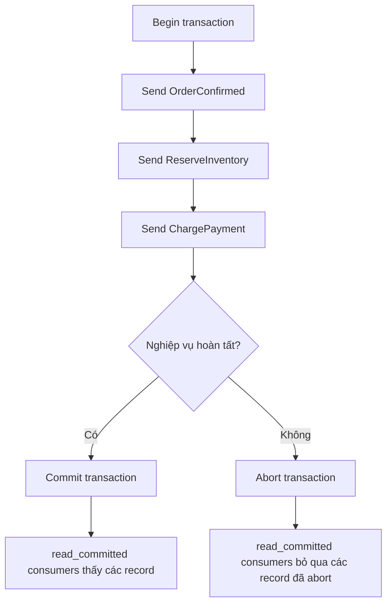
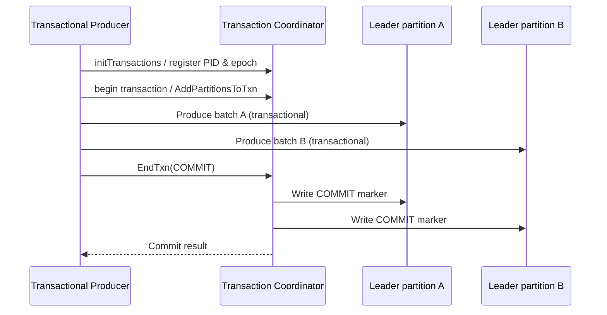
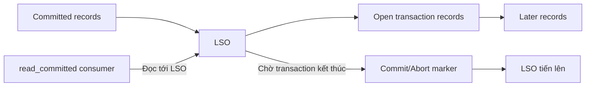

# Ghi nguyên tử vào nhiều topic và partition

Một nghiệp vụ có thể cần phát sinh nhiều record cùng lúc. Ví dụ, khi đơn hàng được xác nhận, hệ thống cần ghi sự kiện vào topic `orders`, tạo yêu cầu giữ hàng trong `inventory-commands` và gửi yêu cầu thanh toán vào `payment-commands`. Nếu chỉ gửi từng record bằng producer thông thường, một số record có thể ghi thành công trong khi record khác thất bại. Các consumer khi đó có thể nhìn thấy một phần của nghiệp vụ.

Kafka transaction cho phép producer gom nhiều lần ghi thành một giao dịch. Các record có thể thuộc nhiều partition và nhiều topic trong cùng một Kafka cluster. Producer kết thúc giao dịch bằng commit hoặc abort; consumer dùng `isolation.level=read_committed` chỉ nhìn thấy dữ liệu của giao dịch đã commit. Đây là nền tảng cho việc ghi nguyên tử nhiều topic/partition và cho luồng consume-transform-produce có exactly-once semantics trong phạm vi Kafka.

Bài học thuộc chương **Giao dịch** của module **KAFKA**. Module hướng dẫn xây dựng hệ thống event streaming với topic, partition, offset, producer, consumer group, replication và KRaft; đồng thời triển khai Java/Spring Kafka, xử lý retry, ordering và giao dịch. Bài này tập trung vào phạm vi, cơ chế và cách sử dụng Kafka transaction để ghi nhiều đầu ra nhất quán.

Sau bài này, bạn có thể:

- Giải thích vì sao nhiều lần `send()` độc lập không tạo thành một nghiệp vụ nguyên tử.
- Mô tả vai trò của transactional producer và transaction coordinator.
- Ghi record vào nhiều topic/partition trong một transaction rồi commit hoặc abort.
- Phân biệt Producer ID, producer epoch, transaction marker và Last Stable Offset.
- Cấu hình consumer `read_committed` để chỉ xử lý giao dịch đã commit.
- Kết hợp output records và consumer offsets trong một transaction để xử lý consume-transform-produce.
- Nhận diện giới hạn của Kafka transaction khi nghiệp vụ còn ghi database hoặc gọi hệ thống bên ngoài.

## 1. Vì sao cần ghi nguyên tử nhiều topic và partition?

### 1.1. Ghi nhiều record bằng producer thông thường

Giả sử một service nhận yêu cầu xác nhận đơn hàng. Nó cần ghi ba record:

1. `OrderConfirmed` vào topic `orders`.
2. `ReserveInventory` vào topic `inventory-commands`.
3. `ChargePayment` vào topic `payment-commands`.

Nếu service gửi từng record độc lập, kết quả có thể như sau:

| Record | Kết quả |
|---|---|
| `OrderConfirmed` | Ghi thành công |
| `ReserveInventory` | Ghi thành công |
| `ChargePayment` | Timeout hoặc lỗi broker |

Hai record đầu đã tồn tại trong Kafka trong khi record thứ ba chưa được ghi. Consumer kho có thể giữ hàng, consumer thanh toán không nhận được yêu cầu thu tiền, còn consumer đơn hàng cho rằng đơn đã xác nhận. Ứng dụng phải tự xây dựng cơ chế bù trừ hoặc reconciliation để phát hiện trạng thái một phần.

Ngay cả khi gọi `flush()` sau mỗi lần `send()`, producer chỉ chờ kết quả từng lần gửi; điều đó không biến nhiều lần gửi thành một đơn vị commit nguyên tử. `acks=all` cũng chỉ điều khiển mức xác nhận của từng batch ghi, không gộp nhiều request thành một transaction.

### 1.2. Transaction gom nhiều lần ghi thành một đơn vị

Với transactional producer, ứng dụng bắt đầu transaction, gửi tất cả record cần thiết rồi commit. Nếu bước xử lý thất bại trước commit, ứng dụng abort transaction. Với consumer cấu hình `read_committed`, các record trong transaction chỉ được đưa ra ứng dụng sau khi giao dịch commit thành công.



Tính nguyên tử ở đây có nghĩa các record thuộc transaction được công bố như một đơn vị đối với consumer đọc committed data: giao dịch commit thì các record hợp lệ của giao dịch được nhìn thấy; giao dịch abort thì chúng không được trả về như dữ liệu đã commit. Đây không phải là một lời hứa rằng mọi broker ghi xuống thiết bị lưu trữ trong cùng một thời điểm vật lý.

## 2. Phạm vi và điều kiện của Kafka transaction

Kafka transaction hỗ trợ một producer ghi nguyên tử tới nhiều partition, kể cả các partition nằm ở nhiều topic, trong **cùng một Kafka cluster**. Transaction coordinator điều phối trạng thái giao dịch; partition leader lưu record và transaction marker của partition tham gia.

Một transaction có thể bao gồm:

- Nhiều record trong cùng một partition.
- Nhiều partition của cùng một topic.
- Nhiều topic khác nhau trong cùng cluster.
- Offset của consumer group, nếu ứng dụng dùng API gửi offset vào transaction.

Các điều kiện quan trọng:

- Producer phải được cấu hình `transactional.id` và gọi `initTransactions()` trước khi sử dụng transaction.
- Các lần ghi cần thuộc cùng producer instance/transaction đang mở.
- Consumer cần dùng `read_committed` nếu chỉ được phép nhìn thấy record đã commit.
- Transaction phải kết thúc trong thời hạn cho phép; transaction treo có thể làm consumer `read_committed` bị chặn ở Last Stable Offset.
- Kafka transaction không tự mở rộng sang database, HTTP API, email server hoặc một Kafka cluster khác.

Không nên nhầm transaction của Kafka với transaction phân tán bao trùm mọi hệ thống trong một nghiệp vụ. Nếu một thao tác vừa cập nhật database vừa publish Kafka, cần thêm mẫu như transactional outbox/CDC hoặc một quy trình phối hợp riêng.

## 3. Các thành phần nội bộ của transaction

### 3.1. Transactional producer

Producer dùng `transactional.id` để định danh một luồng giao dịch logic qua các lần khởi động. Kafka dùng định danh này để khôi phục trạng thái giao dịch và cấp phát Producer ID/epoch. `transactional.id` cần ổn định khi một producer instance được khởi động lại để Kafka nhận biết producer trước đó; đồng thời, các producer instance đang hoạt động song song phải có transactional ID khác nhau.

Nếu hai producer đồng thời dùng cùng `transactional.id`, producer mới có thể làm producer cũ bị fence. Đây là hành vi bảo vệ để tránh hai tiến trình cùng ghi bằng một danh tính giao dịch và làm sai thứ tự. Trong ứng dụng nhiều instance, hãy tạo transactional ID có phần định danh instance ổn định và duy nhất trong nhóm producer đang chạy.

Khi cấu hình `transactional.id`, Kafka producer bật idempotence và các ràng buộc tương ứng theo client version. Vì vậy, không cần tự tắt idempotence cho transactional producer. Vẫn cần kiểm tra các cấu hình timeout, retry và request phù hợp với SLO.

### 3.2. Producer ID và producer epoch

Kafka cấp Producer ID (PID) để nhận diện producer. Producer epoch tăng khi cùng transactional ID được khởi tạo lại theo cơ chế transaction coordinator. Broker dùng cặp PID/epoch và sequence number để:

- Nhận diện batch thuộc producer nào.
- Phát hiện retry trùng theo sequence.
- Fence producer cũ khi epoch mới đã có hiệu lực.
- Phân biệt batch thuộc các phiên hoạt động khác nhau của cùng transactional ID.

Producer epoch giúp Kafka ngăn một instance cũ tiếp tục ghi sau khi instance mới đã tiếp quản transactional ID. Khi nhận `ProducerFencedException`, ứng dụng phải dừng và đóng producer đó; không được tiếp tục dùng instance đã bị fence.

### 3.3. Transaction coordinator

Kafka chọn transaction coordinator dựa trên `transactional.id`. Coordinator quản lý trạng thái transaction, thời hạn, các partition tham gia và quyết định commit/abort. Trạng thái transaction được lưu bền vững trong internal topic `__transaction_state`, qua đó coordinator có thể phục hồi sau khi broker điều phối bị khởi động lại hoặc chuyển vai trò.

Coordinator không trực tiếp lưu toàn bộ payload của transaction. Record vẫn được append vào partition log bởi leader tương ứng. Coordinator điều phối quyết định cuối cùng và yêu cầu các partition ghi transaction marker để thể hiện kết quả.

### 3.4. Transaction marker

Khi transaction kết thúc, Kafka ghi marker commit hoặc abort vào các partition tham gia. Marker là metadata trong log cho biết kết quả giao dịch đối với các record trước đó thuộc transaction.

Consumer `read_committed` dựa trên trạng thái transaction và marker để phân biệt record đã commit với record thuộc transaction đã abort. Consumer `read_uncommitted` không chờ kết quả commit và có thể nhìn thấy record từ transaction đang mở hoặc đã abort.

## 4. Vòng đời của một transaction

### 4.1. Khởi tạo producer

Ứng dụng cấu hình `transactional.id` và gọi `initTransactions()`. Producer khởi tạo hoặc khôi phục trạng thái giao dịch, nhận PID/epoch phù hợp và đăng ký với transaction coordinator.

`initTransactions()` cần được gọi một lần trước khi producer bắt đầu các transaction. Với cùng transactional ID, lần khởi tạo mới có thể hoàn tất hoặc xử lý transaction còn dang dở từ producer trước theo cơ chế của Kafka, đồng thời fence producer cũ.

### 4.2. Bắt đầu transaction và đăng ký partition

Ứng dụng gọi `beginTransaction()`. Khi producer gửi record tới một partition lần đầu trong transaction, client đăng ký partition đó với coordinator thông qua protocol tương ứng (chẳng hạn AddPartitionsToTxn). Coordinator ghi nhận tập partition tham gia transaction.

Producer tiếp tục gửi record tới leader của từng partition. Các record được append vào log, mang metadata PID/epoch/sequence và trạng thái transactional. Ở thời điểm này, record đã có thể nằm trong log vật lý, nhưng chưa được consumer `read_committed` coi là dữ liệu đã commit.

### 4.3. Commit hoặc abort

Khi ứng dụng gọi `commitTransaction()`, producer yêu cầu coordinator kết thúc transaction theo hướng commit. Coordinator điều phối ghi transaction marker commit tới các partition tham gia. Khi kết quả commit được hoàn tất và marker có hiệu lực, consumer `read_committed` có thể đọc các record thuộc transaction đó.

Nếu ứng dụng gọi `abortTransaction()`, coordinator điều phối marker abort. Record đã append vẫn có thể còn trong log cho tới khi cleanup/compaction xử lý theo quy tắc, nhưng consumer `read_committed` bỏ qua chúng. Vì vậy, abort không nhất thiết xóa byte record ngay lập tức khỏi file segment.



Sơ đồ rút gọn để thể hiện vai trò của coordinator và các partition leader. Protocol thực tế có thêm bước đăng ký partition, replication, xử lý lỗi và xác nhận marker; các request có thể diễn ra bất đồng bộ.

## 5. Ví dụ Java: ghi nguyên tử vào nhiều topic

Ví dụ sau ghi ba record vào ba topic trong cùng một transaction:

```java
import org.apache.kafka.clients.producer.KafkaProducer;
import org.apache.kafka.clients.producer.ProducerConfig;
import org.apache.kafka.clients.producer.ProducerRecord;
import org.apache.kafka.common.KafkaException;
import org.apache.kafka.common.errors.ProducerFencedException;
import org.apache.kafka.common.serialization.StringSerializer;

import java.util.Properties;

public class MultiTopicTransaction {
    public static void main(String[] args) {
        Properties props = new Properties();
        props.put(ProducerConfig.BOOTSTRAP_SERVERS_CONFIG,
                "localhost:9092");
        props.put(ProducerConfig.KEY_SERIALIZER_CLASS_CONFIG,
                StringSerializer.class.getName());
        props.put(ProducerConfig.VALUE_SERIALIZER_CLASS_CONFIG,
                StringSerializer.class.getName());
        props.put(ProducerConfig.TRANSACTIONAL_ID_CONFIG,
                "order-confirmation-instance-01");
        props.put(ProducerConfig.TRANSACTION_TIMEOUT_CONFIG, 60000);

        try (KafkaProducer<String, String> producer =
                     new KafkaProducer<>(props)) {
            producer.initTransactions();
            producer.beginTransaction();

            try {
                String orderId = "order-9001";

                producer.send(new ProducerRecord<>(
                        "orders", orderId,
                        "{\"eventType\":\"OrderConfirmed\"}"
                ));

                producer.send(new ProducerRecord<>(
                        "inventory-commands", orderId,
                        "{\"command\":\"ReserveInventory\"}"
                ));

                producer.send(new ProducerRecord<>(
                        "payment-commands", orderId,
                        "{\"command\":\"ChargePayment\"}"
                ));

                producer.commitTransaction();
            } catch (ProducerFencedException e) {
                // Producer đã bị instance khác fence: phải dừng instance này.
                throw e;
            } catch (KafkaException e) {
                // Với lỗi có thể xử lý tại producer này, yêu cầu abort.
                // Nếu producer đã ở trạng thái fatal/fenced, abort cũng có thể lỗi.
                try {
                    producer.abortTransaction();
                } catch (KafkaException abortError) {
                    e.addSuppressed(abortError);
                }
                throw e;
            }
        }
    }
}
```

Đây là ví dụ minh họa API cơ bản. Trong ứng dụng production, cần phân loại exception theo trạng thái producer và kết quả commit. Một lỗi khi `commitTransaction()` có thể khiến ứng dụng chưa biết chắc kết quả cuối cùng tại thời điểm nhận exception; không nên mù quáng gửi lại toàn bộ nghiệp vụ như một transaction mới. Cần dùng event ID/idempotency và quy trình phục hồi phù hợp. Producer bị fence hoặc gặp lỗi fatal phải được đóng và khởi tạo lại theo đúng transactional ID/epoch.

### 5.1. Vì sao phải chờ commit?

`send()` có tính bất đồng bộ và trả về ngay một `Future`. Gọi `commitTransaction()` sẽ flush các record còn trong buffer và chờ các request/transaction hoàn tất theo protocol trước khi kết thúc transaction. Nếu một send thất bại, producer có thể chuyển transaction sang trạng thái cần abort hoặc báo lỗi khi commit.

Không gọi `commitTransaction()` sau từng record nếu mục tiêu là nguyên tử cả nhóm. Làm như vậy sẽ tạo nhiều transaction độc lập và consumer có thể quan sát kết quả từng phần giữa các lần commit.

### 5.2. Một transaction có thể ghi nhiều partition

Partition được xác định từ topic và key/partitioner. Nếu ba record có key khác nhau hoặc nằm ở ba topic, chúng có thể được định tuyến tới các partition khác nhau. Producer không cần tự gửi marker; coordinator và broker thực hiện phần điều phối.

Số partition tham gia càng lớn, transaction càng cần nhiều thao tác phối hợp và marker. Vì vậy, transaction rộng có thể tăng latency, tải coordinator và thời gian hoàn tất. Chỉ gom những record thực sự cần cùng tính nguyên tử vào một transaction.

## 6. Consumer nhìn thấy transaction như thế nào?

### 6.1. `read_uncommitted`

Consumer có isolation level mặc định `read_uncommitted` nếu không cấu hình khác. Consumer có thể đọc record transactional trước khi transaction commit, và có thể nhận cả record thuộc transaction cuối cùng bị abort. Đây là hành vi phù hợp khi ứng dụng chấp nhận đọc dữ liệu chưa được commit theo transaction.

### 6.2. `read_committed`

Với consumer cần chỉ xử lý kết quả transaction đã commit, cấu hình:

```properties
isolation.level=read_committed
```

Consumer `read_committed`:

- Trả về record không transactional theo quy tắc đọc thông thường.
- Trả về record thuộc transaction đã commit.
- Bỏ qua record thuộc transaction đã abort.
- Không đọc vượt qua Last Stable Offset (LSO) của partition.

LSO là ranh giới ổn định cho consumer `read_committed`. Nếu một transaction trước đó trên partition vẫn đang mở, LSO có thể thấp hơn High Watermark. Consumer `read_committed` sẽ chờ transaction kết thúc trước khi đọc tiếp qua vùng bị chặn. Vì vậy, transaction bị treo hoặc có timeout dài có thể làm tăng consumer lag dù record đã được append và replication đã tiến triển.



Sơ đồ mô tả một trường hợp có transaction chưa kết thúc làm LSO dừng trước vùng dữ liệu phía sau. Khi marker commit/abort được ghi và trạng thái transaction được xác định, LSO có thể tiến lên; consumer tiếp tục đọc dữ liệu hợp lệ.

### 6.3. Cấu hình consumer Java

```java
Properties consumerProps = new Properties();
consumerProps.put("bootstrap.servers", "localhost:9092");
consumerProps.put("group.id", "order-projection");
consumerProps.put("enable.auto.commit", "false");
consumerProps.put("isolation.level", "read_committed");
consumerProps.put("key.deserializer",
        "org.apache.kafka.common.serialization.StringDeserializer");
consumerProps.put("value.deserializer",
        "org.apache.kafka.common.serialization.StringDeserializer");
```

Nếu consumer đọc output của transactional producer nhưng vẫn dùng `read_uncommitted`, ứng dụng có thể nhìn thấy record thuộc transaction bị abort. Đó là lỗi cấu hình phổ biến khi kỳ vọng end-to-end exactly-once.

## 7. Exactly-once consume-transform-produce

Một trường hợp quan trọng là consumer đọc input, biến đổi dữ liệu rồi ghi output vào topic khác. Nếu consumer commit input offset độc lập với việc ghi output, có thể xảy ra hai tình huống:

- Output đã ghi thành công nhưng consumer chết trước khi commit offset: record input được đọc lại và output có thể bị ghi trùng.
- Offset đã commit nhưng output chưa ghi thành công: input bị coi là đã xử lý, dẫn tới mất output.

Kafka transaction có thể gom output records và input offsets trong cùng transaction. Khi commit thành công, output và tiến độ input được commit cùng nhau; khi abort, cả output transactional lẫn offset trong transaction đều không được coi là đã commit.

### 7.1. Luồng xử lý

1. Consumer đọc input với `enable.auto.commit=false`.
2. Producer transactional bắt đầu transaction.
3. Ứng dụng xử lý record và gửi output record.
4. Ứng dụng lấy offset kế tiếp cần commit cho từng partition input.
5. Producer gọi `sendOffsetsToTransaction()` để đưa offset vào transaction.
6. Producer commit transaction.

### 7.2. Ví dụ API Java

```java
// consumer: enable.auto.commit=false, isolation.level=read_committed
// producer: transactional.id được cấu hình và đã gọi initTransactions()

ConsumerRecords<String, String> records = consumer.poll(Duration.ofMillis(500));

if (!records.isEmpty()) {
    producer.beginTransaction();
    try {
        for (ConsumerRecord<String, String> input : records) {
            String outputValue = transform(input.value());
            producer.send(new ProducerRecord<>(
                    "orders-projected",
                    input.key(),
                    outputValue
            ));
        }

        Map<TopicPartition, OffsetAndMetadata> offsets =
                new HashMap<>();
        for (TopicPartition partition : records.partitions()) {
            // position() là offset kế tiếp sau các record đã poll/tiêu thụ,
            // kể cả khi có offset bị bỏ qua do compaction hoặc aborted records.
            long nextOffset = consumer.position(partition);
            offsets.put(partition, new OffsetAndMetadata(nextOffset));
        }

        producer.sendOffsetsToTransaction(
                offsets,
                consumer.groupMetadata()
        );
        producer.commitTransaction();
    } catch (KafkaException e) {
        try {
            producer.abortTransaction();
        } catch (KafkaException abortError) {
            e.addSuppressed(abortError);
        }
        throw e;
    }
}
```

Đây là khung minh họa cho một batch poll; mã production cần xử lý rebalance, exception fencing, transaction timeout, shutdown và trường hợp commit có kết quả chưa rõ. Phải commit offset kế tiếp sau record cuối cùng đã xử lý thành công ở mỗi partition, không commit offset của record cuối cùng mà quên cộng một. Nếu xử lý song song trong một partition, cần bảo đảm không commit vượt qua record chưa hoàn thành.

### 7.3. Những cấu hình bắt buộc cần kiểm tra

| Thành phần | Cấu hình/điều kiện | Lý do |
|---|---|---|
| Producer | `transactional.id` ổn định và duy nhất giữa các instance hoạt động đồng thời | Kích hoạt transaction và fencing |
| Producer | `initTransactions()` trước `beginTransaction()` | Khởi tạo/khôi phục trạng thái transaction |
| Consumer | `enable.auto.commit=false` | Tránh commit offset độc lập ngoài transaction |
| Consumer | `isolation.level=read_committed` | Không xử lý output từ transaction chưa commit hoặc đã abort |
| Consumer group | Gửi `consumer.groupMetadata()` cùng offset | Gắn offset vào đúng group generation/metadata |
| Ứng dụng | Chỉ commit offset của record đã xử lý xong | Tránh bỏ qua dữ liệu chưa hoàn tất |

Exactly-once trong mô hình này áp dụng cho việc đọc input Kafka, ghi output Kafka và commit offset Kafka trong phạm vi transaction được hỗ trợ. Nó không tự bảo đảm một database update hoặc HTTP request bên ngoài chỉ chạy một lần.

## 8. Transaction trong Spring Kafka

Spring Kafka hỗ trợ transaction thông qua `KafkaTransactionManager` và cấu hình transactional producer factory. Trong Spring Boot, có thể cấu hình transaction ID prefix để mỗi producer instance tạo transactional ID riêng. Prefix cần được thiết kế để không trùng giữa các instance đang chạy đồng thời.

Ví dụ cấu hình minh họa:

```yaml
spring:
  kafka:
    producer:
      transaction-id-prefix: order-service-${INSTANCE_ID}-
```

`INSTANCE_ID` cần được cung cấp từ môi trường triển khai và duy nhất giữa các instance đồng thời. Tùy phiên bản Spring Boot/Spring Kafka, cách cấu hình và bean transaction manager có thể khác; cần đối chiếu reference documentation đúng phiên bản.

Khi dùng `KafkaTransactionManager`, các thao tác gửi Kafka trong phạm vi transaction Spring được tham gia vào Kafka transaction tương ứng. Nếu phương thức còn ghi database, cần hiểu rõ thứ tự commit của các transaction manager và giới hạn phối hợp. Việc đặt hai transaction manager trong cùng một method không tự tạo distributed atomic commit giữa database và Kafka.

## 9. Timeout, fencing và lỗi giao dịch

### 9.1. Transaction timeout

`transaction.timeout.ms` giới hạn thời gian broker cho phép transaction hoàn tất. Broker có giới hạn tối đa qua cấu hình `transaction.max.timeout.ms`. Nếu ứng dụng mở transaction quá lâu, coordinator có thể đánh dấu transaction hết hạn và abort nó.

Transaction quá dài còn giữ LSO ở phía sau, làm consumer `read_committed` chờ. Vì vậy:

- Không thực hiện các thao tác I/O chậm hoặc gọi API bên ngoài trong lúc transaction Kafka đang mở nếu có thể tránh.
- Chia workload lớn thành các transaction có kích thước hợp lý.
- Đặt timeout đủ cho tải thực tế nhưng không quá lớn tới mức giữ transaction treo lâu.
- Theo dõi transaction duration và consumer lag/LSO.

### 9.2. Producer bị fence

`ProducerFencedException` cho biết transactional producer đã mất quyền sử dụng transactional ID, thường do một producer khác khởi tạo cùng ID và epoch mới hơn. Producer bị fence không được tiếp tục gửi hoặc commit; cần đóng instance và kiểm tra cơ chế cấp ID giữa các replica ứng dụng.

### 9.3. Lỗi khi commit

Không phải mọi lỗi từ `commitTransaction()` đều có nghĩa transaction chắc chắn chưa commit. Có thể coordinator đã hoàn tất commit nhưng response bị mất, hoặc producer nhận lỗi trong lúc transaction đang được quyết định. Ứng dụng cần xử lý exception theo loại và trạng thái producer, đóng producer khi lỗi fatal, và dựa vào event ID/idempotency hoặc đọc trạng thái đầu ra để reconcile khi kết quả chưa rõ.

Không nên tự động gửi lại các record như một transaction mới chỉ vì lần commit trước timeout. Nếu transaction trước đã commit, gửi lại có thể tạo một nghiệp vụ thứ hai.

### 9.4. Lỗi thường gặp

| Biểu hiện | Nguyên nhân có thể | Hướng xử lý |
|---|---|---|
| `ProducerFencedException` | Một producer khác đã dùng transactional ID với epoch mới hơn | Bảo đảm ID duy nhất giữa instance đang chạy; đóng producer bị fence |
| `InvalidTxnStateException` | Gọi API transaction sai thứ tự hoặc transaction không còn ở trạng thái hợp lệ | Kiểm tra vòng đời begin/send/commit/abort và xử lý exception trước khi tái sử dụng |
| `TimeoutException` khi commit | Coordinator/broker/network chậm hoặc transaction kéo dài | Kiểm tra transaction coordinator, timeout và trạng thái kết quả; không gửi mù quáng lần hai |
| `TransactionTimedOutException` | Transaction vượt `transaction.timeout.ms` hoặc giới hạn broker | Rút ngắn transaction, xem xét timeout và tải xử lý |
| Consumer `read_committed` bị chậm | Transaction mở lâu hoặc marker chưa hoàn tất khiến LSO chưa tiến | Kiểm tra transaction duration, coordinator, marker replication và partition liên quan |
| Consumer thấy record đã abort | Consumer đang dùng `read_uncommitted` | Đặt `isolation.level=read_committed` nếu yêu cầu chỉ đọc dữ liệu commit |
| Offset input đã tiến nhưng output thiếu | Offset được commit độc lập hoặc không nằm trong cùng transaction | Tắt auto commit và dùng `sendOffsetsToTransaction()` |

## 10. Giới hạn và nguyên tắc thiết kế

Kafka transaction cung cấp atomicity trong Kafka cluster, nhưng cần giữ phạm vi rõ ràng:

- **Không bao trùm database:** transaction Kafka không rollback SQL transaction.
- **Không bao trùm HTTP/API:** gọi cổng thanh toán hoặc gửi email trong transaction Kafka không khiến tác động đó được rollback nếu Kafka abort.
- **Không tự xử lý mọi duplicate nghiệp vụ:** event được tạo hai lần từ ứng dụng vẫn là hai event khác nhau với Kafka.
- **Không tạo thứ tự toàn cục:** transaction có thể ghi nhiều partition nguyên tử về visibility, nhưng không tạo một total order chung giữa các partition.
- **Không thay thế idempotency ở consumer:** consumer gọi external side effect vẫn cần idempotency key hoặc inbox/deduplication.
- **Có chi phí điều phối:** coordinator, transaction markers và trạng thái transaction làm tăng độ trễ và tải so với producer không transaction.

Một transaction nên chứa nhóm record có quan hệ nguyên tử thực sự. Tránh gom hàng nghìn thao tác nghiệp vụ không liên quan vào một transaction dài. Thiết kế topic/key/partition vẫn quan trọng vì transaction chỉ bảo đảm kết quả commit/abort của các record đã tham gia, không thay thế ordering trong từng partition.

## 11. Checklist trước khi đưa transaction vào production

- [ ] Đã xác định rõ những record nào bắt buộc phải commit/abort cùng nhau.
- [ ] Tất cả topic/partition tham gia thuộc cùng Kafka cluster.
- [ ] Mỗi producer instance đồng thời có `transactional.id` riêng; ID ổn định khi instance khởi động lại theo thiết kế.
- [ ] Đã gọi `initTransactions()` trước transaction đầu tiên.
- [ ] Mọi đường code đều kết thúc transaction bằng commit hoặc abort; xử lý đúng producer fatal/fenced.
- [ ] Đã cấu hình `transaction.timeout.ms` và đối chiếu `transaction.max.timeout.ms` của broker.
- [ ] Consumer cần tính nguyên tử đã dùng `isolation.level=read_committed`.
- [ ] Với consume-transform-produce, auto commit đã tắt và offset được gửi qua `sendOffsetsToTransaction()`.
- [ ] Đã kiểm thử broker restart, network timeout, coordinator failover và producer fencing.
- [ ] Có event ID/idempotency và quy trình reconcile cho kết quả commit không rõ ràng.
- [ ] Các thao tác database/API ngoài Kafka có outbox, inbox hoặc cơ chế phối hợp phù hợp.
- [ ] Đã giám sát transaction duration, abort rate, coordinator health và consumer lag.

## 12. Câu hỏi tự kiểm tra

1. Vì sao `acks=all` không thay thế Kafka transaction khi ghi nhiều topic?
2. `transactional.id` có vai trò gì và vì sao các producer đang chạy đồng thời không được dùng chung ID?
3. Transaction coordinator lưu và điều phối những thông tin nào?
4. Transaction marker giúp consumer phân biệt commit và abort ra sao?
5. Vì sao record đã append vẫn có thể không được consumer `read_committed` nhìn thấy?
6. LSO khác High Watermark như thế nào trong trường hợp có transaction đang mở?
7. Vì sao transaction mở quá lâu có thể làm consumer `read_committed` bị chậm?
8. Trong consume-transform-produce, vì sao output records và input offsets phải nằm trong cùng transaction?
9. Kafka transaction có bảo đảm atomicity giữa Kafka và database không? Cần mẫu thiết kế nào để giải quyết dual-write?
10. Khi `commitTransaction()` timeout, vì sao không nên tự động gửi lại toàn bộ nghiệp vụ?

## 13. Tài liệu tham khảo

- Apache Kafka documentation — Transactions: <https://kafka.apache.org/documentation/#transactions> — transactional producer, coordinator, consumer isolation và exactly-once processing.
- Apache Kafka design: <https://kafka.apache.org/documentation/#design> — replication, log và semantics của producer/consumer.
- Apache Kafka protocol: <https://kafka.apache.org/protocol> — transaction APIs, markers và offset commit protocol.
- Spring for Apache Kafka reference — Transactions: <https://docs.spring.io/spring-kafka/reference/kafka/transactions.html> — cấu hình transaction manager và transactional listener/template.

Transaction APIs, cấu hình mặc định và cách tích hợp Spring có thể thay đổi theo phiên bản. Khi triển khai, hãy đối chiếu tài liệu của đúng Kafka broker, Java client và Spring Kafka release, sau đó kiểm thử cả commit, abort, timeout, fencing và phục hồi coordinator.
