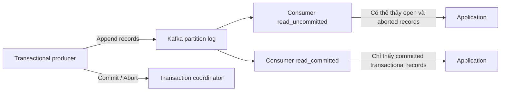
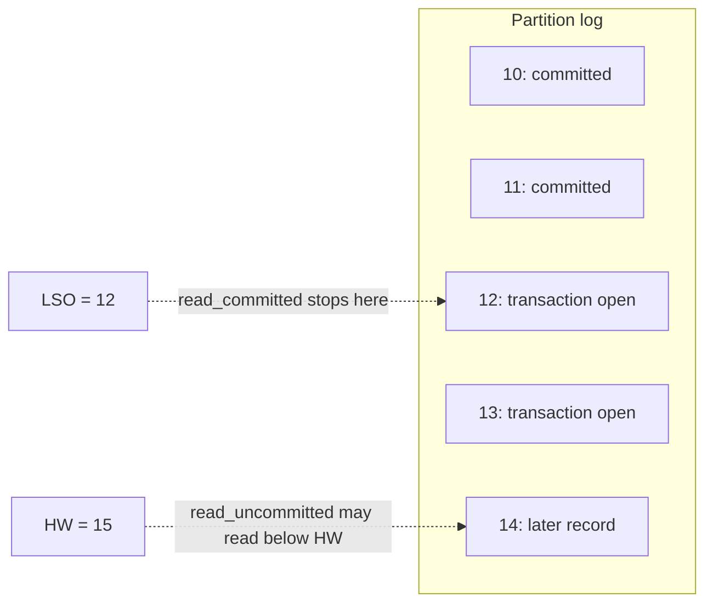
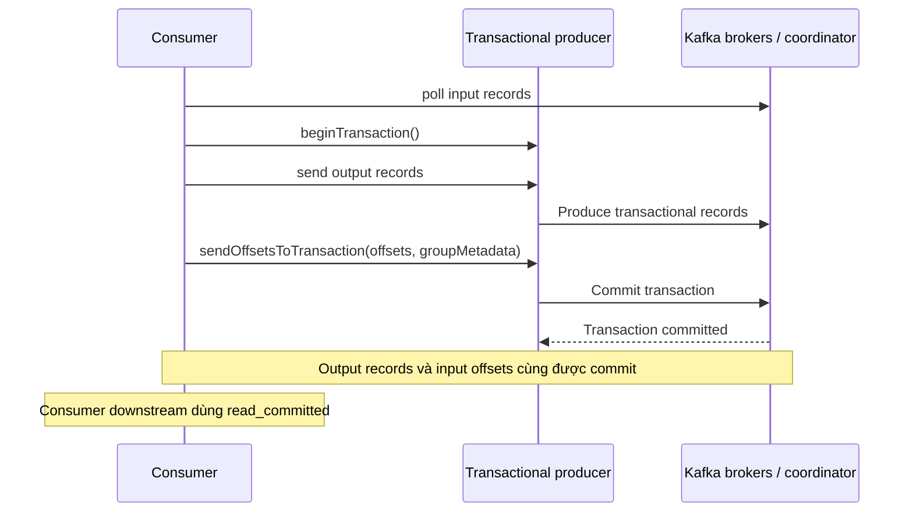

# `isolation.level=read_committed` và `read_uncommitted`

## Mục tiêu

Kafka producer có thể ghi nhiều record trong một transaction rồi commit hoặc abort toàn bộ transaction. Consumer cần quyết định có đọc những record thuộc transaction chưa kết thúc hoặc đã bị abort hay không. Cấu hình `isolation.level` điều khiển ranh giới dữ liệu mà consumer nhìn thấy.

`read_uncommitted` cho phép consumer đọc record đã được append và replicate tới mức broker cho phép, kể cả record thuộc transaction đang mở hoặc transaction sau đó bị abort. `read_committed` chỉ trả record không thuộc transaction hoặc thuộc transaction đã commit; record thuộc transaction đang mở bị giữ lại và record thuộc transaction đã abort bị bỏ qua.

Sau bài học này, bạn có thể:

- Phân biệt `read_uncommitted` và `read_committed` khi đọc dữ liệu transactional.
- Giải thích High Watermark (HW), Last Stable Offset (LSO) và ảnh hưởng của transaction đang mở.
- Hiểu vì sao offset consumer có thể có khoảng trống khi đọc committed records.
- Cấu hình `isolation.level` trong Java Kafka Consumer và Spring Kafka.
- Thiết kế luồng consume-transform-produce với transactional offset commit.
- Nhận biết giới hạn của Kafka transaction đối với database và side effect bên ngoài.
- Kiểm chứng hành vi commit/abort bằng producer và consumer trong lab.

## 1. Vì sao consumer cần isolation level?

Một producer transactional có thể ghi nhiều record vào một hoặc nhiều partition. Các record được append vào log trước khi transaction kết thúc, nhưng trạng thái cuối cùng của transaction chưa được xác định. Producer sau đó có thể commit transaction để công bố các record, hoặc abort để hủy hiệu lực của chúng.

Consumer cần một chính sách nhất quán:

- Có thể đọc mọi record đã append, kể cả record trong transaction chưa hoàn tất hay không?
- Hay chỉ đọc dữ liệu đã được transaction commit?

Kafka cung cấp hai chế độ:

| `isolation.level` | Consumer nhìn thấy gì? | Khi nào dùng? |
|---|---|---|
| `read_uncommitted` | Record non-transactional và record transactional đã append, kể cả transaction đang mở hoặc đã abort | Luồng không phụ thuộc transactional visibility, telemetry hoặc workload chấp nhận đọc dữ liệu có thể bị abort |
| `read_committed` | Record non-transactional và record thuộc transaction đã commit; bỏ qua record transactional đã abort, chờ transaction đang mở | Consumer đọc topic có transactional producer, đặc biệt luồng exactly-once Kafka-to-Kafka |

Giá trị mặc định của Kafka consumer là `read_uncommitted`. Nếu ứng dụng cần chỉ nhìn thấy output của transaction đã commit, phải cấu hình `read_committed` một cách tường minh.



`isolation.level` là chính sách đọc ở consumer. Nó không tự biến producer thường thành transactional producer, không tạo transaction và không thay thế việc producer gọi `commitTransaction()` hoặc `abortTransaction()`.

## 2. `read_uncommitted`: đọc record đã append

Với `read_uncommitted`, consumer không lọc theo kết quả transaction. Khi record đã nằm trong phạm vi đọc của partition, consumer có thể nhận record dù transaction chứa nó chưa commit hoặc cuối cùng bị abort.

Ví dụ producer bắt đầu transaction và gửi hai record:

```text
beginTransaction()
  send(order-created)
  send(order-audited)
  // Transaction vẫn đang mở
```

Consumer `read_uncommitted` có thể đọc hai record này trước khi producer quyết định commit hay abort. Nếu producer sau đó abort, ứng dụng consumer đã nhận dữ liệu đó và không có cơ chế Kafka tự thu hồi side effect đã thực hiện.

Điều này có thể tạo ra kết quả sai:

1. Producer mở transaction để ghi `PaymentCaptured` và `AccountBalanceUpdated`.
2. Consumer `read_uncommitted` nhận `PaymentCaptured` và gửi thông báo thanh toán thành công.
3. Producer gặp lỗi và abort transaction.
4. Output transactional không được commit, nhưng email/thông báo đã gửi không thể tự thu hồi.

Với consumer chỉ đọc topic không có transactional producer, hai chế độ thường cho kết quả giống nhau. Khác biệt chỉ xuất hiện khi topic có record transactional.

## 3. `read_committed`: chỉ đọc dữ liệu đã commit

Với `read_committed`, consumer chỉ nhận:

- Record không thuộc transaction khi record nằm trong phạm vi đọc ổn định của partition.
- Record thuộc transaction đã commit.

Consumer bỏ qua record thuộc transaction đã abort. Record thuộc transaction đang mở chưa được trả về cho ứng dụng cho đến khi transaction có kết quả commit hoặc abort.

Ví dụ:

```text
Transaction T1: begin
  offset 10: order-created
  offset 11: order-audited
Transaction T1: COMMIT

Transaction T2: begin
  offset 12: payment-authorized
  offset 13: payment-captured
Transaction T2: ABORT

offset 14: inventory-snapshot (non-transactional)
```

Consumer `read_uncommitted` có thể nhận record tại offset 10, 11, 12, 13 và 14 (khi các offset nằm trong giới hạn fetch đã replicate). Consumer `read_committed` nhận record 10, 11 và 14; record 12, 13 bị bỏ qua vì transaction T2 abort.

Consumer `read_committed` không nhận control record commit/abort như record nghiệp vụ thông thường. Kafka dùng các marker này để xác định trạng thái transaction và lọc dữ liệu trước khi trả record cho ứng dụng.

### 3.1. `read_committed` không có nghĩa là chờ mọi record trong cluster

Isolation được áp dụng theo từng partition log. Consumer có thể tiếp tục đọc partition khác nếu partition đó có dữ liệu ổn định. Nhưng trong một partition, transaction chưa kết thúc có thể chặn việc đọc các offset phía sau nó, kể cả record phía sau không thuộc transaction.

Điều này là hệ quả của việc Kafka giữ thứ tự log trong partition và dùng Last Stable Offset làm giới hạn đọc cho consumer committed.

## 4. High Watermark và Last Stable Offset

Để hiểu `read_committed`, cần phân biệt hai offset:

- **High Watermark (HW):** ranh giới dữ liệu đã được replicate tới các replica cần thiết theo trạng thái partition; consumer thông thường không đọc vượt quá HW.
- **Last Stable Offset (LSO):** ranh giới ổn định cho consumer `read_committed`; consumer không đọc các record ở offset bằng hoặc lớn hơn LSO khi còn transaction mở đứng trước.

Khi không có transaction đang mở, LSO thường tiến tới HW. Khi một transaction còn mở, LSO dừng tại vị trí đầu tiên mà consumer committed chưa thể xác nhận trạng thái transaction.



Ví dụ HW bằng 15 và LSO bằng 12:

- Consumer `read_uncommitted` có thể đọc các record có offset nhỏ hơn HW, bao gồm record trong transaction mở.
- Consumer `read_committed` chỉ đọc tới offset nhỏ hơn LSO; các record từ offset 12 trở đi chưa được trả về.
- Khi transaction commit hoặc abort, LSO có thể tiến lên và consumer tiếp tục đọc.

LSO không phải offset cuối cùng đã commit toàn topic. Nó là ranh giới đọc ổn định của một partition và có thể khác nhau giữa các partition.

### 4.1. Transaction mở làm tăng độ trễ đọc

Nếu producer mở transaction quá lâu, `read_committed` consumer có thể thấy dữ liệu mới đến chậm dù broker đã nhận các record phía sau. Khi transaction kết thúc, LSO tiến lên và consumer tiếp tục.

Nguyên nhân thường gặp:

- Ứng dụng mở transaction rồi thực hiện công việc lâu trước khi commit.
- Producer bị treo hoặc mất kết nối giữa transaction.
- Transaction chứa quá nhiều record hoặc nhiều partition.
- Transaction coordinator đang phục hồi sau sự cố.
- `transaction.timeout.ms` đặt quá dài làm transaction mở tồn tại lâu hơn khi producer không hoàn tất.

Hãy giữ transaction ngắn, chỉ bao quanh các thao tác Kafka cần tính nguyên tử. Không thực hiện HTTP request hoặc công việc CPU dài trong lúc transaction đang mở nếu có thể hoàn thành trước hoặc thiết kế lại.

## 5. Offset có thể có khoảng trống khi đọc committed

Kafka offset là vị trí trong partition log, không phải bộ đếm số lượng record mà ứng dụng chắc chắn nhìn thấy. Control record và record thuộc transaction bị abort có thể chiếm offset nhưng không được trả về cho `read_committed` consumer.

Ví dụ:

| Offset | Nội dung | Transaction | `read_uncommitted` | `read_committed` |
|---:|---|---|---|---|
| 20 | `order-created` | T1 commit | Nhận | Nhận |
| 21 | `order-audited` | T1 commit | Nhận | Nhận |
| 22 | `payment-requested` | T2 abort | Nhận | Bỏ qua |
| 23 | `payment-authorized` | T2 abort | Nhận | Bỏ qua |
| 24 | `inventory-updated` | Non-transactional | Nhận | Nhận |

Consumer `read_committed` có thể nhận offset 20, 21, rồi 24. Khoảng trống 22 và 23 không có nghĩa consumer bị mất record do lỗi. Đây là kết quả đúng của isolation.

Khi commit offset, ứng dụng lưu **vị trí tiếp theo cần đọc**, thường là `record.offset() + 1` cho record đã xử lý. Không tự suy luận rằng offset tiếp theo phải bằng offset hiện tại cộng một record được trả về, vì có thể có khoảng trống do aborted transaction hoặc control record.

Các dashboard lag cũng cần được diễn giải theo isolation level. Với `read_committed`, consumer có thể chưa đọc tới HW vì LSO còn thấp. Lag tạm thời tăng không nhất thiết là consumer chậm; cần kiểm tra transaction đang mở và LSO của partition.

## 6. So sánh hai chế độ theo tình huống

| Tình huống | `read_uncommitted` | `read_committed` |
|---|---|---|
| Topic chỉ có record non-transactional | Đọc record | Đọc record tương tự |
| Transaction đã commit | Đọc record | Đọc record |
| Transaction đang mở | Có thể đọc record đã append | Chờ LSO tiến qua transaction |
| Transaction abort | Có thể đã đọc record trước khi abort | Không trả các record của transaction đó |
| Transaction mở chặn offset phía sau | Có thể tiếp tục đọc dưới HW | Dừng tại LSO trong partition đó |
| Latency | Có thể thấp hơn vì không chờ transaction kết thúc | Có thể cao hơn khi transaction mở lâu |
| Phù hợp với output transactional | Có nguy cơ nhìn thấy dữ liệu bị abort | Phù hợp khi chỉ xử lý dữ liệu đã commit |

### 6.1. Chọn `read_committed` khi nào?

Nên dùng `read_committed` khi:

- Consumer đọc output từ producer có `transactional.id`.
- Consumer là một mắt xích trong pipeline consume-transform-produce có exactly-once semantics.
- Ứng dụng không được phép xử lý dữ liệu thuộc transaction đã abort.
- Consumer tạo side effect từ event transactional và cần chỉ phản ứng với kết quả đã commit.

### 6.2. Khi nào `read_uncommitted` có thể phù hợp?

Có thể giữ `read_uncommitted` khi:

- Topic không dùng transaction và yêu cầu latency thấp.
- Ứng dụng chấp nhận nhìn thấy dữ liệu tạm thời hoặc dữ liệu có thể bị abort.
- Công cụ quan sát cần thấy các record đã append để debug transaction.
- Luồng xử lý không tạo side effect không thể đảo ngược từ record chưa commit.

Không chọn `read_uncommitted` chỉ vì muốn giảm vài mili giây latency nếu dữ liệu transactional có ý nghĩa nghiệp vụ quan trọng.

## 7. Cấu hình Java Kafka Consumer

Đặt isolation level bằng `ConsumerConfig.ISOLATION_LEVEL_CONFIG`:

```java
import java.time.Duration;
import java.util.List;
import java.util.Properties;

import org.apache.kafka.clients.consumer.ConsumerConfig;
import org.apache.kafka.clients.consumer.ConsumerRecord;
import org.apache.kafka.clients.consumer.ConsumerRecords;
import org.apache.kafka.clients.consumer.KafkaConsumer;
import org.apache.kafka.common.serialization.StringDeserializer;

Properties props = new Properties();
props.put(ConsumerConfig.BOOTSTRAP_SERVERS_CONFIG, "localhost:9092");
props.put(ConsumerConfig.GROUP_ID_CONFIG, "orders-projection");
props.put(ConsumerConfig.KEY_DESERIALIZER_CLASS_CONFIG,
        StringDeserializer.class.getName());
props.put(ConsumerConfig.VALUE_DESERIALIZER_CLASS_CONFIG,
        StringDeserializer.class.getName());
props.put(ConsumerConfig.ENABLE_AUTO_COMMIT_CONFIG, false);
props.put(ConsumerConfig.ISOLATION_LEVEL_CONFIG, "read_committed");

try (KafkaConsumer<String, String> consumer = new KafkaConsumer<>(props)) {
    consumer.subscribe(List.of("orders.events"));

    while (running) {
        ConsumerRecords<String, String> records =
                consumer.poll(Duration.ofMillis(250));

        for (ConsumerRecord<String, String> record : records) {
            process(record);
        }

        consumer.commitSync();
    }
}
```

Ví dụ này minh họa consumer chỉ đọc committed records và commit offset sau khi xử lý toàn bộ batch thành công. Trong ứng dụng thực tế, hãy xử lý lỗi theo từng partition/record và chỉ commit offset đã xử lý an toàn. `read_committed` không tự bảo đảm side effect với database được commit cùng Kafka offset.

Đổi sang `read_uncommitted`:

```java
props.put(ConsumerConfig.ISOLATION_LEVEL_CONFIG, "read_uncommitted");
```

Nếu bỏ cấu hình, consumer dùng giá trị mặc định của Kafka client là `read_uncommitted`.

## 8. Cấu hình Spring Boot và Spring Kafka

Với Spring Boot, cấu hình consumer property trong `application.yml`:

```yaml
spring:
  kafka:
    bootstrap-servers: localhost:9092
    consumer:
      group-id: orders-projection
      enable-auto-commit: false
      properties:
        isolation.level: read_committed
```

Hoặc đặt property trực tiếp:

```properties
spring.kafka.consumer.properties.isolation.level=read_committed
```

Listener có thể giữ cấu trúc thông thường:

```java
@KafkaListener(topics = "orders.events", groupId = "orders-projection")
public void onOrderEvent(ConsumerRecord<String, String> record) {
    orderProjection.apply(record.value());
}
```

`isolation.level` được áp dụng cho Kafka consumer mà listener container tạo. Nó không tự bật transaction cho `KafkaTemplate` hoặc producer. Nếu ứng dụng vừa consume vừa produce transactional, cần cấu hình cả producer transaction manager/factory và consumer isolation/offset handling theo mô hình xử lý đã chọn.

## 9. Kết hợp `read_committed` với consume-transform-produce

Một luồng Kafka-to-Kafka có thể đọc input, tạo output và commit input offsets trong cùng transaction. Mục tiêu là bảo đảm output và tiến độ consumer cùng commit hoặc cùng abort.



Các bước:

1. Consumer đọc input với `enable.auto.commit=false`.
2. Producer được cấu hình `transactional.id` và gọi `initTransactions()`.
3. Consumer poll input records.
4. Producer gọi `beginTransaction()`.
5. Ứng dụng xử lý input và gửi output bằng producer transactional.
6. Gọi `sendOffsetsToTransaction()` để đưa offset input vào transaction.
7. Gọi `commitTransaction()` để commit output records và input offsets cùng nhau.
8. Nếu xử lý thất bại, gọi `abortTransaction()`; output transaction bị abort và input offsets không được commit.

### 9.1. Ví dụ Java rút gọn

```java
Properties consumerProps = new Properties();
consumerProps.put(ConsumerConfig.BOOTSTRAP_SERVERS_CONFIG, "localhost:9092");
consumerProps.put(ConsumerConfig.GROUP_ID_CONFIG, "orders-transformer");
consumerProps.put(ConsumerConfig.KEY_DESERIALIZER_CLASS_CONFIG,
        StringDeserializer.class.getName());
consumerProps.put(ConsumerConfig.VALUE_DESERIALIZER_CLASS_CONFIG,
        StringDeserializer.class.getName());
consumerProps.put(ConsumerConfig.ENABLE_AUTO_COMMIT_CONFIG, false);
consumerProps.put(ConsumerConfig.ISOLATION_LEVEL_CONFIG, "read_committed");

Properties producerProps = new Properties();
producerProps.put(ProducerConfig.BOOTSTRAP_SERVERS_CONFIG, "localhost:9092");
producerProps.put(ProducerConfig.KEY_SERIALIZER_CLASS_CONFIG,
        StringSerializer.class.getName());
producerProps.put(ProducerConfig.VALUE_SERIALIZER_CLASS_CONFIG,
        StringSerializer.class.getName());
producerProps.put(ProducerConfig.TRANSACTIONAL_ID_CONFIG,
        "orders-transformer-instance-1");

try (KafkaConsumer<String, String> consumer =
             new KafkaConsumer<>(consumerProps);
     KafkaProducer<String, String> producer =
             new KafkaProducer<>(producerProps)) {

    producer.initTransactions();
    consumer.subscribe(List.of("orders.input"));

    while (running) {
        ConsumerRecords<String, String> records =
                consumer.poll(Duration.ofMillis(250));
        if (records.isEmpty()) {
            continue;
        }

        producer.beginTransaction();
        try {
            for (ConsumerRecord<String, String> input : records) {
                String output = transform(input.value());
                producer.send(new ProducerRecord<>(
                        "orders.output", input.key(), output));
            }

            Map<TopicPartition, OffsetAndMetadata> offsets = new HashMap<>();
            for (TopicPartition partition : records.partitions()) {
                // position() là vị trí tiếp theo của consumer sau poll;
                // nó tính cả các offset bị bỏ qua do aborted/control records.
                offsets.put(partition,
                        new OffsetAndMetadata(consumer.position(partition)));
            }

            producer.sendOffsetsToTransaction(offsets, consumer.groupMetadata());
            producer.commitTransaction();
        } catch (Exception e) {
            producer.abortTransaction();
            throw e;
        }
    }
}
```

Đây là skeleton minh họa cho batch tuần tự: mọi record trong batch được xử lý xong trước khi offset tương ứng được đưa vào transaction. Nếu xử lý song song, phải tính contiguous completed offset theo từng partition; không commit offset lớn nhất khi record trước đó còn pending. Cần bổ sung imports, xử lý `WakeupException`, lỗi fencing, transaction timeout và retry phù hợp trong ứng dụng thật.

`transactional.id` phải duy nhất giữa các producer instance đang hoạt động. Một instance khởi động lại có thể dùng lại ID logical của nó để Kafka fence producer cũ; không dùng cùng một ID cho nhiều replica đang chạy đồng thời.

### 9.2. Vì sao consumer đầu ra cần `read_committed`?

Transaction đảm bảo record output và input offsets được commit cùng nhau. Nếu consumer downstream dùng `read_uncommitted`, nó vẫn có thể nhìn thấy record output của transaction trước khi transaction hoàn tất hoặc record sau đó bị abort. Để downstream chỉ xử lý output đã commit, consumer phải dùng `read_committed`.

Exactly-once Kafka-to-Kafka là đặc tính của toàn pipeline: transactional producer, transactional offset commit và downstream consumer đọc committed. Chỉ đặt `isolation.level=read_committed` không tự tạo exactly-once processing.

## 10. Giới hạn: Kafka transaction không bao phủ database tùy ý

Kafka transaction có thể nguyên tử hóa các ghi Kafka và consumer offsets được gửi vào transaction. Nó không tự bao gồm thao tác JDBC, gọi REST API, gửi email hoặc cập nhật hệ thống ngoài Kafka.

Ví dụ:

1. Consumer đọc `OrderCreated`.
2. Ứng dụng cập nhật PostgreSQL thành công.
3. Producer transaction ghi `OrderIndexed` nhưng transaction bị abort.
4. Input offset không commit nên record được đọc lại.
5. PostgreSQL có thể nhận cập nhật lần nữa.

Để bảo vệ side effect database, cần một thiết kế như inbox/deduplication theo event ID, outbox, transaction coordinator ở tầng ứng dụng hoặc mô hình saga phù hợp. Không gọi đây là exactly-once end-to-end chỉ vì producer dùng transaction.

| Phạm vi | Kafka transaction bảo vệ? | Cơ chế bổ sung |
|---|---|---|
| Ghi nhiều Kafka partition | Có | Transactional producer |
| Ghi output và commit input consumer offsets | Có | `sendOffsetsToTransaction()` |
| Consumer downstream tránh thấy output abort | Cần `read_committed` | Cấu hình isolation cho downstream |
| Ghi PostgreSQL cùng Kafka output | Không tự động | Outbox/inbox, idempotency, transaction orchestration |
| Gọi REST API hoặc gửi email | Không | Idempotency key, deduplication, retry/reconciliation |

## 11. Kiểm tra isolation level bằng Kafka CLI

Consumer console có thể đặt isolation level bằng consumer property:

```bash
bin/kafka-console-consumer.sh --bootstrap-server localhost:9092 \
  --topic orders.output \
  --from-beginning \
  --consumer-property isolation.level=read_committed
```

Đổi sang:

```bash
bin/kafka-console-consumer.sh --bootstrap-server localhost:9092 \
  --topic orders.output \
  --from-beginning \
  --consumer-property isolation.level=read_uncommitted
```

Console consumer mặc định có thể không hiển thị khác biệt nếu topic không có transactional records. Cần dùng producer transactional để tạo một transaction commit và một transaction abort mới quan sát rõ semantics.

## 12. Thực hành: quan sát committed và aborted records

Thực hiện trên Kafka lab có broker hỗ trợ transactions. Tạo topic `isolation-lab` với ít nhất một partition.

### 12.1. Chuẩn bị transactional producer

Tạo Java producer với `transactional.id` duy nhất, gọi `initTransactions()`. Gửi hai record trong transaction thứ nhất rồi commit. Gửi hai record khác trong transaction thứ hai rồi abort.

```java
producer.initTransactions();

producer.beginTransaction();
producer.send(new ProducerRecord<>("isolation-lab", "committed-1"));
producer.send(new ProducerRecord<>("isolation-lab", "committed-2"));
producer.commitTransaction();

producer.beginTransaction();
producer.send(new ProducerRecord<>("isolation-lab", "aborted-1"));
producer.send(new ProducerRecord<>("isolation-lab", "aborted-2"));
producer.abortTransaction();

producer.send(new ProducerRecord<>("isolation-lab", "plain-record"));
```

Các lệnh gửi cuối cùng ngoài transaction tạo record non-transactional. Đóng producer sau khi hoàn tất.

### 12.2. Đọc với `read_uncommitted`

Chạy console consumer với `isolation.level=read_uncommitted`. Quan sát các giá trị `committed-1`, `committed-2`, `aborted-1`, `aborted-2` và `plain-record` trong log nếu chúng nằm trong phạm vi đọc.

### 12.3. Đọc với `read_committed`

Chạy console consumer mới với `isolation.level=read_committed`. Consumer chỉ nhận `committed-1`, `committed-2` và `plain-record`; các giá trị thuộc transaction abort không được trả về.

Nếu consumer đang chạy đồng thời với transaction mở, có thể quan sát consumer committed dừng ở LSO. Sau khi transaction commit hoặc abort, consumer tiếp tục đọc.

### 12.4. Kết quả cần ghi nhận

| Record | Kết quả transaction | `read_uncommitted` | `read_committed` |
|---|---|---|---|
| committed-1 | Commit | Nhận | Nhận |
| committed-2 | Commit | Nhận | Nhận |
| aborted-1 | Abort | Nhận | Bỏ qua |
| aborted-2 | Abort | Nhận | Bỏ qua |
| plain-record | Không transactional | Nhận | Nhận |

Ghi lại offset thực tế của từng record. Có thể thấy consumer committed nhảy qua offset của aborted records. Đây là hành vi đúng, không phải lỗi mất record.

## 13. Monitoring và troubleshooting

Khi `read_committed` consumer có vẻ bị chậm, cần kiểm tra transaction state chứ không chỉ nhìn consumer CPU.

| Hiện tượng | Nguyên nhân có thể | Hướng kiểm tra |
|---|---|---|
| Consumer không thấy record mới dù broker đã nhận | Record thuộc transaction đang mở, LSO chưa tiến | Kiểm tra producer transaction lifecycle và transaction coordinator |
| Consumer `read_uncommitted` thấy record nhưng committed không thấy | Record thuộc transaction chưa commit hoặc đã abort | Kiểm tra commit/abort marker và trạng thái transaction |
| Offset có khoảng trống | Aborted records hoặc control records không được trả về | Đối chiếu transaction state; không suy luận mất record từ offset gap |
| Consumer lag tăng nhưng CPU thấp | LSO thấp do transaction mở lâu | Kiểm tra thời gian mở transaction, transaction timeout và producer logs |
| Transaction liên tục abort | Producer lỗi, fencing, timeout hoặc coordinator instability | Kiểm tra `transactional.id`, producer epoch, coordinator và exception |
| Consumer downstream xử lý record đã abort | Consumer đang dùng `read_uncommitted` | Đổi sang `read_committed` và kiểm thử pipeline |
| Transactional producer bị fenced | Hai instance dùng trùng `transactional.id` hoặc producer epoch cũ | Bảo đảm ID duy nhất cho từng instance đang hoạt động |

Các chỉ số nên theo dõi:

- Transaction commit/abort rate.
- Transaction duration và số transaction timeout.
- Producer request latency và error rate.
- Consumer lag cùng LSO/HW theo partition nếu metric/CLI phiên bản cung cấp.
- Số record đang chờ xử lý và tuổi của transaction mở.
- Coordinator availability và lỗi producer fencing.

Không để transaction mở trong lúc ứng dụng chờ user input hoặc gọi dịch vụ bên ngoài có latency không giới hạn. Giữ transaction ngắn và có timeout phù hợp.

## 14. Các sai lầm thường gặp

| Sai lầm | Hậu quả | Cách khắc phục |
|---|---|---|
| Nghĩ `read_committed` là mặc định | Consumer có thể đọc record thuộc transaction abort | Cấu hình tường minh cho consumer đọc transactional output |
| Nghĩ `read_committed` tự bật transaction | Producer thường vẫn ghi non-transactional | Cấu hình producer transactional và quản lý transaction lifecycle |
| Dùng `read_uncommitted` cho side effect quan trọng | Có thể xử lý record rồi transaction bị abort | Dùng `read_committed` |
| Nghĩ offset phải liên tiếp | Hiểu nhầm aborted/control offsets là mất record | Theo dõi offset như vị trí log, chấp nhận gap |
| Đổ mọi lag cho consumer chậm | Transaction mở có thể giữ LSO phía sau HW | Kiểm tra transaction duration và LSO |
| Gọi Kafka transaction là exactly-once end-to-end | Database/API ngoài Kafka không được bao phủ | Dùng inbox/outbox và idempotency ở hệ thống đích |
| Dùng chung `transactional.id` cho nhiều pod | Producer mới fence producer cũ, transaction lỗi | Tạo transactional ID duy nhất cho mỗi producer instance |
| Mở transaction quá lâu | Consumer committed bị chặn đọc dữ liệu phía sau | Thu nhỏ transaction batch và tránh I/O chậm trong transaction |

## 15. Checklist cấu hình production

- [ ] Đã xác định topic có transactional producer hay không.
- [ ] Consumer đọc transactional output dùng `isolation.level=read_committed`.
- [ ] Producer transactional gọi `initTransactions`, `beginTransaction`, `commitTransaction`/`abortTransaction` đúng lifecycle.
- [ ] `transactional.id` duy nhất giữa các producer instance đang hoạt động.
- [ ] Consumer tắt auto commit khi offset cần đưa vào Kafka transaction.
- [ ] Consume-transform-produce dùng `sendOffsetsToTransaction()` với group metadata đúng.
- [ ] Consumer downstream cũng dùng `read_committed`.
- [ ] Transaction ngắn và có timeout phù hợp.
- [ ] Theo dõi transaction duration, commit/abort rate, LSO/HW và consumer lag.
- [ ] Database/API side effect có inbox/outbox hoặc idempotency riêng.
- [ ] Đã thử nghiệm cả commit và abort trong lab.

## 16. Câu hỏi tự kiểm tra

1. `read_uncommitted` có thể nhìn thấy những record nào trong transaction?
2. `read_committed` xử lý record của transaction abort như thế nào?
3. Vì sao consumer committed có thể bị chặn tại LSO dù HW đã tiến lên?
4. LSO khác HW ở điểm nào?
5. Vì sao offset của record trả về có thể nhảy từ 21 lên 24?
6. Khi topic không có transactional producer, hai isolation level thường khác nhau không?
7. `read_committed` có tự tạo exactly-once processing không? Vì sao?
8. Làm thế nào commit output records và input offsets trong cùng Kafka transaction?
9. Vì sao downstream consumer của transactional output cũng cần `read_committed`?
10. Kafka transaction có bao gồm thao tác ghi PostgreSQL hoặc gọi REST API không?
11. Vì sao không được dùng chung `transactional.id` cho nhiều producer instance đang hoạt động?
12. Khi committed consumer lag tăng nhưng CPU thấp, cần kiểm tra thông tin transaction nào?

## Tài liệu tham khảo

- [Apache Kafka — Consumer Configurations](https://kafka.apache.org/documentation/#consumerconfigs): `isolation.level`, `read_committed` và `read_uncommitted`.
- [Apache Kafka — Design: Message Delivery Semantics](https://kafka.apache.org/documentation/#semantics): at-least-once, at-most-once và exactly-once semantics.
- [Apache Kafka — Transactions](https://kafka.apache.org/documentation/#transactions): transactional producer, transaction coordinator và consume-transform-produce.
- [Apache Kafka — Producer Configurations](https://kafka.apache.org/documentation/#producerconfigs): `transactional.id`, idempotence và transaction timeout.
- [Spring for Apache Kafka — Transactions](https://docs.spring.io/spring-kafka/reference/kafka/transactions.html): transactional producer factory, transaction manager và listener integration.

> `read_committed` bảo đảm consumer chỉ nhìn thấy transactional records đã commit theo Kafka transaction protocol. Nó là một phần của thiết kế exactly-once Kafka-to-Kafka, không thay thế idempotency hoặc transaction ở database và hệ thống bên ngoài.
