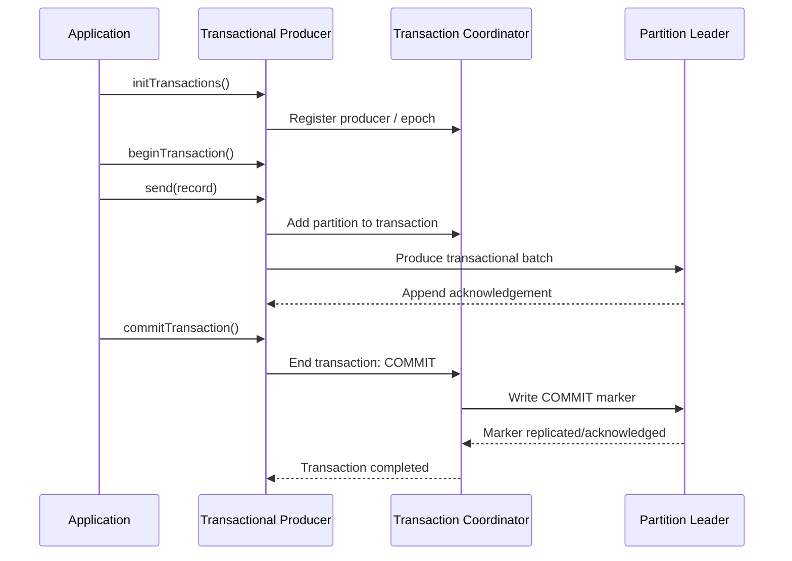

# Transaction marker, last stable offset và giao dịch chưa kết thúc

Kafka transaction cho phép producer ghi một nhóm record vào nhiều partition và hoàn tất nhóm đó bằng commit hoặc abort. Để consumer biết record nào đã được xác nhận, Kafka ghi các **transaction marker** vào log của những partition tham gia. Các marker này cùng trạng thái transaction do coordinator quản lý tạo nên ranh giới giữa dữ liệu đã ổn định và dữ liệu còn đang chờ quyết định.

Ranh giới đó được gọi là **Last Stable Offset (LSO)**. Với consumer dùng `isolation.level=read_committed`, Kafka chỉ trả về record nằm trước LSO. Vì vậy, một transaction mở quá lâu có thể khiến consumer không đọc được các record phía sau, dù các record đó đã được ghi và replication đã tiến lên. Hiểu transaction marker, LSO, Last Stable Offset và giao dịch chưa kết thúc giúp chẩn đoán hiện tượng consumer có vẻ bị đứng hoặc lag không giảm.

## 1. Transaction trong Kafka gồm những gì?

Một transactional producer có thể ghi record vào một hoặc nhiều topic-partition trong cùng transaction. Ứng dụng bắt đầu transaction, gửi các record, rồi chọn một trong hai kết quả:

- **Commit:** xác nhận các record trong transaction là dữ liệu hợp lệ và cho phép consumer `read_committed` nhìn thấy chúng.
- **Abort:** hủy transaction; consumer `read_committed` bỏ qua các record dữ liệu thuộc transaction đó.

Kafka dùng transaction coordinator để quản lý vòng đời transaction. Producer được nhận diện bằng `transactional.id`; coordinator cấp hoặc quản lý `producerId` và epoch tương ứng, theo dõi các partition tham gia và quyết định trạng thái transaction.

Với luồng consume-transform-produce, producer còn có thể đưa offset đầu vào vào cùng transaction bằng `sendOffsetsToTransaction()`. Khi đó output records và input offsets được commit cùng nhau trong phạm vi Kafka transaction. Điều này tránh trường hợp output đã được commit nhưng offset đầu vào chưa được commit, hoặc offset đầu vào tiến lên trong khi output bị abort.

## 2. Transaction marker là gì?

Khi transaction kết thúc, Kafka ghi một **control record** (transaction marker) vào các partition liên quan. Marker cho biết transaction đã commit hay abort. Đây là metadata nội bộ của Kafka, không phải event nghiệp vụ do ứng dụng gửi.

Hai loại marker quan trọng:

| Marker | Ý nghĩa |
|---|---|
| `COMMIT` | Transaction kết thúc thành công; các data record của transaction được xem là committed |
| `ABORT` | Transaction bị hủy; các data record thuộc transaction không được trả cho consumer `read_committed` |

Marker được ghi trong log của partition tham gia transaction. Kafka cũng lưu trạng thái điều phối transaction trong topic nội bộ `__transaction_state`. Khi dùng `sendOffsetsToTransaction()`, offset group liên quan được ghi vào `__consumer_offsets` theo cơ chế transaction.

### Marker không phải record nghiệp vụ

Consumer ứng dụng không nhận marker như một `ConsumerRecord` thông thường. Kafka client xử lý control record nội bộ và lọc chúng khỏi dữ liệu trả về cho ứng dụng. Vì vậy, ứng dụng không cần tự parse marker để biết event commit hay abort.

Marker vẫn chiếm vị trí trong log và ảnh hưởng tới offset. Do đó, offset của các record mà ứng dụng nhìn thấy có thể không liên tiếp. Ví dụ consumer đọc offset 10 rồi offset 12; offset 11 có thể là control record hoặc một record đã bị lọc do transaction abort. Không được giả định offset kế tiếp luôn bằng offset vừa đọc cộng một trong mọi luồng dữ liệu.

## 3. Last Stable Offset (LSO) là gì?

LSO là ranh giới cao nhất mà consumer `read_committed` có thể đọc an toàn trên một partition. Nói cách khác, mọi record có offset nhỏ hơn LSO đã nằm trước transaction chưa kết thúc sớm nhất trên partition đó. Record tại LSO và các record phía sau chưa được xem là ổn định đối với consumer `read_committed`.

Nếu partition không có transaction đang mở, LSO thường bằng High Watermark (HW). Nếu có transaction đang mở, LSO bị giữ tại offset bắt đầu của transaction mở sớm nhất mà marker kết thúc chưa được ghi nhận đầy đủ cho partition đó.

LSO có ba điểm cần nhớ:

- Được xác định riêng cho từng partition, không phải một offset chung của toàn topic.
- Có thể nhỏ hơn HW vì transaction còn đang mở.
- Có thể tiến lên khi transaction được commit hoặc abort và marker tương ứng được ghi vào log.

Ví dụ một partition có log như sau:

| Offset | Nội dung | Trạng thái |
|---:|---|---|
| 100 | `OrderCreated` không transactional | Có thể đọc |
| 101 | `PaymentAuthorized` thuộc transaction T1 | T1 đang mở |
| 102 | `InventoryReserved` không transactional | Đứng sau T1 |
| 103 | `NotificationRequested` không transactional | Đứng sau T1 |

Khi T1 vẫn mở, LSO của partition là 101. Consumer `read_committed` có thể đọc record offset 100 nhưng không thể đọc offset 101, 102 hoặc 103. Dù offset 102 và 103 không thuộc T1, chúng vẫn nằm sau transaction chưa kết thúc và phải chờ ranh giới ổn định tiến lên.

Khi T1 commit, Kafka ghi commit marker. Khi marker đã được ghi và replication đạt điều kiện cần thiết, LSO có thể tiến tới HW hoặc tới transaction đang mở tiếp theo. Consumer `read_committed` khi đó có thể đọc record T1 và các record tiếp sau, bỏ qua marker nội bộ.

Nếu T1 abort, data record ở offset 101 bị lọc khỏi consumer `read_committed`. Sau khi abort marker được ghi và ranh giới ổn định tiến lên, consumer có thể đọc các record phía sau như offset 102 và 103. Offset 101 vẫn tồn tại trong lịch sử log nhưng không được trả như dữ liệu committed.

## 4. Phân biệt LEO, High Watermark và LSO

Ba mốc offset này mô tả ba trạng thái khác nhau của log:

| Mốc | Tên đầy đủ | Ý nghĩa |
|---|---|---|
| LEO | Log End Offset | Vị trí offset kế tiếp ở cuối log của replica; phản ánh dữ liệu đã append vào replica đó |
| HW | High Watermark | Ranh giới dữ liệu đã được replication xác nhận theo quy tắc ISR; consumer thông thường không đọc vượt qua ranh giới này |
| LSO | Last Stable Offset | Ranh giới dữ liệu ổn định mà consumer `read_committed` được phép đọc; bị chặn bởi transaction chưa kết thúc |

Trong điều kiện thông thường, LEO của leader không nhỏ hơn HW; LSO không vượt quá HW. Với partition không có transaction đang mở, LSO thường bằng HW. Khi có transaction mở, LSO có thể thấp hơn HW:

```text
Offset tăng theo chiều ---------------------------------------------->

LEO:  --------------------------------------------------------------> 150
HW:   -----------------------------------------------------------> 146
LSO:  -------------------------------> 121
                                      ^
                                      transaction đang mở bắt đầu

read_uncommitted: đọc dữ liệu replicated trước HW theo semantics của client
read_committed:   chỉ đọc record có offset nhỏ hơn LSO
```

Sơ đồ chỉ minh họa quan hệ giữa các ranh giới. Giá trị thực tế thay đổi theo replication, transaction marker và hoạt động ghi của partition.

### Vì sao consumer có thể bị chặn dù HW vẫn tăng?

Giả sử producer ghi record mới sau một transaction đang mở. Broker có thể tiếp tục append và replication các record đó, khiến HW tiến lên. Nhưng consumer `read_committed` vẫn không thể vượt qua LSO đang bị giữ ở đầu transaction mở. Vì vậy, HW tăng không đồng nghĩa dữ liệu mới đã sẵn sàng cho consumer `read_committed`.

## 5. `read_committed` và `read_uncommitted`

Consumer chọn isolation level để quyết định cách nhìn dữ liệu transactional:

| Isolation level | Dữ liệu consumer có thể nhận | Khi nào dùng |
|---|---|---|
| `read_uncommitted` | Có thể nhận data record thuộc transaction chưa kết thúc hoặc đã abort, miễn nằm trong phạm vi fetch có thể đọc; control marker vẫn được client xử lý nội bộ | Luồng không yêu cầu chỉ nhìn dữ liệu transaction đã commit |
| `read_committed` | Chỉ nhận record không transactional và record thuộc transaction đã commit, trước LSO; record thuộc transaction abort bị lọc | Pipeline cần không nhìn thấy dữ liệu transactional chưa commit hoặc đã abort |

Cấu hình Java Consumer:

```java
props.put(ConsumerConfig.ISOLATION_LEVEL_CONFIG, "read_committed");
```

Hoặc:

```properties
isolation.level=read_committed
```

`read_committed` không làm producer trở thành transactional và cũng không tạo transaction. Nó chỉ quyết định consumer quan sát dữ liệu transactional như thế nào. Producer phải sử dụng `transactional.id`, `initTransactions()`, `beginTransaction()` và commit/abort đúng cách để tạo ra transaction.

### Record đã abort vẫn có thể chiếm offset

Khi transaction abort, Kafka không cần xóa vật lý ngay các data record đã ghi. Consumer `read_committed` bỏ qua chúng nhờ transaction metadata và abort marker. Vì vậy:

- Offset có thể có khoảng trống trong những record consumer nhận được.
- `read_uncommitted` có thể nhìn thấy record thuộc transaction đã abort.
- `read_committed` không trả record aborted nhưng vẫn tiến qua vị trí của chúng khi ranh giới LSO cho phép.
- Không tính số record đã xử lý bằng cách lấy offset hiện tại trừ offset trước đó mà không tính tới control record và aborted record.

## 6. Transaction đang mở giữ LSO như thế nào?

Khi producer gọi `beginTransaction()` và gửi record vào một partition, transaction được đăng ký với coordinator và partition trở thành một phần của transaction. Cho tới khi coordinator hoàn tất commit hoặc abort và marker được ghi vào partition, LSO có thể bị giữ ở offset đầu tiên của transaction đó.

Một transaction mở có thể tồn tại vì:

- Ứng dụng đã gọi `beginTransaction()` nhưng bị treo trước khi gọi `commitTransaction()` hoặc `abortTransaction()`.
- Producer đang chờ database, HTTP API hoặc một dịch vụ khác trong khi transaction vẫn mở.
- Một thread quên kết thúc transaction khi có exception.
- Producer mất kết nối hoặc process dừng giữa transaction.
- Transaction coordinator đang phục hồi trạng thái hoặc gửi marker tới các partition.
- `transaction.timeout.ms` đặt quá dài khiến transaction lỗi phải chờ lâu mới được xử lý timeout.

Transaction mở trên một partition có thể chặn consumer `read_committed` của partition đó, kể cả các record phía sau là non-transactional hoặc thuộc transaction khác đã kết thúc. Một partition khác không tham gia transaction vẫn có thể có LSO bình thường và tiếp tục được đọc.

Nếu một transaction ghi vào nhiều partition, mỗi partition có ranh giới LSO riêng. Transaction coordinator quản lý trạng thái chung và gửi marker tới các partition tham gia; LSO trên từng partition tiến lên khi marker tương ứng được ghi nhận tại partition đó.

## 7. Vòng đời transaction và vị trí ghi marker

Một luồng transactional producer đơn giản:



Đây là sơ đồ khái niệm. Chi tiết request và trạng thái nội bộ có thể khác theo phiên bản Kafka, nhưng các vai trò chính vẫn là producer, transaction coordinator, partition leader và marker trong log.

Với abort, coordinator ghi abort marker thay vì commit marker. Consumer `read_committed` dùng marker và thông tin transaction để lọc data record thuộc transaction bị hủy.

### `__transaction_state`

Kafka lưu metadata trạng thái transaction trong topic nội bộ `__transaction_state`. Thông tin này hỗ trợ coordinator khôi phục transaction sau khi broker coordinator thay đổi hoặc khởi động lại. Không chỉnh sửa topic này trực tiếp bằng producer/consumer ứng dụng và không xóa dữ liệu của nó để “giải phóng” LSO.

### Transactional offset commit

Trong mô hình consume-transform-produce, `sendOffsetsToTransaction()` đưa offset đầu vào vào transaction. Khi transaction commit, output records và offsets được commit cùng nhau. Nếu transaction abort, output không được consumer `read_committed` nhìn thấy và offset đầu vào không tiến như một commit độc lập.

Điều này khác với việc gọi `consumer.commitSync()` riêng sau khi gửi output. Hai thao tác tách rời có thể tạo crash window khiến input offset tiến nhưng output chưa commit, hoặc output đã commit nhưng input được đọc lại.

## 8. Ví dụ Java: commit và abort transaction

Producer transactional cần có `transactional.id` ổn định cho một logical producer instance và được khởi tạo transaction trước khi sử dụng:

```java
Properties props = new Properties();
props.put(ProducerConfig.BOOTSTRAP_SERVERS_CONFIG, "localhost:9092");
props.put(ProducerConfig.KEY_SERIALIZER_CLASS_CONFIG,
        StringSerializer.class.getName());
props.put(ProducerConfig.VALUE_SERIALIZER_CLASS_CONFIG,
        StringSerializer.class.getName());
props.put(ProducerConfig.TRANSACTIONAL_ID_CONFIG, "orders-transformer-1");
props.put(ProducerConfig.ACKS_CONFIG, "all");
props.put(ProducerConfig.ENABLE_IDEMPOTENCE_CONFIG, true);

try (KafkaProducer<String, String> producer = new KafkaProducer<>(props)) {
    producer.initTransactions();

    try {
        producer.beginTransaction();

        producer.send(new ProducerRecord<>(
                "orders.processed", "ORD-2048", "OrderValidated"));
        producer.send(new ProducerRecord<>(
                "orders.audit", "ORD-2048", "ValidationCompleted"));

        producer.commitTransaction();
    } catch (Exception e) {
        try {
            producer.abortTransaction();
        } catch (Exception abortError) {
            e.addSuppressed(abortError);
        }
        throw e;
    }
}
```

Ví dụ minh họa producer gửi hai record vào hai topic trong một transaction. Trong ứng dụng thật, cần phân biệt lỗi có thể phục hồi với lỗi fatal/fenced; sau một số lỗi producer không còn dùng được và phải đóng/tạo lại theo đúng quy trình. Không được tiếp tục dùng producer sau khi transaction state đã trở nên không hợp lệ.

`transactional.id` phải duy nhất giữa các producer đang hoạt động đồng thời, nhưng ổn định qua restart của cùng logical instance để producer mới có thể tiếp quản và fence producer cũ. Nếu mọi replica ứng dụng cùng dùng một `transactional.id`, chúng có thể liên tục fence lẫn nhau.

## 9. Ví dụ consumer chỉ đọc transaction đã commit

Consumer cần đặt isolation level:

```java
Properties consumerProps = new Properties();
consumerProps.put(ConsumerConfig.BOOTSTRAP_SERVERS_CONFIG, "localhost:9092");
consumerProps.put(ConsumerConfig.GROUP_ID_CONFIG, "orders-projection");
consumerProps.put(ConsumerConfig.KEY_DESERIALIZER_CLASS_CONFIG,
        StringDeserializer.class.getName());
consumerProps.put(ConsumerConfig.VALUE_DESERIALIZER_CLASS_CONFIG,
        StringDeserializer.class.getName());
consumerProps.put(ConsumerConfig.ISOLATION_LEVEL_CONFIG, "read_committed");
```

Khi poll, consumer chỉ nhận record đã commit cùng record không transactional nằm trước LSO. Nếu transaction abort, các record dữ liệu thuộc transaction đó bị lọc. Ứng dụng không cần tự kiểm tra marker.

`read_committed` có thể làm consumer trông như bị chậm khi có transaction mở lâu. Trước khi thay isolation level, cần kiểm tra transaction đang mở và thời gian hoàn tất của producer. Đổi sang `read_uncommitted` có thể làm dữ liệu chưa commit hoặc đã abort xuất hiện trong ứng dụng, thay đổi semantics của pipeline.

## 10. Điều gì xảy ra khi transaction không kết thúc?

Một transaction không kết thúc sẽ giữ LSO tại offset bắt đầu của nó trên các partition liên quan. Khi đó:

- Consumer `read_committed` không đọc được record từ LSO trở đi trên partition bị ảnh hưởng.
- Consumer lag có thể tăng hoặc không giảm dù broker vẫn nhận và replication record mới.
- Các record non-transactional đứng sau transaction cũng bị chặn bởi ranh giới ổn định.
- Transaction khác trên partition đó có thể bị ảnh hưởng nếu nằm sau transaction mở đầu tiên.
- Các partition không liên quan vẫn có thể tiếp tục hoạt động bình thường.

Ví dụ: producer mở transaction T1 tại offset 500, sau đó ghi thêm record thường tại offset 510. T1 không commit hoặc abort. HW tiến tới 520 nhưng LSO vẫn ở 500. Consumer `read_committed` không thể đọc record offset 510 cho tới khi T1 kết thúc và marker được ghi.

### Transaction timeout

`transaction.timeout.ms` xác định thời gian coordinator cho phép transaction mở trước khi xem nó hết hạn và xử lý abort. Broker có giới hạn tối đa thông qua `transaction.max.timeout.ms`; yêu cầu timeout của producer vượt giới hạn có thể bị từ chối khi khởi tạo transaction.

Đặt timeout quá ngắn có thể làm transaction hợp lệ bị abort khi tải cao hoặc khi ghi nhiều partition. Đặt quá dài có thể kéo dài thời gian LSO bị chặn khi producer bị treo. Chọn timeout dựa trên thời gian xử lý transaction p99, số partition tham gia, network và thời gian coordinator cần hoàn tất marker; không dùng timeout dài để che giấu transaction bị bỏ quên.

## 11. Cách chẩn đoán LSO bị giữ

Khi consumer `read_committed` không tiến triển, hãy xác minh ranh giới offset và trạng thái transaction trước khi kết luận consumer bị lỗi.

### So sánh LEO, HW và LSO

Với từng partition, cần biết:

- LEO của leader và follower để đánh giá dữ liệu đã append.
- HW để biết replication đã tiến tới đâu.
- LSO để biết consumer `read_committed` được phép đọc đến đâu.
- Offset consumer hiện tại và lag theo cách hệ thống giám sát đang tính.

Nếu HW tiến nhưng LSO đứng lâu, transaction mở là một nguyên nhân quan trọng cần điều tra. Nếu cả HW cũng đứng, vấn đề có thể nằm ở replication, broker hoặc network chứ không chỉ ở transaction.

### Tìm producer và transaction đang mở

Điều tra theo các bước:

1. Xác định topic-partition có LSO bị giữ.
2. Tìm producer transactional đang ghi vào partition đó qua cấu hình `transactional.id`, log ứng dụng và log broker.
3. Kiểm tra ứng dụng có gọi `beginTransaction()` mà không đi tới `commitTransaction()` hoặc `abortTransaction()` hay không.
4. Kiểm tra request downstream nằm trong lúc transaction mở, retry không giới hạn hoặc thread bị treo.
5. Kiểm tra transaction timeout, trạng thái coordinator và lỗi fencing.
6. Xác nhận commit/abort marker đã được ghi và LSO có tiến lên sau khi transaction kết thúc.

Tên metric transaction và cách hiển thị phụ thuộc Kafka version, exporter và nền tảng giám sát. Nên kết hợp broker JMX, broker log, producer log và consumer metrics thay vì phụ thuộc một metric có tên cố định.

### Theo dõi thời gian transaction

Ứng dụng nên ghi log thời điểm bắt đầu và kết thúc transaction cùng `transactional.id`, correlation ID, topic-partition và kết quả commit/abort. Theo dõi thời gian transaction mở, số transaction timeout/abort, lỗi producer fencing và thời gian commit. Không log payload nhạy cảm chỉ để chẩn đoán transaction.

## 12. Những nguyên nhân phổ biến khiến transaction bị treo

| Nguyên nhân | Hệ quả | Hướng xử lý |
|---|---|---|
| Exception xảy ra nhưng code không abort | Transaction tiếp tục mở cho tới khi timeout hoặc producer bị đóng | Dùng `try/catch` để abort khi có thể; quản lý vòng đời producer rõ ràng |
| Gọi HTTP/database trong khi transaction đang mở | Transaction giữ LSO trong toàn bộ thời gian chờ downstream | Chuẩn bị dữ liệu trước transaction nếu có thể; giữ transaction ngắn và giới hạn timeout I/O |
| `transaction.timeout.ms` quá dài | LSO có thể bị giữ lâu khi producer mất tích | Chọn timeout theo thời gian xử lý đo được và broker maximum |
| Producer bị treo hoặc process bị kill | Không có commit/abort rõ ràng từ ứng dụng | Coordinator xử lý timeout/recovery; theo dõi transaction age và log |
| Nhiều instance dùng cùng `transactional.id` | Producer bị fencing lẫn nhau, transaction lỗi | Cấp transactional ID riêng cho mỗi instance đang chạy và ổn định theo logical identity |
| Coordinator đang phục hồi hoặc marker chưa hoàn tất | LSO chưa tiến dù producer đã yêu cầu kết thúc | Kiểm tra coordinator availability, broker log và marker propagation |
| Một transaction tham gia quá nhiều partition | Nhiều partition cùng chịu ảnh hưởng và quá trình marker phức tạp hơn | Giữ transaction nhỏ, giới hạn số partition và thời gian mở |

## 13. Lưu ý về transaction marker và compaction

Transaction marker là control record trong partition log. Nó không phải tombstone của compacted topic và không dùng `cleanup.policy=compact` để quản lý trạng thái transaction. Kafka quản lý marker theo quy tắc log và transaction metadata nội bộ.

Consumer ứng dụng không được xóa marker, ghi marker thủ công hoặc sửa `__transaction_state` để cố đẩy LSO tiến lên. Nếu marker thiếu hoặc coordinator gặp lỗi, xử lý bằng cơ chế recovery và công cụ quản trị phù hợp với phiên bản Kafka; thao tác trực tiếp lên topic nội bộ có thể làm hỏng tính nhất quán của cluster.

Compaction và retention vẫn có thể ảnh hưởng dữ liệu ứng dụng trong topic, nhưng không phải cách giải quyết transaction đang mở. Một transaction mở cần được coordinator hoàn tất hoặc timeout/abort để LSO tiến lên.

## 14. Checklist thiết kế transaction ngắn và an toàn

- Dùng `transactional.id` duy nhất giữa các producer instance đang hoạt động đồng thời.
- Giữ `transactional.id` ổn định qua restart của cùng logical producer khi cần fencing producer cũ.
- Gọi `initTransactions()` trước khi bắt đầu giao dịch.
- Mọi đường đi sau `beginTransaction()` phải kết thúc bằng commit hoặc abort, trừ trường hợp process mất đột ngột và coordinator xử lý recovery/timeout.
- Không giữ transaction mở trong lúc chờ tác vụ bên ngoài lâu nếu có thể chuẩn bị trước.
- Đặt timeout I/O downstream và `transaction.timeout.ms` phù hợp.
- Giới hạn số partition tham gia mỗi transaction khi nghiệp vụ cho phép.
- Dùng `read_committed` cho consumer cần loại dữ liệu aborted/chưa commit.
- Theo dõi LSO, HW, transaction age, commit/abort rate và producer fencing.
- Kiểm thử transaction timeout, producer restart, coordinator failover và abort path trong staging.
- Không tự sửa `__transaction_state` hoặc control marker.

## 15. Ghi nhớ

Transaction marker là control record nội bộ cho biết transaction đã commit hoặc abort. Kafka dùng marker và trạng thái coordinator để xác định dữ liệu nào ổn định. **LSO (Last Stable Offset)** là ranh giới đọc của consumer `read_committed`; consumer chỉ nhận record có offset nhỏ hơn LSO. LSO thường bằng HW khi không có transaction mở, nhưng có thể bị giữ thấp hơn HW bởi transaction chưa kết thúc.

Một transaction mở lâu có thể chặn cả record non-transactional đứng sau nó trên cùng partition. Khi consumer `read_committed` có vẻ bị đứng, hãy so sánh LEO, HW và LSO, xác định producer/transaction đang mở, rồi kiểm tra commit/abort, timeout và coordinator. Giữ transaction ngắn, kết thúc mọi transaction rõ ràng và giám sát LSO giúp pipeline Kafka transactional duy trì tính nhất quán mà không tạo độ trễ kéo dài.
