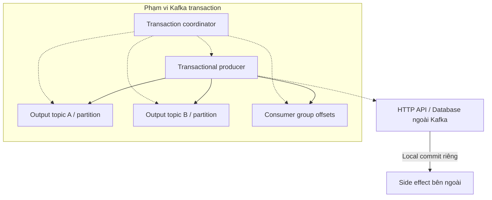
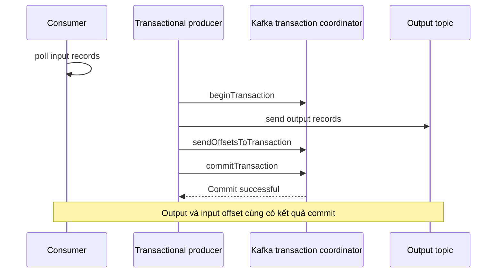
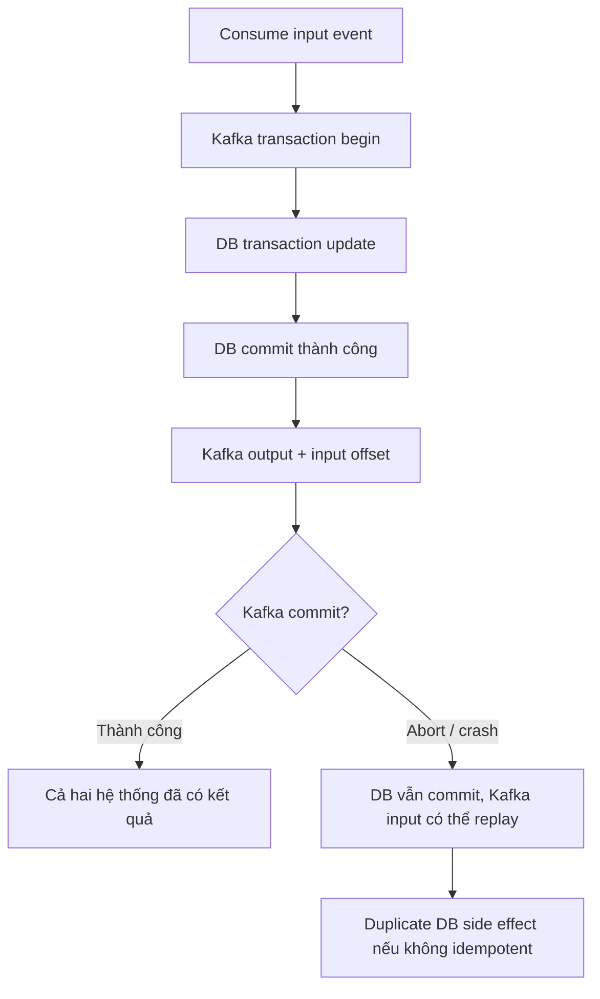
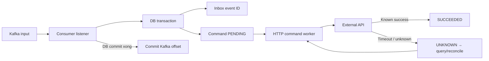

# Vì sao giao dịch Kafka không tự bao phủ HTTP hoặc cơ sở dữ liệu

Kafka transaction có thể ghi nhiều record vào nhiều topic/partition và commit offset của consumer trong cùng một giao dịch Kafka. Điều đó giúp một luồng consume-transform-produce tránh tình trạng output đã được công bố nhưng input offset chưa được ghi nhận, hoặc ngược lại. Tuy nhiên, khi ứng dụng gọi HTTP API, cập nhật PostgreSQL/MySQL hoặc gửi thông báo tới một hệ thống khác, các thao tác đó nằm ngoài transaction Kafka.

Ranh giới này rất quan trọng: **Kafka transaction không tự rollback một HTTP request hoặc database commit**. Nếu ứng dụng thực hiện side effect bên ngoài rồi Kafka transaction abort, record input có thể được phát lại và side effect có thể lặp. Muốn xử lý đáng tin cậy, cần kết hợp transaction trong từng hệ thống với idempotency, inbox/outbox, retry và đối soát.

## 1. Transaction Kafka thực sự quản lý những gì?

Kafka transaction được điều phối bởi transaction coordinator của cluster. Producer có `transactional.id` đăng ký với coordinator, bắt đầu transaction, gửi record đến một hoặc nhiều partition và có thể gửi offset của consumer group vào cùng transaction. Khi commit, Kafka hoàn tất transaction và ghi các marker cần thiết để consumer `read_committed` biết record nào được phép nhìn thấy.

Một Kafka transaction có thể bao gồm:

- Nhiều record được producer gửi đến nhiều topic và partition.
- Offset input của consumer group thông qua `sendOffsetsToTransaction()`.
- Trạng thái commit/abort được Kafka transaction coordinator quản lý.
- Tính nhất quán hiển thị cho consumer dùng `isolation.level=read_committed`.

Transaction Kafka không tự bao gồm:

- Một transaction SQL trong PostgreSQL, MySQL, Oracle hoặc database khác.
- Một HTTP/REST/gRPC request tới payment provider hoặc microservice.
- Gửi email, SMS, push notification hoặc ghi file ra object storage.
- Side effect bất kỳ mà hệ thống đích không tham gia cùng một distributed transaction được điều phối.



Kafka coordinator không mở transaction SQL, không giữ database lock và không có quyền rollback một lệnh HTTP đã được server bên ngoài thực hiện. Transaction Kafka chỉ có thể quyết định trạng thái của các thao tác Kafka nằm trong transaction đó.

## 2. Consume-transform-produce có thể atomic trong Kafka

Một trường hợp điển hình của Kafka transaction là đọc topic đầu vào, biến đổi record, ghi topic đầu ra và commit offset input trong cùng transaction.

Ví dụ: consumer đọc `orders.raw`, chuyển đổi thành `orders.validated` và ghi nhận offset input. Producer transactional có thể thực hiện các thao tác sau:

1. Gọi `beginTransaction()`.
2. Gửi output record vào `orders.validated`.
3. Tạo offset tiếp theo cần đọc cho từng partition input.
4. Gọi `sendOffsetsToTransaction(offsets, consumer.groupMetadata())`.
5. Gọi `commitTransaction()`.

Nếu transaction commit, output record và input offsets cùng được commit theo transaction Kafka. Nếu transaction abort, output không hiển thị với consumer `read_committed`, và input offsets chưa được commit bởi transaction đó nên record đầu vào có thể được xử lý lại.



Đây là atomicity trong Kafka. Nó không có nghĩa một database hoặc HTTP API được gọi trong lúc xử lý cũng tự rollback nếu transaction abort.

### Cấu hình transactional producer

Ví dụ cấu hình producer Java:

```java
Properties props = new Properties();
props.put(ProducerConfig.BOOTSTRAP_SERVERS_CONFIG, "broker-1:9092,broker-2:9092");
props.put(ProducerConfig.KEY_SERIALIZER_CLASS_CONFIG,
        StringSerializer.class.getName());
props.put(ProducerConfig.VALUE_SERIALIZER_CLASS_CONFIG,
        StringSerializer.class.getName());
props.put(ProducerConfig.TRANSACTIONAL_ID_CONFIG,
        "order-transformer-instance-1");
props.put(ProducerConfig.ENABLE_IDEMPOTENCE_CONFIG, "true");
props.put(ProducerConfig.ACKS_CONFIG, "all");

KafkaProducer<String, String> producer = new KafkaProducer<>(props);
producer.initTransactions();
```

`transactional.id` phải duy nhất giữa các producer instance đang hoạt động đồng thời. Một logical instance có thể dùng lại ID sau restart để producer mới fence instance cũ còn sót lại. Không cấu hình cùng một ID cho nhiều instance chạy song song, vì producer mới có thể fence producer trước.

Khi `transactional.id` được cấu hình, idempotence được bật theo các ràng buộc tương ứng của Kafka client. `acks=all` là cấu hình phù hợp cho transactional producer và thường được tự áp dụng theo version/configuration. Hãy xác nhận hành vi với phiên bản client đang triển khai.

### Gửi output và offset trong cùng transaction

Đoạn mã khung dưới đây minh họa consume-transform-produce. Nó giả định consumer đã subscribe, nhận batch và xử lý tuần tự; phần xử lý exception và shutdown cần được bổ sung theo lifecycle của service.

```java
ConsumerRecords<String, String> records =
        consumer.poll(Duration.ofMillis(500));

if (!records.isEmpty()) {
    producer.beginTransaction();
    try {
        Map<TopicPartition, OffsetAndMetadata> offsets = new HashMap<>();

        for (ConsumerRecord<String, String> record : records) {
            String transformed = validateAndTransform(record.value());
            producer.send(new ProducerRecord<>(
                    "orders.validated", record.key(), transformed));

            TopicPartition partition =
                    new TopicPartition(record.topic(), record.partition());
            offsets.put(partition,
                    new OffsetAndMetadata(record.offset() + 1));
        }

        producer.sendOffsetsToTransaction(offsets, consumer.groupMetadata());
        producer.commitTransaction();
    } catch (RuntimeException e) {
        producer.abortTransaction();
        throw e;
    }
}
```

Ví dụ rút gọn để làm rõ ranh giới transaction. Code production phải xử lý riêng các lỗi fatal như producer bị fence hoặc lỗi sequence, timeout commit có kết quả không xác định, rebalance và shutdown. Không tiếp tục dùng producer sau lỗi fencing; với lỗi transaction cần xác định trạng thái theo API/version và thực hiện abort/reinitialize hoặc đóng producer đúng quy tắc.

Consumer downstream cần đặt `isolation.level=read_committed` nếu chỉ muốn nhìn thấy output từ transaction đã commit. Consumer `read_uncommitted` có thể đọc record thuộc transaction đang mở hoặc đã abort, nên không phù hợp khi ứng dụng phụ thuộc vào transaction visibility.

## 3. Thêm HTTP call vào Kafka transaction không làm HTTP atomic

Hãy xét cùng ví dụ trên nhưng trước khi commit Kafka, ứng dụng gọi payment API:

```java
producer.beginTransaction();
try {
    PaymentResult result = paymentClient.charge(order);
    producer.send(new ProducerRecord<>("payments.result", order.id(), result.toJson()));
    producer.sendOffsetsToTransaction(offsets, consumer.groupMetadata());
    producer.commitTransaction();
} catch (Exception e) {
    producer.abortTransaction();
    throw e;
}
```

Đoạn mã này **không** tạo một transaction phân tán bao gồm payment API. Nếu `charge()` đã thu tiền thành công nhưng `commitTransaction()` thất bại hoặc ứng dụng crash trước commit, Kafka có thể abort output và không commit input offset. Khi consumer đọc lại event, `charge()` có thể được gọi lần nữa.

```mermaid
sequenceDiagram
    participant C as Consumer
    participant P as Kafka producer transaction
    participant K as Kafka
    participant H as Payment HTTP API

    C->>P: beginTransaction
    P->>H: POST /charge
    H-->>P: Payment successful
    P->>K: Send output + input offsets
    P->>K: commitTransaction
    K--xP: Commit fails / process crashes
    Note over K: Input offset chưa commit; output transaction không visible
    C->>H: Retry cùng input event
    Note over H: Có nguy cơ charge lần thứ hai
```

Kafka abort chỉ ảnh hưởng các record và offset trong Kafka transaction. Nó không gửi lệnh bù trừ tới payment API và không thể thu hồi khoản tiền đã được xử lý.

### Các cửa sổ lỗi cần nhận diện

| Thời điểm lỗi | Trạng thái Kafka | Trạng thái HTTP bên ngoài | Nguy cơ |
|---|---|---|---|
| Trước khi gọi HTTP | Transaction chưa commit | Chưa có request | Input có thể replay bình thường |
| Request chưa tới server | Transaction có thể abort | Chưa có side effect | Retry thường an toàn nếu xác định được request chưa tới |
| Server đã thực hiện, response bị timeout | Transaction có thể abort | Kết quả không rõ với client | Retry có thể tạo side effect trùng |
| HTTP thành công, Kafka commit thành công | Output và offset commit | Side effect đã xảy ra | Luồng hoàn tất theo dự kiến |
| HTTP thành công, Kafka commit thất bại | Input offset chưa commit hoặc kết quả commit chưa rõ | Side effect đã xảy ra | Input replay có thể gọi HTTP lần nữa |

Timeout khi gọi `commitTransaction()` cũng cần được xử lý cẩn thận: client có thể không biết ngay transaction đã commit ở coordinator hay chưa. Không nên suy luận rằng mọi timeout đều đồng nghĩa transaction chắc chắn abort. Hãy tuân theo trạng thái/error semantics của Kafka client và giữ side effect bên ngoài idempotent.

## 4. Database commit cũng nằm ngoài Kafka transaction

Tương tự HTTP, một lệnh SQL chạy trong transaction database có commit riêng. Ví dụ:

1. Consumer bắt đầu Kafka transaction.
2. Database transaction cập nhật `orders.status='PAID'` và commit.
3. Producer gửi output Kafka và input offsets.
4. Kafka transaction abort.

Database đã commit nhưng Kafka offset chưa commit. Khi input event được đọc lại, consumer có thể cập nhật database lần nữa.

Nếu đảo thứ tự và commit Kafka trước database, một lỗi database sau đó có thể khiến offset đã tiến lên trong khi dữ liệu nghiệp vụ chưa được ghi. Không có thứ tự đơn giản nào giữa hai local transaction có thể loại bỏ mọi cửa sổ lỗi.



Database không nhận transaction marker từ Kafka và không có cách tự rollback transaction SQL đã commit chỉ vì Kafka abort. Ngược lại, Kafka coordinator không biết database đã commit hay chưa.

## 5. Vì sao không tự dùng XA/2-phase commit?

Distributed transaction dựa trên XA/2PC có thể phối hợp một số resource manager hỗ trợ XA thông qua transaction coordinator. Tuy nhiên, API transaction chuẩn của Kafka không phải một XAResource tổng quát để bất kỳ JTA transaction manager nào cũng có thể enlist cùng database. Kafka sử dụng transaction protocol riêng, gồm transactional producer, transaction coordinator và transaction markers.

Để có một transaction phân tán thực sự, mọi resource tham gia phải hỗ trợ cùng giao thức điều phối, prepare/commit/rollback và phục hồi sau lỗi. HTTP REST API thông thường không triển khai XA và không giữ một transaction ở trạng thái prepared chờ coordinator. Chỉ bọc lời gọi HTTP trong `@Transactional` không biến HTTP server thành XA participant.

Một số framework có thể đồng bộ thứ tự commit giữa hai local transaction manager, ví dụ transaction manager cho database và `KafkaTransactionManager`. Cơ chế đồng bộ này hữu ích để chọn thứ tự commit và giảm một số cửa sổ lỗi, nhưng không tương đương distributed 2PC nguyên tử. Nếu transaction resource thứ hai commit thất bại sau khi resource thứ nhất đã commit, hệ thống vẫn có thể ở trạng thái một bên thành công, một bên thất bại.

Do đó, khi thiết kế cần kiểm tra chính xác:

- Resource nào thực sự tham gia cùng một transaction coordinator?
- Có pha prepare và khả năng rollback trước commit hay chỉ là commit tuần tự?
- Khi coordinator/process chết giữa hai lần commit, recovery diễn ra thế nào?
- HTTP provider có hỗ trợ operation ID/idempotency hay không?
- Chi phí giữ connection, lock và transaction mở có chấp nhận được không?

Không gọi một cấu hình có hai `@Transactional` hoặc hai transaction manager là “atomic end-to-end” nếu chưa chứng minh được cơ chế distributed transaction thực sự.

## 6. Ghi database an toàn bằng Inbox Pattern

Khi consumer cần cập nhật database, một mẫu phổ biến là ghi event ID vào bảng inbox và cập nhật dữ liệu nghiệp vụ trong **cùng database transaction**. Sau khi transaction database thành công, consumer mới commit offset Kafka.

### Bảng inbox với unique constraint

```sql
CREATE TABLE processed_events (
    source_name   VARCHAR(80) NOT NULL,
    event_id      VARCHAR(120) NOT NULL,
    processed_at  TIMESTAMP NOT NULL DEFAULT CURRENT_TIMESTAMP,
    PRIMARY KEY (source_name, event_id)
);
```

Trong transaction database:

1. Insert `(source_name, event_id)` vào inbox.
2. Nếu insert mới thành công, áp dụng thay đổi nghiệp vụ.
3. Commit inbox marker và business update cùng lúc.
4. Nếu event ID đã tồn tại, bỏ qua side effect đã được áp dụng trước đó.

Ví dụ PostgreSQL:

```sql
BEGIN;

WITH newly_processed AS (
    INSERT INTO processed_events(source_name, event_id)
    VALUES ('orders', 'evt-2026-00042')
    ON CONFLICT (source_name, event_id) DO NOTHING
    RETURNING event_id
)
UPDATE orders
   SET status = 'PAID', version = version + 1
 WHERE order_id = 'order-42'
   AND EXISTS (SELECT 1 FROM newly_processed);

COMMIT;
```

CTE `newly_processed` chỉ trả row khi event ID được insert lần đầu, vì vậy business update chỉ chạy cho event mới. SQL này dùng cú pháp PostgreSQL; với database khác, hãy dùng cú pháp insert-if-absent/upsert tương ứng và kiểm tra affected-row count trong cùng transaction. Không chỉ `SELECT` trước rồi `INSERT` sau vì hai consumer có thể đồng thời vượt qua bước kiểm tra. Unique constraint mới là cơ chế chống race condition.

Ví dụ Java với Spring `JdbcTemplate`:

```java
@Service
public class OrderProjectionService {
    private final JdbcTemplate jdbc;

    public OrderProjectionService(JdbcTemplate jdbc) {
        this.jdbc = jdbc;
    }

    @Transactional
    public void applyOnce(OrderPaid event) {
        int inserted = jdbc.update("""
            INSERT INTO processed_events(source_name, event_id)
            VALUES (?, ?)
            ON CONFLICT (source_name, event_id) DO NOTHING
            """, "orders", event.eventId());

        if (inserted == 0) {
            return; // Duplicate: side effect đã được áp dụng.
        }

        jdbc.update("""
            UPDATE orders
               SET status = ?, version = ?
             WHERE order_id = ?
            """, "PAID", event.aggregateVersion(), event.orderId());
    }
}
```

Khi database commit xong nhưng process chết trước Kafka offset commit, event được giao lại. Inbox nhận ra event ID đã tồn tại và không lặp update; listener có thể trả về thành công để offset tiến lên. Nếu business update rollback, inbox marker cũng rollback nên lần xử lý sau vẫn có thể thử lại.

Điều kiện quan trọng: inbox marker và business update phải nằm trong cùng transaction database. Inbox không bảo vệ một HTTP call khác nằm ngoài database đó.

## 7. Gọi HTTP an toàn hơn bằng idempotency key

HTTP timeout không cho biết server đã thực hiện side effect hay chưa. Nếu API đích hỗ trợ idempotency, consumer nên gửi một key ổn định được tạo từ event/command ID và giữ nguyên key qua mọi retry.

```java
public PaymentResponse charge(OrderPaid event) {
    String key = "payment-charge:" + event.eventId();

    return paymentClient.post()
            .uri("/charges")
            .header("Idempotency-Key", key)
            .body(event.toRequest())
            .retrieve()
            .body(PaymentResponse.class);
}
```

Header trên chỉ có tác dụng nếu payment API thực sự hỗ trợ và lưu kết quả theo key. Cần xác nhận:

- Cùng key và cùng payload có trả về kết quả đã lưu hay không.
- Cùng key nhưng payload khác được từ chối hay bị xử lý lại.
- Key được lưu bao lâu; TTL phải bao phủ thời gian retry và replay có thể xảy ra.
- Có API tra cứu operation khi client timeout hay không.
- Lỗi nào được retry, lỗi nào là kết quả nghiệp vụ cuối cùng.

Nếu provider không hỗ trợ idempotency hoặc operation lookup, kết quả sau timeout có thể không xác định. Hãy dùng command ID do hệ thống quản lý, lưu trạng thái command, đối soát với provider hoặc thiết kế bước bù trừ. Không có Kafka transaction nào có thể tự ngăn một HTTP server thực hiện side effect hai lần.

## 8. Dùng command table để tách HTTP khỏi poll loop

Với HTTP call lâu hoặc có retry phức tạp, consumer có thể ghi nhận command vào database thay vì gọi API trực tiếp trong poll loop.

Trong cùng DB transaction:

1. Insert event ID vào inbox.
2. Insert command vào bảng `external_commands` với trạng thái `PENDING`, operation key ổn định và payload cần thiết.
3. Commit database transaction.
4. Listener hoàn tất và consumer commit offset Kafka.

Worker riêng đọc command pending, gọi HTTP và cập nhật `SUCCEEDED`, `FAILED` hoặc `UNKNOWN`. Với kết quả `UNKNOWN` do timeout, worker tra cứu operation bằng key trước khi quyết định gửi lại.



Mẫu này tách thời gian xử lý HTTP khỏi poll loop và giúp quan sát retry. Tuy nhiên, worker vẫn cần idempotency key hoặc operation lookup để xử lý crash sau khi API thành công nhưng trước khi command row được cập nhật.

## 9. Transactional Outbox cho chiều database → Kafka

Một bài toán khác là service vừa cập nhật database vừa phát event Kafka. Gửi Kafka rồi commit database có thể tạo event cho thay đổi chưa commit; commit database rồi gửi Kafka có thể làm mất event nếu process chết giữa hai thao tác.

Transactional outbox giải quyết dual write bằng cách ghi business update và outbox row trong cùng database transaction:

```sql
CREATE TABLE outbox_events (
    event_id      VARCHAR(120) PRIMARY KEY,
    aggregate_id  VARCHAR(120) NOT NULL,
    event_type    VARCHAR(100) NOT NULL,
    payload       JSONB NOT NULL,
    created_at    TIMESTAMP NOT NULL DEFAULT CURRENT_TIMESTAMP,
    published_at  TIMESTAMP NULL
);
```

Service commit business data và outbox event cùng nhau. Relay worker hoặc CDC connector đọc outbox và publish lên Kafka. Nếu relay publish thành công nhưng chết trước khi lưu tiến độ, event có thể được publish lại. Downstream consumer vẫn cần dedupe theo event ID.

Outbox bảo đảm ý định phát event được lưu cùng business update trong database. Nó không làm database và Kafka trở thành một XA transaction, và không bảo đảm relay chỉ gửi đúng một lần trong mọi tình huống.

## 10. Spring Kafka: hai transaction manager không tự tạo distributed atomicity

Spring Kafka cung cấp `KafkaTransactionManager` để quản lý Kafka transaction. Khi dùng transactional listener container, container có thể phối hợp xử lý input, gửi output Kafka và commit offset theo transaction Kafka.

Ví dụ cấu hình producer transaction trong Spring Boot:

```yaml
spring:
  kafka:
    producer:
      transaction-id-prefix: order-service-${INSTANCE_ID}-
    consumer:
      enable-auto-commit: false
      properties:
        isolation.level: read_committed
```

`transaction-id-prefix` cần tạo ID không trùng giữa các application instance đang hoạt động. Spring Kafka dùng producer factory để tạo transactional producer và listener container có thể tham gia Kafka transaction theo cấu hình.

Ví dụ service phát output Kafka trong transaction:

```java
@Service
public class OrderEventPublisher {
    private final KafkaTemplate<String, String> kafkaTemplate;

    public OrderEventPublisher(KafkaTemplate<String, String> kafkaTemplate) {
        this.kafkaTemplate = kafkaTemplate;
    }

    @Transactional("kafkaTransactionManager")
    public void publish(String orderId, String payload) {
        kafkaTemplate.send("orders.validated", orderId, payload);
    }
}
```

Tên bean transaction manager và cấu hình cụ thể tùy ứng dụng. `@Transactional("kafkaTransactionManager")` chỉ quản lý resource Kafka mà transaction manager đó sở hữu.

Nếu một service đồng thời dùng `JpaTransactionManager` cho database và `KafkaTransactionManager` cho Kafka, Spring có thể đồng bộ thứ tự commit giữa các local transaction theo cấu hình. Điều đó không có nghĩa hai hệ thống tham gia một XA/2PC transaction. Một resource có thể đã commit trong khi commit resource còn lại thất bại. Với yêu cầu không mất event giữa database và Kafka, transactional outbox thường dễ phục hồi và kiểm chứng hơn.

Với consumer listener gọi database, hãy bảo đảm database transaction hoàn tất trước khi offset Kafka được commit nếu chọn at-least-once. Inbox pattern bảo vệ trường hợp database commit xong nhưng offset chưa commit. Không giả định chỉ thêm `@Transactional` lên listener là tự động bao trùm cả Kafka, database và HTTP.

## 11. Kafka Connect và hệ thống đích

Kafka Connect có thể chuyển dữ liệu giữa Kafka và database/object storage/HTTP-capable sink connector. Nhưng delivery semantics phụ thuộc connector, sink API, cách connector ghi offset và khả năng idempotency/transaction của hệ thống đích.

Trước khi tuyên bố một pipeline Connect có exactly-once, cần kiểm tra:

- Connector có hỗ trợ exactly-once source/sink ở phiên bản đang dùng không?
- Sink có transaction hoặc upsert/idempotent key không?
- Connector lưu offset và ghi dữ liệu đích theo thứ tự nào?
- Khi task restart giữa sink write và offset commit, dữ liệu có thể bị ghi trùng không?
- Có thể dedupe theo primary key/event ID hoặc reconcile sau restart không?

Không suy ra rằng vì connector dùng Kafka transaction nên mọi database sink hoặc HTTP endpoint đều được Kafka transaction bao phủ. Guarantee của connector phải được xác nhận trong tài liệu và kiểm thử của connector cụ thể.

## 12. Ma trận chọn mẫu thiết kế

| Luồng công việc | Ranh giới transaction | Mẫu nên cân nhắc |
|---|---|---|
| Kafka input → Kafka output | Kafka transaction bao gồm output và input offsets | Transactional producer, `sendOffsetsToTransaction()`, downstream `read_committed` |
| Kafka input → database | Database transaction riêng, Kafka offset riêng | Inbox/unique event ID; DB commit trước offset commit |
| Kafka input → HTTP API | HTTP side effect không thuộc Kafka transaction | Idempotency key, operation lookup, command table và reconciliation |
| Database update → Kafka event | DB và Kafka là hai resource | Transactional outbox + relay/CDC; consumer idempotent |
| Kafka input → DB command → HTTP worker | DB transaction ghi inbox và command | Command state machine, idempotency và retry có kiểm soát |
| Workflow qua nhiều dịch vụ | Nhiều local transaction độc lập | Saga, timeout, compensating action và reconciliation |
| Kafka Connect → external sink | Phụ thuộc connector và sink | Xác minh connector guarantee, upsert/dedupe và recovery |

## 13. Kiểm thử các cửa sổ lỗi

Để xác minh semantics, đừng chỉ kiểm tra trường hợp chạy thành công. Hãy cố ý dừng process hoặc làm gián đoạn kết nối ở các điểm sau:

1. Trước khi side effect bên ngoài bắt đầu.
2. Sau khi server ngoài thực hiện side effect nhưng trước khi client nhận response.
3. Sau khi database commit nhưng trước Kafka offset commit.
4. Sau khi Kafka output đã gửi nhưng trước `commitTransaction()`.
5. Trong lúc `commitTransaction()` timeout và kết quả chưa rõ.
6. Sau khi outbox relay publish nhưng trước khi lưu trạng thái published.
7. Khi retry một event đã từng xử lý thành công.

Với mỗi thử nghiệm, kiểm tra:

- Kafka input offset có tiến đúng không?
- Output transaction có hiển thị với consumer `read_committed` không?
- Database có một hay nhiều side effect cho cùng event ID?
- HTTP provider có nhận một hay nhiều operation cho cùng idempotency key?
- Inbox/outbox/command state có đủ để phục hồi không?
- Reconciliation có phát hiện được kết quả `UNKNOWN` không?

## 14. Những hiểu nhầm thường gặp

- **“Kafka transaction bao gồm mọi lệnh chạy trong block `try`.”** Chỉ các thao tác Kafka được producer transaction quản lý mới thuộc transaction đó.
- **“Abort Kafka transaction sẽ hoàn tiền HTTP payment.”** Kafka không thể rollback một side effect đã thực hiện ở HTTP provider.
- **“Database `@Transactional` và Kafka `@Transactional` tự tạo atomicity.”** Hai local transaction manager không tự trở thành distributed 2PC.
- **“`sendOffsetsToTransaction()` commit offset của database.”** API này gửi offset consumer group vào Kafka transaction; nó không điều khiển DB transaction.
- **“Idempotent producer chống duplicate HTTP.”** Producer idempotence chỉ bảo vệ retry khi ghi Kafka trong phạm vi được hỗ trợ.
- **“`read_committed` làm HTTP side effect exactly-once.”** Isolation level chỉ kiểm soát record Kafka transaction được consumer nhìn thấy.
- **“Outbox không bao giờ phát trùng.”** Relay có thể phát lại sau crash; event ID và downstream dedupe vẫn cần thiết.
- **“Kafka Connect sink luôn exactly-once.”** Guarantee phụ thuộc connector, sink và cấu hình cụ thể.

## 15. Checklist thiết kế production

- [ ] Vẽ rõ resource nào nằm trong Kafka transaction và resource nào nằm ngoài.
- [ ] Dùng `transactional.id` duy nhất cho từng producer instance đang hoạt động.
- [ ] Consume-transform-produce gửi output và input offsets trong cùng Kafka transaction.
- [ ] Consumer cần transaction visibility dùng `isolation.level=read_committed`.
- [ ] Không gọi HTTP/database rồi giả định Kafka abort có thể rollback side effect.
- [ ] Database consumer dùng inbox/event ID và business update trong cùng DB transaction.
- [ ] HTTP request dùng idempotency key ổn định hoặc operation lookup/reconciliation.
- [ ] Dùng outbox cho database update cần phát Kafka event.
- [ ] Không gọi hai local transaction manager là XA/atomic nếu không có distributed coordinator/resource thật sự.
- [ ] Retry có giới hạn, backoff, jitter và xử lý rõ kết quả timeout không xác định.
- [ ] Kafka Connect guarantee được xác nhận theo connector/version/sink cụ thể.
- [ ] Đã fault-injection ở các cửa sổ giữa side effect ngoài và Kafka commit.
- [ ] Có metrics, event ID, correlation ID và runbook phục hồi/đối soát.

Kafka transaction rất hữu ích để phối hợp output record và input offset trong phạm vi Kafka. Khi workflow chạm tới HTTP hoặc database, mỗi hệ thống có transaction và failure window riêng. Thiết kế đáng tin cậy cần giữ ranh giới đó rõ ràng: dùng Kafka transaction cho Kafka, inbox/idempotency cho side effect khi consume, outbox cho database-to-Kafka, và retry/reconciliation/Saga cho các dịch vụ không thể cùng rollback.
