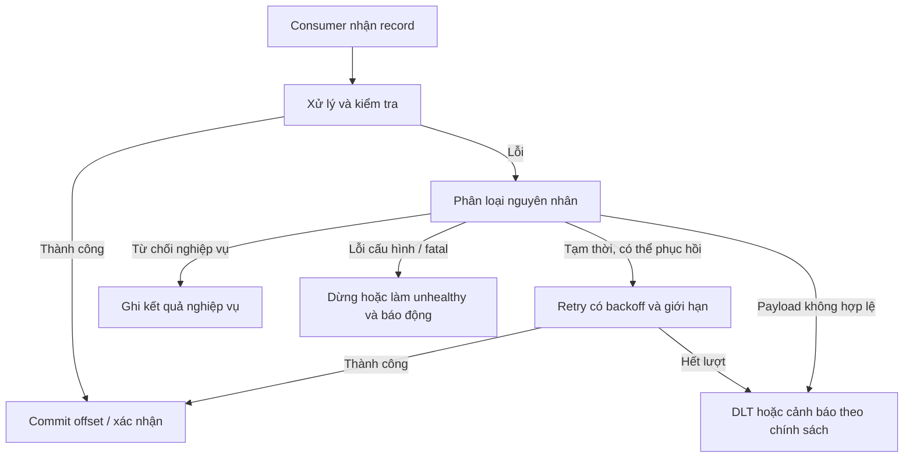

# Phân loại lỗi tạm thời, lỗi dữ liệu và lỗi nghiệp vụ

Consumer Kafka nhận record nhưng không phải record nào cũng xử lý thành công ngay lần đầu. Có lúc dịch vụ downstream tạm thời không phản hồi; có lúc payload sai cấu trúc; cũng có lúc dữ liệu hoàn toàn hợp lệ nhưng nghiệp vụ từ chối yêu cầu, chẳng hạn đơn hàng đã bị hủy. Nếu xử lý mọi trường hợp bằng cùng một chính sách retry, hệ thống có thể lặp vô hạn với dữ liệu không thể sửa, làm nghẽn partition hoặc biến một quyết định nghiệp vụ bình thường thành cảnh báo kỹ thuật.

Thiết kế xử lý lỗi tốt bắt đầu bằng việc phân loại nguyên nhân và xác định hành động phù hợp: retry có giới hạn, chuyển sang dead-letter topic (DLT), ghi nhận kết quả nghiệp vụ, hoặc dừng để vận hành can thiệp. Phân loại này cần nhất quán ở producer, consumer và các dịch vụ được gọi trong quá trình xử lý.

## 1. Vì sao cần phân loại lỗi?

Kafka lưu record bền vững và consumer thường xử lý theo cơ chế at-least-once. Nếu listener thất bại trước khi offset được commit, record có thể được đọc lại. Cơ chế đọc lại giúp phục hồi khi có lỗi tạm thời, nhưng cũng có nghĩa cùng một record có thể đi qua logic ứng dụng nhiều lần.

Ba nhóm lỗi chính có cách xử lý khác nhau:

| Nhóm lỗi | Bản chất | Hành động thường phù hợp |
|---|---|---|
| Lỗi tạm thời (transient/technical) | Điều kiện bên ngoài có thể tự phục hồi theo thời gian | Retry có backoff và giới hạn; nếu hết lượt thì cảnh báo hoặc chuyển DLT tùy loại công việc |
| Lỗi dữ liệu (data/format) | Record không đáp ứng cấu trúc hoặc quy tắc dữ liệu cần thiết | Không retry payload không đổi; lưu thông tin lỗi vào DLT hoặc quarantine để sửa và replay |
| Lỗi nghiệp vụ (business) | Yêu cầu hợp lệ về kỹ thuật nhưng không được chấp nhận theo trạng thái hoặc quy tắc miền nghiệp vụ | Ghi nhận kết quả từ chối hoặc phát sự kiện nghiệp vụ tương ứng; chỉ retry nếu nguyên nhân thực sự có thể thay đổi |

Không phải mọi exception đều thuộc ba nhóm trên. Lỗi cấu hình, quyền truy cập, thiếu topic hoặc lỗi lập trình có thể cần dừng consumer và báo động thay vì retry liên tục. Hãy phân loại theo nguyên nhân và khả năng phục hồi, không chỉ dựa vào tên lớp exception.

Một luồng quyết định tổng quát:



## 2. Lỗi tạm thời: retry có kiểm soát

Lỗi tạm thời xuất hiện khi một thành phần hiện không thể hoàn thành thao tác nhưng có khả năng hoạt động trở lại mà không cần sửa record. Ví dụ:

- Kết nối broker hoặc database bị gián đoạn trong thời gian ngắn.
- Request đến dịch vụ tồn kho bị timeout hoặc trả về HTTP 503.
- Dịch vụ downstream giới hạn tốc độ và trả về HTTP 429.
- Database gặp deadlock hoặc lock contention có thể được giải phóng.
- Group coordinator tạm thời chưa sẵn sàng trong lúc rebalance, hoặc partition leader đang được bầu lại.

Lỗi tạm thời không có nghĩa là phải retry mãi mãi. Mỗi lần thử đều tiêu tốn tài nguyên, có thể làm tăng tải lên dịch vụ đang gặp sự cố và kéo dài thời gian xử lý của partition.

### Backoff và giới hạn retry

Retry liên tiếp không có khoảng nghỉ thường làm tình trạng quá tải nặng hơn. Backoff tăng dần tạo thời gian cho dịch vụ phục hồi. Một dạng exponential backoff:

```text
delay(n) = min(max_delay, initial_delay * multiplier^(n - 1))
```

Ví dụ với lần thử đầu sau 1 giây, hệ số nhân 2 và mức tối đa 30 giây:

| Lần retry | Khoảng chờ minh họa |
|---:|---:|
| 1 | 1 giây |
| 2 | 2 giây |
| 3 | 4 giây |
| 4 | 8 giây |
| 5 trở đi | Tối đa 30 giây |

Trong hệ thống nhiều consumer, nên thêm jitter (độ lệch ngẫu nhiên) để các instance không đồng loạt retry đúng một thời điểm sau khi dịch vụ phục hồi. Chính sách cần có cả số lần thử tối đa hoặc thời gian retry tối đa, rồi xác định rõ điều gì xảy ra khi hết giới hạn.

### Phân biệt retry ở producer và consumer

Producer Kafka đã có cơ chế retry request nội bộ. Các cấu hình như `retries`, `retry.backoff.ms`, `request.timeout.ms` và `delivery.timeout.ms` phối hợp để giới hạn thời gian gửi. Với producer hiện đại, bật idempotence giúp broker nhận diện retry của cùng producer session để tránh ghi trùng do retry giao thức. `delivery.timeout.ms` đặt giới hạn tổng thời gian producer cố gắng giao record.

Ví dụ cấu hình producer:

```properties
acks=all
enable.idempotence=true
delivery.timeout.ms=120000
request.timeout.ms=30000
retry.backoff.ms=500
```

Giá trị cụ thể phải dựa trên SLA và độ trễ của cluster. Không nên chỉ tăng `retries` mà bỏ qua `delivery.timeout.ms`, vì thời gian chờ thực tế còn phụ thuộc các timeout khác. Ứng dụng cần kiểm tra kết quả gửi qua callback hoặc future; `send()` trả về trước khi broker xác nhận không có nghĩa record đã được ghi thành công.

Retry của consumer là một lớp khác. Nó xử lý việc listener thất bại sau khi record đã được đọc. Ví dụ, consumer gọi dịch vụ kho hàng và nhận timeout. Consumer có thể retry listener với backoff, hoặc chuyển record sang retry topic để xử lý lại sau.

Idempotence của producer chỉ xử lý duplicate do retry ở giao thức producer. Nếu ứng dụng nhận kết quả gửi không rõ ràng rồi tạo một lần gửi mới với một producer request khác, hoặc consumer xử lý lại record, nghiệp vụ vẫn có thể bị lặp. Hãy dùng event ID hoặc business key để idempotent ở tầng ứng dụng.

### Retry chặn partition và retry topic

Có hai cách phổ biến để retry consumer:

| Cách làm | Cơ chế | Ưu điểm | Đánh đổi |
|---|---|---|---|
| Blocking retry | Listener được thử lại với backoff trong luồng xử lý partition | Dễ giữ thứ tự xử lý trong partition; triển khai đơn giản | Record lỗi giữ partition lại, các record phía sau phải chờ |
| Non-blocking retry topic | Record được chuyển sang topic retry có thời gian chờ rồi được consumer khác xử lý | Consumer luồng chính tiếp tục xử lý record mới | Có thể đảo thứ tự; cần quản lý retry topics, consumer và DLT |

Blocking retry phù hợp khi ordering quan trọng và thời gian retry ngắn. Nếu record đầu partition liên tục lỗi, cả partition có thể bị chặn. Retry topic phù hợp khi có thể chấp nhận xử lý lệch thứ tự hoặc khi cần thời gian chờ dài. Ví dụ, một `OrderUpdated` đang chờ retry có thể được xử lý sau `OrderCancelled` đến sau nó; logic nghiệp vụ phải kiểm tra version hoặc trạng thái để không áp dụng sự kiện cũ sai thứ tự.

## 3. Lỗi dữ liệu: không retry payload không thể tự sửa

Lỗi dữ liệu xảy ra khi record không thể được diễn giải hoặc không đáp ứng hợp đồng dữ liệu của ứng dụng. Ví dụ:

- JSON sai cú pháp hoặc không thể deserialize.
- Thiếu trường bắt buộc, sai kiểu dữ liệu hoặc giá trị nằm ngoài miền cho phép.
- Schema producer không tương thích với schema consumer.
- Enum có giá trị mới mà consumer cũ chưa biết xử lý.
- Key hoặc header cần thiết bị thiếu hoặc sai định dạng.

Nếu cùng một payload được đọc lại mà không có thay đổi về code, schema hoặc dữ liệu, lỗi thường sẽ lặp lại. Retry nhiều lần chỉ tăng độ trễ và có thể chặn partition. Với lỗi dữ liệu không thể tự phục hồi, nên đưa record vào DLT hoặc vùng quarantine kèm thông tin để điều tra.

### Phân biệt lỗi payload với lỗi hạ tầng schema

Không phải mọi lỗi deserialize đều là dữ liệu hỏng. Ví dụ, Schema Registry tạm thời không truy cập được là lỗi hạ tầng có thể retry. Một schema ID không tồn tại, payload sai định dạng hoặc schema không tương thích có thể là lỗi dữ liệu hoặc lỗi cấu hình cần can thiệp. Cần nhìn vào nguyên nhân gốc thay vì đánh đồng mọi `SerializationException` thành lỗi vĩnh viễn.

Thiết kế schema nên ưu tiên thay đổi tương thích ngược hoặc tương thích xuôi theo chiến lược của hệ thống. Khi thêm field, cân nhắc giá trị mặc định; khi đổi kiểu hoặc xóa field, kiểm tra các consumer đang triển khai. Schema Registry giúp kiểm soát hợp đồng nhưng không thay thế kiểm tra quy tắc nghiệp vụ trong ứng dụng.

### Xử lý lỗi deserialize trước listener

Nếu deserializer ném exception, listener có thể chưa được gọi. Với Spring Kafka, `ErrorHandlingDeserializer` bọc deserializer thực tế và giữ thông tin exception trong header để container error handler có thể xử lý record lỗi. Cấu hình minh họa:

```yaml
spring:
  kafka:
    consumer:
      key-deserializer: org.springframework.kafka.support.serializer.ErrorHandlingDeserializer
      value-deserializer: org.springframework.kafka.support.serializer.ErrorHandlingDeserializer
      properties:
        spring.deserializer.key.delegate.class: org.apache.kafka.common.serialization.StringDeserializer
        spring.deserializer.value.delegate.class: org.springframework.kafka.support.serializer.JsonDeserializer
        spring.json.trusted.packages: com.example.events
```

Tên class delegate và trusted packages phải khớp với kiểu dữ liệu và phiên bản Spring Kafka của ứng dụng. Không nên mở trusted packages quá rộng nếu payload có thể đến từ nguồn không tin cậy.

## 4. Lỗi nghiệp vụ: từ chối có thể là kết quả hợp lệ

Lỗi nghiệp vụ xảy ra khi record hợp lệ về cú pháp và cấu trúc nhưng yêu cầu không được chấp nhận theo quy tắc miền nghiệp vụ. Ví dụ:

- Đơn hàng đã bị hủy nên không thể xác nhận tiếp.
- Tài khoản không đủ điều kiện thực hiện giao dịch.
- Hạn mức của khách hàng đã được sử dụng hết.
- Yêu cầu cập nhật dùng version cũ hơn version hiện tại.

Đây có thể là kết quả nghiệp vụ bình thường, không phải sự cố kỹ thuật. Nếu consumer ném exception chung rồi retry vô hạn, cùng một yêu cầu bị từ chối sẽ lặp đi lặp lại mà không thay đổi kết quả.

Thông thường, ứng dụng nên biểu diễn quyết định từ chối thành kết quả có cấu trúc: cập nhật trạng thái đơn hàng, ghi lý do từ chối, hoặc phát một sự kiện như `OrderRejected`. Record đầu vào sau khi kết quả từ chối được ghi thành công có thể được xác nhận/commit như một xử lý hoàn tất.

Ví dụ phân biệt hai trường hợp:

```java
public void handle(OrderCreated event) {
    try {
        inventoryService.reserve(event.items());
    } catch (InventoryUnavailableException temporaryFailure) {
        // Hạ tầng kho tạm thời không phản hồi: để lỗi đi tới retry policy.
        throw temporaryFailure;
    } catch (InsufficientInventoryException rejected) {
        // Không đủ hàng là quyết định nghiệp vụ; ghi kết quả từ chối.
        orderService.reject(event.orderId(), "INSUFFICIENT_INVENTORY");
        eventPublisher.publishOrderRejected(event.orderId(), "INSUFFICIENT_INVENTORY");
    }
}
```

Đây là ví dụ minh họa. Trong hệ thống thực tế, việc cập nhật trạng thái và phát sự kiện từ chối cần được bảo đảm nhất quán, chẳng hạn bằng transactional outbox nếu trạng thái nằm trong database và sự kiện được phát sang Kafka. Nếu thao tác ghi kết quả từ chối thất bại do database timeout, đó lại là lỗi kỹ thuật tạm thời và có thể cần retry.

Một số lỗi có vẻ là nghiệp vụ nhưng thực chất phụ thuộc thời gian. Ví dụ, “chưa đủ số dư” có thể là kết quả từ chối cuối cùng đối với lệnh thanh toán, nhưng “hạn mức dịch vụ tạm thời bị khóa để bảo trì” có thể là lỗi tạm thời. Chủ sở hữu nghiệp vụ cần định nghĩa rõ trường hợp nào được thử lại và trong bao lâu.

## 5. Bảng quyết định phân loại lỗi

| Tình huống | Phân loại gợi ý | Retry? | Hành động khi không phục hồi |
|---|---|---|---|
| Broker tạm mất kết nối | Tạm thời | Có, theo timeout/backoff của client | Báo động nếu vượt SLA hoặc producer hết thời gian giao |
| API downstream trả 503 hoặc timeout | Tạm thời | Có giới hạn, backoff và jitter | DLT hoặc tạm dừng luồng theo chính sách |
| API trả 429 | Tạm thời / rate limit | Có, tôn trọng `Retry-After` nếu có | Giảm tốc độ hoặc mở circuit breaker |
| JSON sai cú pháp | Dữ liệu | Thường không | DLT/quarantine, sửa producer hoặc dữ liệu rồi replay |
| Thiếu field bắt buộc | Dữ liệu | Không nếu payload không đổi | DLT và điều tra hợp đồng schema |
| Schema Registry tạm không truy cập được | Tạm thời | Có giới hạn | Báo động hạ tầng nếu tiếp tục thất bại |
| Đơn hàng đã hủy | Nghiệp vụ | Không | Ghi nhận trạng thái từ chối hoặc bỏ qua theo quy tắc |
| Không đủ hàng | Nghiệp vụ | Thường không, trừ khi chính sách cho phép thử lại sau | Phát kết quả nghiệp vụ tương ứng |
| Database deadlock | Tạm thời | Có giới hạn | Báo động nếu vượt ngưỡng |
| Sai cấu hình ACL hoặc topic | Lỗi cấu hình/fatal | Không retry liên tục | Dừng hoặc làm unhealthy, sửa cấu hình/quyền |

Một exception class có thể đại diện nhiều nguyên nhân. Ví dụ `TimeoutException` từ API kho thường là transient, nhưng timeout do cấu hình deadline luôn thấp hơn thời gian xử lý bình thường có thể là lỗi cấu hình. Log nguyên nhân gốc, endpoint, mã phản hồi và context cần thiết để phân loại chính xác.

## 6. Cấu hình retry và DLT trong Spring Kafka

Spring Kafka cung cấp `DefaultErrorHandler` để retry record khi listener ném exception, kết hợp `BackOff` và recoverer. `DeadLetterPublishingRecoverer` có thể gửi record đã hết lượt retry sang DLT.

Ví dụ cấu hình blocking retry với số lần thử hữu hạn:

```java
@Configuration
public class KafkaErrorHandlingConfig {

    @Bean
    DefaultErrorHandler kafkaErrorHandler(
            DeadLetterPublishingRecoverer recoverer) {

        FixedBackOff backOff = new FixedBackOff(1_000L, 3L);
        DefaultErrorHandler handler =
                new DefaultErrorHandler(recoverer, backOff);

        handler.addNotRetryableExceptions(
                MalformedOrderEventException.class
        );

        return handler;
    }
}
```

Trong ví dụ này, record được thử lại theo khoảng chờ cố định; khi hết lượt, recoverer gửi record sang DLT. `MalformedOrderEventException` được đánh dấu không retry vì payload không thể tự sửa. Các exception khác dùng chính sách mặc định của handler hoặc được cấu hình bổ sung theo ứng dụng. Hãy kiểm tra danh sách exception mặc định và hành vi của phiên bản Spring Kafka đang dùng; không nên phụ thuộc ngầm vào default mà không xác minh.

Một recoverer đơn giản định tuyến record sang topic DLT cùng partition:

```java
@Bean
DeadLetterPublishingRecoverer deadLetterRecoverer(
        KafkaTemplate<Object, Object> template) {

    return new DeadLetterPublishingRecoverer(
            template,
            (record, exception) -> new TopicPartition(
                    record.topic() + ".DLT",
                    record.partition()
            )
    );
}
```

Nếu giữ nguyên partition number khi gửi DLT, topic DLT cần có đủ số partition tương ứng. Có thể chọn chiến lược định tuyến khác, nhưng phải bảo đảm topic đích tồn tại và producer có quyền ghi. Cũng cần cấu hình serializer phù hợp để DLT có thể chứa cả payload không deserialize được; trong trường hợp lỗi deserialize, Spring Kafka có thể chuyển dữ liệu gốc và exception header theo cơ chế `ErrorHandlingDeserializer`.

Với retry chậm và không cần giữ thứ tự tuyệt đối, Spring Kafka có cơ chế retry topic thông qua `@RetryableTopic`. Ví dụ minh họa:

```java
@RetryableTopic(
        attempts = "4",
        backoff = @Backoff(delay = 1_000, multiplier = 2.0),
        include = {TransientInventoryException.class},
        exclude = {MalformedOrderEventException.class}
)
@KafkaListener(topics = "orders", groupId = "order-service")
public void consume(OrderCreated event) {
    orderService.handle(event);
}
```

`attempts` biểu thị tổng số lần giao nhận theo cấu hình retry topic, bao gồm lần xử lý ban đầu. Các topic retry và DLT được tạo/định tuyến theo cấu hình Spring Kafka. Cần kiểm tra phiên bản thư viện, chính sách auto-create topic, số partition, replication factor và cách xử lý DLT trước khi triển khai. Retry topic không giữ thứ tự xử lý như blocking retry: record sau có thể được xử lý trước record đang chờ retry.

Không nên đồng thời áp dụng nhiều lớp retry không có ngân sách chung. Ví dụ producer retry 2 phút, consumer retry 10 lần, HTTP client retry 5 lần có thể khiến một record chờ rất lâu và tạo số request lớn. Hãy xác định tổng thời gian tối đa cho một sự kiện qua toàn bộ chuỗi.

## 7. Thiết kế DLT để điều tra và replay

DLT lưu record không thể xử lý theo chính sách hiện tại để nhóm vận hành hoặc phát triển điều tra. DLT không phải nơi bỏ quên dữ liệu. Một record chuyển vào DLT cần giữ đủ thông tin để xác định nguồn, nguyên nhân và cách phục hồi.

Nên bảo toàn hoặc bổ sung:

- Payload gốc và key của record nếu có thể.
- Topic, partition và offset nguồn.
- Timestamp và event ID/correlation ID.
- Exception class, thông điệp lỗi đã được làm sạch và số lần thử.
- Thời điểm đưa vào DLT và phiên bản ứng dụng xử lý.

Theo dõi số record mới vào DLT, tuổi của record cũ nhất, tỷ lệ DLT theo topic và nguyên nhân phổ biến. Đặt retention đủ để điều tra và replay; phân quyền truy cập vì payload có thể chứa dữ liệu nhạy cảm. Cần có người hoặc quy trình chịu trách nhiệm xử lý DLT.

Quy trình replay nên có kiểm soát:

1. Xác định nguyên nhân gốc: sửa code, schema, cấu hình hoặc dữ liệu nguồn.
2. Kiểm tra record mẫu và xác nhận cách xử lý mới không tạo tác động phụ.
3. Chọn phạm vi replay, tốc độ phát lại và consumer group đích.
4. Bảo đảm handler idempotent để record được xử lý lại không tạo tác động nghiệp vụ trùng.
5. Theo dõi lag, lỗi và DLT mới trong khi replay; dừng nếu lỗi tăng bất thường.

Không nên replay toàn bộ DLT vào topic gốc ngay sau khi sửa một lỗi mà chưa thử nghiệm. Nếu một phần record vẫn không hợp lệ, chúng có thể quay lại DLT hoặc tạo vòng lặp chuyển tiếp. Có thể giữ bản gốc, thêm metadata replay và ghi audit về người hoặc quy trình khởi chạy.

## 8. Retry, ordering và idempotency

Kafka bảo đảm thứ tự trong một partition. Blocking retry giữ record hiện tại ở luồng xử lý và vì vậy có thể giữ thứ tự, nhưng nó chặn các record sau trong partition. Retry topic giải phóng luồng chính nhưng có thể làm thứ tự thay đổi. Quyết định cần dựa trên yêu cầu nghiệp vụ:

- Nếu mọi thay đổi của cùng một aggregate phải theo thứ tự, dùng cùng key để vào cùng partition và cân nhắc blocking retry ngắn.
- Nếu có thể xử lý độc lập hoặc dựa trên version, retry topic có thể tăng throughput.
- Nếu record cũ có thể đến sau record mới, consumer cần kiểm tra version/sequence và bỏ qua hoặc xử lý bù theo quy tắc.

At-least-once có thể khiến handler nhận lại record sau khi xử lý thành công nhưng trước khi offset được commit. Vì vậy, các thao tác có side effect nên idempotent. Một số cách phổ biến:

- Lưu event ID đã xử lý với unique constraint trong database.
- Dùng business key và trạng thái để phát hiện thao tác lặp.
- Dùng upsert hoặc conditional update theo version.
- Dùng transactional outbox/inbox khi phối hợp database với Kafka.

Với luồng Kafka-to-Kafka, Kafka transaction có thể gộp output record và offset đầu vào trong một transaction để đạt exactly-once processing trong phạm vi Kafka. Điều này không tự động bao phủ lời gọi HTTP, gửi email hay transaction database độc lập.

## 9. Quan sát và cảnh báo

Đừng chỉ đếm tổng exception. Hãy đo theo loại lỗi, topic, consumer group và giai đoạn xử lý. Các metric hữu ích gồm:

| Metric | Ý nghĩa |
|---|---|
| `consumer_records_failed_total` | Số lần xử lý record thất bại, phân loại theo exception/type |
| `consumer_retry_total` | Số lần retry và phân bố theo nguyên nhân |
| `consumer_dlt_records_total` | Số record được chuyển vào DLT |
| `consumer_processing_duration` | Thời gian xử lý record, bao gồm percentile |
| `consumer_lag` | Khoảng cách offset; cần đọc cùng throughput và partition |
| `producer_record_error_total` | Số lần producer giao record thất bại |
| `business_rejection_total` | Số quyết định từ chối nghiệp vụ theo reason code |

Phân biệt business rejection với technical failure trên dashboard. Nếu tỷ lệ `OrderRejected` tăng, đó có thể là thay đổi nhu cầu hoặc chính sách kinh doanh, không nhất thiết là lỗi hệ thống. Nếu retry và DLT tăng đồng thời với lag tăng, có thể consumer đang bị nghẽn bởi downstream hoặc payload lỗi.

Không dùng event ID, order ID, customer ID hoặc exception message tự do làm label metric vì số lượng giá trị có thể tăng không giới hạn. Dùng log có cấu trúc và distributed trace để tra cứu từng record; metric nên dùng nhóm giá trị hữu hạn như `error_category`, `topic`, `consumer_group` hoặc `dependency`.

## 10. Checklist xây dựng chính sách xử lý lỗi

- Phân loại lỗi theo nguyên nhân và khả năng phục hồi: transient, data, business hoặc fatal/configuration.
- Xác định lỗi nào retry được, lỗi nào không retry và lỗi nào phải dừng consumer.
- Đặt giới hạn số lần retry hoặc tổng thời gian retry; dùng backoff và jitter khi thích hợp.
- Phân biệt producer retry với consumer retry; kiểm tra kết quả gửi producer thay vì giả định `send()` đã thành công.
- Chọn blocking retry hay retry topic dựa trên yêu cầu ordering và thời gian chờ.
- Dùng `ErrorHandlingDeserializer` khi cần xử lý lỗi deserialize trước listener trong Spring Kafka.
- Cấu hình DLT có đủ partition, serializer, quyền ghi, retention và quy trình replay.
- Ghi nhận business rejection thành kết quả nghiệp vụ có cấu trúc, tránh retry như lỗi kỹ thuật.
- Bảo đảm idempotency cho side effect vì record có thể được xử lý lại.
- Theo dõi retry, DLT, lag, thời gian xử lý và tỷ lệ từ chối nghiệp vụ riêng biệt.

Phân loại đúng giúp hệ thống retry những lỗi có thể phục hồi, cách ly dữ liệu không hợp lệ và ghi nhận quyết định nghiệp vụ như một phần bình thường của luồng. Khi kết hợp chính sách retry có giới hạn, DLT có quy trình replay, idempotency và quan sát đầy đủ, consumer Kafka có thể phục hồi có kiểm soát mà không làm nghẽn partition hoặc lặp tác động nghiệp vụ ngoài ý muốn.
