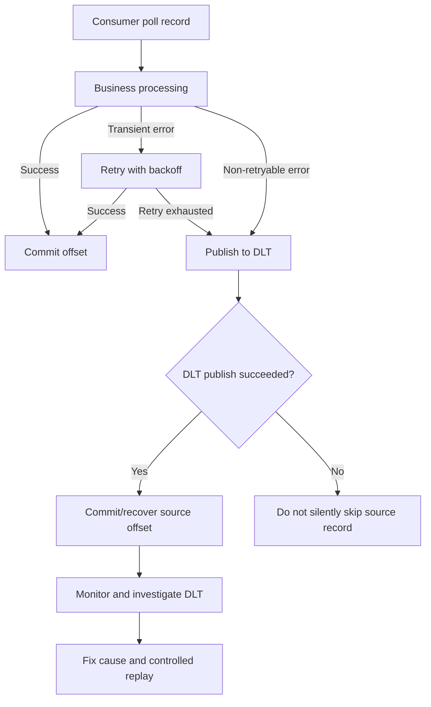

# Dead-letter topic và dữ liệu chẩn đoán cần lưu

## Mục tiêu

Một record có thể không xử lý được vì payload sai schema, dữ liệu nghiệp vụ không hợp lệ, dependency tạm thời không sẵn sàng hoặc lỗi trong code. Nếu consumer retry vô hạn, một record lỗi có thể chặn cả partition. Nếu bỏ qua record mà không lưu dấu vết, đội vận hành sẽ khó điều tra và không thể phát lại dữ liệu sau khi sửa lỗi.

Dead-letter topic (DLT, đôi khi gọi là dead-letter queue/DLQ) là topic dùng để lưu record đã vượt quá chính sách retry hoặc được phân loại là không thể retry. Kafka không tự động tạo DLT hay tự quyết định record nào phải chuyển vào đó; ứng dụng hoặc framework như Spring Kafka thực hiện routing và quản lý offset.

Bài học này hướng dẫn thiết kế DLT, phân loại lỗi, xác định dữ liệu chẩn đoán cần lưu, cấu hình Spring Kafka và xây dựng quy trình điều tra/replay có kiểm soát.

Sau bài học, bạn có thể:

- Phân biệt lỗi retry được, lỗi không retry và poison pill.
- Thiết kế luồng retry có giới hạn trước khi đưa record vào DLT.
- Chọn partitioning, replication, retention và ACL cho DLT.
- Lưu đủ source coordinates, payload, exception metadata và correlation data để điều tra.
- Xử lý lỗi deserialize trước khi listener nhận record.
- Cấu hình `DeadLetterPublishingRecoverer` và `DefaultErrorHandler` trong Spring Kafka.
- Theo dõi DLT, sửa nguyên nhân gốc và replay mà không tạo vòng lặp hoặc side effect trùng.

## 1. Dead-letter topic giải quyết vấn đề gì?

Kafka consumer đọc record theo thứ tự offset trong partition. Nếu một record không xử lý được, ứng dụng cần quyết định retry, dừng partition hay chuyển record lỗi sang nơi khác.

Ví dụ topic `commerce.orders.events.v1` có partition 0:

```text
offset 100  -> xử lý thành công
offset 101  -> payload sai schema, xử lý thất bại
offset 102  -> record hợp lệ
offset 103  -> record hợp lệ
```

Nếu consumer retry offset 101 vô hạn theo kiểu blocking, các record 102 và 103 có thể không được xử lý. Nếu consumer bỏ qua offset 101, dữ liệu có thể mất khỏi luồng xử lý nghiệp vụ. DLT cho phép chuyển record 101 cùng thông tin chẩn đoán sang một topic riêng để partition nguồn tiếp tục.



DLT giúp cô lập record lỗi, giữ lại bằng chứng và cho phép luồng chính tiếp tục. DLT không tự sửa dữ liệu, không đảm bảo record sẽ được xử lý lại và không thay thế idempotency ở hệ thống downstream.

## 2. Phân loại lỗi trước khi retry

Không nên đưa mọi exception vào cùng một chính sách. Trước hết phân loại lỗi theo khả năng khắc phục:

| Loại lỗi | Ví dụ | Hành động phù hợp |
|---|---|---|
| Lỗi tạm thời (transient) | Database timeout, HTTP 503, connection reset, leader transition | Retry có giới hạn, backoff và jitter |
| Lỗi dữ liệu (permanent data error) | Thiếu trường bắt buộc, giá trị enum không hợp lệ, JSON sai cấu trúc | Đưa vào DLT sau khi ghi diagnostic metadata; thường không retry cùng payload |
| Lỗi schema/contract | Schema version không tương thích, deserializer không đọc được payload | Kiểm tra schema/compatibility; lưu raw payload và thông tin schema rồi đưa DLT hoặc quarantine |
| Lỗi cấu hình/quyền | ACL thiếu quyền, topic không tồn tại, credential sai | Dừng/alert và sửa cấu hình; retry liên tục thường không có ích |
| Lỗi code/bug | Null pointer, mapping sai, invariant bị vi phạm | Retry chỉ khi có lý do rõ ràng; nếu deterministic thì chuyển DLT và tạo incident |
| Lỗi không xác định | Exception chưa được phân loại | Retry giới hạn, ghi exception class/message đã làm sạch, sau đó DLT |

### 2.1. Retry có giới hạn

Một chính sách retry cần xác định:

- Số lần thử tối đa.
- Khoảng chờ giữa các lần thử.
- Backoff cố định hay exponential.
- Có jitter để tránh nhiều consumer retry đồng thời hay không.
- Deadline tối đa cho một record.
- Exception nào không retry.
- Điều gì xảy ra nếu publish DLT thất bại.

Ví dụ exponential backoff với jitter:

```text
delay(attempt) = random(0, min(maxDelay, initialDelay * 2^attempt))
```

Giới hạn `maxDelay` và tổng thời gian retry để một record không chiếm tài nguyên vô hạn. Với dependency đang outage, exponential backoff có jitter giảm retry storm. Với lỗi dữ liệu deterministic, retry nhiều lần chỉ tăng latency và log noise.

### 2.2. Blocking retry và retry topic

Hai cách retry thường gặp:

| Cách | Cách hoạt động | Đánh đổi |
|---|---|---|
| Blocking/in-place retry | Consumer giữ luồng xử lý và retry cùng record sau backoff | Dễ giữ thứ tự trong partition, nhưng record lỗi chặn record phía sau trong thời gian retry |
| Retry topic | Chuyển record sang topic retry có delay/backoff; consumer nguồn có thể tiếp tục | Tăng throughput cho partition chính, nhưng record sau có thể xử lý trước record lỗi; cần quản lý nhiều topic và routing |

Retry topic và DLT là hai vai trò khác nhau. Retry topic giữ record đang chờ thử lại; DLT giữ record đã hết retry hoặc không thể xử lý theo chính sách. Một pipeline có thể có nhiều retry topic theo các khoảng delay rồi mới tới DLT.

Với retry topic, thứ tự nghiệp vụ theo key có thể bị thay đổi: event sau của cùng entity có thể được xử lý trước event lỗi đang nằm trong retry topic. Nếu cần ordering chặt, cân nhắc blocking retry ngắn, tạm dừng partition hoặc thiết kế state machine/idempotent version check.

### 2.3. Poison pill

Poison pill là record luôn làm consumer thất bại, ví dụ payload hỏng hoặc deserialize exception deterministic. Nếu consumer không thể deserialize record, listener có thể chưa được gọi; vì vậy error handling cần bao phủ cả giai đoạn deserialize, không chỉ exception trong business method.

Không được giả định mọi exception đều xuất hiện dưới dạng `RuntimeException` trong listener. Với lỗi deserialize, framework cần giữ raw bytes và exception metadata để có thể chuyển record vào DLT.

## 3. Thiết kế DLT topic

DLT là topic Kafka thông thường. Nó cần được tạo, phân quyền, giám sát và đặt retention như các topic khác.

### 3.1. Quy tắc đặt tên

Chọn quy ước nhất quán, ví dụ:

```text
commerce.orders.events.v1
commerce.orders.events.v1.DLT
commerce.orders.events.v1.retry-1m
commerce.orders.events.v1.retry-10m
```

Tên DLT nên giúp nhận diện topic nguồn và môi trường. Tránh tên chung như `errors` nếu nhiều ứng dụng/đội cùng ghi vào đó; một topic chung làm khó ACL, retention, schema và ownership.

### 3.2. Partition count và partition mapping

Nếu DLT giữ nguyên partition nguồn, DLT nên có ít nhất số partition bằng topic nguồn. Ví dụ nguồn có 12 partition, DLT cần ít nhất 12 partition nếu recoverer gửi record lỗi vào đúng partition index ban đầu.

Giữ partition index giúp điều tra theo source partition và có thể giữ thứ tự tương đối trong từng partition DLT theo thứ tự publish vào DLT. Tuy nhiên, DLT không phải bản sao log nguồn: record lỗi chỉ được gửi sau retry, timestamp và offset DLT khác với nguồn, và các record thành công không xuất hiện trong DLT.

Nếu DLT ít partition hơn hoặc muốn phân phối theo một chiến lược khác, cần cấu hình destination resolver/partition mapping rõ ràng. Không cố gửi partition index 11 vào DLT chỉ có 3 partition; broker sẽ từ chối partition không hợp lệ.

### 3.3. Replication và durability

DLT có thể chứa record cần điều tra, dữ liệu audit hoặc thông tin nghiệp vụ quan trọng. Đừng mặc định DLT có thể dùng RF=1 chỉ vì đó là topic lỗi.

Ví dụ cấu hình cho DLT production:

```bash
bin/kafka-topics.sh \
  --bootstrap-server localhost:9092 \
  --create \
  --topic commerce.orders.events.v1.DLT \
  --partitions 12 \
  --replication-factor 3 \
  --config min.insync.replicas=2 \
  --config retention.ms=1209600000
```

Ví dụ trên giữ DLT 14 ngày, RF=3 và min ISR=2. Điều chỉnh theo dung lượng, SLA điều tra và yêu cầu audit. Nếu DLT là nơi duy nhất lưu record lỗi sau khi offset nguồn được commit, độ bền của DLT cần tương xứng với dữ liệu nguồn.

### 3.4. Retention và cleanup policy

DLT thường dùng `cleanup.policy=delete` để giữ record lỗi trong một khoảng thời gian rồi xóa theo retention. Thời gian giữ cần đủ để đội vận hành:

- Nhận alert và điều tra.
- Sửa bug hoặc dữ liệu nguồn.
- Đánh giá tác động và xin phê duyệt replay.
- Phát lại record trước khi DLT hết retention.

Không đặt retention quá ngắn đến mức record bị xóa trước khi có người xử lý. Cũng không giữ vô hạn nếu payload có PII, dữ liệu nhạy cảm hoặc chi phí lưu trữ cao. Nếu cần lưu audit lâu dài, cân nhắc archive có kiểm soát thay vì giữ DLT mãi mãi.

### 3.5. ACL và ownership

Phân quyền riêng:

- Consumer nguồn có quyền đọc topic nguồn và ghi DLT theo cơ chế recoverer.
- DLT processor/operator có quyền đọc DLT.
- Replay tool có quyền đọc DLT và ghi topic đích được phê duyệt.
- Ứng dụng không liên quan không nên đọc hoặc ghi DLT.

Định nghĩa owner của từng DLT, SLA xử lý, chính sách retention và quy trình xóa dữ liệu. DLT có thể chứa payload nhạy cảm và stack trace nội bộ; áp dụng encryption, ACL và audit log giống dữ liệu production.

## 4. Dữ liệu chẩn đoán cần lưu

Một DLT record tốt phải trả lời được: record đến từ đâu, lỗi gì, đã thử bao nhiêu lần, lỗi xảy ra lúc nào, code version nào xử lý và có thể replay bằng cách nào.

### 4.1. Source coordinates

Các trường tối thiểu:

| Trường | Ý nghĩa |
|---|---|
| `originalTopic` | Topic nguồn |
| `originalPartition` | Partition nguồn |
| `originalOffset` | Offset nguồn |
| `originalTimestamp` | Timestamp gốc của Kafka record |
| `originalTimestampType` | Loại timestamp, ví dụ CreateTime hoặc LogAppendTime |
| `consumerGroup` | Group xử lý record |
| `consumerClientId` / `memberId` | Client/member gây lỗi nếu có thể xác định |
| `originalKey` | Key gốc, cần giữ nguyên bytes hoặc encoding |
| `originalHeaders` | Headers nguồn cần thiết cho trace, schema hoặc routing |

`topic + partition + offset` là định danh vị trí của record trong log nguồn. Dùng bộ ba này làm reference để điều tra và đối chiếu; không dùng offset DLT thay cho offset nguồn.

### 4.2. Error metadata

Nên lưu các trường có cấu trúc:

| Trường | Nội dung |
|---|---|
| `errorCode` | Mã lỗi ổn định do ứng dụng định nghĩa, ví dụ `ORDER_SCHEMA_INVALID` |
| `exceptionClass` | Tên class exception đầy đủ |
| `exceptionMessage` | Message đã làm sạch và giới hạn độ dài |
| `stackTrace` | Stack trace đã giới hạn/truncate nếu cần điều tra sâu |
| `failureStage` | Giai đoạn lỗi: deserialize, validate, database, downstream call... |
| `retryAttempt` | Số lần thử đã thực hiện |
| `firstFailureAt` | Thời điểm lỗi đầu tiên |
| `lastFailureAt` | Thời điểm lỗi gần nhất |
| `nextAction` | Hướng xử lý dự kiến: fix-data, retry, manual-review... |

Không chỉ lưu `exceptionMessage`: message có thể thay đổi theo phiên bản thư viện, chứa dữ liệu nhạy cảm và không thuận tiện để tổng hợp. `errorCode` nên ổn định để dashboard và quy trình vận hành phân loại lỗi.

### 4.3. Correlation và version metadata

Nên giữ hoặc bổ sung:

- `eventId` duy nhất để deduplicate và đối chiếu event.
- `correlationId` để nối các service trong cùng luồng nghiệp vụ.
- `traceparent`/trace ID nếu dùng distributed tracing.
- `tenantId` hoặc customer reference đã được kiểm soát dữ liệu nhạy cảm.
- `applicationName`, `applicationVersion`, build/commit ID.
- `schemaId` hoặc schema version nếu dùng Schema Registry.
- `environment` và `clusterId` để tránh replay nhầm môi trường.

Không dùng tên host/member ID làm định danh lâu dài của lỗi; chúng chỉ là ngữ cảnh tại thời điểm phát sinh.

## 5. Giữ payload và headers gốc

DLT cần đủ thông tin để tái hiện lỗi. Có hai cách phổ biến:

### 5.1. Giữ nguyên record gốc và thêm headers

Giữ key/value gốc, thêm diagnostic headers. Cách này phù hợp khi DLT processor có thể deserialize payload theo serializer tương ứng hoặc cần giữ nguyên raw bytes.

Ưu điểm:

- Không phải bọc payload trong một schema mới.
- Dễ chuyển tiếp record gốc khi replay.
- Có thể giữ byte-for-byte payload nếu xử lý đúng serializer.

Nhược điểm:

- Metadata phân tán giữa headers và record.
- Header có giới hạn kích thước và không phù hợp stack trace quá lớn.
- Serializer của DLT producer phải xử lý được kiểu dữ liệu gốc, kể cả `byte[]` khi deserialize thất bại.

### 5.2. Bọc trong diagnostic envelope

Nếu cần schema chẩn đoán thống nhất, có thể bọc record trong envelope:

```json
{
  "diagnosticVersion": 1,
  "source": {
    "topic": "commerce.orders.events.v1",
    "partition": 3,
    "offset": 84521,
    "timestamp": 1795165200000,
    "timestampType": "CREATE_TIME",
    "consumerGroup": "order-processor"
  },
  "event": {
    "eventId": "evt-8f1c2d",
    "key": "order-1042",
    "contentType": "application/json",
    "schemaVersion": 4,
    "payloadEncoding": "base64",
    "payload": "eyJvcmRlcklkIjoi..."
  },
  "failure": {
    "errorCode": "ORDER_SCHEMA_INVALID",
    "exceptionClass": "com.example.OrderValidationException",
    "message": "field currency is required",
    "stage": "validation",
    "retryAttempt": 3,
    "firstFailureAt": "2026-11-20T10:15:00Z",
    "lastFailureAt": "2026-11-20T10:15:08Z"
  },
  "processor": {
    "application": "order-processor",
    "version": "2.7.1",
    "environment": "production"
  },
  "correlation": {
    "correlationId": "corr-2a8d",
    "traceId": "4bf92f3577b34da6a3ce929d0e0e4736"
  }
}
```

Payload trong ví dụ được mã hóa Base64 để minh họa khả năng giữ raw bytes. Base64 không phải mã hóa bảo mật; nếu dữ liệu nhạy cảm, phải dùng ACL, encryption và data minimization. Với payload lớn, cân nhắc giới hạn kích thước DLT hoặc lưu payload ở object storage có kiểm soát và chỉ lưu URI/checksum trong envelope.

Envelope giúp schema chẩn đoán nhất quán nhưng làm thay đổi định dạng record. Replay tool phải biết cách giải mã envelope và khôi phục key/value/headers gốc.

### 5.3. Không làm mất headers gốc

Các header như `eventId`, `correlationId`, `traceparent`, content type và schema metadata có thể cần thiết cho downstream. Khi publish sang DLT, giữ các header cần thiết và bổ sung diagnostic headers. Tránh xóa header gốc một cách vô tình.

Nếu record đi qua nhiều retry topic, có thể xuất hiện nhiều header cùng tên. Đặt chính sách rõ ràng: giữ giá trị đầu tiên, giữ giá trị mới nhất hay chuyển lịch sử retry vào envelope. Không append stack trace/retry metadata vô hạn làm header tăng kích thước qua mỗi lần thử.

## 6. Dữ liệu nhạy cảm và giới hạn kích thước

DLT thường có quyền truy cập rộng hơn về mặt vận hành, vì vậy payload và diagnostic data có thể tạo rủi ro lộ dữ liệu.

Nguyên tắc:

- Không ghi password, access token, API key, private key hoặc credential vào headers, exception message hay stack trace.
- Redact PII theo chính sách dữ liệu; chỉ giữ trường cần thiết để điều tra/replay.
- Giới hạn độ dài `exceptionMessage` và `stackTrace`; lưu bản đầy đủ trong hệ thống log có kiểm soát nếu cần.
- Không lưu payload nguyên bản nếu dữ liệu nhạy cảm không cần thiết cho replay; có thể lưu bản đã mask hoặc tham chiếu tới kho dữ liệu được bảo vệ.
- Base64 chỉ là encoding, không phải encryption.
- Đặt retention, ACL, encryption-at-rest và audit access cho DLT.
- Tránh đưa payload đầy đủ vào log ứng dụng; log source coordinates và event ID thường đủ để tra cứu DLT.

Kích thước DLT record phải nằm trong giới hạn producer, broker và topic (`max.request.size`, `message.max.bytes`/`max.message.bytes` theo phiên bản). Stack trace dài cộng với payload lớn có thể làm DLT publish thất bại. Hãy giới hạn diagnostic metadata và kiểm tra kích thước thực tế.

## 7. Publish DLT và commit source offset

Đây là ranh giới quan trọng nhất của thiết kế DLT.

Trình tự an toàn theo at-least-once:

1. Consumer nhận record nguồn.
2. Business processing thất bại và retry đã hết hoặc lỗi được phân loại non-retryable.
3. Consumer/recoverer publish record sang DLT.
4. Chờ xác nhận DLT publish thành công theo durability policy đã chọn.
5. Chỉ sau đó mới xác nhận/commit source offset để consumer không đọc lại record nguồn.

Nếu commit source offset trước khi DLT publish thành công, process crash có thể khiến record biến mất khỏi luồng xử lý mà không có bản DLT. Nếu DLT publish thành công nhưng source offset chưa commit, record có thể được publish vào DLT lần nữa sau restart. Vì vậy, DLT pipeline thường có semantics at-least-once và DLT consumer/replay cần deduplicate theo source coordinates hoặc `eventId`.

### 7.1. Nếu DLT publish thất bại

Không được âm thầm bỏ qua record nguồn. Khi DLT producer gặp timeout, authorization error, topic không tồn tại hoặc partition mapping sai:

- Không đánh dấu source record là recovered thành công.
- Giữ/retry source record theo error handler policy.
- Alert lỗi publish DLT riêng biệt; tránh retry vô hạn không giới hạn.
- Kiểm tra DLT topic, ACL, broker health, serializer và partition count.
- Nếu DLT không thể ghi trong thời gian dài, cân nhắc pause/stop consumer để tránh mất dữ liệu.

Một timeout khi publish DLT có thể có kết quả không xác định: broker có thể đã append record nhưng acknowledgement bị mất. Khi retry, có thể tạo DLT duplicate. Ghi `originalTopic`, `originalPartition`, `originalOffset` và `eventId` để nhận diện.

### 7.2. Consumer xử lý đồng bộ

Với consumer tự quản lý offset, ví dụ giản lược cho một partition được xử lý tuần tự:

```java
try {
    process(record);
    consumer.commitSync(Map.of(
            topicPartition,
            new OffsetAndMetadata(record.offset() + 1)
    ));
} catch (PermanentProcessingException ex) {
    ProducerRecord<byte[], byte[]> dltRecord = buildDltRecord(record, ex);

    // Chờ DLT broker xác nhận trước khi commit source offset.
    dltProducer.send(dltRecord).get();

    consumer.commitSync(Map.of(
            topicPartition,
            new OffsetAndMetadata(record.offset() + 1)
    ));
}
```

Đây là skeleton để minh họa thứ tự publish rồi commit. Trong ứng dụng thực tế cần xử lý retry, exception khi `send().get()`, rebalance, transaction và offset liên tục đã hoàn tất. Không dùng `record.offset() + 1` làm commit watermark nếu các record trước trong cùng partition vẫn đang xử lý bất đồng bộ.

## 8. Spring Kafka: DefaultErrorHandler và DeadLetterPublishingRecoverer

Spring Kafka cung cấp `DefaultErrorHandler` để quản lý retry và `DeadLetterPublishingRecoverer` để chuyển record đã recover sang DLT.

Ví dụ cấu hình listener container:

```java
@Bean
DefaultErrorHandler kafkaErrorHandler(
        KafkaTemplate<Object, Object> kafkaTemplate) {

    DeadLetterPublishingRecoverer recoverer =
            new DeadLetterPublishingRecoverer(
                    kafkaTemplate,
                    (record, exception) -> new TopicPartition(
                            record.topic() + ".DLT",
                            record.partition()));

    // 2 retry sau lần xử lý đầu tiên, mỗi lần cách nhau 1 giây.
    DefaultErrorHandler handler = new DefaultErrorHandler(
            recoverer,
            new FixedBackOff(1_000L, 2L));

    // Lỗi dữ liệu deterministic: không retry cùng payload.
    handler.addNotRetryableExceptions(
            IllegalArgumentException.class,
            InvalidOrderException.class);

    return handler;
}
```

Ví dụ trên dùng cùng partition index của topic nguồn. Vì vậy, DLT phải có ít nhất số partition bằng topic nguồn. Nếu muốn route tất cả lỗi vào một partition, route theo error code hoặc DLT riêng theo service, thay đổi destination resolver và kiểm tra ordering/throughput tương ứng.

`FixedBackOff(1_000L, 2L)` nghĩa là tối đa hai lần retry sau lần xử lý đầu tiên; tổng số lần listener có thể được gọi trong trường hợp này là ba. Điều chỉnh backoff theo SLA và loại dependency.

### 8.1. Cấu hình ErrorHandlingDeserializer

Lỗi deserialize có thể xảy ra trước khi listener nhận record. Spring Kafka có `ErrorHandlingDeserializer` để bắt lỗi từ delegate deserializer và chuyển exception/raw data vào header để error handler xử lý.

Ví dụ cấu hình consumer properties:

```yaml
spring:
  kafka:
    consumer:
      key-deserializer: org.springframework.kafka.support.serializer.ErrorHandlingDeserializer
      value-deserializer: org.springframework.kafka.support.serializer.ErrorHandlingDeserializer
      properties:
        spring.deserializer.key.delegate.class: org.apache.kafka.common.serialization.StringDeserializer
        spring.deserializer.value.delegate.class: org.springframework.kafka.support.serializer.JsonDeserializer
```

Với `JsonDeserializer`, cần cấu hình type mapping/trusted packages hoặc type information theo chính sách schema của ứng dụng. Khi deserialize thất bại, DLT producer có thể cần serialize raw `byte[]`; cấu hình `KafkaTemplate`/serializer hỗ trợ cả kiểu payload đã deserialize và `byte[]` để tránh lỗi khi recover poison pill.

### 8.2. DLT headers trong Spring Kafka

`DeadLetterPublishingRecoverer` có thể bổ sung metadata nguồn và exception vào headers. Các header constants thường dùng gồm:

- `KafkaHeaders.DLT_ORIGINAL_TOPIC`
- `KafkaHeaders.DLT_ORIGINAL_PARTITION`
- `KafkaHeaders.DLT_ORIGINAL_OFFSET`
- `KafkaHeaders.DLT_ORIGINAL_TIMESTAMP`
- `KafkaHeaders.DLT_ORIGINAL_TIMESTAMP_TYPE`
- `KafkaHeaders.DLT_ORIGINAL_CONSUMER_GROUP`
- `KafkaHeaders.DLT_EXCEPTION_FQCN`
- `KafkaHeaders.DLT_EXCEPTION_MESSAGE`
- `KafkaHeaders.DLT_EXCEPTION_STACKTRACE`

Tên wire header và cách xử lý header có thể thay đổi theo Spring Kafka version. Dùng constants của đúng dependency thay vì tự gõ chuỗi tên; kiểm tra headers thực tế trong integration test. Bổ sung `eventId`, correlation/trace ID, schema version và application version nếu ứng dụng cần các thông tin này.

### 8.3. Khi recoverer không gửi được DLT

Recoverer cần được cấu hình để lỗi publish DLT không bị xem như record đã xử lý thành công. Kiểm tra hành vi `DeadLetterPublishingRecoverer` theo phiên bản Spring Kafka đang dùng, đặc biệt các tùy chọn chờ send result, timeout và `failIfSendResultIsError`. Chỉ cho phép container commit recovered offset sau khi DLT send được xác nhận thành công.

Với `AckMode` và transaction khác nhau, thời điểm commit có thể khác. Hãy kiểm thử các trường hợp DLT publish thành công, publish thất bại, timeout không rõ kết quả và process crash giữa publish/commit.

## 9. Theo dõi DLT và cảnh báo

DLT không nên trở thành nơi lưu lỗi vô thời hạn mà không có owner. Tạo dashboard/alert cho:

| Metric | Ý nghĩa |
|---|---|
| `dlt.records.published` | Số record được chuyển vào DLT |
| `dlt.publish.failures` | Số lần publish DLT thất bại |
| `dlt.consumer.lag` | Backlog của DLT inspection/processing group |
| `dlt.oldest-record-age` | Tuổi của record cũ nhất chưa được xử lý |
| `retry.attempts` | Số lần retry trước khi recover |
| `processing.error.count` theo `errorCode` | Nhóm lỗi tăng bất thường |
| `dlt.bytes.in` và `dlt.bytes.retained` | Dung lượng DLT đang tăng và được giữ |

Không dùng `exceptionMessage` hoặc event ID làm metric label vì cardinality có thể tăng không giới hạn và làm lộ dữ liệu. Dùng error code, topic, application và environment làm dimension có kiểm soát.

Alert nên được kích hoạt khi:

- DLT có record mới trong một service vốn không kỳ vọng có lỗi.
- DLT publish thất bại hoặc DLT topic không có leader.
- Số record theo một `errorCode` tăng đột biến.
- DLT backlog/oldest-record-age vượt SLA xử lý.
- DLT storage gần đầy hoặc retention sắp xóa record chưa được điều tra.

## 10. Điều tra và replay DLT

Quy trình xử lý một record DLT:

1. Lấy source coordinates và `eventId`.
2. Đọc error code, exception class/message, failure stage và retry history.
3. Tra log/trace bằng correlation ID và timestamp.
4. Xác định lỗi thuộc dữ liệu, schema, code, dependency hay cấu hình.
5. Sửa nguyên nhân gốc; nếu cần sửa payload, lưu lại bản gốc và bản đã hiệu chỉnh theo quy trình audit.
6. Kiểm tra downstream có idempotent không và event có còn hợp lệ về nghiệp vụ không.
7. Replay bằng công cụ riêng, giới hạn tốc độ và ghi nhận người thực hiện/lý do.
8. Xác minh kết quả xử lý và đóng incident.

### 10.1. Replay về topic nguồn

Replay tool có thể đọc DLT, khôi phục key/value/headers gốc và publish vào topic nguồn. Record mới sẽ có offset mới; không thể khôi phục offset cũ trong log nguồn. Giữ source coordinates cũ trong replay headers để audit:

```text
replay-from-topic: commerce.orders.events.v1
replay-from-partition: 3
replay-from-offset: 84521
replay-id: replay-20261120-001
replay-at: 2026-11-20T11:00:00Z
replay-by: operator-or-service-id
```

Không dùng cùng consumer group của DLT để ghi ngược vào chính DLT; tạo vòng lặp. Replay về topic nguồn cần có idempotency/dedup vì event có thể đã được xử lý một phần trước đó.

### 10.2. Replay qua topic trung gian

Với hệ thống quan trọng, có thể gửi record đã duyệt vào topic replay riêng, sau đó dùng consumer group/cấu hình được kiểm soát để xử lý. Cách này tách luồng replay khỏi traffic realtime, dễ rate limit và audit hơn.

Không replay hàng loạt trực tiếp vào production khi chưa kiểm tra:

- Schema và version của payload.
- Ordering theo key/partition.
- Khả năng idempotent của consumer.
- Downstream capacity và rate limit.
- Retention của topic đích.
- ACL và quyền của replay tool.

### 10.3. Tránh vòng lặp DLT

Nếu DLT processor cũng thất bại, không gửi record lại cùng DLT một cách vô hạn. Có thể:

- Dùng quarantine topic riêng cho lỗi của DLT processor.
- Dừng consumer DLT và alert để điều tra.
- Giới hạn số lần retry của replay tool.
- Ghi lại `replay-id` và số lần replay để phát hiện vòng lặp.

## 11. Những lỗi thường gặp

| Hiện tượng | Nguyên nhân thường gặp | Hướng xử lý |
|---|---|---|
| Record lỗi không xuất hiện trong DLT | Recoverer chưa được cấu hình hoặc lỗi xảy ra trước deserialize/listener | Kiểm tra error handler, ErrorHandlingDeserializer và broker logs |
| DLT publish lỗi `UNKNOWN_TOPIC_OR_PARTITION` | DLT chưa được tạo hoặc sai tên | Tạo topic đúng tên, kiểm tra metadata và ACL |
| DLT publish lỗi partition out of range | DLT ít partition hơn source nhưng resolver giữ partition index | Tăng DLT partition count hoặc thay partition mapping |
| DLT record không deserialize được | DLT serializer không hỗ trợ raw `byte[]` hoặc schema/type metadata bị mất | Cấu hình serializer theo type hoặc dùng diagnostic envelope |
| Record xuất hiện nhiều lần trong DLT | DLT publish thành công nhưng source offset chưa commit, timeout hoặc restart | Deduplicate theo source coordinates/event ID; giữ semantics at-least-once |
| Partition nguồn bị chặn lâu | Blocking retry quá dài hoặc retry vô hạn | Giới hạn retry, backoff và chuyển DLT hoặc dùng retry topic |
| DLT chứa thông tin nhạy cảm | Stack trace/message/payload chưa được redact | Mask dữ liệu, giới hạn ACL/retention và audit access |
| DLT backlog tăng nhưng không ai xử lý | Chưa có owner, dashboard hoặc quy trình incident | Gán owner, SLA, alert và lịch review DLT |
| Replay tạo đơn hàng/giao dịch trùng | Downstream không idempotent hoặc event đã xử lý một phần | Dùng event ID, unique constraint và replay audit |

## 12. Bài thực hành và tự kiểm tra

### Thực hành A — Chuyển poison pill vào DLT

1. Tạo topic `error-lab` với ba partition và topic `error-lab.DLT` cũng có ba partition.
2. Gửi một record hợp lệ, một record thiếu trường bắt buộc và một record có payload không đúng JSON.
3. Tạo consumer có retry giới hạn và DLT recoverer.
4. Xử lý record hợp lệ thành công; xác nhận hai record lỗi được chuyển vào DLT theo chính sách.
5. Kiểm tra DLT key, payload, source topic/partition/offset và exception metadata.
6. Kiểm tra source committed offset chỉ tiến qua record sau khi xử lý thành công hoặc DLT publish được xác nhận.

### Thực hành B — Kiểm tra DLT publish failure

1. Dừng DLT broker/topic hoặc thu hồi quyền ghi trong môi trường lab.
2. Gửi một record gây lỗi nghiệp vụ vào topic nguồn.
3. Quan sát recoverer không thể publish DLT.
4. Xác nhận source record chưa bị âm thầm commit/skip.
5. Khôi phục DLT và quan sát retry/recovery.
6. Kiểm tra khả năng DLT duplicate nếu kết quả publish trước đó không xác định.

### Thực hành C — Điều tra và replay

1. Đọc một record DLT và lấy source coordinates, event ID, error code.
2. Sửa nguyên nhân lỗi hoặc tạo payload hợp lệ mới theo schema.
3. Dùng replay tool gửi record vào topic replay hoặc topic nguồn.
4. Thêm `replay-id`, `replay-at` và source coordinates vào headers.
5. Xác minh consumer xử lý thành công và downstream không tạo side effect trùng.

### Câu hỏi tự kiểm tra

1. Kafka có tự động tạo DLT khi consumer thất bại không?
2. Khác biệt giữa retry topic và dead-letter topic là gì?
3. Vì sao poison pill do deserialize có thể không đi qua listener?
4. Vì sao DLT cần ít nhất số partition bằng topic nguồn khi giữ nguyên partition mapping?
5. Những source coordinates nào cần lưu để truy ngược record?
6. Vì sao chỉ lưu exception message là chưa đủ?
7. Tại sao cần publish DLT thành công trước khi commit source offset?
8. Điều gì có thể xảy ra nếu DLT publish thành công nhưng source commit thất bại?
9. Vì sao Base64 không bảo vệ dữ liệu nhạy cảm?
10. Replay record về topic nguồn có giữ nguyên offset cũ không?
11. Làm thế nào tránh DLT processor tạo vòng lặp vô hạn?
12. Vì sao cần idempotency ở downstream khi replay?

## Kết luận

DLT là nơi lưu record đã hết retry hoặc không thể xử lý, cùng dữ liệu chẩn đoán đủ để điều tra và replay. Thiết kế tốt cần phân loại lỗi, retry có giới hạn, giữ source coordinates và payload/headers cần thiết, lưu error metadata có cấu trúc, bảo vệ dữ liệu nhạy cảm và đặt retention/ACL rõ ràng. Chỉ commit source offset sau khi DLT publish được xác nhận; chấp nhận khả năng duplicate theo at-least-once và xử lý bằng event ID/idempotency. Cuối cùng, DLT phải có dashboard, owner, SLA và quy trình replay được kiểm soát để không trở thành nơi chứa lỗi bị lãng quên.

## Tài liệu tham khảo

- [Apache Kafka 4.1 — Design: Message delivery semantics](https://kafka.apache.org/41/design/design/#message-delivery-semantics)
- [Apache Kafka 4.1 — Consumer configuration](https://kafka.apache.org/41/configuration/consumer-configs/)
- [Spring for Apache Kafka — Handling Exceptions](https://docs.spring.io/spring-kafka/reference/kafka/annotation-error-handling.html)
- [Spring for Apache Kafka — Serialization, Deserialization and Message Conversion](https://docs.spring.io/spring-kafka/reference/kafka/serdes.html)
- [Spring for Apache Kafka — Dead-letter Publishing](https://docs.spring.io/spring-kafka/reference/kafka/annotation-error-handling.html#dead-letters)
