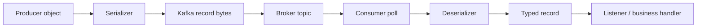
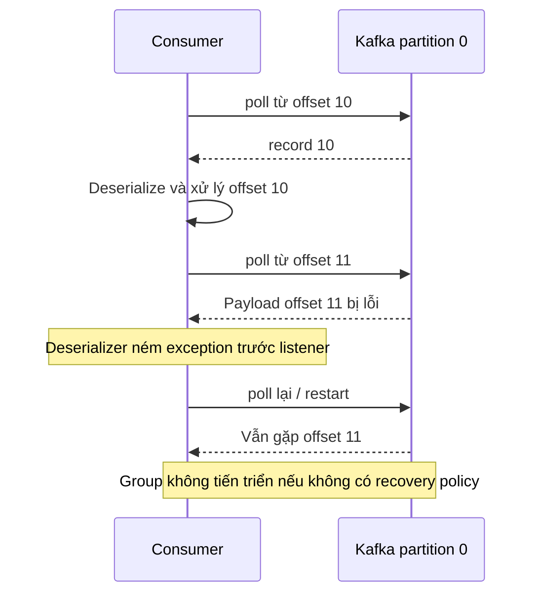

# Lỗi deserialization và bản ghi không thể xử lý

Kafka lưu và truyền record dưới dạng byte array. Producer serialize key/value thành bytes trước khi gửi; consumer deserialize bytes thành kiểu dữ liệu mà ứng dụng hiểu. Nếu payload không đúng định dạng, schema không tương thích hoặc kiểu dữ liệu không thể tạo được, consumer có thể gặp lỗi ngay khi gọi `poll()`.

Một record không thể deserialize thường được gọi là **poison pill**: cùng một payload lỗi có thể khiến consumer liên tục dừng ở cùng offset, làm group không tiến triển. Với Spring Kafka, `ErrorHandlingDeserializer` giúp chuyển lỗi deserialization thành metadata gắn với record để container error handler có thể retry theo chính sách phù hợp hoặc chuyển record sang Dead Letter Topic (DLT). Thiết kế cần giữ lại payload gốc, xác định nguyên nhân và bảo đảm offset nguồn chỉ được tiến lên khi record đã được xử lý hoặc phục hồi theo chính sách đã chọn.

## 1. Deserialization xảy ra ở đâu trong luồng Kafka?

Producer gửi key và value dưới dạng bytes. Khi consumer gọi `poll()`, Kafka client lấy record batch và chạy deserializer cho key/value trước khi trả `ConsumerRecords` về ứng dụng.



Nếu deserializer ném exception, record có thể không được trả về listener. Vì vậy, `try/catch` quanh code xử lý trong `@KafkaListener` không bắt được mọi lỗi parse xảy ra trước khi listener được gọi.

### Các nguyên nhân phổ biến

| Nguyên nhân | Ví dụ | Biểu hiện |
|---|---|---|
| Payload không đúng định dạng | JSON bị cắt, dấu ngoặc hoặc dấu phẩy sai | JSON parser ném exception |
| Encoding không hợp lệ | Bytes không phải UTF-8 nhưng được đọc như UTF-8 | Lỗi decode hoặc ký tự sai |
| Schema không tương thích | Producer thêm field bắt buộc hoặc đổi kiểu field | Avro/Protobuf/JSON Schema deserializer không đọc được |
| Type mismatch | Producer gửi string nhưng consumer mong object | Jackson hoặc converter không tạo được target type |
| Thiếu class/type mapping | Header chỉ đến class không tồn tại ở consumer | Class loading hoặc type resolution thất bại |
| Enum/value không được hỗ trợ | Producer gửi enum mới, consumer dùng phiên bản cũ | Schema/JSON mapping không chấp nhận giá trị |
| Key deserialization lỗi | Key bytes không đúng định dạng key serializer | Consumer không tạo được key |
| Schema Registry hoặc hạ tầng schema lỗi | Registry timeout, authentication thất bại | Có thể là lỗi tạm thời, không phải payload hỏng |

Phân biệt lỗi dữ liệu với lỗi hạ tầng rất quan trọng. Một JSON sai cú pháp thường sẽ sai như cũ ở lần retry tiếp theo; Registry tạm thời không truy cập được có thể phục hồi sau backoff. Không nên áp dụng cùng một chính sách retry cho cả hai.

## 2. Poison pill làm consumer group bị kẹt như thế nào?

Giả sử partition 0 có các record offset 10, 11, 12. Offset 11 chứa payload hỏng. Consumer đọc offset 10 thành công, nhưng lần poll tiếp theo gặp lỗi khi deserialize offset 11. Nếu lỗi không được xử lý, consumer không thể tiếp tục tiến qua record lỗi theo luồng bình thường.



Tùy client, phiên bản và cách cấu hình, lỗi có thể xuất hiện trực tiếp từ `poll()` hoặc được Spring Kafka chuyển thành lỗi gắn với record. Nếu consumer liên tục restart mà không thay đổi payload hay vị trí đọc, poison pill vẫn còn ở log và có thể tiếp tục chặn tiến độ partition.

Các hậu quả thường thấy:

- Consumer lag tăng dần trên partition bị kẹt.
- Các record hợp lệ nằm sau poison pill không được xử lý.
- Consumer có thể liên tục log cùng một stack trace.
- Rebalance có thể xảy ra nếu lỗi làm consumer dừng, mất heartbeat hoặc vượt thời gian poll.
- Các partition khác trong group có thể vẫn chạy, nhưng partition lỗi không tiến triển.

## 3. Xử lý ở tầng byte hay typed object?

Có hai hướng thiết kế phổ biến:

| Cách đọc | Ưu điểm | Đánh đổi |
|---|---|---|
| Deserialize ngay trong Kafka client | Listener nhận object có kiểu rõ ràng; code nghiệp vụ gọn | Lỗi xảy ra trước listener nếu deserializer ném exception |
| Nhận `byte[]` rồi parse trong ứng dụng | Luôn giữ được raw payload để log, phân loại và đưa DLT | Ứng dụng tự quản lý parser, validation và mapping |

### Dùng `ByteArrayDeserializer` khi cần kiểm soát hoàn toàn payload

```java
Properties props = new Properties();
props.put(ConsumerConfig.KEY_DESERIALIZER_CLASS_CONFIG,
          ByteArrayDeserializer.class.getName());
props.put(ConsumerConfig.VALUE_DESERIALIZER_CLASS_CONFIG,
          ByteArrayDeserializer.class.getName());
props.put(ConsumerConfig.ENABLE_AUTO_COMMIT_CONFIG, false);
```

Sau khi nhận bytes, ứng dụng tự parse:

```java
for (ConsumerRecord<byte[], byte[]> record : records) {
    try {
        OrderCreated event = objectMapper.readValue(
            record.value(), OrderCreated.class);
        orderService.handle(event);
    }
    catch (JsonProcessingException ex) {
        deadLetterPublisher.publish(record, ex);
    }
}
```

`deadLetterPublisher` là thành phần do ứng dụng triển khai. Nếu publish DLT thành công rồi mới commit offset nguồn, vẫn có thể có duplicate ở DLT nếu tiến trình crash giữa hai thao tác; cần giữ event ID và làm consumer DLT idempotent. Cách dùng bytes phù hợp khi cần tự kiểm soát payload gốc hoặc xử lý nhiều schema trong cùng topic.

## 4. `ErrorHandlingDeserializer` trong Spring Kafka

Spring Kafka cung cấp `ErrorHandlingDeserializer` để bọc một deserializer delegate. Khi delegate deserialize thành công, record được trả về bình thường. Khi delegate ném exception, wrapper ghi thông tin lỗi và dữ liệu thô vào header của record rồi trả về giá trị `null` cho phần key/value bị lỗi. Container có thể phát hiện header lỗi và chuyển record cho error handler.

Các điểm cần nhớ:

- Delegate vẫn là thành phần thực hiện parse thực tế, ví dụ `StringDeserializer`, `JsonDeserializer` hoặc deserializer Avro.
- `ErrorHandlingDeserializer` giúp lỗi xuất hiện trong luồng xử lý của Spring Kafka thay vì làm `poll()` thất bại theo cách không thể gắn với record.
- Header lỗi chứa thông tin exception và raw bytes để có thể điều tra hoặc phục hồi.
- `null` có thể là giá trị hợp lệ của một record; cần kiểm tra header deserialization exception để phân biệt null hợp lệ với null do deserialize thất bại.
- Key và value có thể lỗi độc lập; cần kiểm tra cả hai loại header.

### Cấu hình Spring Boot với JSON

Ví dụ consumer đọc `OrderCreated` bằng Jackson:

```yaml
spring:
  kafka:
    bootstrap-servers: localhost:9092
    consumer:
      group-id: order-service
      enable-auto-commit: false
      key-deserializer: org.springframework.kafka.support.serializer.ErrorHandlingDeserializer
      value-deserializer: org.springframework.kafka.support.serializer.ErrorHandlingDeserializer
      properties:
        spring.deserializer.key.delegate.class: org.apache.kafka.common.serialization.StringDeserializer
        spring.deserializer.value.delegate.class: org.springframework.kafka.support.serializer.JsonDeserializer
        spring.json.value.default.type: com.example.events.OrderCreated
        spring.json.trusted.packages: com.example.events
```

Trong cấu hình trên, key dùng chuỗi và value dùng JSON object. Chỉ khai báo package tin cậy mà ứng dụng thực sự sử dụng; tránh đặt `spring.json.trusted.packages: '*'` trong production nếu không cần thiết. Với schema registry hoặc Avro/Protobuf, thay delegate bằng deserializer tương ứng và cấu hình registry/authentication theo môi trường.

### Cấu hình bằng Java Properties

```java
props.put(ConsumerConfig.KEY_DESERIALIZER_CLASS_CONFIG,
          ErrorHandlingDeserializer.class);
props.put(ConsumerConfig.VALUE_DESERIALIZER_CLASS_CONFIG,
          ErrorHandlingDeserializer.class);

props.put(ErrorHandlingDeserializer.KEY_DESERIALIZER_CLASS,
          StringDeserializer.class);
props.put(ErrorHandlingDeserializer.VALUE_DESERIALIZER_CLASS,
          JsonDeserializer.class);
props.put(JsonDeserializer.VALUE_DEFAULT_TYPE,
          OrderCreated.class.getName());
props.put(JsonDeserializer.TRUSTED_PACKAGES,
          "com.example.events");
```

Tên constant có thể khác theo phiên bản Spring Kafka; khi dùng phiên bản cụ thể, hãy đối chiếu API tương ứng. Có thể cấu hình delegate trực tiếp trong constructor nếu tự tạo consumer factory, nhưng không nên đồng thời cấu hình nhiều cách khác nhau mà không xác định thứ tự ưu tiên.

### Xử lý fallback object

`ErrorHandlingDeserializer` hỗ trợ `failedDeserializationFunction` để tạo một đối tượng fallback khi deserialize thất bại. Fallback có thể hữu ích nếu ứng dụng muốn nhận một kiểu wrapper chứa thông tin lỗi. Tuy nhiên, không nên biến payload lỗi thành một object nghiệp vụ giả rồi xử lý như event hợp lệ. Hãy giữ rõ trạng thái `deserializationFailed`, raw bytes và exception để tránh tạo side effect từ dữ liệu không đáng tin cậy.

## 5. Phân biệt lỗi deserialization với lỗi xử lý nghiệp vụ

Không phải mọi lỗi trong consumer đều là deserialization error. Phân loại đúng giúp tránh retry vô hạn cho lỗi vĩnh viễn hoặc đưa nhầm lỗi tạm thời vào DLT quá sớm.

| Nhóm lỗi | Ví dụ | Chính sách thường phù hợp |
|---|---|---|
| Payload hỏng, parse không thể thành công | JSON sai cú pháp, byte format không hợp lệ | Không retry nhiều lần; đưa DLT kèm raw payload |
| Schema incompatibility | Field đổi kiểu, enum mới không được hỗ trợ | DLT hoặc quarantine; sửa contract/consumer rồi replay có kiểm soát |
| Schema Registry tạm thời lỗi | Timeout, 503, DNS tạm thời | Retry có backoff và giới hạn |
| Validation nghiệp vụ không đạt | Amount âm, thiếu order ID bắt buộc | Thường không retry nếu dữ liệu bất biến; DLT/quarantine hoặc luồng xử lý thủ công |
| Downstream tạm thời lỗi | DB timeout, HTTP 503 | Retry có backoff, idempotency và timeout tổng |
| Lỗi lập trình | Null pointer, class cast do code | Dừng/alert hoặc retry rất hạn chế; sửa code trước khi replay |

Lỗi payload hỏng thường mang tính deterministic: cùng bytes và cùng schema sẽ cho cùng kết quả. Retry không sửa được payload. Ngược lại, lỗi kết nối Schema Registry có thể biến mất sau vài giây; cần retry có giới hạn trước khi kết luận record không thể xử lý.

## 6. `DefaultErrorHandler`: retry và recovery cho record listener

Trong Spring Kafka hiện đại, `DefaultErrorHandler` là error handler phổ biến cho record listener. Handler có thể retry record thất bại theo `BackOff`; khi hết retry, gọi recoverer như `DeadLetterPublishingRecoverer` để chuyển record sang DLT.

Ví dụ cấu hình:

```java
@Bean
DefaultErrorHandler kafkaErrorHandler(
        DeadLetterPublishingRecoverer recoverer) {

    FixedBackOff backOff = new FixedBackOff(1_000L, 2L);
    DefaultErrorHandler handler =
        new DefaultErrorHandler(recoverer, backOff);

    handler.addNotRetryableExceptions(
        IllegalArgumentException.class,
        UnsupportedOperationException.class);

    return handler;
}
```

Với `FixedBackOff(1000L, 2L)`, handler chờ một giây giữa các lần thử lại và thực hiện tối đa hai lần retry sau lần xử lý ban đầu. Nếu vẫn thất bại, recoverer được gọi. `DefaultErrorHandler` đã phân loại một số exception như `DeserializationException` là fatal/non-retryable theo mặc định; không cần cố retry vô hạn một payload chắc chắn không parse được. Hãy kiểm tra danh sách exception mặc định theo phiên bản Spring Kafka đang dùng.

Có thể chọn `ExponentialBackOffWithMaxRetries` hoặc custom `BackOff` để tăng khoảng chờ theo cấp số nhân và giới hạn tổng thời gian. Backoff nên tính đến:

- Thời gian downstream dự kiến phục hồi.
- `max.poll.interval.ms` và khả năng consumer vẫn poll đúng hạn.
- Mức độ backlog và số partition bị ảnh hưởng.
- Retry có thể làm side effect lặp hay không.
- Tổng thời gian trước khi record bị chuyển DLT.

Không đặt retry count quá lớn cho lỗi dữ liệu bất biến. Điều đó chỉ giữ partition bị kẹt lâu hơn và làm tăng lag.

## 7. Chuyển record lỗi sang Dead Letter Topic

DLT lưu record không thể xử lý cùng metadata để điều tra và replay sau khi nguyên nhân được khắc phục. Với Spring Kafka, `DeadLetterPublishingRecoverer` có thể publish record thất bại sang topic đích.

Ví dụ route tới topic cùng tên cộng hậu tố `.DLT`, giữ nguyên partition nguồn:

```java
@Bean
DeadLetterPublishingRecoverer deadLetterRecoverer(
        KafkaTemplate<Object, Object> template) {

    return new DeadLetterPublishingRecoverer(
        template,
        (record, exception) -> new TopicPartition(
            record.topic() + ".DLT",
            record.partition())
    );
}
```

Nếu dùng cách giữ nguyên partition, topic DLT cần có đủ số partition tương ứng với topic nguồn. Nếu không, hãy dùng destination resolver chọn partition hợp lệ hoặc tạo DLT với partition count phù hợp. Cần cấp quyền ghi cho producer DLT và quyền đọc/ghi phù hợp cho consumer vận hành.

### Giữ raw bytes khi deserialize thất bại

Khi `ErrorHandlingDeserializer` thất bại, value trả về cho listener có thể là `null`, trong khi bytes gốc được lưu trong header exception. Producer dùng để ghi DLT phải serialize được cả object đã deserialize thành công lẫn raw `byte[]` của record lỗi. Trong Spring Kafka, có thể cấu hình `DelegatingByTypeSerializer` cho `byte[]` và serializer của object bình thường.

Không giả định `JsonSerializer` có thể serialize mọi giá trị `byte[]` thành đúng payload gốc. Nếu DLT không giữ được raw bytes, nhóm vận hành có thể không tái tạo được lỗi. Hãy kiểm thử DLT với cả record hợp lệ và record hỏng trước khi triển khai.

### Metadata cần lưu trong DLT

| Metadata | Mục đích |
|---|---|
| Original topic, partition, offset | Xác định nguồn gốc record |
| Original key và raw value | Điều tra và replay dữ liệu gốc |
| Exception class và message | Phân loại nguyên nhân |
| Timestamp lỗi/recovery | Theo dõi thời điểm và độ tuổi record lỗi |
| Consumer group/application | Xác định consumer nào không xử lý được |
| Retry count / delivery attempt | Hiểu số lần đã thử xử lý |
| Event ID/correlation ID nếu đọc được | Liên kết với nghiệp vụ và trace |

Spring Kafka có thể thêm các header như original topic/partition/offset, exception class/message và stack trace tùy phiên bản/cấu hình. Cần quản lý kích thước header, tránh lặp stack trace quá lớn qua nhiều lần DLT và không đưa secret hoặc dữ liệu cá nhân vào log/metadata không cần thiết.

## 8. Offset nguồn được commit khi nào?

Một record chỉ nên được xem là đã phục hồi khi:

1. Listener xử lý thành công; hoặc
2. Error handler đã chuyển record sang DLT thành công theo chính sách đã cấu hình.

Nếu publish DLT thất bại, không được đánh dấu record nguồn đã xử lý thành công rồi bỏ qua. Nếu không, payload có thể biến mất khỏi đường xử lý mà không có bản lưu phục hồi. Với Spring Kafka, hành vi commit sau recovery phụ thuộc `AckMode`, `ackAfterHandle`, `commitRecovered`, transaction manager và phiên bản container. Hãy kiểm tra cấu hình thực tế; không giả định DLT publish và offset commit tự động là một transaction nguyên tử trong mọi cấu hình.

Với Kafka-to-Kafka, có thể dùng Kafka transaction để kết hợp publish DLT và offset nguồn trong cùng transaction. Nếu transaction commit, DLT record và offset cùng được ghi nhận; nếu abort, offset nguồn chưa tiến qua record đó. Điều này không áp dụng tự động cho DLT nằm ngoài Kafka hoặc side effect ở database.

## 9. Record listener và batch listener

Error handling có khác biệt khi listener nhận từng record hay cả batch:

| Loại listener | Cách lỗi thường được nhận diện | Lưu ý |
|---|---|---|
| Record listener | Một record gây exception | Error handler có thể retry record lỗi và xử lý offset theo container policy |
| Batch listener | Một phần tử trong `ConsumerRecords` lỗi | Ứng dụng cần xác định chính xác index/record thất bại để tránh retry hoặc bỏ qua sai phần batch |
| Batch listener ném lỗi không xác định record | Không rõ record nào gây lỗi | Container có thể phải retry cả batch; xử lý lại các record đã thành công có thể tạo side effect trùng |

Với batch listener, Spring Kafka hỗ trợ `BatchListenerFailedException` để chỉ ra record hoặc index bị lỗi. Error handler có thể commit phần trước record lỗi và retry phần lỗi/các record sau theo chiến lược phù hợp.

Ví dụ:

```java
@KafkaListener(topics = "orders.events", groupId = "order-service")
public void listen(List<ConsumerRecord<String, OrderCreated>> records) {
    for (int i = 0; i < records.size(); i++) {
        ConsumerRecord<String, OrderCreated> record = records.get(i);
        try {
            orderService.handle(record.value());
        }
        catch (Exception ex) {
            throw new BatchListenerFailedException(
                "Cannot process order event", ex, i);
        }
    }
}
```

Đoạn ví dụ tập trung vào việc chỉ rõ index lỗi. Nếu batch có nhiều partition, cần hiểu thứ tự và offset riêng từng partition; không suy luận index toàn batch tương đương với một dải offset duy nhất.

## 10. Schema evolution để ngăn lỗi trước khi xảy ra

Nhiều poison record xuất phát từ việc producer và consumer triển khai không tương thích. Quản lý schema giúp phát hiện sớm thay đổi có thể phá vỡ consumer cũ.

Các thực hành nên áp dụng:

- Dùng schema registry hoặc schema contract được version hóa.
- Chọn compatibility mode phù hợp với cách deploy producer/consumer, ví dụ backward, forward hoặc full compatibility.
- Thêm field mới với default/optional khi contract yêu cầu consumer cũ vẫn đọc được.
- Tránh đổi kiểu field hoặc tái sử dụng tên field với ý nghĩa khác.
- Kiểm thử producer mới với consumer phiên bản cũ và ngược lại theo compatibility policy.
- Triển khai consumer hỗ trợ schema mới trước khi producer phát dữ liệu mới nếu cần backward compatibility.
- Giữ lại schema ID/version và thông tin producer trong record để điều tra.

Với JSON không có schema registry, cần kiểm tra contract ở CI và có version rõ ràng trong envelope. JSON parse thành công không có nghĩa payload hợp lệ về nghiệp vụ; sau deserialize vẫn cần validation riêng.

## 11. Quan sát và cảnh báo lỗi deserialization

Nên theo dõi riêng lỗi parse, lỗi schema, lỗi nghiệp vụ và lỗi downstream. Các tín hiệu hữu ích:

| Metric/log | Ý nghĩa | Cảnh báo khi |
|---|---|---|
| Deserialization failure count | Số record không parse được | Tăng đột biến hoặc xuất hiện trên topic quan trọng |
| DLT publish success/failure | Recovery có lưu được record lỗi không | Publish DLT thất bại hoặc retry tăng |
| DLT record rate / oldest age | Lượng record cần điều tra | DLT tích tụ lâu không được xử lý |
| Consumer lag theo partition | Partition có tiến triển không | Lag tăng liên tục trên partition có poison pill |
| Retry attempts và recovery count | Lỗi tạm thời có phục hồi không | Retry lặp lại cùng exception/payload |
| Schema Registry error rate | Hạ tầng schema có ổn định không | Timeout/authentication lỗi diện rộng |
| Exception class và topic | Phân loại lỗi theo nguồn | Một producer/version cụ thể tạo lỗi hàng loạt |

Log nên có topic, partition, offset, group ID, exception class, schema ID/version và event ID nếu có. Không log raw payload không giới hạn: payload có thể rất lớn hoặc chứa token, thông tin cá nhân và dữ liệu nhạy cảm. Có thể lưu payload trong DLT với ACL phù hợp rồi log reference/metadata.

## 12. Quy trình xử lý poison record trong production

Khi phát hiện partition không tiến triển do lỗi deserialization:

1. Xác định topic, partition, offset và consumer group bị ảnh hưởng.
2. Xác định lỗi nằm ở key hay value; lấy exception class, schema ID và producer version.
3. Kiểm tra payload có sai định dạng hay lỗi truy cập schema registry/hạ tầng.
4. Nếu lỗi tạm thời, áp dụng retry có backoff và giới hạn tổng thời gian.
5. Nếu payload chắc chắn không hợp lệ, chuyển DLT và xác nhận raw bytes cùng metadata được giữ.
6. Xác minh offset nguồn chỉ tiến sau khi xử lý thành công hoặc DLT publish thành công.
7. Sửa producer/schema/consumer contract hoặc dữ liệu nguồn.
8. Replay DLT bằng công cụ/consumer riêng sau khi đã kiểm tra tính tương thích và idempotency.
9. Theo dõi lag, DLT age, duplicate và lỗi tái diễn.

Không xóa record lỗi hoặc reset offset về phía sau một cách tùy tiện để làm consumer “chạy tiếp”. Làm vậy có thể mất dấu dữ liệu chưa xử lý hoặc tạo side effect trùng khi replay.

## 13. Replay từ DLT sau khi sửa lỗi

DLT nên được xem là hàng đợi phục hồi có quản lý, không phải kho lưu trữ vô thời hạn. Một quy trình replay cần:

- Xác định nguyên nhân gốc đã được sửa và consumer hiện tại đọc được payload.
- Giữ event ID gốc; không tạo ID mới chỉ vì replay.
- Chọn replay về topic gốc hay topic recovery riêng.
- Kiểm soát tốc độ để không làm quá tải downstream.
- Dùng consumer idempotent vì record có thể đã được xử lý một phần trước khi lỗi xảy ra.
- Ghi lại ai replay, thời điểm, số lượng record và kết quả.
- Có thể quarantine lại nếu record vẫn không hợp lệ.

Nếu replay về topic gốc, record mới sẽ nhận offset mới và có thể xuất hiện sau các event mới hơn. Với nghiệp vụ yêu cầu ordering, cần kiểm tra aggregate version/sequence trước khi áp dụng. Nếu thứ tự quan trọng hơn throughput, dùng luồng recovery có kiểm soát hoặc tạm dừng xử lý aggregate liên quan.

## 14. Bài thực hành: tạo và xử lý poison pill

Tạo topic thử nghiệm `orders.events` và Spring Kafka consumer đọc JSON thành `OrderCreated`.

1. Gửi một JSON hợp lệ và xác minh listener nhận object.
2. Gửi một JSON sai cú pháp, ví dụ thiếu dấu đóng ngoặc, rồi quan sát lỗi khi không dùng `ErrorHandlingDeserializer`.
3. Cấu hình `ErrorHandlingDeserializer` với `JsonDeserializer` delegate và gửi lại payload sai.
4. Cấu hình `DefaultErrorHandler` với backoff ngắn, phân loại lỗi deserialization là non-retryable theo hành vi mặc định/phiên bản.
5. Cấu hình `DeadLetterPublishingRecoverer` route sang `orders.events.DLT` và xác minh record lỗi có original topic/partition/offset cùng raw bytes.
6. Gửi payload hợp lệ nhưng sai schema version để kiểm tra compatibility failure.
7. Tạm thời làm Schema Registry không truy cập được trong lab để phân biệt lỗi hạ tầng có thể retry với payload hỏng không thể retry.
8. Sửa payload/schema hoặc consumer rồi replay một record từ DLT; xác minh event ID được giữ và side effect không bị áp dụng hai lần.
9. Kiểm tra consumer lag và offset nguồn để xác nhận partition đã tiến triển sau recovery.

Chỉ fault-inject trên môi trường lab. Không gửi payload phá hỏng có chủ ý vào topic production hoặc dừng Schema Registry production để thử nghiệm.

## 15. Checklist triển khai

- Chọn deserializer đúng với serializer và schema của producer.
- Dùng `ErrorHandlingDeserializer` nếu cần Spring container error handler xử lý lỗi xảy ra trong quá trình deserialize.
- Kiểm tra cả key và value deserialization exception headers.
- Phân biệt payload hỏng với lỗi Registry/network có thể phục hồi.
- Đặt retry/backoff có giới hạn; không retry vô hạn deterministic parse error.
- Cấu hình DLT topic đủ partition, ACL và serializer hỗ trợ cả object lẫn raw `byte[]`.
- Kiểm thử raw payload được giữ nguyên khi chuyển DLT.
- Xác minh source offset chỉ tiến sau xử lý thành công hoặc recovery thành công.
- Với batch listener, xác định chính xác record/index gây lỗi.
- Quản lý schema evolution và compatibility trước khi phát hành producer mới.
- Giữ event ID, source offset và exception metadata để điều tra/replay.
- Giới hạn log payload và bảo vệ dữ liệu nhạy cảm.
- Thiết kế consumer idempotent và quy trình replay DLT có kiểm soát.

## 16. Những nhầm lẫn thường gặp

- **Cho rằng `try/catch` trong `@KafkaListener` bắt được lỗi deserializer:** lỗi có thể xảy ra trong `poll()` trước khi listener được gọi.
- **Retry mọi lỗi như nhau:** JSON hỏng không tự sửa sau retry; Registry timeout có thể phục hồi.
- **Cho rằng `ErrorHandlingDeserializer` sửa payload:** nó giữ thông tin lỗi và raw bytes để error handler xử lý, không biến payload sai thành dữ liệu đúng.
- **Coi mọi giá trị `null` là deserialize thất bại:** null có thể là giá trị hợp lệ; hãy kiểm tra exception header.
- **Chỉ cấu hình value deserializer:** key cũng có thể lỗi và cần được xử lý.
- **Ghi DLT bằng JSON serializer bất kể kiểu dữ liệu:** raw bytes cần serializer phù hợp để không mất payload gốc.
- **Commit source offset trước khi DLT publish thành công:** có thể làm mất record khỏi luồng phục hồi.
- **Cho rằng DLT publish và source offset commit luôn nguyên tử:** cần cấu hình transaction đúng nếu muốn atomic trong Kafka.
- **Retry vô hạn poison pill:** partition bị kẹt và consumer lag tăng.
- **Replay DLT mà không deduplicate:** event có thể tạo side effect trùng.
- **Cho rằng JSON parse thành công nghĩa là event hợp lệ:** vẫn cần schema validation và business validation.

Deserialization failure cần được phát hiện trước khi listener xử lý nghiệp vụ. `ErrorHandlingDeserializer` giúp Spring Kafka đưa lỗi và raw payload vào cơ chế error handling; `DefaultErrorHandler` phân loại retry; `DeadLetterPublishingRecoverer` lưu record không thể xử lý vào DLT. Kết hợp schema compatibility, offset recovery, raw-byte preservation, quan sát và replay idempotent sẽ giúp một poison record không chặn cả partition và không biến lỗi dữ liệu thành mất mát nghiệp vụ.
