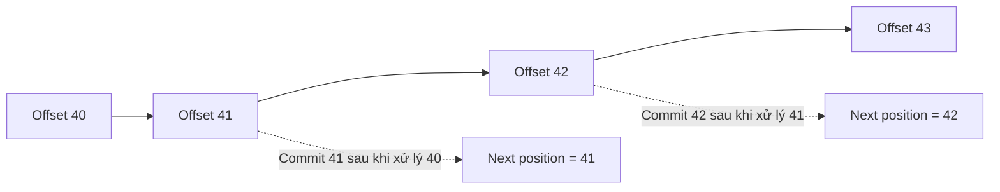
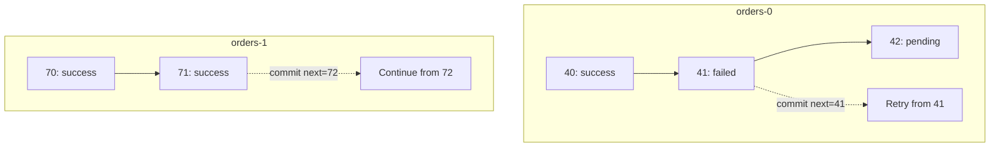

# Commit offset khi bỏ qua, chuyển lỗi hoặc xử lý một phần lô

## Mục tiêu

Consumer không phải lúc nào cũng xử lý thành công mọi record đã poll. Có record lỗi tạm thời cần retry, record không hợp lệ cần chuyển sang dead-letter topic (DLT), record được phép bỏ qua sau khi ghi nhận, hoặc một batch chỉ xử lý thành công một phần. Trong các trường hợp này, commit offset sai có thể làm mất record chưa xử lý; không commit đúng lúc có thể khiến record đã xử lý bị đọc lại.

Nguyên tắc cốt lõi là Kafka lưu **vị trí tiếp theo cần đọc** cho từng partition. Ứng dụng chỉ được commit qua một record khi đã có quyết định xử lý cuối cùng cho record đó và mọi record đứng trước nó trong cùng partition đã hoàn tất. Với xử lý một phần batch, cần theo dõi riêng từng partition thay vì commit offset lớn nhất của toàn batch.

Sau bài học này, bạn có thể:

- Phân biệt retry, skip có chủ đích, recover/DLT và xử lý một phần batch.
- Giải thích vì sao committed offset là next offset chứ không phải offset của record cuối cùng.
- Commit an toàn khi một record bị bỏ qua hoặc chuyển sang DLT.
- Theo dõi contiguous completed offset theo từng partition khi xử lý song song.
- Chọn `AckMode` và error handler phù hợp trong Spring Kafka.
- Xử lý batch listener thất bại tại một record cụ thể.
- Thiết kế DLT publication, audit và offset commit để tránh mất hoặc nhân đôi dữ liệu.
- Kiểm thử các cửa sổ lỗi giữa xử lý nghiệp vụ và commit offset.

## 1. Offset commit lưu vị trí tiếp theo cần đọc

Giả sử consumer xử lý partition `orders-0` và nhận các record có offset 40, 41, 42. Sau khi xử lý thành công record 40, vị trí tiếp theo cần đọc là 41. Vì vậy ứng dụng commit `OffsetAndMetadata(41)`, không commit 40.

| Record đã xử lý xong | Offset cần commit | Ý nghĩa sau restart |
|---:|---:|---|
| 40 | 41 | Đọc tiếp từ record 41 |
| 41 | 42 | Đọc tiếp từ record 42 |
| 42 | 43 | Đọc tiếp từ record 43 |

Commit offset 42 sau khi mới xử lý record 41 là đúng. Commit offset 41 sau khi xử lý record 41 sẽ khiến record 41 được đọc lại. Commit offset 43 trước khi record 42 hoàn tất có thể làm record 42 bị bỏ qua sau restart.



Offset là vị trí trong log, không phải số lượng record ứng dụng nhìn thấy. Với `read_committed`, aborted records và control records có thể tạo khoảng trống. Khi xử lý tuần tự một record, `record.offset() + 1` là vị trí sau record đó. Khi xử lý toàn bộ poll result của một partition, `consumer.position(partition)` có thể phản ánh next position sau cả những offset bị lọc; chỉ dùng nó nếu toàn bộ record hiển thị trước vị trí đó đã có kết quả xử lý an toàn.

## 2. Phân loại quyết định xử lý lỗi

Trước khi commit, consumer cần xác định record thuộc trường hợp nào. Không nên gom mọi exception vào một nhánh `catch` rồi bỏ qua.

| Kết quả | Hành động | Có được tiến offset qua record? |
|---|---|---|
| Xử lý thành công | Ghi nhận kết quả nghiệp vụ | Có |
| Lỗi tạm thời | Retry theo backoff hoặc để record được đọc lại | Chưa, cho tới khi xử lý thành công hoặc có quyết định recover cuối cùng |
| Lỗi dữ liệu không thể sửa tự động | Ghi DLT kèm payload và exception metadata | Chỉ sau khi DLT được ghi thành công và chính sách recover cho phép |
| Bỏ qua có chủ đích | Ghi audit/metric và áp dụng skip policy | Có, sau khi quyết định bỏ qua được ghi nhận bền vững nếu nghiệp vụ yêu cầu |
| Xử lý một phần batch | Commit prefix đã hoàn tất theo từng partition | Chỉ qua phần liên tục đã hoàn tất |
| Lỗi không xác định kết quả | Đối soát hoặc retry idempotent | Không tự ý commit để che lỗi |

### 2.1. Retry không đồng nghĩa skip

Lỗi timeout database hoặc broker tạm thời thường cần retry. Nếu commit offset ngay sau lỗi, record sẽ bị bỏ qua vĩnh viễn trong group đó. Nếu không commit, record có thể được đọc lại sau restart/rebalance.

Retry có giới hạn cần có backoff, số lần thử hoặc deadline, metric và chính sách cuối cùng. Sau khi hết retry, ứng dụng phải quyết định dừng partition, chuyển DLT hoặc bỏ qua theo nghiệp vụ. Không nên tự động skip chỉ để consumer lag giảm.

### 2.2. Skip là quyết định nghiệp vụ có audit

Skip chỉ phù hợp khi record được xác định không cần xử lý hoặc đã được xử lý thay thế. Ví dụ event trùng đã có event ID trong inbox, hoặc record bị loại theo quy tắc lọc được phê duyệt.

Với record sai schema hoặc dữ liệu không hợp lệ, thường nên chuyển DLT để có thể điều tra và sửa sau. Nếu skip, hãy ghi ít nhất topic, partition, offset, key, event ID, lý do và thời điểm. Nếu audit là yêu cầu nghiệp vụ, lưu audit bền vững trước khi commit offset.

## 3. Commit khi bỏ qua một record

Giả sử partition `orders-0` có offset 40, 41, 42. Record 40 xử lý thành công, record 41 được xác định là duplicate theo event ID và được phép skip, record 42 tiếp tục xử lý thành công.

Nếu skip 41 sau khi đã ghi nhận quyết định, consumer có thể tiến offset qua 41. Nhưng không được commit 43 trước khi record 42 hoàn tất. Nếu batch đang xử lý tuần tự, có thể commit theo từng record hoặc commit một lần sau khi cả ba record đã có kết quả cuối cùng.

### 3.1. Ví dụ Java: skip có audit rồi commit

```java
ConsumerRecord<String, String> record = records.iterator().next();

try {
    process(record);
} catch (DuplicateEventException duplicate) {
    auditSkippedEvent(
            record.topic(),
            record.partition(),
            record.offset(),
            record.key(),
            "duplicate-event-id");

    TopicPartition tp = new TopicPartition(
            record.topic(), record.partition());
    consumer.commitSync(Map.of(
            tp, new OffsetAndMetadata(record.offset() + 1)));
}
```

Ví dụ giả định chỉ có một record đang xử lý trong partition đó và `auditSkippedEvent()` đã ghi nhận thành công. Nếu consumer đã poll thêm record phía sau, commit `record.offset() + 1` vẫn giữ vị trí tại record kế tiếp; không được commit `consumer.position(tp)` nếu các record sau còn pending.

Nếu audit ghi vào database hoặc hệ thống ngoài Kafka, commit offset và audit không tự động nằm trong cùng transaction. Crash sau audit nhưng trước commit có thể làm record được đọc lại; audit nên idempotent theo event ID hoặc topic-partition-offset.

### 3.2. Không dùng `seek()` thay cho commit

`consumer.seek(tp, offset)` chỉ thay đổi vị trí đọc trong phiên consumer hiện tại. Nó không ghi committed offset cho group. Khi consumer restart hoặc rebalance, group có thể quay lại committed offset cũ.

Để skip bền vững, cần commit next offset theo chính sách. Nếu vừa `seek()` vừa commit, hãy chắc chắn vị trí seek và committed offset nhất quán. API consumer chỉ được gọi trên owner/poll thread.

## 4. Commit khi chuyển record sang Dead Letter Topic

DLT giữ record không xử lý được để điều tra hoặc re-drive sau khi sửa lỗi. Một DLT record nên có đủ thông tin để truy vết nguồn:

- Payload và key gốc.
- Original topic, partition và offset.
- Event ID và timestamp gốc nếu có.
- Exception class, message và thời điểm lỗi.
- Số lần delivery/retry và consumer group.
- Correlation ID hoặc trace ID.

Quy tắc quan trọng: **chỉ tiến input offset sau khi việc publish DLT đã được xác nhận thành công**. Nếu DLT publish thất bại, không được coi record đã recover.

### 4.1. Cửa sổ lỗi khi DLT và offset commit tách rời

Nếu publish DLT và commit input offset là hai thao tác độc lập, có thể xảy ra:

1. DLT publish thành công, process crash trước khi commit input offset: record nguồn được đọc lại và có thể tạo thêm một DLT record.
2. Commit input offset trước, DLT publish thất bại: record nguồn bị bỏ qua nhưng không có bản sao trong DLT.

Thứ tự an toàn cho at-least-once là publish DLT thành công trước, sau đó mới commit input offset. Cách này có thể tạo duplicate ở DLT trong cửa sổ crash đầu tiên, nên DLT consumer hoặc quy trình vận hành cần deduplicate theo source topic-partition-offset hoặc event ID.

Nếu cả DLT record và input offset đều nằm trong Kafka, có thể dùng Kafka transaction để publish DLT và gửi input offset vào cùng transaction. Khi transaction commit, cả hai cùng có hiệu lực; khi abort, cả hai cùng không được commit. Consumer đọc DLT nên dùng `read_committed` nếu DLT được ghi transactional.

### 4.2. Ví dụ Java: publish DLT trước rồi commit

```java
ProducerRecord<String, String> dltRecord = new ProducerRecord<>(
        "orders.DLT", record.key(), record.value());
dltRecord.headers().add("original-topic",
        record.topic().getBytes(StandardCharsets.UTF_8));
dltRecord.headers().add("original-partition",
        Integer.toString(record.partition()).getBytes(StandardCharsets.UTF_8));
dltRecord.headers().add("original-offset",
        Long.toString(record.offset()).getBytes(StandardCharsets.UTF_8));
dltRecord.headers().add("error-class",
        exception.getClass().getName().getBytes(StandardCharsets.UTF_8));

// Chờ broker xác nhận DLT publish theo acks đã cấu hình.
dltProducer.send(dltRecord).get();

TopicPartition tp = new TopicPartition(record.topic(), record.partition());
consumer.commitSync(Map.of(
        tp, new OffsetAndMetadata(record.offset() + 1)));
```

Đây là skeleton cho trường hợp xử lý tuần tự, một record tại một thời điểm. Cần xử lý `InterruptedException`, `ExecutionException`, timeout và shutdown đúng cách. Nếu `send().get()` lỗi, không commit input offset. Nếu DLT đã được broker ghi nhưng response bị mất, retry có thể tạo DLT duplicate; giữ source identity để deduplicate.

### 4.3. Atomic DLT và offset bằng Kafka transaction

Khi yêu cầu không có cửa sổ giữa publish DLT và commit input offset, dùng transactional producer:

```java
dltProducer.beginTransaction();
try {
    dltProducer.send(dltRecord);

    Map<TopicPartition, OffsetAndMetadata> offsets = Map.of(
            tp, new OffsetAndMetadata(record.offset() + 1));
    dltProducer.sendOffsetsToTransaction(offsets, consumer.groupMetadata());

    dltProducer.commitTransaction();
} catch (Exception e) {
    dltProducer.abortTransaction();
    throw e;
}
```

Ví dụ cần producer đã `initTransactions()`, `transactional.id` duy nhất cho instance đang chạy, consumer tắt auto commit và consumer group metadata hợp lệ. Transaction chỉ bao phủ Kafka DLT record và Kafka offset; nó không bao gồm audit/database/API ngoài Kafka. DLT consumer nên dùng `isolation.level=read_committed` để không nhìn thấy DLT record của transaction bị abort.

## 5. Commit khi xử lý một phần batch

Một lần `poll()` có thể trả record từ nhiều partition. Batch không phải một dãy offset toàn cục; mỗi partition có vị trí độc lập.

Ví dụ poll trả:

| Partition | Record theo thứ tự | Kết quả xử lý |
|---|---|---|
| `orders-0` | 40, 41, 42 | 40 thành công, 41 lỗi, 42 chưa xử lý |
| `orders-1` | 70, 71 | 70 và 71 thành công |

Commit an toàn:

- `orders-0`: commit offset 41, tức vị trí record lỗi 41 sẽ được đọc lại. Không commit 43 vì record 41/42 chưa hoàn tất.
- `orders-1`: commit offset 72 vì cả hai record đã hoàn tất.



### 5.1. Ví dụ commit map theo partition

```java
Map<TopicPartition, OffsetAndMetadata> safeOffsets = new HashMap<>();

// Partition 0: record 40 thành công; record 41 lỗi.
safeOffsets.put(new TopicPartition("orders", 0),
        new OffsetAndMetadata(41));

// Partition 1: record 70 và 71 đều thành công.
safeOffsets.put(new TopicPartition("orders", 1),
        new OffsetAndMetadata(72));

consumer.commitSync(safeOffsets);
```

Không gọi `consumer.commitSync()` không tham số sau khi chỉ xử lý một phần batch. Lệnh đó commit vị trí hiện tại của consumer, có thể đã tiến qua cả những record chưa xử lý xong. Hãy commit map offset đã tính theo kết quả thực tế.

### 5.2. Xử lý song song: chỉ commit contiguous prefix

Nếu worker xử lý record song song, offset 42 có thể hoàn tất trước offset 41. Không được commit 43 khi 41 còn pending. Mỗi partition cần một completion tracker giữ thứ tự các record đã dispatch:

| Offset | Trạng thái | Commit candidate |
|---:|---|---|
| 40 | Hoàn tất | Có thể tiến qua 40 |
| 41 | Đang xử lý | Dừng tại 41 |
| 42 | Hoàn tất | Chưa thể tiến qua 41 |

Khi 41 hoàn tất hoặc được recover/skip có chủ đích, tracker mới có thể tiến qua 41 và 42. Commit candidate là next offset sau record cuối cùng của prefix liên tục đã có kết quả cuối cùng.

Không giả định offset phải liên tiếp từng số nguyên khi `read_committed` có thể bỏ qua aborted/control records. Tracker nên giữ thứ tự record đã giao cho ứng dụng theo partition và xác định prefix hoàn tất trong thứ tự đó.

### 5.3. Không để record phía sau vượt qua lỗi nếu ordering quan trọng

Ngay cả khi commit offset an toàn, worker có thể đã thực hiện side effect của offset 42 trước offset 41. Completion tracker chỉ bảo vệ commit; nó không tự giữ thứ tự nghiệp vụ. Nếu thứ tự trong partition quan trọng, xử lý tuần tự theo partition hoặc dùng serial executor cho mỗi partition. Chỉ song song giữa các partition hoặc key mà nghiệp vụ cho phép độc lập.

## 6. Java Consumer: xử lý lỗi và commit rõ ràng

Ví dụ sau minh họa xử lý tuần tự từng record với ba quyết định: thành công, duplicate được skip sau audit, hoặc lỗi khác được ném lên để retry/stop. Consumer tắt auto commit và commit next offset sau kết quả cuối cùng.

```java
Properties props = new Properties();
props.put(ConsumerConfig.BOOTSTRAP_SERVERS_CONFIG, "localhost:9092");
props.put(ConsumerConfig.GROUP_ID_CONFIG, "orders-worker");
props.put(ConsumerConfig.KEY_DESERIALIZER_CLASS_CONFIG,
        StringDeserializer.class.getName());
props.put(ConsumerConfig.VALUE_DESERIALIZER_CLASS_CONFIG,
        StringDeserializer.class.getName());
props.put(ConsumerConfig.ENABLE_AUTO_COMMIT_CONFIG, false);

try (KafkaConsumer<String, String> consumer = new KafkaConsumer<>(props)) {
    consumer.subscribe(List.of("orders"));

    while (running) {
        ConsumerRecords<String, String> records =
                consumer.poll(Duration.ofMillis(250));

        for (ConsumerRecord<String, String> record : records) {
            try {
                process(record);
            } catch (DuplicateEventException duplicate) {
                auditSkip(record, duplicate);
                // Skip là kết quả cuối cùng đã được audit.
            } catch (PermanentDataException invalid) {
                publishToDltAndWait(record, invalid);
                // Chỉ tiếp tục nếu DLT publish đã được xác nhận.
            }

            TopicPartition tp = new TopicPartition(
                    record.topic(), record.partition());
            consumer.commitSync(Map.of(
                    tp, new OffsetAndMetadata(record.offset() + 1)));
        }
    }
}
```

Ví dụ giả định vòng lặp xử lý theo thứ tự và không có worker xử lý song song trên cùng partition. `process()` ném lỗi tạm thời hoặc lỗi không được phân loại thì exception thoát ra; offset của record đó chưa được commit. Nếu muốn tiếp tục poll sau lỗi, phải có retry/DLT policy rõ ràng và bảo đảm không commit vượt qua record thất bại.

Trong ứng dụng có batch nhiều partition, commit từng record như ví dụ có thể tạo nhiều request. Có thể tích lũy safe offset map và commit theo batch sau khi mọi record trong prefix tương ứng hoàn tất.

## 7. Spring Kafka: AckMode và commit offset

Spring Kafka listener container quản lý poll loop và commit offset theo `AckMode`. Cần chọn mode phù hợp với mức độ kiểm soát cần thiết.

| AckMode | Thời điểm commit (khi auto commit tắt) | Phù hợp |
|---|---|---|
| `RECORD` | Sau khi listener xử lý thành công từng record | Record listener xử lý tuần tự |
| `BATCH` | Sau khi tất cả record trong poll batch được xử lý thành công | Batch listener hoặc xử lý batch nguyên khối |
| `TIME` | Khi hết khoảng thời gian cấu hình và batch xử lý đã hoàn tất | Cần gom commit theo thời gian |
| `COUNT` | Khi đạt số record cấu hình và batch xử lý đã hoàn tất | Cần gom commit theo số lượng |
| `COUNT_TIME` | Khi đạt count hoặc time và batch đã hoàn tất | Kết hợp hai điều kiện |
| `MANUAL` | Listener gọi acknowledge; container commit theo semantics manual sau batch | Muốn ứng dụng quyết định thời điểm acknowledge |
| `MANUAL_IMMEDIATE` | Commit ngay khi acknowledge được gọi trên consumer thread; nếu gọi từ thread khác, hành vi phụ thuộc container và cần kiểm tra version | Cần điều khiển commit tường minh |

`AckMode` không thay thế error handler. Nếu listener ném exception, container/error handler quyết định retry, recover, seek và commit như thế nào. Không được giả định exception bị bắt và log trong listener sẽ khiến container tự biết record thất bại.

### 7.1. Cấu hình record listener

```yaml
spring:
  kafka:
    consumer:
      enable-auto-commit: false
    listener:
      ack-mode: record
```

Với `RECORD`, listener trả về bình thường thì container có thể commit record theo container semantics. Nếu listener ném exception, error handler sẽ quyết định retry hoặc recover; không tự commit record lỗi trước khi recovery hoàn tất.

### 7.2. Manual acknowledgment

```java
@KafkaListener(topics = "orders", groupId = "orders-worker")
public void onMessage(ConsumerRecord<String, String> record,
                      Acknowledgment acknowledgment) {
    try {
        process(record);
        acknowledgment.acknowledge();
    } catch (DuplicateEventException duplicate) {
        auditSkip(record, duplicate);
        acknowledgment.acknowledge();
    } catch (PermanentDataException invalid) {
        publishToDltAndWait(record, invalid);
        acknowledgment.acknowledge();
    }
}
```

Chỉ acknowledge sau khi xử lý, audit skip hoặc publish DLT thành công. Nếu publish DLT thất bại, để exception đi ra để error handler retry hoặc dừng theo policy; không acknowledge record đó.

Ví dụ cần cấu hình `AckMode.MANUAL` hoặc `MANUAL_IMMEDIATE` và hiểu commit timing tương ứng. Không gọi `acknowledge()` sau khi bắt mọi exception chung; làm vậy biến lỗi chưa xử lý thành skip.

## 8. Spring Kafka: DefaultErrorHandler và DeadLetterPublishingRecoverer

Với record listener, `DefaultErrorHandler` hỗ trợ retry có backoff rồi gọi recoverer khi hết retry. `DeadLetterPublishingRecoverer` có thể publish record lỗi sang DLT. Cần cấu hình producer/template, topic đích và xử lý lỗi publish DLT.

Ví dụ cấu hình minh họa:

```java
@Bean
DefaultErrorHandler kafkaErrorHandler(KafkaTemplate<Object, Object> template) {
    DeadLetterPublishingRecoverer recoverer =
            new DeadLetterPublishingRecoverer(template);

    FixedBackOff backOff = new FixedBackOff(1_000L, 2L);
    DefaultErrorHandler handler =
            new DefaultErrorHandler(recoverer, backOff);

    handler.addNotRetryableExceptions(
            InvalidEventSchemaException.class,
            UnsupportedEventTypeException.class);

    return handler;
}
```

Trong ví dụ, `FixedBackOff(1000, 2)` cấu hình hai lần retry sau lần giao đầu, mỗi lần cách nhau một giây. Exception không retryable được chuyển thẳng tới recovery. Topic DLT cần tồn tại hoặc được tạo theo chính sách provisioning; `DeadLetterPublishingRecoverer` mặc định thường định tuyến tới tên topic có hậu tố `.DLT` và giữ partition tương ứng nếu topic đích đủ partition. Hãy cấu hình destination resolver rõ ràng nếu naming/partition strategy khác.

Không được xem việc recoverer được gọi là bằng chứng DLT đã publish nếu send thất bại. Kiểm tra kết quả gửi và cấu hình `failIfSendResultIsError` phù hợp phiên bản Spring Kafka đang dùng để lỗi publish được truyền lại thay vì bị coi là recover thành công.

### 8.1. Commit sau recovery

Với record listener, container/error handler có thể commit offset sau khi record được recover thành công. Nếu dùng `MANUAL_IMMEDIATE`, cần cấu hình `commitRecovered` theo yêu cầu và đúng điều kiện của phiên bản Spring Kafka. `ackAfterHandle` cũng ảnh hưởng việc container commit sau khi error handler xử lý xong.

Không bật các cờ này theo mẫu copy-paste mà chưa kiểm tra AckMode, transactional/non-transactional container và version. Điều quan trọng là thứ tự: recovery phải hoàn tất trước khi input offset được xác nhận.

## 9. Batch listener: xử lý thất bại tại một phần tử

Batch listener nhận nhiều record trong một lần gọi. Nếu một record ở giữa batch lỗi, container cần biết record nào thất bại để quyết định commit phần trước và retry phần còn lại.

Spring Kafka hỗ trợ `BatchListenerFailedException` để listener chỉ rõ index hoặc record thất bại. Với `DefaultErrorHandler`, các record trước vị trí lỗi có thể được commit, record lỗi và phần còn lại được seek/retry theo policy. Nếu recoverer chuyển record lỗi sang DLT thành công, container có thể tiếp tục theo semantics của handler.

Ví dụ listener:

```java
@KafkaListener(topics = "orders", groupId = "orders-batch")
public void onBatch(List<ConsumerRecord<String, String>> records) {
    for (int index = 0; index < records.size(); index++) {
        ConsumerRecord<String, String> record = records.get(index);
        try {
            process(record);
        } catch (Exception ex) {
            throw new BatchListenerFailedException(
                    "Không xử lý được record tại index " + index,
                    ex,
                    index);
        }
    }
}
```

Constructor overload của `BatchListenerFailedException` có thể khác theo phiên bản Spring Kafka; dùng overload nhận index hoặc record theo API của dependency. Không bắt exception rồi tiếp tục vòng lặp nếu chưa có chính sách cho record lỗi.

### 9.1. Commit phần trước, retry phần lỗi và phía sau

Giả sử batch của partition `orders-0` gồm offset 100, 101, 102, 103 và offset 102 lỗi:

| Offset | Kết quả | Hành vi |
|---:|---|---|
| 100 | Thành công | Có thể commit qua record này |
| 101 | Thành công | Có thể commit qua record này |
| 102 | Lỗi | Retry hoặc recover theo error handler |
| 103 | Chưa xử lý | Chờ sau khi record lỗi được giải quyết |

Sau khi hai record đầu hoàn tất, next offset an toàn là 102. Không commit 104. Nếu 102 được recover thành công và 103 xử lý thành công, offset có thể tiến tiếp.

Nếu batch có nhiều partition, việc commit phần trước được tính riêng cho mỗi partition. Không lấy index trong list làm offset vì index là vị trí trong batch, còn offset là vị trí trong partition log.

### 9.2. Khi listener không xác định index lỗi

Nếu listener ném exception thông thường mà không chỉ ra record lỗi, container không thể biết chính xác phần nào đã hoàn tất. Với batch listener, fallback có thể retry toàn bộ batch. Điều này có thể khiến các record đã xử lý trước đó được gọi lại; nghiệp vụ cần idempotent.

Nếu batch được xử lý song song, index lỗi đơn lẻ không đủ để mô tả mọi completion. Hãy dùng completion tracker theo partition hoặc chuyển sang mô hình record listener/worker có offset management rõ ràng.

## 10. Partial batch acknowledgment

Từ Spring Kafka 3.0.10, batch listener có thể dùng `Acknowledgment.acknowledge(index)` để xác nhận một prefix của batch. Cơ chế này yêu cầu `AckMode.MANUAL_IMMEDIATE`, phải gọi trên listener thread và index phải nằm trong batch, tăng đơn điệu qua các lần acknowledge. Kiểm tra tài liệu của đúng phiên bản trước khi dùng.

Cấu hình listener container tương ứng, ví dụ với Spring Boot:

```yaml
spring:
  kafka:
    listener:
      type: batch
      ack-mode: manual_immediate
```

Ví dụ ý tưởng:

```java
// Cấu hình container: AckMode.MANUAL_IMMEDIATE
@KafkaListener(topics = "orders", groupId = "orders-batch")
public void onBatch(List<ConsumerRecord<String, String>> records,
                    Acknowledgment ack) {
    for (int i = 0; i < records.size(); i++) {
        process(records.get(i));

        if (i == 4 && i < records.size() - 1) {
            // Xác nhận prefix từ đầu batch tới index 4.
            ack.acknowledge(i);
        }
    }
    // Xác nhận phần còn lại; index này luôn lớn hơn partial index nếu đã gọi.
    ack.acknowledge(records.size() - 1);
}
```

Partial acknowledgment xác nhận prefix của batch theo API container, không phải một cách tùy ý commit các index bất kỳ. Nếu phần sau lỗi, phần prefix đã acknowledge có thể không được đọc lại; phần chưa acknowledge cần được retry theo container semantics.

Không nhầm `acknowledge(index)` với việc worker tùy ý báo hoàn tất out-of-order. Nếu bật `asyncAcks` để acknowledge ngoài thứ tự, container sẽ trì hoãn commit cho đến khi các gap được lấp đầy và có thể pause consumer; không thể kết hợp tùy tiện với `nack()`. Kiểm tra phiên bản Spring Kafka trước khi dùng async acknowledgment.

## 11. Xử lý một phần batch bằng Java Consumer thuần

Với Kafka Java client, ứng dụng tự chịu trách nhiệm theo dõi offset an toàn. Ví dụ poll trả record từ hai partition:

```java
Map<TopicPartition, Long> nextOffsets = new HashMap<>();
Map<TopicPartition, Boolean> partitionBlocked = new HashMap<>();

for (TopicPartition tp : records.partitions()) {
    for (ConsumerRecord<String, String> record : records.records(tp)) {
        if (Boolean.TRUE.equals(partitionBlocked.get(tp))) {
            continue;
        }

        try {
            process(record);
            nextOffsets.put(tp, record.offset() + 1);
        } catch (PermanentDataException invalid) {
            publishToDltAndWait(record, invalid);
            nextOffsets.put(tp, record.offset() + 1);
        } catch (Exception retryable) {
            // Không commit qua record lỗi hoặc record phía sau trong partition.
            partitionBlocked.put(tp, true);
        }
    }
}

Map<TopicPartition, OffsetAndMetadata> commitMap = new HashMap<>();
nextOffsets.forEach((tp, offset) ->
        commitMap.put(tp, new OffsetAndMetadata(offset)));

if (!commitMap.isEmpty()) {
    consumer.commitSync(commitMap);
}
```

Đây là skeleton cho xử lý tuần tự theo từng partition trong batch. Khi một record lỗi retryable, vòng lặp bỏ qua các record sau của partition đó và không cập nhật commit candidate nữa. Partition khác vẫn có thể tiếp tục xử lý.

Nếu dùng `read_committed` và poll đã đi qua aborted/control offsets, `record.offset()+1` sau record cuối cùng đã xử lý có thể chưa phản ánh hết vị trí hiện tại nếu có offset bị lọc sau record đó. Trong trường hợp commit toàn bộ record trả về của partition, có thể dùng `consumer.position(tp)` sau khi toàn bộ record hiển thị của partition đã có kết quả cuối cùng. Khi partition bị block giữa batch, commit next offset của record lỗi để lần sau đọc lại từ đó; không dùng position cuối poll vì có thể nhảy qua record chưa xử lý.

## 12. Commit thất bại và kết quả không xác định

`commitSync()` có thể ném exception hoặc timeout. Có trường hợp broker đã lưu commit nhưng response không tới client. Vì vậy ứng dụng có thể không biết chắc commit đã thành công hay chưa.

Hãy thiết kế xử lý theo at-least-once:

- Side effect của consumer idempotent theo event ID hoặc business key.
- Không đánh dấu record thành công trước khi side effect bền vững hoàn tất.
- Nếu commit không xác định, chấp nhận record có thể được đọc lại.
- Ghi log topic, partition, offset, group ID và event ID để đối soát.
- Không commit một offset cao hơn chỉ để tránh đọc lại nếu còn record chưa xử lý.

`commitAsync()` không chặn thread chờ phản hồi và có thể cải thiện throughput, nhưng callback cần quan sát lỗi. Tránh gửi nhiều commit async out-of-order khiến commit cũ hoàn tất sau commit mới và ghi lùi offset; nếu cần bảo đảm thứ tự commit, serialize commit hoặc dùng `commitSync()` tại ranh giới an toàn.

## 13. Kiểm thử các cửa sổ lỗi

Một bài kiểm thử hữu ích cần chủ động dừng consumer ở những thời điểm khác nhau:

| Điểm crash | Trạng thái sau restart | Kỳ vọng an toàn |
|---|---|---|
| Trước khi xử lý record | Offset chưa commit | Record được đọc lại |
| Sau side effect, trước commit | Side effect có thể đã xảy ra | Record được đọc lại; idempotency ngăn tác động trùng |
| Sau khi publish DLT, trước commit input | DLT có thể đã có record | Input được đọc lại; DLT có thể duplicate, dedupe theo source identity |
| Sau commit input, trước khi DLT publish | Không an toàn nếu thứ tự sai | Có thể mất record khỏi luồng chính và không có DLT; không commit trước publish |
| Sau transaction DLT + offset commit | Cả hai commit hoặc abort | Không có cửa sổ tách rời trong Kafka transaction |
| Khi batch xử lý được một phần | Prefix đã commit, phần sau chưa commit | Restart đọc từ offset lỗi trở đi |

### 13.1. Lab thực hành

1. Tạo topic `orders-lab` với hai partition và gửi ít nhất 10 record cho mỗi partition.
2. Chạy consumer với `enable.auto.commit=false`, in topic/partition/offset.
3. Cấu hình một key hoặc payload gây `PermanentDataException` tại offset giữa batch.
4. Thử policy DLT: publish record lỗi sang `orders-lab.DLT`, chờ xác nhận rồi commit next offset.
5. Kill consumer ngay sau khi DLT publish nhưng trước commit; restart và quan sát DLT có thể chứa duplicate.
6. Bổ sung dedup key từ original topic-partition-offset hoặc event ID, chạy lại và xác nhận không tạo side effect lần nữa.
7. Thử một record lỗi retryable ở partition 0 và record tốt ở partition 1; xác nhận partition 1 vẫn có thể commit độc lập trong khi partition 0 dừng tại offset lỗi.
8. Với Spring batch listener, ném `BatchListenerFailedException` tại index giữa batch và quan sát phần trước được commit, phần lỗi được retry/recover.

Ghi lại committed offset trước và sau mỗi lần chạy bằng `kafka-consumer-groups.sh --describe --group <group-id>`. Đối chiếu log DLT với original topic-partition-offset để xác minh không bỏ sót và hiểu rõ cửa sổ duplicate.

## 14. Monitoring và troubleshooting

| Chỉ số/dấu hiệu | Ý nghĩa | Hành động |
|---|---|---|
| Commit failure rate tăng | Coordinator, network hoặc rebalance có vấn đề | Kiểm tra group state, generation và broker/network |
| DLT publish error | Topic/ACL/broker/serializer hoặc producer lỗi | Không commit input; sửa DLT path và retry |
| DLT duplicate tăng | Crash sau publish trước commit hoặc retry send không idempotent | Deduplicate theo event ID/source identity |
| Consumer lag đứng tại một offset | Poison record hoặc partition bị block | Xem exception, retry policy và DLT recoverer |
| Lag giảm nhưng dữ liệu thiếu | Commit có thể tiến trước khi xử lý hoàn tất | Kiểm tra commit map và side effect log |
| Batch listener xử lý lại nhiều record | Không xác định index lỗi hoặc retry toàn batch | Dùng `BatchListenerFailedException` hoặc xử lý idempotent |
| Offset nhảy qua record lỗi | Commit dùng position cuối poll thay vì contiguous prefix | Tính next offset an toàn theo từng partition |
| Duplicate side effect sau restart | Crash sau side effect trước commit | Inbox/deduplication và transaction DB phù hợp |
| Commit async ghi lùi offset | Nhiều commit callback hoàn tất không theo thứ tự | Serialize commit hoặc dùng commitSync ở ranh giới |

Các metric cần theo dõi gồm commit latency/error, retry count, DLT send success/error, recovered record count, batch size, per-partition lag, processing latency, in-flight count và số record bị skip có audit.

## 15. Các sai lầm thường gặp

| Sai lầm | Hậu quả | Cách khắc phục |
|---|---|---|
| Commit offset bằng offset record vừa xử lý | Record đó bị đọc lại | Commit `record.offset() + 1` |
| Commit sau khi bắt mọi exception | Record lỗi bị bỏ qua âm thầm | Phân loại exception và chỉ commit sau kết quả cuối cùng |
| Commit trước khi DLT publish | Record có thể mất khỏi cả luồng chính và DLT | Publish DLT thành công trước, hoặc dùng Kafka transaction |
| DLT publish rồi crash trước commit | DLT duplicate | Dedupe theo source topic-partition-offset/event ID |
| Dùng `commitSync()` không tham số sau partial batch | Commit có thể vượt qua record chưa xử lý | Commit explicit offset map theo từng partition |
| Commit offset lớn nhất hoàn tất trong worker pool | Bỏ qua record trước còn pending | Commit contiguous completed prefix |
| Dùng batch index làm Kafka offset | Commit sai partition position | Dùng record offset và TopicPartition |
| Bắt lỗi trong Spring listener rồi return bình thường | Container có thể xem record là xử lý thành công | Chỉ return khi đã xử lý/recover; lỗi chưa xong phải throw |
| Nghĩ AckMode tự retry | AckMode chỉ quyết định commit timing | Cấu hình error handler/backoff/recoverer riêng |
| Xử lý song song rồi chỉ dùng completion tracker | Commit an toàn nhưng side effect vẫn đảo thứ tự | Serial executor theo partition khi ordering quan trọng |

## 16. Checklist thiết kế commit và recovery

- [ ] `enable.auto.commit=false` khi ứng dụng cần kiểm soát offset theo kết quả xử lý.
- [ ] Commit next offset, không commit offset của record cuối cùng.
- [ ] Mọi commit map được tính riêng theo `TopicPartition`.
- [ ] Retryable error không làm tiến offset qua record lỗi.
- [ ] Skip có lý do, audit và idempotency nếu cần.
- [ ] DLT publish được xác nhận thành công trước khi commit input offset.
- [ ] Có deduplication cho DLT duplicate trong cửa sổ crash.
- [ ] Kafka transaction được cân nhắc khi DLT record và input offset cần atomic.
- [ ] Batch listener chỉ commit prefix đã hoàn tất; biết rõ index/record lỗi.
- [ ] Worker pool dùng contiguous completion tracker và backpressure.
- [ ] Ordering side effect theo partition được giữ nếu nghiệp vụ yêu cầu.
- [ ] Spring Kafka AckMode, DefaultErrorHandler và recoverer tương thích phiên bản.
- [ ] Có metric cho retry, DLT, skip, commit và per-partition lag.
- [ ] Đã kiểm thử crash ở các điểm giữa side effect, DLT publish và offset commit.

## 17. Câu hỏi tự kiểm tra

1. Vì sao Kafka commit next offset thay vì offset của record cuối cùng đã xử lý?
2. Nếu record offset 41 được skip sau khi audit, vị trí tiếp theo cần commit là bao nhiêu?
3. Vì sao phải publish DLT thành công trước khi commit input offset?
4. Crash sau DLT publish nhưng trước input commit có thể tạo kết quả gì?
5. Khi nào Kafka transaction giúp atomic hóa DLT publish và input offset?
6. Với batch có offset 40, 41, 42 và record 41 lỗi, next offset an toàn là bao nhiêu?
7. Vì sao phải commit offset riêng cho từng partition?
8. Completion tracker bảo vệ điều gì và không bảo vệ điều gì về ordering?
9. `AckMode.RECORD` khác `BATCH` như thế nào?
10. `BatchListenerFailedException` giúp container xử lý partial batch ra sao?
11. Vì sao không nên bắt exception rồi return bình thường từ listener?
12. Khi nào `consumer.position(tp)` phù hợp để commit và khi nào có thể làm mất record?

## Tài liệu tham khảo

- [Apache Kafka — Consumer API](https://kafka.apache.org/documentation/#consumerapi): `commitSync`, `commitAsync`, `seek`, position và offset management.
- [Apache Kafka — Consumer Configurations](https://kafka.apache.org/documentation/#consumerconfigs): `enable.auto.commit`, auto commit interval và consumer settings.
- [Apache Kafka — Transactions](https://kafka.apache.org/documentation/#transactions): transactional producer và atomic commit input offsets cùng output records.
- [Spring for Apache Kafka — Annotation Error Handling](https://docs.spring.io/spring-kafka/reference/kafka/annotation-error-handling.html): `DefaultErrorHandler`, recoverer, retry và batch listener failures.
- [Spring for Apache Kafka — Message Listener Containers](https://docs.spring.io/spring-kafka/reference/kafka/receiving-messages/message-listener-container.html): AckMode, manual acknowledgment và listener container commit behavior.

> Offset chỉ được tiến qua record khi record đó đã có kết quả cuối cùng: thành công, được recover hoặc được skip theo policy. Với batch và worker song song, commit theo contiguous prefix của từng partition; với DLT, bảo đảm bản sao lỗi được ghi thành công trước khi xác nhận input.
