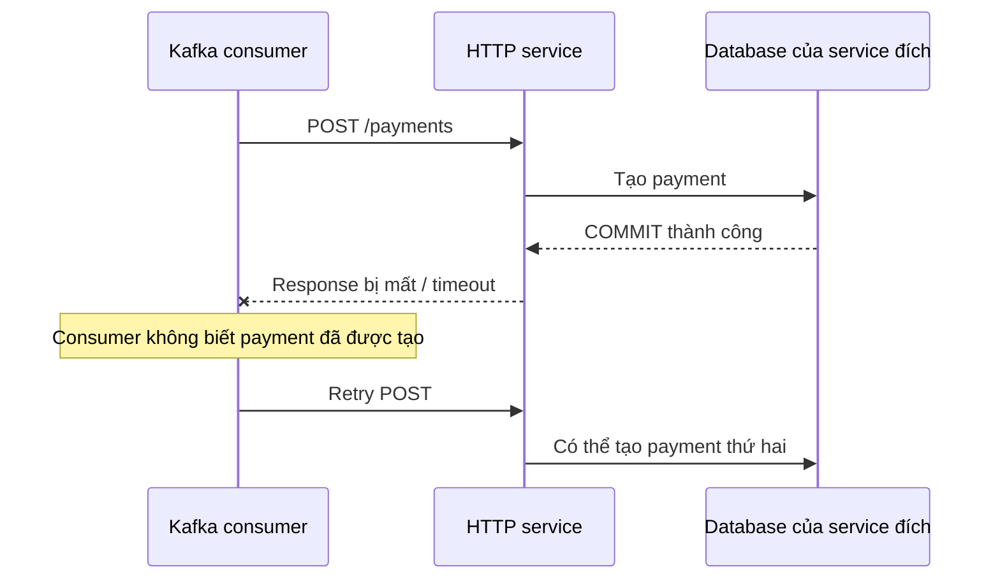
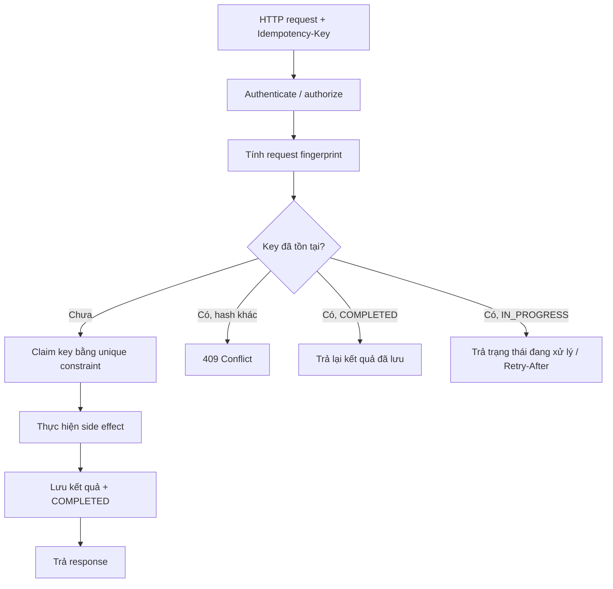
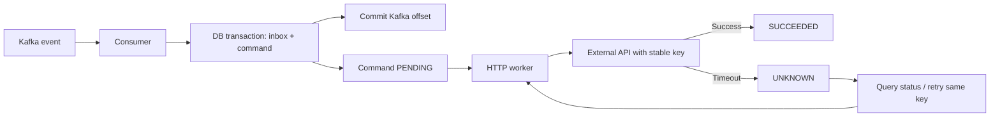

# Khử trùng tác dụng phụ khi retry sau timeout

Khi Kafka consumer gọi một HTTP API hoặc ghi dữ liệu vào hệ thống bên ngoài, timeout không cho biết chắc chắn thao tác đã thất bại. Server có thể đã thực hiện side effect nhưng response bị mất trên mạng; nếu consumer gửi lại bằng một request mới, thao tác có thể xảy ra hai lần. Đây là tình huống phổ biến khi xử lý payment, tạo đơn hàng, gửi thông báo hoặc cập nhật một hệ thống khác.

Cách xử lý cốt lõi là tạo **idempotency key ổn định cho một ý định nghiệp vụ**, gửi lại cùng key qua mọi lần retry và yêu cầu hệ thống đích lưu/deduplicate key một cách nguyên tử với side effect. Với database do ứng dụng quản lý, có thể dùng inbox table và unique constraint. Với HTTP provider, cần API hỗ trợ idempotency key hoặc operation lookup. Kafka offset chỉ được commit sau khi side effect đã hoàn tất hoặc command đã được lưu bền vững để một worker khác tiếp tục.

## 1. Timeout không đồng nghĩa thao tác thất bại

Giả sử consumer đọc event `PaymentRequested` rồi gọi payment service. Client chờ 3 giây nhưng không nhận response. Có nhiều trạng thái có thể xảy ra:

1. Request chưa rời khỏi client hoặc chưa tới server; payment chưa được tạo.
2. Server đã nhận request nhưng chưa xử lý xong.
3. Server đã tạo payment thành công, nhưng response bị mất hoặc đến sau timeout.
4. Server trả lỗi trước khi thực hiện side effect.
5. Server thực hiện một phần công việc rồi gặp lỗi nội bộ.

Ở phía consumer, nhiều tình huống trên đều có thể biểu hiện thành `SocketTimeoutException`, connection reset hoặc gateway timeout. Client không thể chỉ dựa vào timeout để biết server đã thực hiện nghiệp vụ hay chưa.



Nếu consumer xem timeout là thất bại chắc chắn rồi tạo request mới, nó có thể lặp side effect. Nếu consumer commit offset ngay khi timeout để tránh retry, payment có thể chưa từng được tạo. Vì vậy, kết quả timeout cần được xem là **UNKNOWN / chưa xác định** cho đến khi được xác minh.

## 2. Phân biệt event deduplication và HTTP idempotency

Hai cơ chế thường đi cùng nhau nhưng bảo vệ hai ranh giới khác nhau:

| Cơ chế | Nơi áp dụng | Mục tiêu |
|---|---|---|
| Event deduplication / inbox | Consumer và database của ứng dụng | Một event ID chỉ áp dụng business update một lần trong phạm vi transaction database |
| HTTP idempotency key | Client và HTTP API đích | Nhiều lần gửi cùng một ý định nghiệp vụ chỉ tạo một side effect ở server |
| Kafka producer idempotence | Producer và broker Kafka | Loại duplicate do retry Produce request trong phạm vi producer session/protocol |
| Consumer offset commit | Kafka consumer group | Lưu vị trí tiếp theo cần đọc; không tự deduplicate side effect ngoài Kafka |

Producer idempotence không bảo vệ HTTP request. Inbox của consumer cũng không tự bảo vệ một payment API bên ngoài. Phải đặt cơ chế dedup ở đúng hệ thống sở hữu side effect.

Ví dụ, consumer nhận event `evt-901`:

- Nếu cập nhật database local, inbox có thể dùng `(consumer_name, event_id)` làm khóa duy nhất.
- Nếu gọi payment provider, idempotency key có thể là `charge:evt-901` và phải được provider ghi nhận.
- Nếu cùng event tạo hai thao tác khác nhau, ví dụ charge và gửi receipt, cần hai operation key riêng như `charge:evt-901` và `receipt:evt-901`.

## 3. Thiết kế idempotency key ổn định

Idempotency key nhận diện **một ý định nghiệp vụ**, không nhận diện một lần thử gửi. Mọi retry của cùng thao tác phải dùng cùng key, kể cả khi consumer restart, rebalance hoặc replay event.

Một key có thể được tạo từ:

```text
<operation>:<eventId>

charge:evt-901
reserve-inventory:evt-901
send-receipt:evt-901
```

Nếu ID event không duy nhất toàn hệ thống, thêm namespace nguồn hoặc tenant:

```text
<tenantId>:<source>:<operation>:<eventId>
tenant-42:orders:charge:evt-901
```

Các nguyên tắc quan trọng:

- Tạo event ID ở nguồn phát và giữ nguyên qua retry/replay; không sinh UUID mới mỗi lần gọi API.
- Dùng scope phù hợp, chẳng hạn tenant, API client và loại operation, để hai nghiệp vụ khác nhau không vô tình dùng chung key.
- Không đưa attempt number hoặc timestamp của lần retry vào key; làm vậy sẽ biến mỗi lần retry thành một thao tác mới.
- Lưu payload hash hoặc request fingerprint để phát hiện trường hợp cùng key nhưng payload khác.
- Key phải được giữ đủ lâu để bao phủ retry window, Kafka retention/replay window và thời gian đối soát cần thiết.
- Không xem idempotency key là credential hoặc cơ chế authorization; server vẫn phải xác thực và phân quyền request.

Một event có thể gây nhiều side effect. Vì vậy, dùng riêng `eventId` cho mọi endpoint đôi khi không đủ. Hãy xác định khóa theo operation: một event thanh toán có thể tạo thao tác reserve, charge và receipt; mỗi thao tác cần key riêng nhưng ổn định.

## 4. Hệ thống HTTP đích phải lưu key cùng kết quả

Gửi header `Idempotency-Key` chỉ có ý nghĩa khi server đích thực sự triển khai hợp đồng idempotency. Server cần lưu key, scope, fingerprint của request, trạng thái xử lý và kết quả có thể trả lại cho client.

Một bảng ví dụ trên PostgreSQL:

```sql
CREATE TABLE idempotency_requests (
    scope              VARCHAR(120) NOT NULL,
    idempotency_key    VARCHAR(200) NOT NULL,
    request_hash       VARCHAR(64) NOT NULL,
    state              VARCHAR(20) NOT NULL,
    response_status    INTEGER,
    response_body      JSONB,
    created_at         TIMESTAMPTZ NOT NULL DEFAULT now(),
    updated_at         TIMESTAMPTZ NOT NULL DEFAULT now(),
    PRIMARY KEY (scope, idempotency_key)
);
```

`scope` có thể chứa tenant/client và tên operation. Unique constraint trên `(scope, idempotency_key)` ngăn hai request đồng thời cùng tạo một operation. `request_hash` được tính từ payload đã canonicalize để cùng key nhưng body khác bị từ chối.

### Luồng xử lý khi nhận request

Một server có thể xử lý theo quy tắc sau:

1. Xác thực client và quyền thực hiện operation.
2. Đọc idempotency key và tính request hash theo quy tắc canonicalization ổn định.
3. Cố gắng claim key bằng insert có unique constraint.
4. Nếu key mới, thực hiện side effect trong cùng local database transaction khi có thể, rồi lưu kết quả và chuyển trạng thái sang `COMPLETED`.
5. Nếu key đã tồn tại và hash khác, trả lỗi conflict; không chạy side effect.
6. Nếu key đã `COMPLETED` và hash trùng, trả lại kết quả đã lưu thay vì chạy side effect lần nữa.
7. Nếu key đang `IN_PROGRESS`, trả trạng thái đang xử lý hoặc operation reference để client truy vấn sau.



Với side effect nằm trong cùng database, claim key, business update và lưu kết quả nên được commit trong một transaction database. Nếu transaction rollback, key claim cũng rollback để retry có thể thực hiện lại. Nếu side effect gọi một dịch vụ khác, transaction local không bao trùm dịch vụ đó; khi ấy server cần command state machine, downstream idempotency hoặc reconciliation tương tự phía consumer.

### Cùng key nhưng payload khác

Không nên âm thầm trả kết quả cũ nếu client dùng cùng key cho một payload khác. Ví dụ key `charge:evt-901` lần đầu yêu cầu charge 100.000 đồng, lần sau lại yêu cầu 1.000.000 đồng. Server nên so sánh request hash và trả lỗi conflict có thể quan sát được.

Fingerprint cần được tạo từ biểu diễn chuẩn hóa của những field có ảnh hưởng tới side effect. Không hash JSON raw nếu thứ tự field hoặc whitespace có thể thay đổi mà ý nghĩa payload không đổi. Cũng không bỏ qua field nghiệp vụ quan trọng như currency, account hoặc amount.

## 5. Xử lý request đồng thời và trạng thái IN_PROGRESS

Hai consumer instance có thể nhận cùng event trong một cửa sổ rebalance hoặc do replay. Chúng có thể đồng thời gọi cùng API với cùng idempotency key. Chỉ dùng một bước `SELECT` rồi mới `INSERT` là không an toàn: cả hai request có thể cùng đọc thấy chưa có key.

Server phải dựa vào unique constraint/atomic insert hoặc một cơ chế khóa tương đương để chỉ một request claim được key. Request còn lại phải đọc trạng thái của key đã được claim.

Các kết quả thường gặp:

| Trạng thái key | Hành vi server |
|---|---|
| Chưa tồn tại | Claim key và bắt đầu operation |
| `IN_PROGRESS` | Không chạy operation lần hai; trả operation ID, `202 Accepted`, `409 Conflict` hoặc trạng thái retry theo API contract |
| `COMPLETED` | Trả lại status/body đã lưu |
| `FAILED_RETRYABLE` | Cho phép tiếp tục theo quy tắc retry đã định nghĩa |
| `FAILED_FINAL` | Trả lại lỗi cuối cùng; không tự chạy lại side effect |
| Cùng key, request hash khác | Từ chối bằng conflict |

Với operation kéo dài, đừng giữ một SQL transaction mở trong suốt thời gian gọi dịch vụ ngoài. Hãy claim key và tạo command bền vững trong transaction ngắn, sau đó worker xử lý command và cập nhật trạng thái. Cần có lease/heartbeat hoặc recovery rule cho command bị kẹt `IN_PROGRESS` khi worker chết.

Nếu dùng lease, chỉ worker đang sở hữu lease/version hiện tại mới được cập nhật trạng thái cuối. Dùng fencing token hoặc optimistic version để worker cũ không ghi đè kết quả của worker mới sau khi lease hết hạn.

## 6. Consumer Kafka gọi HTTP và retry cùng key

Consumer nên tạo idempotency key một lần từ event ID và operation, sau đó giữ nguyên key qua mọi lần retry. Không dùng số lần thử làm một phần của key.

Ví dụ Java minh họa:

```java
public PaymentResult charge(OrderPaymentRequested event) {
    String idempotencyKey = "charge:" + event.eventId();

    return paymentClient.charge(
            idempotencyKey,
            event.orderId(),
            event.amount(),
            event.currency());
}
```

Interface client có thể triển khai bằng `RestClient`, `WebClient` hoặc HTTP client của dự án. Điều quan trọng là mỗi lần gọi cùng event đều gửi đúng key và cùng payload nghiệp vụ.

Một vòng xử lý đồng bộ đơn giản:

```java
@KafkaListener(topics = "payment-requests", groupId = "payment-worker")
public void onMessage(PaymentRequested event) {
    String key = "charge:" + event.eventId();

    PaymentResult result = paymentClient.charge(
            key, event.orderId(), event.amount(), event.currency());

    paymentResultRepository.saveIfAbsent(event.eventId(), result);
    // Listener trả về thành công; container commit offset theo ack mode.
}
```

Đây là ví dụ khung. Nếu `paymentClient.charge()` timeout, listener phải ném lỗi hoặc chuyển sang workflow durable phù hợp để event chưa bị commit như đã hoàn tất. Khi Kafka giao lại event, key được tạo lại từ cùng `eventId`, nên API provider có thể trả kết quả cũ nếu hỗ trợ idempotency.

Nếu HTTP call thành công nhưng process chết trước khi offset commit, record được giao lại. Lần gọi thứ hai dùng cùng key và không tạo payment thứ hai nếu provider thực hiện đúng hợp đồng idempotency. Nếu offset commit trước khi biết kết quả payment, có nguy cơ bỏ qua một payment chưa được tạo; vì vậy không commit chỉ để né timeout.

## 7. Database consumer: inbox marker và business update trong cùng transaction

Khi side effect là cập nhật database do chính service sở hữu, dùng inbox table để deduplicate event. Event ID và business update phải nằm trong cùng database transaction.

Ví dụ PostgreSQL:

```sql
CREATE TABLE processed_events (
    consumer_name  VARCHAR(100) NOT NULL,
    event_id       VARCHAR(160) NOT NULL,
    processed_at   TIMESTAMPTZ NOT NULL DEFAULT now(),
    PRIMARY KEY (consumer_name, event_id)
);
```

Trong transaction, chỉ cập nhật business row nếu insert inbox thành công:

```sql
WITH newly_processed AS (
    INSERT INTO processed_events(consumer_name, event_id)
    VALUES ('order-projection', 'evt-901')
    ON CONFLICT (consumer_name, event_id) DO NOTHING
    RETURNING event_id
), updated_order AS (
    UPDATE orders
       SET status = 'PAID'
     WHERE order_id = 'order-42'
       AND EXISTS (SELECT 1 FROM newly_processed)
    RETURNING order_id
)
SELECT
    (SELECT count(*) FROM newly_processed) AS inserted_count,
    (SELECT count(*) FROM updated_order) AS updated_count;
```

Nếu event ID đã có, `inserted_count` bằng 0 và business update không chạy; đây là duplicate có thể coi là đã xử lý. Nếu `inserted_count` bằng 1 nhưng `updated_count` bằng 0, ứng dụng phải rollback transaction (ví dụ order chưa tồn tại) để inbox marker không đánh dấu nhầm event là hoàn tất. Nếu update lỗi, transaction cũng rollback cả inbox insert. SQL trên dùng cú pháp PostgreSQL; database khác cần cú pháp insert-if-absent/upsert tương ứng.

Ví dụ Java với Spring:

```java
@Service
public class PaymentEventHandler {
    private final JdbcTemplate jdbc;

    public PaymentEventHandler(JdbcTemplate jdbc) {
        this.jdbc = jdbc;
    }

    @Transactional
    public void applyOnce(PaymentSucceeded event) {
        int inserted = jdbc.update("""
            INSERT INTO processed_events(consumer_name, event_id)
            VALUES (?, ?)
            ON CONFLICT (consumer_name, event_id) DO NOTHING
            """, "order-projection", event.eventId());

        if (inserted == 0) {
            return; // Event đã được áp dụng trước đó.
        }

        int updated = jdbc.update("""
            UPDATE orders SET status = ? WHERE order_id = ?
            """, "PAID", event.orderId());

        if (updated != 1) {
            throw new IllegalStateException("Không tìm thấy order để cập nhật");
        }
    }
}
```

Consumer commit offset sau khi phương thức database transaction hoàn tất thành công. Ví dụ kiểm tra số row được cập nhật; nếu không tìm thấy order hoặc có lỗi nghiệp vụ, exception làm rollback cả business update lẫn inbox marker. Nếu database commit xong nhưng Kafka offset chưa commit, event được giao lại; inbox unique constraint biến lần xử lý lại thành no-op. Nếu database transaction rollback, marker cũng rollback nên event vẫn có thể được thử lại.

Inbox không tự bảo vệ HTTP call được thực hiện bên trong cùng phương thức nếu HTTP server không có idempotency. Database rollback không thể thu hồi request đã được server ngoài thực hiện.

## 8. Retry có phân loại, backoff và deadline

Không retry mọi lỗi theo cùng một cách. Cần phân loại theo khả năng lỗi tự hết và theo tính an toàn của side effect.

| Kết quả | Hướng xử lý thường dùng |
|---|---|
| Connection timeout trước khi gửi request được xác nhận | Retry cùng key; vẫn giữ khả năng kết quả chưa rõ nếu không chứng minh request chưa tới server |
| Read timeout sau khi gửi request | Xem là `UNKNOWN`; retry cùng key hoặc query operation status |
| HTTP 429 | Tôn trọng `Retry-After` nếu có; retry có giới hạn và cùng key |
| HTTP 5xx | Có thể retry cùng key nếu API có idempotency; áp dụng backoff/jitter |
| HTTP 400/422 do payload không hợp lệ | Thường không retry tự động; đưa vào xử lý lỗi dữ liệu/DLT |
| HTTP 401/403 | Sửa credential/quyền; tránh retry dồn dập |
| HTTP 409 key đang xử lý | Query trạng thái hoặc chờ theo API contract; không tạo key mới |
| HTTP 409 cùng key, payload khác | Lỗi logic; không retry bằng key đó với payload mới |

Một backoff exponential có jitter có thể dùng công thức:

\[
delay_n = random(0, \min(cap, base \times 2^n))
\]

Trong đó `base` là thời gian chờ ban đầu, `cap` là giới hạn tối đa và `n` là số lần retry. Jitter giúp nhiều consumer không cùng retry vào một thời điểm sau khi dịch vụ phục hồi.

Chính sách retry cần giới hạn:

- Số lần retry hoặc tổng thời gian retry.
- Deadline nghiệp vụ của command.
- Timeout kết nối và timeout đọc của HTTP client.
- Backoff tối đa và jitter.
- Các lỗi retryable/non-retryable.
- Cách chuyển trạng thái sang `UNKNOWN`, `FAILED_FINAL` hoặc DLT khi hết retry budget.

Không tăng timeout vô hạn hoặc retry mãi mãi. Một command có thể hết hạn nghiệp vụ dù provider vẫn đang gặp sự cố; cần trạng thái cuối và quy trình vận hành rõ ràng.

## 9. Không block Kafka poll loop bằng retry dài

Nếu listener gọi HTTP và chờ nhiều lần retry trong thời gian dài, consumer có thể không poll kịp `max.poll.interval.ms`, dẫn đến rebalance. Consumer khác nhận partition và có thể xử lý lại cùng event trong khi request cũ vẫn đang chạy.

Với retry ngắn, có giới hạn, xử lý đồng bộ có thể chấp nhận được nếu tổng thời gian nằm trong poll interval và SLA. Với retry dài hoặc kết quả HTTP mơ hồ, cân nhắc:

- Ghi event và command vào database trong cùng transaction, sau đó commit Kafka offset.
- Dùng worker riêng đọc command pending và gọi HTTP.
- Lưu trạng thái `PENDING`, `IN_PROGRESS`, `UNKNOWN`, `SUCCEEDED`, `FAILED_FINAL`.
- Dùng idempotency key cố định và query operation status trước khi gửi lại khi kết quả chưa rõ.
- Dùng retry topic có delay hoặc pause/resume partition theo chính sách; không sleep lâu trong poll loop.



Khi command đã được lưu bền vững cùng inbox marker, consumer có thể commit offset vì trách nhiệm xử lý đã được chuyển giao cho command worker. Worker phải có cơ chế claim command, lease, retry và recovery để command không bị bỏ quên.

## 10. Key TTL phải bao phủ thời gian replay

API provider thường chỉ giữ idempotency key trong một khoảng thời gian. Nếu key hết hạn nhưng Kafka vẫn còn event cũ để replay, lần replay có thể tạo side effect mới.

Ví dụ:

- Provider giữ key trong 24 giờ.
- Kafka topic giữ event 14 ngày.
- Operator reset consumer group về earliest sau 5 ngày.

Trong trường hợp này, provider có thể đã quên key của event cũ. Replay sẽ không còn được deduplicate bằng cơ chế provider.

Hãy chọn TTL theo thời gian lớn nhất mà nghiệp vụ cho phép retry/replay, bao gồm:

- Thời gian retry tự động.
- Thời gian service có thể outage.
- Kafka retention và thời gian operator có thể reset offset.
- Thời gian DLT được giữ trước khi replay.
- Khoảng thời gian reconciliation hoặc xử lý thủ công.

Nếu provider không thể giữ key đủ lâu, ứng dụng cần lưu operation ID và kết quả ở database local để chặn replay cũ, hoặc có API tra cứu trạng thái lâu dài. Không xóa inbox/idempotency record chỉ dựa vào một TTL ngắn nếu event vẫn có thể được phát lại.

## 11. Khi API không hỗ trợ idempotency key

Nếu API đích không hỗ trợ idempotency, client không thể tự bảo đảm side effect không bị lặp sau timeout. Có thể giảm rủi ro bằng các cách sau:

1. Yêu cầu API đích bổ sung client-supplied operation ID và unique constraint ở server.
2. Yêu cầu API cung cấp endpoint tra cứu theo business reference/command ID.
3. Lưu command trong database và đánh dấu `UNKNOWN` khi timeout; không tự gửi lại cho đến khi đối soát được kết quả.
4. Dùng báo cáo đối soát của provider để xác định operation đã xảy ra hay chưa.
5. Thiết kế compensating action nếu duplicate không thể ngăn tuyệt đối.
6. Nếu nghiệp vụ cho phép, dùng thao tác tự nhiên idempotent như `PUT` trạng thái mong muốn hoặc upsert theo business key, thay vì lệnh tạo mới không có khóa dedup.

Không được biến timeout thành `FAILED` một cách tùy tiện. Nếu kết quả chưa rõ, giữ trạng thái `UNKNOWN` và tạo cảnh báo/queue xử lý thủ công. Gửi lại bằng một key mới có thể làm side effect lặp.

## 12. Ma trận sự cố và hành vi mong muốn

| Tình huống | Kafka offset | Hệ thống đích | Hành vi mong muốn |
|---|---|---|---|
| Consumer chết trước khi gửi HTTP | Chưa commit | Chưa có side effect | Kafka giao lại event; gửi cùng key |
| HTTP thành công, response mất | Chưa commit | Side effect đã xảy ra | Retry cùng key hoặc query operation; nhận kết quả cũ |
| HTTP timeout, server chưa xử lý | Chưa commit | Chưa có side effect | Retry cùng key; server claim key và xử lý |
| HTTP thành công, consumer chết trước commit offset | Chưa commit | Side effect đã xảy ra | Replay cùng event/key; dedup tại server |
| Offset commit trước HTTP | Đã commit | Chưa rõ hoặc chưa có side effect | Có nguy cơ mất nghiệp vụ; tránh thứ tự này |
| Hai consumer gọi cùng key đồng thời | Chưa commit ở một/both | Có thể cạnh tranh claim | Unique constraint chỉ cho một operation; request còn lại đọc trạng thái |
| Provider key hết TTL rồi event replay | Chưa commit/reset | Provider không còn dấu vết key | Có nguy cơ side effect mới; cần local ledger/lookup dài hạn |
| DB inbox commit xong, Kafka offset chưa commit | Chưa commit | Business update đã lưu | Replay bị unique constraint chặn trong cùng DB transaction |

## 13. Kiểm thử idempotency và retry

Đừng chỉ kiểm thử một request thành công. Hãy tạo các tình huống lỗi có thể xảy ra trong production:

1. Gửi request thành công nhưng cố ý drop response trước khi client nhận.
2. Gửi hai request đồng thời với cùng key và cùng payload.
3. Gửi cùng key nhưng payload khác.
4. Dừng consumer sau khi HTTP server commit nhưng trước Kafka offset commit.
5. Restart consumer và xác nhận retry dùng lại đúng key.
6. Làm worker chết khi command ở `IN_PROGRESS`, sau đó kiểm tra lease/recovery.
7. Replay event sau khi idempotency key gần hết TTL.
8. Kiểm tra API trả `202`, `409`, `429`, `5xx` và `Retry-After` theo hợp đồng.
9. Xác nhận một event chỉ tạo một business operation ở hệ thống đích.
10. Kiểm tra metric/log có thể truy vết event ID, idempotency key và operation ID mà không lộ payload nhạy cảm.

Các assertion quan trọng:

- Cùng key + cùng payload không tạo side effect thứ hai.
- Cùng key + payload khác bị từ chối rõ ràng.
- Response retry trả lại kết quả đã lưu hoặc trạng thái operation hiện tại.
- Consumer không commit offset khi side effect chưa được xác nhận hoặc command chưa được lưu bền vững.
- Khi kết quả không thể xác định, command chuyển sang `UNKNOWN` và được đối soát thay vì retry bằng key mới.

## 14. Observability và vận hành

Để tìm lỗi duplicate, cần liên kết được một event với tất cả lần thử và operation bên ngoài:

| Trường/metric | Mục đích |
|---|---|
| `eventId` | Nhận diện event nguồn xuyên các lần replay |
| `idempotencyKey` | Nhận diện một ý định nghiệp vụ tại API đích |
| `operationId` | Tra cứu operation do hệ thống đích tạo |
| `attempt` | Đếm lần thử, chỉ dùng cho telemetry, không đưa vào idempotency key |
| `requestHash` | Phát hiện cùng key nhưng payload khác |
| `outcome` | `SUCCEEDED`, `FAILED`, `UNKNOWN`, `IN_PROGRESS` |
| HTTP timeout/rate | Phát hiện provider chậm hoặc lỗi |
| Duplicate hit/conflict rate | Đo số request được deduplicate hoặc dùng key sai |
| Command age/backlog | Phát hiện command pending hoặc unknown bị tồn đọng |
| Kafka consumer lag/commit failure | Phân biệt lỗi xử lý với lỗi tiến độ consumer |

Log nên ghi event ID, key đã mask nếu cần, operation ID, HTTP status, attempt và kết quả. Không log API secret, authorization header, thông tin thẻ hoặc payload nhạy cảm.

Khi duplicate tăng, kiểm tra retry policy, timeout, rebalance, key generation, key scope, TTL và hành vi của provider. Khi `UNKNOWN` tăng, kiểm tra endpoint tra cứu operation và quy trình reconciliation.

## 15. Những hiểu nhầm thường gặp

- **“HTTP timeout nghĩa là server chưa làm gì.”** Server có thể đã commit side effect và chỉ mất response.
- **“Retry tạo request mới là đủ.”** Retry phải giữ cùng idempotency key và payload nghiệp vụ.
- **“Kafka producer idempotence ngăn duplicate HTTP.”** Nó chỉ áp dụng cho retry ghi Kafka trong phạm vi được hỗ trợ.
- **“Inbox trong consumer bảo vệ mọi API ngoài.”** Inbox chỉ bảo vệ side effect nằm trong cùng database transaction của inbox.
- **“Cùng key, payload khác vẫn trả kết quả cũ.”** Server nên phát hiện request hash khác và từ chối.
- **“Có unique key là đủ cho operation kéo dài.”** Cần trạng thái `IN_PROGRESS`, lease/recovery và quy tắc worker đồng thời.
- **“Hết retry budget thì tạo key mới.”** Key mới có thể tạo side effect trùng; cần query/reconcile hoặc can thiệp thủ công.
- **“Idempotency key có thể xóa sau vài giờ.”** TTL phải bao phủ cả thời gian replay và đối soát.
- **“Commit offset để tránh Kafka retry là an toàn.”** Nếu side effect chưa được xác nhận hoặc command chưa được lưu bền vững, commit có thể làm mất nghiệp vụ.

## 16. Checklist production

- [ ] Mỗi side effect có operation ID/idempotency key ổn định theo event và loại operation.
- [ ] Retry không thay đổi key hoặc payload nghiệp vụ.
- [ ] API đích lưu key, request fingerprint, trạng thái và kết quả bằng cơ chế atomic/unique constraint.
- [ ] Cùng key nhưng payload khác bị từ chối.
- [ ] Request đồng thời cùng key không chạy side effect hai lần.
- [ ] Operation dài có `IN_PROGRESS`, lease/recovery hoặc operation status endpoint.
- [ ] Key TTL bao phủ retry, outage, Kafka retention, DLT replay và reconciliation window.
- [ ] HTTP timeout được phân loại là `UNKNOWN` khi chưa xác định kết quả.
- [ ] Retry có backoff, jitter, deadline, retry budget và tôn trọng `Retry-After`.
- [ ] Consumer chỉ commit offset sau side effect đã xác nhận hoặc command đã được lưu bền vững.
- [ ] Database inbox marker và business update nằm trong cùng DB transaction.
- [ ] Không block poll loop bằng retry dài; dùng command worker/retry topic khi cần.
- [ ] Có operation lookup/reconciliation nếu provider không hỗ trợ idempotency đầy đủ.
- [ ] Có log/metric theo event ID, idempotency key, operation ID và outcome.
- [ ] Đã fault-injection sau side effect, trước response và trước Kafka offset commit.

Khử trùng tác dụng phụ khi retry sau timeout cần được thiết kế ở hệ thống sở hữu side effect. Consumer giữ nguyên idempotency key qua mọi lần thử; server đích lưu key và kết quả một cách nguyên tử, xử lý request đồng thời và trả lại trạng thái cũ. Khi kết quả chưa rõ, hãy query/reconcile thay vì tạo key mới. Kết hợp cách này với inbox cho database, command state bền vững cho HTTP dài hạn và offset commit sau khi trách nhiệm xử lý đã được lưu an toàn sẽ giúp Kafka consumer chịu được retry, crash và replay mà không tạo side effect trùng.
