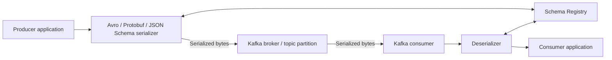

# Vai trò của Schema Registry và ranh giới với Apache Kafka

Kafka lưu và vận chuyển record giữa producer và consumer. Ở mức cơ bản, broker nhận key/value dưới dạng byte array, ghi chúng vào partition log, replication sang follower và phục vụ consumer theo offset. Kafka không tự hiểu một chuỗi JSON có trường `orderId`, một Avro record hay một Protobuf message có ý nghĩa nghiệp vụ gì.

**Schema Registry** giải quyết phần quản lý cấu trúc dữ liệu: lưu schema, quản lý version, kiểm tra khả năng tương thích khi schema thay đổi và cung cấp schema cho serializer/deserializer. Nó thường được tích hợp với Kafka client ở phía producer/consumer, nhưng là một dịch vụ riêng với API, lưu trữ, xác thực và vòng đời vận hành riêng. Hiểu ranh giới này giúp tránh kỳ vọng broker tự validate payload, đồng thời thiết kế được quy trình phát triển và triển khai data contract an toàn.

## 1. Kafka và Schema Registry giải quyết hai bài toán khác nhau

Kafka tập trung vào lưu trữ và truyền dữ liệu theo log phân tán:

- Topic và partition tổ chức luồng record.
- Offset định vị record trong từng partition.
- Producer ghi record và consumer đọc record.
- Replication và ISR hỗ trợ khả năng chịu lỗi.
- Retention và compaction quản lý vòng đời dữ liệu trong log.

Schema Registry tập trung vào hợp đồng cấu trúc của dữ liệu:

- Lưu định nghĩa schema như Avro, Protobuf hoặc JSON Schema.
- Quản lý subject và các version schema.
- Kiểm tra schema mới có tương thích với schema đã đăng ký theo policy hay không.
- Cấp schema ID để serializer gắn vào dữ liệu và deserializer tra cứu khi đọc.
- Hỗ trợ chia sẻ hợp đồng giữa nhiều ứng dụng producer và consumer.

| Thành phần | Trách nhiệm chính | Không tự đảm nhiệm |
|---|---|---|
| Kafka broker | Nhận byte record, ghi partition log, replication, phục vụ fetch và quản lý offset | Không mặc định phân tích JSON/Avro/Protobuf hoặc hiểu ý nghĩa field nghiệp vụ |
| Kafka producer/consumer client | Serialize/deserialize record, gửi/nhận byte, quản lý retry và offset | Không tự tạo governance hoặc quy tắc tương thích chung nếu không tích hợp công cụ phù hợp |
| Schema Registry | Lưu schema, version, subject, compatibility policy và cung cấp schema theo ID | Không thay thế Kafka broker, không lưu event log và không xử lý business event |
| Ứng dụng nghiệp vụ | Định nghĩa ý nghĩa field, validation nghiệp vụ, ordering và side effect | Không nên tự duy trì bản schema không được version hóa ở từng service |

Trong một luồng thông thường, producer dùng serializer tích hợp Registry để đăng ký hoặc lấy schema, serialize object thành bytes rồi gửi bytes tới Kafka. Broker lưu bytes. Consumer lấy bytes từ broker và deserializer dùng schema ID để lấy schema tương ứng, sau đó dựng object cho ứng dụng.



Registry không nằm trên đường truyền từng byte qua broker theo nghĩa broker phải gọi Registry cho mỗi record. Serializer/deserializer là thành phần thường tương tác với Registry; schema ID và payload đã serialize được lưu trong Kafka record.

## 2. Vì sao chỉ dùng JSON hoặc Java class là chưa đủ?

Một producer có thể gửi JSON như sau:

```json
{
  "orderId": "ORD-2048",
  "amount": 1250000,
  "currency": "VND"
}
```

Kafka broker chỉ thấy byte array. Nếu producer khác gửi `amount` dưới dạng chuỗi, hoặc đổi `orderId` thành `id`, broker vẫn có thể lưu record nếu request hợp lệ ở mức Kafka protocol. Lỗi chỉ xuất hiện khi consumer parse hoặc xử lý dữ liệu.

Nếu mỗi service tự định nghĩa Java class và tự serialize JSON, các service có thể dần lệch nhau:

- Producer đổi tên field nhưng consumer cũ vẫn chờ tên cũ.
- Một field đổi từ integer sang string mà không có kế hoạch migration.
- Producer thêm field bắt buộc khiến consumer cũ không thể đọc.
- Một service hiểu `amount` là đơn vị đồng, service khác hiểu là đơn vị xu.
- Một service dùng UTC, service khác gửi local time nhưng không ghi timezone.

Schema Registry giúp kiểm soát thay đổi cấu trúc có thể kiểm tra tự động. Tuy nhiên, Registry không tự hiểu mọi quy tắc nghiệp vụ. Ví dụ đổi ý nghĩa `amount` từ VND sang USD vẫn có thể giữ nguyên kiểu `long` và vượt qua kiểm tra tương thích cấu trúc. Vì vậy, data contract cần mô tả cả ý nghĩa field, đơn vị, timezone, nullability, key, ordering và quy tắc nghiệp vụ.

## 3. Schema, subject, version và schema ID

Các khái niệm trong Schema Registry có quan hệ với nhau nhưng không đồng nghĩa:

| Khái niệm | Ý nghĩa |
|---|---|
| Schema | Định nghĩa cấu trúc và kiểu dữ liệu của record |
| Subject | Tên logic dùng để quản lý một nhóm version schema có cùng phạm vi tương thích |
| Version | Số thứ tự schema được đăng ký trong một subject |
| Schema ID | Định danh schema mà serializer có thể nhúng vào serialized payload để deserializer tra cứu |
| Compatibility policy | Quy tắc xác định schema mới có tương thích với schema cũ theo hướng nào |

Một schema có thể được tham chiếu bởi nhiều subject tùy cấu hình và cách đăng ký. Version thuộc subject; schema ID là định danh schema trong Registry. Không nên giả định version 3 luôn có schema ID 3 hoặc schema ID giống nhau ở hai môi trường Registry khác nhau.

Ví dụ một subject có thể có các version:

```text
Subject: orders-value
  Version 1 -> schema ID 17
  Version 2 -> schema ID 23
  Version 3 -> schema ID 31
```

Các con số trên chỉ minh họa. Khi producer gửi record dùng schema version 3, serializer có thể nhúng schema ID 31 vào framing của payload. Consumer không cần đoán version từ topic; nó đọc ID và yêu cầu Registry cung cấp schema tương ứng.

## 4. Subject naming strategy

Subject là ranh giới quan trọng để Registry xác định schema nào được so sánh với schema mới khi kiểm tra compatibility. Với Confluent Schema Registry và serializer tương ứng, các naming strategy thường gặp gồm:

| Strategy | Cách đặt subject | Khi phù hợp |
|---|---|---|
| `TopicNameStrategy` | `<topic>-key` hoặc `<topic>-value` | Mặc định phổ biến; schema value của một topic được quản lý chung trong một subject |
| `RecordNameStrategy` | Tên đầy đủ của record/schema | Cùng một loại record được dùng ở nhiều topic và muốn quản lý compatibility theo record name |
| `TopicRecordNameStrategy` | Kết hợp topic và record name | Một topic chứa nhiều loại record và cần tách compatibility theo từng loại record trong topic |

Ví dụ với topic `orders.events`:

- Key subject mặc định: `orders.events-key`.
- Value subject mặc định: `orders.events-value`.

Nếu topic chứa nhiều loại event như `OrderPlaced` và `OrderCancelled`, dùng một subject value chung có thể buộc chúng chia sẻ một schema/compatibility lineage. Khi cần nhiều record type, có thể chọn strategy khác hoặc tách topic theo loại event. Quyết định này ảnh hưởng tới khả năng tiến hóa schema và cách quản lý hợp đồng.

Naming strategy phải được thống nhất giữa producer và quy trình đăng ký schema. Nếu CI đăng ký schema vào một subject nhưng producer runtime lại dùng strategy khác, kiểm tra compatibility ở bước build có thể không phản ánh schema thực tế được serializer đăng ký.

## 5. Serializer tích hợp Schema Registry làm gì?

Serializer thường thực hiện các bước:

1. Nhận object Java hoặc record theo schema.
2. Xác định subject theo naming strategy.
3. Tìm schema đã đăng ký hoặc đăng ký schema mới theo cấu hình.
4. Nhận schema ID từ Registry.
5. Serialize object thành byte payload theo định dạng.
6. Đóng gói schema ID cùng payload theo wire format của serializer.
7. Trả byte array cho Kafka producer gửi tới broker.

Với Confluent wire format phổ biến cho Avro và JSON Schema, payload thường bắt đầu bằng một magic byte, tiếp theo là schema ID dạng 4 byte, rồi tới dữ liệu serialize. Protobuf có thêm thông tin chỉ mục message trong framing để xác định message type bên trong schema file. Đây là framing của serializer/Registry cụ thể, không phải định dạng record bắt buộc của Apache Kafka protocol.

Minh họa khái niệm:

```text
+----------------+----------------------+--------------------------+
| Magic byte     | Schema ID            | Serialized payload       |
| 1 byte         | 4 bytes              | bytes theo Avro/JSON/... |
+----------------+----------------------+--------------------------+
```

Kafka broker lưu toàn bộ byte array như value của record. Broker không cần hiểu schema ID để append record. Consumer deserializer nhận byte array, đọc framing, lấy schema ID, tra cache hoặc gọi Registry, rồi deserialize thành object.

Không tự bóc/tạo framing bằng tay trừ khi đang triển khai serializer tương thích hoàn toàn với format đã chọn. Các format và framing có thể khác nhau giữa nhà cung cấp; không coi Confluent wire format là chuẩn chung của mọi Schema Registry.

## 6. Deserializer và schema cache

Deserializer đọc schema ID trong payload và lấy schema tương ứng từ Registry. Để tránh gọi Registry cho mỗi record, serializer/deserializer thường cache schema theo ID và cache thông tin subject/version. Khi schema đã được cache, nhiều record tiếp theo có thể deserialize mà không tạo request mạng mới.

Các tình huống có thể làm deserialize thất bại:

- Consumer không kết nối được Schema Registry và schema ID chưa có trong cache.
- Schema ID không tồn tại trong Registry mà consumer đang cấu hình.
- Producer dùng wire format hoặc serializer khác với deserializer.
- Consumer classpath thiếu generated class hoặc Protobuf/Avro runtime phù hợp.
- Payload bị hỏng, bị cắt hoặc không đúng framing.
- Schema có thể parse nhưng ứng dụng không xử lý được giá trị nghiệp vụ.

Schema Registry vì vậy là dependency runtime của producer/consumer khi cần tra schema chưa cache. Cần triển khai Registry có khả năng sẵn sàng phù hợp, cấu hình timeout/retry cho client và kiểm thử hành vi khi Registry tạm thời không truy cập được.

## 7. Các định dạng schema phổ biến

| Định dạng | Đặc điểm | Lưu ý |
|---|---|---|
| Apache Avro | Schema rõ ràng, encoding nhị phân gọn, hỗ trợ schema evolution | Thường dùng với record Avro và generated SpecificRecord hoặc GenericRecord |
| Protocol Buffers (Protobuf) | Message/type rõ ràng, code generation mạnh, phù hợp nhiều ngôn ngữ | Schema `.proto`, field number phải được quản lý ổn định; không tái sử dụng field number đã xóa |
| JSON Schema | Mô tả cấu trúc JSON bằng schema, dễ đọc và tương tác hệ thống JSON | Compatibility phụ thuộc dialect, rule và cách serializer/Registry diễn giải schema |

Không có một định dạng tốt nhất cho mọi hệ thống. Chọn theo hệ sinh thái ngôn ngữ, yêu cầu hiệu năng, khả năng đọc/debug, code generation và quy trình tiến hóa dữ liệu. Dù chọn format nào, cần thống nhất serializer/deserializer và compatibility policy giữa các service.

## 8. Schema compatibility là gì?

Compatibility policy kiểm tra liệu schema mới có thể phối hợp với dữ liệu do schema cũ tạo ra theo một hướng xác định hay không. Những mode phổ biến:

| Mode | Hướng tương thích | Câu hỏi cần trả lời |
|---|---|---|
| `BACKWARD` | Consumer dùng schema mới đọc dữ liệu cũ | Reader mới có đọc được record đã ghi bằng schema trước không? |
| `FORWARD` | Consumer dùng schema cũ đọc dữ liệu mới | Reader cũ có đọc được record được ghi bằng schema mới không? |
| `FULL` | Cả backward và forward | Hai hướng trên đều được bảo đảm theo rule của format? |
| `NONE` | Không kiểm tra compatibility | Cho phép đăng ký schema mà không áp dụng kiểm tra tương thích |

Các biến thể `BACKWARD_TRANSITIVE`, `FORWARD_TRANSITIVE` và `FULL_TRANSITIVE` kiểm tra schema mới với nhiều version trước đó trong subject, thay vì chỉ kiểm tra version gần nhất. Chi tiết so sánh phụ thuộc format và implementation của Registry.

### Vì sao transitive quan trọng?

Giả sử schema tiến hóa qua V1 → V2 → V3. V3 có thể tương thích với V2 nhưng không tương thích với V1. Nếu policy chỉ kiểm tra với version mới nhất, Registry có thể chấp nhận V3 dù một consumer rất cũ vẫn đang đọc dữ liệu V1. Policy transitive giúp phát hiện trường hợp này bằng cách kiểm tra với toàn bộ lịch sử version theo mode tương ứng.

Không nên chọn `FULL_TRANSITIVE` một cách máy móc. Policy quá nghiêm có thể cản trở thay đổi hợp lệ; policy quá lỏng có thể làm consumer cũ hỏng. Cần biết thời gian tồn tại của consumer cũ, retention của topic, khả năng replay và chiến lược rollout.

## 9. Ví dụ tiến hóa schema Avro

Giả sử V1 có schema:

```json
{
  "type": "record",
  "name": "Order",
  "namespace": "com.example.events",
  "fields": [
    {"name": "orderId", "type": "string"},
    {"name": "amount", "type": "long"}
  ]
}
```

V2 thêm field `currency` với default:

```json
{
  "type": "record",
  "name": "Order",
  "namespace": "com.example.events",
  "fields": [
    {"name": "orderId", "type": "string"},
    {"name": "amount", "type": "long"},
    {"name": "currency", "type": "string", "default": "VND"}
  ]
}
```

Với Avro, default của field mới giúp reader dùng schema V2 đọc record cũ được ghi theo V1 mà không có field `currency`. Đây là ví dụ thường gặp cho backward-compatible evolution.

Nếu thêm field mới mà không có default, reader V2 có thể không dựng được field đó khi đọc record V1. Nếu đổi kiểu field hoặc đổi tên, cần kiểm tra compatibility theo Avro resolution rules và policy thực tế thay vì suy luận chỉ từ tên field.

### Quy tắc thực hành cho Avro

- Thêm field mới thường nên có default nếu cần reader mới đọc dữ liệu cũ.
- Không thay đổi ý nghĩa field hiện có mà không version hóa hợp đồng nghiệp vụ.
- Khi đổi tên field, cân nhắc aliases và kiểm tra compatibility.
- Khi xóa field, xác định consumer cũ còn đọc dữ liệu mới hay không.
- Không tái sử dụng tên/ý nghĩa field cũ cho một dữ liệu khác.

## 10. Ví dụ Protobuf và JSON Schema

### Protobuf

```proto
syntax = "proto3";

package com.example.orders;

message OrderEvent {
  string order_id = 1;
  int64 amount_minor = 2;
  string currency = 3;
}
```

Trong Protobuf, field number là định danh trên wire format. Khi xóa field, đánh dấu field number và tên đã dùng là `reserved` để tránh tái sử dụng:

```proto
message OrderEvent {
  reserved 2;
  reserved "amount_minor";

  string order_id = 1;
  string currency = 3;
}
```

Không tái sử dụng field number đã phát hành. Việc đổi type cũng cần kiểm tra wire compatibility; một số kiểu có wire type giống nhau nhưng vẫn có thể thay đổi ý nghĩa hoặc gây mất dữ liệu.

### JSON Schema

JSON Schema mô tả các thuộc tính, kiểu, required fields và constraint của JSON. Ví dụ rút gọn:

```json
{
  "$schema": "https://json-schema.org/draft/2020-12/schema",
  "type": "object",
  "properties": {
    "orderId": {"type": "string"},
    "amount": {"type": "integer", "minimum": 0},
    "currency": {"type": "string", "default": "VND"}
  },
  "required": ["orderId", "amount"]
}
```

Không mặc định rằng từ khóa `default` trong mọi JSON Schema serializer tự động điền giá trị vào payload. Trong JSON Schema, default thường là annotation; hành vi áp dụng giá trị phụ thuộc ứng dụng/validator. Cần phân biệt validation schema với cơ chế tự bổ sung field của serializer.

## 11. Tích hợp Kafka Java Producer với Avro và Schema Registry

Với Confluent serializer, producer cần khai báo serializer và địa chỉ Registry. Ví dụ cấu hình:

```java
Properties props = new Properties();
props.put(ProducerConfig.BOOTSTRAP_SERVERS_CONFIG, "localhost:9092");
props.put(ProducerConfig.KEY_SERIALIZER_CLASS_CONFIG,
        StringSerializer.class.getName());
props.put(ProducerConfig.VALUE_SERIALIZER_CLASS_CONFIG,
        KafkaAvroSerializer.class.getName());
props.put("schema.registry.url", "http://localhost:8081");
```

Ví dụ tạo `GenericRecord`:

```java
Schema schema = new Schema.Parser().parse("""
    {
      "type":"record",
      "name":"Order",
      "namespace":"com.example.events",
      "fields":[
        {"name":"orderId","type":"string"},
        {"name":"amount","type":"long"},
        {"name":"currency","type":"string","default":"VND"}
      ]
    }
    """);

GenericRecord order = new GenericData.Record(schema);
order.put("orderId", "ORD-2048");
order.put("amount", 1_250_000L);
order.put("currency", "VND");

ProducerRecord<String, GenericRecord> record =
        new ProducerRecord<>("orders.events", "ORD-2048", order);
producer.send(record);
```

Đoạn code là phần minh họa; cần thêm dependency Avro và Confluent Kafka Avro Serializer tương thích với phiên bản Kafka client của dự án, cùng import và vòng đời `KafkaProducer` đầy đủ. Khi serializer được cấu hình đăng ký schema tự động, nó có thể đăng ký schema vào subject phù hợp nếu schema chưa tồn tại và quyền Registry cho phép.

Trong production, cân nhắc tắt auto registration ở runtime và đăng ký schema qua CI/CD trước khi deploy producer. Cách này giúp review schema, kiểm tra compatibility và giới hạn quyền thay đổi contract tại môi trường chạy.

## 12. Consumer Java đọc Avro record

Consumer cần dùng deserializer tương ứng và cùng địa chỉ Registry:

```java
Properties props = new Properties();
props.put(ConsumerConfig.BOOTSTRAP_SERVERS_CONFIG, "localhost:9092");
props.put(ConsumerConfig.GROUP_ID_CONFIG, "order-projection");
props.put(ConsumerConfig.KEY_DESERIALIZER_CLASS_CONFIG,
        StringDeserializer.class.getName());
props.put(ConsumerConfig.VALUE_DESERIALIZER_CLASS_CONFIG,
        KafkaAvroDeserializer.class.getName());
props.put("schema.registry.url", "http://localhost:8081");
props.put("specific.avro.reader", false);
```

Với `specific.avro.reader=false`, consumer thường nhận `GenericRecord`. Nếu dùng generated Avro class và muốn nhận `SpecificRecord`, bật `specific.avro.reader=true` và bảo đảm class tương ứng có trong classpath.

Deserializer dùng schema ID trong payload để lấy schema. Schema đã cache có thể tiếp tục được dùng khi Registry tạm thời gián đoạn; nhưng schema mới chưa cache có thể không deserialize được nếu Registry không truy cập được. Vì vậy, không nên coi Registry là dependency chỉ cần lúc build.

## 13. Spring Kafka và Spring Boot

Với Spring Boot, producer có thể cấu hình Confluent Avro serializer như sau:

```yaml
spring:
  kafka:
    bootstrap-servers: localhost:9092
    properties:
      schema.registry.url: http://localhost:8081
    producer:
      key-serializer: org.apache.kafka.common.serialization.StringSerializer
      value-serializer: io.confluent.kafka.serializers.KafkaAvroSerializer
```

Consumer tương ứng:

```yaml
spring:
  kafka:
    consumer:
      group-id: order-projection
      key-deserializer: org.apache.kafka.common.serialization.StringDeserializer
      value-deserializer: io.confluent.kafka.serializers.KafkaAvroDeserializer
      properties:
        specific.avro.reader: false
    properties:
      schema.registry.url: http://localhost:8081
```

Tên property, cách kế thừa `spring.kafka.properties` và class serializer phụ thuộc Spring Boot/Spring Kafka và Confluent serializer version. Kiểm tra cấu hình thực tế khi dự án dùng nhiều `ProducerFactory` hoặc `ConsumerFactory` khác nhau.

Dependency của Confluent serializer không nhất thiết được quản lý bởi Spring Boot BOM. Cần chọn phiên bản artifact tương thích với Kafka client và runtime Avro đang dùng; không trộn tùy tiện các phiên bản Confluent serializer khác nhau trong cùng ứng dụng.

## 14. Compatibility policy và quy trình đăng ký schema

Schema Registry thường hỗ trợ cấu hình compatibility ở cấp global hoặc subject. Quy trình phát triển nên:

1. Thay đổi schema trong source control cùng code producer/consumer.
2. Chạy kiểm tra syntax/schema lint.
3. Gửi schema mới tới Registry test hoặc API compatibility check.
4. Xác định subject và naming strategy chính xác.
5. Kiểm tra backward/forward/transitive theo vòng đời consumer thực tế.
6. Chạy contract test với mẫu dữ liệu của version cũ và mới.
7. Đăng ký schema vào Registry production qua pipeline có kiểm soát.
8. Deploy consumer có khả năng đọc dữ liệu cũ/mới trước hoặc theo chiến lược expand-contract.
9. Deploy producer bắt đầu phát schema mới.
10. Chỉ xóa field/consumer cũ sau khi hết thời gian migration và replay cần thiết.

Ví dụ API compatibility check của Confluent Schema Registry có endpoint theo subject; cú pháp request cụ thể cần đối chiếu với phiên bản Registry. Có thể kiểm tra bằng CLI/tool của nhà cung cấp trong pipeline, không nên để mỗi lần khởi động service production tự ý thay đổi schema.

### Expand-contract

Một chiến lược an toàn thường là:

- **Expand:** thêm field mới theo cách tương thích; consumer được nâng cấp để hiểu cả dữ liệu cũ và mới.
- **Migrate:** producer bắt đầu phát field mới; theo dõi consumer và dữ liệu.
- **Contract:** chỉ loại bỏ field cũ khi mọi consumer đã chuyển và không còn yêu cầu replay dữ liệu cũ.

Compatibility check không thay thế rollout strategy. Một schema được Registry chấp nhận vẫn có thể làm ứng dụng lỗi nếu consumer có logic nghiệp vụ phụ thuộc vào field cũ hoặc default không phù hợp.

## 15. Schema Registry không validate mọi record tại broker

Một hiểu nhầm phổ biến là đăng ký schema trong Registry sẽ khiến Kafka broker tự từ chối record không đúng schema. Với tích hợp serializer phổ biến, validation/serialization diễn ra ở producer client:

- Producer serializer kiểm tra object theo schema và serialize.
- Kafka broker nhận byte array và lưu record.
- Consumer deserializer giải mã theo schema ID.

Nếu một producer dùng `ByteArraySerializer` hoặc serializer tùy chỉnh và gửi JSON sai cấu trúc, broker thường vẫn lưu bytes đó nếu request thỏa giới hạn và protocol. Registry không tự intercept mọi ProduceRequest để parse payload.

Một số nền tảng/phiên bản hoặc giải pháp bổ sung có thể cung cấp broker-side schema validation, rule enforcement hoặc policy tích hợp. Đây là tính năng riêng cần cấu hình và xác minh; không được mặc định rằng Apache Kafka broker cơ bản tự thực hiện validation chỉ vì trong hệ thống có Schema Registry.

Nếu muốn enforce contract ở biên hệ thống, có thể kết hợp:

- Chỉ cấp quyền ghi topic cho producer service được quản lý.
- Dùng serializer chuẩn và tắt serializer tùy tiện.
- CI compatibility check và contract test.
- Schema validation tại API ingress hoặc producer application.
- Broker-side validation nếu nền tảng đang dùng hỗ trợ và đã được kiểm thử.
- Monitoring deserialization failure và schema ID không hợp lệ ở consumer.

## 16. Schema Registry và Kafka có vòng đời vận hành riêng

Schema Registry là dependency quan trọng nhưng không lưu dữ liệu event log. Cần vận hành nó như một dịch vụ riêng:

- **Availability:** triển khai nhiều instance theo kiến trúc được hỗ trợ, kiểm tra health và load balancing.
- **Persistence:** bảo vệ backing store/metadata của Registry theo hướng dẫn nhà cung cấp; không xóa store để sửa lỗi tạm thời.
- **Security:** cấu hình TLS, authentication và authorization cho producer/consumer/CI.
- **Network:** cho phép service cần thiết truy cập Registry; broker không nhất thiết cần truy cập Registry trong mô hình serializer client-side.
- **Compatibility policy:** quản lý policy rõ ràng theo subject và môi trường.
- **Backup/restore:** sao lưu metadata/schema và kiểm thử khôi phục.
- **Monitoring:** theo dõi latency API, error rate, registration failure, storage và cache behavior.
- **Environment separation:** quản lý schema dev/test/prod có chủ đích; không giả định schema ID giống nhau giữa Registry khác nhau.

Nếu Registry tạm thời không truy cập được, producer có thể tiếp tục serialize với schema đã cache tùy serializer/configuration, nhưng đăng ký schema mới có thể thất bại. Consumer có thể deserialize record có schema ID đã cache, nhưng record dùng schema ID chưa biết có thể lỗi. Hành vi cụ thể phụ thuộc client và cache; cần kiểm thử khi Registry unavailable.

## 17. Những gì Schema Registry không giải quyết

Schema Registry kiểm soát cấu trúc và một phần compatibility, nhưng không tự bảo đảm:

- Ý nghĩa nghiệp vụ của field là đúng.
- Producer gửi đúng giá trị hoặc đúng đơn vị.
- Event được gửi đúng thứ tự.
- Event ID là duy nhất hoặc consumer không xử lý duplicate.
- Consumer xử lý side effect exactly-once.
- Topic có replication factor/retention phù hợp.
- Dữ liệu nhạy cảm được mã hóa hoặc ẩn khỏi người không có quyền.
- Consumer cũ đã được nâng cấp trước khi producer đổi contract.

Những yêu cầu đó cần data governance, application validation, Kafka configuration, security policy và quy trình release riêng.

## 18. Lỗi thường gặp

| Hiện tượng | Nguyên nhân có thể | Hướng xử lý |
|---|---|---|
| Producer báo không kết nối được Schema Registry | URL, DNS, TLS, authentication hoặc Registry unavailable | Kiểm tra URL, certificate, credential và health Registry |
| Schema mới bị từ chối đăng ký | Vi phạm compatibility policy của subject | Xem chi tiết compatibility error, điều chỉnh schema hoặc rollout strategy |
| Consumer báo schema ID không tồn tại | Producer và consumer trỏ tới Registry khác, ID không được replicate/migrate hoặc payload sai framing | Xác minh Registry context, schema ID và nguồn record |
| Consumer không deserialize được record cũ | Generated class/runtime không tương thích hoặc schema resolution thất bại | Kiểm tra schema version, Avro/Protobuf runtime và classpath |
| Producer gửi JSON sai nhưng broker vẫn nhận | Broker chỉ nhận bytes; serializer không validate theo schema | Bắt buộc dùng serializer chuẩn hoặc validation tại ingress/broker feature nếu có |
| CI pass nhưng runtime đăng ký vào subject khác | Naming strategy giữa CI và serializer không thống nhất | Đồng bộ subject naming strategy và contract test |
| Version schema khác schema ID | Nhầm version trong subject với schema ID | Tra cứu subject/version và schema ID riêng biệt |
| Đổi field nhưng không lỗi compatibility | Thay đổi cấu trúc vẫn hợp lệ nhưng ý nghĩa nghiệp vụ đã đổi | Review semantic contract, version hóa event hoặc field mới |
| Registry outage làm consumer lỗi khi đọc record mới | Schema ID chưa có trong cache | Khôi phục Registry, kiểm tra cache và khả năng retry/deserializer behavior |
| Nhiều record type dùng chung subject khó tiến hóa | Naming strategy không phù hợp với topic nhiều loại record | Chọn strategy phù hợp hoặc tách topic/subject theo contract |

## 19. Checklist thiết kế Schema Registry production

- Chọn Avro, Protobuf hoặc JSON Schema theo hệ sinh thái và yêu cầu dữ liệu.
- Thống nhất subject naming strategy giữa runtime và CI.
- Chọn compatibility mode theo tuổi thọ consumer, retention và replay horizon.
- Cân nhắc transitive compatibility khi consumer cũ có thể đọc dữ liệu nhiều version trước.
- Lưu schema cùng source code và review thay đổi như API contract.
- Kiểm tra schema mới trong CI trước khi deploy.
- Triển khai consumer tương thích trước khi producer phát schema mới khi cần.
- Dùng serializer/deserializer tương ứng và quản lý dependency version nhất quán.
- Cấu hình Registry URL, TLS, authentication và authorization.
- Quản lý quyền đăng ký schema tách biệt với quyền produce/consume nếu phù hợp.
- Không dựa vào giả định broker tự validate payload.
- Kiểm thử Registry unavailable, unknown schema ID và schema cache miss.
- Theo dõi compatibility failure, registration error và deserialization failure.
- Sao lưu metadata Registry và có quy trình phục hồi.
- Ghi rõ semantic contract: đơn vị, timezone, nullability, key, ordering và ý nghĩa field.

## 20. Ghi nhớ

Kafka chịu trách nhiệm lưu trữ và truyền byte record theo topic, partition và offset. Schema Registry quản lý schema, subject, version, schema ID và compatibility policy để producer/consumer có thể serialize/deserialize dữ liệu theo một hợp đồng thống nhất. Serializer thường đăng ký hoặc tra schema, gắn schema ID vào payload; broker lưu bytes và không mặc định phân tích schema.

Compatibility như backward, forward, full và các biến thể transitive giúp kiểm soát tiến hóa cấu trúc, nhưng không bảo đảm ý nghĩa nghiệp vụ hay rollout ứng dụng luôn đúng. Hãy thống nhất naming strategy, kiểm tra schema trong CI, triển khai consumer/producer theo chiến lược tương thích và vận hành Registry như một dịch vụ riêng. Ranh giới rõ ràng giữa Kafka, Schema Registry và ứng dụng giúp hệ thống event streaming tiến hóa hợp đồng dữ liệu an toàn mà không làm broker gánh trách nhiệm ngoài thiết kế.
