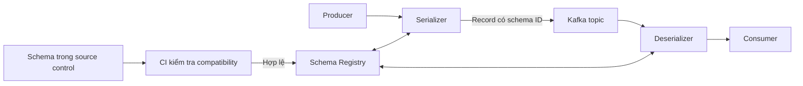

# Schema ID, subject và quy ước đăng ký schema

Trong một hệ thống Kafka có nhiều producer và consumer, các bên cần thống nhất cấu trúc của key và value. Producer có thể thêm field, đổi kiểu dữ liệu hoặc phát hành một loại sự kiện mới trong khi nhiều phiên bản consumer vẫn đang chạy. Nếu mỗi ứng dụng tự thay đổi payload mà không có quy ước chung, lỗi tương thích thường chỉ xuất hiện khi một consumer cũ nhận dữ liệu mới.

Schema Registry giúp quản lý schema, phiên bản và quy tắc tương thích cho dữ liệu trao đổi. Để sử dụng đúng, cần phân biệt ba khái niệm: **schema ID** nhận diện một schema đã đăng ký, **subject** xác định phạm vi quản lý và kiểm tra tương thích, còn **version** đánh số các lần đăng ký schema trong một subject. Ba khái niệm này liên quan nhưng không thay thế cho nhau.

## 1. Schema Registry nằm ở đâu trong kiến trúc Kafka?

Schema Registry là một dịch vụ quản lý hợp đồng dữ liệu, thường được triển khai bên cạnh Kafka. Nó lưu định nghĩa schema, subject, version, compatibility policy và cho phép serializer/deserializer tra cứu schema. Kafka broker vẫn lưu các record trong topic; broker không tự động hiểu hoặc kiểm tra nội dung schema trong mọi record.

Luồng cơ bản:

1. Nhóm phát triển định nghĩa schema cho event hoặc message.
2. Schema được đăng ký vào một subject trong Schema Registry và được kiểm tra theo compatibility policy của subject.
3. Producer dùng serializer tương thích để lấy schema ID và mã hóa record.
4. Record được ghi vào Kafka topic cùng key/value đã serialize.
5. Consumer dùng deserializer đọc schema ID từ payload, lấy schema tương ứng từ registry hoặc cache rồi giải mã dữ liệu.



Schema Registry không thay thế Kafka, không lưu message nghiệp vụ và cũng không tự bảo đảm mọi producer đều tuân thủ schema. Producer phải dùng serializer phù hợp hoặc có cơ chế kiểm tra riêng. Một ứng dụng tự serialize JSON rồi gửi byte trực tiếp vẫn có thể ghi payload sai hợp đồng vào topic.

Các ví dụ dưới đây sử dụng khái niệm và wire format phổ biến của Confluent Schema Registry. Những registry khác có thể hỗ trợ API tương thích nhưng chi tiết về ID, wire format, subject strategy và cấu hình serializer có thể khác. Không nên giả định schema ID hoặc byte format có tính phổ quát giữa mọi implementation.

## 2. Phân biệt schema ID, subject và version

Giả sử topic `orders` chứa sự kiện `OrderCreated`. Một schema Avro được đăng ký vào subject `orders-value` lần đầu, sau đó được cập nhật khi bổ sung field `source`.

| Khái niệm | Ý nghĩa | Ví dụ |
|---|---|---|
| Schema | Định nghĩa cấu trúc và kiểu dữ liệu của record | Avro record `com.example.OrderCreated` |
| Subject | Tên phạm vi mà registry dùng để quản lý schema và kiểm tra compatibility | `orders-value` |
| Version | Số thứ tự schema đã đăng ký trong một subject | Version `1`, `2` |
| Schema ID | ID do registry cấp để serializer/deserializer tra cứu một schema | ID `42` |

### Schema ID

Schema ID là định danh được gắn vào dữ liệu đã serialize để deserializer biết cần tải schema nào. Trong Confluent Schema Registry, ID được cấp trong phạm vi registry/context tương ứng và không phải số version của subject. Cùng một schema definition có thể được dùng trong nhiều subject; registry có thể tái sử dụng ID cho schema giống nhau. Vì vậy, không dùng schema ID để suy ra subject hoặc thứ tự tiến hóa.

Schema ID cũng không phải ID của event, topic, partition hay record. Nhiều record khác nhau có thể dùng cùng một schema ID. Một schema ID có thể xuất hiện trong nhiều topic nếu các topic dùng cùng schema definition.

### Subject

Subject là phạm vi đăng ký schema và áp dụng compatibility policy. Một subject có thể có nhiều version. Subject name thường được tạo tự động từ topic và loại dữ liệu, nhưng có thể thay đổi bằng subject naming strategy.

Key và value là hai hợp đồng độc lập. Với naming strategy mặc định, topic `orders` thường có hai subject:

- `orders-key` quản lý schema của record key.
- `orders-value` quản lý schema của record value.

Nếu key dùng string serializer thuần thì không nhất thiết cần đăng ký schema cho key; subject key chỉ xuất hiện khi ứng dụng dùng serializer có schema cho key.

### Version

Version là số thứ tự trong một subject. Ví dụ `orders-value` có version 1, 2 và 3. Version 2 của subject này không nhất thiết tương đương version 2 của subject khác. Nếu cùng một schema được đăng ký ở nhiều subject, mỗi subject vẫn có lịch sử version riêng.

Một cách tra cứu cụ thể trong Confluent Schema Registry là xem danh sách version của subject hoặc tra schema theo ID. Ví dụ API thường dùng:

```text
GET /subjects/orders-value/versions
GET /subjects/orders-value/versions/2
GET /schemas/ids/42
```

API tra theo subject/version trả về thông tin của một lần đăng ký trong subject. API tra theo ID trả về schema tương ứng với ID. Khi điều tra một record, cần giữ cả topic, key/value, subject strategy và schema ID; chỉ nhìn ID không đủ để biết chính sách compatibility nào đã được áp dụng.

## 3. Schema ID xuất hiện trong Kafka record như thế nào?

Với wire format phổ biến của Confluent serializers, payload bắt đầu bằng một magic byte, tiếp theo là schema ID 4 byte, rồi đến phần dữ liệu được serialize. Với Avro, phần sau ID là Avro binary data. Với Protobuf, serializer còn có thông tin message index trước phần message bytes để xác định message type trong schema file.

```text
+----------------+----------------------+---------------------------+
| Magic byte     | Schema ID             | Serialized payload        |
| 1 byte         | 4 bytes               | Phụ thuộc format           |
+----------------+----------------------+---------------------------+
```

Deserializer đọc ID và tra schema trong registry. Client thường cache schema đã tra cứu để không phải gọi registry cho từng record. Nếu registry tạm thời không sẵn sàng nhưng schema đã nằm trong cache, một số thao tác vẫn có thể tiếp tục; schema chưa được cache có thể không giải mã được cho đến khi registry truy cập lại.

Schema ID nằm trong bytes của key hoặc value theo serializer tương ứng, không phải Kafka header mặc định và cũng không phải metadata offset. Một số serializer/format có cơ chế tùy chọn khác, vì vậy khi phân tích byte trực tiếp cần xác nhận wire format thực tế.

Không nên tự cắt 5 byte đầu rồi coi phần còn lại là JSON. Payload có thể là Avro binary hoặc Protobuf, không phải văn bản. Dùng deserializer đúng định dạng hoặc công cụ hỗ trợ Schema Registry để đọc record.

## 4. Subject naming strategy và cách chọn subject

Subject naming strategy quyết định serializer tạo subject name như thế nào. Với Confluent serializers, ba chiến lược thường gặp là:

| Strategy | Subject name | Khi phù hợp |
|---|---|---|
| `TopicNameStrategy` | `<topic>-key` hoặc `<topic>-value` | Mỗi topic có hợp đồng riêng cho key/value; đây là lựa chọn mặc định phổ biến |
| `RecordNameStrategy` | Tên đầy đủ của record, ví dụ `com.example.OrderCreated` | Cùng một loại record được dùng ở nhiều topic và muốn chia sẻ compatibility boundary theo record type |
| `TopicRecordNameStrategy` | `<topic>-<record-name>` | Muốn phân biệt record type theo từng topic, nhưng một topic có thể chứa nhiều loại record |

### TopicNameStrategy

Với `TopicNameStrategy`, mọi record value trong topic `orders` được kiểm tra dưới subject `orders-value`, bất kể record có tên Avro nào. Điều này phù hợp khi topic đại diện cho một hợp đồng ổn định. Nếu topic chứa nhiều loại record khác nhau với lịch sử tiến hóa khác nhau, một subject chung có thể khiến compatibility policy khó áp dụng.

### RecordNameStrategy

Với `RecordNameStrategy`, subject dựa trên tên đầy đủ của record. Cùng record `com.example.OrderCreated` được gửi đến nhiều topic sẽ dùng cùng subject. Cách này giúp chia sẻ schema và compatibility policy cho cùng loại record trên nhiều luồng, nhưng cũng khiến thay đổi schema ảnh hưởng đến tất cả topic đang dùng record đó.

### TopicRecordNameStrategy

Với `TopicRecordNameStrategy`, subject kết hợp tên topic và tên record. Ví dụ `orders-com.example.OrderCreated`. Một topic có thể chứa nhiều loại event và mỗi loại có compatibility history riêng trong topic đó.

Không có chiến lược tốt nhất cho mọi hệ thống. Chọn dựa trên ranh giới hợp đồng mà tổ chức muốn quản lý: theo topic, theo record type trên toàn hệ thống, hay theo record type trong từng topic. Subject strategy là một phần của contract; thay đổi strategy sau khi đã có dữ liệu có thể làm serializer tìm subject khác và tạo một lịch sử compatibility khác. Cần lên kế hoạch migration thay vì đổi cấu hình tùy tiện.

## 5. Compatibility policy kiểm soát thay đổi schema

Schema Registry có thể từ chối đăng ký schema mới nếu schema không tương thích với policy đang áp dụng cho subject. Mục tiêu là phát hiện thay đổi có thể làm producer hoặc consumer của phiên bản khác không đọc được dữ liệu.

Các policy thường gặp:

| Policy | Ý nghĩa khái quát |
|---|---|
| `BACKWARD` | Schema mới có thể đọc dữ liệu được ghi bằng schema trước đó gần nhất |
| `BACKWARD_TRANSITIVE` | Schema mới có thể đọc dữ liệu từ tất cả version trước trong subject |
| `FORWARD` | Consumer dùng schema trước đó có thể đọc dữ liệu được ghi bằng schema mới |
| `FORWARD_TRANSITIVE` | Điều kiện forward phải đúng với tất cả version trước |
| `FULL` | Bảo đảm cả backward và forward với version trước gần nhất |
| `FULL_TRANSITIVE` | Bảo đảm cả backward và forward với tất cả version trước |
| `NONE` | Không áp dụng kiểm tra compatibility tự động |

Các định nghĩa trên mô tả hướng tương thích ở mức reader/writer. Kết quả cụ thể còn phụ thuộc schema format và quy tắc của serializer/registry. “Transitive” nghĩa là kiểm tra với toàn bộ lịch sử version trước, thay vì chỉ so với version gần nhất. `NONE` không có nghĩa schema chắc chắn an toàn; nó chỉ tắt rào chắn compatibility.

Ví dụ về rollout:

- Với backward compatibility, có thể triển khai consumer mới trước để consumer mới đọc được dữ liệu cũ; sau đó producer mới bắt đầu ghi schema mới.
- Với forward compatibility, có thể triển khai producer mới trước nếu consumer cũ vẫn đọc được dữ liệu mới; sau đó mới triển khai consumer mới.
- Với full compatibility, schema mới cần hỗ trợ cả hai hướng để rollout linh hoạt hơn.

Khi hệ thống giữ dữ liệu lâu và có thể replay từ nhiều tháng trước, kiểm tra transitive thường quan trọng hơn kiểm tra riêng version gần nhất. Một schema tương thích với version hiện tại vẫn có thể không đọc được dữ liệu rất cũ trong topic hoặc archive.

## 6. Quy tắc tiến hóa schema theo định dạng

Compatibility policy không thay thế việc hiểu quy tắc của từng schema format.

### Avro

Avro phân biệt writer schema và reader schema. Khi consumer đọc record, writer schema mô tả dữ liệu đã ghi; reader schema mô tả cấu trúc mà ứng dụng muốn nhận. Default value trong reader schema có thể được dùng khi dữ liệu cũ không có field mới.

Ví dụ schema ban đầu:

```json
{
  "type": "record",
  "name": "OrderCreated",
  "namespace": "com.example.events",
  "fields": [
    {"name": "orderId", "type": "string"},
    {"name": "amount", "type": "double"}
  ]
}
```

Khi thêm `source` theo hướng backward-compatible, có thể cung cấp default:

```json
{
  "type": "record",
  "name": "OrderCreated",
  "namespace": "com.example.events",
  "fields": [
    {"name": "orderId", "type": "string"},
    {"name": "amount", "type": "double"},
    {"name": "source", "type": ["null", "string"], "default": null}
  ]
}
```

Consumer dùng schema mới có thể đọc record cũ không có `source` và nhận giá trị default. Nếu thêm field bắt buộc mà không có default, reader schema mới có thể không đọc được record cũ.

### Protobuf

Protobuf dùng field number trong wire format. Khi đổi schema, không tái sử dụng field number đã xóa vì dữ liệu cũ có thể bị diễn giải thành field mới. Nên khai báo `reserved` cho field number và tên đã bỏ:

```protobuf
message OrderCreated {
  string order_id = 1;
  double amount = 2;

  reserved 3;
  reserved "legacy_source";

  string source = 4;
}
```

Quy tắc tương thích Protobuf còn phụ thuộc wire type, cardinality, enum và cách client sinh code. Không đổi kiểu field chỉ vì hai kiểu có vẻ tương tự trong ngôn ngữ lập trình. Kiểm tra compatibility bằng registry và test với message cũ trước khi phát hành.

### JSON Schema

JSON Schema mô tả cấu trúc JSON qua `type`, `properties`, `required`, `additionalProperties` và các constraint khác. Ví dụ, thêm property tùy chọn thường ít rủi ro hơn thêm property bắt buộc mà consumer cũ không gửi. Tuy nhiên, `additionalProperties: false`, thay đổi enum hoặc siết constraint có thể làm dữ liệu trước đây hợp lệ trở thành không hợp lệ.

Compatibility phụ thuộc dialect, cấu hình registry và cách validator diễn giải schema. Hãy dùng đúng validator/registry trong pipeline và test các payload đại diện của phiên bản cũ lẫn mới.

## 7. Quy ước đăng ký schema

Một quy trình đăng ký nên xác định trước subject, format, compatibility policy và quyền sở hữu schema. Không nên để mỗi ứng dụng tự tạo subject theo cách riêng mà không có quy ước của nhóm nền tảng.

Một quy trình thường dùng:

1. Đặt schema trong source control cùng mã nguồn producer/consumer hoặc trong repository hợp đồng dùng chung.
2. Chọn schema format và subject naming strategy.
3. Xác định compatibility policy ở global level hoặc override riêng cho subject.
4. Chạy kiểm tra cú pháp, lint và compatibility trong CI trước khi merge/release.
5. Đăng ký schema mới vào subject sau khi kiểm tra đạt.
6. Cấu hình producer dùng schema đã đăng ký và serializer tương ứng.
7. Triển khai consumer theo thứ tự rollout phù hợp với hướng compatibility.
8. Theo dõi lỗi serialize/deserialize và khả năng tương thích khi replay dữ liệu cũ.

Trong Confluent Schema Registry, việc đăng ký schema qua REST API thường gửi schema vào một subject cụ thể. Ví dụ request có dạng:

```http
POST /subjects/orders-value/versions
Content-Type: application/vnd.schemaregistry.v1+json

{
  "schemaType": "AVRO",
  "schema": "{\"type\":\"record\",\"name\":\"OrderCreated\",\"namespace\":\"com.example.events\",\"fields\":[{\"name\":\"orderId\",\"type\":\"string\"}]}"
}
```

Nếu schema vi phạm compatibility policy, registry từ chối đăng ký. Nếu đăng ký thành công, response trả về schema ID. Khi cần kiểm tra trước mà chưa tạo version mới, có thể dùng endpoint compatibility check mà registry cung cấp. Endpoint và quyền truy cập cần đối chiếu với phiên bản registry đang triển khai.

### Ai được phép đăng ký schema?

Trong môi trường phát triển, auto registration có thể tiện lợi. Trong production, thường nên để CI/CD hoặc nhóm quản trị contract đăng ký schema sau khi kiểm tra; ứng dụng runtime chỉ dùng schema đã được phê duyệt. Cách làm này giúp tránh một instance mới tự động tạo subject/version ngoài dự kiến.

Với Confluent serializers, `auto.register.schemas` điều khiển việc serializer tự đăng ký schema nếu chưa có. Đặt `false` khi quy trình triển khai đã đăng ký schema trước. Khi đó schema ứng dụng gửi phải khớp schema được registry nhận diện theo subject; nếu không, serialize có thể thất bại. Một số cấu hình như `use.latest.version` thay đổi cách serializer chọn schema, cần dùng có chủ đích và kiểm thử.

## 8. Cấu hình Java và Spring Kafka

Ví dụ cấu hình producer Spring Boot dùng Avro serializer:

```yaml
spring:
  kafka:
    bootstrap-servers: localhost:9092
    producer:
      key-serializer: org.apache.kafka.common.serialization.StringSerializer
      value-serializer: io.confluent.kafka.serializers.KafkaAvroSerializer
      properties:
        schema.registry.url: http://localhost:8081
        auto.register.schemas: false
        value.subject.name.strategy: io.confluent.kafka.serializers.subject.TopicNameStrategy
```

Consumer tương ứng dùng Avro deserializer:

```yaml
spring:
  kafka:
    consumer:
      group-id: order-projection
      key-deserializer: org.apache.kafka.common.serialization.StringDeserializer
      value-deserializer: io.confluent.kafka.serializers.KafkaAvroDeserializer
      properties:
        schema.registry.url: http://localhost:8081
        specific.avro.reader: true
```

`specific.avro.reader=true` yêu cầu deserializer trả về generated SpecificRecord nếu ứng dụng có class Avro tương ứng. Nếu dùng GenericRecord, cấu hình và kiểu nhận dữ liệu sẽ khác. Dependency của Confluent serializer/deserializer cần có trong build và phiên bản phải tương thích với Kafka client/Spring Kafka của dự án.

Nếu key cũng dùng Avro hoặc Protobuf, cần cấu hình serializer/deserializer tương ứng và có thể đặt `key.subject.name.strategy` riêng. Subject của key và value cần được đăng ký độc lập theo đúng strategy.

Trong môi trường production, Schema Registry thường cần xác thực và TLS. Không hard-code credential trong file YAML được commit; dùng secret manager hoặc biến môi trường và cấp quyền tối thiểu cho producer/consumer. Producer runtime có thể chỉ cần quyền đọc schema đã đăng ký nếu registry hỗ trợ ACL chi tiết; pipeline đăng ký schema cần quyền ghi.

## 9. Các lỗi thường gặp và cách điều tra

| Triệu chứng | Nguyên nhân có thể | Cách kiểm tra |
|---|---|---|
| Đăng ký schema bị từ chối | Schema mới không tương thích với policy của subject | Xem subject, policy và diff giữa các version; chạy compatibility check |
| Serializer báo không tìm thấy schema | Schema chưa được đăng ký hoặc auto registration bị tắt | Kiểm tra subject naming strategy, schema và trạng thái đăng ký |
| Consumer không lấy được schema theo ID | Registry không truy cập được, sai URL/auth hoặc ID không tồn tại trong registry/context đang dùng | Kiểm tra URL, quyền, context, cache và schema ID từ payload |
| Producer và consumer chọn subject khác nhau | Naming strategy hoặc topic/key-value mapping không nhất quán | So sánh cấu hình serializer hai phía và subject thực tế |
| Consumer lỗi khi đọc record cũ | Schema mới không tương thích hoặc dữ liệu cũ không còn schema cần thiết | Kiểm tra ID, subject/version, compatibility policy và khả năng replay |
| Runtime tự tạo version ngoài dự kiến | `auto.register.schemas` đang bật | Tắt auto registration ở production và đưa đăng ký vào CI/CD |

Khi điều tra, ghi nhận topic, partition, offset, key/value, schema ID, serializer/deserializer version và subject naming strategy. Tránh chỉ ghi payload thô nếu payload có thông tin nhạy cảm; log schema ID và metadata thường đủ để bắt đầu tra cứu.

## 10. Quy ước quản trị và vận hành

Một bộ quy ước thực tế nên thống nhất:

- Tên topic và chủ sở hữu event, ví dụ `orders` do Order Service quản lý.
- Schema format được chọn cho từng luồng: Avro, Protobuf hoặc JSON Schema.
- Subject naming strategy áp dụng cho key/value; tránh thay đổi tùy tiện giữa các service.
- Compatibility policy ở global level và các subject có override.
- Quy tắc versioning: version do registry quản lý, không tự nhúng số version subject vào schema ID.
- Quy trình review, compatibility check, đăng ký và phát hành schema qua CI/CD.
- Chính sách auto registration ở local, test, staging và production.
- Quyền đọc/ghi registry, TLS, credential và audit thay đổi schema.
- Retention dữ liệu và khả năng truy cập schema cũ khi cần replay.

Không xóa schema cũ chỉ vì producer đã chuyển sang version mới. Record lịch sử trong Kafka có thể vẫn cần schema cũ để đọc. Việc xóa subject hoặc schema cần tuân theo chính sách lưu trữ, quy trình migration và khả năng phục hồi dữ liệu của tổ chức.

Schema ID giúp deserializer tìm đúng định nghĩa schema; subject xác định ranh giới quản lý và compatibility; version ghi lại lịch sử schema trong subject. Khi chọn naming strategy phù hợp, đặt compatibility policy có chủ đích và đưa đăng ký schema vào pipeline kiểm soát, các producer và consumer có thể tiến hóa độc lập mà vẫn giữ được hợp đồng dữ liệu cho luồng Kafka hiện tại lẫn dữ liệu lịch sử.
