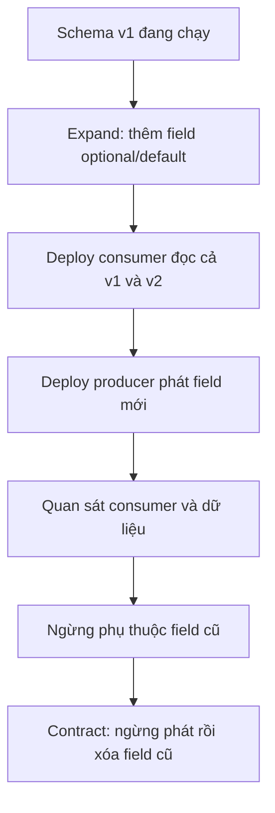

# Thêm, đổi, xóa trường và giá trị mặc định

Kafka lưu event trong topic theo dạng record bất biến: một khi record đã được ghi, việc thay đổi hợp đồng dữ liệu không tự sửa các record cũ. Trong khi producer và consumer được triển khai ở những thời điểm khác nhau, một topic còn có thể chứa dữ liệu từ nhiều phiên bản ứng dụng. Consumer mới phải đọc được event cũ; consumer cũ có thể phải đọc event mới trong lúc rolling deployment; một consumer replay có thể đọc dữ liệu đã tồn tại nhiều ngày hoặc nhiều tháng.

Vì vậy, thêm, đổi, xóa field và đặt giá trị mặc định là các quyết định về **schema evolution**. Cần xem xét cả định dạng dữ liệu (JSON, Avro, Protobuf), chiều tương thích, thời gian lưu dữ liệu Kafka, thứ tự triển khai producer/consumer và ý nghĩa nghiệp vụ của field. Một thay đổi vẫn có thể phá vỡ hệ thống dù JSON còn parse được, nếu consumer hiểu sai ý nghĩa của giá trị.

## 1. Hợp đồng dữ liệu của một event

Một event contract mô tả cấu trúc và ý nghĩa dữ liệu mà producer phát ra và consumer dựa vào. Ví dụ event `OrderCreated`:

```json
{
  "eventId": "evt-1042-01",
  "eventType": "OrderCreated",
  "schemaVersion": 1,
  "occurredAt": "2026-11-20T10:15:00Z",
  "orderId": "order-1042",
  "customerId": "customer-77",
  "totalAmount": 125000,
  "currency": "VND"
}
```

Các trường có vai trò khác nhau:

| Field | Vai trò | Có thể thay đổi tùy tiện? |
|---|---|---|
| `eventId` | Định danh duy nhất của lần phát sinh event | Không; phải ổn định khi retry/replay cùng event |
| `eventType` | Loại sự kiện và ý nghĩa nghiệp vụ | Không nên đổi ý nghĩa dưới cùng tên |
| `schemaVersion` | Phiên bản contract do ứng dụng quản lý nếu có dùng | Cần có quy tắc tăng và tương thích rõ ràng |
| `occurredAt` | Thời điểm nghiệp vụ xảy ra | Không đổi thành thời điểm publish mà không đổi contract |
| `orderId` | Định danh aggregate, thường dùng làm Kafka key | Thay đổi có thể ảnh hưởng partitioning và ordering |
| `totalAmount` | Số tiền theo đơn vị được quy định | Không đổi đơn vị hoặc kiểu mà không migration |
| `currency` | Đơn vị tiền tệ | Không được mặc định suy ra nếu thiếu mà không có quy tắc |

Schema mô tả hình dạng dữ liệu; contract còn bao gồm ý nghĩa field, đơn vị, timezone, quy tắc null, phạm vi giá trị, ordering và cách xử lý khi field vắng mặt. Hai payload cùng kiểu `number` nhưng một bên là VND, bên kia là USD vẫn là thay đổi breaking ở mức nghiệp vụ.

## 2. Backward, forward và full compatibility

Trước khi thêm hoặc xóa field, cần xác định consumer và producer nào phải tương thích trong giai đoạn rollout.

| Chế độ | Câu hỏi | Cách diễn giải |
|---|---|---|
| Backward compatibility | Consumer dùng schema mới có đọc được dữ liệu được ghi bằng schema cũ không? | New reader đọc old writer data |
| Forward compatibility | Consumer dùng schema cũ có đọc được dữ liệu được ghi bằng schema mới không? | Old reader đọc new writer data |
| Full compatibility | Cả hai chiều có hoạt động không? | New reader đọc old data và old reader đọc new data |
| Không tương thích | Có chiều đọc nào thất bại hoặc thay đổi ý nghĩa không? | Cần version/topic/migration strategy riêng |

Với Schema Registry, compatibility thường được kiểm tra theo subject. Chế độ non-transitive so sánh schema mới với phiên bản trước gần nhất; chế độ transitive kiểm tra với các phiên bản trước trong phạm vi subject. Transitive quan trọng khi consumer có thể replay dữ liệu rất cũ, không chỉ dữ liệu của phiên bản ngay trước đó.

Tên gọi backward/forward mô tả chiều đọc giữa writer schema và reader schema. Không nên nhầm chúng với thứ tự deploy. Nếu hệ thống cần consumer cũ đọc được event mới trong rolling deployment, cần forward compatibility; nếu consumer mới phải replay event cũ, cần backward compatibility.

## 3. Thêm field mới

Thêm field thường là thay đổi dễ quản lý nhất, nhưng vẫn cần biết consumer cũ xử lý field không nhận diện ra sao và consumer mới xử lý record cũ thiếu field như thế nào.

Ví dụ thêm `sourceChannel` để biết đơn hàng đến từ web, mobile hay cửa hàng:

```json
{
  "eventId": "evt-1042-01",
  "eventType": "OrderCreated",
  "orderId": "order-1042",
  "totalAmount": 125000,
  "currency": "VND",
  "sourceChannel": "mobile"
}
```

### Điều kiện để thêm field an toàn

- Field mới nên optional hoặc có default đọc phù hợp với dữ liệu cũ.
- Consumer cũ cần bỏ qua field chưa biết hoặc có cơ chế tương thích tương ứng.
- Consumer mới phải xác định hành vi khi record cũ không có field.
- Không được gán một giá trị giả nếu giá trị đó làm sai nghiệp vụ.
- Field mới không nên trở thành bắt buộc trước khi mọi producer đã phát nó và mọi dữ liệu cũ đã được xử lý theo kế hoạch.

### Avro: field mới cần default để reader mới đọc dữ liệu cũ

Trong Avro, khi reader schema có field mà writer schema cũ không có, reader cần default cho field đó để schema resolution có thể cung cấp giá trị khi đọc record cũ.

```json
{
  "type": "record",
  "name": "OrderCreated",
  "namespace": "com.example.events",
  "fields": [
    { "name": "orderId", "type": "string" },
    { "name": "totalAmount", "type": "long" },
    {
      "name": "sourceChannel",
      "type": ["null", "string"],
      "default": null
    }
  ]
}
```

Khi reader dùng schema mới đọc record được ghi bằng schema cũ, `sourceChannel` được đọc là `null`. Default của Avro là quy tắc schema resolution khi field vắng mặt trong dữ liệu được ghi; nó không sửa payload cũ trên topic và cũng không có nghĩa producer cũ bắt đầu phát field đó.

Default chỉ được dùng khi field không có trong writer schema. Nếu writer schema có field và record thực tế ghi giá trị `null`, reader nhận `null`; Avro không thay giá trị null đó bằng default. Default trong schema Avro cũng không tự làm producer ghi field mới khi serialize.

### Protobuf: thêm field với số field mới

```protobuf
message OrderCreated {
  string order_id = 1;
  int64 total_amount = 2;
  optional string source_channel = 3;
}
```

Field number là định danh trên wire format. Khi thêm field, phải chọn số chưa từng dùng trong message đó. Không tái sử dụng số field đã xóa. Với proto3, `optional` giúp phân biệt field không được set với field được set bằng giá trị mặc định trong các trường hợp cần presence.

Với scalar proto3 không khai báo `optional`, field không được set thường được đọc như giá trị mặc định của kiểu (ví dụ `0`, `false` hoặc chuỗi rỗng), và ứng dụng không phân biệt được nó với trường hợp producer chủ động set đúng giá trị đó. Dùng `optional` khi contract cần biết field có hiện diện hay không.

### JSON/JSON Schema: thêm property optional

```json
{
  "type": "object",
  "properties": {
    "orderId": { "type": "string" },
    "totalAmount": { "type": "integer" },
    "sourceChannel": {
      "type": ["string", "null"],
      "default": null
    }
  },
  "required": ["orderId", "totalAmount"]
}
```

Property không nằm trong `required`, nên record cũ có thể thiếu field. Trong JSON Schema, keyword `default` chủ yếu là annotation mô tả giá trị mặc định; validator thông thường không tự chèn giá trị vào payload. Ứng dụng cần tự áp dụng default nếu muốn object sau deserialize có giá trị cụ thể.

### Consumer cũ có đọc được field mới không?

Nhiều JSON mapper bỏ qua unknown property theo cấu hình mặc định, nhưng không phải mọi consumer đều làm vậy. Consumer bật strict unknown-property validation, DTO bất tương thích hoặc schema validator nghiêm ngặt có thể từ chối payload có field mới. Với Avro, reader thường bỏ qua field có trong writer schema nhưng không có trong reader schema. Với Protobuf, field chưa biết thường được giữ dưới dạng unknown field ở wire processing tùy runtime.

Không dựa vào giả định “format này tolerant” mà không kiểm thử consumer thực tế. Cần kiểm tra tất cả consumer đang đọc topic, kể cả connector, job replay và ứng dụng bên thứ ba.

## 4. Giá trị mặc định: field vắng mặt khác field null

Ba trạng thái sau có thể mang ý nghĩa khác nhau:

```json
{}
```

```json
{ "sourceChannel": null }
```

```json
{ "sourceChannel": "mobile" }
```

| Trạng thái | Ý nghĩa có thể có |
|---|---|
| Field không xuất hiện | Producer chưa biết field, hoặc không có thông tin |
| Field xuất hiện với `null` | Producer biết field nhưng giá trị không có/được xóa, nếu contract định nghĩa như vậy |
| Field có giá trị | Producer cung cấp thông tin cụ thể |

Không được tự động coi missing và null là một. Ví dụ với `middleName`, missing có thể nghĩa là producer phiên bản cũ chưa gửi field; null có thể nghĩa là người dùng chủ động xóa tên đệm. Với `discountAmount`, missing có thể cần default 0, trong khi null có thể biểu thị chưa tính được.

### Default không tự backfill dữ liệu cũ

Nếu schema mới khai báo default `sourceChannel="unknown"`, record cũ trên Kafka vẫn giữ nguyên bytes và vẫn không có field. Reader schema hoặc ứng dụng có thể trình bày giá trị mặc định khi đọc; broker không viết lại record cũ. Nếu cần báo cáo lịch sử với giá trị đã chuẩn hóa, phải áp dụng logic ở consumer/projection hoặc chạy một job migration riêng.

### Chọn default có ý nghĩa đúng

| Field | Default có thể dùng | Khi nào không nên dùng |
|---|---|---|
| `sourceChannel` | `"unknown"` nếu contract cho phép phân loại không rõ nguồn | Không dùng `"web"` chỉ vì web là kênh phổ biến |
| `retryCount` | `0` nếu thiếu thực sự nghĩa là chưa retry | Không dùng nếu field biểu diễn số lần retry ở hệ thống khác mà không rõ lịch sử |
| `currency` | Chỉ dùng `"VND"` nếu contract/topic bảo đảm tất cả record đều là VND | Không suy ra từ locale hoặc quốc gia chạy service |
| `isGift` | `false` nếu thiếu được định nghĩa tương đương không phải quà tặng | Không dùng nếu missing có nghĩa là chưa hỏi người mua |
| `occurredAt` | Thường không có default nghiệp vụ an toàn | Không thay bằng thời điểm consumer đọc hoặc thời điểm deploy |

Default nên được định nghĩa trong contract và được mọi consumer áp dụng nhất quán. Tránh để mỗi service tự chọn một default khác nhau.

## 5. Thay đổi kiểu dữ liệu hoặc ý nghĩa field

Thay đổi field hiện có thường rủi ro hơn thêm field. Consumer cũ có thể không parse được kiểu mới hoặc vẫn parse được nhưng hiểu sai giá trị.

| Thay đổi | Rủi ro | Hướng xử lý |
|---|---|---|
| `int` sang `long` | Có thể an toàn trong một số schema như Avro theo promotion, nhưng DTO/JSON consumer có thể giới hạn kiểu | Kiểm tra schema format và tất cả consumer; test giá trị biên |
| `number` sang `string` | Consumer đang tính toán số có thể lỗi | Thêm field mới, dual-write và migration |
| `amount` từ đơn vị đồng sang đơn vị xu | Payload vẫn là số nhưng ý nghĩa thay đổi 100 lần | Không đổi nghĩa field cũ; tạo field/version mới và công bố đơn vị |
| `timestamp` từ local time sang UTC | Consumer có thể diễn giải sai thời điểm | Chuẩn hóa format/timezone và migration có version |
| `customerId` từ string sang object | Key/lookup logic của consumer bị phá vỡ | Tạo field mới hoặc event version mới |
| Scalar thành nullable | Consumer cũ có thể không xử lý null | Kiểm tra presence/null semantics và rollout tương thích |
| Đổi tên field | Với wire schema có thể tương đương remove + add; generated code/JSON mapping bị ảnh hưởng | Dual-read/dual-write trong giai đoạn chuyển tiếp |

Một số format hỗ trợ promotion có kiểm soát. Ví dụ Avro cho phép một số chuyển đổi numeric như `int` sang `long`, `float` sang `double` theo quy tắc schema resolution. Điều này không có nghĩa mọi client JSON/Java hoặc mọi giá trị đều an toàn. Hãy xem compatibility checker và kiểm thử dữ liệu thật trước khi dựa vào promotion.

### Không đổi ý nghĩa dưới cùng tên field

Ví dụ `totalAmount` trước đây là tổng tiền trước thuế, nay đổi thành tổng tiền sau thuế. Schema vẫn là `long`, JSON vẫn parse thành công, nhưng consumer báo cáo và đối soát có thể sai. Đây là breaking change về semantic contract.

Nếu ý nghĩa thay đổi, hãy tạo field mới như `grossAmount`/`netAmount`, thêm currency/unit rõ ràng hoặc tạo event type/version mới. Duy trì field cũ trong giai đoạn chuyển tiếp và ghi rõ thời điểm ngừng phát.

## 6. Đổi tên field: xem như thêm và xóa

Đổi tên `customerId` thành `buyerId` không chỉ là refactor code. Consumer cũ đang đọc `customerId`; consumer mới có thể chỉ đọc `buyerId`; event lịch sử vẫn mang tên cũ.

Một chiến lược tương thích là:

1. Thêm `buyerId` optional, giữ `customerId`.
2. Producer mới phát cả hai field với cùng một giá trị trong giai đoạn chuyển tiếp.
3. Consumer mới ưu tiên `buyerId`, nhưng fallback sang `customerId` khi đọc event cũ.
4. Cập nhật toàn bộ consumer và job replay.
5. Sau khi hết thời gian hỗ trợ producer/consumer cũ và dữ liệu cũ được xử lý theo kế hoạch, ngừng phát `customerId`.
6. Chỉ loại bỏ field cũ khỏi schema khi không còn consumer cần nó và compatibility policy cho phép.

Không dual-write hai field nếu chúng có thể khác nhau. Nếu cả hai tồn tại nhưng giá trị xung đột, contract phải định nghĩa field nào là nguồn sự thật và cách xử lý conflict.

## 7. Xóa field

Xóa field cần hai câu hỏi:

- Consumer cũ có còn cần field này để đọc event mới không?
- Consumer mới có còn cần field này khi replay event cũ không?

Trong một hệ thống có rolling deployment, xóa field khỏi producer trước khi consumer cũ được nâng cấp có thể làm consumer cũ thất bại. Xóa field khỏi schema reader quá sớm cũng có thể làm mất thông tin mà ứng dụng vẫn cần khi replay.

### Quy trình xóa an toàn

1. Đánh dấu field deprecated trong tài liệu contract và thông báo consumer owners.
2. Triển khai consumer không còn phụ thuộc field cũ; vẫn đọc được event có hoặc không có field.
3. Đợi toàn bộ consumer production, batch job, connector và replay tool chuyển đổi.
4. Ngừng producer phát field cũ; tiếp tục đọc event lịch sử nếu cần.
5. Theo dõi thời gian lưu topic, archive, DLT và khoảng thời gian replay tối đa.
6. Chỉ loại field khỏi schema sau khi compatibility và yêu cầu replay đã được đánh giá.

Với Avro, xóa field khỏi writer schema mới có thể khiến reader cũ thất bại nếu reader schema cũ yêu cầu field đó mà không có default. Reader schema cũ cần default phù hợp để đọc record mới thiếu field. Với JSON, consumer cũ có thể từ chối khi field required bị thiếu. Với Protobuf, field number và name đã xóa cần được `reserved` để tránh tái sử dụng.

### Protobuf: reserve field đã xóa

```protobuf
message OrderCreated {
  string order_id = 1;
  int64 total_amount = 2;

  reserved 3;
  reserved "legacy_channel";
}
```

Không tái sử dụng field number đã xóa cho field khác. Nếu tái sử dụng, bytes của record cũ có thể bị diễn giải thành một field mới với ý nghĩa hoàn toàn khác. Reserve cả tên giúp tránh tái sử dụng tên trong JSON/text representation và generated API.

### Retention làm thay đổi phạm vi tương thích

Nếu topic giữ dữ liệu 30 ngày nhưng một consumer chỉ replay tối đa 7 ngày, hợp đồng cần tương thích ít nhất với dữ liệu có thể được đọc trong 7 ngày và mọi archive/DLT có liên quan. Nếu dữ liệu được lưu vô thời hạn hoặc có thể replay từ object storage, phải tính cả schema rất cũ.

Retention không tự đảm bảo field cũ đã biến mất: record có thể còn trong backup, compacted topic, DLT hoặc hệ thống lưu trữ ngoài Kafka. Chỉ dựa vào `retention.ms` của topic chính để xóa field là chưa đủ.

## 8. Enum, union và các giá trị mới

Thêm một giá trị enum có thể phá vỡ consumer cũ dù cấu trúc field không đổi. Ví dụ producer phát `status="REFUNDED"`, nhưng consumer cũ chỉ biết `CREATED`, `PAID`, `CANCELLED` và dùng switch không có nhánh mặc định.

Các nguyên tắc:

- Consumer nên có nhánh xử lý unknown enum rõ ràng: lưu lại, cảnh báo, bỏ qua theo contract hoặc đưa DLT.
- Không ánh xạ unknown status thành một trạng thái nghiệp vụ có tác động khác như `CANCELLED`.
- Với Avro enum, reader schema có thể cần enum default để đọc symbol chưa biết theo quy tắc resolution.
- Với Protobuf, giữ số enum ổn định; reserve số và tên khi xóa giá trị, không tái sử dụng.
- Với JSON Schema, kiểm tra `enum`/`const` vì consumer validator có thể từ chối giá trị mới.

Nếu thêm một trạng thái mới, triển khai consumer hiểu trạng thái đó trước khi producer bắt đầu phát nó, trừ khi contract và consumer đã có cơ chế unknown-value an toàn.

## 9. Kafka key là một phần của contract

Schema evolution không chỉ là thay đổi value. Key thường quyết định partition, do đó ảnh hưởng ordering và phân phối tải.

Nếu `orderId` đang là key và producer chuyển sang dùng `customerId`, các event của cùng đơn hàng có thể đi vào partition khác. Kafka chỉ bảo đảm ordering trong một partition; thay đổi key có thể làm consumer thấy event của cùng aggregate ở nhiều partition và không còn thứ tự như trước.

Trước khi đổi key, cần đánh giá:

- Ordering được bảo đảm theo entity nào: order, customer hay account?
- Consumer có dựa vào key để deduplicate, partition state hoặc join không?
- Có cần migration topic hoặc dual-publish trong thời gian chuyển đổi không?
- Partition count có thay đổi đồng thời không? Tăng partition cũng có thể làm key ánh xạ sang partition khác với default partitioner.
- Có thể dùng `aggregateId` ổn định làm key và đưa các định danh khác vào value không?

Thay key nên được xem là thay đổi contract có ảnh hưởng hành vi, ngay cả khi JSON schema không đổi.

## 10. Expand-contract: chiến lược rollout producer và consumer

Với event contract đang chạy production, cách an toàn thường là mở rộng trước, chuyển consumer, rồi mới thu hẹp. Mẫu này thường được gọi là **expand-contract**.



Trình tự khuyến nghị khi thêm field:

1. Định nghĩa schema mới với field optional/default phù hợp.
2. Kiểm tra compatibility trong CI/Schema Registry.
3. Deploy consumer mới trước; consumer phải đọc được cả record cũ thiếu field và record mới có field.
4. Deploy producer mới để bắt đầu phát field.
5. Theo dõi tỷ lệ record có field, lỗi deserialize/validation và consumer lag.
6. Chỉ sau khi các consumer cần field đã sẵn sàng mới xem field là bắt buộc trong logic nghiệp vụ.

Trình tự khuyến nghị khi xóa field:

1. Deploy consumer không còn dùng field cũ nhưng vẫn chấp nhận record lịch sử có field.
2. Ngừng producer phát field cũ.
3. Chờ các producer cũ dừng, dữ liệu mới không còn field và các yêu cầu replay đã được đáp ứng.
4. Loại field khỏi schema theo compatibility policy và giữ schema history.

Không thực hiện add và remove trong một lần deploy nếu producer và consumer không thể được nâng cấp đồng thời.

## 11. Versioning event và schema

Có thể quản lý version theo schema registry ID, schema version của subject hoặc field `schemaVersion` trong event envelope. Cần tránh hai nguồn version mâu thuẫn.

| Cách quản lý | Ưu điểm | Lưu ý |
|---|---|---|
| Schema Registry version/ID | Gắn với schema cụ thể và compatibility check | Phụ thuộc format/serializer và subject strategy |
| `schemaVersion` trong payload | Dễ quan sát, hỗ trợ JSON thuần và routing logic | Ứng dụng phải duy trì version nhất quán với schema thực tế |
| Event type version (`OrderCreatedV2`) | Ranh giới contract rõ khi thay đổi breaking | Tăng số event type và yêu cầu consumer hỗ trợ song song |
| Topic version (`orders.v2`) | Cô lập luồng mới và có thể thay partition/retention policy | Tăng vận hành, cần migration/bridge và tránh phân mảnh không cần thiết |

Không tăng version chỉ vì thêm một field tương thích nếu schema registry đã quản lý schema evolution. Ngược lại, thay đổi semantic hoặc wire format breaking có thể cần event type/topic version mới, dù chỉ một field thay đổi.

## 12. Kiểm thử compatibility trước khi phát hành

Một bài test chỉ serialize và deserialize bằng cùng một schema mới không chứng minh khả năng tương thích. Cần kiểm tra chéo phiên bản:

| Writer | Reader | Mục tiêu |
|---|---|---|
| Producer/schema cũ | Consumer/schema mới | Kiểm tra backward compatibility và default cho field mới |
| Producer/schema mới | Consumer/schema cũ | Kiểm tra forward compatibility trong rolling deployment |
| Producer/schema cũ | Consumer/schema cũ | Giữ hành vi hiện tại |
| Producer/schema mới | Consumer/schema mới | Kiểm tra contract đích |
| Event lịch sử rất cũ | Consumer hiện tại | Kiểm tra transitive/replay horizon |

Test nên dùng sample payload thực tế, gồm:

- Field mới bị thiếu.
- Field mới có `null`.
- Field mới có default và giá trị khác default.
- Enum mới hoặc unknown value.
- Giá trị số ở biên min/max và trường hợp vượt kiểu cũ.
- Payload có field lạ, field deprecated và field bị xóa.
- Event có key cũ và key mới nếu key migration xảy ra.

Với Schema Registry, kiểm tra compatibility trên đúng subject và đúng chế độ transitive/non-transitive. Với JSON không có registry, cần contract test giữa producer và consumer, không chỉ unit test DTO riêng lẻ.

## 13. Ví dụ Java: consumer đọc field mới có fallback

Với JSON, có thể dùng wrapper để phân biệt field chưa có thông tin và field có giá trị. Ví dụ dưới đây minh họa cách áp dụng default ở tầng ứng dụng:

```java
public record OrderCreated(
    String eventId,
    String orderId,
    Long totalAmount,
    String currency,
    String sourceChannel
) {
    public String effectiveSourceChannel() {
        return sourceChannel == null ? "unknown" : sourceChannel;
    }
}
```

Phương thức `effectiveSourceChannel()` là quy tắc của ứng dụng; Jackson không tự áp dụng keyword `default` từ JSON Schema. Nếu cần phân biệt missing với explicit `null`, DTO đơn giản có thể chưa đủ vì cả hai có thể được ánh xạ thành `null`; hãy dùng custom deserializer, `JsonNode.has()`/`hasNonNull()` hoặc wrapper biểu diễn presence.

Ví dụ parse thủ công để phân biệt:

```java
JsonNode root = objectMapper.readTree(payload);

boolean fieldPresent = root.has("sourceChannel");
boolean fieldHasValue = root.hasNonNull("sourceChannel");

String sourceChannel = fieldHasValue
    ? root.get("sourceChannel").asText()
    : "unknown";
```

Ở đây `fieldPresent=false` nghĩa là field bị thiếu; `fieldPresent=true` và `fieldHasValue=false` nghĩa là field xuất hiện với `null`. Nếu hai trường hợp có ý nghĩa nghiệp vụ khác nhau, cần giữ cả hai cờ trong model thay vì gộp thành một string.

## 14. Những thay đổi thường gây breaking change

| Thay đổi | Vì sao nguy hiểm |
|---|---|
| Thêm field required không có default | Consumer mới không đọc được event cũ thiếu field; producer cũ không gửi được field bắt buộc |
| Đổi kiểu field | Consumer cũ có thể parse thất bại hoặc cast sai |
| Đổi đơn vị/ý nghĩa nhưng giữ tên | Payload parse được nhưng nghiệp vụ tính sai |
| Đổi tên mà không dual-read/dual-write | Consumer cũ hoặc replay tool không tìm thấy field |
| Xóa field ngay khi producer ngừng phát | Consumer cũ và dữ liệu lịch sử có thể vẫn cần field |
| Thêm enum nhưng consumer không có unknown handling | Switch/validator cũ có thể ném lỗi |
| Thay key/partitioning | Ordering theo aggregate và phân phối tải thay đổi |
| Đổi null thành missing hoặc ngược lại | Consumer có thể hiểu khác về “chưa biết”, “đã xóa” và “mặc định” |
| Đổi timestamp format/timezone | Event có thể bị xếp sai thứ tự hoặc sai thời điểm nghiệp vụ |

## 15. Giám sát sau khi thay đổi contract

Sau rollout, cần theo dõi cả schema và hành vi consumer:

| Tín hiệu | Cần kiểm tra |
|---|---|
| Schema compatibility check | Schema mới có được registry chấp nhận đúng policy không? |
| Serialization/deserialization error | Producer/consumer có đọc được schema mới không? |
| Tỷ lệ field mới có mặt | Producer nào chưa phát field hoặc rollout chưa hoàn tất? |
| Tỷ lệ missing/null/default | Consumer đang áp dụng default nhiều bất thường không? |
| Unknown enum/value count | Producer đã phát giá trị mà consumer chưa hiểu chưa? |
| Consumer lag và DLT rate | Thay đổi schema có làm partition bị kẹt hoặc tăng poison record không? |
| Event version theo producer | Có producer cũ vẫn phát schema cũ sau thời hạn migration không? |
| Ordering/version gap | Thay key hoặc version có làm sai thứ tự aggregate không? |

Không chỉ dựa vào tỷ lệ deserialize thành công. Một event có thể deserialize hoàn toàn nhưng vẫn sai đơn vị tiền, timezone hoặc semantic. Cần metric nghiệp vụ như số đơn có amount âm, số event thiếu currency hoặc số trạng thái không được consumer nhận diện.

## 16. Bài thực hành: thêm, đổi và xóa field an toàn

Dùng topic thử nghiệm `orders.events` với event `OrderCreated` phiên bản 1.

1. Tạo schema v1 gồm `orderId`, `totalAmount`, `currency` và phát một số record.
2. Thêm `sourceChannel` optional với default phù hợp; đăng ký schema mới và kiểm tra backward compatibility.
3. Dùng consumer mới đọc record v1 thiếu `sourceChannel`; xác minh default được áp dụng đúng ở reader/application.
4. Dùng consumer cũ đọc record mới có `sourceChannel`; xác minh unknown field được xử lý theo cấu hình thực tế.
5. Thử gửi `sourceChannel=null`, field bị thiếu và field có giá trị; xác minh ba trạng thái không bị gộp sai.
6. Thử đổi `totalAmount` từ integer sang string hoặc đổi đơn vị; xác minh compatibility checker/test phát hiện thay đổi breaking.
7. Thử rename `customerId` thành `buyerId` bằng dual-write/dual-read và kiểm tra cả producer/consumer cũ.
8. Đánh dấu một field deprecated, ngừng producer phát field rồi kiểm tra consumer mới vẫn replay được event lịch sử.
9. Với Protobuf, xóa field thử nghiệm và reserve số/name; xác minh không tái sử dụng field number.
10. Chạy contract test ma trận old/new producer và consumer, gồm cả event lịch sử.

Thực hiện trên registry/topic lab. Không thay đổi schema subject production hoặc xóa field đang được consumer sử dụng khi chưa có migration plan.

## 17. Checklist trước khi merge schema mới

- Xác định field mới là optional hay required và ý nghĩa khi missing/null.
- Chọn default có căn cứ nghiệp vụ; không dùng giá trị tiện tay để che dữ liệu thiếu.
- Kiểm tra backward/forward/full compatibility đúng với rollout.
- Bật transitive compatibility nếu dữ liệu rất cũ vẫn có thể được replay.
- Kiểm tra behavior của consumer khi gặp unknown field và unknown enum.
- Không đổi kiểu, đơn vị, timezone hoặc semantic dưới cùng field name mà không migration.
- Khi rename, có giai đoạn dual-read/dual-write và quy tắc xử lý conflict.
- Khi xóa Protobuf field, reserve field number và name; không tái sử dụng số.
- Kiểm tra key và ordering nếu thay đổi aggregate identifier hoặc partitioning.
- Deploy consumer tương thích trước producer khi cần hỗ trợ rolling deployment.
- Chờ hết retention/replay horizon trước khi loại bỏ khả năng đọc field cũ.
- Kiểm thử old writer/new reader, new writer/old reader và event lịch sử.
- Theo dõi missing/null/default, schema errors, DLT và metric nghiệp vụ sau rollout.

## 18. Những nhầm lẫn thường gặp

- **Cho rằng thêm field luôn backward compatible:** reader mới cần xử lý record cũ thiếu field; với Avro, field mới thường cần default trong reader schema.
- **Cho rằng JSON Schema `default` tự chèn giá trị:** default thường là annotation; ứng dụng/validator phải chủ động áp dụng.
- **Cho rằng missing và null giống nhau:** chúng có thể biểu đạt hai trạng thái nghiệp vụ khác nhau.
- **Cho rằng default sẽ sửa record lịch sử trên Kafka:** record cũ vẫn giữ nguyên bytes; default chỉ ảnh hưởng cách đọc/diễn giải.
- **Cho rằng đổi kiểu số luôn an toàn:** promotion phụ thuộc format, client và giới hạn giá trị.
- **Cho rằng rename chỉ là đổi tên biến Java:** event cũ vẫn chứa tên field cũ và consumer cũ có thể cần nó.
- **Xóa field ngay sau khi producer ngừng phát:** consumer replay vẫn có thể cần đọc dữ liệu cũ.
- **Tái sử dụng Protobuf field number:** bytes lịch sử có thể bị diễn giải sai theo field mới.
- **Chỉ kiểm tra schema mà không kiểm tra semantic:** cùng kiểu dữ liệu vẫn có thể đổi đơn vị hoặc ý nghĩa.
- **Cho rằng tăng version giải quyết mọi breaking change:** version chỉ hữu ích khi có quy tắc migration và consumer thực sự hỗ trợ nhiều phiên bản.

Tiến hóa contract an toàn cần phối hợp schema compatibility, ý nghĩa nghiệp vụ, rollout producer/consumer và thời gian lưu/replay của Kafka. Thêm field theo hướng optional/default, thay đổi bằng dual-read/dual-write, xóa sau khi consumer và dữ liệu lịch sử không còn phụ thuộc, đồng thời kiểm thử cả hai chiều tương thích sẽ giảm nguy cơ một lần deploy làm hỏng toàn bộ luồng event.
