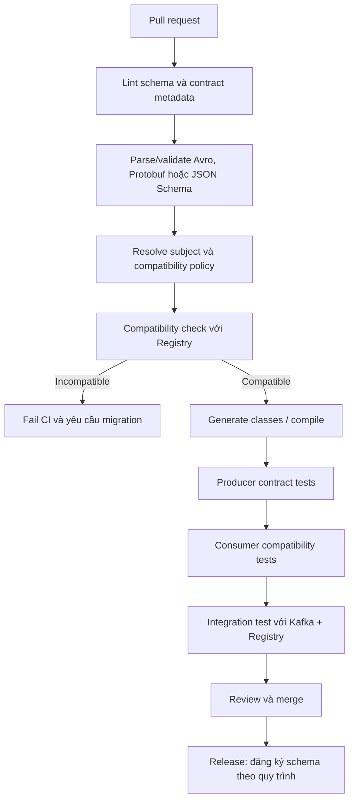

# Contract testing và kiểm tra schema trong CI

## Mục tiêu

Kafka producer và consumer thường được phát triển, triển khai bởi các nhóm khác nhau. Producer có thể thêm field, đổi kiểu dữ liệu, thay key hoặc thay ý nghĩa event trong khi consumer cũ vẫn đang chạy. Nếu thay đổi không tương thích, consumer có thể không deserialize được record, bỏ qua dữ liệu hoặc hiểu sai nghiệp vụ dù broker vẫn nhận và lưu message bình thường.

Data contract mô tả hình dạng và cách diễn giải event giữa producer và consumer. Schema là một phần của contract; key, headers, timestamp, partitioning, ordering, nullability và ý nghĩa nghiệp vụ cũng quan trọng. Contract testing đưa các quy tắc này vào CI để phát hiện thay đổi không tương thích trước khi merge hoặc deploy.

Bài học này hướng dẫn kiểm tra schema và contract trong pipeline CI, sử dụng Schema Registry, kiểm tra tương thích giữa các phiên bản, viết producer/consumer contract tests và triển khai thay đổi schema an toàn.

Sau bài học, bạn có thể:

- Phân biệt schema validation, schema compatibility và contract testing.
- Xác định những thành phần của Kafka event contract ngoài payload schema.
- Giải thích subject, schema version, schema ID và compatibility mode.
- Chọn BACKWARD, FORWARD, FULL hoặc chế độ transitive phù hợp.
- Tích hợp compatibility check vào CI bằng Schema Registry API.
- Kiểm thử producer, consumer và các phiên bản schema cũ/mới.
- Xử lý thay đổi breaking bằng versioning và rollout có kiểm soát.

## 1. Vì sao cần contract testing?

Giả sử producer phát event đơn hàng:

```json
{
  "orderId": "ORD-1001",
  "amount": 125000,
  "currency": "VND"
}
```

Consumer hiện tại đọc ba field trên để ghi nhận đơn hàng. Một thay đổi producer có thể:

- Đổi `amount` từ number sang string.
- Đổi tên `orderId` thành `id`.
- Xóa `currency`.
- Thêm field bắt buộc `source` nhưng không có default.
- Đổi Kafka key từ `orderId` sang `customerId`.
- Thay header schema version hoặc đổi ý nghĩa của event mà không đổi schema.

Một số thay đổi khiến consumer không deserialize được. Một số khác vẫn deserialize nhưng làm sai nghiệp vụ. Ví dụ, đổi key có thể khiến event của cùng một đơn hàng được route sang partition khác, phá vỡ ordering theo entity.

CI cần kiểm tra nhiều lớp:

| Lớp kiểm tra | Câu hỏi |
|---|---|
| Syntax/schema validation | Schema có hợp lệ theo Avro, Protobuf hoặc JSON Schema không? |
| Compatibility | Schema mới có tương thích với các schema đã phát hành theo policy không? |
| Producer contract | Producer có phát đúng key, value, headers và event semantics không? |
| Consumer contract | Consumer có đọc được các schema version mà nó phải hỗ trợ không? |
| Integration contract | Producer, broker, Schema Registry và consumer có hoạt động cùng nhau trong môi trường gần thực tế không? |
| Semantic contract | Field có giữ đúng đơn vị, ý nghĩa, nullability, ordering và quy tắc nghiệp vụ không? |

Schema compatibility không thay thế contract testing. Một schema có thể tương thích về cấu trúc nhưng thay đổi ý nghĩa của field, ví dụ `amount` chuyển từ đơn vị đồng sang đơn vị nghìn đồng mà vẫn giữ kiểu integer.

## 2. Thành phần của Kafka data contract

Một event contract nên mô tả tối thiểu các thành phần sau:

| Thành phần | Nội dung cần thống nhất |
|---|---|
| Event identity | Event name/type, event ID và phiên bản contract |
| Key | Kiểu dữ liệu, cách serialize, quy tắc chọn key và ý nghĩa partitioning |
| Value | Schema, field, type, required/optional, default và semantic meaning |
| Headers | Content type, schema metadata, correlation ID, trace context, tenant hoặc routing metadata |
| Timestamp | CreateTime/LogAppendTime và timestamp nghiệp vụ trong payload |
| Partitioning | Key-to-partition strategy và yêu cầu ordering theo entity |
| Delivery semantics | At-least-once, idempotency, transaction hoặc khả năng duplicate |
| Evolution policy | Quy tắc thêm, xóa, đổi field và thời gian hỗ trợ schema cũ |
| Ownership | Team sở hữu event, người duyệt thay đổi và kênh thông báo consumer |

Ví dụ contract cho event đơn hàng:

```yaml
event:
  name: commerce.order-created
  topic: commerce.orders.events.v1
  owner: commerce-platform
  key:
    type: string
    meaning: orderId
    ordering: per-order
  value:
    schemaType: AVRO
    subject: commerce.orders.events.v1-value
    compatibility: BACKWARD_TRANSITIVE
  headers:
    required:
      - eventId
      - correlationId
      - traceparent
  semantics:
    delivery: at-least-once
    consumerMustBeIdempotent: true
    timestampMeaning: event occurrence time in UTC
```

Đây là ví dụ contract mô tả để quản lý trong repository; không phải định dạng cấu hình bắt buộc của Kafka. Nhóm có thể lưu thông tin này trong catalog hoặc tài liệu API event.

### 2.1. Key là một phần quan trọng của contract

Kafka ordering chỉ được đảm bảo trong một partition. Nếu event của cùng một entity phải xử lý theo thứ tự, producer thường dùng entity ID làm key ổn định.

Ví dụ:

- Trước đây key là `orderId`.
- Sau thay đổi, key là `customerId`.
- Các event của cùng một order có thể được route sang partition khác so với trước.

Schema value vẫn có thể hoàn toàn tương thích, nhưng ordering theo order không còn được đảm bảo. Vì vậy, contract test cần kiểm tra key bytes hoặc key semantics, không chỉ deserialize value.

Thay đổi số partition cũng có thể làm thay đổi mapping key-to-partition của partitioner mặc định. Nếu ordering xuyên suốt vòng đời entity là yêu cầu nghiệp vụ, cần đánh giá tác động partition expansion trước khi triển khai.

## 3. Schema Registry và quản lý schema version

Kafka broker lưu record bytes và không tự hiểu Avro, Protobuf hay JSON Schema. Schema Registry là dịch vụ riêng, thường được dùng cùng serializer/deserializer để quản lý schema và kiểm tra compatibility. Có thể sử dụng Confluent Schema Registry hoặc một registry tương thích API như Apicurio; chi tiết API và policy phụ thuộc sản phẩm.

Các khái niệm quan trọng:

| Khái niệm | Ý nghĩa |
|---|---|
| Schema | Định nghĩa cấu trúc và kiểu dữ liệu |
| Subject | Namespace mà Registry dùng để quản lý các phiên bản schema có liên quan |
| Schema version | Số phiên bản trong một subject, thường tăng khi đăng ký schema mới |
| Schema ID | Định danh schema trong Registry; serializer có thể ghi ID vào wire format |
| Compatibility mode | Quy tắc so sánh schema mới với schema đã đăng ký |

Schema ID không phải schema version. Một schema giống nhau có thể được Registry deduplicate và trả về cùng schema ID, trong khi subject version là lịch sử phiên bản theo subject. Không dùng schema ID như phiên bản nghiệp vụ của event.

### 3.1. Subject naming strategy

Với Confluent serializers, subject naming strategy quyết định schema được đăng ký dưới subject nào:

| Strategy | Subject thường dùng | Phạm vi compatibility |
|---|---|---|
| TopicNameStrategy | `<topic>-key` hoặc `<topic>-value` | Tất cả record dùng key/value schema của topic cùng chia sẻ subject tương ứng |
| RecordNameStrategy | Tên đầy đủ của record/message | Các topic dùng cùng record name có thể chia sẻ subject |
| TopicRecordNameStrategy | `<topic>-<recordName>` | Schema được tách theo topic và record name |

Ví dụ topic `commerce.orders.events.v1` dùng TopicNameStrategy có subject value `commerce.orders.events.v1-value`. Key schema được quản lý riêng dưới `commerce.orders.events.v1-key`.

Subject strategy ảnh hưởng trực tiếp phạm vi compatibility. Nếu nhiều record type dùng chung một subject, policy áp dụng cho toàn bộ lịch sử schema của subject đó. Chọn strategy trước khi phát hành event và giữ nhất quán giữa producer, consumer và CI.

### 3.2. Schema Registry không phải broker

Producer thường lấy schema ID/đăng ký schema từ Registry, sau đó gửi record bytes tới Kafka broker. Consumer đọc bytes từ broker và dùng schema metadata để lấy schema cần thiết từ Registry.

Vì vậy, pipeline cần kiểm tra riêng:

- Kafka broker reachable và ACL cho produce/consume.
- Schema Registry reachable và ACL cho đăng ký/đọc schema.
- Serializer/deserializer dùng đúng subject strategy.
- Schema compatibility policy được cấu hình đúng subject.
- Consumer có thể truy xuất schema cần thiết khi deserialize.

Broker có thể vẫn nhận bytes nếu producer không dùng schema-aware serializer. Đó không phải bằng chứng event contract đã được validate.

## 4. Compatibility modes

Compatibility mô tả khả năng reader dùng một schema version có thể đọc dữ liệu được writer tạo ra bằng schema version khác. Cách diễn giải phổ biến:

| Mode | Hướng tương thích | Ý nghĩa khi schema tiến từ V1 lên V2 |
|---|---|---|
| BACKWARD | Reader mới đọc data cũ | Consumer dùng V2 có thể đọc record được ghi theo V1 |
| FORWARD | Reader cũ đọc data mới | Consumer dùng V1 có thể đọc record được ghi theo V2 |
| FULL | Cả hai hướng | Consumer V2 đọc data V1 và consumer V1 đọc data V2 |
| NONE | Không kiểm tra compatibility | Registry không chặn schema vì quy tắc tương thích |

Các mode transitive so sánh schema mới với nhiều phiên bản cũ hơn trong subject, thay vì chỉ phiên bản gần nhất:

- `BACKWARD_TRANSITIVE`
- `FORWARD_TRANSITIVE`
- `FULL_TRANSITIVE`

Ví dụ, BACKWARD thường kiểm tra schema mới với schema version trước đó; BACKWARD_TRANSITIVE kiểm tra schema mới với toàn bộ lịch sử version trong subject. Hãy xác nhận semantics của Registry đang dùng trước khi đặt policy.

### 4.1. Chọn mode theo cách rollout

- BACKWARD phù hợp khi consumer mới được triển khai trước, rồi producer mới bắt đầu phát schema mới; consumer mới cần đọc được dữ liệu cũ còn trong retention.
- FORWARD phù hợp khi producer mới được triển khai trước nhưng consumer cũ vẫn phải đọc dữ liệu mới trong giai đoạn chuyển tiếp.
- FULL phù hợp khi producer và consumer có thể được nâng cấp theo thứ tự khác nhau và cần tương thích hai chiều.
- Transitive phù hợp khi consumer có thể phải đọc lại dữ liệu từ nhiều schema version cũ, không chỉ version ngay trước đó.
- NONE chỉ dùng khi có kế hoạch migration rõ ràng và đã kiểm thử tất cả consumer; nó bỏ qua lớp bảo vệ compatibility.

Không chọn mode chỉ vì tên nghe “an toàn hơn”. Mode phải phản ánh thứ tự deploy, retention, replay window và các consumer còn được hỗ trợ.

### 4.2. Ví dụ chọn mode

Giả sử topic giữ dữ liệu 30 ngày và consumer có thể replay bất kỳ record nào trong khoảng đó:

- Nếu V2 consumer phải đọc V1, cần backward compatibility.
- Nếu V1 consumer vẫn chạy trong quá trình producer rollout V2, cần forward compatibility.
- Nếu cả hai tình huống xảy ra, chọn FULL hoặc triển khai rollout theo giai đoạn có chủ đích.
- Nếu consumer mới cần đọc dữ liệu từ V1, V2, V3, hãy cân nhắc BACKWARD_TRANSITIVE thay vì chỉ kiểm tra V3 với V2.

Compatibility không tự đảm bảo consumer thực sự còn chạy được. Consumer có thể có business validation, enum mapping hoặc dependency không tương thích dù schema resolution thành công.

## 5. Schema evolution: Avro, Protobuf và JSON Schema

Quy tắc compatibility cụ thể phụ thuộc schema format và Registry. Không áp dụng một quy tắc field chung cho cả ba định dạng.

### 5.1. Avro

Avro record schema định nghĩa tên record và danh sách field. Khi thêm field vào schema mới, consumer đọc dữ liệu cũ cần có cách cung cấp giá trị cho field mới, thường là khai báo default.

Schema V1:

```json
{
  "type": "record",
  "name": "OrderCreated",
  "namespace": "com.example.events",
  "fields": [
    {"name": "orderId", "type": "string"},
    {"name": "amount", "type": "long"},
    {"name": "currency", "type": "string"}
  ]
}
```

Schema V2 thêm field `source` với default:

```json
{
  "type": "record",
  "name": "OrderCreated",
  "namespace": "com.example.events",
  "fields": [
    {"name": "orderId", "type": "string"},
    {"name": "amount", "type": "long"},
    {"name": "currency", "type": "string"},
    {"name": "source", "type": ["null", "string"], "default": null}
  ]
}
```

Consumer V2 có thể đọc record V1 và nhận `source=null` thông qua schema resolution. Tuy nhiên, phải kiểm tra default và union ordering theo quy tắc Avro; ví dụ trên đặt `null` đầu tiên phù hợp default null.

Các thay đổi cần kiểm tra kỹ:

- Thêm field không có default có thể làm reader mới không đọc được record cũ.
- Đổi kiểu dữ liệu chỉ tương thích trong các trường hợp promotion được format hỗ trợ.
- Xóa field có thể ảnh hưởng reader cũ hoặc dữ liệu được đọc lại.
- Đổi tên field cần xem xét aliases và compatibility mode.
- Thay đổi enum symbols có thể khiến consumer cũ gặp symbol không biết.

Không kết luận “thêm field luôn backward-compatible” hoặc “xóa field luôn forward-compatible” mà không chạy compatibility checker trên schema thật.

### 5.2. Protobuf

Protobuf dùng field number trong wire format. Field number là một phần của contract và không được tái sử dụng sau khi xóa field.

Ví dụ:

```protobuf
message OrderCreated {
  string order_id = 1;
  int64 amount = 2;
  string currency = 3;
}
```

Nếu xóa field `currency`, giữ lại field number/name bằng `reserved`:

```protobuf
message OrderCreated {
  string order_id = 1;
  int64 amount = 2;
  reserved 3;
  reserved "currency";
}
```

Các nguyên tắc:

- Không tái sử dụng field number đã xóa.
- Dùng `reserved` cho number/name đã bỏ.
- Không đổi field type tùy tiện; một số thay đổi wire-compatible nhưng vẫn có thể gây lỗi ngữ nghĩa hoặc runtime.
- Kiểm tra enum numeric values và hành vi unknown enum theo ngôn ngữ/runtime.
- Kiểm tra cách Registry xử lý message indexes và references nếu schema dùng nested/imported message.

Protobuf wire compatibility không đồng nghĩa contract nghiệp vụ tương thích. Ví dụ đổi ý nghĩa field `amount` mà vẫn giữ `int64` không bị wire format phát hiện.

### 5.3. JSON Schema

JSON Schema mô tả payload JSON bằng các từ khóa như `type`, `properties`, `required`, `additionalProperties`, `enum` và `$ref`.

Ví dụ schema:

```json
{
  "$schema": "http://json-schema.org/draft-07/schema#",
  "type": "object",
  "properties": {
    "orderId": {"type": "string"},
    "amount": {"type": "integer", "minimum": 0},
    "currency": {"type": "string"}
  },
  "required": ["orderId", "amount", "currency"],
  "additionalProperties": false
}
```

Những thay đổi như thêm property, đổi `required`, thay `additionalProperties`, nới hoặc siết `enum`/numeric constraints có thể ảnh hưởng compatibility theo hướng khác nhau. Kết quả còn phụ thuộc dialect và compatibility implementation của Registry.

Ví dụ, nếu consumer schema cũ đặt `additionalProperties: false`, producer mới thêm property có thể khiến consumer cũ từ chối payload dù field cũ vẫn nguyên vẹn. Vì vậy, cần chạy compatibility check trên đúng Registry và đúng JSON Schema dialect.

## 6. Compatibility check trong CI

CI nên kiểm tra schema trước khi merge/deploy. Pipeline điển hình:



CI nên fail sớm ở bước schema validation/compatibility để developer nhận feedback trước khi chạy integration tests tốn thời gian.

### 6.1. Chuẩn bị subject và policy

Trước khi kiểm tra, pipeline phải biết:

- Subject của key/value schema.
- Schema type: AVRO, PROTOBUF hoặc JSON.
- Compatibility mode hiệu lực ở subject hay global.
- Phiên bản baseline đang được dùng.
- Registry endpoint và credentials.

Không tự suy subject bằng tên topic nếu serializer đang dùng RecordNameStrategy hoặc TopicRecordNameStrategy. Subject trong CI phải giống subject mà producer thực tế đăng ký.

### 6.2. Kiểm tra compatibility bằng REST API

Confluent Schema Registry cung cấp endpoint kiểm tra schema với version hiện tại của subject. Ví dụ request cho Avro:

File `compatibility-request.json`:

```json
{
  "schema": "{"type":"record","name":"OrderCreated","namespace":"com.example.events","fields":[{"name":"orderId","type":"string"},{"name":"amount","type":"long"},{"name":"currency","type":"string"},{"name":"source","type":["null","string"],"default":null}]}",
  "schemaType": "AVRO"
}
```

Gọi API:

```bash
curl --fail --silent --show-error --netrc-file "$SR_NETRC_FILE" -H "Content-Type: application/vnd.schemaregistry.v1+json" --data-binary @compatibility-request.json "$SCHEMA_REGISTRY_URL/compatibility/subjects/commerce.orders.events.v1-value/versions/latest"
```

Response tương thích:

```json
{"is_compatible": true}
```

Nếu response `is_compatible` là `false`, CI phải fail và hiển thị compatibility messages để developer biết thay đổi nào không được chấp nhận. HTTP error như 401/403, timeout hoặc 404 không được diễn giải thành compatible; đó là lỗi pipeline cần xử lý riêng.

Ví dụ shell gate:

```bash
set -euo pipefail

response="$(curl --fail --silent --show-error --netrc-file "$SR_NETRC_FILE" -H "Content-Type: application/vnd.schemaregistry.v1+json" --data-binary @compatibility-request.json "$SCHEMA_REGISTRY_URL/compatibility/subjects/$SUBJECT/versions/latest")"

printf '%s\n' "$response" | jq .
printf '%s' "$response" | jq -e '.is_compatible == true' >/dev/null
```

Đoạn script dùng `jq` để kiểm tra boolean; runner cần cài `curl` và `jq`. `SR_NETRC_FILE` trỏ tới netrc file được CI secret manager tạo với quyền đọc giới hạn (ví dụ mode 600), chứa hostname, username và password của Registry. Dùng netrc tránh đưa credential trực tiếp vào tham số process. Nếu subject chưa có version nào, endpoint `/versions/latest` có thể trả lỗi; pipeline cần có bước bootstrap/baseline rõ ràng thay vì tự coi lỗi đó là pass.

### 6.3. Kiểm tra compatibility mode

Có thể đọc mode hiệu lực theo subject:

```bash
curl --fail --silent --show-error --netrc-file "$SR_NETRC_FILE" "$SCHEMA_REGISTRY_URL/config/commerce.orders.events.v1-value"
```

Ví dụ response:

```json
{"compatibilityLevel":"BACKWARD_TRANSITIVE"}
```

Nếu subject không có cấu hình riêng, mode có thể được kế thừa từ global config. CI cần biết mode hiệu lực thực sự, không chỉ đọc một file local hoặc giả định default.

### 6.4. Không đăng ký schema production từ mọi pull request

Compatibility check và schema registration là hai bước khác nhau:

- Pull request: validate và kiểm tra compatibility, không nhất thiết tạo version mới trong production Registry.
- Merge/release: đăng ký schema đã được duyệt vào Registry theo quy trình phát hành.
- Deploy producer: dùng schema đã được đăng ký/được phép theo policy.

Nếu mỗi PR đều đăng ký schema production, Registry sẽ có nhiều version thử nghiệm, khó audit và có thể làm rối subject history. Có thể dùng ephemeral Registry cho integration test và production Registry chỉ cho bước release.

## 7. Producer contract tests

Producer contract tests kiểm tra event được phát ra đúng như cam kết, không chỉ đảm bảo `send()` không ném exception.

Những điều cần kiểm tra:

- Topic đúng.
- Key đúng định dạng và đúng entity identity.
- Value deserialize được theo schema đã phát hành.
- Required fields có mặt và đúng kiểu.
- Optional fields/default có hành vi đúng.
- Headers bắt buộc được gửi.
- Event type/version và timestamp đúng.
- Partition mapping/order theo key không bị thay đổi ngoài dự kiến.
- Producer xử lý đúng khi Registry không sẵn sàng hoặc schema không được phép.

### 7.1. Ví dụ kiểm tra payload

Giả sử producer tạo event:

```json
{
  "orderId": "ORD-1001",
  "amount": 125000,
  "currency": "VND",
  "source": null
}
```

Contract test có thể xác nhận:

```java
assertThat(record.topic()).isEqualTo("commerce.orders.events.v1");
assertThat(record.key()).isEqualTo("ORD-1001");
assertThat(record.value().getOrderId()).isEqualTo("ORD-1001");
assertThat(record.value().getAmount()).isEqualTo(125000L);
assertThat(record.value().getCurrency()).isEqualTo("VND");
assertThat(record.headers().lastHeader("eventId")).isNotNull();
assertThat(record.headers().lastHeader("correlationId")).isNotNull();
```

Đây là minh họa assertion; kiểu record thực tế phụ thuộc Avro generated class, Protobuf message hoặc JSON model.

### 7.2. Test key và partitioning

Nếu contract yêu cầu mọi event của cùng order có cùng key:

```java
assertThat(record1.key()).isEqualTo(orderId);
assertThat(record2.key()).isEqualTo(orderId);
```

Nếu cần kiểm tra partition thực tế, chạy integration test với cùng topic metadata và partitioner mà ứng dụng sử dụng. Không chỉ kiểm tra key string nếu serializer có thể tạo bytes khác nhau giữa phiên bản.

## 8. Consumer contract tests

Consumer cần đọc được mọi schema version nằm trong compatibility/replay window mà hệ thống cam kết hỗ trợ.

Một test suite nên có fixture đại diện:

| Fixture | Mục đích |
|---|---|
| Schema V1 record | Consumer hiện tại đọc được event cũ |
| Schema V2 record | Consumer hỗ trợ schema mới |
| Record thiếu optional field | Default/null handling đúng |
| Record có unknown optional field | Consumer không lỗi nếu contract cho phép |
| Unknown enum value | Consumer có policy rõ: reject, fallback hoặc DLT |
| Null/empty value | Phân biệt tombstone, null field và empty string |
| Payload malformed | Error handler đưa record vào retry/DLT theo policy |
| Key/headers thiếu hoặc sai | Contract validation phát hiện vi phạm |

### 8.1. Consumer fixture test

Ví dụ logic test:

```java
@ParameterizedTest
@MethodSource("supportedOrderEventFixtures")
void shouldConsumeSupportedSchemaVersions(byte[] payload) {
    OrderCreated event = deserialize(payload);

    assertThat(event.getOrderId()).isNotBlank();
    assertThat(event.getAmount()).isGreaterThanOrEqualTo(0);
    handle(event);
}
```

Fixture cần được lưu cùng schema version và provenance. Không tạo payload V1 bằng serializer V2 rồi gọi đó là test dữ liệu cũ; điều đó không chứng minh consumer đọc được bytes đã được phát hành trước migration.

### 8.2. Test với Schema Registry

Với schema-aware serializer/deserializer, integration test nên chạy với Kafka và Registry phù hợp:

- Kafka Testcontainers hoặc môi trường Kafka test cô lập.
- Schema Registry tương thích với serializer đang dùng.
- Subject naming strategy giống production.
- Schema fixtures đã phát hành trong các version cần hỗ trợ.
- Consumer `isolation.level` và transaction config nếu contract phụ thuộc transaction.

Mock Registry hữu ích cho unit test nhưng không thay thế integration test với Registry thật/compatible implementation. Mock có thể không tái hiện chính xác compatibility rules, references, authentication hoặc wire format.

## 9. Consumer-driven contract và provider verification

Trong hệ thống nhiều team, consumer-driven contract có thể bổ sung cho schema compatibility:

1. Consumer mô tả field, header và semantic behavior mà nó thực sự cần.
2. Contract được lưu versioned và gắn với consumer/application version.
3. Producer/provider CI kiểm tra event mà nó phát ra có thỏa các contract consumer đã công bố không.
4. Producer release chỉ được triển khai khi tất cả consumer contract còn hiệu lực được xác minh.

Schema Registry kiểm tra tương thích schema giữa các version trong một subject. Consumer-driven contract kiểm tra nhu cầu thực tế của từng consumer. Hai cơ chế bổ sung cho nhau:

| Cơ chế | Phạm vi |
|---|---|
| Schema compatibility | Cấu trúc schema theo policy và lịch sử subject |
| Consumer contract | Các field/header/semantics mà consumer cụ thể phụ thuộc |
| Integration test | Hành vi thực tế giữa producer, broker, registry và consumer |

Không để contract consumer trở thành danh sách field được copy thủ công nhưng không có owner. Mỗi contract cần consumer owner, version, thời hạn hỗ trợ và pipeline xác minh.

## 10. CI pipeline mẫu

Một pipeline có thể chia thành các stage:

| Stage | Việc thực hiện | Điều kiện pass |
|---|---|---|
| 1. Lint | Format, naming, documentation, required metadata | Không có lỗi lint |
| 2. Schema parse | Parse Avro/Protobuf/JSON Schema và resolve references | Schema hợp lệ |
| 3. Compatibility | Kiểm tra subject với Registry baseline | `is_compatible=true` |
| 4. Code generation | Generate Java classes/client models | Build thành công |
| 5. Unit/contract tests | Producer/consumer tests, fixture versions | Assertion pass |
| 6. Integration | Kafka + Registry ephemeral, serialize/produce/consume | End-to-end contract pass |
| 7. Security | Scan schema metadata và config, không có secret | Không lộ credential/PII |
| 8. Release | Register schema đã duyệt và publish artifact | Registry version được ghi nhận |

Ví dụ workflow khái quát:

```yaml
name: event-contract-ci

on:
  pull_request:
    paths:
      - "schemas/**"
      - "src/**"
      - "contracts/**"

jobs:
  contract:
    runs-on: ubuntu-latest
    steps:
      - uses: actions/checkout@v4

      - name: Validate schema
        run: ./scripts/validate-schemas.sh

      - name: Create Registry credentials file
        env:
          SR_NETRC_CONTENT: ${{ secrets.SR_NETRC_CONTENT }}
        run: |
          umask 077
          printf '%s' "$SR_NETRC_CONTENT" > "$RUNNER_TEMP/schema-registry.netrc"

      - name: Check Registry compatibility
        env:
          SCHEMA_REGISTRY_URL: ${{ secrets.SCHEMA_REGISTRY_URL }}
          SUBJECT: commerce.orders.events.v1-value
          SR_NETRC_FILE: ${{ runner.temp }}/schema-registry.netrc
        run: ./scripts/check-schema-compatibility.sh

      - name: Remove Registry credentials file
        if: always()
        run: rm -f "$RUNNER_TEMP/schema-registry.netrc"

      - name: Generate code and compile
        run: ./gradlew compileJava

      - name: Run contract tests
        run: ./gradlew contractTest

      - name: Run integration tests
        run: ./gradlew integrationTest
```

Workflow trên là mẫu cấu trúc. Secret SR_NETRC_CONTENT chứa nội dung netrc cho đúng hostname Registry; tên task Gradle, đường dẫn schema và action cần thay theo repository. Tạo file từ secret store trước bước compatibility check, đặt quyền đọc 600 và xóa sau job; không đưa Registry password vào command line, artifact hoặc log CI. Dùng service account có quyền tối thiểu.

### 10.1. Baseline schema phải có thể tái lập

CI cần một baseline rõ ràng:

- Registry subject/version cụ thể; hoặc
- Schema artifact đã release được lưu trong source control/artifact repository; hoặc
- Ephemeral Registry được bootstrap bằng toàn bộ schema version cần thiết.

Không so sánh schema mới với một Registry dev có thể bị sửa thủ công hoặc xóa version. Kết quả CI phải tái lập được để developer biết chính xác schema nào là baseline.

### 10.2. Pull request và release khác nhau

Trong pull request:

- Kiểm tra schema syntax và compatibility.
- Chạy contract tests với fixtures.
- Không tự động phát hành schema vào production subject.

Trong release:

- Xác nhận commit/tag đã được duyệt.
- Đăng ký schema vào Registry đúng subject.
- Lưu schema ID/version trả về vào release metadata.
- Triển khai producer/consumer theo thứ tự rollout đã chọn.

Nếu schema registration thành công nhưng application deploy thất bại, schema version vẫn có thể tồn tại trong Registry. Không xóa version một cách tùy tiện; schema đã đăng ký có thể đã được producer khác sử dụng.

## 11. Breaking change và chiến lược rollout

Khi thay đổi không tương thích, không nên sửa schema cũ rồi hy vọng mọi consumer nâng cấp cùng lúc. Dùng chiến lược expand-and-contract:

1. **Expand:** thêm field mới hoặc tạo topic/schema version mới trong khi vẫn giữ field/contract cũ.
2. **Deploy consumers:** cập nhật consumer để đọc cả dữ liệu cũ và mới.
3. **Deploy producers:** bắt đầu phát field mới hoặc chuyển sang contract mới.
4. **Observe:** theo dõi consumer errors, DLT, schema usage và version adoption.
5. **Contract:** chỉ xóa field cũ/topic cũ sau khi mọi consumer đã migrate và replay window không còn cần dữ liệu cũ.

Ví dụ đổi tên `customerId` thành `accountId`:

- Giai đoạn 1: producer phát cả hai field, consumer mới ưu tiên `accountId` và fallback `customerId`.
- Giai đoạn 2: triển khai toàn bộ consumer mới.
- Giai đoạn 3: xác nhận không còn consumer cũ.
- Giai đoạn 4: producer ngừng phát `customerId`.
- Giai đoạn 5: xóa field cũ trong schema khi policy và replay window cho phép.

Nếu thay đổi semantics, key hoặc event meaning quá lớn, tạo topic/event type version mới thường rõ ràng hơn cố nhồi tất cả vào schema cũ.

### 11.1. Version topic hay version schema?

| Lựa chọn | Khi phù hợp |
|---|---|
| Schema version trong cùng topic | Thay đổi tương thích, consumer có thể đọc nhiều version, semantics event vẫn ổn định |
| Topic version mới | Breaking change về semantics, key, ordering, partitioning hoặc consumer population cần migration riêng |
| Event type/version trong envelope | Một topic mang nhiều event type và consumer cần dispatch theo type/version; cần schema strategy phù hợp |

Không tăng topic version cho mọi field addition; điều đó tạo nhiều topic không cần thiết. Ngược lại, không giữ một topic duy nhất nếu semantics và routing đã thay đổi đến mức consumer không thể xử lý chung an toàn.

## 12. Kiểm tra contract ngoài schema

Một schema compatibility gate chỉ xác minh cấu trúc theo quy tắc của Registry. Bổ sung các test semantic:

| Quy tắc | Ví dụ test |
|---|---|
| Units | `amount` luôn là VND minor unit hoặc decimal theo contract đã công bố |
| Required headers | `eventId`, `correlationId` phải có |
| Timestamp | `occurredAt` dùng UTC và không bị thay bằng publish time |
| Key stability | Cùng entity phải tạo key bytes nhất quán |
| Ordering | Version/sequence của entity không giảm |
| Idempotency | Gửi lại cùng `eventId` không tạo side effect trùng |
| Null semantics | Null, absent và empty string được phân biệt theo contract |
| Enum evolution | Consumer có fallback/reject rõ khi gặp enum symbol mới |
| Event meaning | `OrderCancelled` không bị tái sử dụng cho trạng thái khác |
| Privacy | Payload không chứa secret hoặc PII ngoài phạm vi được phép |

Đây là nơi consumer-driven contract và domain tests phát hiện các thay đổi mà schema Registry không thể hiểu.

## 13. Troubleshooting CI contract checks

| Hiện tượng | Nguyên nhân thường gặp | Hướng xử lý |
|---|---|---|
| Compatibility check trả false | Field/type/required/enum change không tương thích | Đọc compatibility messages; thêm default, dùng expand-and-contract hoặc version topic |
| CI trả 401/403 | Credential sai hoặc service account thiếu quyền | Kiểm tra secret store, Registry endpoint và ACL; không bỏ qua lỗi auth |
| Subject not found | Sai subject naming strategy hoặc chưa có baseline | Xác nhận topic/key/value subject và bootstrap schema đã release |
| Schema parse pass nhưng compatibility fail | Syntax hợp lệ nhưng reader/writer resolution không tương thích | Chạy checker theo đúng format và mode |
| Producer test pass nhưng consumer cũ fail | Chỉ test producer với schema mới, thiếu fixture cũ | Thêm consumer compatibility matrix và dữ liệu wire format đã phát hành |
| Consumer deserialize pass nhưng business test fail | Schema tương thích nhưng semantic meaning thay đổi | Thêm semantic contract và domain assertions |
| Registry dev pass, production fail | Mode/subject/version baseline khác nhau | Kiểm tra effective compatibility config và release baseline |
| CI tạo nhiều schema version thử nghiệm | PR đăng ký trực tiếp vào production Registry | Tách compatibility check khỏi release registration |
| Key/ordering thay đổi mà schema gate không phát hiện | Key hoặc partition semantics không nằm trong value schema | Thêm key contract và partitioning integration tests |
| Reference schema không resolve | Thiếu imported schema/reference trong CI | Bootstrap toàn bộ dependency và version cố định |

## 14. Runbook khi schema mới không tương thích

Khi CI chặn một thay đổi:

1. Xác định subject, schema type, version hiện tại và compatibility mode hiệu lực.
2. Đọc compatibility error để biết field hoặc rule gây lỗi.
3. Xác định producer/consumer nào còn dùng schema version cũ.
4. Kiểm tra retention và replay window; consumer có thể đọc lại dữ liệu cũ trong bao lâu?
5. Nếu có thể, sửa schema theo hướng tương thích: thêm default, giữ field cũ hoặc nới validation.
6. Nếu breaking change là bắt buộc, thiết kế dual-read/dual-write hoặc topic version mới.
7. Thêm fixture của schema version cũ và test rollout order.
8. Chạy lại CI với Registry baseline giống môi trường release.
9. Ghi migration plan, owner, ngày ngừng hỗ trợ và điều kiện xóa contract cũ.

Không chuyển compatibility mode sang `NONE` chỉ để làm pipeline xanh. Nếu cần migration không tương thích, phải có kế hoạch consumer và replay được phê duyệt, đồng thời ghi nhận ngoại lệ có thời hạn.

## 15. Bài thực hành và tự kiểm tra

### Thực hành A — Kiểm tra Avro compatibility trong CI

1. Tạo subject `commerce.orders.events.v1-value` và đăng ký schema V1.
2. Cấu hình BACKWARD_TRANSITIVE.
3. Tạo schema V2 thêm field `source` với default null.
4. Gọi compatibility endpoint ở chế độ preview và xác nhận kết quả.
5. Thử thêm field không có default; quan sát checker có thể từ chối theo Avro resolution.
6. Thử đổi `amount` từ `long` sang `string`; đọc lý do không tương thích.
7. Chỉ đăng ký schema được duyệt trong bước release.

### Thực hành B — Producer/consumer contract tests

1. Tạo fixture record theo schema V1 và V2.
2. Viết producer test kiểm tra topic, key, value và headers.
3. Viết consumer test đọc cả fixture V1 và V2.
4. Thêm fixture unknown enum, missing optional field và malformed payload.
5. Chạy integration test với Kafka và Schema Registry cô lập.
6. Xác nhận DLT/error handler nhận đúng record không thể deserialize.

### Thực hành C — Breaking change migration

1. Đổi tên field `customerId` thành `accountId` theo cách cố ý không tương thích.
2. Quan sát CI fail compatibility gate.
3. Thiết kế schema expand có cả hai field và default/fallback phù hợp.
4. Cập nhật consumer để đọc cả hai field.
5. Chạy compatibility matrix với fixture cũ/mới.
6. Viết rollout plan và điều kiện loại bỏ field cũ.

### Câu hỏi tự kiểm tra

1. Schema validation khác schema compatibility như thế nào?
2. Vì sao schema compatibility không đủ để bảo vệ event semantics?
3. Schema ID khác schema version ra sao?
4. Subject naming strategy ảnh hưởng compatibility scope như thế nào?
5. BACKWARD khác BACKWARD_TRANSITIVE ở đâu?
6. Vì sao thêm field Avro thường cần default để consumer mới đọc dữ liệu cũ?
7. Vì sao Protobuf không được tái sử dụng field number đã xóa?
8. `additionalProperties: false` có thể làm consumer cũ từ chối payload mới như thế nào?
9. Vì sao CI nên chạy compatibility check trước code generation và integration test?
10. Vì sao không nên đăng ký mọi PR schema vào production Registry?
11. Contract test cần kiểm tra key và headers ngoài value schema vì lý do gì?
12. Khi nào nên tạo topic version mới thay vì chỉ tăng schema version?

## Kết luận

Contract testing đưa cam kết giữa producer và consumer thành kiểm tra tự động trong CI. Schema Registry quản lý subject, schema version và compatibility policy; CI xác minh schema mới trước khi release. Producer/consumer contract tests tiếp tục kiểm tra key, headers, payload, semantic meaning, ordering và hành vi với các version cũ. Khi thay đổi không tương thích, dùng expand-and-contract hoặc topic version mới, triển khai consumer trước khi ngừng contract cũ và chỉ đăng ký schema production trong release đã được duyệt.

## Tài liệu tham khảo

- [Apache Kafka 4.1 — Design and message format](https://kafka.apache.org/41/design/design/)
- [Confluent Schema Registry — Schema evolution and compatibility](https://docs.confluent.io/platform/current/schema-registry/fundamentals/schema-evolution.html)
- [Confluent Schema Registry — REST API](https://docs.confluent.io/platform/current/schema-registry/develop/api.html)
- [Confluent serializers — Subject name strategy](https://docs.confluent.io/platform/current/schema-registry/fundamentals/serdes-develop/index.html#subject-name-strategy)
- [Apache Avro — Schema resolution](https://avro.apache.org/docs/1.12.0/specification/#schema-resolution)
- [Protocol Buffers — Updating a message type](https://protobuf.dev/programming-guides/proto3/#updating)
- [JSON Schema — Understanding JSON Schema](https://json-schema.org/understanding-json-schema/)
