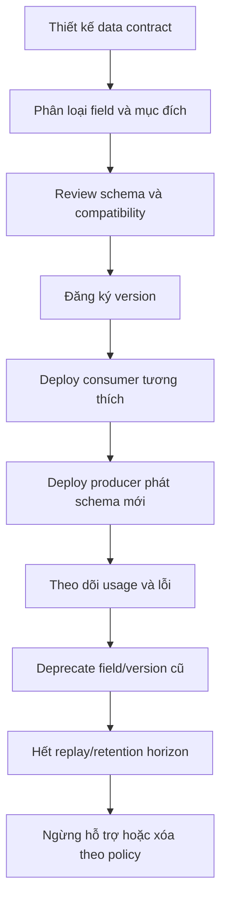

# Quản lý dữ liệu nhạy cảm và vòng đời schema

Kafka thường lưu event trong thời gian dài để phục vụ nhiều consumer, replay, audit và phục hồi. Vì một record có thể được sao chép sang nhiều broker, topic retry, Dead Letter Topic (DLT), hệ thống phân tích và backup, dữ liệu nhạy cảm đưa vào Kafka có thể xuất hiện ở nhiều nơi hơn dự kiến. Khi schema thay đổi hoặc một cá nhân yêu cầu sửa/xóa dữ liệu, việc chỉ cập nhật Java class hay đăng ký schema version mới không làm thay đổi các record đã được ghi.

Quản lý dữ liệu nhạy cảm vì vậy cần được thiết kế cùng data contract và vòng đời schema. Cần biết trường nào nhạy cảm, vì sao phải lưu, ai được đọc, lưu trong bao lâu, cách mã hóa/ẩn danh, cách xử lý ở log và DLT, cũng như cách thay đổi hoặc ngừng sử dụng field mà không làm hỏng consumer cũ. Schema Registry hỗ trợ quản lý cấu trúc và compatibility; chính sách bảo vệ dữ liệu còn cần được thực thi ở producer, broker, consumer, hệ thống lưu trữ và quy trình vận hành.

## 1. Xác định dữ liệu nhạy cảm trước khi đưa vào event

Trước khi thiết kế schema, hãy phân loại dữ liệu theo mức độ nhạy cảm và mục đích sử dụng. Không phải mọi field đều có cùng rủi ro hoặc cần cùng biện pháp bảo vệ.

Ví dụ một event đơn hàng:

```json
{
  "eventId": "evt-9012",
  "orderId": "ORD-2048",
  "customerId": "CUS-73",
  "email": "customer@example.com",
  "phone": "+84901234567",
  "shippingAddress": "12 Example Street",
  "paymentToken": "tok_xxx",
  "amount": 1250000,
  "currency": "VND"
}
```

Trong ví dụ này, `email`, `phone`, `shippingAddress` và `paymentToken` cần được xem xét kỹ. `customerId` có thể là mã giả danh nhưng vẫn có thể liên kết tới một cá nhân qua hệ thống khác. `orderId` hoặc `eventId` thường ít nhạy cảm hơn nhưng cũng có thể trở thành dữ liệu nhận diện khi kết hợp với nguồn khác.

Một phân loại đơn giản:

| Nhóm dữ liệu | Ví dụ | Cách xử lý thường cân nhắc |
|---|---|---|
| Công khai | Loại sản phẩm, tên danh mục công khai | Có thể truyền bình thường nếu không chứa metadata nhạy cảm |
| Nội bộ | Trạng thái xử lý, mã workflow | ACL theo service/team, giới hạn quyền đọc |
| Dữ liệu cá nhân | Email, số điện thoại, địa chỉ, định danh khách hàng | Tối thiểu hóa, hạn chế truy cập, retention rõ ràng, mã hóa hoặc tokenization khi phù hợp |
| Dữ liệu xác thực/bí mật | Access token, API key, mật khẩu, private key | Không đưa vào event; dùng secret manager và cơ chế cấp quyền riêng |
| Dữ liệu tài chính/đặc biệt nhạy cảm | Thông tin tài khoản, dữ liệu thanh toán, hồ sơ nhạy cảm | Giảm phạm vi lưu, mã hóa/tokenization, audit truy cập và chính sách lưu giữ nghiêm ngặt |

Phân loại phải dựa trên bối cảnh và quy định áp dụng cho tổ chức. Một trường không có tên giống PII vẫn có thể nhạy cảm; ví dụ vị trí thiết bị, mã khách hàng có thể liên kết hoặc nội dung tự do do người dùng nhập.

## 2. Nguyên tắc tối thiểu hóa dữ liệu

Biện pháp hiệu quả nhất thường là không phát hành dữ liệu không cần thiết. Trước khi thêm field vào event, hãy hỏi:

- Consumer nào thực sự cần field này?
- Consumer có thể lấy dữ liệu qua API có kiểm soát thay vì sao chép vào event không?
- Có thể gửi ID tham chiếu hoặc token thay vì giá trị gốc không?
- Có cần lưu field trong mọi event hay chỉ trong một loại event giới hạn?
- Có cần giữ field trong retry topic, DLT, analytics và backup không?
- Field có thể được loại khỏi log/trace mà vẫn đủ khả năng điều tra không?

Ví dụ, thay vì phát toàn bộ địa chỉ giao hàng tới mọi consumer, event có thể chỉ chứa `addressRef` và consumer được cấp quyền mới truy xuất chi tiết địa chỉ từ dịch vụ chuyên trách. Cách này giảm số bản sao của dữ liệu cá nhân, nhưng tạo thêm dependency runtime và cần xử lý trường hợp dịch vụ tham chiếu không sẵn sàng.

Không dùng Kafka header để chuyển dữ liệu nhạy cảm chỉ vì header nhỏ hoặc ít được chú ý. Key, value và headers đều được lưu trong record và có thể xuất hiện trong log, trace, DLT hoặc công cụ quản trị. Cần áp dụng phân loại cho toàn bộ record.

## 3. Ghi phân loại và ý nghĩa dữ liệu trong schema

Schema nên mô tả ý nghĩa field đủ rõ để producer, consumer và người review hiểu cách sử dụng. Với Avro có thể dùng `doc`; với JSON Schema có thể dùng `description` và annotation; với Protobuf có thể dùng comment và quy ước quản trị bổ sung.

Ví dụ Avro:

```json
{
  "type": "record",
  "name": "CustomerContactUpdated",
  "namespace": "com.example.customer.events",
  "fields": [
    {
      "name": "eventId",
      "type": "string",
      "doc": "ID ổn định của event; giữ nguyên khi retry hoặc replay."
    },
    {
      "name": "customerRef",
      "type": "string",
      "doc": "Mã tham chiếu giả danh; không phải credential."
    },
    {
      "name": "email",
      "type": ["null", "string"],
      "default": null,
      "doc": "Email cá nhân; chỉ consumer có quyền phù hợp mới được xử lý."
    }
  ]
}
```

Các mô tả trong schema giúp review và sinh tài liệu, nhưng `doc` hoặc `description` không tự mã hóa field, không tạo ACL và không ngăn consumer đọc dữ liệu. Nếu Registry hoặc nền tảng hỗ trợ tag/rule cho phân loại dữ liệu, có thể dùng chúng để bổ sung governance; vẫn phải xác minh rule có được thực thi ở runtime hay chỉ là metadata.

Không đặt dữ liệu cá nhân thật trong schema example, default, comment hoặc tên subject. Schema thường được nhiều developer và công cụ CI truy cập; metadata của schema cũng cần được xem xét về bảo mật.

## 4. Mã hóa ở các lớp khác nhau

Mã hóa cần phù hợp với nơi dữ liệu được bảo vệ và người có thể truy cập:

| Lớp bảo vệ | Bảo vệ điều gì? | Giới hạn |
|---|---|---|
| TLS giữa client và broker/Registry | Bảo vệ dữ liệu khi truyền qua mạng | Không bảo vệ bytes đã lưu trên broker hoặc dữ liệu sau khi consumer giải mã |
| Encryption at rest cho volume/disk/backup | Bảo vệ media lưu trữ khi bị truy cập vật lý trái phép | Broker hoặc process có quyền vẫn có thể đọc dữ liệu khi hệ thống đang chạy |
| Field-level/payload encryption | Giữ một số trường ở dạng mã hóa trong Kafka và các hệ thống trung gian | Cần quản lý key, quyền giải mã, rotation và xử lý truy vấn |
| Tokenization | Thay giá trị nhạy cảm bằng token tham chiếu | Cần bảo vệ vault/mapping service và xử lý tính sẵn sàng của dịch vụ token |
| Masking/redaction | Giảm lộ dữ liệu trong log, UI hoặc môi trường không cần giá trị đầy đủ | Không thay thế bảo vệ dữ liệu gốc trong topic |

TLS và encryption at rest là lớp cơ bản nhưng không đồng nghĩa payload đã được bảo vệ trước mọi principal có quyền đọc topic. Nếu nhiều consumer được cấp quyền đọc cùng topic nhưng chỉ một số consumer được phép thấy email hoặc số tài khoản, có thể cần tách topic theo mức nhạy cảm, tokenization hoặc mã hóa field-level với quyền giải mã riêng.

## 5. Field-level encryption và envelope encryption

Với field-level encryption, producer mã hóa trường nhạy cảm trước khi serialize record. Một thiết kế phổ biến là envelope encryption:

1. Ứng dụng yêu cầu Key Management Service (KMS) tạo hoặc cấp data encryption key (DEK).
2. Dùng DEK để mã hóa payload/field bằng thuật toán authenticated encryption phù hợp, chẳng hạn AES-GCM.
3. KMS bảo vệ DEK bằng key encryption key (KEK) và trả về wrapped DEK.
4. Record lưu ciphertext, nonce/IV, authentication tag và metadata định danh key cần thiết.
5. Consumer có quyền giải mã lấy wrapped DEK, yêu cầu KMS unwrap rồi giải mã ciphertext.

Minh họa record:

```json
{
  "eventId": "evt-9012",
  "customerRef": "CUS-73",
  "emailEncrypted": {
    "algorithm": "AES-256-GCM",
    "keyRef": "kms://customer-events/key-version-4",
    "nonce": "base64...",
    "ciphertext": "base64...",
    "wrappedDek": "base64..."
  }
}
```

Đây là cấu trúc minh họa, không phải wire format bắt buộc. Không lưu plaintext DEK hoặc KEK trong Kafka, schema, source code hay log. `keyRef` chỉ là định danh tham chiếu, không phải bí mật; quyền gọi KMS phải được cấp theo workload identity.

Authenticated encryption giúp phát hiện ciphertext bị sửa đổi. Nonce/IV phải được tạo theo yêu cầu của thuật toán và không được tái sử dụng với cùng key theo cách làm mất an toàn. Nên dùng thư viện mật mã đã được kiểm chứng thay vì tự thiết kế thuật toán hoặc format mã hóa.

### Đánh đổi của field-level encryption

- Consumer không có quyền giải mã vẫn có thể chuyển tiếp ciphertext, nhưng không thể xử lý nghiệp vụ cần plaintext.
- Tìm kiếm, filter, group hoặc join theo field đã mã hóa trở nên khó khăn.
- Randomized encryption khiến cùng một giá trị thường tạo ciphertext khác nhau; điều này tốt cho bảo mật nhưng không thể so sánh trực tiếp.
- Deterministic encryption có thể để lộ việc hai giá trị bằng nhau và cần đánh giá rủi ro trước khi dùng.
- Rotation có thể cần re-encrypt dữ liệu cũ hoặc duy trì nhiều key version trong thời gian chuyển đổi.

Nếu cần lookup theo email/định danh, cân nhắc tokenization hoặc keyed HMAC trong một thiết kế có kiểm soát. Hash không khóa của giá trị có entropy thấp như số điện thoại hoặc email có thể bị dò từ điển; không coi SHA-256 đơn thuần là ẩn danh an toàn.

## 6. Tokenization và pseudonymization

Tokenization thay dữ liệu gốc bằng một token không mang ý nghĩa trực tiếp. Ví dụ event chứa `customerRef=CUS-73` thay vì email và địa chỉ. Dịch vụ token giữ mapping giữa token và dữ liệu thật, kiểm soát quyền truy cập mapping riêng.

Pseudonymization thay định danh trực tiếp bằng một mã khác nhưng vẫn có thể liên kết lại nếu có bảng ánh xạ hoặc thông tin bổ sung. Vì vậy, dữ liệu giả danh vẫn có thể là dữ liệu cá nhân theo bối cảnh và không nên được xem là dữ liệu công khai.

Thiết kế token cần lưu ý:

- Token không được suy ra dễ dàng từ giá trị gốc.
- Mapping/vault cần ACL, audit, backup và quy trình rotation riêng.
- Không tái sử dụng token ngoài phạm vi cần thiết nếu điều đó cho phép liên kết hoạt động giữa các hệ thống.
- Consumer chỉ được resolve token khi có mục đích và quyền hợp lệ.
- Có phương án khi token service tạm thời không truy cập được.

## 7. Bảo vệ dữ liệu trong key, headers, logs và tracing

Dữ liệu nhạy cảm thường bị lộ ở nơi ngoài payload chính:

- Kafka key có thể chứa email, số tài khoản hoặc mã định danh trực tiếp.
- Headers có thể mang authorization token, session ID hoặc dữ liệu cá nhân.
- Log producer/consumer có thể ghi toàn bộ record khi debug.
- Exception và DLT header có thể chứa payload hoặc thông tin lỗi từ hệ thống ngoài.
- Distributed trace có thể đưa event value hoặc request body vào span attribute.
- Dashboard và công cụ quản trị có thể hiển thị key/value cho người có quyền xem topic.

Quy tắc thực hành:

1. Dùng key kỹ thuật ổn định như entity ID giả danh, không dùng credential hoặc dữ liệu cá nhân trực tiếp nếu không cần.
2. Chỉ đặt metadata cần thiết vào header; không đặt token xác thực hay secret.
3. Log event ID, topic, partition, offset và kết quả xử lý thay vì toàn bộ payload.
4. Redact field nhạy cảm trong log, exception, trace và metric label.
5. Không đưa email, phone hoặc customer ID trực tiếp vào metric label vì có thể gây lộ dữ liệu và cardinality tăng mạnh.
6. Kiểm tra serializer/deserializer error handler không ghi payload đầy đủ khi phát sinh lỗi.
7. Áp dụng cùng quy tắc cho retry topic, DLT, archive và công cụ replay.

Ví dụ log an toàn hơn:

```java
log.info("Processed eventId={} topic={} partition={} offset={} result={}",
        eventId, record.topic(), record.partition(), record.offset(), "SUCCESS");
```

Nếu cần điều tra payload, dùng quy trình truy cập có audit và thời hạn, không bật log toàn bộ dữ liệu trong production một cách rộng rãi.

## 8. Quyền truy cập Kafka và Schema Registry

Schema Registry không thay thế Kafka ACL. Cần cấp quyền riêng cho từng thành phần:

| Principal | Quyền nên giới hạn theo nhu cầu |
|---|---|
| Producer service | Ghi vào đúng topic; đọc/đăng ký schema theo subject được phép |
| Consumer service | Đọc đúng topic và sử dụng đúng consumer group |
| Schema deployment pipeline | Đăng ký version và kiểm tra compatibility; không cần quyền đọc mọi topic |
| Operator | Quyền quản trị có kiểm soát, audit và break-glass khi cần |
| DLT/replay service | Chỉ đọc/ghi các topic retry/DLT cần thiết |

Các nguyên tắc bảo vệ:

- Dùng TLS cho kết nối Kafka và Registry.
- Dùng SASL/OAuth hoặc cơ chế authentication được nền tảng hỗ trợ; không nhúng password trong repository.
- Cấp ACL tối thiểu theo topic, group và cluster resource cần thiết.
- Phân tách quyền đăng ký schema khỏi quyền produce nếu quy trình yêu cầu review schema.
- Audit thao tác đọc topic nhạy cảm, thay đổi ACL, đăng ký schema và replay.
- Xoay vòng credential và thu hồi quyền của workload đã ngừng hoạt động.

Topic-level ACL không phải field-level ACL. Nếu consumer có quyền đọc topic, thường nó có thể đọc toàn bộ record trong topic. Muốn giới hạn theo field, cần tách luồng dữ liệu, mã hóa field-level hoặc dùng dịch vụ trung gian có kiểm soát.

## 9. Retention và vòng đời dữ liệu trong Kafka

Kafka lưu record theo segment. Với `cleanup.policy=delete`, segment cũ có thể bị xóa theo retention time hoặc retention size. Với `cleanup.policy=compact`, log cleaner giữ bản ghi mới nhất theo key trong từng partition; compaction là quá trình nền và không xóa ngay mọi phiên bản cũ.

Ví dụ cấu hình topic có retention 7 ngày:

```bash
kafka-configs.sh --bootstrap-server localhost:9092 \
  --entity-type topics \
  --entity-name customer-events \
  --alter --add-config cleanup.policy=delete,retention.ms=604800000
```

Kiểm tra cấu hình hiệu lực:

```bash
kafka-configs.sh --bootstrap-server localhost:9092 \
  --entity-type topics \
  --entity-name customer-events \
  --describe
```

Giá trị 7 ngày chỉ là ví dụ. Retention phải được chọn theo mục đích nghiệp vụ, yêu cầu audit, khả năng replay, dung lượng và chính sách lưu trữ. Dữ liệu có thể được sao chép sang topic khác, DLT, data lake, backup hoặc hệ thống downstream; đặt retention trên topic nguồn không tự xóa các bản sao đó.

### Compaction không phải lệnh xóa tức thời

Trong compacted topic, tombstone (record có key và value null) đánh dấu key bị xóa khỏi trạng thái hiện tại. Tombstone được giữ theo `delete.retention.ms` trước khi có thể bị cleaner loại bỏ. Nó hữu ích cho state topic/changelog nhưng không xóa ngay tất cả bản ghi lịch sử có chứa dữ liệu cá nhân.

Nếu event log dùng `cleanup.policy=delete`, phát tombstone vào một topic khác không xóa record cũ ở topic event log. Nếu topic dùng `compact,delete`, retention vẫn có thể xóa segment theo thời gian/dung lượng; dữ liệu cuối cùng của key cũng có thể hết hạn. Cần hiểu đúng loại topic trước khi thiết kế quy trình xóa.

## 10. Xử lý yêu cầu sửa hoặc xóa dữ liệu cá nhân

Kafka là log phân tán, có replication và có thể có nhiều bản sao ngoài topic chính. Một yêu cầu xóa dữ liệu cần xác định toàn bộ nơi dữ liệu được lưu hoặc sao chép:

- Topic nguồn và các partition replica.
- Retry topic, retry theo tầng, DLT và topic audit.
- Consumer database, search index, cache và data warehouse.
- Object storage, archive, snapshot và backup.
- Log, trace, metric label và hệ thống hỗ trợ vận hành.
- Bản sao do connector hoặc pipeline khác tạo ra.

Không nên hứa rằng xóa một record bằng API Kafka sẽ làm dữ liệu biến mất tức thời và không thể phục hồi. Delete Records có thể tiến log start offset; retention/compaction dọn dữ liệu theo cơ chế nền. Các bản sao, backup, filesystem snapshot hoặc tiered storage có vòng đời riêng.

### Quy trình xử lý đề xuất

1. Xác minh yêu cầu và định danh dữ liệu cần xử lý theo chính sách tổ chức.
2. Tra lineage để xác định topic, partition, consumer store, DLT, archive và backup liên quan.
3. Ngăn phát sinh bản sao mới bằng cách sửa producer/consumer hoặc policy nguồn.
4. Xác định phương thức xử lý phù hợp: xóa theo retention/segment, compacted state update, rebuild topic, xóa ở downstream hoặc crypto-shredding.
5. Thực hiện theo quy trình có phê duyệt và audit, bảo đảm không làm mất dữ liệu không thuộc phạm vi.
6. Xử lý backup và bản sao theo lịch/khả năng kỹ thuật đã công bố.
7. Xác minh kết quả ở từng hệ thống và lưu bằng chứng xử lý theo chính sách.

Quy trình pháp lý cụ thể phụ thuộc loại dữ liệu, khu vực pháp lý, hợp đồng và chính sách lưu trữ của tổ chức. Bài học kỹ thuật này không thay thế việc xác định nghĩa vụ pháp lý với bộ phận có thẩm quyền.

## 11. Crypto-shredding: hủy key để làm ciphertext không thể giải mã

Với dữ liệu đã được mã hóa field-level bằng DEK riêng cho một cá nhân hoặc một phạm vi dữ liệu, một chiến lược có thể cân nhắc là **crypto-shredding**: hủy key cần thiết để giải mã ciphertext. Nếu mọi bản sao của key và material cần thiết để khôi phục key đều đã bị hủy an toàn, ciphertext còn lại có thể không còn khả năng giải mã thực tế.

Crypto-shredding chỉ đáng tin khi:

- Key được tách khỏi Kafka và dữ liệu được mã hóa.
- Mỗi phạm vi xóa có key riêng đủ nhỏ (ví dụ theo subject/entity hoặc nhóm dữ liệu được xác định rõ).
- Không còn bản sao key trong backup, cache, export, log hoặc hệ thống khác.
- KMS có quy trình hủy/disable key và audit rõ ràng.
- Không có plaintext copy trong DLT, database, analytics hoặc log.
- Việc hủy key không phá hủy dữ liệu của người khác dùng chung key.

Nếu một DEK dùng chung cho hàng triệu record, hủy key sẽ ảnh hưởng tất cả record đó. Nếu key được backup có thể phục hồi, thao tác xóa key trong một nơi chưa chắc làm ciphertext không thể giải mã. Crypto-shredding không tự xóa metadata, ciphertext, bản sao plaintext hoặc thông tin có thể nhận diện còn ở hệ thống khác.

## 12. Vòng đời schema: từ thiết kế đến ngừng sử dụng

Schema có vòng đời dài hơn một lần deploy ứng dụng vì record cũ vẫn có thể được đọc lại trong thời gian retention hoặc từ archive. Một quy trình nên gồm các giai đoạn:



### Giai đoạn 1: thiết kế

- Xác định owner của event và subject.
- Mô tả ý nghĩa, kiểu, đơn vị, timezone, nullability và sensitivity của từng field.
- Chỉ thêm field cần thiết cho consumer đã xác định.
- Chọn key và partitioning theo ordering nghiệp vụ.
- Quyết định field nhạy cảm được loại bỏ, token hóa hay mã hóa.

### Giai đoạn 2: review và compatibility

- Lưu schema trong source control.
- Kiểm tra syntax và compatibility với policy của subject.
- Chạy contract test với payload của các version đang được hỗ trợ.
- Kiểm tra consumer cũ có thể đọc record mới và consumer mới có thể đọc record cũ theo rollout plan.
- Review thay đổi sensitivity: thêm field PII hoặc thay đổi mục đích sử dụng phải có đánh giá bảo vệ dữ liệu.

### Giai đoạn 3: đăng ký và triển khai

- Đăng ký schema mới qua CI/CD hoặc quy trình có review.
- Deploy consumer có khả năng đọc schema mới trước khi producer phát dữ liệu mới khi cần.
- Deploy producer theo rollout có kiểm soát.
- Theo dõi lỗi serialization/deserialization, schema ID, consumer lag và hành vi downstream.

### Giai đoạn 4: deprecation và retirement

- Đánh dấu field cũ là deprecated trong tài liệu/hợp đồng và thông báo consumer owner.
- Ngừng producer ghi field cũ sau khi consumer đã chuyển.
- Giữ khả năng đọc record cũ trong suốt retention/replay horizon cần thiết.
- Chỉ xóa field/schema hoặc ngừng hỗ trợ khi không còn consumer, replay, archive hoặc yêu cầu audit phụ thuộc.
- Lập kế hoạch xử lý dữ liệu cũ chứa field nhạy cảm nếu mục tiêu là xóa dữ liệu, vì đăng ký schema mới không sửa record cũ.

## 13. Thay đổi field nhạy cảm cần chiến lược riêng

Thêm, đổi hoặc xóa field nhạy cảm không chỉ là thay đổi cấu trúc:

| Thay đổi | Rủi ro | Cách triển khai nên cân nhắc |
|---|---|---|
| Thêm field PII mới | Tăng phạm vi dữ liệu và quyền truy cập | Đánh giá mục đích, consumer, retention, mã hóa và compatibility trước khi đăng ký |
| Chuyển plaintext sang ciphertext | Consumer cũ có thể không đọc được hoặc vẫn kỳ vọng plaintext | Thêm field mã hóa mới, triển khai consumer hỗ trợ cả hai, chuyển producer, rồi ngừng field plaintext |
| Đổi định danh trực tiếp sang token | Consumer có thể phụ thuộc định dạng cũ hoặc cần resolve token | Expand-contract, kiểm thử token service và quyền resolve |
| Xóa field khỏi schema mới | Record cũ vẫn còn field trong Kafka/backup | Giữ reader tương thích, xử lý dữ liệu lịch sử riêng nếu cần xóa thật |
| Đổi ý nghĩa field nhưng giữ kiểu | Compatibility check có thể vẫn pass | Tạo field/event version mới và mô tả semantic contract rõ ràng |
| Thay đổi key chứa dữ liệu cá nhân | Ảnh hưởng partitioning, compaction và ordering | Migration topic/partition có kế hoạch; tránh thay key tại chỗ mà không đánh giá |

Không nên đổi trực tiếp field `email` từ plaintext sang ciphertext nhưng vẫn giữ cùng tên và cùng kiểu `string` nếu consumer không biết format đã thay đổi. Dù schema compatibility có thể pass, ứng dụng cũ sẽ nhận ciphertext và có thể xử lý sai. Dùng tên/kiểu/phiên bản rõ ràng hoặc một migration contract có quy tắc nhận diện format.

## 14. Compatibility không đồng nghĩa với dữ liệu đã được làm sạch

Schema Registry kiểm tra khả năng tương thích giữa schema theo policy. Nó không:

- Sửa các record cũ trong Kafka.
- Xóa field đã ghi từ partition log.
- Mã hóa lại payload lịch sử.
- Xóa dữ liệu khỏi retry topic, DLT, backup hoặc database downstream.
- Bảo đảm consumer không log plaintext.
- Xác minh ý nghĩa nghiệp vụ hoặc mục đích thu thập dữ liệu.

Ví dụ, V2 bỏ field `phone` và tương thích với một số consumer cũ. Record được ghi theo V1 vẫn chứa số điện thoại trong bytes của Kafka. Consumer dùng schema V2 có thể không expose field đó trong object, nhưng điều này không có nghĩa dữ liệu đã bị xóa khỏi log.

Tách hai công việc:

- **Schema evolution:** thay đổi hợp đồng để ứng dụng mới hoạt động an toàn với dữ liệu cũ/mới.
- **Data lifecycle operation:** xử lý dữ liệu đã lưu theo retention, deletion, migration, re-encryption hoặc archive policy.

Hai công việc liên quan nhưng cần kế hoạch và xác minh riêng.

## 15. Retention phải nhất quán giữa topic, DLT và hệ thống downstream

Một event có thể được giữ lâu hơn topic nguồn nếu consumer ghi nó vào database hoặc DLT. Khi thiết kế retention, lập bảng lineage tối thiểu:

| Nơi lưu | Câu hỏi cần xác định |
|---|---|
| Topic nguồn | Retention time/size, delete hay compact, ai được replay? |
| Retry topic | Thời gian chờ tối đa và retention có đủ cho retry backlog không? |
| DLT | Ai xử lý, thời gian lưu, cách replay và cách xóa dữ liệu nhạy cảm? |
| Consumer database | Có processed marker, projection, cache hoặc bản sao PII không? |
| Data lake/warehouse | Partition theo ngày/subject, retention và quy trình xóa ra sao? |
| Backup/snapshot | Chu kỳ backup, thời gian giữ, mã hóa và quy trình hết hạn? |
| Logs/traces | Redaction, retention, quyền đọc và export? |

Không đặt retention của DLT vô hạn chỉ vì cần điều tra. Ngược lại, không đặt retention quá ngắn nếu chưa có quy trình xử lý lỗi và replay. Retention phải đồng bộ với SLA vận hành và nghĩa vụ lưu dữ liệu của tổ chức.

## 16. Ví dụ cấu hình bảo vệ kết nối

Kafka client nên dùng TLS và cơ chế xác thực được cluster hỗ trợ. Ví dụ cấu hình khái niệm:

```properties
security.protocol=SASL_SSL
sasl.mechanism=SCRAM-SHA-512
sasl.jaas.config=org.apache.kafka.common.security.scram.ScramLoginModule required username="${KAFKA_USERNAME}" password="${KAFKA_PASSWORD}";
```

Đây là ví dụ theo SASL/SCRAM; cơ chế thực tế có thể là OAuth, mTLS hoặc phương án do nền tảng quy định. Không commit credential thật vào file cấu hình, image hoặc repository; lấy secret từ secret manager và xoay vòng định kỳ.

Schema Registry cần TLS/authentication/authorization riêng theo cách triển khai. Việc Kafka connection đã dùng SASL_SSL không tự bảo vệ HTTP connection tới Registry nếu Registry endpoint chưa được cấu hình TLS.

## 17. Lỗi thường gặp

| Hiện tượng | Nguyên nhân có thể | Hướng xử lý |
|---|---|---|
| Email xuất hiện trong log consumer | Log toàn bộ `ConsumerRecord` hoặc exception chứa payload | Log event ID/offset, redact field và kiểm tra appender/trace exporter |
| DLT chứa nguyên payload nhạy cảm | Recoverer sao chép value/header gốc | Đánh giá DLT ACL/retention; mã hóa hoặc redact theo yêu cầu, giữ thông tin đủ điều tra |
| Consumer không đọc được sau khi mã hóa field | Consumer cũ vẫn kỳ vọng plaintext | Dùng expand-contract và triển khai reader hỗ trợ format mới trước producer |
| Schema compatibility pass nhưng nghiệp vụ lỗi | Ý nghĩa field/đơn vị thay đổi mà kiểu không đổi | Review semantic contract và version hóa event/field |
| Xóa field trong schema nhưng PII vẫn còn | Schema mới không sửa record đã lưu | Thực hiện data lifecycle operation trên topic, downstream, archive và backup |
| Tombstone không xóa event lịch sử | Tombstone chỉ biểu diễn xóa key trong compacted topic | Dùng retention/rewrite/deletion workflow phù hợp với loại topic |
| Hủy key nhưng dữ liệu vẫn giải mã được | Còn key backup, plaintext copy hoặc DEK cache | Kiểm kê key material và mọi bản sao; kiểm chứng quy trình crypto-shredding |
| Consumer không có quyền giải mã nhưng vẫn thấy ciphertext | Topic ACL cho phép đọc bytes | Đây là hành vi dự kiến; giới hạn thêm quyền KMS và tách topic nếu cần |
| Registry metadata chứa thông tin nhạy cảm | Dùng dữ liệu thật trong schema example/doc/default | Thay bằng dữ liệu giả, review schema metadata và giới hạn quyền Registry |
| Replay làm xuất hiện dữ liệu đã yêu cầu xóa | Archive/DLT/backup chưa được xử lý hoặc producer còn phát bản sao | Theo dõi lineage, ngăn phát lại nguồn cũ và áp dụng deletion policy đồng bộ |

## 18. Checklist production

**Trước khi phát hành schema:**

- Phân loại từng field và ghi rõ mục đích sử dụng.
- Loại bỏ field không cần thiết; cân nhắc ID tham chiếu/token thay plaintext.
- Xác định key, value và headers có chứa dữ liệu nhạy cảm hay không.
- Chọn encryption/tokenization và quản lý key phù hợp.
- Review compatibility và rollout với consumer cũ.
- Không đưa dữ liệu thật hoặc secret vào schema metadata/default/example.

**Khi vận hành Kafka:**

- Bật TLS và authentication; cấp ACL tối thiểu.
- Giới hạn quyền đọc topic và quyền giải mã KMS riêng biệt.
- Redact log, trace, exception, DLT và metric label.
- Đặt retention theo topic, retry, DLT, database và archive.
- Theo dõi schema version, consumer usage, replay và dữ liệu được sao chép.
- Có quy trình key rotation, credential rotation và thu hồi quyền.

**Khi deprecate hoặc xóa dữ liệu:**

- Xác định toàn bộ lineage và bản sao.
- Ngừng producer phát field/dữ liệu không còn được phép.
- Triển khai consumer không còn phụ thuộc field cũ.
- Xử lý record lịch sử, downstream, DLT, archive và backup theo policy.
- Nếu dùng crypto-shredding, xác minh không còn key material có thể khôi phục.
- Xác minh kết quả và lưu audit evidence.

## 19. Ghi nhớ

Quản lý dữ liệu nhạy cảm bắt đầu từ phân loại và tối thiểu hóa: chỉ đưa vào event những field consumer thực sự cần. Schema nên mô tả ý nghĩa và mức nhạy cảm, nhưng metadata không tự tạo mã hóa hay quyền truy cập. TLS bảo vệ dữ liệu khi truyền; encryption at rest bảo vệ media lưu trữ; field-level encryption và tokenization giúp giới hạn việc đọc plaintext. Cần bảo vệ cả key, headers, logs, traces, retry topic, DLT và backup.

Vòng đời schema gồm thiết kế, review compatibility, đăng ký version, rollout consumer/producer, theo dõi, deprecate và retirement. Đăng ký schema mới hoặc bỏ field khỏi schema không xóa dữ liệu cũ trong Kafka. Retention, compaction, deletion, downstream cleanup và backup cần quy trình riêng. Khi cần xóa dữ liệu, phải theo dõi toàn bộ lineage; crypto-shredding chỉ hữu ích khi key material và mọi bản plaintext được kiểm soát đầy đủ. Thiết kế đồng bộ data contract và data lifecycle giúp hệ thống Kafka tiến hóa mà vẫn bảo vệ dữ liệu trong suốt thời gian lưu trữ và replay.
