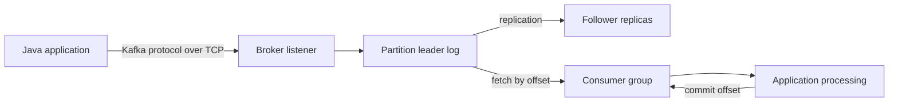

# Kiến thức nền về Java, mạng, lưu trữ và hệ phân tán

## Mục tiêu bài học

Trước khi chạy Kafka, người học cần hiểu ứng dụng Java giao tiếp với một dịch vụ qua mạng như thế nào, dữ liệu được ghi bền vững ra sao và điều gì thay đổi khi hệ thống chạy trên nhiều máy. Đây là những kiến thức nền để đọc cấu hình Kafka, chẩn đoán lỗi kết nối, hiểu khả năng chịu lỗi và thiết kế producer/consumer đáng tin cậy.

Sau bài học, bạn có thể:

- Phân biệt JDK, JVM và ứng dụng Java đang chạy; kiểm tra công cụ Java và build tool trên máy.
- Giải thích IP, DNS, TCP, port, TLS và đường đi cơ bản của một kết nối từ ứng dụng đến Kafka broker.
- Phân biệt dữ liệu trong bộ nhớ với dữ liệu đã được lưu bền vững; hiểu vai trò của log, ghi tuần tự và đồng bộ xuống đĩa.
- Mô tả node, replication, leader/follower, quorum, lỗi một phần và các giới hạn của hệ phân tán.
- Liên hệ các khái niệm trên với broker, partition, replica, producer, consumer và consumer group trong Kafka.

## 1. Java: nền tảng chạy ứng dụng Kafka

Kafka broker được triển khai trên JVM, còn các ứng dụng producer và consumer thường được viết bằng Java hoặc một ngôn ngữ có Kafka client tương ứng. Vì vậy, cần phân biệt môi trường chạy của broker với môi trường chạy của ứng dụng client.

### 1.1. JDK, JVM và bytecode

- **JDK (Java Development Kit)** cung cấp compiler (`javac`), công cụ đóng gói và các tiện ích phát triển. Máy dùng để biên dịch mã nguồn cần JDK.
- **JVM (Java Virtual Machine)** thực thi bytecode Java, quản lý bộ nhớ heap, garbage collection, thread và các tối ưu hóa khi chương trình chạy.
- **JRE** là cách gọi môi trường chạy Java gồm JVM và thư viện cần thiết. Với các bản phân phối Java hiện đại, người dùng thường cài JDK để có cả công cụ chạy lẫn phát triển.
- **Bytecode** là mã trung gian trong file `.class`. Compiler chuyển mã nguồn `.java` thành bytecode; JVM nạp và thực thi bytecode đó trên hệ điều hành tương ứng.

Quy trình đơn giản:

```text
Source code (.java)
       |
       | javac
       v
Bytecode (.class)
       |
       | JVM: class loading, verification, execution
       v
Running Java process
```

Điểm cần nhớ: một ứng dụng Java đang chạy là một **process** của hệ điều hành. Bên trong process có thể có nhiều **thread** cùng thực hiện công việc. Kafka client dùng thread để gửi request, nhận response, xử lý callback hoặc chạy các tác vụ nền. Vì thế, lỗi cấu hình JVM, thiếu bộ nhớ, thread bị chặn hay ứng dụng bị dừng đều có thể ảnh hưởng đến luồng sự kiện.

### 1.2. Kiểm tra môi trường Java

Mở terminal mới và chạy:

```bash
java -version
javac -version
```

Hai lệnh giúp kiểm tra runtime và compiler mà terminal đang tìm thấy qua `PATH`. Nếu `java` chạy được nhưng `javac` không tồn tại, máy có thể chỉ có runtime hoặc `PATH` chưa trỏ đến thư mục `bin` của JDK.

Nếu dự án dùng Maven Wrapper hoặc Gradle Wrapper, kiểm tra wrapper từ thư mục dự án:

```bash
# Maven Wrapper
./mvnw -version

# Gradle Wrapper
./gradlew --version
```

Trên Windows PowerShell, dùng `mvnw.cmd -version` hoặc `gradlew.bat --version` nếu repository cung cấp các file wrapper tương ứng. Wrapper giúp dự án chọn phiên bản build tool đã khai báo, giảm khác biệt giữa máy cá nhân và CI. Phiên bản JDK mà dự án yêu cầu vẫn phải đáp ứng cấu hình build của dự án.

Khi một lệnh hoạt động ở terminal này nhưng thất bại ở terminal khác, hãy kiểm tra `PATH`, `JAVA_HOME` và phiên bản JDK thực tế của từng môi trường. Đừng chỉ dựa vào phiên bản hiển thị trong IDE: tiến trình chạy ứng dụng có thể dùng JDK khác với terminal.

### 1.3. Bộ nhớ và vòng đời ứng dụng

JVM quản lý nhiều vùng bộ nhớ. Với ứng dụng Kafka, hai khái niệm thường gặp là:

- **Heap** chứa các object Java. Heap quá nhỏ có thể gây `OutOfMemoryError`; heap quá lớn cũng có thể làm thời gian garbage collection tăng hoặc tạo áp lực lên máy.
- **Stack** thuộc về từng thread, lưu frame của lời gọi hàm và biến cục bộ. Quá nhiều thread hoặc stack quá lớn cũng tiêu thụ bộ nhớ.

Ngoài heap và stack, process còn dùng bộ nhớ native, buffer trực tiếp, thư viện và bộ nhớ do hệ điều hành quản lý. Do đó, tổng RAM của process có thể lớn hơn đáng kể giá trị `-Xmx` (giới hạn heap tối đa).

Ví dụ cấu hình heap khi chạy một ứng dụng Java:

```bash
java -Xms512m -Xmx2g -jar event-consumer.jar
```

`-Xms` đặt heap ban đầu và `-Xmx` đặt giới hạn heap tối đa. Các con số trên chỉ là ví dụ cú pháp, không phải cấu hình khuyến nghị cho mọi ứng dụng. Hãy đo mức sử dụng thực tế, số lượng message, kích thước payload và giới hạn bộ nhớ của container hoặc máy trước khi điều chỉnh.

### 1.4. Thread, đồng thời và an toàn dữ liệu

**Concurrency** là khả năng nhiều công việc cùng tiến triển trong một khoảng thời gian; **parallelism** là thực thi thực sự đồng thời trên nhiều lõi CPU. Một ứng dụng có thể concurrent dù chỉ có một lõi CPU, vì scheduler luân phiên cấp thời gian cho các thread.

Khi nhiều thread cùng đọc/ghi một trạng thái, thứ tự thực thi có thể thay đổi. Nếu không có cơ chế đồng bộ phù hợp, chương trình có thể gặp race condition, mất cập nhật hoặc đọc trạng thái chưa nhất quán. Với Kafka client, cần chú ý hợp đồng thread-safety của từng đối tượng: không giả định mọi producer, consumer hay callback đều có thể được gọi đồng thời tùy ý. Đặc biệt, `KafkaConsumer` không được thiết kế để nhiều thread cùng gọi các thao tác consumer một cách tùy ý; thường một thread sở hữu consumer và các thread khác giao tiếp qua queue hoặc cơ chế phối hợp rõ ràng.

Một số khái niệm Java nên nhận diện:

- `synchronized`, `Lock`, `volatile` và các lớp trong `java.util.concurrent` hỗ trợ phối hợp giữa thread, nhưng mỗi cơ chế có ngữ nghĩa khác nhau.
- `ExecutorService` quản lý nhóm thread và vòng đời tác vụ.
- `CompletableFuture` biểu diễn kết quả bất đồng bộ và chuỗi xử lý tiếp theo.
- `try-with-resources` giúp đóng tài nguyên như socket, stream hoặc client khi không còn sử dụng.

Ví dụ đóng tài nguyên an toàn:

```java
try (var socket = new java.net.Socket("localhost", 9092)) {
    System.out.println("Connected: " + socket.isConnected());
} catch (java.io.IOException e) {
    System.err.println("Cannot connect to broker: " + e.getMessage());
}
```

Đoạn mã này chỉ kiểm tra TCP connection có thể được thiết lập đến `localhost:9092` hay không. Nó chưa xác thực Kafka protocol, chưa kiểm tra TLS/SASL và chưa chứng minh broker có thể xử lý request.

### 1.5. Build, dependency và cấu hình

Ứng dụng Java thường được biên dịch và đóng gói bằng Maven hoặc Gradle. Build tool quản lý dependency, plugin, profile và quy trình tạo artifact. Kafka client là một dependency của ứng dụng; broker là dịch vụ riêng, không phải thư viện được nhúng tự động vào process producer.

Nên tách cấu hình theo môi trường:

- Thông tin kết nối như `bootstrap.servers`.
- Cấu hình bảo mật như giao thức bảo mật, cơ chế SASL và đường dẫn truststore khi cần.
- Tham số ứng dụng như batch size, timeout, retry và kích thước queue.
- Bí mật như password hoặc token được lấy từ secret store hay biến môi trường phù hợp, không commit vào Git.

Không nên ghi cứng `localhost` trong ứng dụng sẽ chạy ở nhiều môi trường. Trong container, `localhost` trỏ về chính container đó; nó không tự động trỏ đến máy host hoặc container Kafka khác.

## 2. Mạng: đường đi từ ứng dụng đến Kafka

Kafka client giao tiếp với broker qua mạng. Ngay cả khi ứng dụng và broker chạy trên cùng máy, kết nối vẫn thường đi qua TCP socket và cổng mạng.

### 2.1. IP, DNS và port

- **IP address** xác định một giao diện mạng trong phạm vi định tuyến. IPv4 thường có dạng `192.0.2.10`; IPv6 có dạng dài hơn và dùng dấu `:`.
- **DNS** ánh xạ tên máy, chẳng hạn `broker-1.example.internal`, thành địa chỉ IP. DNS giúp cấu hình theo tên ổn định hơn so với ghi cứng IP, nhưng kết quả có thể thay đổi theo môi trường và thời gian cache.
- **Port** xác định dịch vụ hoặc socket đích trên một máy. Một kết nối TCP được nhận diện bởi địa chỉ IP và port ở hai đầu, cùng với giao thức vận chuyển.
- **Hostname** là tên được client phân giải qua DNS hoặc cơ chế phân giải tên của hệ điều hành. Tên phân giải được chưa chắc port dịch vụ đã mở.

Ví dụ, `broker.example.internal:9092` có nghĩa là client cần phân giải hostname rồi thiết lập kết nối đến TCP port `9092`. Port `9092` là giá trị thường gặp trong ví dụ Kafka, nhưng port thực tế phụ thuộc listener và cấu hình triển khai.

### 2.2. TCP và vòng đời kết nối

TCP cung cấp luồng byte hai chiều có thứ tự và cơ chế phát hiện/truyền lại một số segment bị mất. TCP không hiểu khái niệm Kafka record, topic hay partition; đó là trách nhiệm của giao thức ứng dụng chạy phía trên TCP.

Quá trình kết nối cơ bản:

```text
Java client                         Kafka broker
    |                                    |
    | -------- TCP SYN ----------------> |
    | <------- SYN + ACK --------------- |
    | -------- ACK --------------------> |
    |                                    |
    | ===== TCP connection established = |
    |                                    |
    | ---- Kafka protocol request -----> |
    | <--- Kafka protocol response ----- |
    |                                    |
```

TCP handshake thành công chỉ chứng minh hai đầu thiết lập được kết nối TCP. Sau đó client còn phải trao đổi đúng giao thức Kafka, có thể phải hoàn tất TLS handshake, xác thực SASL và được broker cấp quyền truy cập.

TCP giữ thứ tự byte trong một kết nối. Tuy nhiên, điều đó không đồng nghĩa mọi message của một topic đều có thứ tự toàn cục. Trong Kafka, thứ tự được bảo đảm trong phạm vi một partition; các partition khác nhau có thể được xử lý song song và không có thứ tự tổng thể mặc định.

### 2.3. DNS, routing và firewall

Khi client không kết nối được, kiểm tra theo từng lớp sẽ giúp khoanh vùng nhanh hơn:

1. Tên broker có phân giải thành địa chỉ IP phù hợp không?
2. Máy client có route đến mạng chứa broker không?
3. Firewall, security group, network policy hoặc NAT có chặn kết nối không?
4. Broker có đang lắng nghe trên đúng giao diện và port không?
5. Listener mà client dùng có quảng bá địa chỉ mà client thực sự truy cập được không?

Trên Windows PowerShell:

```powershell
Resolve-DnsName broker.example.internal
Test-NetConnection broker.example.internal -Port 9092
```

Trên Linux/macOS có thể dùng:

```bash
getent hosts broker.example.internal
nc -vz broker.example.internal 9092
```

Thay hostname và port bằng giá trị trong môi trường lab. `Test-NetConnection` hoặc `nc` chỉ kiểm tra khả năng thiết lập TCP đến endpoint; chúng không kiểm tra xác thực, quyền truy cập hay khả năng xử lý Kafka request.

### 2.4. Kafka listener và advertised address

Broker có thể lắng nghe trên một địa chỉ/port và quảng bá một địa chỉ khác cho client. Cấu hình listener xác định nơi broker nhận kết nối; `advertised.listeners` xác định địa chỉ mà broker thông báo để client tiếp tục kết nối.

Khái niệm này đặc biệt quan trọng khi dùng Docker, Kubernetes, máy ảo hoặc môi trường có NAT:

```text
Host machine                  Docker network
     |                              |
     | localhost:19092              | broker:9092
     +---------- port mapping ------+
                                    |
                              Kafka broker
```

Client chạy trên host có thể truy cập qua cổng được publish trên host. Client chạy trong cùng Docker network thường dùng tên service và port nội bộ. Nếu broker quảng bá `localhost:9092` cho một client ở container khác, client đó sẽ hiểu `localhost` là container của chính nó và kết nối thất bại.

Hãy xác định rõ vị trí chạy của client trước khi chọn địa chỉ bootstrap. `bootstrap.servers` là danh sách điểm bắt đầu để client khám phá cluster; sau khi kết nối, client có thể nhận metadata và kết nối trực tiếp đến các broker được metadata trả về. Vì vậy, chỉ mở được một bootstrap endpoint vẫn chưa đủ nếu các địa chỉ broker quảng bá không thể truy cập từ client.

### 2.5. TLS và xác thực

TCP không mã hóa dữ liệu và không xác minh danh tính máy chủ ở tầng ứng dụng. TLS bổ sung mã hóa khi truyền, kiểm tra chứng thư máy chủ và có thể hỗ trợ xác thực hai chiều bằng client certificate.

Kafka có thể dùng các listener khác nhau cho kết nối plaintext, TLS hoặc SASL. Cần phân biệt:

- **TLS** bảo vệ kênh truyền và xác minh chứng thư theo cấu hình trust.
- **SASL** là khung xác thực; cơ chế cụ thể quyết định cách client chứng minh danh tính.
- **Authorization/ACL** quyết định principal đã xác thực được phép thực hiện thao tác nào trên cluster, topic hoặc group.

Một kết nối TCP thành công không chứng minh TLS, SASL hoặc ACL đã đúng. Khi gặp lỗi bảo mật, hãy đọc thông báo handshake, authentication và authorization riêng biệt; kiểm tra hostname trong certificate, truststore, cơ chế SASL và quyền trên tài nguyên.

## 3. Lưu trữ: từ dữ liệu trong RAM đến dữ liệu bền vững

Một hệ thống event streaming phải giữ lại sự kiện đủ lâu để consumer đọc, xử lý lại hoặc phục hồi sau sự cố. Hiểu cách hệ điều hành và thiết bị lưu trữ ghi dữ liệu giúp giải thích vì sao Kafka sử dụng log tuần tự và vì sao cấu hình retention, replication cùng xác nhận ghi có ý nghĩa.

### 3.1. RAM, page cache và thiết bị lưu trữ

RAM có độ trễ thấp nhưng nội dung thông thường mất khi máy mất điện. SSD/HDD lưu dữ liệu bền vững hơn qua lần khởi động lại, nhưng độ trễ truy cập và thông lượng khác RAM.

Khi một process ghi file, dữ liệu có thể đi qua nhiều lớp:

```text
Application buffer
       |
       v
Operating system page cache
       |
       v
Filesystem / block layer
       |
       v
SSD or HDD
```

Một lệnh ghi thành công thường có nghĩa dữ liệu đã được hệ điều hành chấp nhận; không phải lúc nào nó cũng đồng nghĩa dữ liệu đã được đẩy xuống thiết bị vật lý. Hệ điều hành có thể giữ dữ liệu trong page cache và ghi xuống thiết bị sau đó. Các cơ chế như `fsync` yêu cầu đồng bộ dữ liệu theo hợp đồng của hệ điều hành và filesystem, nhưng độ bền cuối cùng còn phụ thuộc thiết bị, cache controller và cấu hình phần cứng.

Do đó, khi nói về durability, cần làm rõ mức xác nhận đang xét: ứng dụng đã gửi dữ liệu, broker đã nhận, replica đã ghi vào log, hay dữ liệu đã được xác nhận theo cấu hình replication và chính sách đồng bộ tương ứng.

### 3.2. File, block và log

Filesystem tổ chức dữ liệu thành file và thư mục; thiết bị lưu trữ thường đọc/ghi theo block. Ứng dụng làm việc với file hoặc API, còn hệ điều hành và filesystem ánh xạ thao tác đó xuống các block lưu trữ.

**Log** là cấu trúc dữ liệu ghi các thay đổi nối tiếp theo thời gian. Một append-only log thường thêm bản ghi vào cuối thay vì sửa tùy ý nhiều vị trí cũ. Cách ghi tuần tự có thể giảm thao tác seek và giúp tận dụng thông lượng thiết bị lưu trữ.

Các hệ quản trị dữ liệu cũng dùng ý tưởng log, ví dụ write-ahead log (WAL): ghi thông tin thay đổi vào log trước khi hoặc cùng với việc cập nhật cấu trúc dữ liệu chính. Sau sự cố, hệ thống có thể đọc log để khôi phục trạng thái theo quy tắc của nó.

Kafka lưu record của mỗi partition trong log riêng. Record được append vào cuối log và được gán offset tăng dần trong partition đó. Log được chia thành các segment để quản lý kích thước file, index và xóa dữ liệu cũ theo chính sách retention. Consumer thường đọc log theo offset; việc đọc lại dữ liệu cũ là một phần tự nhiên của mô hình lưu trữ sự kiện.

### 3.3. Throughput, latency và IOPS

Ba chỉ số thường được nhắc đến khi đánh giá lưu trữ:

- **Latency** là thời gian hoàn thành một thao tác. Độ trễ thấp quan trọng với request cần phản hồi nhanh.
- **Throughput** là lượng dữ liệu xử lý trong một đơn vị thời gian, ví dụ MB/s. Ghi tuần tự thường có thể đạt throughput cao.
- **IOPS** là số thao tác I/O mỗi giây. Nhiều thao tác nhỏ, ngẫu nhiên có thể bị giới hạn bởi IOPS và latency dù tổng dung lượng dữ liệu thấp.

Không có một chỉ số đơn lẻ mô tả đầy đủ hiệu năng. Một workload nhiều request nhỏ ngẫu nhiên khác workload ghi batch lớn tuần tự. Với Kafka, cần quan sát cả kích thước message, batch, số partition, tốc độ ghi, tốc độ đọc, page cache, disk latency và mức sử dụng mạng.

### 3.4. Retention và dung lượng đĩa

Kafka không mặc định xóa một record ngay khi consumer đọc xong. Thời gian giữ dữ liệu được điều khiển bởi chính sách retention theo thời gian hoặc dung lượng, cùng với chính sách cleanup như xóa segment cũ hay compact theo key.

Ước lượng dung lượng thô để lập kế hoạch:

```text
Dung lượng log xấp xỉ
  = tốc độ dữ liệu ghi (bytes/giây)
  × thời gian giữ (giây)
  × hệ số replication
  + phần dự phòng cho index, metadata và vận hành
```

Ví dụ: nếu cluster nhận 2 MB/s, giữ dữ liệu 24 giờ và replication factor là 3, phần log bản sao có thể cần khoảng `2 × 86.400 × 3 = 518.400 MB` (xấp xỉ 518 GB theo hệ thập phân), trước khi cộng overhead và dung lượng dự phòng. Đây là phép ước lượng đơn giản; phân bố tải giữa broker, nén, compact, retention thực tế và tốc độ tăng trưởng đều ảnh hưởng kết quả.

Replication tăng khả năng chịu lỗi nhưng cũng làm tăng dung lượng lưu trữ và lưu lượng mạng. Cần dự trù đủ dung lượng để cluster tiếp tục hoạt động trong lúc replica được tái đồng bộ hoặc broker phục hồi.

## 4. Hệ phân tán: nhiều node cùng tạo thành một hệ thống

Một hệ phân tán gồm nhiều process hoặc máy tính giao tiếp qua mạng để cung cấp một dịch vụ chung. Kafka cluster là một ví dụ: nhiều broker phối hợp lưu trữ partition, phục vụ client và sao chép dữ liệu.

### 4.1. Node, network và partial failure

Trong một chương trình chạy trên một máy, lỗi thường dễ quan sát trong cùng process. Trong hệ phân tán, mỗi node có thể hoạt động độc lập và liên lạc qua mạng. Một node có thể:

- Dừng hoàn toàn do crash hoặc mất điện.
- Vẫn chạy nhưng phản hồi chậm vì CPU, GC, disk hoặc network quá tải.
- Không liên lạc được với một số node do lỗi route, firewall hoặc phân vùng mạng.
- Nhận request nhưng client không nhận được response vì response bị mất hoặc timeout.

Đây là **partial failure**: một phần hệ thống lỗi trong khi phần khác vẫn hoạt động. Timeout không cho biết chắc chắn server đã thực hiện request hay chưa. Server có thể đã ghi dữ liệu nhưng response bị mất; nếu client gửi lại, thao tác có thể được thực hiện lần nữa.

Vì vậy, hệ phân tán cần thiết kế retry có giới hạn, timeout hợp lý, backoff, idempotency và cách xử lý kết quả không chắc chắn. Retry vô hạn hoặc retry ngay lập tức có thể làm hệ thống quá tải nặng hơn.

### 4.2. Replication, leader và follower

**Replication** tạo nhiều bản sao của dữ liệu trên các node khác nhau. Nếu một node hỏng, một bản sao khác có thể tiếp tục phục vụ tùy theo trạng thái replica và chính sách của hệ thống.

Một mô hình thường gặp là:

- **Leader** nhận các thao tác ghi hoặc điều phối thứ tự ghi cho một nhóm dữ liệu.
- **Follower** sao chép dữ liệu từ leader và có thể tham gia phục hồi hoặc bầu chọn theo giao thức.
- **Replica** là một bản sao của dữ liệu. Replication factor cho biết số replica được cấu hình cho một partition.

Trong Kafka, mỗi partition có một replica leader và có thể có các follower replica. Producer thường gửi record đến leader của partition đích. Follower sao chép log từ leader. Nếu leader lỗi, một replica đủ điều kiện có thể được chọn làm leader mới theo cơ chế quản lý replica của Kafka.

Replication không đồng nghĩa dữ liệu lập tức có mặt ở mọi replica. Replica có thể chậm hoặc tạm thời mất kết nối. Kafka theo dõi trạng thái đồng bộ của replica; khái niệm ISR (in-sync replicas) mô tả tập replica đang theo kịp leader theo tiêu chí của cluster. Cấu hình `acks`, `min.insync.replicas` và chính sách bầu chọn leader ảnh hưởng đến sự cân bằng giữa khả năng ghi, độ bền và tính sẵn sàng.

Ví dụ minh họa ba replica cho một partition:

```text
Partition P0 (replication factor = 3)

Broker 1                 Broker 2                 Broker 3
Leader                   Follower                 Follower
  log: 0 1 2 3 4           log: 0 1 2 3             log: 0 1 2 3
       |                         ^                        ^
       +-------------------------+------------------------+
                  replica fetch / replication
```

Hình chỉ minh họa follower có thể chậm hơn leader. Trạng thái đồng bộ thực tế do Kafka xác định theo tiến độ replica và cấu hình cluster.

### 4.3. Quorum và quyết định trong cluster

Nhiều hệ phân tán cần một nhóm node quản lý metadata hoặc điều phối quyết định. **Quorum** là số lượng thành viên tối thiểu cần tham gia để một quyết định được chấp nhận theo giao thức cụ thể. Trong một nhóm có `2f + 1` thành viên, quorum đa số thường là `f + 1`; mô hình này có thể tiếp tục đạt quorum khi tối đa `f` thành viên không hoạt động, nếu các điều kiện khác của giao thức vẫn được đáp ứng.

Kafka hiện đại có thể chạy metadata quorum bằng **KRaft**, sử dụng các controller để quản lý metadata cluster mà không cần ZooKeeper. Cần phân biệt controller quorum với replica của dữ liệu topic: đây là hai vai trò và hai loại trạng thái khác nhau, dù đều có liên quan đến khả năng chịu lỗi của cluster.

Không nên suy luận rằng cứ có ba broker thì mọi thao tác luôn chịu được một lỗi. Khả năng tiếp tục ghi còn phụ thuộc replication factor của partition, số replica đang đồng bộ, `min.insync.replicas`, `acks`, trạng thái controller quorum và vị trí lỗi. Cần xem các cấu hình cùng trạng thái cluster để kết luận.

### 4.4. Consistency, availability và partition tolerance

Trong hệ phân tán, **consistency** thường nói đến việc các node quan sát trạng thái dữ liệu theo một quy tắc nhất quán; **availability** nói đến việc request nhận được phản hồi; **partition tolerance** là khả năng hệ thống tiếp tục xử lý trong điều kiện mạng bị chia cắt.

Định lý CAP thường được dùng để nhắc rằng khi xảy ra network partition, một hệ thống phân tán phải đưa ra lựa chọn giữa việc giữ consistency theo mô hình mạnh và tiếp tục trả lời mọi request. CAP không có nghĩa hệ thống chỉ được chọn cố định hai trong ba thuộc tính ở mọi thời điểm; trade-off xuất hiện trong điều kiện partition và còn phụ thuộc định nghĩa consistency, phạm vi dữ liệu cùng thiết kế giao thức.

Trong thực tế, cần hỏi rõ:

- Client có thể đọc dữ liệu vừa ghi ngay lập tức từ mọi nơi không?
- Khi một replica mất kết nối, hệ thống từ chối ghi hay chấp nhận ghi với mức đảm bảo thấp hơn?
- Khi failover, dữ liệu nào đã được xác nhận có thể bị mất theo cấu hình hiện tại?
- Ứng dụng có chấp nhận dữ liệu đến trễ hoặc xử lý lại không?

Kafka cho phép điều chỉnh nhiều lựa chọn liên quan đến durability và availability. Ví dụ, producer `acks=all` yêu cầu broker đợi các replica đang nằm trong ISR xác nhận theo quy tắc Kafka; `min.insync.replicas` đặt ngưỡng replica đồng bộ tối thiểu để chấp nhận ghi. Nếu số ISR thấp hơn ngưỡng, ghi có thể bị từ chối thay vì tiếp tục với mức bảo vệ thấp hơn. Giá trị phù hợp tùy yêu cầu nghiệp vụ và topology.

### 4.5. Ordering, retry và idempotency

Trong hệ phân tán, nhiều request có thể chạy đồng thời, đi qua các đường mạng khác nhau hoặc được retry. Vì vậy, thứ tự mà producer gửi request không tự động trở thành thứ tự toàn cục mà mọi consumer quan sát.

Kafka bảo đảm thứ tự record trong một partition. Nếu các sự kiện cần được xử lý theo thứ tự của một thực thể, chẳng hạn đơn hàng, hãy chọn message key ổn định như `orderId` để các sự kiện của cùng đơn hàng được định tuyến về cùng partition. Điều này vẫn cần tính đến thay đổi số partition, cách chọn partitioner và logic xử lý song song trong consumer.

**Idempotency** nghĩa là thực hiện một thao tác lặp lại không làm thay đổi kết quả cuối cùng ngoài lần thực hiện đầu tiên theo định nghĩa nghiệp vụ. Ví dụ, thay vì cộng tiền cho mỗi message nhận được, một consumer có thể ghi nhận `eventId` đã xử lý và bỏ qua event trùng. Kafka producer idempotence giúp hạn chế duplicate do retry ở phía producer trong phạm vi các đảm bảo mà Kafka hỗ trợ; nó không tự làm cho mọi side effect ở database hoặc API bên ngoài trở nên idempotent.

Một số nguyên tắc thực hành:

- Đặt timeout dựa trên độ trễ kỳ vọng và giới hạn của hệ thống.
- Retry lỗi tạm thời với exponential backoff và jitter; không retry lỗi cấu hình hoặc lỗi xác thực như thể chúng sẽ tự hết.
- Dùng idempotency key hoặc bảng deduplication khi xử lý side effect có thể bị lặp.
- Ghi log correlation ID/event ID để lần theo một sự kiện qua producer, broker và consumer.
- Thiết kế consumer chịu được xử lý lại sau crash; chỉ commit offset khi trạng thái xử lý đáp ứng yêu cầu nghiệp vụ.

### 4.6. Timeouts, clocks và quan sát hệ thống

Đồng hồ trên các máy có thể lệch nhau. Timestamp trong event hữu ích để phân tích, nhưng không nên mặc định timestamp của hai máy xác định chính xác thứ tự xảy ra của hai sự kiện. Đồng hồ hệ thống cần được đồng bộ, ví dụ qua NTP, nhưng độ lệch vẫn cần được tính đến.

Khi điều tra sự cố, hãy kết hợp timestamp với offset Kafka, event ID, log của ứng dụng, metric broker và dấu thời gian monotonic trong cùng process nếu cần đo thời lượng. Offset cho biết vị trí của record trong partition và thường hữu ích hơn timestamp đơn lẻ để xác định thứ tự record trong partition đó.

## 5. Kết nối các kiến thức nền với kiến trúc Kafka

Các khái niệm trên liên hệ với những thành phần Kafka như sau:

| Thành phần/khái niệm | Vai trò | Kiến thức nền liên quan |
|---|---|---|
| Java producer/consumer | Ứng dụng gửi và đọc event | JVM, dependency, thread, timeout, exception, resource lifecycle |
| Broker | Process phục vụ client và quản lý dữ liệu partition | Process, network socket, CPU, heap, disk, page cache |
| Listener | Endpoint broker nhận kết nối | IP, DNS, port, TCP, TLS, SASL |
| Topic | Tên logic của luồng event | Schema, retention, phân loại dữ liệu |
| Partition | Đơn vị log có thứ tự và phân phối tải | Append-only log, offset, parallelism, ordering |
| Replica | Bản sao partition trên broker khác | Replication, failure, durability, network bandwidth |
| Leader/follower | Vai trò replica trong đọc/ghi và sao chép | Coordination, failover, consistency |
| Consumer group | Nhóm consumer chia nhau đọc partition | Concurrency, assignment, rebalancing, offset commit |
| KRaft controller quorum | Quản lý metadata cluster | Quorum, consensus, failure tolerance |

Một luồng gửi và nhận event điển hình:



Producer tạo record, chọn topic và có thể chọn key. Partitioner quyết định partition đích. Client gửi request đến broker leader của partition đó. Broker append record vào log và phản hồi theo cấu hình xác nhận. Follower sao chép dữ liệu. Consumer trong group fetch record theo offset, xử lý và commit offset theo chiến lược của ứng dụng.

Offset là vị trí record trong một partition, không phải số thứ tự toàn cluster. Hai partition có thể cùng có offset `10` nhưng đó là hai vị trí độc lập. Consumer group phân chia partition cho các consumer; thông thường một partition chỉ được gán cho tối đa một consumer trong cùng group tại một thời điểm, còn các group khác nhau có thể đọc độc lập.

## 6. Checklist chuẩn bị môi trường lab

Trước khi bắt đầu các bài thực hành Kafka, hãy kiểm tra các mục sau và ghi lại kết quả:

| Hạng mục | Cách kiểm tra | Kết quả mong đợi |
|---|---|---|
| Java runtime | `java -version` | Hiển thị phiên bản Java phù hợp yêu cầu dự án |
| Java compiler | `javac -version` | Có compiler nếu cần build mã nguồn |
| Build tool | `./mvnw -version` hoặc `./gradlew --version` | Wrapper chạy và nhận đúng JDK |
| DNS | `Resolve-DnsName <broker-host>` hoặc `getent hosts <broker-host>` | Tên broker phân giải được |
| TCP endpoint | `Test-NetConnection <broker-host> -Port <port>` hoặc `nc -vz <broker-host> <port>` | Có thể thiết lập TCP connection |
| Kafka listener | Dùng Kafka CLI/client phù hợp với lab | Client nhận metadata và giao tiếp được với broker |
| Storage | Kiểm tra dung lượng volume/data directory theo môi trường | Có đủ dung lượng cho log, replica và tăng trưởng |
| Time | Kiểm tra đồng bộ giờ của máy/VM/container host | Đồng hồ không lệch bất thường |

Không điền mật khẩu, token, private key hoặc nội dung truststore vào tài liệu chia sẻ. Khi lab dùng TLS/SASL, chỉ kiểm tra kết nối sau khi đã nhận cấu hình và credential từ nguồn được quản lý an toàn.

### Cách khoanh vùng lỗi theo lớp

Khi ứng dụng không gửi được event, hãy đi từ lớp thấp lên lớp cao:

1. **Runtime:** ứng dụng có khởi động được không, đúng JDK không, có lỗi heap/thread không?
2. **Name resolution:** hostname trong cấu hình có phân giải đúng từ chính môi trường chạy client không?
3. **Transport:** client có mở được TCP connection đến listener không?
4. **Security:** TLS handshake, SASL authentication và ACL authorization có thành công không?
5. **Kafka metadata:** client có nhận metadata và truy cập được leader của partition không?
6. **Producer semantics:** key, serializer, timeout, retry, `acks` và idempotence có đúng yêu cầu không?
7. **Consumer semantics:** group, partition assignment, offset commit, retry và xử lý message lỗi có đúng không?

Phân loại lỗi theo lớp giúp tránh thay đổi ngẫu nhiên nhiều cấu hình cùng lúc. Ví dụ, lỗi DNS không được giải quyết bằng cách tăng retry của producer; lỗi ACL không được giải quyết bằng cách mở thêm port.

## 7. Câu hỏi tự kiểm tra

1. Vì sao `java -version` thành công nhưng `javac -version` thất bại có thể cho thấy môi trường phát triển chưa đầy đủ?
2. TCP connection đến port Kafka thành công đã chứng minh được những gì, và chưa chứng minh được những gì?
3. Vì sao client chạy trong container không nên mặc định dùng `localhost` để truy cập broker ở container khác?
4. Page cache có vai trò gì trong đường đi của dữ liệu từ ứng dụng xuống thiết bị lưu trữ?
5. Vì sao append-only log phù hợp với mô hình lưu trữ record của Kafka?
6. Nếu broker leader đã ghi record nhưng response bị mất, producer có thể gặp tình huống nào khi retry?
7. Replication factor bằng 3 có tự động bảo đảm cluster luôn tiếp tục ghi khi một broker lỗi không? Vì sao?
8. Vì sao Kafka bảo đảm ordering trong partition nhưng không bảo đảm thứ tự toàn cục giữa các partition?
9. Consumer đã thực hiện side effect ở database nhưng crash trước khi commit offset có thể dẫn đến điều gì?
10. Khi kiểm tra lỗi kết nối, vì sao cần phân biệt DNS, TCP, TLS, SASL và ACL?

## Kết luận

Java cung cấp môi trường thực thi cho broker và client; mạng đưa request giữa các process; hệ thống lưu trữ giữ log để consumer có thể đọc và phục hồi; các cơ chế phân tán phối hợp nhiều broker để phân phối dữ liệu và chịu lỗi. Khi hiểu ranh giới của từng lớp, bạn có thể chuẩn bị môi trường lab có chủ đích, đọc cấu hình Kafka chính xác hơn và chẩn đoán sự cố theo bằng chứng.
