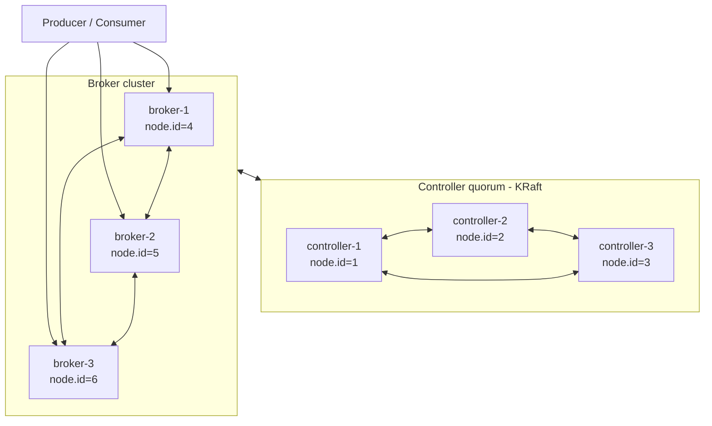

# Thiết lập cụm nhiều broker và controller để mô phỏng sự cố

## Mục tiêu

Trong bài lab này, bạn triển khai một Kafka cluster chạy KRaft với ba controller chuyên trách và ba broker. Sau khi kiểm tra producer, consumer, partition và replica, bạn chủ động dừng từng broker hoặc controller để quan sát khả năng bầu leader, duy trì quorum và bảo vệ dữ liệu.

Hoàn thành bài lab, bạn có thể:

- Phân biệt vai trò điều phối metadata của controller với vai trò lưu trữ và phục vụ record của broker.
- Giải thích vì sao KRaft cần một controller quorum và vì sao cụm ba controller chịu được một controller dừng.
- Cấu hình listener riêng cho giao tiếp trong Docker network và kết nối từ máy host.
- Tạo topic có replication factor bằng ba, đọc trạng thái leader, replica và ISR.
- Quan sát ảnh hưởng của sự cố broker và controller đối với đọc, ghi và thao tác metadata.

## 1. Kiến trúc lab

KRaft thay ZooKeeper bằng metadata log được quản lý bởi controller quorum. Trong mô hình này, controller chuyên trách xử lý metadata và điều phối cluster; broker chuyên trách nhận request từ client, lưu partition và sao chép record. Các node có `node.id` duy nhất trong toàn cluster.



| Thành phần | Số lượng | Vai trò |
|---|---:|---|
| Controller | 3 | Bầu controller leader, lưu và đồng bộ metadata log, điều phối thay đổi metadata |
| Broker | 3 | Lưu partition, nhận request từ client, replication và phục vụ consumer |
| Client | Tùy nhu cầu | Kết nối tới một hoặc nhiều broker qua `bootstrap.servers` |

Ba controller tạo quorum có đa số là hai node. Khi một controller dừng, hai node còn lại vẫn có thể duy trì quorum. Khi hai controller dừng, node còn lại không đủ đa số để tiếp tục xử lý các thay đổi metadata. Cụm dùng ba broker để mỗi partition của topic thử nghiệm có thể có ba replica, mỗi replica nằm trên một broker.

Lab sử dụng static KRaft quorum để phần khởi tạo dễ quan sát: mọi node khai báo cùng danh sách `KAFKA_CONTROLLER_QUORUM_VOTERS`. Kafka cũng hỗ trợ dynamic controller quorum; hai chế độ có cách bootstrap và quản lý thành viên khác nhau, không cấu hình đồng thời hai kiểu quorum cho cùng cluster.

## 2. Chuẩn bị môi trường

Bạn cần:

- Docker Desktop hoặc Docker Engine đang chạy và Docker Compose v2 (`docker compose version`).
- Các cổng `29092`, `39092`, `49092` còn trống trên máy host.
- Đủ bộ nhớ để chạy sáu tiến trình Kafka trong container. Khi Docker thiếu RAM, node có thể khởi động chậm hoặc bị hệ điều hành dừng.
- Terminal mở tại thư mục bạn muốn lưu file `compose.yaml`.

Ví dụ dưới đây dùng image chính thức `apache/kafka:4.4.0`, ba controller và ba broker. Tất cả node dùng chung một `CLUSTER_ID`, nhưng mỗi node có `node.id` và volume dữ liệu riêng. Controller chỉ mở listener điều phối nội bộ. Broker mở hai listener: `PLAINTEXT` cho các container trong Docker network và `PLAINTEXT_HOST` cho ứng dụng chạy trên máy host.

## 3. Khai báo cluster bằng Docker Compose

Tạo file `compose.yaml` với nội dung sau:

```yaml
name: kafka-kraft-lab

x-controller-env: &controller-env
  CLUSTER_ID: "4L6g3nShT-eMCtK--X86sw"
  KAFKA_PROCESS_ROLES: controller
  KAFKA_LISTENERS: "CONTROLLER://:9093"
  KAFKA_CONTROLLER_LISTENER_NAMES: CONTROLLER
  KAFKA_CONTROLLER_QUORUM_VOTERS: "1@controller-1:9093,2@controller-2:9093,3@controller-3:9093"
  KAFKA_INTER_BROKER_LISTENER_NAME: PLAINTEXT
  KAFKA_LISTENER_SECURITY_PROTOCOL_MAP: "CONTROLLER:PLAINTEXT,PLAINTEXT:PLAINTEXT"
  KAFKA_GROUP_INITIAL_REBALANCE_DELAY_MS: 0

x-broker-env: &broker-env
  CLUSTER_ID: "4L6g3nShT-eMCtK--X86sw"
  KAFKA_PROCESS_ROLES: broker
  KAFKA_INTER_BROKER_LISTENER_NAME: PLAINTEXT
  KAFKA_CONTROLLER_LISTENER_NAMES: CONTROLLER
  KAFKA_LISTENER_SECURITY_PROTOCOL_MAP: "CONTROLLER:PLAINTEXT,PLAINTEXT:PLAINTEXT,PLAINTEXT_HOST:PLAINTEXT"
  KAFKA_CONTROLLER_QUORUM_VOTERS: "1@controller-1:9093,2@controller-2:9093,3@controller-3:9093"
  KAFKA_OFFSETS_TOPIC_REPLICATION_FACTOR: 3
  KAFKA_TRANSACTION_STATE_LOG_REPLICATION_FACTOR: 3
  KAFKA_TRANSACTION_STATE_LOG_MIN_ISR: 2
  KAFKA_MIN_INSYNC_REPLICAS: 2
  KAFKA_DEFAULT_REPLICATION_FACTOR: 3
  KAFKA_NUM_PARTITIONS: 6
  KAFKA_GROUP_INITIAL_REBALANCE_DELAY_MS: 0

services:
  controller-1:
    image: apache/kafka:4.4.0
    hostname: controller-1
    environment:
      <<: *controller-env
      KAFKA_NODE_ID: 1
    volumes:
      - controller-1-data:/var/lib/kafka/data

  controller-2:
    image: apache/kafka:4.4.0
    hostname: controller-2
    environment:
      <<: *controller-env
      KAFKA_NODE_ID: 2
    volumes:
      - controller-2-data:/var/lib/kafka/data

  controller-3:
    image: apache/kafka:4.4.0
    hostname: controller-3
    environment:
      <<: *controller-env
      KAFKA_NODE_ID: 3
    volumes:
      - controller-3-data:/var/lib/kafka/data

  broker-1:
    image: apache/kafka:4.4.0
    hostname: broker-1
    ports:
      - "29092:9092"
    environment:
      <<: *broker-env
      KAFKA_NODE_ID: 4
      KAFKA_LISTENERS: "PLAINTEXT://:19092,PLAINTEXT_HOST://:9092"
      KAFKA_ADVERTISED_LISTENERS: "PLAINTEXT://broker-1:19092,PLAINTEXT_HOST://localhost:29092"
    depends_on:
      - controller-1
      - controller-2
      - controller-3
    volumes:
      - broker-1-data:/var/lib/kafka/data

  broker-2:
    image: apache/kafka:4.4.0
    hostname: broker-2
    ports:
      - "39092:9092"
    environment:
      <<: *broker-env
      KAFKA_NODE_ID: 5
      KAFKA_LISTENERS: "PLAINTEXT://:19092,PLAINTEXT_HOST://:9092"
      KAFKA_ADVERTISED_LISTENERS: "PLAINTEXT://broker-2:19092,PLAINTEXT_HOST://localhost:39092"
    depends_on:
      - controller-1
      - controller-2
      - controller-3
    volumes:
      - broker-2-data:/var/lib/kafka/data

  broker-3:
    image: apache/kafka:4.4.0
    hostname: broker-3
    ports:
      - "49092:9092"
    environment:
      <<: *broker-env
      KAFKA_NODE_ID: 6
      KAFKA_LISTENERS: "PLAINTEXT://:19092,PLAINTEXT_HOST://:9092"
      KAFKA_ADVERTISED_LISTENERS: "PLAINTEXT://broker-3:19092,PLAINTEXT_HOST://localhost:49092"
    depends_on:
      - controller-1
      - controller-2
      - controller-3
    volumes:
      - broker-3-data:/var/lib/kafka/data

volumes:
  controller-1-data:
  controller-2-data:
  controller-3-data:
  broker-1-data:
  broker-2-data:
  broker-3-data:
```

Các cấu hình quan trọng:

| Cấu hình | Ý nghĩa |
|---|---|
| `KAFKA_PROCESS_ROLES` | Phân node thành `controller` hoặc `broker`; lab không dùng node combined role |
| `KAFKA_NODE_ID` | ID duy nhất của từng node: controller `1–3`, broker `4–6` |
| `KAFKA_CONTROLLER_QUORUM_VOTERS` | Danh sách ba controller và địa chỉ listener quorum; phải giống nhau trên mọi node |
| `KAFKA_CONTROLLER_LISTENER_NAMES` | Tên listener dùng cho giao tiếp broker/controller |
| `KAFKA_INTER_BROKER_LISTENER_NAME` | Listener broker dùng để trao đổi dữ liệu với nhau |
| `KAFKA_ADVERTISED_LISTENERS` | Địa chỉ Kafka trả về trong metadata để client kết nối tới đúng broker |
| `KAFKA_MIN_INSYNC_REPLICAS` | Mức ISR tối thiểu cho ghi với `acks=all` khi topic dùng cấu hình này |
| `CLUSTER_ID` | Định danh cluster; mọi node phải được format với cùng cluster ID |

Hai địa chỉ bootstrap phụ thuộc vị trí ứng dụng:

| Nơi chạy client | `bootstrap.servers` |
|---|---|
| Trong Docker network | `broker-1:19092,broker-2:19092,broker-3:19092` |
| Trên máy host | `localhost:29092,localhost:39092,localhost:49092` |

Kafka client dùng bootstrap address để lấy metadata, sau đó kết nối trực tiếp tới broker được chỉ định trong metadata. Vì vậy `advertised.listeners` phải chứa hostname và port mà client thực sự truy cập được. Một ứng dụng trong Docker không thể dùng `localhost:29092` để tới broker trên host của nó; ứng dụng đó phải dùng tên service và listener nội bộ.

## 4. Khởi động và xác minh cluster

Từ thư mục chứa `compose.yaml`, khởi động sáu node:

```bash
docker compose up -d
docker compose ps
```

`depends_on` chỉ đảm bảo controller container được khởi chạy trước broker; nó không đảm bảo controller đã bầu leader hoặc sẵn sàng nhận request. Nếu lệnh kiểm tra chạy quá sớm, hãy xem log và thử lại sau:

```bash
docker compose logs --tail=100 controller-1 controller-2 controller-3 broker-1 broker-2 broker-3
```

Kiểm tra controller quorum từ một broker container:

```bash
docker compose exec broker-1 /opt/kafka/bin/kafka-metadata-quorum.sh --bootstrap-controller controller-1:9093 describe --status
```

Kết quả cần có một `LeaderId` hợp lệ, `CurrentVoters` gồm ba controller và high watermark của metadata log. Có thể dùng một controller bất kỳ còn hoạt động làm địa chỉ bootstrap.

Kiểm tra các broker đang nhận request:

```bash
docker compose exec broker-1 /opt/kafka/bin/kafka-broker-api-versions.sh --bootstrap-server broker-1:19092,broker-2:19092,broker-3:19092
```

Kết quả liệt kê các broker ID `4`, `5` và `6`. Nếu thiếu node, xem log của node đó và kiểm tra node ID, cluster ID, quorum voter list cùng DNS name trong Docker network.

## 5. Tạo topic và quan sát replication

Tạo topic `orders` gồm sáu partition, replication factor bằng ba và `min.insync.replicas=2`:

```bash
docker compose exec broker-1 /opt/kafka/bin/kafka-topics.sh --bootstrap-server broker-1:19092,broker-2:19092,broker-3:19092 --create --topic orders --partitions 6 --replication-factor 3 --config min.insync.replicas=2
```

Xem trạng thái topic:

```bash
docker compose exec broker-1 /opt/kafka/bin/kafka-topics.sh --bootstrap-server broker-1:19092 --describe --topic orders
```

Đọc các cột trong kết quả:

- `Partition`: số thứ tự partition trong topic.
- `Leader`: broker đang nhận request đọc/ghi cho partition đó.
- `Replicas`: các broker lưu bản sao của partition.
- `Isr`: các replica đang đồng bộ với leader và đủ điều kiện tham gia bầu leader an toàn.

Với ba broker và replication factor bằng ba, mỗi partition có một replica trên mỗi broker. Khi cluster ổn định, ISR của mỗi partition thường chứa đủ ba broker ID `4,5,6`. Leader có thể khác nhau giữa các partition.

Mở console producer trong một terminal:

```bash
docker compose exec broker-1 /opt/kafka/bin/kafka-console-producer.sh --bootstrap-server broker-1:19092,broker-2:19092,broker-3:19092 --topic orders --producer-property acks=all
```

Nhập vài dòng, ví dụ `order-1001 created`, `order-1002 paid`, rồi nhấn `Ctrl+C` để thoát producer. Mở terminal khác và đọc dữ liệu:

```bash
docker compose exec broker-2 /opt/kafka/bin/kafka-console-consumer.sh --bootstrap-server broker-1:19092,broker-2:19092,broker-3:19092 --topic orders --from-beginning
```

Consumer sẽ đọc lại các record đã ghi và tiếp tục chờ record mới. Nhấn `Ctrl+C` để dừng consumer.

Nếu ứng dụng Spring Boot chạy trực tiếp trên máy host, cấu hình bootstrap server như sau:

```properties
spring.kafka.bootstrap-servers=localhost:29092,localhost:39092,localhost:49092
spring.kafka.producer.acks=all
```

Nếu ứng dụng Spring Boot cũng chạy trong Docker Compose network, dùng `broker-1:19092,broker-2:19092,broker-3:19092` thay cho các địa chỉ `localhost`.

## 6. Mô phỏng sự cố broker

### 6.1. Dừng một broker

Dừng broker-1:

```bash
docker compose stop broker-1
```

Kiểm tra lại topic qua broker-2:

```bash
docker compose exec broker-2 /opt/kafka/bin/kafka-topics.sh --bootstrap-server broker-2:19092 --describe --topic orders
```

Quan sát leader của một số partition. Với replica còn đồng bộ, Kafka có thể bầu leader mới trên broker-2 hoặc broker-3. ISR của partition thường giảm từ ba xuống hai. Do `min.insync.replicas=2`, producer dùng `acks=all` vẫn có thể ghi khi hai replica còn lại tiếp tục đồng bộ.

Khởi động lại broker-1:

```bash
docker compose start broker-1
```

Chờ broker đăng ký lại và replica bắt kịp. Chạy lại lệnh `--describe`; ISR sẽ tăng trở lại khi replica đồng bộ xong. Việc container đã ở trạng thái running không có nghĩa dữ liệu đã bắt kịp hoàn toàn.

### 6.2. Dừng hai broker để kiểm tra `min.insync.replicas`

Sau khi broker-1 đã phục hồi và ISR đủ ba, dừng broker-1 và broker-2:

```bash
docker compose stop broker-1 broker-2
```

Broker-3 vẫn giữ một replica cho mỗi partition. Mở producer trên broker-3 và yêu cầu `acks=all`:

```bash
docker compose exec broker-3 /opt/kafka/bin/kafka-console-producer.sh --bootstrap-server broker-3:19092 --topic orders --producer-property acks=all
```

Ghi một record thử nghiệm. Do ISR chỉ còn một replica trong khi topic yêu cầu tối thiểu hai, Kafka từ chối ghi với lỗi liên quan đến `NotEnoughReplicas`. Cơ chế này ưu tiên điều kiện durability đã cấu hình hơn việc xác nhận một bản ghi khi số replica đồng bộ thấp hơn ngưỡng.

Khôi phục hai broker:

```bash
docker compose start broker-1 broker-2
```

Chờ cả hai broker bắt kịp rồi kiểm tra ISR trước khi tiếp tục lab.

## 7. Mô phỏng sự cố controller quorum

Controller quản lý metadata và trạng thái cluster. Với ba voter, quorum cần ít nhất hai voter. Ta sẽ dừng một controller trước, sau đó dừng thêm một controller để quan sát ranh giới chịu lỗi.

### 7.1. Mất một controller

Dừng controller-1:

```bash
docker compose stop controller-1
```

Kiểm tra quorum qua controller-2:

```bash
docker compose exec broker-1 /opt/kafka/bin/kafka-metadata-quorum.sh --bootstrap-controller controller-2:9093 describe --status
```

Hai controller còn lại vẫn tạo thành đa số. Quorum vẫn có leader và các thao tác metadata có thể tiếp tục. Ghi chú `LeaderId` để so sánh trước và sau sự cố.

### 7.2. Mất quorum

Tiếp tục dừng controller-2:

```bash
docker compose stop controller-2
```

Chỉ controller-3 còn hoạt động, không đủ đa số hai trên ba. Thử tạo topic mới:

```bash
docker compose exec broker-3 /opt/kafka/bin/kafka-topics.sh --bootstrap-server broker-3:19092 --create --topic quorum-test --partitions 1 --replication-factor 3
```

Request thay đổi metadata sẽ không được quorum commit và có thể chờ đến khi timeout hoặc trả lỗi liên quan đến controller/quorum. Dừng lệnh bằng `Ctrl+C` nếu cần. Mất quorum không đồng nghĩa mọi request đọc/ghi đang chạy lập tức dừng: broker có thể tiếp tục phục vụ một số partition đang có leader dựa trên metadata hiện tại, nhưng các thay đổi metadata và hoạt động cần controller phối hợp sẽ bị ảnh hưởng. Khả năng tiếp tục phục vụ còn phụ thuộc trạng thái broker, leader và thời gian outage.

Khôi phục quorum:

```bash
docker compose start controller-1 controller-2
```

Đợi controller tái gia nhập, sau đó chạy lại `kafka-metadata-quorum.sh --bootstrap-controller controller-1:9093 describe --status`. Chỉ tiếp tục khi có leader và quorum đủ ba voter.

## 8. Bảng kết quả cần ghi nhận

| Tình huống | Quorum controller | ISR của partition | Kết quả mong đợi |
|---|---|---|---|
| Cluster bình thường | 3/3 | 3 | Đọc/ghi hoạt động; replica đồng bộ |
| Dừng một broker | 3/3 | Thường còn 2 | Leader có thể chuyển sang replica khác; ghi `acks=all` vẫn đạt `min.insync.replicas=2` |
| Dừng hai broker | 3/3 | Còn 1 trên broker sống | Ghi `acks=all` bị từ chối do ISR thấp hơn 2 |
| Dừng một controller | 2/3 | Không nhất thiết đổi | Controller quorum vẫn hoạt động; metadata tiếp tục được điều phối |
| Dừng hai controller | 1/3 | Không nhất thiết đổi ngay | Không còn quorum để commit thay đổi metadata; một số traffic hiện hữu có thể còn hoạt động |

Khi thực hiện, ghi lại leader ID, ISR và thông báo lỗi thực tế. Kết quả cụ thể có thể thay đổi theo partition leader, thời điểm controller phát hiện node mất kết nối và thời gian replica bắt kịp.

## 9. Khôi phục và dọn dẹp

Đưa tất cả node về trạng thái chạy:

```bash
docker compose start controller-1 controller-2 controller-3 broker-1 broker-2 broker-3
```

Kiểm tra `docker compose ps`, controller quorum và ISR của topic `orders`. Nếu cần dừng lab nhưng giữ dữ liệu để chạy lại, dùng:

```bash
docker compose down
```

Lệnh trên xóa container và network của Compose nhưng giữ named volume. Khi cần xóa cả dữ liệu lab và khởi tạo cluster mới, dùng:

```bash
docker compose down -v
```

`-v` xóa toàn bộ volume được khai báo trong file, bao gồm metadata log của controller và dữ liệu partition của broker. Chỉ chạy lệnh này khi bạn chấp nhận mất dữ liệu lab.

## 10. Lỗi thường gặp

| Hiện tượng | Nguyên nhân thường gặp | Cách kiểm tra |
|---|---|---|
| Broker không đăng ký vào cluster | Controller chưa sẵn sàng, voter hostname sai hoặc node ID bị trùng | Xem log controller/broker; so sánh `KAFKA_NODE_ID` và `KAFKA_CONTROLLER_QUORUM_VOTERS` |
| Client bootstrap được nhưng request sau đó timeout | `advertised.listeners` trả về hostname/port client không truy cập được | Client trong Docker dùng `broker-N:19092`; client trên host dùng `localhost` và port đã publish |
| Không tạo được topic ngay sau `up -d` | `depends_on` chỉ đợi container khởi chạy, chưa đợi Kafka sẵn sàng | Kiểm tra quorum và danh sách broker rồi thử lại |
| ISR chưa trở lại đủ ba sau khi start broker | Replica vẫn đang phục hồi dữ liệu | Theo dõi `--describe` và log; chờ ISR bắt kịp |
| Node không thể tham gia sau khi đổi cấu hình cluster | Volume chứa metadata đã format theo cấu hình/cluster cũ | Kiểm tra cluster ID và dữ liệu volume; chỉ xóa volume khi có thể bỏ dữ liệu lab |
| Cổng host đã được sử dụng | Ứng dụng khác đang chiếm `29092`, `39092` hoặc `49092` | Đổi cả host port trong `ports` và host endpoint tương ứng trong `KAFKA_ADVERTISED_LISTENERS` |

## 11. Câu hỏi tự kiểm tra

1. Vì sao cụm có ba controller có thể tiếp tục hoạt động khi mất một controller, nhưng không thể commit metadata khi chỉ còn một controller?
2. `controller.quorum.voters` khác `bootstrap.servers` của Kafka client ở mục đích sử dụng nào?
3. Vì sao broker cần listener nội bộ và listener dành cho host trong cấu hình Docker nhiều node?
4. `Leader`, `Replicas` và `Isr` mô tả những trạng thái nào? Một replica nằm trong `Replicas` nhưng không nằm trong `Isr` có ý nghĩa gì?
5. Khi topic đặt `min.insync.replicas=2`, điều gì xảy ra với producer dùng `acks=all` nếu chỉ còn một replica trong ISR?
6. Vì sao mất controller quorum không nhất thiết làm mọi request đọc/ghi hiện hữu dừng ngay lập tức?
7. Khi dùng `docker compose down` và `docker compose down -v`, dữ liệu Kafka khác nhau như thế nào?

## Tài liệu tham khảo

- [Apache Kafka Docker image — Multiple nodes](https://hub.docker.com/r/apache/kafka): ví dụ triển khai ba broker và ba controller ở KRaft isolated mode, cùng cách cấu hình listener nội bộ và listener cho host.
- [Apache Kafka — KRaft](https://kafka.apache.org/44/operations/kraft/): vai trò broker/controller, static và dynamic controller quorum, cơ chế quorum và metadata log.
- [Apache Kafka — Broker configuration](https://kafka.apache.org/44/configuration/broker-configs/): ý nghĩa các cấu hình broker, controller và replication.

> Đây là môi trường học tập chạy PLAINTEXT trên Docker network, không cấu hình TLS hoặc SASL. Không đưa các listener này ra mạng công cộng và không dùng nguyên cấu hình lab làm cấu hình production.
