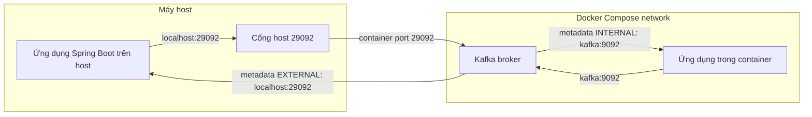

# Cấu hình listeners, advertised.listeners và kết nối trong Docker

## Môi trường thực hành

Kafka có thể chạy ổn định trong Docker nhưng ứng dụng vẫn không kết nối được nếu broker quảng bá địa chỉ không thể truy cập từ mạng của ứng dụng. Tình huống thường gặp là broker khởi động thành công, client kết nối được đến địa chỉ bootstrap, sau đó nhận metadata chứa `localhost:9092` hoặc tên container không phân giải được và liên tục timeout.

Bài thực hành này tập trung vào cách Kafka mở cổng nhận kết nối, cách broker công bố địa chỉ cho client và cách chọn địa chỉ đúng khi ứng dụng chạy trên máy host hoặc trong Docker Compose. Ví dụ sử dụng một broker Kafka chạy KRaft để cấu hình gọn và dễ thử nghiệm. Các nguyên tắc về listener cũng áp dụng cho cụm nhiều broker.

Sau bài học, người học có thể:

- Phân biệt `listeners`, `advertised.listeners` và `bootstrap.servers`.
- Giải thích vì sao địa chỉ `localhost` có ý nghĩa khác nhau giữa máy host và container.
- Cấu hình listener nội bộ, listener bên ngoài và listener controller cho Kafka KRaft.
- Kết nối ứng dụng Spring Kafka theo đúng mạng đang chạy.
- Kiểm tra metadata và xử lý các lỗi thường gặp khi Kafka chạy trong Docker.

## 1. Ba địa chỉ cần phân biệt

Khi client kết nối Kafka, có ba cấu hình thường bị nhầm lẫn. Chúng có liên quan nhưng đảm nhiệm các vai trò khác nhau.

### 1.1. `listeners`: địa chỉ Kafka bind để nhận kết nối

`listeners` quy định các socket mà tiến trình broker mở bên trong môi trường đang chạy. Một listener có dạng:

```text
<TÊN_LISTENER>://<ĐỊA_CHỈ_BIND>:<CỔNG>
```

Ví dụ:

```properties
listeners=INTERNAL://0.0.0.0:9092,EXTERNAL://0.0.0.0:29092,CONTROLLER://0.0.0.0:9093
```

Trong ví dụ này:

- `INTERNAL` nhận kết nối ứng dụng trong Docker network tại cổng `9092`.
- `EXTERNAL` nhận kết nối từ máy host qua cổng `29092`.
- `CONTROLLER` phục vụ giao tiếp điều khiển của KRaft tại cổng `9093`.
- `0.0.0.0` yêu cầu tiến trình bind trên tất cả interface mạng bên trong container.

Tên `INTERNAL`, `EXTERNAL` và `CONTROLLER` là tên listener do cấu hình đặt ra. Kafka ánh xạ từng tên sang giao thức bằng `listener.security.protocol.map`. Không dùng `0.0.0.0` làm địa chỉ client kết nối: đây là địa chỉ bind, không phải địa chỉ đích có thể quảng bá cho client.

### 1.2. `advertised.listeners`: địa chỉ Kafka công bố cho client

Sau khi client kết nối đến một broker, Kafka trả metadata mô tả các broker và endpoint mà client cần sử dụng. `advertised.listeners` quy định các địa chỉ được công bố trong metadata đó.

Ví dụ:

```properties
advertised.listeners=INTERNAL://kafka:9092,EXTERNAL://localhost:29092
```

Địa chỉ `kafka:9092` có thể được container khác trong cùng Docker network phân giải qua DNS của Docker. Địa chỉ `localhost:29092` dành cho ứng dụng chạy trực tiếp trên máy host.

Đây là điểm quan trọng nhất khi cấu hình Kafka trong Docker: địa chỉ bootstrap chỉ giúp client bắt đầu phiên kết nối. Sau đó client dùng metadata do broker trả về để giao tiếp với broker. Nếu metadata chứa địa chỉ không thể truy cập từ mạng của client, client vẫn có thể báo lỗi dù bước kết nối bootstrap ban đầu thành công.

Không quảng bá `localhost` cho ứng dụng chạy ở container khác. Trong container ứng dụng, `localhost` trỏ về chính container ứng dụng, không trỏ về container Kafka. Tương tự, không quảng bá `kafka:9092` cho một ứng dụng chạy ngoài Docker nếu máy host không có DNS hoặc route để phân giải tên `kafka`.

### 1.3. `bootstrap.servers`: địa chỉ khởi đầu của client

`bootstrap.servers` là danh sách địa chỉ client dùng để bắt đầu kết nối và lấy metadata. Client không cần liệt kê mọi broker ở đây; Kafka sẽ cung cấp metadata để client tìm broker cần thiết.

Ví dụ cấu hình theo vị trí của ứng dụng:

| Vị trí ứng dụng | `bootstrap.servers` phù hợp | Lý do |
|---|---|---|
| Chạy trực tiếp trên máy host | `localhost:29092` | Đi qua cổng EXTERNAL đã publish từ Docker |
| Chạy trong cùng Docker Compose network | `kafka:9092` | Dùng DNS service name và cổng INTERNAL |
| Chạy trên máy khác trong mạng | `kafka-dev.example.local:29092` | Dùng hostname/IP mà máy client thực sự truy cập được; broker cũng phải quảng bá endpoint này |

`bootstrap.servers` và `advertised.listeners` phải nhất quán với đường mạng mà client sử dụng. Chỉ thay địa chỉ bootstrap mà không sửa địa chỉ được quảng bá thường không giải quyết được lỗi metadata.

## 2. Mô hình mạng khi Kafka chạy trong Docker

Docker Compose tạo một network riêng cho các service. Các container trong cùng network có thể gọi nhau bằng tên service và cổng bên trong container. Máy host truy cập container thông qua cổng được publish.



Trong mô hình này, hai nhóm client dùng hai listener khác nhau:

- Client trong Compose dùng `INTERNAL`, kết nối đến `kafka:9092`.
- Client trên host dùng `EXTERNAL`, kết nối đến `localhost:29092`.

Docker publish cổng theo cú pháp `HOST_PORT:CONTAINER_PORT`. Vì vậy `29092:29092` chuyển kết nối đến cổng `29092` bên trong container Kafka. Việc publish cổng không tự thay đổi `advertised.listeners`; hai phần này phải được cấu hình đồng bộ.

## 3. Tạo Kafka KRaft bằng Docker Compose

Tạo file `compose.yaml` trong thư mục thực hành:

```yaml
services:
  kafka:
    image: apache/kafka:4.0.0
    hostname: kafka
    container_name: kafka
    ports:
      - "29092:29092"
    environment:
      # Một node đảm nhiệm cả broker và controller cho môi trường lab.
      KAFKA_NODE_ID: 1
      KAFKA_PROCESS_ROLES: broker,controller

      # INTERNAL dành cho container; EXTERNAL dành cho máy host.
      # CONTROLLER chỉ dùng cho quorum KRaft.
      KAFKA_LISTENERS: INTERNAL://0.0.0.0:9092,EXTERNAL://0.0.0.0:29092,CONTROLLER://0.0.0.0:9093
      KAFKA_ADVERTISED_LISTENERS: INTERNAL://kafka:9092,EXTERNAL://localhost:29092
      KAFKA_LISTENER_SECURITY_PROTOCOL_MAP: INTERNAL:PLAINTEXT,EXTERNAL:PLAINTEXT,CONTROLLER:PLAINTEXT

      KAFKA_INTER_BROKER_LISTENER_NAME: INTERNAL
      KAFKA_CONTROLLER_LISTENER_NAMES: CONTROLLER
      KAFKA_CONTROLLER_QUORUM_VOTERS: 1@kafka:9093

      # Các replication factor bằng 1 phù hợp với cụm lab chỉ có một broker.
      KAFKA_OFFSETS_TOPIC_REPLICATION_FACTOR: 1
      KAFKA_TRANSACTION_STATE_LOG_REPLICATION_FACTOR: 1
      KAFKA_TRANSACTION_STATE_LOG_MIN_ISR: 1
      KAFKA_GROUP_INITIAL_REBALANCE_DELAY_MS: 0
      KAFKA_NUM_PARTITIONS: 3
```

Khởi động broker:

```bash
docker compose up -d
docker compose ps
docker compose logs -f kafka
```

Đợi log cho biết broker đã khởi động và sẵn sàng nhận kết nối. Có thể xem cấu hình Compose sau khi Docker nội suy biến bằng lệnh:

```bash
docker compose config
```

### 3.1. Đọc các cấu hình quan trọng

| Cấu hình | Ý nghĩa trong bài lab |
|---|---|
| `KAFKA_LISTENERS` | Mở ba listener tại các cổng `9092`, `29092` và `9093` bên trong container |
| `KAFKA_ADVERTISED_LISTENERS` | Công bố `kafka:9092` cho container và `localhost:29092` cho host |
| `KAFKA_LISTENER_SECURITY_PROTOCOL_MAP` | Ánh xạ ba tên listener sang `PLAINTEXT` |
| `KAFKA_INTER_BROKER_LISTENER_NAME` | Chọn listener `INTERNAL` cho giao tiếp broker-to-broker |
| `KAFKA_CONTROLLER_LISTENER_NAMES` | Chỉ định listener `CONTROLLER` cho KRaft |
| `KAFKA_CONTROLLER_QUORUM_VOTERS` | Khai báo node controller có ID `1` tại `kafka:9093` |
| `ports` | Publish listener EXTERNAL từ container ra máy host |

`CONTROLLER` không nằm trong `advertised.listeners` vì đây là endpoint dành cho giao tiếp điều khiển của cụm. Client producer và consumer kết nối qua listener broker như `INTERNAL` hoặc `EXTERNAL`.

Ví dụ chỉ có một broker nên các replication factor của internal topic được đặt bằng `1`. Cấu hình này không đại diện cho mức chịu lỗi của môi trường production. Khi triển khai nhiều broker, cần điều chỉnh replication factor, `min.insync.replicas`, quorum controller và địa chỉ quảng bá cho từng broker theo topology thực tế.

### 3.2. Vì sao chỉ publish cổng 29092?

Ứng dụng khác trong Compose gọi trực tiếp `kafka:9092` qua Docker network, không cần đi vòng qua cổng host. Chỉ listener `EXTERNAL` cần được publish để máy host truy cập. Listener controller `9093` không cần mở ra máy host trong bài lab một node.

Nếu muốn ứng dụng trên host truy cập bằng cổng `9092`, có thể đổi đồng bộ cả ba phần: cổng bind EXTERNAL, cổng được quảng bá và mapping Docker. Không đổi riêng một phần vì client có thể kết nối đến cổng không tồn tại hoặc nhận metadata sai.

## 4. Kết nối từ các vị trí khác nhau

### 4.1. Ứng dụng chạy trên máy host

Ứng dụng chạy trực tiếp trên máy phát triển cần dùng listener EXTERNAL:

```yaml
spring:
  kafka:
    bootstrap-servers: localhost:29092
```

Có thể đặt cấu hình tương đương bằng biến môi trường:

```text
SPRING_KAFKA_BOOTSTRAP_SERVERS=localhost:29092
```

Ở đây, `localhost` là máy đang chạy Spring Boot. Kết nối đi qua cổng `29092` mà Compose publish đến container Kafka.

### 4.2. Ứng dụng chạy trong cùng Docker Compose network

Khi service Spring Boot cũng được khai báo trong cùng Compose project hoặc được gắn vào cùng Docker network, dùng tên service `kafka` và cổng nội bộ `9092`:

```yaml
spring:
  kafka:
    bootstrap-servers: kafka:9092
```

Hoặc:

```text
SPRING_KAFKA_BOOTSTRAP_SERVERS=kafka:9092
```

Ví dụ service ứng dụng trong Compose:

```yaml
services:
  app:
    build: .
    environment:
      SPRING_KAFKA_BOOTSTRAP_SERVERS: kafka:9092
    depends_on:
      - kafka
```

`depends_on` giúp Compose khởi chạy service Kafka trước service ứng dụng, nhưng không tự bảo đảm broker đã sẵn sàng nhận kết nối. Ứng dụng vẫn cần cơ chế retry kết nối khi khởi động; trong môi trường cần kiểm soát readiness chặt chẽ, hãy bổ sung healthcheck và điều kiện phụ thuộc phù hợp với phiên bản Docker Compose đang sử dụng.

### 4.3. Ứng dụng chạy trên máy khác

Nếu client nằm trên máy khác, `localhost` sẽ trỏ về máy client đó. Hãy chọn hostname hoặc IP của máy chạy Docker mà client có thể truy cập, ví dụ:

```properties
advertised.listeners=INTERNAL://kafka:9092,EXTERNAL://kafka-dev.example.local:29092
```

Đồng thời publish cổng `29092` trên máy Docker, cấu hình DNS hoặc hosts phù hợp, và cho phép lưu lượng qua firewall. Tên `kafka-dev.example.local` chỉ là ví dụ; phải thay bằng hostname/IP thực tế trong môi trường của bạn.

Nếu cùng một broker phục vụ nhiều mạng client, hãy xác định endpoint mà từng nhóm client có thể truy cập và cấu hình listener riêng tương ứng. Đừng quảng bá một hostname chỉ phân giải được trong Docker cho client bên ngoài Docker.

## 5. Kiểm thử kết nối và metadata

### 5.1. Kiểm tra listener bên trong Docker

Tạo topic bằng Kafka CLI chạy trong container:

```bash
docker compose exec kafka /opt/kafka/bin/kafka-topics.sh \
  --bootstrap-server kafka:9092 \
  --create \
  --topic demo.events \
  --partitions 3 \
  --replication-factor 1
```

Liệt kê topic:

```bash
docker compose exec kafka /opt/kafka/bin/kafka-topics.sh \
  --bootstrap-server kafka:9092 \
  --list
```

Gửi một vài sự kiện:

```bash
docker compose exec -it kafka /opt/kafka/bin/kafka-console-producer.sh \
  --bootstrap-server kafka:9092 \
  --topic demo.events
```

Nhập từng dòng rồi nhấn Enter để gửi. Mở terminal khác và đọc sự kiện:

```bash
docker compose exec -it kafka /opt/kafka/bin/kafka-console-consumer.sh \
  --bootstrap-server kafka:9092 \
  --topic demo.events \
  --from-beginning
```

Các lệnh trên dùng listener INTERNAL. Chúng xác minh rằng broker hoạt động trong Docker network và topic có thể được tạo, đọc, ghi.

### 5.2. Kiểm tra listener từ máy host

Nếu máy host đã cài Kafka CLI, chạy:

```bash
kafka-topics.sh --bootstrap-server localhost:29092 --list
```

Hoặc dùng `kcat` nếu công cụ này đã được cài:

```bash
kcat -b localhost:29092 -L
```

Metadata trả về cần chứa endpoint có thể truy cập từ máy host, trong ví dụ là `localhost:29092`. Nếu metadata trả về `kafka:9092`, client trên host có thể không phân giải được tên service Docker. Nếu metadata trả về `localhost:9092` nhưng chỉ cổng `29092` được publish, client sẽ kết nối sai cổng.

### 5.3. Đọc kết quả theo từng bước

Khi kiểm tra, hãy tách quá trình thành ba bước:

1. **Bootstrap:** client có mở được TCP connection đến `bootstrap.servers` hay không?
2. **Metadata:** broker quảng bá hostname và port nào cho client?
3. **Giao tiếp broker:** client có truy cập được endpoint trong metadata để gửi, nhận hoặc lấy thông tin partition hay không?

Nếu bootstrap thành công nhưng producer hoặc consumer timeout sau đó, hãy kiểm tra metadata trước khi thay đổi timeout hoặc retry của ứng dụng.

## 6. Các lỗi thường gặp và cách xử lý

| Triệu chứng | Nguyên nhân thường gặp | Hướng kiểm tra |
|---|---|---|
| `Connection to node -1 could not be established` | Sai bootstrap host/port, broker chưa sẵn sàng hoặc cổng chưa được publish | Kiểm tra `docker compose ps`, log broker, mapping `ports` và `bootstrap.servers` |
| Ứng dụng trong container gọi `localhost:29092` nhưng thất bại | `localhost` trỏ về container ứng dụng | Dùng `kafka:9092` nếu hai service cùng Docker network |
| Ứng dụng trên host gọi `kafka:9092` nhưng không phân giải được tên | Tên service chỉ có trong DNS của Docker network | Dùng `localhost:29092` hoặc hostname/IP có thể truy cập từ host |
| Bootstrap thành công nhưng produce/consume timeout | Broker trả metadata có endpoint không thể truy cập từ client | Kiểm tra `advertised.listeners` và metadata bằng `kcat -L` hoặc Kafka CLI |
| `advertised.listeners` chứa `0.0.0.0` | Dùng địa chỉ bind làm địa chỉ công bố | Đặt hostname/IP có thể định tuyến từ phía client |
| Client gọi sai cổng sau khi Docker đã publish cổng | Nhầm `HOST_PORT` với `CONTAINER_PORT` hoặc quảng bá không khớp listener | Đối chiếu `listeners`, `advertised.listeners` và `ports` |
| Broker không khởi động do cấu hình listener | Tên listener chưa có trong protocol map, trùng cổng hoặc cấu hình KRaft không nhất quán | Đối chiếu tên trong `listeners`, `listener.security.protocol.map`, controller và inter-broker listener |
| Container ứng dụng không phân giải được `kafka` | Hai container không ở cùng Docker network hoặc service name khác | Kiểm tra network của Compose và tên service thực tế |

Một lỗi phổ biến là chỉ sửa `bootstrap.servers`. Ví dụ client được cấu hình `localhost:29092`, nhưng broker vẫn quảng bá `localhost:9092`. Client có thể vào được bootstrap listener rồi thất bại khi chuyển sang endpoint trong metadata. Hãy kiểm tra cả địa chỉ client khởi đầu lẫn địa chỉ broker công bố.

## 7. Bài tập thực hành

### Bài 1: Xác nhận hai đường kết nối

1. Khởi động Kafka bằng Compose.
2. Tạo topic `demo.events` bằng listener INTERNAL.
3. Đọc topic bằng Kafka CLI từ container.
4. Đọc danh sách topic từ máy host qua `localhost:29092`.
5. Ghi lại hostname và port xuất hiện trong metadata của mỗi đường kết nối.

**Kết quả mong đợi:** cả hai đường kết nối hoạt động; client trong Docker sử dụng `kafka:9092`, client trên host sử dụng `localhost:29092`.

### Bài 2: Tạo lỗi advertised listener

1. Tạm đổi EXTERNAL listener thành `EXTERNAL://kafka:9092` trong `advertised.listeners`.
2. Khởi động lại broker và thử kết nối từ máy host.
3. Quan sát lỗi hoặc endpoint trong metadata.
4. Khôi phục `EXTERNAL://localhost:29092` và thử lại.

**Câu hỏi:** vì sao client có thể kết nối đến bootstrap address nhưng vẫn thất bại khi làm việc với broker? Hãy giải thích vai trò của metadata trong quá trình này.

### Bài 3: Kết nối Spring Kafka

1. Chạy ứng dụng Spring Boot trực tiếp trên máy host với `spring.kafka.bootstrap-servers=localhost:29092`.
2. Chuyển ứng dụng vào Docker Compose network và đổi thành `kafka:9092`.
3. Gửi và nhận một sự kiện ở cả hai cách triển khai.
4. Ghi lại cấu hình cần thay đổi khi chuyển vị trí chạy ứng dụng.

**Kết quả mong đợi:** ứng dụng dùng endpoint có thể truy cập từ network namespace của chính nó; broker quảng bá endpoint tương ứng cho client.

## 8. Nguyên tắc khi chuyển sang môi trường nhiều broker hoặc production

- Mỗi broker cần quảng bá địa chỉ riêng có thể truy cập từ các client liên quan. Kiểm tra metadata của từng broker, không chỉ broker bootstrap.
- Các broker phải giao tiếp với nhau qua listener được chọn bởi `inter.broker.listener.name`; endpoint này cần phân giải và định tuyến được giữa các broker.
- Controller listener của KRaft phục vụ quorum controller. Giữ listener này tách biệt khỏi endpoint producer/consumer và chỉ mở trong mạng điều khiển cần thiết.
- Cấu hình listener phải phù hợp với topology thực tế: Docker bridge, Kubernetes, máy ảo, mạng nội bộ hoặc kết nối từ xa.
- `PLAINTEXT` phù hợp cho bài lab cô lập. Khi kết nối qua mạng dùng chung hoặc môi trường production, cần cấu hình xác thực và mã hóa như SASL/SSL hoặc SSL, quản lý chứng thư/secret và giới hạn firewall.
- Không publish cổng controller hoặc broker ra Internet chỉ để khắc phục lỗi kết nối. Hãy xác định đúng client network và công bố endpoint phù hợp.
- Dùng hostname ổn định thay cho IP thay đổi khi có DNS phù hợp; bảo đảm hostname trong metadata phân giải được từ mọi client cần sử dụng listener đó.

## 9. Tự đánh giá

Trước khi kết thúc bài thực hành, hãy tự trả lời:

1. `listeners` khác `advertised.listeners` ở điểm nào?
2. Vì sao `localhost` trong container ứng dụng không phải là container Kafka?
3. Client dùng `bootstrap.servers` để làm gì sau khi kết nối lần đầu?
4. Trong Compose mẫu, vì sao ứng dụng trong container dùng `kafka:9092`, còn ứng dụng trên host dùng `localhost:29092`?
5. Khi bootstrap thành công nhưng producer timeout, bạn sẽ kiểm tra thông tin nào trong metadata?
6. Listener `CONTROLLER` có vai trò gì trong Kafka KRaft và vì sao không dùng nó làm listener cho producer/consumer?

Nếu giải thích được đường đi từ bootstrap, nhận metadata đến kết nối broker theo từng network, bạn đã nắm được nền tảng quan trọng để cấu hình Kafka trong Docker và mở rộng sang cụm nhiều broker.
