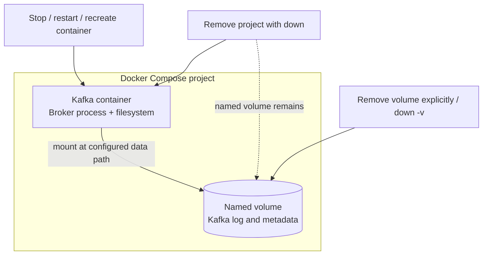

# Lưu volume, khởi động lại và dọn môi trường thử nghiệm an toàn

Khi chạy Kafka trong Docker Compose, dữ liệu của broker nằm trong thư mục lưu trữ bên trong container. Nếu thư mục này không được gắn với một volume hoặc thư mục trên máy host, việc xóa và tạo lại container có thể làm mất dữ liệu thử nghiệm. Ngược lại, giữ volume quá lâu có thể khiến lần chạy sau vô tình sử dụng dữ liệu, cluster ID hoặc cấu hình cũ.

Bài này hướng dẫn cách giữ dữ liệu Kafka qua các lần dừng và tạo lại container, kiểm tra volume đang được sử dụng, sao lưu dữ liệu lab, và xóa đúng phạm vi khi muốn bắt đầu lại. Ví dụ tập trung vào Kafka chạy cục bộ bằng Docker Compose, đặc biệt là chế độ KRaft. Tên service, đường dẫn trong container và tên volume cần điều chỉnh theo file Compose thực tế của lab.

## 1. Phân biệt vòng đời container và vòng đời dữ liệu

Container là môi trường chạy tiến trình Kafka. Volume là nơi lưu dữ liệu được giữ độc lập với vòng đời container. Khi container bị xóa, lớp filesystem riêng của container cũng bị xóa; dữ liệu trong named volume vẫn còn nếu thao tác không yêu cầu xóa volume đó.

Có thể hình dung:



| Thành phần | Chứa gì? | Khi xóa container |
|---|---|---|
| Container filesystem | Binary, cấu hình được copy vào image/container và file tạm | Mất cùng container |
| Named volume | Dữ liệu broker được mount vào volume | Còn lại cho đến khi bị xóa rõ ràng |
| Bind mount | Thư mục trên máy host được mount vào container | Dữ liệu vẫn ở thư mục host |
| Anonymous volume | Volume Docker tự tạo, không có tên dễ nhận biết | Thường còn sau `down`, nhưng khó nhận diện và tái sử dụng |
| tmpfs | Dữ liệu tạm trong bộ nhớ | Mất khi container dừng hoặc bị xóa |

Đối với Kafka, dữ liệu cần giữ thường gồm các segment log của topic, index, checkpoint và metadata của broker. Nếu dùng KRaft, metadata quorum cũng cần được lưu bền vững theo cấu hình. Chỉ mount một thư mục bất kỳ vào container không đủ; volume phải được gắn đúng vào thư mục Kafka thực sự sử dụng.

Cần phân biệt ba hành động:

- **Dừng tiến trình/container:** Kafka ngừng chạy nhưng container và volume vẫn tồn tại.
- **Xóa container:** container bị loại bỏ; volume có thể vẫn còn.
- **Xóa volume:** dữ liệu được lưu trong volume bị xóa. Đây thường là thao tác reset dữ liệu lab.

## 2. Kafka lưu dữ liệu ở đâu?

Kafka broker lưu các partition log trong thư mục cấu hình bởi thuộc tính `log.dirs`. Nếu cấu hình nhiều thư mục, Kafka có thể phân bổ dữ liệu log giữa chúng. Trong KRaft, metadata log thường nằm trong thư mục log đầu tiên nếu không cấu hình riêng; nếu đặt `metadata.log.dir`, thư mục đó cũng cần được lưu bền vững.

Ví dụ các thuộc tính Kafka:

```properties
log.dirs=/var/lib/kafka/data
# Chỉ khai báo nếu muốn đặt metadata log ở thư mục riêng:
metadata.log.dir=/var/lib/kafka/metadata
```

Nếu metadata và data dùng hai đường dẫn khác nhau, hãy mount cả hai:

```yaml
services:
  kafka:
    volumes:
      - kafka_data:/var/lib/kafka/data
      - kafka_metadata:/var/lib/kafka/metadata
    environment:
      KAFKA_LOG_DIRS: /var/lib/kafka/data
      KAFKA_METADATA_LOG_DIR: /var/lib/kafka/metadata

volumes:
  kafka_data:
  kafka_metadata:
```

Đây là ví dụ cấu hình theo quy ước ánh xạ biến môi trường của image Kafka. Hãy kiểm tra image đang dùng có ánh xạ `KAFKA_LOG_DIRS` và `KAFKA_METADATA_LOG_DIR` sang đúng thuộc tính Kafka hay không. Nếu image không hỗ trợ các biến này, cấu hình trực tiếp trong file `server.properties` hoặc cơ chế cấu hình tương ứng của image. Nếu không khai báo `metadata.log.dir` riêng, không cần tạo volume metadata riêng: cần bảo đảm thư mục `log.dirs` đang được mount.

Nếu chỉ có một thư mục dữ liệu, ví dụ tối giản là:

```yaml
services:
  kafka:
    volumes:
      - kafka_data:/var/lib/kafka/data

volumes:
  kafka_data:
```

Điều kiện quan trọng là cấu hình broker phải thực sự đặt `log.dirs=/var/lib/kafka/data`. Mount volume vào đường dẫn khác với `log.dirs` sẽ không bảo vệ dữ liệu mà Kafka đang ghi ở nơi khác.

Một số điểm cần nhớ với KRaft:

- `node.id` phải ổn định với dữ liệu broker đang dùng.
- Cluster ID và metadata đã được format ban đầu gắn với storage của cluster.
- Không chạy lại thao tác format storage mỗi lần khởi động container.
- Không dùng chung một thư mục dữ liệu cho hai broker khác nhau.
- Nếu đặt metadata log ở đường dẫn riêng, phải lưu volume cho đường dẫn đó cùng với dữ liệu broker.

Volume chỉ bảo vệ dữ liệu khỏi việc xóa container. Nó không ngăn Kafka xóa record theo chính sách retention hoặc compaction. Ví dụ, topic có `retention.ms` hoặc `retention.bytes` vẫn có thể loại bỏ segment cũ dù volume còn nguyên. Nếu cần giữ lịch sử lâu hơn, phải thiết kế retention và nơi lưu trữ phù hợp.

## 3. Chọn named volume hay bind mount?

Hai cách phổ biến để giữ dữ liệu Kafka là named volume và bind mount.

| Tiêu chí | Named volume | Bind mount |
|---|---|---|
| Vị trí dữ liệu | Docker quản lý | Một thư mục cụ thể trên máy host |
| Dễ cấu hình | Thường đơn giản, dùng tên logic trong Compose | Cần chọn và quản lý đường dẫn host |
| Quan sát file | Cần công cụ Docker hoặc container phụ | Có thể xem thư mục trực tiếp trên host |
| Tính di động | Dễ gắn lại vào container khác trên cùng Docker host | Phụ thuộc đường dẫn và quyền truy cập của host |
| Phù hợp | Dữ liệu Kafka trong lab Docker thông thường | Khi cần thao tác file trực tiếp hoặc có quy trình backup theo thư mục |

Với lab Kafka chạy trên Docker Desktop, named volume thường là lựa chọn thuận tiện. Docker quản lý vị trí lưu trữ và container có thể được tạo lại mà vẫn gắn vào cùng volume.

Bind mount phù hợp khi bài thực hành yêu cầu quan sát file trên host hoặc dùng công cụ backup hiện có. Tuy nhiên, trên Windows và macOS, bind mount đi qua lớp chia sẻ filesystem của Docker Desktop; quyền truy cập và hiệu năng I/O có thể khác named volume. Kafka ghi nhiều segment và index, nên hãy cân nhắc hiệu năng trước khi dùng thư mục chia sẻ của host làm nơi lưu dữ liệu lâu dài.

Nếu dùng bind mount, ví dụ:

```yaml
services:
  kafka:
    volumes:
      - ./.local-data/kafka:/var/lib/kafka/data
```

Thư mục `.local-data/kafka` nằm cạnh file Compose trong ví dụ này. Hãy thêm thư mục dữ liệu local vào `.gitignore` để không đưa log segment, metadata hoặc file nhị phân của lab vào Git. Không đặt hai broker cùng ghi vào một thư mục bind mount.

Không nên dựa vào anonymous volume cho dữ liệu cần giữ qua nhiều lần thực hành. Tên volume khó nhận biết và lần tạo container sau có thể không tự gắn lại đúng volume cũ. Hãy khai báo named volume với tên logic rõ ràng như `kafka_data`.

## 4. Kiểm tra Compose project và volume trước khi thao tác

Docker Compose đặt tên volume theo project. Nếu khai báo volume là `kafka_data`, tên thực tế thường có dạng `<project>_kafka_data`. Project name mặc định có thể dựa trên tên thư mục hoặc được chỉ định bằng tham số `-p` hay biến `COMPOSE_PROJECT_NAME`.

Nên chọn một project name ổn định cho lab và dùng nhất quán trong các lệnh:

```powershell
docker compose -p kafka-lab config
docker compose -p kafka-lab ps
docker compose -p kafka-lab logs --tail=100 kafka
docker volume ls
```

Trong ví dụ này, `kafka` là tên service trong file Compose. Nếu service có tên khác, thay đối số tương ứng. `docker compose config` hiển thị cấu hình Compose sau khi nội suy biến môi trường; hãy dùng nó để kiểm tra service, mount path và volume trước khi chạy.

Tìm volume có tên chứa project và logical volume, ví dụ `kafka-lab_kafka_data`, sau đó kiểm tra chi tiết:

```powershell
docker volume inspect kafka-lab_kafka_data
```

Kết quả cho biết tên volume, driver và mountpoint mà Docker quản lý. Mountpoint có thể nằm bên trong môi trường Docker Desktop; không nên giả định đó là đường dẫn Windows có thể thao tác trực tiếp.

Trước khi xóa hoặc thay đổi mount, hãy xác minh đủ ba điều:

1. Compose project đang thao tác đúng là project của lab hiện tại.
2. Container Kafka đang mount đúng named volume vào đúng đường dẫn `log.dirs` và `metadata.log.dir` (nếu có).
3. Volume đó không được một project hoặc container khác dùng chung ngoài dự kiến.

Nếu muốn tránh nhầm project giữa nhiều bài lab, hãy thêm `-p kafka-lab` vào tất cả lệnh Compose của bài này. Bỏ tham số hoặc dùng tên project khác có thể khiến Compose tạo một volume mới, làm người học tưởng dữ liệu cũ đã mất trong khi volume cũ vẫn còn.

## 5. Dừng, khởi động lại và tạo lại container

Các lệnh Compose có tác động khác nhau. Chọn lệnh theo mục đích thay vì dùng `down -v` như một thao tác dọn dẹp mặc định.

| Lệnh | Tác động | Named volume |
|---|---|---|
| `docker compose stop kafka` | Dừng container service | Giữ nguyên |
| `docker compose start kafka` | Khởi động lại container đã tồn tại | Giữ nguyên |
| `docker compose restart kafka` | Khởi động lại container hiện có | Giữ nguyên |
| `docker compose up -d` | Tạo hoặc khởi động service theo cấu hình | Gắn volume đã khai báo |
| `docker compose up -d --force-recreate kafka` | Tạo lại container service | Giữ nguyên named volume |
| `docker compose down` | Xóa container và network của project | Giữ named volume |
| `docker compose down -v` | Xóa container, network và volume thuộc project được khai báo trong Compose | Xóa named volume của project |

### 5.1. Dừng và chạy lại broker

Khi chỉ muốn tạm dừng lab:

```powershell
docker compose -p kafka-lab stop kafka
docker compose -p kafka-lab start kafka
```

Hoặc khởi động lại service:

```powershell
docker compose -p kafka-lab restart kafka
```

Các lệnh trên không xóa volume. Sau khi broker khởi động, kiểm tra trạng thái và log:

```powershell
docker compose -p kafka-lab ps
docker compose -p kafka-lab logs --tail=100 kafka
```

Với cluster một broker trong lab, trong khoảng thời gian restart, producer và consumer có thể tạm thời không kết nối được. Ứng dụng nên có retry hoặc reconnect phù hợp. Với cluster nhiều broker, cần hiểu replication factor và trạng thái leader trước khi dừng một broker.

### 5.2. Tạo lại container sau khi đổi cấu hình

Khi thay đổi environment, port, mount hoặc cấu hình service, chỉ chạy `restart` không làm container nhận cấu hình mới. Hãy để Compose tạo lại container:

```powershell
docker compose -p kafka-lab up -d --force-recreate kafka
```

Nếu volume vẫn được khai báo với cùng logical name và mount path, Compose gắn lại named volume cũ. Dữ liệu tiếp tục tồn tại khi container mới chạy đúng cấu hình storage.

Sau khi thay đổi mount path hoặc `log.dirs`, hãy kiểm tra kỹ trước khi khởi động. Nếu broker trỏ sang một thư mục rỗng, nó có thể khởi động như một storage mới và tạo cảm giác dữ liệu đã mất. Volume cũ có thể vẫn còn nhưng không còn được mount vào vị trí Kafka đang đọc.

### 5.3. Xóa container nhưng giữ dữ liệu

Khi muốn dựng lại toàn bộ container và network của project, nhưng giữ dữ liệu Kafka:

```powershell
docker compose -p kafka-lab down
docker compose -p kafka-lab up -d
```

Lệnh `down` mặc định giữ named volume được khai báo trong Compose. Lần `up` tiếp theo sẽ gắn lại volume đó nếu project name và cấu hình volume khớp.

Đây là quy trình hữu ích để kiểm tra rằng dữ liệu thực sự được lưu ngoài container. Nếu dữ liệu biến mất sau quy trình này, cần kiểm tra volume mount và đường dẫn storage trước khi tạo lại hoặc format dữ liệu.

### 5.4. Cẩn trọng với down -v

Lệnh sau xóa cả named volume thuộc Compose project:

```powershell
docker compose -p kafka-lab down -v
```

Sau lệnh này, dữ liệu trong volume `kafka_data` của project bị xóa. Lần `up` tiếp theo có thể tạo volume mới rỗng. Với project có nhiều named volume, `-v` có thể xóa dữ liệu của những service khác trong cùng project nữa. Volume khai báo là external có quy tắc riêng và không bị Compose xóa theo cách này.

Không dùng `down -v` chỉ để restart Kafka hoặc để áp dụng thay đổi cấu hình. Hãy dành nó cho trường hợp chủ động reset toàn bộ dữ liệu lab và đã xác định các volume sẽ bị xóa.

## 6. Xác minh dữ liệu còn nguyên sau khi tạo lại container

Một bài lab nên có bước kiểm chứng rõ ràng thay vì chỉ nhìn thấy container chuyển sang trạng thái running. Có thể tạo một topic thử nghiệm, ghi một message, tạo lại container rồi đọc lại message.

Ví dụ dưới đây giả định:

- Service có tên `kafka`.
- Broker có listener mà lệnh chạy bên trong container có thể truy cập bằng `localhost:9092`.
- Image cung cấp các script `kafka-topics.sh`, `kafka-console-producer.sh` và `kafka-console-consumer.sh` trong PATH.

Nếu image hoặc listener của lab khác, thay đường dẫn script và địa chỉ bootstrap server bằng giá trị tương ứng trong cấu hình.

Tạo topic một partition cho lab một broker:

```powershell
docker compose -p kafka-lab exec kafka kafka-topics.sh --bootstrap-server localhost:9092 --create --topic volume-check --partitions 1 --replication-factor 1
```

Mở console producer:

```powershell
docker compose -p kafka-lab exec kafka kafka-console-producer.sh --bootstrap-server localhost:9092 --topic volume-check
```

Nhập một dòng, chẳng hạn:

```text
message-survives-container-recreate
```

Sau đó kết thúc producer bằng Ctrl+C. Xác minh message đã được ghi:

```powershell
docker compose -p kafka-lab exec kafka kafka-console-consumer.sh --bootstrap-server localhost:9092 --topic volume-check --from-beginning --max-messages 1
```

Tạo lại container nhưng giữ volume:

```powershell
docker compose -p kafka-lab down
docker compose -p kafka-lab up -d
docker compose -p kafka-lab ps
docker compose -p kafka-lab logs --tail=100 kafka
```

Chờ broker sẵn sàng rồi đọc lại:

```powershell
docker compose -p kafka-lab exec kafka kafka-console-consumer.sh --bootstrap-server localhost:9092 --topic volume-check --from-beginning --max-messages 1
```

Nếu thấy lại `message-survives-container-recreate`, dữ liệu topic đã được giữ qua lần xóa và tạo lại container. Đây là phép kiểm tra persistence ở mức lab; nó không thay thế kiểm tra replication, backup/restore hoặc khả năng chịu lỗi của cluster production.

Có thể xác minh volume đang được gắn bằng:

```powershell
docker volume inspect kafka-lab_kafka_data
```

Nếu tên thực tế khác, lấy đúng tên từ `docker volume ls`. Cũng có thể xem mục Mounts của container bằng `docker inspect` hoặc Docker Desktop để đối chiếu source volume với destination trong container.

## 7. Sao lưu volume trước khi reset

Với lab, cách đơn giản để sao lưu file-level là dừng broker một cách bình thường rồi dùng một container phụ mount volume ở chế độ chỉ đọc và đóng gói dữ liệu. Không nên copy trực tiếp các segment đang được broker ghi nếu không có quy trình snapshot nhất quán.

Trước hết, xác định tên volume chính xác bằng `docker volume ls`. Ví dụ volume là `kafka-lab_kafka_data`. Dừng Kafka:

```powershell
docker compose -p kafka-lab stop kafka
```

Sau đó chạy container phụ để tạo file nén. Thay đường dẫn host trong ví dụ bằng một thư mục backup có thật; Docker Desktop cần quyền chia sẻ thư mục đó:

```powershell
docker run --rm -v kafka-lab_kafka_data:/source:ro -v "C:\kafka-backups:/backup" alpine sh -c "tar -czf /backup/kafka-data.tar.gz -C /source ."
```

Kiểm tra file `C:\kafka-backups\kafka-data.tar.gz` đã được tạo và có dung lượng hợp lý. Sau đó khởi động broker:

```powershell
docker compose -p kafka-lab start kafka
```

Nếu có volume riêng cho `metadata.log.dir`, phải sao lưu cả volume metadata theo một quy trình nhất quán với volume dữ liệu. Với cluster nhiều broker, cần một quy trình offline có phối hợp: dừng các broker theo kế hoạch, sao lưu storage của từng node cùng metadata KRaft và ghi lại cluster ID, node ID cũng như cấu hình tương ứng. Không thể coi việc sao chép tùy tiện một volume là bản backup đầy đủ của cả cluster.

Một bản backup file-level của storage Kafka cần được khôi phục cùng cấu hình và danh tính cluster tương thích. Không giải nén đè lên thư mục đang được broker sử dụng. Khi thực hành restore, hãy dừng broker, chuẩn bị volume đích rỗng và làm theo quy trình phục hồi đã xác định. Với hệ thống production, sử dụng cơ chế backup/snapshot đã được kiểm chứng, kiểm tra khả năng restore định kỳ và có kế hoạch phục hồi metadata KRaft. Replication trong Kafka giúp chịu lỗi broker, nhưng không thay thế backup trước thao tác xóa nhầm hoặc hỏng dữ liệu lan rộng.

## 8. Dọn môi trường theo đúng phạm vi

Trước khi dọn, quyết định rõ mục tiêu: chỉ dừng lab, xóa container, xóa dữ liệu Kafka, hay xóa toàn bộ tài nguyên thử nghiệm. Mỗi mục tiêu cần một lệnh khác nhau.

### 8.1. Chỉ tạm dừng lab

```powershell
docker compose -p kafka-lab stop
```

Container và volume vẫn còn. Có thể tiếp tục bằng:

```powershell
docker compose -p kafka-lab start
```

### 8.2. Xóa container và network, giữ volume

```powershell
docker compose -p kafka-lab down
```

Dùng khi muốn tạo lại container từ cấu hình Compose mà vẫn giữ topic và dữ liệu đã ghi.

### 8.3. Xóa riêng volume dữ liệu Kafka

Chỉ làm khi đã xác nhận không cần dữ liệu hiện tại. Trước tiên dừng project:

```powershell
docker compose -p kafka-lab down
docker volume inspect kafka-lab_kafka_data
```

Đối chiếu tên volume và project. Sau đó xóa đúng volume:

```powershell
docker volume rm kafka-lab_kafka_data
```

Nếu có volume metadata riêng, chỉ xóa nó khi mục tiêu là reset toàn bộ storage của cluster và đã xác minh đúng tên. Khi chạy `docker compose -p kafka-lab up -d`, Compose sẽ tạo volume mới theo khai báo nếu volume cũ đã bị xóa.

Xóa một volume là thao tác mất dữ liệu. Không xóa volume chỉ dựa vào một cái tên gần giống; hãy kiểm tra project và mount trước.

### 8.4. Xóa toàn bộ volume của Compose project

```powershell
docker compose -p kafka-lab down -v
```

Chỉ dùng khi muốn reset toàn bộ named volume được khai báo trong project cùng các anonymous volume được gắn vào container. Nếu project còn có database, schema registry hoặc service khác dùng volume, dữ liệu của chúng cũng có thể bị xóa.

### 8.5. Tránh lệnh dọn dẹp toàn Docker host khi chưa kiểm kê

Các lệnh như:

```powershell
docker volume prune
docker system prune --volumes
```

có phạm vi rộng hơn một Kafka project. Chúng có thể xóa volume không còn container tham chiếu, kể cả volume của lab khác mà người học muốn giữ để dùng lại. Không dùng chúng như bước cleanup thông thường của bài Kafka. Nếu cần dọn toàn host, hãy kiểm kê volume và container trước, xác định rõ dữ liệu nào có thể bỏ.

## 9. Những lỗi thường gặp và cách xử lý

### Container mới chạy nhưng topic cũ không xuất hiện

Kiểm tra project name có giống lần chạy trước không. Nếu lần trước dùng `-p kafka-lab` nhưng lần này bỏ `-p`, Compose có thể tạo project và volume mới. So sánh `docker volume ls`, `docker compose config` và Mounts của container.

Tiếp theo kiểm tra `log.dirs` có trùng với destination đang mount hay không. Nếu Kafka ghi vào `/tmp/kraft-combined-logs` nhưng volume lại mount ở `/var/lib/kafka/data`, volume sẽ không chứa dữ liệu thực tế. Đừng vội xóa volume cũ; hãy xác định nơi broker đã ghi dữ liệu.

### Broker báo lỗi metadata hoặc cluster ID không khớp

KRaft storage có metadata và cluster identity riêng. Có thể volume đang chứa dữ liệu của một cluster khác, hoặc node ID/cấu hình quorum đã thay đổi. Kiểm tra cấu hình và log trước khi can thiệp. Không xóa metadata hoặc chạy format storage để thử vận may; các thao tác đó có thể làm mất khả năng khôi phục dữ liệu hiện có.

### Broker khởi động nhưng dữ liệu cũ đã hết

Volume có thể vẫn được gắn đúng nhưng topic đã áp dụng retention hoặc compaction. Kiểm tra cấu hình topic, thời gian lưu giữ, kích thước dữ liệu và consumer offset. Persistence của volume không có nghĩa là mọi record được giữ vô thời hạn.

### Volume cũ không xuất hiện trong project hiện tại

Kiểm tra tên project và logical volume. Compose thêm project prefix vào tên volume; hai project khác nhau có thể tạo hai volume riêng dù cùng khai báo `kafka_data`. Nếu cần gắn lại volume có sẵn, hãy cấu hình external volume hoặc tên volume rõ ràng theo quy tắc của Compose, rồi xác minh trước khi khởi động broker.

### Không thể xóa volume vì đang được sử dụng

Docker không cho xóa volume vẫn được container tham chiếu. Dừng và xóa đúng container/project trước, sau đó kiểm tra lại bằng `docker volume inspect` và `docker ps -a`. Không cần xóa cưỡng bức các container hoặc volume không liên quan để giải quyết lỗi này.

### Broker bị lỗi sau khi mount một thư mục rỗng

Kiểm tra quyền đọc/ghi của user trong container, mount destination và cấu hình storage. Kafka phải có quyền tạo và cập nhật file trong thư mục dữ liệu. Trên Docker Desktop, bind mount từ host có thể có khác biệt về quyền và hiệu năng; named volume thường giúp giảm các vấn đề chia sẻ filesystem này.

## 10. Quy trình thực hành khuyến nghị

Có thể áp dụng quy trình sau cho mỗi buổi lab:

1. Chọn project name cố định, ví dụ `kafka-lab`, và kiểm tra cấu hình Compose bằng `docker compose -p kafka-lab config`.
2. Xác nhận `log.dirs` và `metadata.log.dir` (nếu có) được mount vào named volume.
3. Khởi động Kafka, kiểm tra broker sẵn sàng và tạo một topic thử nghiệm.
4. Ghi một vài message, đọc lại để xác nhận luồng producer/consumer hoạt động.
5. Dừng hoặc tạo lại container bằng `stop/start`, `restart` hoặc `down/up` tùy mục đích.
6. Đọc lại message để xác minh persistence.
7. Nếu cần giữ kết quả bài thực hành, sao lưu volume khi broker đã dừng đúng cách.
8. Khi kết thúc, dùng `down` để xóa container nhưng giữ dữ liệu, hoặc xóa đúng volume nếu chủ động reset lab.
9. Trước mọi thao tác xóa volume, kiểm tra project name, tên volume và dữ liệu cần giữ.

## 11. Checklist trước khi xóa dữ liệu

- [ ] Đã xác định đúng Docker Compose project.
- [ ] Đã xác định đúng tên volume Kafka và volume metadata (nếu có).
- [ ] Đã xác minh volume không chứa dữ liệu của bài lab khác.
- [ ] Đã dừng broker trước khi sao lưu hoặc xóa storage.
- [ ] Đã tạo và kiểm tra backup nếu dữ liệu cần giữ.
- [ ] Đã hiểu `down` giữ named volume còn `down -v` xóa volume thuộc project.
- [ ] Đã tránh dùng `docker volume prune` hoặc `docker system prune --volumes` khi chưa kiểm kê toàn host.
- [ ] Sau khi tạo lại container, đã kiểm tra broker và đọc lại message thử nghiệm.

Điểm cốt lõi của bài lab là tách vòng đời dữ liệu khỏi vòng đời container. Hãy mount đúng thư mục Kafka sử dụng, giữ project name ổn định và kiểm tra volume trước khi thao tác. Khi cần reset, xóa đúng volume sau khi đã xác nhận dữ liệu có thể bỏ. Quy trình này giúp người học lặp lại bài thực hành nhiều lần mà vẫn kiểm soát được dữ liệu, trạng thái KRaft và phạm vi dọn dẹp.
