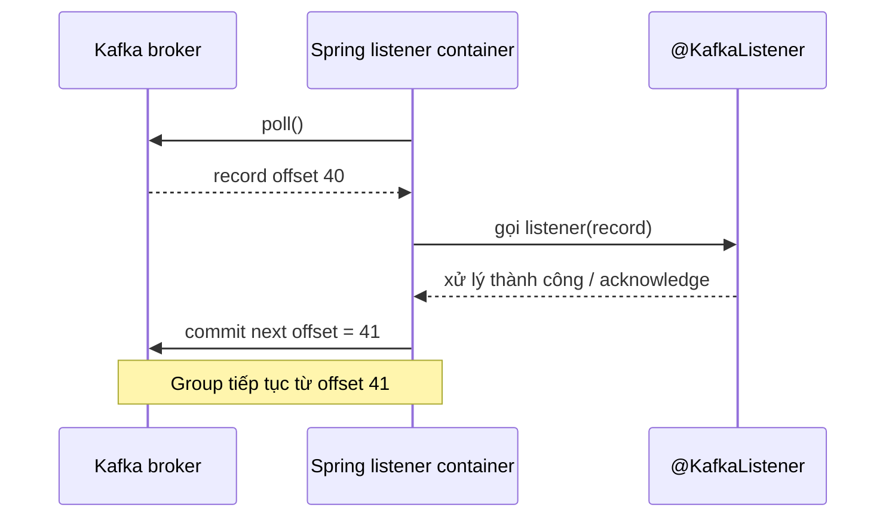
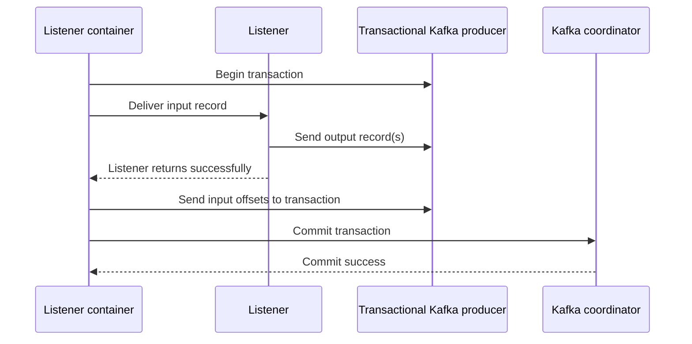

# AckMode, manual acknowledgment và ranh giới commit offset

## Mục tiêu

Spring Kafka listener container quản lý `KafkaConsumer`, vòng lặp `poll()` và việc commit offset. Listener chỉ cần xử lý record hoặc batch; container quyết định thời điểm ghi nhận vị trí đọc dựa trên `AckMode`, acknowledgment và error handler. Nếu chọn sai ranh giới commit, ứng dụng có thể bỏ qua record chưa xử lý, đọc lại side effect đã hoàn tất hoặc làm retry không đúng ý định.

Bài học này tập trung vào cách Spring Kafka xác nhận record đã xử lý, sự khác nhau giữa các `AckMode`, cách dùng `Acknowledgment` và cách phối hợp commit offset với transaction, retry, batch và rebalance.

Sau bài học này, bạn có thể:

- Giải thích committed offset là vị trí tiếp theo cần đọc, không phải offset của record cuối cùng.
- So sánh `RECORD`, `BATCH`, `TIME`, `COUNT`, `COUNT_TIME`, `MANUAL` và `MANUAL_IMMEDIATE`.
- Chọn acknowledgment boundary cho record listener và batch listener.
- Dùng `Acknowledgment.acknowledge()` sau khi xử lý nghiệp vụ hoàn tất.
- Hiểu partial batch acknowledgment, `nack()` và `asyncAcks`.
- Cấu hình Spring Boot và `ConcurrentKafkaListenerContainerFactory`.
- Phối hợp acknowledgment với retry, DLT và transactional listener container.
- Thiết kế idempotency để xử lý cửa sổ crash giữa side effect và offset commit.

## 1. Acknowledgment và commit offset là hai khái niệm liên quan

Kafka consumer lưu committed offset cho từng partition trong consumer group. Giá trị commit là **next offset**: vị trí tiếp theo mà group cần đọc khi khởi động hoặc nhận lại partition.

Ví dụ consumer xử lý record offset 40 thành công. Vị trí tiếp theo cần đọc là 41, vì vậy committed offset phải là 41. Nếu commit 40, record 40 có thể được đọc lại sau restart.

| Record đã xử lý | Committed offset | Ý nghĩa |
|---:|---:|---|
| 40 | 41 | Lần sau đọc từ 41 |
| 41 | 42 | Lần sau đọc từ 42 |
| 42 | 43 | Lần sau đọc từ 43 |

Trong Spring Kafka, listener không nhất thiết gọi API commit trực tiếp. Container theo dõi kết quả xử lý và thực hiện commit theo `AckMode`. Khi listener gọi `acknowledge()`, đó là tín hiệu cho container biết phần dữ liệu tương ứng đã được xử lý; thời điểm commit thực tế phụ thuộc mode và cấu hình container.



Acknowledgment không có nghĩa side effect và offset đã được commit trong cùng một transaction. Nếu database commit xong nhưng Kafka offset commit thất bại, record có thể được giao lại. Vì vậy consumer thường cần idempotency hoặc inbox/deduplication theo event ID.

## 2. `AckMode` điều khiển thời điểm commit

`AckMode` được cấu hình trong listener container. Khi không dùng Kafka transaction, các mode phổ biến hoạt động như sau:

| AckMode | Ranh giới commit | Phù hợp với |
|---|---|---|
| `RECORD` | Sau khi listener xử lý thành công từng record | Record listener cần commit sát từng record |
| `BATCH` | Sau khi tất cả record trả về từ một lần `poll()` được xử lý thành công | Mặc định thường dùng; throughput tốt khi xử lý batch an toàn |
| `TIME` | Khi khoảng thời gian từ lần commit trước đạt ngưỡng và các record đang chờ đã xử lý xong | Gom commit theo thời gian |
| `COUNT` | Khi số record kể từ lần commit trước đạt ngưỡng | Gom commit theo số record |
| `COUNT_TIME` | Khi đạt ngưỡng count hoặc time, điều kiện nào đến trước | Cân bằng tần suất commit và tải |
| `MANUAL` | Listener gọi `acknowledge()`; container gom acknowledgment và commit sau khi các record của poll liên quan hoàn tất | Ứng dụng quyết định record nào đã xử lý xong |
| `MANUAL_IMMEDIATE` | Commit ngay khi `acknowledge()` được gọi trên consumer thread | Cần commit tường minh ngay tại listener thread |

`RECORD` áp dụng cho record listener. Với batch listener, container chỉ nhận kết quả của cả batch; nếu muốn xác nhận một phần batch, dùng cơ chế partial batch acknowledgment được hỗ trợ ở phiên bản Spring Kafka phù hợp.

`TIME`, `COUNT` và `COUNT_TIME` không thay thế xử lý lỗi. Chúng chỉ điều chỉnh khi container commit các record đã xử lý thành công. Nếu listener ném exception, error handler quyết định retry/recover; container không nên tiến offset qua record chưa có kết quả cuối cùng.

### 2.1. `RECORD`

Container commit sau khi mỗi lần gọi record listener hoàn tất bình thường. Nếu một poll trả nhiều record, commit có thể xảy ra nhiều lần trong batch poll đó. Đây là lựa chọn dễ hiểu khi cần ranh giới xử lý theo từng record, đổi lại có thể tăng số lần commit so với `BATCH`.

### 2.2. `BATCH`

Container commit sau khi tất cả record được trả về trong lần `poll()` đã xử lý thành công. Với record listener, container gọi listener lần lượt cho từng record rồi commit batch. Với batch listener, listener nhận danh sách record và khi method trả về bình thường, batch được xem là xử lý thành công.

Nếu listener xử lý được một phần rồi ném exception, cần error handler hoặc batch failure API để chỉ ra record lỗi. Nếu container không xác định được điểm lỗi, nó có thể phải retry nhiều record hơn, kể cả record đã chạy trước đó. Side effect cần idempotent.

### 2.3. `TIME`, `COUNT` và `COUNT_TIME`

Các mode này gom commit để giảm overhead:

- `TIME`: commit khi đã qua khoảng `ackTime` kể từ lần commit trước.
- `COUNT`: commit khi số record kể từ lần commit trước đạt `ackCount`.
- `COUNT_TIME`: commit khi đạt một trong hai điều kiện.

Ví dụ cấu hình `COUNT_TIME` với count 500 và time 2 giây: nếu đủ 500 record trước, container commit theo ngưỡng count; nếu chưa đủ nhưng đã qua 2 giây, container commit theo ngưỡng thời gian. Các record phải hoàn tất xử lý trước khi được đưa vào commit.

Không nên tăng ngưỡng quá cao chỉ để giảm commit request. Nếu process crash trước lần commit tiếp theo, các record đã xử lý kể từ committed offset gần nhất có thể được giao lại.

### 2.4. `MANUAL`

Listener chủ động gọi `Acknowledgment.acknowledge()` sau khi xử lý thành công. Container ghi nhận acknowledgment và commit sau khi các record thuộc poll liên quan đã hoàn tất theo semantics của container. Vì vậy `MANUAL` không nhất thiết commit ngay tại dòng gọi `acknowledge()`.

### 2.5. `MANUAL_IMMEDIATE`

Nếu listener gọi `acknowledge()` ngay trên consumer thread, container commit ngay. Nếu acknowledgment được gọi từ thread khác, nó được điều phối theo cơ chế của container và có thể được gom lại; không nên trộn hai cách gọi trong cùng listener nếu muốn thời điểm commit xác định.

Với `MANUAL_IMMEDIATE`, hãy gọi acknowledgment trên listener/consumer thread trừ khi đã thiết kế rõ luồng asynchronous acknowledgment và hiểu semantics của phiên bản Spring Kafka đang dùng.

## 3. Cấu hình Spring Boot

Ví dụ cấu hình record listener dùng manual acknowledgment:

```yaml
spring:
  kafka:
    bootstrap-servers: localhost:9092
    consumer:
      group-id: orders-service
      enable-auto-commit: false
      auto-offset-reset: earliest
      properties:
        isolation.level: read_committed
    listener:
      type: single
      ack-mode: manual
```

Spring Kafka listener container thường tắt Kafka auto commit nếu ứng dụng không cấu hình `enable.auto.commit` rõ ràng. Dù vậy, nên đặt `false` tường minh để thể hiện rằng container quản lý commit offset.

`isolation.level` là ví dụ khi topic có transactional producer; nó độc lập với `AckMode`. `read_committed` điều khiển record nào consumer được nhìn thấy, còn `AckMode` điều khiển thời điểm commit vị trí đọc.

Đổi sang commit ngay sau mỗi acknowledgment trên listener thread:

```yaml
spring:
  kafka:
    listener:
      ack-mode: manual_immediate
```

Không nên chọn `MANUAL_IMMEDIATE` chỉ vì tên gọi có vẻ nhanh hơn. Chọn mode theo ranh giới nghiệp vụ và khả năng chấp nhận duplicate khi có lỗi.

## 4. Cấu hình `ConcurrentKafkaListenerContainerFactory`

Khi cần cấu hình riêng container factory, đặt AckMode qua `ContainerProperties`:

```java
@Configuration
public class KafkaListenerConfiguration {

    @Bean
    ConcurrentKafkaListenerContainerFactory<String, OrderEvent>
    manualAckListenerFactory(
            ConsumerFactory<String, OrderEvent> consumerFactory) {

        var factory =
                new ConcurrentKafkaListenerContainerFactory<String, OrderEvent>();
        factory.setConsumerFactory(consumerFactory);
        factory.setConcurrency(3);
        factory.getContainerProperties()
                .setAckMode(ContainerProperties.AckMode.MANUAL);
        factory.getContainerProperties().setSyncCommits(true);
        return factory;
    }
}
```

Listener sử dụng factory:

```java
@KafkaListener(
        topics = "orders.events",
        groupId = "orders-service",
        containerFactory = "manualAckListenerFactory"
)
public void onOrder(OrderEvent event, Acknowledgment acknowledgment) {
    orderService.apply(event);
    acknowledgment.acknowledge();
}
```

`concurrency=3` tạo các consumer child riêng trong listener container; mỗi consumer có thread sở hữu riêng. Nó không chia sẻ một `KafkaConsumer` cho ba thread. Số partition và group assignment vẫn giới hạn số consumer thực sự nhận dữ liệu.

`setSyncCommits(true)` yêu cầu container dùng `commitSync()` cho các commit thông thường. Commit sync có thể block tới khi broker trả kết quả hoặc timeout; có thể điều chỉnh `syncCommitTimeout`. Nếu dùng async commit, cần theo dõi callback/error handling và hiểu thứ tự commit.

## 5. Manual acknowledgment cho record listener

Manual acknowledgment phù hợp khi listener cần thực hiện một bước nghiệp vụ hoặc kiểm tra trước khi xác nhận record.

```java
@KafkaListener(topics = "orders.events", groupId = "orders-service")
public void onOrder(
        ConsumerRecord<String, OrderEvent> record,
        Acknowledgment acknowledgment) {

    orderService.apply(record.value());

    // Chỉ xác nhận sau khi xử lý nghiệp vụ thành công.
    acknowledgment.acknowledge();
}
```

Nếu `orderService.apply()` ném exception, dòng `acknowledge()` không chạy. Exception được chuyển tới error handler của container để retry/recover theo cấu hình. Không bắt exception rồi vẫn acknowledge, trừ khi ứng dụng đã thực hiện một quyết định skip/recovery có chủ đích.

### 5.1. Commit sau transaction database

Khi listener cập nhật database, cần bảo đảm transaction database hoàn tất trước khi acknowledgment được gửi. Một cách rõ ràng là gọi một service bean khác có `@Transactional`; khi method proxy trả về thành công, transaction database đã commit rồi listener mới acknowledge.

```java
@Service
public class OrderProjectionService {

    @Transactional
    public void apply(OrderEvent event) {
        // Update projection và inbox/event ID trong cùng DB transaction.
        inboxRepository.insertIfAbsent(event.eventId());
        orderRepository.apply(event);
    }
}

@Component
public class OrderListener {
    private final OrderProjectionService projectionService;

    public OrderListener(OrderProjectionService projectionService) {
        this.projectionService = projectionService;
    }

    @KafkaListener(topics = "orders.events", groupId = "orders-service")
    public void onOrder(OrderEvent event, Acknowledgment acknowledgment) {
        projectionService.apply(event); // DB transaction commit khi method trả về
        acknowledgment.acknowledge();  // Sau đó mới xác nhận Kafka offset
    }
}
```

Ví dụ giả định `OrderProjectionService` là bean được Spring proxy và `inboxRepository.insertIfAbsent()` có unique constraint theo event ID. Nếu database commit thành công nhưng Kafka commit thất bại, record có thể được giao lại; inbox/idempotency giúp lần giao lại không lặp side effect.

Không gọi `acknowledge()` trước khi transaction database commit. Nếu offset được commit trước rồi database transaction rollback, record có thể bị bỏ qua vĩnh viễn trong consumer group.

### 5.2. Skip có chủ đích

Nếu record là duplicate đã được inbox ghi nhận, listener có thể bỏ qua side effect mới và acknowledge. Nếu record bị loại theo business rule, hãy ghi audit hoặc metric trước khi acknowledge nếu yêu cầu vận hành cần truy vết.

```java
@KafkaListener(topics = "orders.events", groupId = "orders-service")
public void onOrder(OrderEvent event, Acknowledgment acknowledgment) {
    if (inboxRepository.wasProcessed(event.eventId())) {
        metrics.incrementDuplicateEvents();
        acknowledgment.acknowledge();
        return;
    }

    projectionService.apply(event);
    acknowledgment.acknowledge();
}
```

Đoạn code minh họa luồng; kiểm tra `wasProcessed()` rồi mới ghi có thể gặp race. Production nên thực hiện insert-if-absent và update projection trong cùng transaction database, như ví dụ trên. Acknowledgment chỉ xảy ra sau khi transaction trả về.

### 5.3. Không acknowledge trong `finally`

Mẫu sau không an toàn:

```java
try {
    process(record);
} finally {
    acknowledgment.acknowledge(); // Sai: lỗi vẫn làm offset tiến
}
```

`finally` chạy cả khi xử lý thành công lẫn thất bại. Acknowledge trong khối này có thể xác nhận record mà side effect chưa hoàn tất. Chỉ acknowledge tại nhánh đã có kết quả cuối cùng.

## 6. Manual acknowledgment và xử lý bất đồng bộ

Mặc định, listener xử lý record trên consumer thread và acknowledge trước khi listener trả về. Nếu chuyển công việc sang executor rồi return ngay, container có thể coi listener đã hoàn tất tùy mode, trong khi worker chưa xử lý xong. Đây là cách dễ tạo mất dữ liệu.

Ví dụ không an toàn:

```java
@KafkaListener(topics = "orders.events")
public void onOrder(OrderEvent event, Acknowledgment ack) {
    executor.submit(() -> projectionService.apply(event));
    ack.acknowledge(); // Worker có thể chưa chạy xong
}
```

Chỉ dùng asynchronous acknowledgment khi đã cấu hình và hiểu `asyncAcks`, hoặc dùng async listener return type mà Spring Kafka hỗ trợ trong phiên bản đang dùng. Không tự đưa `KafkaConsumer` hoặc API consumer ra worker thread.

### 6.1. `asyncAcks`

Từ Spring Kafka 2.8, container hỗ trợ acknowledgment ngoài thứ tự với `asyncAcks=true` trong các manual ack mode. Container ghi nhận các acknowledgment đến không theo thứ tự và trì hoãn commit cho đến khi các offset còn thiếu trong poll được acknowledge. Trong thời gian còn gap, consumer bị pause để tránh nhận thêm dữ liệu vượt qua ranh giới chưa hoàn tất.

Ví dụ cấu hình:

```java
factory.getContainerProperties().setAckMode(ContainerProperties.AckMode.MANUAL);
factory.getContainerProperties().setAsyncAcks(true);
```

Khi dùng `asyncAcks`:

- Worker có thể báo acknowledgment hoàn tất không theo thứ tự của record trong poll.
- Container chỉ commit khi các gap trước đó đã được lấp đầy.
- Nếu process crash trước khi toàn bộ poll batch được acknowledge/commit, một số record đã xử lý có thể được giao lại.
- `nack()` không tương thích với `asyncAcks`.
- Cần bounded worker pool và backpressure; không dispatch vô hạn.

`asyncAcks` không tự tạo exactly-once side effect. Database/API vẫn cần idempotency. Nếu ordering nghiệp vụ trong cùng partition quan trọng, đừng xử lý song song các event của cùng aggregate chỉ vì container hỗ trợ out-of-order acknowledgment.

### 6.2. Khi nào không nên dùng `asyncAcks`?

Nếu listener xử lý nhanh và tuần tự, manual acknowledgment thông thường dễ vận hành hơn. Dùng `asyncAcks` khi công việc thực sự cần worker concurrency và có thể chấp nhận cơ chế pause/commit gap. Hãy đo queue depth, processing latency, pause duration và duplicate sau restart trước khi triển khai rộng.

## 7. `nack()` và xử lý lại phần chưa hoàn tất

`Acknowledgment.nack()` cho phép listener báo một record hoặc phần batch không thể xử lý và yêu cầu container redeliver từ vị trí đó sau thời gian chờ. Với record listener, các record trước điểm lỗi trong poll có thể được commit; record lỗi và các record sau đó được seek để đọc lại.

Với batch listener, API `nack(index, sleep)` chỉ ra index đầu tiên chưa xử lý thành công; phần trước index được xác nhận, phần lỗi và phía sau được đọc lại theo container semantics. Tên overload có thể khác theo phiên bản Spring Kafka (`long` hoặc `Duration`); dùng API của dependency đang chạy.

Các giới hạn quan trọng:

- Gọi `nack()` trên listener/consumer thread.
- Chỉ gọi một lần cho một lần giao và không acknowledge cùng record sau khi đã nack.
- Thời gian sleep phải phù hợp với `max.poll.interval.ms` và cấu hình container.
- `nack()` không dùng được với `asyncAcks`.
- Nếu side effect của record đã xảy ra trước khi nack, lần redelivery có thể lặp side effect; cần idempotency.

Không dùng `nack()` như cách thay thế chung cho retry topic hoặc DLT. Với lỗi tạm thời ngắn hạn, backoff có thể phù hợp; với poison record hoặc lỗi lâu dài, cần retry có giới hạn rồi recover sang DLT để không chặn partition vô thời hạn.

## 8. Batch listener và acknowledgment boundary

Batch listener nhận nhiều record trong một lần gọi. Với `AckMode.BATCH`, container chỉ commit khi listener xử lý thành công toàn bộ batch. Nếu listener xử lý 99 record rồi lỗi ở record thứ 100, batch có thể được giao lại theo error handler; 99 record trước đó có thể chạy lại.

```java
@KafkaListener(topics = "orders.events", groupId = "orders-batch")
public void onBatch(List<ConsumerRecord<String, OrderEvent>> records) {
    for (ConsumerRecord<String, OrderEvent> record : records) {
        projectionService.apply(record.value());
    }
}
```

Nếu method trả về bình thường, container coi batch đã xử lý xong theo AckMode. Nếu exception thoát ra, error handler xử lý retry/recover. Không bắt exception trong vòng lặp rồi return bình thường nếu record lỗi chưa được giải quyết.

### 8.1. Manual ack cho cả batch

Với `AckMode.MANUAL`, listener có thể acknowledge sau khi toàn bộ batch đã xử lý thành công:

```java
@KafkaListener(topics = "orders.events", groupId = "orders-batch")
public void onBatch(
        List<ConsumerRecord<String, OrderEvent>> records,
        Acknowledgment acknowledgment) {

    for (ConsumerRecord<String, OrderEvent> record : records) {
        projectionService.apply(record.value());
    }

    acknowledgment.acknowledge();
}
```

Nếu một record ném exception, lời gọi acknowledge không xảy ra và error handler quyết định retry/recover. Vì vậy các side effect trước record lỗi có thể được thực hiện lại; dùng event ID/inbox để bảo vệ.

### 8.2. Partial batch acknowledgment

Từ Spring Kafka 3.0.10, batch listener có thể gọi `Acknowledgment.acknowledge(index)` để xác nhận một prefix của batch. Cơ chế này yêu cầu `AckMode.MANUAL_IMMEDIATE`, phải gọi trên listener thread và index phải nằm trong batch, tăng đơn điệu qua các lần acknowledge.

Ví dụ cấu hình:

```yaml
spring:
  kafka:
    listener:
      type: batch
      ack-mode: manual_immediate
```

Ví dụ listener:

```java
@KafkaListener(topics = "orders.events", groupId = "orders-batch")
public void onBatch(
        List<ConsumerRecord<String, OrderEvent>> records,
        Acknowledgment acknowledgment) {

    for (int index = 0; index < records.size(); index++) {
        projectionService.apply(records.get(index).value());

        if (index == 4 && index < records.size() - 1) {
            // Xác nhận prefix từ đầu batch đến index 4 (bao gồm index 4).
            acknowledgment.acknowledge(index);
        }
    }

    // Xác nhận phần còn lại sau khi mọi record đã xử lý thành công.
    acknowledgment.acknowledge(records.size() - 1);
}
```

Partial acknowledgment xác nhận prefix theo thứ tự của batch, không cho phép commit các index tùy ý out-of-order. Nếu lỗi xảy ra sau lần partial ack, phần đã xác nhận có thể không được giao lại; phần còn lại được xử lý theo container/error handler. Các side effect trước ranh giới ack vẫn cần idempotent nếu có cửa sổ crash trước commit.

### 8.3. Batch listener và `BatchListenerFailedException`

Nếu listener xác định được record lỗi, có thể ném `BatchListenerFailedException` với index hoặc record tương ứng. `DefaultErrorHandler` dùng thông tin này để xử lý phần trước và retry/recover từ điểm lỗi thay vì retry toàn bộ batch một cách mù quáng.

```java
@KafkaListener(topics = "orders.events", groupId = "orders-batch")
public void onBatch(List<ConsumerRecord<String, OrderEvent>> records) {
    for (int index = 0; index < records.size(); index++) {
        try {
            projectionService.apply(records.get(index).value());
        } catch (Exception ex) {
            throw new BatchListenerFailedException(
                    "Không xử lý được batch record tại index " + index,
                    ex,
                    index);
        }
    }
}
```

Constructor overload có thể khác theo phiên bản; sử dụng overload nhận index hoặc record trong API hiện có. Nếu không xác định index lỗi, container có thể retry toàn batch. Vì vậy handler batch nên idempotent.

## 9. Error handler quyết định retry và recovery

`AckMode` xác định thời điểm commit cho phần đã xử lý. `CommonErrorHandler`/`DefaultErrorHandler` xác định việc xử lý khi listener ném exception: retry, backoff, recover, seek và cách container tiếp tục.

Ví dụ cấu hình `DefaultErrorHandler` với retry có giới hạn và DLT recoverer:

```java
@Bean
DefaultErrorHandler kafkaErrorHandler(KafkaTemplate<Object, Object> template) {
    DeadLetterPublishingRecoverer recoverer =
            new DeadLetterPublishingRecoverer(template);

    FixedBackOff backOff = new FixedBackOff(1_000L, 2L);
    DefaultErrorHandler handler =
            new DefaultErrorHandler(recoverer, backOff);

    handler.addNotRetryableExceptions(
            InvalidEventSchemaException.class,
            UnsupportedEventTypeException.class);
    return handler;
}
```

Trong ví dụ, `FixedBackOff(1000, 2)` cấu hình hai lần retry sau lần giao đầu, mỗi lần cách nhau một giây. Exception không retryable được chuyển thẳng tới recoverer. Chỉ coi record đã recover khi publish DLT thành công; nếu send DLT thất bại, không được tiến input offset như thể recovery đã hoàn tất. Kiểm tra `failIfSendResultIsError`, `ackAfterHandle` và `commitRecovered` theo AckMode/phiên bản Spring Kafka đang dùng.

### 9.1. Commit sau recovery

Với error handler, cần xác định rõ ai chịu trách nhiệm xác nhận record sau khi recover:

- `ackAfterHandle` điều khiển việc container commit sau khi error handler xử lý exception và trả về bình thường.
- `commitRecovered` hỗ trợ commit offset của record được recover trong các cấu hình được hỗ trợ; với manual acknowledgment, điều kiện thường yêu cầu `MANUAL_IMMEDIATE`.
- Nếu dùng Kafka transaction, recovery và offset có thể cần nằm trong transaction theo cấu hình transactional container.

Không bật các cờ này theo mẫu copy-paste. Kiểm tra AckMode, transactional/non-transactional container và tài liệu của đúng phiên bản. Quy tắc chung vẫn là: recovery phải hoàn tất trước khi input offset được xác nhận.

## 10. Kafka transaction và listener acknowledgment

Nếu listener container được cấu hình với Kafka transaction manager, container có thể đưa output records và input offsets vào cùng Kafka transaction. Khi listener xử lý thành công, transaction commit; khi listener ném exception, transaction abort và input offsets không được commit trong transaction đó.



Đây là nền tảng cho Kafka-to-Kafka exactly-once processing khi producer transactional, offsets được commit trong transaction và downstream consumer dùng `read_committed`. `AckMode` không tự tạo transaction; cần cấu hình `KafkaTransactionManager`/producer factory có `transactional.id` và listener container tương ứng.

Kafka transaction không tự bao gồm transaction PostgreSQL, HTTP request, email hay hệ thống ngoài Kafka. Nếu listener cập nhật database rồi Kafka transaction abort, database side effect có thể đã tồn tại trong khi record được giao lại. Dùng inbox/outbox, idempotency hoặc quy trình đối soát cho phần ngoài Kafka.

## 11. Rebalance và acknowledgment chưa commit

Partition có thể được thu hồi khi consumer rời group, mất heartbeat, vượt `max.poll.interval.ms` hoặc group thay đổi. Khi rebalance, offset chưa commit không được coi là đã xử lý bền vững. Consumer mới có thể nhận lại record từ committed offset gần nhất.

Với manual acknowledgment:

- Nếu listener chưa acknowledge record, record có thể được giao lại sau rebalance.
- Nếu side effect đã xong nhưng commit chưa hoàn tất, side effect có thể chạy lại.
- Nếu listener acknowledge nhưng commit thất bại hoặc response không tới client, kết quả commit có thể không xác định.
- Nếu acknowledgment đến từ worker thread, cần `asyncAcks` và lifecycle phù hợp; worker hoàn tất muộn sau revoke phải được xử lý idempotent.

Giữ thời gian xử lý mỗi poll trong giới hạn `max.poll.interval.ms`. Manual acknowledgment không cho phép listener block vô hạn mà không poll. Nếu cần xử lý dài, cân nhắc retry topic, worker pool có bounded queue và async acknowledgment đúng cách.

## 12. Commit sync, async và kết quả không xác định

Container có thể commit bằng `commitSync()` hoặc `commitAsync()` tùy `syncCommits`.

| Cách commit | Đặc điểm | Điều cần lưu ý |
|---|---|---|
| Sync commit | Chờ broker phản hồi | Dễ xác định lỗi tại điểm commit nhưng làm listener thread chờ |
| Async commit | Gửi request và nhận callback | Giảm thời gian chờ; phải quan sát callback và tránh commit out-of-order |

Một timeout không luôn chứng minh broker chưa lưu offset. Có thể broker đã ghi commit nhưng response bị mất. Ứng dụng nên chấp nhận khả năng record được giao lại và bảo vệ side effect bằng idempotency.

Nếu commit async nhiều lần, commit cũ hoàn tất sau commit mới có thể làm offset lùi nếu ứng dụng không serialize/điều phối commit. Container Spring Kafka quản lý commit theo semantics của nó; khi tự dùng consumer API, không gửi các commit map không đồng bộ mà không kiểm soát thứ tự.

## 13. Chọn AckMode theo tình huống

| Nhu cầu | Gợi ý | Lý do |
|---|---|---|
| Record listener xử lý nhanh, tuần tự | `RECORD` hoặc `BATCH` | Chọn giữa commit từng record và commit theo poll batch |
| Muốn listener tự xác nhận sau khi service nghiệp vụ thành công | `MANUAL` | Ranh giới ack nằm trong code listener |
| Cần commit ngay tại listener thread sau từng record | `MANUAL_IMMEDIATE` | Commit tại thời điểm gọi ack trên consumer thread |
| Batch listener xử lý nguyên batch | `BATCH` hoặc `MANUAL` | Chỉ commit khi batch/ack boundary hoàn tất |
| Batch listener xác nhận prefix đã xong | `MANUAL_IMMEDIATE` + partial batch ack (Spring Kafka 3.0.10+) | Commit phần liên tục đã xử lý |
| Xử lý worker song song và ack out-of-order | Manual mode + `asyncAcks` | Container đợi gap được lấp đầy; cần idempotency và backpressure |
| Retry ngắn cho record lỗi | Error handler/backoff, có thể kết hợp `nack()` | Không commit qua record lỗi |
| Consume-transform-produce exactly-once trong Kafka | Transactional listener container | Output và input offsets cùng transaction |
| Ghi DB rồi ack Kafka | DB transaction hoàn tất trước ack, inbox/idempotency | DB và Kafka không tự atomic với nhau |

Không có một AckMode tối ưu cho mọi workload. Hãy chọn theo chi phí commit, độ lớn poll batch, yêu cầu ordering, retry policy và mức duplicate mà side effect có thể chịu được.

## 14. Thực hành: quan sát các AckMode

Lab sử dụng topic `orders-lab`, consumer group `ack-lab` và một listener Spring Kafka. Gửi ít nhất 20 record để mỗi lần poll có thể nhận nhiều record.

### 14.1. Thử `BATCH`

Đặt:

```yaml
spring:
  kafka:
    consumer:
      group-id: ack-lab
      enable-auto-commit: false
      max-poll-records: 10
    listener:
      ack-mode: batch
```

Ghi log topic, partition, offset ở listener. Quan sát committed offset bằng:

```bash
bin/kafka-consumer-groups.sh --bootstrap-server localhost:9092 \
  --describe --group ack-lab
```

Xác nhận offset chỉ tiến sau khi các record trong poll batch đã xử lý thành công.

### 14.2. Thử `RECORD`

Đổi `ack-mode: record`. Tạo delay ngắn giữa các record và quan sát committed offset tiến theo từng lần listener hoàn tất. So sánh số lần commit và throughput với `BATCH`.

### 14.3. Thử `MANUAL`

Đổi `ack-mode: manual`, thêm tham số `Acknowledgment`. Chỉ gọi `acknowledge()` sau khi xử lý. Thử ném exception trước dòng ack và quan sát record được retry theo error handler; sau đó xử lý thành công và xác nhận offset tiến.

### 14.4. Thử crash sau side effect trước ack

Cho listener cập nhật một bảng database, sau đó tạm dừng trước `acknowledge()`. Kill process trong cửa sổ này rồi khởi động lại cùng group. Record có thể được giao lại. Thêm inbox table có unique constraint theo event ID và chạy lại để xác nhận side effect không bị nhân đôi.

### 14.5. Thử partial batch acknowledgment

Dùng batch listener, `AckMode.MANUAL_IMMEDIATE` và Spring Kafka 3.0.10 trở lên. Xác nhận prefix qua `acknowledge(index)`, sau đó tạo lỗi ở phần còn lại. Quan sát committed offset và record được giao lại. Lặp lại với crash ngay sau partial ack để thấy phần đã xác nhận và phần chưa xác nhận có ranh giới khác nhau.

Ghi kết quả cho từng mode: số commit, committed offset, record được giao lại khi crash và thời gian xử lý batch.

## 15. Monitoring và troubleshooting

| Hiện tượng | Nguyên nhân có thể | Cách xử lý |
|---|---|---|
| Offset không tiến dù listener xử lý thành công | Manual mode chưa gọi acknowledge hoặc commit bị lỗi | Kiểm tra code ack, commit callback và container logs |
| Offset tiến nhưng dữ liệu nghiệp vụ thiếu | Ack xảy ra trước khi DB transaction commit hoặc exception bị nuốt | Đặt ack sau transaction; không acknowledge trong `finally` |
| Record bị xử lý lặp sau restart | Crash sau side effect trước commit | Inbox/deduplication và idempotent handler |
| `MANUAL_IMMEDIATE` không commit ngay như kỳ vọng | Ack được gọi từ thread khác hoặc trộn thread | Gọi trên listener thread hoặc thiết kế `asyncAcks` rõ ràng |
| Consumer pause sau async ack | Có acknowledgment gap chưa được lấp | Kiểm tra worker thất bại/mất callback và in-flight tasks |
| Batch bị giao lại nhiều lần | Listener không chỉ ra record lỗi hoặc retry toàn batch | Dùng `BatchListenerFailedException`/partial batch ack |
| DLT đã có record nhưng input vẫn đọc lại | Crash sau DLT publish trước input commit | Dedupe DLT theo source identity hoặc dùng Kafka transaction |
| Rebalance thường xuyên | Listener xử lý lâu, poll interval vượt ngưỡng | Giảm batch, tối ưu xử lý hoặc tách worker có backpressure |
| Commit timeout nhưng offset có thể đã tiến | Response bị mất sau broker commit | Chấp nhận redelivery và idempotency |
| Side effect trong cùng partition sai thứ tự | Worker xử lý song song và hoàn tất out-of-order | Tuần tự hóa theo partition/aggregate |

Metric nên theo dõi:

- Listener processing latency và batch size.
- Commit latency, commit failure và commit frequency.
- Consumer lag theo partition và oldest record age.
- Retry count, recover/DLT count và error handler invocation.
- Số acknowledgment pending, async ack gap và thời gian pause.
- Rebalance count/duration, `max.poll.interval` violation.
- Duplicate event count và idempotency conflict.

## 16. Sai lầm thường gặp

| Sai lầm | Hậu quả | Cách khắc phục |
|---|---|---|
| Nghĩ `acknowledge()` luôn commit ngay | Offset có thể chỉ được queue lại theo `MANUAL` | Chọn đúng giữa `MANUAL` và `MANUAL_IMMEDIATE` |
| Acknowledge trước khi DB commit | Record có thể bị bỏ qua dù DB rollback | Gọi service transaction xong rồi mới ack |
| Bắt mọi exception rồi return | Container xem listener thành công và có thể commit | Chỉ return khi đã recover/skip có chủ đích; lỗi chưa xử lý phải throw |
| Acknowledge trong `finally` | Commit cả record xử lý thất bại | Ack sau nhánh thành công/recovery |
| Dùng `MANUAL_IMMEDIATE` từ worker tùy ý | Thời điểm commit phụ thuộc thread/container | Ack trên listener thread hoặc dùng asyncAcks đúng cách |
| Dùng `asyncAcks` mà không theo dõi gap | Consumer pause kéo dài và lag tăng | Theo dõi worker completion và xử lý lỗi callback |
| Dùng `nack()` cùng `asyncAcks` | Cấu hình không được hỗ trợ | Chọn một cơ chế phù hợp |
| Cho rằng batch listener commit từng record với `RECORD` | Ranh giới ack không phù hợp loại listener | Dùng BATCH/manual/partial batch ack |
| Nhầm AckMode với error handler | Lỗi không retry hoặc recover như mong muốn | Cấu hình error handler/backoff/DLT riêng |
| Nghĩ Kafka transaction bao gồm database | Side effect ngoài Kafka có thể không rollback | Inbox/outbox/idempotency hoặc saga |

## 17. Checklist production

- [ ] `enable.auto.commit=false` để container quản lý commit.
- [ ] AckMode phù hợp với record listener hay batch listener.
- [ ] Listener chỉ acknowledge sau khi side effect bền vững hoàn tất.
- [ ] Database transaction hoàn tất trước Kafka acknowledgment.
- [ ] Side effect idempotent theo event ID để chịu được redelivery.
- [ ] Manual ack không bị gọi trong `finally` hoặc sau khi nuốt exception.
- [ ] `MANUAL_IMMEDIATE` được gọi trên listener thread nếu cần commit tức thời.
- [ ] `asyncAcks` có bounded worker pool, gap tracking và backpressure.
- [ ] Không kết hợp `nack()` với `asyncAcks`.
- [ ] Batch listener có error handling xác định record/index lỗi.
- [ ] Partial batch ack chỉ dùng với phiên bản và điều kiện được hỗ trợ.
- [ ] DLT publish thành công trước khi input offset được xác nhận.
- [ ] Transactional container được cấu hình producer/transaction manager đúng.
- [ ] Theo dõi commit failure, lag, retry, DLT, rebalance và duplicate.
- [ ] Đã kiểm thử crash trước/sau side effect, ack và commit.

## 18. Câu hỏi tự kiểm tra

1. Vì sao committed offset là vị trí tiếp theo cần đọc?
2. `RECORD` khác `BATCH` ở ranh giới commit nào?
3. Vì sao `MANUAL` không đồng nghĩa commit ngay khi gọi `acknowledge()`?
4. Điều kiện nào làm `MANUAL_IMMEDIATE` commit ngay?
5. Vì sao phải acknowledge sau khi database transaction hoàn tất?
6. Nếu DB commit thành công nhưng Kafka commit thất bại, điều gì có thể xảy ra?
7. `asyncAcks` xử lý acknowledgment out-of-order như thế nào?
8. Vì sao `nack()` không tương thích với `asyncAcks`?
9. Batch listener có thể chỉ rõ record lỗi bằng API nào?
10. Partial batch acknowledgment yêu cầu AckMode và phiên bản nào?
11. Kafka transaction bảo vệ input offset và output record ra sao?
12. Những metric nào giúp phát hiện acknowledgment gap hoặc commit failure?

## Tài liệu tham khảo

- [Spring for Apache Kafka — Message Listener Containers](https://docs.spring.io/spring-kafka/reference/kafka/receiving-messages/message-listener-container.html): AckMode, commit timing, manual acknowledgment, asyncAcks và container properties.
- [Spring for Apache Kafka — Annotation Error Handling](https://docs.spring.io/spring-kafka/reference/kafka/annotation-error-handling.html): DefaultErrorHandler, retry, recovery và batch listener failure.
- [Spring for Apache Kafka — Transactions](https://docs.spring.io/spring-kafka/reference/kafka/transactions.html): transactional listener container, KafkaTransactionManager và offset commit trong transaction.
- [Spring for Apache Kafka — Batch Listeners](https://docs.spring.io/spring-kafka/reference/kafka/receiving-messages/listener-annotation.html): record/batch listener và acknowledgment API.
- [Apache Kafka — Consumer API](https://kafka.apache.org/documentation/#consumerapi): committed offsets, commitSync/commitAsync và consumer position.

> AckMode xác định ranh giới commit do container quản lý; manual acknowledgment cho listener quyền chọn thời điểm xử lý đã hoàn tất. Hãy đặt acknowledgment sau side effect bền vững, commit theo đúng batch/partition boundary và thiết kế idempotency cho mọi cửa sổ redelivery.
