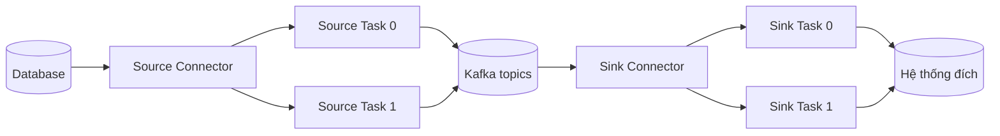

# Connector, task, worker và worker group

Kafka Connect là framework để chuyển dữ liệu giữa Kafka và các hệ thống bên ngoài như database, object storage, search engine hoặc message broker khác. Thay vì tự viết một producer/consumer service cho từng tích hợp, ứng dụng có thể dùng connector plugin đã có, cấu hình nguồn/đích và để Kafka Connect quản lý vòng đời, phân bổ công việc, offset cùng trạng thái vận hành.

Để vận hành Kafka Connect đúng cách, cần phân biệt bốn khái niệm: **connector** mô tả một công việc tích hợp; **task** thực hiện phần công việc có thể phân chia; **worker** là tiến trình chạy connector và task; **worker group** là nhóm các worker phối hợp trong distributed mode. Hiểu rõ quan hệ giữa chúng giúp thiết kế mức song song, mở rộng cluster và xử lý rebalance.

## 1. Kiến trúc tổng quan của Kafka Connect

Một luồng tích hợp thường có dạng:

- **Source connector:** đọc dữ liệu từ hệ thống bên ngoài rồi chuyển thành Kafka record và ghi vào topic.
- **Sink connector:** đọc Kafka record rồi ghi dữ liệu vào hệ thống đích.

Ví dụ, source connector đọc thay đổi từ database và ghi vào `dbserver1.inventory.customers`; sink connector đọc topic `orders` rồi ghi đơn hàng sang hệ thống search hoặc data warehouse.



Connector và task là khái niệm logic trong framework. Worker là tiến trình thực thi. Một worker có thể chạy nhiều task của nhiều connector; một connector có thể có nhiều task được phân bổ trên nhiều worker trong distributed mode.

Kafka Connect không tự suy ra cách chia dữ liệu cho mọi hệ thống. Connector plugin quyết định có thể tạo bao nhiêu task, cách mỗi task đọc/ghi dữ liệu và cách lưu offset. Vì vậy, đặt `tasks.max` lớn không bảo đảm connector sẽ thực sự chạy đúng số task đó.

## 2. Connector: định nghĩa công việc tích hợp

Connector là thành phần plugin triển khai logic tích hợp với một hệ thống cụ thể. Nó nhận cấu hình như địa chỉ database, tên bảng, topic, thông tin xác thực, bộ lọc hoặc chiến lược đồng bộ.

Ví dụ cấu hình source connector ở mức khái niệm:

```json
{
  "name": "inventory-jdbc-source",
  "config": {
    "connector.class": "io.confluent.connect.jdbc.JdbcSourceConnector",
    "connection.url": "jdbc:postgresql://db:5432/inventory",
    "connection.user": "connect_reader",
    "connection.password": "${file:/opt/connect/secrets.properties:db.password}",
    "mode": "timestamp+incrementing",
    "timestamp.column.name": "updated_at",
    "incrementing.column.name": "id",
    "topic.prefix": "inventory-",
    "tasks.max": "2"
  }
}
```

Đây là ví dụ minh họa cho JDBC source connector; tên thuộc tính, khả năng chia task và cách quản lý secret phụ thuộc plugin/phiên bản cụ thể. Không nên đặt password dạng rõ trong cấu hình gửi qua REST API hoặc lưu vào file được commit. Dùng ConfigProvider/secret store phù hợp và giới hạn quyền đọc secret cho worker.

Một connector có các trách nhiệm chính:

- Xác thực và kiểm tra cấu hình tích hợp.
- Khám phá hoặc xác định nguồn dữ liệu/đích dữ liệu cần xử lý.
- Tạo danh sách task configuration dựa trên khả năng phân chia công việc.
- Theo dõi vòng đời và trạng thái của connector.
- Cung cấp thông tin cần thiết để framework khởi động, dừng hoặc tái khởi động task.

Connector thường là nơi mô tả công việc ở mức tổng thể. Trong distributed mode, framework có thể khởi tạo connector instance trên một worker và phân bổ các task do connector tạo ra đến các worker trong cùng cluster.

## 3. Task: đơn vị thực thi và mở rộng song song

Task là đơn vị thực thi công việc thực tế. Connector tạo ra các cấu hình task; Kafka Connect khởi chạy và quản lý task đó. Mỗi task chạy trong một worker process tại một thời điểm.

Với source connector, task thường đọc một phần nguồn dữ liệu và phát `SourceRecord` vào Kafka. Với sink connector, task nhận một phần record từ topic rồi ghi sang hệ thống đích.

Ví dụ, một sink connector đọc topic có 12 partition. Nếu plugin hỗ trợ phân chia theo partition, connector có thể tạo nhiều task để xử lý song song. Mỗi task nhận một phần partition assignment. Tuy nhiên, số task thực tế phụ thuộc thuật toán và giới hạn của connector, không chỉ phụ thuộc số partition.

### `tasks.max` có ý nghĩa gì?

`tasks.max` là giới hạn tối đa số task mà connector được phép tạo. Đây không phải lệnh buộc connector phải tạo đúng số task đó.

- Connector có thể tạo ít task hơn nếu nguồn không thể chia nhỏ công việc.
- Một số connector có thể tạo một task duy nhất dù `tasks.max` đặt cao.
- Số task thực tế còn phụ thuộc số shard, table, partition, luồng nguồn hoặc giới hạn của hệ thống đích.
- Tăng task có thể tăng throughput nhưng cũng tăng kết nối, thread, request và tải lên database/đích.

Không nên đặt `tasks.max` bằng một con số lớn theo cảm tính. Hãy xem tài liệu plugin, số đơn vị dữ liệu có thể phân chia, giới hạn kết nối và throughput thực tế.

### Task và ordering

Kafka bảo đảm thứ tự trong từng partition. Khi một sink connector xử lý nhiều partition bằng nhiều task, thứ tự giữa các partition không được bảo đảm toàn cục. Nếu dữ liệu cùng một entity cần được xử lý theo thứ tự, producer cần chọn key phù hợp để các record của entity vào cùng partition và connector phải giữ đúng ngữ nghĩa xử lý của partition đó.

Tăng số task không tự tạo thêm partition và cũng không thay đổi thứ tự record đã được Kafka ghi trong partition. Số partition của topic, khả năng song song của connector và năng lực hệ thống đích là ba yếu tố cần cân đối riêng.

## 4. Worker: tiến trình chạy connector và task

Worker là tiến trình Kafka Connect chạy trong JVM. Worker nạp connector plugin, tạo connector/task instance, kết nối Kafka và hệ thống ngoài, đồng thời cung cấp REST API để quản lý cấu hình và trạng thái.

Worker config thường chứa các thuộc tính như:

```properties
bootstrap.servers=kafka-1:9092,kafka-2:9092
key.converter=org.apache.kafka.connect.storage.StringConverter
value.converter=org.apache.kafka.connect.json.JsonConverter
value.converter.schemas.enable=false
plugin.path=/opt/connect/plugins
```

Các thuộc tính này cấu hình kết nối Kafka, converter và nơi tìm plugin. Trong distributed mode, worker còn cần `group.id` và các internal topic cho config, offset, status. Trong standalone mode, worker dùng cấu hình offset lưu cục bộ cho source connector thay vì tham gia worker group.

Một worker process có thể chạy:

- Nhiều connector instance.
- Nhiều source task hoặc sink task.
- REST endpoint để nhận lệnh quản trị.
- Các thành phần nội bộ để trao đổi trạng thái và điều phối với worker khác khi chạy distributed mode.

Worker không phải một Kafka broker. Worker sử dụng Kafka cluster để lưu record và trạng thái nội bộ, nhưng bản thân worker là tiến trình ứng dụng riêng có thể triển khai trên máy hoặc container khác với broker.

## 5. Standalone mode và distributed mode

Kafka Connect có hai chế độ triển khai chính.

| Tiêu chí | Standalone mode | Distributed mode |
|---|---|---|
| Tiến trình | Một worker process chạy độc lập | Nhiều worker process phối hợp thành một cluster Connect |
| Phân bổ task | Trong phạm vi một process | Framework phân bổ task giữa các worker |
| Worker group | Không tham gia group coordination | Các worker dùng chung `group.id` để phối hợp |
| Lưu cấu hình/offset/trạng thái | Cấu hình truyền khi khởi chạy; source offset thường lưu vào file cục bộ | Lưu trong các Kafka internal topic dùng chung |
| Khả năng mở rộng | Hạn chế trong một process | Có thể thêm worker để tăng tài nguyên và khả năng chịu lỗi |
| Trường hợp phù hợp | Local development, thử nghiệm, tác vụ nhỏ hoặc môi trường đơn giản | Production, cần mở rộng và phục hồi khi worker lỗi |

Standalone mode thường chạy bằng lệnh `connect-standalone` với file worker properties và một hoặc nhiều file connector properties. Source offset của worker standalone thường được lưu bằng `offset.storage.file.filename` trong file cục bộ. Đây là cách thuận tiện để thử plugin hoặc debug cấu hình. Nếu process dừng, task không còn chạy cho đến khi process được khởi động lại.

Distributed mode chạy nhiều worker bằng `connect-distributed`. Các worker có cùng `group.id` và cùng bộ internal topic sẽ tham gia một cluster Connect. Khi worker mới tham gia hoặc worker hiện tại rời group, framework có thể rebalance và phân bổ lại connector/task.

Không nên trộn worker standalone với distributed trong cùng một cluster. Hai mode có cơ chế lưu trạng thái và điều phối khác nhau.

## 6. Worker group trong distributed mode

`group.id` trong worker configuration xác định nhóm các worker Kafka Connect phối hợp với nhau. Các worker cùng Connect cluster phải dùng cùng giá trị `group.id`, cùng Kafka cluster và cùng các internal topic tương ứng.

Ví dụ cấu hình rút gọn:

```properties
bootstrap.servers=kafka-1:9092,kafka-2:9092
group.id=connect-prod

config.storage.topic=connect-configs
offset.storage.topic=connect-offsets
status.storage.topic=connect-status
config.storage.replication.factor=3
offset.storage.replication.factor=3
status.storage.replication.factor=3

key.converter=org.apache.kafka.connect.json.JsonConverter
value.converter=org.apache.kafka.connect.json.JsonConverter
value.converter.schemas.enable=false

plugin.path=/opt/connect/plugins
rest.port=8083
```

Worker group có một số vai trò:

- Nhận diện các worker thuộc cùng một Connect cluster.
- Phối hợp phân bổ connector và task giữa các worker.
- Phát hiện worker tham gia hoặc rời khỏi cluster thông qua cơ chế group membership.
- Kích hoạt rebalance khi topology worker hoặc cấu hình task thay đổi.
- Đồng bộ trạng thái quản trị cần thiết thông qua internal topic và group coordination.

Một worker group không phải consumer group của từng ứng dụng nghiệp vụ. Đối với sink connector, Connect còn quản lý consumer để đọc topic; consumer group của sink connector là khái niệm riêng với `group.id` của worker cluster (thường được framework tạo dựa trên tên connector). Không dùng chung hoặc thay đổi tùy tiện hai loại group này.

Các worker trong cùng group cần có cấu hình tương thích: cùng internal topic, converter phù hợp và plugin cần thiết. Nếu một worker thiếu plugin hoặc dùng phiên bản plugin khác với các worker còn lại, connector/task có thể được phân bổ tới worker đó rồi thất bại khi khởi chạy.

## 7. Ba internal topic trong distributed mode

Distributed mode sử dụng các Kafka topic nội bộ để lưu trạng thái của Connect cluster:

| Internal topic | Nội dung | Yêu cầu quan trọng |
|---|---|---|
| `config.storage.topic` | Cấu hình connector và task | Phải có đúng một partition; dùng log compaction và replication phù hợp |
| `offset.storage.topic` | Offset của source connector | Dùng log compaction; có thể có nhiều partition để mở rộng |
| `status.storage.topic` | Trạng thái connector và task | Dùng log compaction; có thể có nhiều partition để mở rộng |

Các topic này không phải topic nghiệp vụ. Chúng thuộc control plane của Kafka Connect và cần được bảo vệ khỏi việc xóa hoặc sửa thủ công.

Ví dụ tạo trước các internal topic với replication factor 3:

```bash
kafka-topics.sh --bootstrap-server kafka-1:9092 \
  --create --topic connect-configs --partitions 1 --replication-factor 3 \
  --config cleanup.policy=compact

kafka-topics.sh --bootstrap-server kafka-1:9092 \
  --create --topic connect-offsets --partitions 25 --replication-factor 3 \
  --config cleanup.policy=compact

kafka-topics.sh --bootstrap-server kafka-1:9092 \
  --create --topic connect-status --partitions 5 --replication-factor 3 \
  --config cleanup.policy=compact
```

Số partition của offset/status là ví dụ, cần chọn theo quy mô Connect cluster. `config.storage.topic` cần một partition để bảo đảm thứ tự cập nhật cấu hình. Replication factor 3 là cấu hình thường dùng cho môi trường có ít nhất ba broker; nếu cluster nhỏ hơn, điều chỉnh theo số broker và yêu cầu độ bền.

Có thể để Connect tự tạo internal topic nếu cấu hình và quyền cho phép, nhưng production thường nên tạo trước với partition, replication factor và cleanup policy đã xác định. Nếu topic được tự tạo sai cấu hình, việc sửa về sau có thể khó khăn; đặc biệt không thể giảm số partition của topic Kafka.

## 8. Plugin và tính nhất quán giữa các worker

Connector là plugin được nạp vào worker. Plugin có thể gồm connector class, converter, transform và các thư viện phụ thuộc. `plugin.path` chỉ định các thư mục Kafka Connect tìm plugin.

Khi chạy distributed mode, mọi worker có thể nhận task của connector bất cứ lúc nào sau rebalance. Vì vậy:

- Cài cùng connector plugin trên tất cả worker có thể nhận task.
- Giữ phiên bản plugin và dependency nhất quán giữa các worker.
- Đảm bảo `plugin.path` giống nhau hoặc trỏ đến các thư mục có nội dung tương đương.
- Sau khi nâng cấp plugin, thực hiện rolling restart theo kế hoạch và kiểm tra trạng thái connector/task.
- Không xóa JAR hoặc dependency đang được task sử dụng khi worker còn chạy.

Nếu worker A có JDBC connector nhưng worker B không có, task có thể chạy khi được gán cho A nhưng lỗi khi rebalance chuyển sang B. Đây là một nguyên nhân thường gặp khiến connector hoạt động không ổn định dù cấu hình connector không đổi.

## 9. REST API quản lý connector và quan sát task

Kafka Connect cung cấp REST API trên từng worker, mặc định thường là cổng `8083`. Trong distributed mode, có thể gửi request đến một worker; các thao tác cần điều phối sẽ được worker xử lý hoặc chuyển tiếp tới worker phù hợp trong cluster.

Một số endpoint thường dùng:

| Endpoint | Mục đích |
|---|---|
| `GET /connectors` | Liệt kê connector |
| `POST /connectors` | Tạo connector mới từ cấu hình |
| `GET /connectors/{name}` | Xem cấu hình connector |
| `PUT /connectors/{name}/config` | Cập nhật cấu hình connector |
| `GET /connectors/{name}/status` | Xem trạng thái connector và task |
| `GET /connectors/{name}/tasks` | Liệt kê task của connector |
| `POST /connectors/{name}/pause` | Tạm dừng connector |
| `POST /connectors/{name}/resume` | Tiếp tục connector |
| `POST /connectors/{name}/restart` | Yêu cầu restart connector |
| `DELETE /connectors/{name}` | Xóa connector |

Ví dụ tạo connector:

```bash
curl -X POST http://connect-worker-1:8083/connectors \
  -H 'Content-Type: application/json' \
  -d '{
    "name": "inventory-jdbc-source",
    "config": {
      "connector.class": "io.confluent.connect.jdbc.JdbcSourceConnector",
      "connection.url": "jdbc:postgresql://db:5432/inventory",
      "connection.user": "connect_reader",
      "mode": "incrementing",
      "incrementing.column.name": "id",
      "topic.prefix": "inventory-",
      "tasks.max": "2"
    }
  }'
```

Ví dụ kiểm tra trạng thái:

```bash
curl http://connect-worker-1:8083/connectors/inventory-jdbc-source/status
```

Kết quả status cho biết connector và từng task đang `RUNNING`, `FAILED`, `PAUSED` hoặc trạng thái khác tùy phiên bản. Khi task lỗi, cần xem `trace`/exception được trả về, log của worker đang chạy task và trạng thái nguồn/đích. Trạng thái `RUNNING` chỉ cho biết task đang chạy, không tự chứng minh dữ liệu đang được đồng bộ đúng hoặc không bị trễ.

REST API cần được bảo vệ bằng network policy, authentication/authorization hoặc reverse proxy phù hợp. Không phơi cổng quản trị Connect ra mạng công cộng không kiểm soát.

## 10. Rebalance và khả năng phục hồi của worker group

Trong distributed mode, task assignment có thể thay đổi khi:

- Worker mới gia nhập group.
- Worker dừng, crash hoặc mất kết nối quá thời hạn session.
- Connector được tạo, xóa, pause hoặc resume.
- Cấu hình connector thay đổi làm số lượng hoặc task configuration thay đổi.
- Thành viên group cần đồng bộ lại trạng thái sau một sự kiện điều phối.

Khi rebalance, một số task có thể dừng trên worker cũ rồi khởi chạy trên worker mới. Thời gian chuyển giao có thể tạo khoảng gián đoạn ngắn. Source connector cần lưu offset đúng để tiếp tục đọc từ vị trí đã xử lý; sink connector cần dựa vào offset/commit và cơ chế ghi đích để tránh mất hoặc nhân đôi dữ liệu ngoài ý muốn.

Kafka Connect không biến mọi connector thành exactly-once mặc định. Semantics phụ thuộc connector, hệ thống nguồn/đích, cách commit offset và tính idempotent của thao tác ghi. Một sink connector có thể ghi thành công ở hệ thống đích nhưng lỗi trước khi Kafka offset được commit; khi task chạy lại, record có thể được gửi lần nữa. Hãy dùng upsert, khóa duy nhất hoặc cơ chế idempotency của hệ thống đích khi cần.

## 11. Chọn số worker và task khi triển khai

Worker group và task count giải quyết hai lớp mở rộng khác nhau:

- Thêm worker làm tăng tài nguyên thực thi và số nơi có thể phân bổ task.
- Tăng `tasks.max` cho phép connector tạo nhiều task hơn nếu plugin và nguồn/đích hỗ trợ.
- Thêm worker không làm một connector đơn task tự động chạy song song.
- Tăng task vượt số đơn vị dữ liệu có thể phân chia không làm throughput tăng tương ứng.

Ví dụ, một connector có 8 task và Connect cluster có 3 worker có thể phân bổ task thành các nhóm gần cân bằng, nhưng cách phân bổ thực tế phụ thuộc assignor và tài nguyên. Nếu chỉ có một task, hai worker còn lại không thể chia task đó thành nhiều phần chỉ bằng cách tăng số worker.

Khi sizing, cần xem:

- Số task thực tế mà connector tạo ra.
- CPU, heap, network và số connection mỗi task sử dụng.
- Throughput và latency của nguồn/đích.
- Số partition topic đối với sink connector.
- Thời gian rebalance và mức gián đoạn có thể chấp nhận.
- Replication, partition và dung lượng của các internal topic.

## 12. Checklist vận hành Kafka Connect

- Xác định connector là source hay sink và hiểu cách plugin chia task.
- Kiểm tra `tasks.max` là giới hạn trên; quan sát số task thực tế qua REST API.
- Dùng standalone cho phát triển/thử nghiệm đơn giản và distributed mode cho cluster cần mở rộng/khả năng phục hồi.
- Đảm bảo worker distributed dùng chung `group.id`, Kafka cluster và internal topic.
- Tạo `config.storage.topic` một partition, compacted; offset/status topic cũng compacted và có replication phù hợp.
- Cài cùng plugin version, dependency và `plugin.path` trên mọi worker.
- Bảo vệ REST API và secret connector; không đưa password dạng rõ vào cấu hình lưu trữ hoặc log.
- Theo dõi trạng thái connector/task, log lỗi, source offset, sink lag và throughput.
- Hiểu rebalance có thể chuyển task giữa worker và thiết kế xử lý lặp phù hợp.
- Kiểm tra khả năng idempotent ở hệ thống đích nếu sink task có thể ghi lại record.

Connector mô tả công việc tích hợp, task thực hiện phần công việc có thể chia nhỏ, worker là tiến trình chạy các thành phần đó, còn worker group phối hợp nhiều worker trong distributed mode. Khi hiểu đúng bốn lớp này và cấu hình internal topic, plugin, task count cùng cơ chế rebalance, Kafka Connect có thể mở rộng và phục hồi ổn định khi tích hợp Kafka với các hệ thống bên ngoài.
