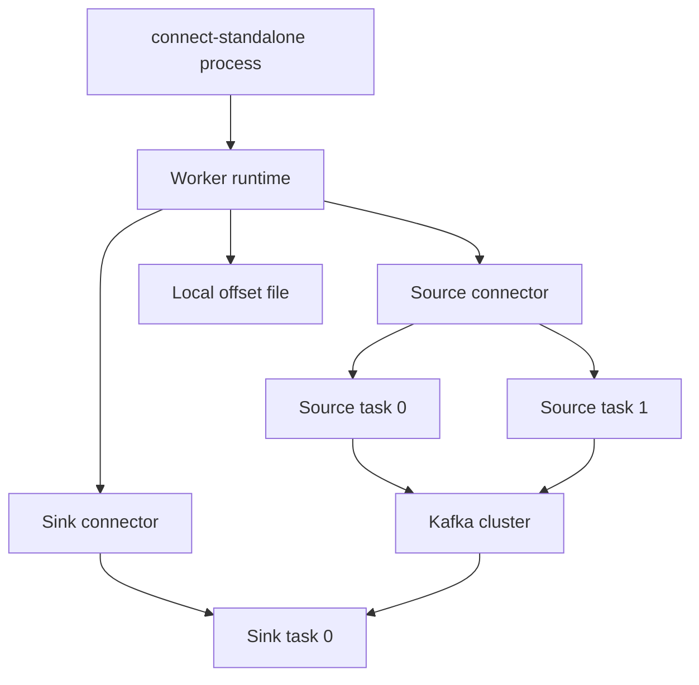
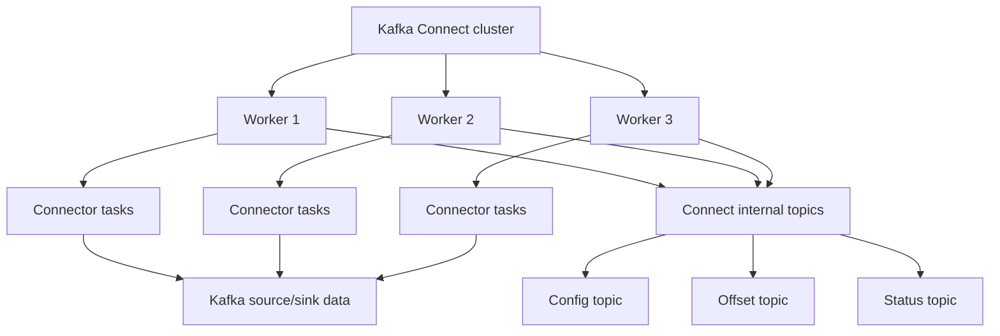

# Standalone mode và distributed mode

## Mục tiêu

Kafka Connect có hai cách triển khai worker: standalone và distributed. Cả hai đều chạy source connector để đưa dữ liệu từ hệ thống bên ngoài vào Kafka, hoặc sink connector để chuyển dữ liệu từ Kafka sang hệ thống đích. Khác biệt lớn nhất nằm ở cách worker quản lý offset, lưu cấu hình, phân phối task và phục hồi khi một process gặp sự cố.

Standalone phù hợp cho học tập, thử connector hoặc một tiến trình thu thập dữ liệu đơn giản. Distributed phù hợp cho production khi cần nhiều worker, tự phân phối task và tiếp tục hoạt động khi một worker bị lỗi. Chọn mode sai có thể tạo single point of failure, duplicate processing hoặc mất vị trí đọc khi khởi động lại.

Bài học này giải thích kiến trúc hai mode, cấu hình worker, internal topics, REST API, cách mở rộng và quy trình chuyển đổi.

Sau bài học, bạn có thể:

- Phân biệt worker, connector và task.
- Mô tả cách standalone và distributed lưu trạng thái, offset.
- Cấu hình và khởi chạy mỗi mode.
- Thiết kế internal topics cho distributed cluster.
- Quản lý connector qua REST API và kiểm tra task status.
- Mở rộng worker, triển khai plugin đồng nhất và xử lý rebalance.
- Chọn mode theo yêu cầu availability, throughput và vận hành.

## 1. Kafka Connect gồm những thành phần nào?

Kafka Connect là framework tích hợp dữ liệu chạy độc lập với ứng dụng producer/consumer thông thường. Một Connect worker là process JVM chạy runtime của framework và thực thi connector tasks.

| Thành phần | Vai trò |
|---|---|
| Worker | Process Kafka Connect; nạp plugin, nhận cấu hình và quản lý lifecycle của connector/task |
| Connector | Thành phần định nghĩa cách kết nối với hệ thống nguồn hoặc đích, tạo và quản lý tasks |
| Task | Đơn vị công việc thực tế; đọc dữ liệu từ source hoặc ghi dữ liệu sang sink |
| Converter | Chuyển đổi giữa Kafka Connect data model và bytes được ghi/đọc trong Kafka |
| Transformation (SMT) | Biến đổi nhẹ từng record như đổi tên field, thêm metadata hoặc route topic |
| Plugin | Gói chứa connector, converter, transformation hoặc thành phần mở rộng |
| Offset | Vị trí tiến độ của source hoặc sink connector để tiếp tục sau restart |

Ví dụ source connector đọc bảng orders từ database. Connector có thể chia công việc thành nhiều tasks, mỗi task đọc một tập bảng hoặc một phạm vi dữ liệu. Các tasks phát record vào Kafka topic. Sink connector thực hiện chiều ngược lại: đọc topic và ghi record vào database, search engine hoặc object storage.

`tasks.max` là giới hạn số task tối đa mà connector được phép tạo. Connector có thể tạo ít hơn vì khả năng song song phụ thuộc vào plugin, số partition, số bảng hoặc cách chia nguồn. Tăng `tasks.max` không bảo đảm throughput tăng tương ứng.

## 2. Standalone mode

Trong standalone mode, toàn bộ công việc của một Connect worker chạy trong một process. Worker có thể chạy một hoặc nhiều connector; các task được thực thi bằng những thread trong cùng process.



Đặc điểm:

- Khởi động một process bằng `connect-standalone.sh`.
- Cấu hình worker được truyền qua một file properties.
- Có thể truyền thêm một hoặc nhiều file cấu hình connector khi khởi động; các connector này cùng chạy trong process đó.
- Có thể tạo connector bằng REST API sau khi worker đã chạy.
- Source connector lưu offset vào file local được khai báo bởi `offset.storage.file.filename`.
- Không có cơ chế tự phân phối task giữa nhiều standalone worker.
- Nếu process hoặc máy chủ dừng, toàn bộ connector/task trong process đó dừng theo.

Standalone không có fault tolerance ở cấp Connect cluster. Có thể khởi động lại worker và tiếp tục từ offset file còn nguyên, nhưng không có worker khác tự nhận task trong thời gian process chính bị lỗi.

### 2.1. Offset file

Ví dụ:

```properties
bootstrap.servers=localhost:9092
key.converter=org.apache.kafka.connect.storage.StringConverter
value.converter=org.apache.kafka.connect.json.JsonConverter
value.converter.schemas.enable=false
plugin.path=/opt/kafka/plugins
offset.storage.file.filename=/var/lib/kafka-connect/standalone.offsets
offset.flush.interval.ms=10000
```

`offset.storage.file.filename` là nơi lưu source connector offsets trong standalone mode. Thư mục chứa file phải tồn tại, có quyền ghi và nằm trên storage bền vững nếu cần tiếp tục sau khi máy/container được thay thế.

File này không phải nơi lưu mọi offset của Connect. Sink connector tiêu thụ Kafka bằng consumer group; tiến độ đọc của sink được Kafka lưu trong consumer group offsets trên broker. Khi điều tra hoặc sao lưu standalone, cần phân biệt source offset file với sink consumer offsets.

Không đặt cùng một offset file cho nhiều standalone worker chạy đồng thời. Mỗi process standalone quản lý trạng thái riêng; chúng không tham gia cùng một Connect cluster để điều phối task.

Nếu file offset bị xóa hoặc mất, source connector có thể đọc lại từ vị trí ban đầu hoặc vị trí mặc định do plugin quyết định. Hậu quả có thể là phát lại dữ liệu và tạo duplicate ở downstream. Hành vi cụ thể phụ thuộc connector và cách nó xác định source partition/offset.

### 2.2. Khởi chạy standalone

Lệnh:

```bash
bin/connect-standalone.sh config/connect-standalone.properties config/orders-source.properties
```

Worker config là tham số đầu tiên; các file sau là cấu hình connector. Có thể truyền nhiều file connector:

```bash
bin/connect-standalone.sh config/connect-standalone.properties config/orders-source.properties config/orders-sink.properties
```

Ví dụ file connector source:

```properties
name=local-file-source
connector.class=org.apache.kafka.connect.file.FileStreamSourceConnector
tasks.max=1
file=/tmp/orders.txt
topic=connect-orders-demo
```

`FileStreamSourceConnector` là connector ví dụ. Trong Kafka 4.1, plugin ví dụ này không tự động nằm trong classpath hoặc `plugin.path` mặc định của worker. Nếu dùng cho lab, cần cài gói `connect-file` đúng phiên bản và thêm thư mục plugin vào `plugin.path`. Trong production, nên dùng connector được hỗ trợ cho hệ thống nguồn thực tế.

### 2.3. Khi nào dùng standalone?

Standalone thích hợp khi:

- Học Kafka Connect và kiểm tra connector lần đầu.
- Phát triển SMT hoặc thử converter trong môi trường local.
- Chạy một job tích hợp nhỏ, có thể chấp nhận gián đoạn khi host lỗi.
- Cần quy trình đơn giản, không cần điều phối nhiều worker.

Không nên coi việc chạy hai standalone process giống cấu hình là một cluster dự phòng. Chúng không tự chia task, không chia sẻ offset file và có thể cùng đọc/ghi một nguồn nếu cấu hình trùng nhau.

## 3. Distributed mode

Trong distributed mode, nhiều Connect worker tham gia cùng một cluster group. Các worker dùng chung `group.id` và cùng tham chiếu đến internal topics để phối hợp lưu cấu hình, offset và trạng thái.



Đặc điểm:

- Mỗi worker vẫn là một process riêng, nhưng các worker cùng group hình thành một Connect cluster.
- Connector configuration được quản lý tập trung và lưu trong Kafka internal topics.
- Source connector offsets được lưu trong offset storage topic.
- Connector/task status được ghi vào status storage topic.
- Connect tự phân phối connector tasks giữa các worker và cân bằng lại khi membership hoặc cấu hình thay đổi.
- Khi một worker mất, các task được phân phối lại cho worker còn hoạt động nếu cluster còn đủ tài nguyên.
- Có thể thêm/bớt worker để thay đổi năng lực thực thi.

Distributed mode cung cấp fault tolerance cho task assignment và trạng thái framework. Điều đó không có nghĩa mọi connector đều exactly-once hoặc mọi lỗi ở hệ thống nguồn/đích đều tự được khôi phục. Semantics xử lý vẫn phụ thuộc connector, offset handling, transaction và hệ thống bên ngoài.

## 4. Ba internal topics của distributed mode

Distributed cluster cần ba topic nội bộ. Các topic này là metadata/state quan trọng; không dùng chung với topic business data.

| Internal topic | Dữ liệu | Cấu hình khuyến nghị |
|---|---|---|
| `config.storage.topic` | Connector config và task config | Một partition, replication factor cao, `cleanup.policy=compact` |
| `offset.storage.topic` | Source connector offsets | Nhiều partition, replication factor cao, `cleanup.policy=compact` |
| `status.storage.topic` | Connector và task status | Nhiều partition, replication factor cao, `cleanup.policy=compact` |

Ví dụ tên topic:

```text
connect-prod-configs
connect-prod-offsets
connect-prod-status
```

### 4.1. Config topic

Config topic nên có đúng một partition vì toàn bộ Connect cluster cần một thứ tự nhất quán cho các thay đổi cấu hình.

Không tăng số partition của config topic sau khi cluster đã sử dụng. Nếu config topic có nhiều partition, Connect cluster có thể gặp lỗi hoặc không đảm bảo cách khôi phục cấu hình theo thiết kế.

### 4.2. Offset topic

Offset topic lưu tiến độ của source connectors. Topic này thường có nhiều partition để phân phối lưu trữ và truy cập offset.

Kafka 4.1 mặc định `offset.storage.partitions=25`; đây là giá trị mặc định khi worker tạo topic, không phải số bắt buộc cho mọi cluster. Cần sizing theo số lượng connector/task và tải cập nhật offset. Số partition của offset topic không thể tùy tiện đổi sau khi topic đã được tạo và sử dụng.

### 4.3. Status topic

Status topic lưu trạng thái connector và task. Kafka 4.1 mặc định `status.storage.partitions=5`.

### 4.4. Replication và compaction

Với production cluster có đủ broker, thường đặt replication factor 3 cho cả ba internal topics. Replication factor phải không lớn hơn số broker có thể nhận replica.

Ví dụ tạo topic trước khi khởi động Connect:

```bash
bin/kafka-topics.sh --bootstrap-server broker1:9092 --create --topic connect-prod-configs --partitions 1 --replication-factor 3 --config cleanup.policy=compact

bin/kafka-topics.sh --bootstrap-server broker1:9092 --create --topic connect-prod-offsets --partitions 25 --replication-factor 3 --config cleanup.policy=compact

bin/kafka-topics.sh --bootstrap-server broker1:9092 --create --topic connect-prod-status --partitions 5 --replication-factor 3 --config cleanup.policy=compact
```

Nên tạo internal topics thủ công để kiểm soát partition count, replication factor và cleanup policy. Nếu worker tự tạo topic với broker defaults không phù hợp, việc sửa lại sau khi cluster đã chạy có thể phức tạp và rủi ro.

Không xóa, đổi tên hoặc truncate các internal topics khi cluster đang sử dụng. Mất config topic có thể làm mất cấu hình connector; mất offset topic có thể khiến source connector không biết vị trí tiếp tục và phát lại dữ liệu; mất status topic làm mất thông tin trạng thái đã lưu.

## 5. Cấu hình distributed worker

Ví dụ file `connect-distributed.properties`:

```properties
bootstrap.servers=broker1:9092,broker2:9092,broker3:9092

group.id=connect-prod

config.storage.topic=connect-prod-configs
config.storage.replication.factor=3

offset.storage.topic=connect-prod-offsets
offset.storage.partitions=25
offset.storage.replication.factor=3

status.storage.topic=connect-prod-status
status.storage.partitions=5
status.storage.replication.factor=3

key.converter=org.apache.kafka.connect.storage.StringConverter
value.converter=org.apache.kafka.connect.json.JsonConverter
value.converter.schemas.enable=false

plugin.path=/opt/kafka/plugins
offset.flush.interval.ms=60000

listeners=http://0.0.0.0:8083
```

Tất cả worker trong cùng Connect cluster phải dùng thống nhất:

- `group.id`.
- `bootstrap.servers` và security configuration tới Kafka cluster.
- Tên ba internal topics và các thiết lập liên quan.
- Converter mặc định hoặc policy override tương thích.
- Plugin và phiên bản plugin mà các connector cần.

`group.id` định danh Connect cluster, không phải consumer group ID của ứng dụng business. Nếu hai Connect cluster độc lập dùng cùng `group.id` và cùng internal topics, chúng sẽ tham gia cùng một nhóm và có thể chia sẻ cấu hình/task ngoài ý muốn.

Khởi động từng worker bằng cùng worker configuration:

```bash
bin/connect-distributed.sh config/connect-distributed.properties
```

Có thể chạy các worker trên những máy/container khác nhau. Khi worker mới tham gia, cluster sẽ thực hiện rebalance để phân phối task.

## 6. So sánh hai mode

| Tiêu chí | Standalone | Distributed |
|---|---|---|
| Process | Một process cho worker | Nhiều worker process cùng cluster group |
| Cấu hình connector | File properties/JSON hoặc REST API | REST API |
| Source offset storage | File local qua `offset.storage.file.filename` | Kafka offset storage topic |
| Connector config storage | Worker quản lý cục bộ; không có config topic dùng chung | Kafka config storage topic |
| Task assignment | Trong cùng process | Connect cluster tự phân phối tasks giữa worker |
| Rebalance | Không có cluster rebalance | Có rebalance khi worker/config/task thay đổi |
| Worker failure | Các connector/task trong process dừng | Task có thể được gán lại cho worker còn sống |
| Horizontal scaling | Không có phối hợp scale | Thêm worker để tăng khả năng chạy task |
| High availability | Không có HA ở cấp Connect cluster | Có khả năng chịu lỗi worker nếu còn worker và Kafka nội bộ hoạt động |
| Vận hành | Đơn giản, phù hợp lab | Cần quản lý internal topics, REST endpoints, plugin đồng nhất và rebalance |
| Exactly-once source support | Không hỗ trợ framework-level exactly-once source | Có thể bật nếu connector hỗ trợ và cấu hình cluster đáp ứng |

REST API có sẵn ở cả hai mode. Điểm khác là distributed mode dùng REST API như giao diện quản lý chung và để worker liên lạc với nhau; request nhận ở follower có thể được forward tới leader worker.

## 7. REST API quản lý connector

Connect REST API mặc định lắng nghe HTTP ở port `8083` nếu không cấu hình `listeners`. Có thể cấu hình listener HTTP/HTTPS riêng. Trong production, giới hạn truy cập REST API bằng network policy, firewall, reverse proxy hoặc cơ chế authentication/authorization phù hợp; không công khai endpoint quản trị ra Internet.

### 7.1. Kiểm tra worker và plugin

```bash
curl http://localhost:8083/
curl http://localhost:8083/connectors
curl http://localhost:8083/connector-plugins
```

`GET /connector-plugins` chỉ kiểm tra plugin trên worker xử lý request. Trong lúc rolling upgrade hoặc plugin deployment chưa đồng nhất, kết quả từ các worker khác nhau có thể khác nhau.

### 7.2. Tạo connector

File `connector.json`:

```json
{
  "name": "orders-file-source",
  "config": {
    "connector.class": "org.apache.kafka.connect.file.FileStreamSourceConnector",
    "tasks.max": "1",
    "file": "/tmp/orders.txt",
    "topic": "connect-orders-demo"
  }
}
```

Tạo connector:

```bash
curl -X POST http://localhost:8083/connectors -H "Content-Type: application/json" --data-binary @connector.json
```

Standalone cũng hỗ trợ tạo connector qua REST sau khi worker đã khởi động. Trong distributed mode, cấu hình connector được quản lý qua REST API thay vì truyền file connector trên command line.

### 7.3. Kiểm tra trạng thái và cấu hình

```bash
curl http://localhost:8083/connectors/orders-file-source/config
curl http://localhost:8083/connectors/orders-file-source/status
curl http://localhost:8083/connectors/orders-file-source/tasks
```

Status response cho biết connector/task đang `RUNNING`, `FAILED`, `PAUSED` hoặc trạng thái tương ứng; đồng thời có thể cho biết worker đang chạy task và thông tin lỗi nếu thất bại.

### 7.4. Pause, resume, restart và delete

```bash
# Pause connector và các task
curl -X PUT http://localhost:8083/connectors/orders-file-source/pause

# Resume connector
curl -X PUT http://localhost:8083/connectors/orders-file-source/resume

# Restart connector và task instances
curl -X POST "http://localhost:8083/connectors/orders-file-source/restart?includeTasks=true&onlyFailed=true"

# Xóa connector
curl -X DELETE http://localhost:8083/connectors/orders-file-source
```

Pause giữ các resource mà task đang nắm giữ để có thể tiếp tục nhanh. Stop dừng task và giải phóng resource; một số thao tác quản lý offset chỉ được phép khi connector ở trạng thái stopped. Không nhầm pause với stop.

## 8. Task assignment và rebalance

Trong distributed mode, connector xác định số task có thể tạo; worker cluster phân phối những task đó cho các worker.

Ví dụ:

- Cluster có ba worker.
- Connector có `tasks.max=6`.
- Connector thực tế tạo được bốn task.
- Bốn task được phân phối lên tối đa ba worker; một worker có thể nhận hai task.

Số worker không đồng nghĩa số task. Nếu connector chỉ tạo một task, thêm nhiều worker không làm connector đó chạy song song hơn.

Rebalance có thể xảy ra khi:

- Worker mới gia nhập cluster.
- Worker mất kết nối hoặc bị dừng.
- Connector được tạo, xóa hoặc cập nhật cấu hình.
- Số task của connector thay đổi.
- Worker được nâng cấp hoặc restart.

Trong rebalance, task có thể dừng ở worker cũ và được khởi động ở worker mới. Thời gian phục hồi phụ thuộc connector shutdown, flush/commit offset, kết nối nguồn/đích và thời gian worker tham gia lại group.

### 8.1. Thiết kế để rebalance an toàn

- Dùng shutdown grace period phù hợp để task flush dữ liệu và commit tiến độ.
- Đảm bảo source connector xử lý offset đúng trước khi phát lại record.
- Đảm bảo sink connector có thể xử lý lại record mà không tạo side effect trùng.
- Theo dõi số lần rebalance và thời gian task khởi động lại.
- Tránh cập nhật hàng loạt connector liên tục gây rebalance không cần thiết.
- Đảm bảo worker có CPU, memory, network và file descriptors đủ cho tasks được phân công.

### 8.2. Exactly-once source support

Kafka Connect có framework-level exactly-once support cho source connectors trong distributed mode nếu connector hỗ trợ và cluster được cấu hình phù hợp. Standalone worker không cung cấp cơ chế exactly-once source này.

Đây không phải bảo đảm exactly-once chung cho mọi source/sink connector. Cần kiểm tra connector có hỗ trợ, worker cluster bật đúng chế độ, ACL/transaction configuration đầy đủ và hệ thống nguồn có semantics phù hợp. Với sink ghi ra database hoặc API, vẫn cần đánh giá idempotency/transaction ở đích.

Với cluster mới dùng Kafka 4.1, cấu hình worker có thể bật hỗ trợ này bằng:

```properties
exactly.once.source.support=enabled
```

Tất cả worker trong cluster phải được cấu hình theo quy trình của Kafka và connector; không bật chỉ vì muốn có nhãn exactly-once nếu plugin không hỗ trợ.

## 9. Plugin deployment trong distributed cluster

Plugin gồm connector, converter và transformation. Worker tìm plugin thông qua `plugin.path` và classpath.

Ví dụ:

```properties
plugin.path=/opt/kafka/plugins,/opt/company/connectors
```

Các thư mục trong `plugin.path` cần chứa JAR và dependency theo layout mà Connect plugin scanner hỗ trợ. Đặt từng plugin trong thư mục riêng giúp giảm xung đột dependency giữa các connector.

Trong distributed cluster:

- Cài cùng connector plugin trên tất cả worker có thể nhận task.
- Dùng phiên bản plugin nhất quán giữa các worker.
- Đồng bộ dependency và cấu hình converter/SMT.
- Sau khi thêm JAR, restart worker để plugin được discovery.
- Kiểm tra plugin list trên từng worker, đặc biệt sau rolling upgrade.

Nếu worker A có connector plugin nhưng worker B không có, task có thể chạy ở A rồi thất bại khi rebalance sang B. Vì vậy, plugin parity là điều kiện vận hành của distributed cluster.

Không chép một bộ JAR khác phiên bản vào từng worker trong lúc connector đang chạy mà không có kế hoạch rolling upgrade. Version mismatch có thể gây lỗi class loading, serialization hoặc thay đổi behavior giữa các task.

## 10. Converter và connector configuration

Converter được cấu hình ở worker và có thể override ở cấp connector:

```properties
key.converter=org.apache.kafka.connect.storage.StringConverter
value.converter=org.apache.kafka.connect.json.JsonConverter
value.converter.schemas.enable=false
```

Converter xác định cách Kafka Connect data model được chuyển thành bytes trong Kafka. Nó tách biệt với connector: cùng một connector có thể sử dụng JSON, Avro hoặc Protobuf tùy converter/plugin được cài.

Các connector config phổ biến:

| Thuộc tính | Ý nghĩa |
|---|---|
| `name` | Tên duy nhất của connector |
| `connector.class` | Class hoặc alias của plugin |
| `tasks.max` | Số task tối đa connector có thể tạo |
| `key.converter` | Override converter của key |
| `value.converter` | Override converter của value |
| `topics` | Topic nguồn mà sink connector đọc |
| `topics.regex` | Regex chọn topic cho sink connector |

Các thuộc tính còn lại phụ thuộc connector cụ thể. Luôn kiểm tra plugin config definition và dùng API validate trước khi tạo connector:

```bash
curl -X PUT "http://localhost:8083/connector-plugins/org.apache.kafka.connect.file.FileStreamSourceConnector/config/validate" -H "Content-Type: application/json" --data-binary @connector-config-only.json
```

API validation giúp phát hiện sai tên thuộc tính, thiếu config bắt buộc và giá trị không hợp lệ trước khi task khởi chạy.

## 11. Security và vận hành REST endpoint

Worker kết nối Kafka để quản lý internal topics, source producer và sink consumer. Trên cluster bảo mật, các cấu hình SSL/SASL có thể cần áp dụng riêng cho:

- Kết nối quản lý/internal topics của worker.
- Producer được source tasks sử dụng.
- Consumer được sink tasks sử dụng.

Không giả định một cấu hình client duy nhất tự áp dụng cho mọi kết nối nếu worker hoặc connector dùng prefix/override riêng. Cấp ACL tối thiểu cho internal topics, business topics và connector resources.

REST API quản trị Connect cần được bảo vệ:

- Chỉ cho phép mạng quản trị hoặc service account tin cậy truy cập.
- Dùng HTTPS khi truyền qua network không tin cậy.
- Đặt authentication/authorization ở proxy hoặc extension phù hợp với triển khai.
- Không đưa password, token hoặc private key vào connector config lưu ở nơi không được bảo vệ.
- Dùng ConfigProvider/secret store để tham chiếu secret ngoài file cấu hình khi có thể.
- Audit thay đổi connector config, restart, pause và offset management.

Trong distributed mode, REST API còn được dùng cho giao tiếp worker-to-worker. Cấu hình advertised host/port/listener phải là địa chỉ mà các worker khác có thể truy cập, nhất là khi chạy trong container, Kubernetes hoặc sau load balancer.

## 12. Monitoring và troubleshooting

Theo dõi ít nhất các nhóm sau:

| Nhóm | Chỉ số/trạng thái cần quan sát |
|---|---|
| Worker | Worker alive, JVM heap/GC, CPU, memory, thread pool, REST request failures |
| Connector | RUNNING/FAILED/PAUSED, connector restart, config validation errors |
| Task | Số task RUNNING/FAILED, task assignment, task startup/shutdown time |
| Source | Poll rate, records produced, source offset commit failures, source lag nếu connector cung cấp |
| Sink | Records read, records sent, batch latency, sink retry/failure, consumer lag |
| Rebalance | Số lần rebalance, thời gian rebalance, thời gian task phục hồi |
| Internal topics | Topic availability, ISR, under-replicated partitions, disk usage |
| Error handling | Retry count, skipped records, DLQ/DLT throughput và lỗi publish DLQ |

Tên JMX metric cụ thể phụ thuộc Kafka version và connector. Dùng metric reference của phiên bản triển khai và plugin vendor; không tạo alert dựa trên một tên metric giả định có ở mọi connector.

### 12.1. Worker không khởi động

Kiểm tra:

1. `bootstrap.servers` có truy cập được không?
2. Internal topics đã tồn tại đúng tên/partition/replication/cleanup policy chưa?
3. `group.id` và internal topic config có đồng nhất trên mọi worker không?
4. Worker có quyền đọc/ghi internal topics không?
5. `plugin.path` có tồn tại và chứa plugin hợp lệ không?
6. Có lỗi class loading hoặc dependency conflict không?

### 12.2. Connector ở trạng thái FAILED

Kiểm tra:

1. `GET /connectors/{name}/status` và trạng thái từng task.
2. Error trace trong worker log.
3. Plugin class và config có đúng không?
4. Credential, ACL, network và endpoint của source/sink có hợp lệ không?
5. Converter, schema và SMT có xử lý được record không?
6. Source/sink system có rate limit hoặc transaction timeout không?

Không restart liên tục trước khi hiểu nguyên nhân; restart chỉ xóa triệu chứng tạm thời nếu cấu hình hoặc dữ liệu vẫn sai.

### 12.3. Task không phân phối hoặc không tăng throughput

- Kiểm tra connector thực sự tạo bao nhiêu task.
- Kiểm tra `tasks.max` và khả năng parallelism của plugin.
- Kiểm tra worker có plugin version giống nhau.
- Kiểm tra worker capacity và task assignment.
- Kiểm tra source partition/table split hoặc sink topic partitions.
- Kiểm tra bottleneck ở database, API, network hoặc Kafka broker.

### 12.4. Duplicate hoặc bỏ sót dữ liệu sau restart

- Kiểm tra offset file nếu chạy standalone.
- Kiểm tra offset storage topic và trạng thái rebalance nếu chạy distributed.
- Kiểm tra thời điểm flush/commit offset so với lúc ghi dữ liệu.
- Kiểm tra source connector có thể phát lại record khi chưa commit offset hay không.
- Kiểm tra sink có idempotent hoặc upsert theo key không.
- Đối chiếu source coordinates, event ID và sink transaction log.

## 13. Chuyển từ standalone sang distributed

Chuyển mode không chỉ là đổi `connect-standalone.sh` thành `connect-distributed.sh`. Cách lưu offset thay đổi từ local file sang Kafka offset topic; cấu hình connector cũng chuyển sang cơ chế quản lý tập trung.

Quy trình chuyển đổi cần có kế hoạch:

1. Lập danh sách connector, plugin, phiên bản plugin và config hiện tại.
2. Dừng standalone worker có kiểm soát để không còn hai tiến trình cùng xử lý một nguồn/đích.
3. Sao lưu offset file và cấu hình connector; ghi lại source position và sink group offsets liên quan.
4. Tạo distributed internal topics đúng partition, replication và compaction.
5. Cài cùng plugin/dependency lên tất cả distributed workers.
6. Cấu hình `group.id`, internal topics, security, converters và REST listeners.
7. Xác định cách khởi tạo offset cho từng connector. Không giả định offset file standalone tự động được nhập vào distributed offset topic.
8. Nếu plugin có công cụ/API migration offset, làm theo tài liệu của plugin. Nếu không, xác định vị trí bắt đầu mới và đánh giá khả năng replay/duplicate.
9. Tạo connector qua REST API, khởi động ở thời điểm được kiểm soát và theo dõi trạng thái.
10. Đối chiếu số record, source position, sink data và duplicate trước khi kết thúc migration.

Không chạy song song standalone cũ và distributed mới với cùng source partition hoặc cùng sink target trừ khi connector và nghiệp vụ có cơ chế fencing/ownership rõ ràng. Nếu không, cả hai có thể đọc hoặc ghi trùng.

## 14. Chọn mode theo nhu cầu

| Nhu cầu | Lựa chọn |
|---|---|
| Học Kafka Connect trên laptop | Standalone |
| Kiểm tra plugin/SMT/converter | Standalone |
| Một tác vụ đơn giản, chấp nhận dừng khi host lỗi | Standalone |
| Nhiều connector production cần quản lý tập trung | Distributed |
| Cần tự động phân phối tasks giữa nhiều worker | Distributed |
| Cần phục hồi task khi một worker gặp sự cố | Distributed |
| Cần tăng số worker theo tải | Distributed |
| Cần framework-level exactly-once source support | Distributed và connector phải hỗ trợ |

Distributed mode yêu cầu vận hành thêm internal topics, worker membership, plugin parity, REST network và monitoring. Đổi lại, nó cung cấp khả năng mở rộng và phục hồi task tốt hơn standalone.

## 15. Bài thực hành và tự kiểm tra

### Thực hành A — Chạy standalone

1. Chuẩn bị Kafka broker local.
2. Tạo `connect-standalone.properties` với `bootstrap.servers`, converters, `plugin.path` và `offset.storage.file.filename`.
3. Cài connector plugin dùng trong lab.
4. Tạo connector properties cho một source connector.
5. Khởi động bằng `connect-standalone.sh`.
6. Kiểm tra topic nhận record và quan sát offset file được tạo/cập nhật.
7. Dừng worker, khởi động lại và quan sát connector tiếp tục theo offset đã lưu.

### Thực hành B — Chạy distributed cluster

1. Chuẩn bị Kafka cluster lab có đủ broker cho replication factor đã chọn.
2. Tạo config topic một partition, offset topic nhiều partition và status topic nhiều partition; đặt `cleanup.policy=compact`.
3. Tạo file `connect-distributed.properties` với `group.id` và internal topic names.
4. Khởi động hai worker bằng cùng cấu hình.
5. Kiểm tra REST endpoint và plugin list.
6. Tạo connector qua `POST /connectors`.
7. Kiểm tra connector status và task assignment.
8. Khởi động worker thứ ba, quan sát rebalance.
9. Dừng một worker và kiểm tra task được phân phối lại.

### Thực hành C — So sánh failure recovery

1. Chạy cùng connector trong lab standalone và distributed.
2. Ghi lại source position và số record đã phát.
3. Dừng process standalone đột ngột rồi khởi động lại.
4. Dừng một worker distributed trong khi các worker khác còn sống.
5. So sánh thời gian phục hồi, task reassignment và duplicate.
6. Giải thích vì sao distributed mode không tự bảo đảm exactly-once cho mọi connector.

### Câu hỏi tự kiểm tra

1. Worker, connector và task khác nhau như thế nào?
2. Standalone lưu source offsets ở đâu?
3. Vì sao nhiều standalone worker không tự tạo thành một Connect cluster?
4. Distributed mode dùng ba internal topics nào?
5. Vì sao config storage topic chỉ nên có một partition?
6. Offset storage topic cần compaction để làm gì?
7. `group.id` định danh điều gì và vì sao phải nhất quán trên các worker?
8. `tasks.max` có bảo đảm connector tạo đúng số task đó không?
9. REST API có được hỗ trợ trong standalone mode không?
10. Vì sao plugin phải đồng nhất trên tất cả distributed workers?
11. Exactly-once source support có áp dụng cho standalone không?
12. Vì sao chuyển standalone sang distributed cần kế hoạch offset riêng?

## Kết luận

Standalone mode chạy toàn bộ connector tasks trong một process và lưu source offsets vào file local, phù hợp cho lab hoặc tích hợp đơn giản. Distributed mode dùng nhiều worker cùng `group.id`, lưu config/offset/status trong ba Kafka internal topics và tự phân phối lại tasks khi cluster thay đổi. Khi triển khai distributed production, cần tạo internal topics đúng partition, replication và compaction; đồng bộ plugin/config trên mọi worker; bảo vệ REST API; theo dõi rebalance và task status. Chọn mode dựa trên yêu cầu availability, scaling và khả năng vận hành, đồng thời lập kế hoạch offset cẩn thận khi chuyển đổi.

## Tài liệu tham khảo

- [Apache Kafka 4.1 — Kafka Connect User Guide](https://kafka.apache.org/41/kafka-connect/user-guide/)
- [Apache Kafka 4.1 — Kafka Connect Configs](https://kafka.apache.org/41/configuration/kafka-connect-configs/)
- [Apache Kafka 4.1 — Kafka Connect REST API](https://kafka.apache.org/41/kafka-connect/user-guide/#rest-api)
- [Apache Kafka 4.1 — Kafka Connect Monitoring](https://kafka.apache.org/41/operations/monitoring/)
