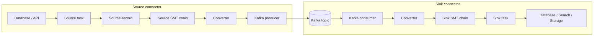

# Single Message Transform và predicate

## Mục tiêu

Kafka Connect đưa dữ liệu giữa Kafka và các hệ thống khác thông qua source connector và sink connector. Trong nhiều pipeline, dữ liệu chỉ cần một số thay đổi nhỏ trước khi ghi vào Kafka hoặc trước khi chuyển tới hệ thống đích: thêm metadata, đổi tên field, chọn lại key, làm phẳng cấu trúc, đổi tên topic hoặc bỏ record không cần thiết. **Single Message Transform (SMT)** cho phép thực hiện những thay đổi đó ngay trong Kafka Connect mà không phải viết một stream processor riêng.

Predicate giúp chỉ áp dụng một SMT khi record thỏa điều kiện, ví dụ chỉ mask dữ liệu của topic `customers`, chỉ thêm header cho record có value hoặc chỉ bỏ tombstone. Kết hợp transform và predicate đúng cách giúp cấu hình connector gọn, có thể tái sử dụng và dễ kiểm soát hơn.

Sau bài học này, bạn có thể:

- Giải thích SMT chạy ở đâu trong source connector và sink connector.
- Phân biệt SMT với converter, serializer và Kafka Streams.
- Xây dựng chuỗi SMT theo đúng thứ tự xử lý.
- Chọn transform cho key, value, header hoặc topic.
- Cấu hình predicate và `negate` để giới hạn phạm vi transform.
- Xử lý schema-aware record, schemaless data, null value và tombstone.
- Kiểm thử cấu hình SMT trước khi triển khai connector.
- Nhận biết khi nào nên chuyển logic sang Kafka Streams hoặc ứng dụng riêng.

## 1. SMT là gì?

SMT là thao tác biến đổi một Kafka Connect record tại một thời điểm. Mỗi transform nhận một record và trả về record đã thay đổi hoặc `null` để loại bỏ record. SMT thường được cấu hình trực tiếp trong connector bằng các thuộc tính `transforms` và `transforms.<alias>.*`.

SMT có thể thay đổi:

- Key hoặc value của record.
- Schema và dữ liệu trong key/value.
- Kafka headers.
- Topic name, partition hoặc timestamp metadata của record.
- Quyết định giữ hay bỏ record.

SMT phù hợp với biến đổi nhỏ, không cần trạng thái giữa nhiều record. Ví dụ đổi tên field `customer_name` thành `name`, thêm field `source_system`, mask trường `email`, hoặc route record từ topic `orders.raw` sang `orders.normalized`.

### 1.1. SMT nằm ở đâu trong pipeline?

Source connector tạo `SourceRecord`; Kafka Connect áp dụng chuỗi SMT trước khi converter chuyển record sang wire format và producer gửi vào Kafka. Sink connector nhận record từ Kafka; converter chuyển byte thành Connect data model, SMT được áp dụng, sau đó sink task nhận record đã biến đổi.



SMT chạy trong Kafka Connect worker, trong luồng xử lý của connector task. Vì vậy transform nặng CPU hoặc cấu hình sai có thể làm giảm throughput của task. SMT không phải một service độc lập và không tạo thêm consumer group riêng.

### 1.2. Source SMT và sink SMT khác nhau thế nào?

| Vị trí | Record đi vào transform | Kết quả được dùng ở đâu? | Ví dụ |
|---|---|---|---|
| Source SMT | Record do source task tạo | Trước khi record được ghi vào Kafka | Thêm `source_system`, đổi topic, loại field nhạy cảm trước khi publish |
| Sink SMT | Record đã đọc từ Kafka và được converter giải mã | Trước khi record được chuyển tới sink task | Đổi tên field theo schema database, lọc record, chọn key/value cho sink |

Source SMT không sửa dữ liệu đã tồn tại trong Kafka. Sink SMT không ghi ngược record đã biến đổi vào topic nguồn; nó chỉ thay đổi record được chuyển cho sink connector. Muốn lưu bản đã biến đổi vào một topic khác, cần source pipeline, Kafka Streams hoặc connector/ứng dụng có hành vi publish rõ ràng.

## 2. Phân biệt SMT, converter và Kafka Streams

Ba cơ chế này thường bị nhầm vì đều có thể thay đổi cách dữ liệu được biểu diễn.

| Cơ chế | Nhiệm vụ chính | Phạm vi xử lý |
|---|---|---|
| Converter | Chuyển đổi giữa Kafka Connect data model và byte format trong Kafka | Serialization/deserialization của record |
| SMT | Biến đổi một Connect record trong connector pipeline | Một record mỗi lần, không giữ state giữa record |
| Kafka Streams | Xây dựng xử lý stream như filter, join, aggregate, window, state store | Luồng record, có thể stateful và kết hợp nhiều topic |

Converter như `JsonConverter`, `AvroConverter` hoặc `ProtobufConverter` quyết định cách record được encode/decode. SMT nhận Connect `Schema` và `Struct` hoặc dữ liệu schemaless như `Map`, không trực tiếp thao tác byte payload theo wire format.

SMT phù hợp với thay đổi cục bộ, đơn giản. Nếu cần join hai topic, aggregate theo key, window theo thời gian, enrichment từ state hoặc logic có nhiều nhánh, nên dùng Kafka Streams hoặc ứng dụng xử lý riêng.

## 3. Cấu hình chuỗi SMT

Connector khai báo danh sách alias trong thuộc tính `transforms`. Mỗi alias có một cấu hình `type` và các thuộc tính riêng.

```properties
transforms=AddSource,MaskEmail,RouteOrders

transforms.AddSource.type=org.apache.kafka.connect.transforms.InsertField$Value
transforms.AddSource.static.field=source_system
transforms.AddSource.static.value=order-service

transforms.MaskEmail.type=org.apache.kafka.connect.transforms.MaskField$Value
transforms.MaskEmail.fields=email

transforms.RouteOrders.type=org.apache.kafka.connect.transforms.RegexRouter
transforms.RouteOrders.regex=^orders\.raw$
transforms.RouteOrders.replacement=orders.normalized
```

Thứ tự alias trong `transforms` là thứ tự áp dụng. Trong ví dụ, `InsertField` chạy trước, `MaskField` chạy tiếp theo, cuối cùng `RegexRouter` đổi topic. Nếu transform trước thay đổi cấu trúc record, transform sau sẽ nhìn thấy cấu trúc mới.

Alias chỉ là tên do người cấu hình chọn; `AddSource`, `MaskEmail` hay `RouteOrders` không phải tên class Java. `type` mới xác định SMT implementation.

### 3.1. Ví dụ cấu hình connector qua REST API

Kafka Connect REST API nhận connector config dưới dạng JSON. Giá trị trong `config` thường là string, kể cả danh sách hoặc số:

```http
POST /connectors
Content-Type: application/json
```

```json
{
  "name": "orders-source",
  "config": {
    "connector.class": "com.example.OrderSourceConnector",
    "tasks.max": "2",
    "topic": "orders.raw",
    "transforms": "AddSource,RouteOrders",
    "transforms.AddSource.type": "org.apache.kafka.connect.transforms.InsertField$Value",
    "transforms.AddSource.static.field": "source_system",
    "transforms.AddSource.static.value": "order-service",
    "transforms.RouteOrders.type": "org.apache.kafka.connect.transforms.RegexRouter",
    "transforms.RouteOrders.regex": "^orders\\.raw$",
    "transforms.RouteOrders.replacement": "orders.normalized"
  }
}
```

Thay `connector.class`, topic và các thuộc tính riêng bằng connector thực tế. Khi dùng REST API, endpoint, authentication và TLS phải phù hợp cấu hình Connect cluster. Không đưa password/token vào file config được commit; dùng ConfigProvider hoặc secret management được triển khai cho Connect worker.

### 3.2. Quy tắc đặt alias

- Dùng tên thể hiện mục đích: `MaskPII`, `AddSource`, `RouteOrders`.
- Không dùng dấu chấm trong alias vì dấu chấm phân tách thuộc tính cấu hình.
- Mỗi alias xuất hiện đúng một lần trong danh sách `transforms`.
- Mọi alias phải có `transforms.<alias>.type` hợp lệ.
- Kiểm tra chính tả của alias trong `predicate` và các thuộc tính liên quan.

## 4. Các SMT dựng sẵn thường dùng

Kafka Connect cung cấp nhiều SMT trong package `org.apache.kafka.connect.transforms`. Tên class và các biến thể `$Key`/`$Value` cần được viết đúng.

| SMT | Tác dụng | Trường hợp sử dụng |
|---|---|---|
| `InsertField` | Thêm field lấy từ topic/partition/offset/timestamp hoặc giá trị tĩnh | Bổ sung nguồn và metadata vào value |
| `ReplaceField` | Chọn, loại bỏ hoặc đổi tên field | Chuẩn hóa schema cho hệ thống đích |
| `MaskField` | Thay giá trị field được chọn bằng giá trị mask phù hợp | Giảm lộ dữ liệu nhạy cảm trong pipeline |
| `ExtractField` | Lấy một field làm key hoặc value mới | Bỏ lớp envelope hoặc chọn một thuộc tính |
| `ValueToKey` | Tạo key từ một hoặc nhiều field trong value | Chọn business key cho partitioning |
| `HoistField` | Bọc toàn bộ key/value vào một field | Tạo envelope đơn giản |
| `Flatten` | Làm phẳng cấu trúc lồng nhau | Phù hợp sink có giới hạn nested field |
| `Cast` | Đổi kiểu một hoặc nhiều field | Chuẩn hóa kiểu dữ liệu |
| `RegexRouter` | Đổi topic bằng biểu thức chính quy | Route topic theo quy tắc tên |
| `TimestampRouter` | Tạo topic đích dựa trên timestamp | Chia dữ liệu theo ngày/tháng |
| `SetSchemaMetadata` | Đặt tên hoặc version cho schema | Chuẩn hóa schema metadata |
| `InsertHeader` | Thêm header với giá trị cấu hình tĩnh | Bổ sung metadata transport |
| `HeaderFrom` | Copy/move field từ key/value sang header hoặc ngược lại theo cấu hình hỗ trợ | Chuyển metadata giữa payload và header |
| `Filter` | Loại bỏ record khi transform được áp dụng | Bỏ record theo predicate |

Các SMT trên là transform theo từng record. Cần đọc tài liệu phiên bản Kafka Connect đang chạy để xác nhận thuộc tính, hỗ trợ schema và hành vi null của từng transform.

## 5. Chọn biến thể `$Key` và `$Value`

Một số SMT có biến thể để thao tác với key hoặc value:

```properties
transforms.RenameValue.type=org.apache.kafka.connect.transforms.ReplaceField$Value
transforms.RenameKey.type=org.apache.kafka.connect.transforms.ReplaceField$Key
```

- `$Key` biến đổi key của record.
- `$Value` biến đổi value của record.
- Một số SMT thao tác với topic hoặc headers nên không có hậu tố này, ví dụ `RegexRouter`, `TimestampRouter`, `InsertHeader`, `Filter`.

Nếu cấu hình nhầm `$Key` thành `$Value`, connector có thể báo lỗi kiểu dữ liệu hoặc biến đổi sai phần record. Hãy xác định rõ record key/value trước khi chọn SMT.

## 6. Thêm metadata với `InsertField`

`InsertField` thêm field vào key hoặc value. Các nguồn giá trị thường dùng gồm giá trị tĩnh và metadata của Kafka Connect record.

Ví dụ thêm tên hệ thống nguồn và topic nguồn vào value:

```properties
transforms=AddMetadata
transforms.AddMetadata.type=org.apache.kafka.connect.transforms.InsertField$Value
transforms.AddMetadata.static.field=source_system
transforms.AddMetadata.static.value=crm
transforms.AddMetadata.topic.field=source_topic
```

Record sau transform có thể có dạng:

```json
{
  "customerId": "CUS-1001",
  "name": "An",
  "source_system": "crm",
  "source_topic": "customers.raw"
}
```

Field mới cần không xung đột với field hiện có. Nếu schema được bật, transform phải cập nhật schema tương ứng. Nếu source value có thể null, cần dùng predicate hoặc thiết kế pipeline để không gọi transform trên tombstone.

## 7. Chọn field với `ReplaceField`

`ReplaceField` hỗ trợ các thao tác chính:

- `include`: chỉ giữ những field được liệt kê.
- `exclude`: loại bỏ field được liệt kê.
- `renames`: đổi tên field theo cặp `old:new`.

Ví dụ loại bỏ thông tin nội bộ và đổi tên field:

```properties
transforms=NormalizeCustomer
transforms.NormalizeCustomer.type=org.apache.kafka.connect.transforms.ReplaceField$Value
transforms.NormalizeCustomer.exclude=internalNote,debugToken
transforms.NormalizeCustomer.renames=customer_name:name,created_on:createdAt
```

Nếu dùng `include`, hãy xác nhận tất cả field cần cho sink đều được giữ lại. Khi rename, cập nhật schema và consumer contract liên quan. Không xóa field chỉ vì sink hiện tại không dùng nếu topic còn consumer khác phụ thuộc vào field đó.

## 8. Mask dữ liệu với `MaskField`

`MaskField` thay giá trị các field được chọn bằng giá trị mặc định hoặc giá trị thay thế phù hợp kiểu dữ liệu. Nếu replacement mặc định là `null`, field trong schema phải cho phép null; với field bắt buộc, hãy chọn replacement hợp lệ theo kiểu dữ liệu. Nó hữu ích để giảm lộ dữ liệu trong một pipeline, nhưng không phải giải pháp bảo mật tổng thể.

```properties
transforms=MaskPII
transforms.MaskPII.type=org.apache.kafka.connect.transforms.MaskField$Value
transforms.MaskPII.fields=email,phoneNumber
```

Ví dụ trước/sau:

```json
// Trước
{"customerId":"CUS-01","email":"an@example.com","phoneNumber":"0900000000"}

// Sau (minh họa; giá trị mask phụ thuộc kiểu dữ liệu và cấu hình)
{"customerId":"CUS-01","email":null,"phoneNumber":null}
```

Hãy kiểm tra hành vi mask đối với string, numeric, boolean, optional field và schema. Ví dụ JSON phía trên chỉ minh họa trường optional có thể nhận `null`; với schema bắt buộc, cấu hình replacement đúng kiểu thay vì để null. Nếu cần che một phần chuỗi theo quy tắc nghiệp vụ, SMT dựng sẵn có thể không đủ; dùng SMT tùy chỉnh hoặc xử lý trước khi dữ liệu vào Kafka.

Không dựa vào sink SMT để bảo vệ dữ liệu đã được ghi vào Kafka. Nếu dữ liệu nhạy cảm đã xuất hiện trong topic nguồn, consumer khác vẫn có thể đọc được. Hãy áp dụng data minimization và ACL ở source boundary.

## 9. Tạo key với `ValueToKey` và `ExtractField`

`ValueToKey` lấy một hoặc nhiều field từ value để tạo key. Việc chọn key ảnh hưởng partition routing và ordering.

```properties
transforms=CreateCustomerKey,KeepCustomerId
transforms.CreateCustomerKey.type=org.apache.kafka.connect.transforms.ValueToKey
transforms.CreateCustomerKey.fields=customerId

transforms.KeepCustomerId.type=org.apache.kafka.connect.transforms.ExtractField$Key
transforms.KeepCustomerId.field=customerId
```

Sau `ValueToKey`, key là một Connect Struct/Map chứa `customerId`. `ExtractField$Key` tiếp tục lấy riêng giá trị `customerId` làm key đơn giản. Nếu chỉ cần một key field và serializer hỗ trợ cấu trúc tương ứng, có thể dừng sau transform đầu; chuỗi hai bước giúp key trở thành scalar.

Chỉ chọn key có ý nghĩa ổn định, thường là aggregate/business ID. Không dùng field có thể thay đổi theo thời gian nếu cần giữ các event của cùng đối tượng trên một partition.

## 10. Thay đổi cấu trúc với `HoistField` và `Flatten`

### 10.1. `HoistField`

`HoistField` bọc toàn bộ key/value hiện tại vào một field mới. Ví dụ:

```properties
transforms=WrapPayload
transforms.WrapPayload.type=org.apache.kafka.connect.transforms.HoistField$Value
transforms.WrapPayload.field=payload
```

Value trước:

```json
{"orderId":"ORD-1001","status":"CREATED"}
```

Value sau:

```json
{"payload":{"orderId":"ORD-1001","status":"CREATED"}}
```

### 10.2. `Flatten`

`Flatten` biến cấu trúc lồng nhau thành các field phẳng. Có thể cấu hình delimiter:

```properties
transforms=FlattenOrder
transforms.FlattenOrder.type=org.apache.kafka.connect.transforms.Flatten$Value
transforms.FlattenOrder.delimiter=__
```

Value trước:

```json
{
  "orderId":"ORD-1001",
  "customer":{"id":"CUS-01","region":"south"}
}
```

Value sau (minh họa):

```json
{
  "orderId":"ORD-1001",
  "customer__id":"CUS-01",
  "customer__region":"south"
}
```

Flatten có thể tạo tên field trùng nhau nếu cấu trúc nguồn không được thiết kế tốt. Chọn delimiter không xung đột với tên field hiện có và kiểm tra schema/column mapping của sink.

## 11. Đổi kiểu dữ liệu với `Cast`

`Cast` đổi kiểu một hoặc nhiều field. Cấu hình `spec` khai báo field và kiểu đích:

```properties
transforms=CastAmounts
transforms.CastAmounts.type=org.apache.kafka.connect.transforms.Cast$Value
transforms.CastAmounts.spec=quantity:int32,totalAmount:int64
```

Các kiểu đích được hỗ trợ gồm các kiểu primitive mà Connect data model định nghĩa như `int8`, `int16`, `int32`, `int64`, `float32`, `float64`, `boolean` và `string` (phụ thuộc transform/phiên bản). Hãy kiểm tra kiểu nguồn, giá trị null và khả năng overflow hoặc parse failure.

Không dùng cast để thay đổi semantics. Ví dụ đổi `amount` từ VND sang USD không phải phép đổi kiểu; cần quy đổi nghiệp vụ có tỷ giá và metadata riêng.

## 12. Đổi topic với `RegexRouter` và `TimestampRouter`

### 12.1. `RegexRouter`

`RegexRouter` dùng Java regular expression để thay đổi topic name:

```properties
transforms=RouteByPrefix
transforms.RouteByPrefix.type=org.apache.kafka.connect.transforms.RegexRouter
transforms.RouteByPrefix.regex=^sales\.(.*)$
transforms.RouteByPrefix.replacement=archive.$1
```

Ví dụ `sales.orders` được chuyển thành `archive.orders`. SMT này thay topic metadata của record; nó không copy record sang topic đích bằng một producer độc lập. Kafka Connect sẽ publish record source đã transform tới topic mới hoặc sink task nhận record với topic đã đổi.

Khi route sang topic mới, bảo đảm topic đích đã tồn tại hoặc broker cho phép auto-create theo chính sách. Kiểm tra ACL và retention của topic đích. Regex không match thì topic được giữ nguyên.

### 12.2. `TimestampRouter`

`TimestampRouter` tạo tên topic dựa trên timestamp của record:

```properties
transforms=RouteByDay
transforms.RouteByDay.type=org.apache.kafka.connect.transforms.TimestampRouter
transforms.RouteByDay.topic.format=events-${timestamp}
transforms.RouteByDay.timestamp.format=yyyyMMdd
```

Ví dụ record có timestamp thuộc ngày 2026-11-20 có thể được route tới `events-20261120`. Kết quả phụ thuộc timestamp của record và format được cấu hình. Nếu timestamp null hoặc không đúng kỳ vọng, cần xác định hành vi và policy cho connector cụ thể.

Chia topic theo ngày có thể làm tăng nhanh số topic và partition. Cần tính retention, metadata overhead, ACL, topic provisioning và cách consumer subscribe (ví dụ pattern) trước khi chọn chiến lược này.

Nếu format phụ thuộc timezone, đồng bộ timezone của Connect worker và ghi rõ quy ước UTC/local time trong contract. Không để các worker có timezone khác nhau tạo tên topic khác nhau cho cùng một thời điểm.

## 13. Header: `InsertHeader` và `HeaderFrom`

Headers phù hợp với metadata transport như correlation ID, content type hoặc nguồn gốc record. Không nên chuyển payload lớn hoặc thông tin bí mật vào header.

### 13.1. `InsertHeader`

Thêm header với giá trị cấu hình:

```properties
transforms=AddEnvironment
transforms.AddEnvironment.type=org.apache.kafka.connect.transforms.InsertHeader
transforms.AddEnvironment.header=environment
transforms.AddEnvironment.value=staging
```

Header `environment=staging` được thêm vào record. Đây là giá trị tĩnh trong config, không tự suy ra môi trường runtime nếu không được cấu hình tương ứng.

### 13.2. `HeaderFrom`

`HeaderFrom` copy hoặc move field giữa key/value và headers theo cấu hình `fields`, `headers` và `operation`. Ví dụ đưa field `correlationId` trong value vào header:

```properties
transforms=CopyCorrelation
transforms.CopyCorrelation.type=org.apache.kafka.connect.transforms.HeaderFrom$Value
transforms.CopyCorrelation.fields=correlationId
transforms.CopyCorrelation.headers=correlation-id
transforms.CopyCorrelation.operation=copy
```

`copy` giữ field trong value và tạo header; `move` chuyển field theo semantics của transform. Khi move, consumer downstream có thể không còn thấy field trong payload. Kiểm tra mapping khi nhiều field được cấu hình và khi schema bật.

## 14. Predicate là gì?

Predicate là điều kiện boolean trên một Connect record. Predicate không tự biến đổi record; nó quyết định một SMT có được áp dụng hay không.

Kafka Connect cung cấp một số predicate dựng sẵn, thường dùng gồm:

| Predicate | Điều kiện match | Ví dụ |
|---|---|---|
| `TopicNameMatches` | Tên topic khớp regex | Chỉ áp dụng transform cho `customers.*` |
| `HasHeaderKey` | Record có header key được chỉ định | Chỉ xử lý record mang header `pii` |
| `RecordIsTombstone` | Value của record là null | Nhận diện tombstone trong compacted topic |

Predicate được khai báo bằng alias trong `predicates`, rồi gắn vào transform qua `transforms.<alias>.predicate`. `transforms.<alias>.negate=true` đảo điều kiện match cho transform đó.

### 14.1. Cấu hình predicate theo topic

Ví dụ chỉ mask email khi record đến từ topic `customers.raw`:

```properties
predicates=IsCustomerTopic
predicates.IsCustomerTopic.type=org.apache.kafka.connect.transforms.predicates.TopicNameMatches
predicates.IsCustomerTopic.pattern=^customers\.raw$

transforms=MaskEmail
transforms.MaskEmail.type=org.apache.kafka.connect.transforms.MaskField$Value
transforms.MaskEmail.fields=email
transforms.MaskEmail.predicate=IsCustomerTopic
```

Record từ topic khác không match predicate nên `MaskEmail` không chạy. Predicate chỉ kiểm tra topic name; nó không kiểm tra field `customerId` hoặc nội dung payload.

### 14.2. Đảo điều kiện bằng `negate`

Nếu muốn mask ở tất cả topic trừ `customers.raw`, dùng:

```properties
transforms.MaskEmail.predicate=IsCustomerTopic
transforms.MaskEmail.negate=true
```

Khi predicate match, `negate=true` làm transform bị bỏ qua; khi predicate không match, transform được áp dụng. `negate` thuộc cấu hình của transform, không phải cấu hình predicate dùng chung. Một predicate có thể được tái sử dụng bởi nhiều SMT với `negate` khác nhau.

### 14.3. Predicate theo header

Ví dụ chỉ route record có header `route-to-archive`:

```properties
predicates=MarkedForArchive
predicates.MarkedForArchive.type=org.apache.kafka.connect.transforms.predicates.HasHeaderKey
predicates.MarkedForArchive.name=route-to-archive

transforms=ArchiveRoute
transforms.ArchiveRoute.type=org.apache.kafka.connect.transforms.RegexRouter
transforms.ArchiveRoute.regex=^orders\.raw$
transforms.ArchiveRoute.replacement=orders.archive
transforms.ArchiveRoute.predicate=MarkedForArchive
```

Predicate `HasHeaderKey` chỉ kiểm tra sự hiện diện của header, không xác thực giá trị header. Nếu quyết định routing ảnh hưởng bảo mật hoặc tenant isolation, cần xác thực giá trị và nguồn tạo header ở tầng phù hợp; predicate dựng sẵn có thể không đủ.

### 14.4. Predicate tombstone

Trong compacted topic, tombstone là record có key nhưng value null. Có thể dùng `RecordIsTombstone` để chỉ áp dụng transform với tombstone hoặc dùng `negate` để bỏ qua tombstone khi transform không hỗ trợ null value.

```properties
predicates=IsTombstone
predicates.IsTombstone.type=org.apache.kafka.connect.transforms.predicates.RecordIsTombstone

transforms=SomeTransform
transforms.SomeTransform.type=org.apache.kafka.connect.transforms.InsertHeader
transforms.SomeTransform.header=record-kind
transforms.SomeTransform.value=normal
transforms.SomeTransform.predicate=IsTombstone
transforms.SomeTransform.negate=true
```

Ví dụ trên áp dụng `InsertHeader` cho record không phải tombstone. Tombstone được giữ nguyên, tránh vô tình biến value null thành value khác làm thay đổi semantics xóa key của compacted topic.

### 14.5. Bỏ record bằng `Filter`

`Filter` trả về `null` khi transform được áp dụng, vì vậy record bị loại khỏi connector pipeline. Gắn predicate để chỉ bỏ record cần loại:

```properties
predicates=IsInternalTopic
predicates.IsInternalTopic.type=org.apache.kafka.connect.transforms.predicates.TopicNameMatches
predicates.IsInternalTopic.pattern=^internal\\..*$

transforms=DropInternal
transforms.DropInternal.type=org.apache.kafka.connect.transforms.Filter
transforms.DropInternal.predicate=IsInternalTopic
```

Trong ví dụ, record từ topic có tên bắt đầu bằng `internal.` bị loại tại vị trí SMT này. Với source connector, record bị loại sẽ không được ghi vào Kafka; với sink connector, record không được chuyển tới sink task. Nếu dùng `negate=true`, transform Filter chạy trên record không match predicate và có thể loại gần như toàn bộ dữ liệu ngoài phạm vi đã chọn. Hãy test cả match và non-match trước khi triển khai.

## 15. Kết hợp nhiều predicate và transform

Mỗi SMT có thể gắn một predicate. Nếu cần logic điều kiện phức tạp như `topic=A AND header=B AND value.field=C`, có thể:

- Dùng nhiều transform theo chuỗi, mỗi transform có predicate riêng.
- Dùng SMT tùy chỉnh có predicate logic chuyên biệt.
- Đưa logic phức tạp sang Kafka Streams hoặc ứng dụng xử lý riêng.

Không giả định có thể viết biểu thức boolean tùy ý trong thuộc tính `predicate`. Predicate dựng sẵn là các điều kiện đơn giản theo loại đã hỗ trợ. Nếu cần AND/OR/NOT phức tạp, hãy thiết kế rõ cách kết hợp và kiểm thử từng nhánh.

Ví dụ chain:

```properties
predicates=IsOrderTopic,HasTenantHeader
predicates.IsOrderTopic.type=org.apache.kafka.connect.transforms.predicates.TopicNameMatches
predicates.IsOrderTopic.pattern=^orders\..*$
predicates.HasTenantHeader.type=org.apache.kafka.connect.transforms.predicates.HasHeaderKey
predicates.HasTenantHeader.name=tenant-id

transforms=AddSource,MaskPII,RouteArchive

transforms.AddSource.type=org.apache.kafka.connect.transforms.InsertField$Value
transforms.AddSource.static.field=source_system
transforms.AddSource.static.value=erp
transforms.AddSource.predicate=IsOrderTopic

transforms.MaskPII.type=org.apache.kafka.connect.transforms.MaskField$Value
transforms.MaskPII.fields=customerEmail
transforms.MaskPII.predicate=HasTenantHeader

transforms.RouteArchive.type=org.apache.kafka.connect.transforms.RegexRouter
transforms.RouteArchive.regex=^orders\.history$
transforms.RouteArchive.replacement=orders.archive
transforms.RouteArchive.predicate=IsOrderTopic
```

Trong ví dụ, mỗi transform có điều kiện riêng. `AddSource` chỉ chạy với topic bắt đầu bằng `orders.`; `MaskPII` chỉ chạy nếu có header `tenant-id`; `RouteArchive` chạy với topic match `IsOrderTopic`, còn regex neo chỉ đổi tên `orders.history`. Vì `RouteArchive` nằm sau `AddSource` và `MaskPII`, điều kiện của nó được đánh giá trên record tại thời điểm transform đó chạy. Khi một transform trước đổi topic hoặc headers, predicate sau có thể quan sát giá trị đã thay đổi.

## 16. Schema-aware và schemaless record

Kafka Connect internal data model biểu diễn record bằng schema và value. Value có thể là `Struct` có schema hoặc dữ liệu schemaless như `Map` tùy converter và connector.

SMT phải tương thích với dạng dữ liệu thực tế:

- `Struct` có schema: transform thường cập nhật cả schema và value.
- `Map` schemaless: transform thao tác trên map; không có schema để kiểm tra kiểu ở runtime.
- Primitive/scalar: chỉ các SMT hỗ trợ kiểu tương ứng mới áp dụng được.
- `null` value: có thể là tombstone, không tương đương object rỗng.

Nếu converter dùng `schemas.enable=true` với JSON, value thường có schema/payload envelope theo Connect JSON format. Nếu dùng `schemas.enable=false`, record thường được biểu diễn schemaless. Cấu hình SMT phù hợp với `Struct` có thể không chạy với `Map`, và ngược lại.

### 16.1. Kiểm tra schema trước và sau transform

Khi thêm/xóa/đổi tên field, cần kiểm tra:

- Schema mới có field đúng tên và đúng kiểu không?
- Optional/default có được giữ đúng không?
- Field bị xóa có còn được sink mapping tham chiếu không?
- Avro/Protobuf converter có yêu cầu schema evolution/Registry compatibility không?
- Consumer downstream có đang phụ thuộc vào schema cũ không?

SMT thay đổi Connect schema của record trong pipeline; nó không tự đăng ký schema mới vào mọi Schema Registry hay bảo đảm compatibility với consumer ngoài connector. Serializer/converter và schema management vẫn cần được cấu hình đúng.

## 17. Null value, tombstone và predicate an toàn

Tombstone là record có key và value null, thường dùng để xóa key khỏi compacted topic. Không nên biến tombstone thành object rỗng hoặc thêm value nếu mục tiêu là giữ semantics xóa.

Một số SMT yêu cầu value không null. Nếu record có thể là tombstone, hãy dùng `RecordIsTombstone` để bỏ qua transform không tương thích:

```properties
predicates=IsTombstone
predicates.IsTombstone.type=org.apache.kafka.connect.transforms.predicates.RecordIsTombstone

transforms=FlattenValue
transforms.FlattenValue.type=org.apache.kafka.connect.transforms.Flatten$Value
transforms.FlattenValue.delimiter=.
transforms.FlattenValue.predicate=IsTombstone
transforms.FlattenValue.negate=true
```

Predicate match tombstone, `negate=true` khiến `FlattenValue` chỉ chạy trên record không phải tombstone. Tombstone đi qua chuỗi mà không bị biến đổi bởi Flatten.

Nếu connector hoặc transform tùy chỉnh không giữ nguyên null semantics, compacted sink có thể không xóa dữ liệu như mong đợi. Hãy test cả record thường và tombstone.

## 18. SMT tùy chỉnh

Khi transform dựng sẵn không đáp ứng nhu cầu, có thể viết SMT Java bằng Kafka Connect API. Một SMT thường triển khai `Transformation<R extends ConnectRecord<R>>`, cung cấp `configure()`, `apply()`, `config()` và `close()`.

Ví dụ skeleton chỉ thêm header:

```java
import java.util.Map;

import org.apache.kafka.common.config.ConfigDef;
import org.apache.kafka.connect.connector.ConnectRecord;
import org.apache.kafka.connect.header.ConnectHeaders;
import org.apache.kafka.connect.header.Headers;
import org.apache.kafka.connect.transforms.Transformation;

public class AddSourceHeader<R extends ConnectRecord<R>>
        implements Transformation<R> {

    private String headerName;
    private String headerValue;

    @Override
    public void configure(Map<String, ?> configs) {
        this.headerName = (String) configs.get("header.name");
        this.headerValue = (String) configs.get("header.value");
    }

    @Override
    public R apply(R record) {
        Headers headers = new ConnectHeaders(record.headers());
        headers.addString(headerName, headerValue);
        return record.newRecord(
                record.topic(), record.kafkaPartition(),
                record.keySchema(), record.key(),
                record.valueSchema(), record.value(),
                record.timestamp(), headers);
    }

    @Override
    public ConfigDef config() {
        return new ConfigDef()
                .define("header.name", ConfigDef.Type.STRING,
                        ConfigDef.Importance.HIGH, "Header name")
                .define("header.value", ConfigDef.Type.STRING,
                        ConfigDef.Importance.HIGH, "Header value");
    }

    @Override
    public void close() {
        // Giải phóng tài nguyên nếu transform có mở tài nguyên riêng.
    }

    @Override
    public String version() {
        return "1.0.0";
    }
}
```

Đây là skeleton minh họa; class production cần kiểm tra config không null/rỗng, quyết định policy khi header đã tồn tại và kiểm thử schema/header behavior trên phiên bản Kafka Connect mục tiêu. Ví dụ tạo `ConnectHeaders` mới và `newRecord()` để không sửa trực tiếp headers của record đầu vào. Có thể dùng generic wrapper hoặc các lớp riêng cho key/value tùy transform. Đóng gói plugin thành JAR và cài vào plugin path của mọi worker trong Connect cluster; sau đó restart/roll worker theo quy trình triển khai.

SMT tùy chỉnh phải nhẹ, thread-safe theo cách Kafka Connect sử dụng instance và không giữ state nghiệp vụ giữa record. Nếu cần cache, network call hoặc stateful processing, cân nhắc service riêng/Kafka Streams.

## 19. Hiệu năng và vận hành

SMT chạy đồng bộ trong connector task, nên chi phí của mỗi transform cộng vào latency và CPU của pipeline. Một chain dài với regex phức tạp, parse JSON nhiều lần hoặc thao tác nặng có thể làm task tụt throughput.

Khuyến nghị:

- Chỉ cấu hình transform thực sự cần thiết.
- Đặt thứ tự để không parse/biến đổi cùng dữ liệu nhiều lần.
- Tránh regex quá rộng hoặc có backtracking lớn.
- Không gọi HTTP/database từ SMT.
- Dùng predicate để tránh áp dụng transform không cần thiết cho mọi record.
- Kiểm tra payload lớn, schema phức tạp và tombstone.
- Theo dõi task error, throughput, batch size, record processing latency và worker CPU/GC.
- Đảm bảo mọi worker có cùng plugin JAR và version nếu dùng SMT tùy chỉnh.

Predicate giảm số lần chạy transform khi không match, nhưng predicate cũng cần được đánh giá cho mỗi record. Đừng tạo hàng chục predicate phức tạp nếu một routing/stream processing stage rõ ràng hơn.

## 20. Thực hành: chuẩn hóa và route record theo điều kiện

Lab dùng source connector giả lập hoặc connector JDBC/HTTP trong môi trường thử nghiệm. Mục tiêu là thêm metadata, mask field nhạy cảm, chỉ áp dụng trên topic khách hàng và đổi topic đầu ra.

### 20.1. Cấu hình source connector

```properties
name=customers-source
connector.class=org.example.CustomersSourceConnector
tasks.max=1
topic=customers.raw

predicates=CustomerTopic
predicates.CustomerTopic.type=org.apache.kafka.connect.transforms.predicates.TopicNameMatches
predicates.CustomerTopic.pattern=^customers\.raw$

transforms=AddSource,MaskPII,RouteCustomers

transforms.AddSource.type=org.apache.kafka.connect.transforms.InsertField$Value
transforms.AddSource.static.field=source_system
transforms.AddSource.static.value=crm
transforms.AddSource.predicate=CustomerTopic

transforms.MaskPII.type=org.apache.kafka.connect.transforms.MaskField$Value
transforms.MaskPII.fields=email,phone
transforms.MaskPII.predicate=CustomerTopic

transforms.RouteCustomers.type=org.apache.kafka.connect.transforms.RegexRouter
transforms.RouteCustomers.regex=^customers\.raw$
transforms.RouteCustomers.replacement=customers.normalized
transforms.RouteCustomers.predicate=CustomerTopic
```

`org.example.CustomersSourceConnector` là placeholder; thay bằng connector có thật trong lab. Xác nhận connector hỗ trợ source record có schema/value tương thích với các SMT.

### 20.2. Kiểm tra output

Đọc topic `customers.normalized` và xác nhận:

- Record được route từ `customers.raw`.
- Field `source_system` có giá trị `crm`.
- `email` và `phone` đã được mask theo cấu hình.
- Record không match predicate không bị thay đổi bởi `MaskPII`.
- Key, timestamp và headers không bị thay đổi ngoài dự kiến.

### 20.3. Thử predicate phủ định

Đổi:

```properties
transforms.MaskPII.negate=true
```

Chạy thử trên connector test có thể phát record từ cả `customers.raw` và một topic khác. Quan sát transform chỉ chạy trên record không match `CustomerTopic`. Nếu connector chỉ phát `customers.raw`, predicate luôn match và `negate=true` sẽ khiến `MaskPII` không chạy trên record nào. Ghi rõ đây là kiểm thử hành vi đảo điều kiện, không phải policy bảo mật production.

### 20.4. Thử tombstone

Gửi record có key `CUS-01` và value null vào compacted topic. Xác nhận transform value đã được predicate bỏ qua và tombstone vẫn giữ null value. Nếu dùng console producer, chọn cách gửi null value đúng với phiên bản CLI; kiểm tra record thực tế bằng consumer phù hợp.

## 21. Kiểm tra cấu hình và troubleshooting

Kafka Connect cung cấp REST API để xem trạng thái connector/task và cấu hình:

```bash
curl http://localhost:8083/connectors/customers-source/config
curl http://localhost:8083/connectors/customers-source/status
```

Các lỗi thường gặp:

| Hiện tượng | Nguyên nhân | Hướng xử lý |
|---|---|---|
| Connector không khởi động, báo class not found | SMT plugin không có trên worker/plugin path hoặc sai `type` | Kiểm tra class name, JAR và plugin discovery trên mọi worker |
| `Invalid value` hoặc lỗi cấu hình | Sai thuộc tính, alias hoặc kiểu giá trị | Đối chiếu config reference đúng phiên bản Kafka |
| Transform không chạy | Predicate không match, alias predicate sai hoặc `negate` đảo điều kiện | Kiểm tra topic/header/value tại thời điểm transform được áp dụng |
| Transform chạy trên topic không mong muốn | Regex quá rộng hoặc không neo đầu/cuối | Dùng `^`/`$` và test với tên topic thực tế |
| `DataException` khi đổi field | Record schema/value không đúng kiểu SMT yêu cầu | Kiểm tra converter, schema, Struct/Map và null value |
| Sink không nhận field sau rename | SMT đã loại/đổi field mà mapping sink vẫn dùng tên cũ | Cập nhật sink mapping và contract |
| Tombstone biến mất hoặc bị thay đổi | Transform không xử lý null đúng cách | Dùng `RecordIsTombstone` predicate và test compacted semantics |
| Throughput giảm sau khi thêm SMT | Chain nặng hoặc regex/serialization tốn CPU | Đo từng transform, bỏ bước thừa hoặc chuyển logic sang stream processor |
| Một worker chạy được, worker khác lỗi | Plugin JAR/version không đồng nhất | Đồng bộ plugin path và restart/roll worker |
| Topic đích không tồn tại hoặc không ghi được | Thiếu provisioning/ACL hoặc auto-create bị tắt | Tạo topic, cấp quyền và kiểm tra routing |

Khi điều tra, xem connector config, connector/task status, worker logs và sample record trước/sau transform. Không đưa payload nhạy cảm vào log khi debug.

## 22. Khi nào SMT không còn phù hợp?

Chuyển logic sang Kafka Streams hoặc ứng dụng riêng nếu cần:

- Join nhiều topic hoặc enrichment từ bảng tham chiếu.
- Aggregate, window hoặc state store.
- Stateful deduplication dựa trên thời gian.
- Business rule có nhiều nhánh và cần version/test độc lập.
- Gọi service ngoài hoặc thực hiện workflow có retry riêng.
- Tính toán nặng hoặc cần scale/monitor độc lập với connector task.
- Cần phát nhiều output record từ một input theo logic phức tạp.

SMT tốt nhất khi phép biến đổi ngắn, cục bộ, xác định và dễ cấu hình. Giữ SMT nhỏ giúp connector dễ vận hành và tránh biến connector config thành một ứng dụng nghiệp vụ ẩn.

## 23. Checklist production

- [ ] Đã xác định SMT chạy ở source hay sink boundary.
- [ ] Đã phân biệt converter với SMT và chọn đúng data model.
- [ ] Danh sách `transforms` đúng thứ tự và alias không trùng.
- [ ] Mỗi alias có `type` và các thuộc tính bắt buộc hợp lệ.
- [ ] Dùng `$Key`/`$Value` đúng phần record cần biến đổi.
- [ ] Predicate alias được khai báo trong `predicates` và tham chiếu đúng.
- [ ] Đã kiểm tra `negate` trên cả trường hợp match và non-match.
- [ ] Regex đã được neo và kiểm thử với topic thực tế.
- [ ] Schema-aware và schemaless record đều được kiểm tra nếu pipeline hỗ trợ cả hai.
- [ ] Null value/tombstone được giữ đúng semantics.
- [ ] Field nhạy cảm được xử lý ở đúng boundary; sink SMT không thay thế ACL/data minimization ở source.
- [ ] Topic đích có retention, partition và ACL phù hợp.
- [ ] Plugin JAR của SMT tùy chỉnh được cài đồng nhất trên mọi worker.
- [ ] Có test record trước/sau transform và giám sát task error/throughput.
- [ ] Logic stateful hoặc phức tạp đã được chuyển sang Kafka Streams/ứng dụng phù hợp.

## 24. Câu hỏi tự kiểm tra

1. SMT chạy ở đâu trong source connector và sink connector?
2. Vì sao converter không thay thế SMT?
3. Thứ tự khai báo trong `transforms` ảnh hưởng kết quả thế nào?
4. Khi nào dùng `ReplaceField$Value` và khi nào dùng `ExtractField$Key`?
5. `ValueToKey` giúp thay đổi partition routing ra sao?
6. `RegexRouter` khác việc copy record sang topic mới bằng producer như thế nào?
7. Predicate có tự biến đổi record không?
8. `negate=true` thay đổi điều kiện áp dụng transform như thế nào?
9. Khi nào nên dùng `RecordIsTombstone`?
10. Vì sao sink SMT không đủ để bảo vệ PII đã được ghi vào topic nguồn?
11. Schema-aware record khác schemaless record ở điểm nào khi chạy SMT?
12. Khi nào nên chuyển logic từ SMT sang Kafka Streams?

## Tài liệu tham khảo

- [Apache Kafka — Kafka Connect: Transformations](https://kafka.apache.org/documentation/#connect_transforms): danh sách SMT dựng sẵn, cấu hình transform và predicate.
- [Apache Kafka — Kafka Connect User Guide](https://kafka.apache.org/documentation/#connect): source/sink connector, converter, worker và REST API.
- [Apache Kafka — Connect Data API](https://kafka.apache.org/documentation/#connect_development): ConnectRecord, Schema, Struct và Transformation API.
- [Confluent — Single Message Transforms](https://docs.confluent.io/platform/current/connect/transforms/overview.html): cách dùng SMT, source/sink transforms và cấu hình.
- [Confluent — Predicates](https://docs.confluent.io/platform/current/connect/transforms/predicates.html): predicate dựng sẵn, điều kiện áp dụng và negate.

> SMT xử lý một record tại connector boundary; predicate quyết định record nào cần chạy transform. Giữ chain ngắn, thứ tự rõ, bảo vệ tombstone/schema và kiểm thử cả nhánh match lẫn non-match trước khi triển khai.
